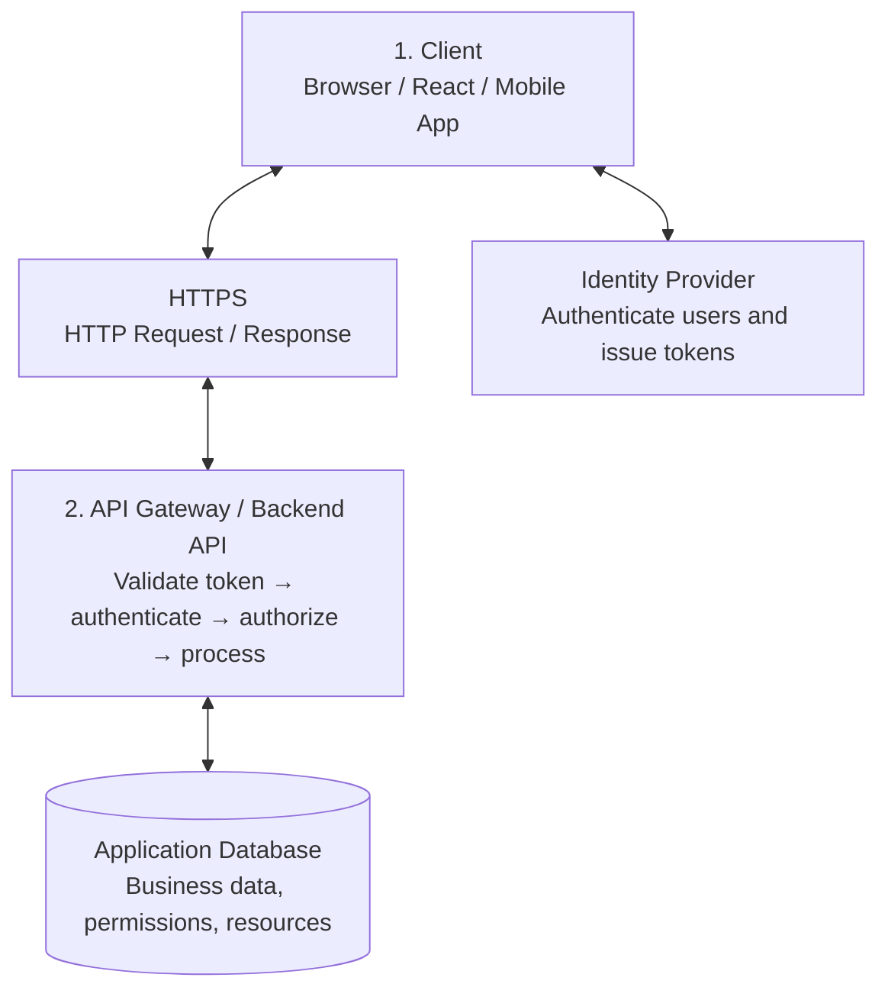
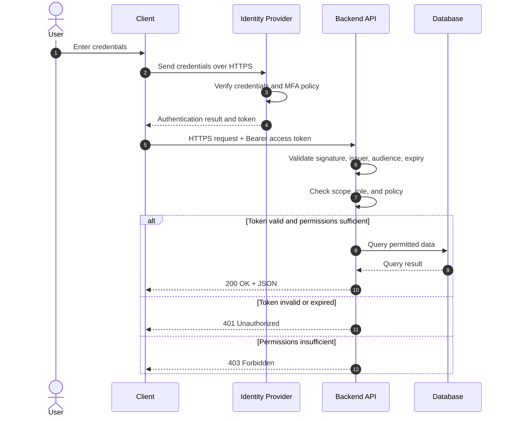
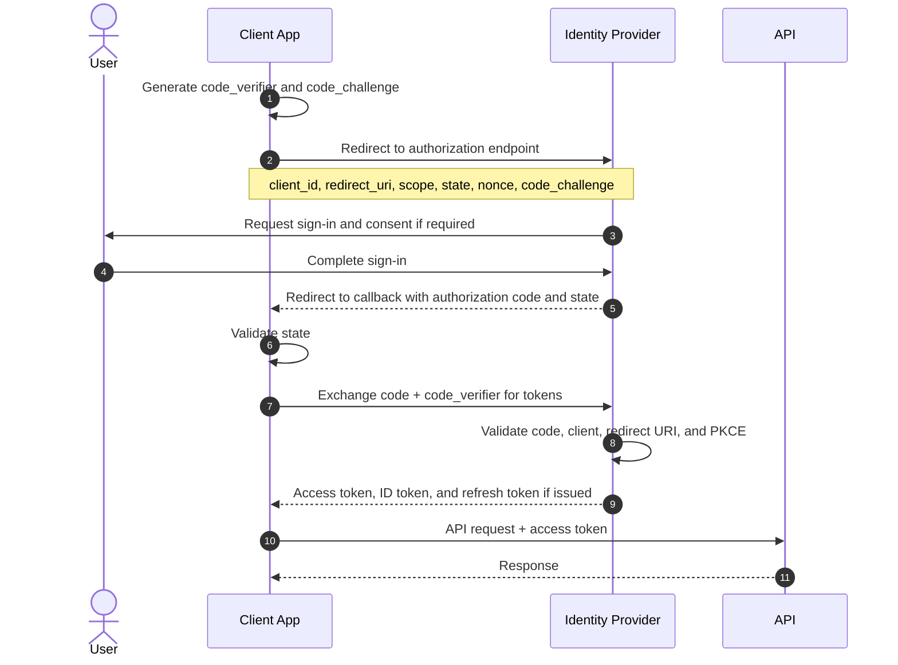
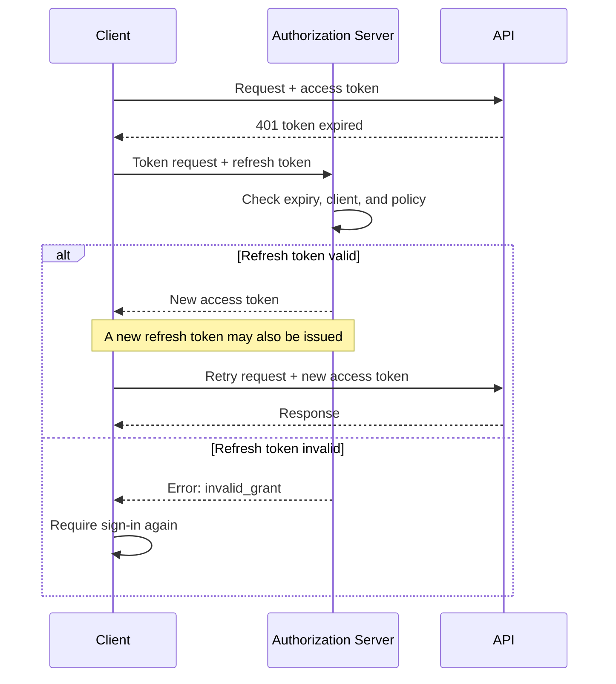
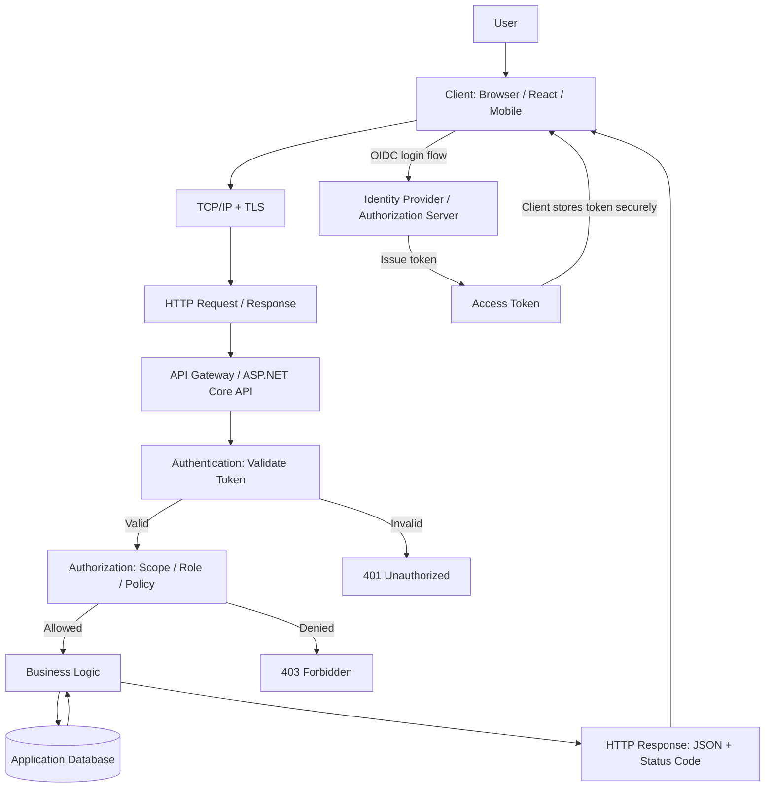

Token-based authentication allows a client to present a token to a server as evidence of identity or access rights, instead of sending a username and password with every request.

To understand the full mechanism, separate three questions:

- **Protocol:** What rules do the client and server use to communicate?
- **Authentication (AuthN):** Who is the user or client?
- **Authorization (AuthZ):** What is the user or client allowed to do?

This guide starts with HTTP fundamentals, then explains login flows, token issuance and validation, OAuth 2.0 and OpenID Connect (OIDC), JWTs, refresh tokens, and common security concerns. The examples use REST APIs, HTTPS, and JWTs in a .NET-style backend.

## 1. Overall Architecture



This is a general architecture. The Identity Provider (IdP) can be a separate service or can be integrated into the backend.

There are two related but distinct flows:

1. **Authentication flow:** The client establishes identity and obtains a token.
2. **API request flow:** The client presents an access token; the API validates it and checks permissions.

## 2. Foundational Concepts

### 2.1 Client, Server, and Resource

| Concept | Meaning | Example |
|---|---|---|
| Client | Component that initiates a request | React app, mobile app |
| Server | Component that receives and processes a request | ASP.NET Core API |
| Resource | The item or operation being accessed | `/api/orders/123` |
| Identity Provider (IdP) | System responsible for identity and authentication | Microsoft Entra ID |
| Authorization Server | Issues access tokens under a defined authorization flow | OAuth 2.0 authorization server |
| Resource Server | API that receives and validates access tokens | Order API |
| Database | Stores business data or account information | SQL Server |

One system can perform several roles, or those roles can be split across services.

### 2.2 What Is a Protocol?

A **protocol** is a set of rules that specifies how components exchange information, including message structure, message order, and how results or errors are handled.

| Protocol or standard | Role |
|---|---|
| TCP/IP | Network communication foundation |
| TLS | Protects a connection's confidentiality and integrity |
| HTTP | Defines request and response semantics |
| HTTPS | HTTP protected by TLS |
| OAuth 2.0 | Framework for delegated authorization |
| OpenID Connect (OIDC) | Adds an identity layer on top of OAuth 2.0 |
| JWT | A common token format; not a login protocol |
| Bearer token | A credential presentation scheme in which possession of the token is sufficient to use it |

These concepts operate at different layers. JWT does not replace HTTPS, and OAuth 2.0 does not replace HTTP.

### 2.3 HTTP Request Structure

An HTTP request typically contains a method, path, headers, and—when needed—a body.

```http
GET /api/orders/123 HTTP/1.1
Host: api.example.com
Authorization: Bearer <access_token>
Accept: application/json
```

The request can be understood as follows:

- **Method:** The intended operation, such as `GET`, `POST`, `PUT`, `PATCH`, or `DELETE`.
- **Path:** The resource address, such as `/api/orders/123`.
- **HTTP version:** For example, HTTP/1.1 or HTTP/2. HTTP/2 changes message transport details while preserving HTTP semantics.
- **Headers:** Metadata such as `Authorization`, `Content-Type`, and `Accept`.
- **Body:** Data sent to the server, often JSON.
- **Status code:** The result returned in the response, such as `200`, `401`, or `403`.

An example login request:

```http
POST /auth/login HTTP/1.1
Host: api.example.com
Content-Type: application/json
Accept: application/json

{
  "username": "user@example.com",
  "password": "example-password"
}
```

The password is sent in the request body. This is only appropriate when the connection is protected by HTTPS and the server handles credentials correctly. Never send passwords over plain HTTP.

### 2.4 HTTP Response Structure

A server response contains a status code, headers, and possibly a body.

```http
HTTP/1.1 200 OK
Content-Type: application/json
Cache-Control: no-store

{
  "id": 123,
  "status": "Processing"
}
```

Common status codes include:

| Status | Meaning |
|---|---|
| `200 OK` | Request succeeded |
| `201 Created` | A resource was created |
| `400 Bad Request` | The request is invalid |
| `401 Unauthorized` | Authentication is missing or invalid |
| `403 Forbidden` | The caller is authenticated but lacks permission |
| `404 Not Found` | The resource was not found |
| `429 Too Many Requests` | A rate limit was exceeded |
| `500 Internal Server Error` | An unexpected server-side error occurred |

A `401` is commonly used when a token is missing, expired, or invalid. A `403` is commonly used when a valid identity does not meet the authorization policy. APIs may deliberately limit error details to avoid exposing sensitive information.

## 3. What Is a Token?

A token is a string or data structure representing a credential, claim, or permission under a specific security scheme.

Instead of sending a password with every request, the client presents a token:

```http
GET /api/orders/123 HTTP/1.1
Host: api.example.com
Authorization: Bearer eyJhbGciOi...
```

The server validates the token according to the relevant scheme. If it is valid, the server continues processing the request under the applicable authorization rules.

Not every token contains user information, not every token is a JWT, and not every token can be validated entirely offline.

### 3.1 Common Token Types

| Token type | Purpose |
|---|---|
| Access token | Allows a client to access an API within the granted permissions |
| Refresh token | Requests a new access token without requiring immediate interactive login |
| ID token | Carries authentication information about a user in OIDC |
| Session token / session ID | Refers to a login session managed by a server |
| Password-reset token | Authorizes a password-reset operation |
| Email-verification token | Verifies an email address |

Access tokens and ID tokens are not interchangeable. Access tokens are intended for APIs; ID tokens are intended for the client to consume as part of OIDC authentication.

### 3.2 A Token Is Not Necessarily a JWT

Two common approaches are opaque tokens and JWTs.

**Opaque token**

```text
7f3c91a2...random-value
```

The token does not expose its meaning to the client. The server may look up its state, consult a session store, or use an introspection endpoint to determine whether it is valid and what permissions apply.

**JWT (JSON Web Token)**

```text
header.payload.signature
```

The token carries claims and can often be validated cryptographically without querying a database on every request, depending on the architecture and policy.

An opaque token is not necessarily a session ID; it can be an OAuth 2.0 access token. JWTs can also be used in contexts other than access tokens.

## 4. JWT: Structure and Validation

JWT is a format for representing claims as JSON. A common form is a signed JWT using JSON Web Signature (JWS).

### 4.1 The Three Parts of a Signed JWT

```text
BASE64URL(HEADER).
BASE64URL(PAYLOAD).
BASE64URL(SIGNATURE)
```

**Header** — identifies the signing algorithm and token type.

```json
{
  "alg": "RS256",
  "typ": "JWT",
  "kid": "key-2026"
}
```

**Payload** — contains claims about the subject, issuer, audience, validity period, and possibly permissions.

```json
{
  "iss": "https://id.example.com",
  "sub": "user-123",
  "aud": "orders-api",
  "exp": 1791800000,
  "scope": "orders.read"
}
```

**Signature** — proves that the encoded header and payload have not been modified, assuming the signature is verified with the correct trusted key.

Conceptually, with an asymmetric algorithm:

```text
Signature = Sign(
  encodedHeader + "." + encodedPayload,
  privateKey
)
```

The values above are illustrative. The expiration value is a Unix timestamp.

### 4.2 Important JWT Claims

| Claim | Meaning |
|---|---|
| `iss` | Issuer: the authority that issued the token |
| `sub` | Subject: the entity represented by the token |
| `aud` | Audience: the intended recipient |
| `exp` | Expiration time |
| `iat` | Issued-at time |
| `nbf` | Token must not be accepted before this time |
| `jti` | Token identifier, if used |
| `scope` | Granted scope, commonly used in OAuth access tokens |
| `roles` | Roles, if the issuer and application define and use this claim |

`scope` and `roles` are not guaranteed to appear in every token. Their representation depends on the issuer and authorization design.

### 4.3 How Is a JWT Protected?

With a symmetric algorithm such as HS256, the issuer and verifier use the same secret.

With an asymmetric algorithm such as RS256:

- The Identity Provider signs with a private key.
- The API verifies the signature using the corresponding public key.
- The API may obtain public keys from the issuer's JWKS endpoint and select the appropriate key using `kid`.

A signature helps detect tampering; it does **not** encrypt the payload. Anyone who obtains a conventional signed JWT can generally decode and read its header and payload.

Do not put passwords, API secrets, or sensitive data in a JWT payload merely because the token is signed.

### 4.4 What Makes a JWT Valid?

An API must not simply decode a JWT and trust its contents. Validation should include at least:

1. Verify the signature with a trusted key.
2. Allow only explicitly configured signing algorithms.
3. Verify that `iss` matches the configured issuer.
4. Verify that `aud` identifies the API receiving the token.
5. Verify that `exp` has not passed, and check `nbf` when present.
6. Enforce other required conditions, such as token type, tenant, or mandatory claims.

Only after token validation should the API evaluate access permissions. A valid token does not automatically grant access to every endpoint.

## 5. The Complete Token Authentication Flow

The following model uses a separate frontend, Identity Provider, and API. The example assumes the user signs in with a username and password at the Identity Provider; real systems may use SSO, MFA, or other authentication methods.



### Step 1 — The User Signs In

The client collects the required authentication input and sends it to the system responsible for authentication.

For applications using an external Identity Provider through OAuth 2.0/OIDC, the frontend should not automatically send a username and password to a custom `/auth/login` endpoint. Authorization Code Flow with PKCE is a common approach for interactive web and mobile applications.

### Step 2 — The Identity Provider Verifies Identity

The Identity Provider checks credentials, account status, and relevant policies, such as MFA.

If authentication fails, it returns an error and does not issue tokens. If authentication succeeds, it completes the configured flow.

### Step 3 — Tokens Are Issued

Depending on the protocol and client type, the result may include an access token, an ID token, and a refresh token.

- The access token is used to call an API.
- The ID token communicates authentication information to the client under OIDC.
- A refresh token, when issued, can request new tokens under the authorization server's rules.

Not every flow issues all three tokens.

### Step 4 — The Client Calls the API

The client sends the access token in the HTTP `Authorization` header:

```http
GET /api/orders HTTP/1.1
Host: api.example.com
Authorization: Bearer <access_token>
Accept: application/json
```

The client does not need to send the password again.

### Step 5 — The API Validates the Token

Authentication middleware checks the signature or the applicable token-validation mechanism, expiration, issuer, audience, and other configured requirements.

If the token is invalid, the request is generally rejected with `401 Unauthorized`.

### Step 6 — The API Checks Permissions

After authentication, the application checks scopes, roles, policies, and access to the specific resource.

For example:

- `orders.read`: may read orders.
- `orders.write`: may create or modify orders.
- A user may only view orders belonging to their organization.

These scope names are illustrative conventions. The actual names and enforcement depend on the application.

### Step 7 — The API Executes Business Logic and Returns a Response

Only after the request satisfies the applicable policies should the API perform the business operation and query data. It then returns an HTTP response.

**The key boundary:** Authentication validates credentials; authorization determines permissions; business logic performs the operation.

## 6. Where OAuth 2.0 and OpenID Connect Fit

These concepts are frequently confused.

**OAuth 2.0 is an authorization framework, not by itself a user-authentication protocol.** OpenID Connect adds an identity layer on top of OAuth 2.0.

### 6.1 OAuth 2.0 Roles

| Role | Example |
|---|---|
| Resource Owner | User who owns the data |
| Client | Application requesting access |
| Authorization Server | Server that issues access tokens |
| Resource Server | API that receives access tokens |

In an OIDC-enabled system, an Identity Provider often provides both user-authentication services and authorization-server capabilities.

### 6.2 Authorization Code Flow with PKCE

This is a recommended flow to study when building web or mobile applications that sign in through an Identity Provider.



Key parameters:

- `client_id`: Identifier of the registered application.
- `redirect_uri`: Registered callback address that receives the result.
- `scope`: Requested permissions; OIDC requests normally include the `openid` scope.
- `state`: Correlates the authorization request and callback and helps protect against certain CSRF attacks.
- `nonce`: Binds an ID token to the authentication request and helps mitigate replay in applicable OIDC flows.
- `code_challenge`: A value derived from the `code_verifier` and sent in the authorization request.
- `authorization code`: A short-lived code exchanged for tokens.
- `code_verifier`: A temporary secret generated by the client and presented when exchanging the code.

PKCE helps prevent an attacker who intercepts an authorization code from exchanging it for tokens without the corresponding `code_verifier`.

For traditional web applications, a Backend-for-Frontend (BFF) is also worth considering. In this architecture, the backend retains tokens and the browser uses a protected session cookie.

### 6.3 Why Not Send an ID Token to an API Instead of an Access Token?

The two tokens have different purposes.

| Property | ID token | Access token |
|---|---|---|
| Intended recipient | Client application | Resource server / API |
| Purpose | Communicates authentication result under OIDC | Grants access to resources |
| `aud` | Usually the client ID | Must match the intended API |
| Used to call an API | No, unless a separate, explicitly defined protocol says otherwise | Yes |

The API must validate an access token against its own audience and policy. A valid ID token is not sufficient evidence that the caller is authorized to access an API.

## 7. Access Token Expiration and Refresh Tokens

Access tokens typically have shorter lifetimes than refresh tokens. When an access token expires, the client may request a new one without immediately prompting the user to sign in again, provided a refresh token was issued and remains valid.



Important considerations:

1. Not every `401` means the access token expired. An invalid signature, issuer, or audience can also cause a `401`.
2. Refresh only according to the authorization server's protocol. Avoid infinite retry loops.
3. With refresh-token rotation, the server issues a new refresh token and invalidates the previous one. Reuse of an old token may indicate theft and should be handled according to policy.
4. Logout must be designed carefully: deleting a token from the client does not necessarily revoke an already-issued access token immediately.
5. If permissions must be revoked quickly, the system may need token introspection, a denylist, server-side status checks, or another mechanism. A self-validating JWT does not automatically know that an account has just been disabled.

## 8. Where Should Tokens Be Stored?

Token storage significantly affects security risk.

| Storage location | Assessment |
|---|---|
| Application memory | Limits persistence, but tokens are lost when the application is reinitialized |
| `localStorage` | Readable by JavaScript; high risk if an XSS vulnerability occurs |
| `sessionStorage` | Also readable by JavaScript; does not eliminate XSS risk |
| `HttpOnly; Secure` cookie | JavaScript cannot read it, but suitable CSRF protection is still required |
| Server-side session / BFF | Tokens can remain on the backend while the browser holds a session cookie |

No single storage strategy is best for every application.

- For web applications with a backend, a BFF and protected session cookies using `HttpOnly`, `Secure`, and suitable `SameSite` settings can reduce direct exposure of access tokens to JavaScript.
- For a pure SPA, carefully assess token acquisition, storage, XSS, refresh behavior, and session lifetime.
- For mobile applications, prefer credential storage protected by the operating system.

Do not put access or refresh tokens in URL query strings. URLs can appear in logs, browser history, and analytics systems.

## 9. Security Controls

A secure token-based implementation requires more than checking a JWT signature.

### Transport Security

Use HTTPS/TLS and never send credentials over plain HTTP. Protect login and token-exchange endpoints as well as ordinary API endpoints.

### Token Validation

Validate the signature, allowed algorithm, `iss`, `aud`, `exp`, `nbf` when present, and required claims.

### Credential Protection

Do not log passwords, access tokens, or refresh tokens. Protect signing keys and client secrets.

### Authorization

Apply scopes, roles, policies, and resource-level checks. Authentication alone does not establish permission to access every record.

### Token Lifecycle

Define token lifetimes, refresh rotation, revocation, logout, account-disable behavior, and incident-response procedures.

Common mistakes include:

- Accepting JWTs without checking the signature or audience.
- Trusting any algorithm specified in the JWT header.
- Using an ID token as an access token.
- Putting sensitive information in a JWT payload.
- Storing refresh tokens where JavaScript can easily read them without assessing the risk.
- Checking roles only in the frontend and not on the backend.
- Treating CORS as authentication. CORS does not replace authentication or authorization.
- Failing to enforce per-user or per-tenant data access even when the token is valid.

## 10. Example: ASP.NET Core JWT Bearer Authentication

ASP.NET Core Web API can use JWT Bearer Authentication to validate access tokens issued by an Identity Provider.

The following example assumes that the provider issues signed JWTs and exposes OpenID Connect discovery metadata so the backend can discover issuer information and public signing keys. Replace the example URLs with your real configuration.

```csharp
using Microsoft.AspNetCore.Authentication.JwtBearer;
using Microsoft.IdentityModel.Tokens;

var builder = WebApplication.CreateBuilder(args);

builder.Services.AddControllers();

builder.Services
    .AddAuthentication(JwtBearerDefaults.AuthenticationScheme)
    .AddJwtBearer(options =>
    {
        options.Authority = "https://id.example.com";
        options.Audience = "orders-api";

        options.TokenValidationParameters =
            new TokenValidationParameters
            {
                ValidateIssuer = true,
                ValidateAudience = true,
                ValidateLifetime = true,
                ValidateIssuerSigningKey = true,
                ClockSkew = TimeSpan.FromMinutes(1)
            };
    });

builder.Services.AddAuthorization();

var app = builder.Build();

app.UseHttpsRedirection();

app.UseAuthentication();
app.UseAuthorization();

app.MapControllers();

app.Run();
```

Important settings:

- `Authority`: The trusted Identity Provider address. Middleware can use its metadata to discover the issuer and signing keys.
- `Audience`: The API for which the access token must have been issued.
- `ValidateIssuer`: Validates the issuer.
- `ValidateAudience`: Validates the audience.
- `ValidateLifetime`: Checks token validity time.
- `ValidateIssuerSigningKey`: Requires signature verification using the appropriate signing key.
- `UseAuthentication()`: Establishes the request identity from the supplied credential.
- `UseAuthorization()`: Enforces authorization rules.

Middleware order matters: authentication must run before authorization.

A protected endpoint can be written as follows:

```csharp
using Microsoft.AspNetCore.Authorization;
using Microsoft.AspNetCore.Mvc;

[ApiController]
[Route("api/orders")]
public class OrdersController : ControllerBase
{
    [HttpGet]
    [Authorize]
    public IActionResult GetOrders()
    {
        return Ok(new
        {
            Message = "Authenticated request"
        });
    }
}
```

`[Authorize]` requires the caller to be authenticated under the configured scheme. A production system should add appropriate policies, scopes, or roles and check access to individual orders. Being authenticated must not grant access to all data.

The exact configuration depends on the token issued by the provider, claim mapping, .NET version, and authorization model. This example does not create a login endpoint or issue tokens; it configures the API to validate tokens.

## 11. End-to-End Architecture: From Network to Business Logic

This diagram places each concept in the context of the whole system.



Read the diagram in this order:

1. The client and server exchange data over HTTP protected by TLS.
2. The client completes the sign-in flow with the Identity Provider and obtains a token.
3. The client sends the access token when calling the API.
4. The API validates the token before establishing the request identity.
5. Authorization checks permission for the action and resource.
6. Only an allowed request proceeds to business logic and data access.
7. The API returns a result or error through an HTTP response.

## 12. Summary: Keep These Concepts Separate

| Concept | Question it answers |
|---|---|
| HTTP | How are requests and responses represented? |
| HTTPS/TLS | How is data protected in transit? |
| Authentication | Who is making the request? |
| Authorization | What is the caller allowed to do? |
| Token | Which credential represents the relevant identity or permission? |
| JWT | How can claims be represented and cryptographically validated? |
| OAuth 2.0 | How can a client be granted access to resources? |
| OpenID Connect | How can a client authenticate a user through an Identity Provider? |
| Access token | Which credential is used to access an API? |
| Refresh token | Which credential can request a new token? |
| Middleware | Which components process a request at each stage of the pipeline? |
| Scope / Role / Policy | How are permissions represented and enforced? |
| Session | How is login state managed across requests? |

A useful learning sequence is:

**HTTP Request/Response → HTTPS/TLS → Authentication and Authorization → Tokens and JWT → OAuth 2.0/OIDC → Refresh and Revocation → ASP.NET Core implementation.**

Following this sequence builds an understanding of both token mechanics and the design of secure login, SSO, and REST API systems.
