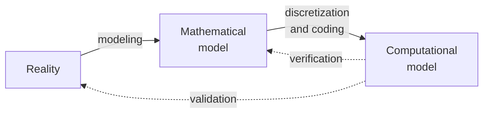

The previous four entries built a simulation from the ground up: a model made of partial differential equations and conditions ([the first entry](/blog/from-differential-equations-to-discrete-problems)), its discretization by finite differences ([the second](/blog/finite-differences-for-heat-and-waves)) or finite elements ([the fourth](/blog/finite-element-method)), and the solution of the resulting linear systems ([the third](/blog/solving-large-linear-systems)). Along the way, every claim about accuracy was checked against an exact solution. A real simulation has no exact solution to check against, and its purpose is to predict something that has not been measured. This entry asks what can then be said about how good its answer is.

The first entry's chain of representations, from physical system to mathematical model to discrete problem to computed numbers, gives the structure. Each link has its own errors and its own check: **code verification** asks whether the program solves the discrete equations of the intended model correctly, **solution verification** estimates the numerical error of a particular result, and **validation** compares results with measurements of the real system to estimate the error of the model itself. The ACRR note [What Makes a Simulation Trustworthy?](/insights/what-makes-a-simulation-trustworthy) states the distinction briefly; this entry turns it into procedures, each demonstrated by a computation. The code uses Python 3 with numpy in double precision, and the validation example uses invented numbers, labeled as such, to show the method.

## 1. Two Questions and Their Vocabulary

### 1.1 Verification and validation

The terminology here follows the verification and validation (V&V) guides of the American Society of Mechanical Engineers (ASME), V&V 10 (computational solid mechanics) and V&V 20 (computational fluid dynamics and heat transfer), which build on the earlier guide for computational fluid dynamics of the American Institute of Aeronautics and Astronautics (AIAA), and the books of Roache and of Oberkampf and Roy listed at the end. In substance:

- **Verification** determines whether a computational model represents the underlying mathematical model and its solution accurately. It is a question about mathematics and software, answered by comparing the program with the equations, and it needs no experimental data.
- **Validation** determines to what degree a model represents the real world accurately, from the perspective of its intended uses. It is a question about physics, answered by comparing the model's predictions with measurements, and it needs experimental data.

The order matters. A comparison with experiments means little if the numerical error is unknown: agreement could come from a numerical error canceling a model error, and disagreement could be the code's fault rather than the physics'. Verification therefore comes first.

Verification itself has two parts, called **code verification** and **solution verification** by Oberkampf and Roy (Roache speaks of the verification of codes and of calculations):

| Activity | Question | Typical evidence |
|---|---|---|
| Code verification | Does the program solve the intended equations correctly, with the expected order of accuracy? | Observed order of accuracy against exact or manufactured solutions (Section 2) |
| Solution verification | How large is the numerical error in this particular result? | Grid and time-step refinement, Richardson extrapolation, the grid convergence index (GCI), iteration and rounding checks (Section 3) |
| Validation | How large is the model's error for this quantity, in this regime? | Comparison with measurements, with all uncertainties stated (Section 4) |

Two neighboring terms are often confused with these. **Calibration** adjusts uncertain model parameters until results match measurements; it is useful, but data used to calibrate a model cannot also validate it. **Prediction** is the use of a model for conditions where no measurements exist, which is usually the reason for building it.

### 1.2 Where the errors enter



Verification compares the computational model with the mathematical model; validation compares the computational model with reality. Neither comparison can be skipped: a perfectly verified code solving the wrong equations is still wrong, and the insight note makes the same point.

## 2. Code Verification

### 2.1 The observed order of accuracy

The strongest test of a code is the one used throughout this series: refine the grid, and check that the error falls at the rate the method's theory predicts. If a scheme has formal order $p$ (the order of its truncation error, as in the second entry), the error on a grid of size $h$ behaves as $e(h) \approx C h^p$ once $h$ is small enough. Two grids with refinement ratio $r = h_{\text{coarse}}/h_{\text{fine}}$ give the **observed order**

$$
p_{\text{obs}} = \frac{\ln\bigl(e(h_{\text{coarse}})/e(h_{\text{fine}})\bigr)}{\ln r} .
$$

The **asymptotic range** is the range of $h$ in which the leading term dominates, so that $p_{\text{obs}}$ settles at a steady value; on coarse grids it may differ, as the implicit scheme's 0.88 on its coarsest pair of grids did in the second entry. A code passes the test when $p_{\text{obs}}$ approaches the formal order on successively finer grids. The test is demanding: nearly any mistake in a term that affects the solution, a wrong coefficient, a sign, an index off by one, a boundary condition of lower accuracy, spoils the order, even when the solution still looks plausible. The first entry's one-sided boundary condition, which reduced the observed order from 2 to 1, is an example.

### 2.2 Manufactured solutions

The test needs an exact solution, and realistic problems have none. The **method of manufactured solutions** (MMS), advocated by Roache, reverses the problem: choose a solution first, substitute it into the differential operator to compute the source term and boundary data that it satisfies, and run the code with those. The manufactured solution need not be physically meaningful. It should be smooth, and it should exercise every term of the equations and every type of boundary condition the code implements, so that no part of the code is tested trivially (a solution with $u'' = 0$, for example, cannot detect an error in a second-derivative term).

The first entry used this idea without naming it, when it chose $u = \sin\pi x$ and set $f = \pi^2\sin\pi x$.

### 2.3 Catching a bug

Consider the variable-coefficient problem of the fourth entry, $-(k u')' = f$ on $(0,1)$, now with $k(x) = 1 + x^2$, discretized by the conservative finite-difference scheme

$$
-\frac{k_{j+1/2}\,(U_{j+1} - U_j) - k_{j-1/2}\,(U_j - U_{j-1})}{h^2} = f(x_j),
$$

where $k_{j\pm1/2}$ is the conductivity at the midpoint between grid points, $k(x_j \pm h/2)$. This scheme is second order. The manufactured solution $u_m = \sin\pi x + x$ has nonzero values and derivatives at both ends and exercises the variable coefficient; differentiating by hand gives the source $f = -(k u_m')' = -2x(\pi\cos\pi x + 1) + (1 + x^2)\pi^2\sin\pi x$ and the boundary values $u(0) = 0$, $u(1) = 1$. The script runs the correct code and a version with a plausible indexing bug, which evaluates the conductivity at the grid point $x_j$ instead of the midpoint $x_j + h/2$.

```python
import numpy as np

# Code verification by the method of manufactured solutions.
# Model: -(k(x) u')' = f on (0, 1), k(x) = 1 + x^2, Dirichlet conditions.
# Manufactured solution u_m = sin(pi x) + x, so u(0) = 0 and u(1) = 1.
k = lambda x: 1.0 + x**2
u_m = lambda x: np.sin(np.pi * x) + x
# f = -(k u_m')', worked out by hand:
f = lambda x: -(2 * x * (np.pi * np.cos(np.pi * x) + 1)
                - (1 + x**2) * np.pi**2 * np.sin(np.pi * x))

def solve(N, buggy=False):
    h = 1.0 / N
    x = np.linspace(0.0, 1.0, N + 1)
    # conductivity at the cell faces x_{j+1/2}; the "bug" uses k(x_j) instead
    kf = k(x[:-1]) if buggy else k(x[:-1] + h / 2)
    n = N - 1
    A = np.zeros((n, n))
    b = f(x[1:-1]) * h**2
    for i in range(n):                       # row i is grid point j = i + 1
        kw, ke = kf[i], kf[i + 1]            # west and east faces
        A[i, i] = kw + ke
        if i > 0:
            A[i, i - 1] = -kw
        if i < n - 1:
            A[i, i + 1] = -ke
    b[-1] += kf[-1] * u_m(1.0)               # known boundary value u(1) = 1
    U = np.concatenate(([u_m(0.0)], np.linalg.solve(A, b), [u_m(1.0)]))
    return np.max(np.abs(U - u_m(x)))

for buggy in (False, True):
    errs = [solve(N, buggy) for N in (20, 40, 80, 160)]
    p = [np.log2(errs[i] / errs[i + 1]) for i in range(3)]
    print("with bug   " if buggy else "correct    ", " ".join(f"{e:.2e}" for e in errs),
          "| observed order:", " ".join(f"{q:.2f}" for q in p))
```

```text
correct     1.71e-03 4.28e-04 1.07e-04 2.68e-05 | observed order: 2.00 2.00 2.00
with bug    1.56e-02 7.39e-03 3.60e-03 1.77e-03 | observed order: 1.08 1.04 1.02
```

Both versions converge: refining the grid reduces the error in each, and the buggy code's error at $N = 160$, $1.8\times10^{-3}$, would look respectable in isolation. Only the observed order exposes the defect: 1 instead of 2. A code that "converges" has not thereby been verified; it must converge at the right rate. Conversely, MMS cannot find errors in features the manufactured solution does not exercise, nor mistakes in the choice of model, which no amount of verification can detect.

## 3. Solution Verification

### 3.1 Richardson extrapolation

Code verification establishes that the code is right; solution verification estimates the numerical error of a specific result, for which no exact answer exists. Let $f$ be a scalar **quantity of interest**, such as a peak temperature, a heat flux or a reaction force, computed on a sequence of grids $h_1 \lt h_2 \lt h_3$ (fine, medium, coarse), with a constant refinement ratio $r = h_2/h_1 = h_3/h_2$, giving values $f_1$, $f_2$, $f_3$. In the asymptotic range,

$$
f_i \approx f_{\text{exact}} + C\,h_i^{\,p}.
$$

Three grids determine the three unknowns $f_{\text{exact}}$, $C$ and $p$. Eliminating them gives the observed order and the **Richardson extrapolation**, after L. F. Richardson's 1911 paper:

$$
p = \frac{\ln\bigl((f_3 - f_2)/(f_2 - f_1)\bigr)}{\ln r},
\qquad
f_{\text{exact}} \approx f_1 + \frac{f_1 - f_2}{r^{p} - 1}.
$$

The extrapolated value is usually more accurate than $f_1$, but it is an estimate whose reliability depends on being in the asymptotic range, and many practitioners prefer to report the fine-grid value $f_1$ with an error estimate rather than replace it.

### 3.2 The grid convergence index

Roache proposed the **grid convergence index** as a uniform way to report such studies, and V&V 20 adopts it. For the fine grid, with relative difference $\varepsilon = (f_2 - f_1)/f_1$,

$$
\text{GCI}_{\text{fine}} = \frac{F_s\,|\varepsilon|}{r^{p} - 1}.
$$

It is the Richardson error estimate, relative to $f_1$, multiplied by a **factor of safety** $F_s$. Roache recommends $F_s = 1.25$ when three or more grids give an observed order consistent with the formal one, and the more conservative $F_s = 3$ for two-grid studies, where $p$ must be assumed. The GCI is intended as a conservative error band on the fine-grid result. Whether the grids are in the asymptotic range can be checked with the medium-grid index computed from $f_2$ and $f_3$: in the asymptotic range $\text{GCI}_{\text{medium}} \approx r^{p}\,\text{GCI}_{\text{fine}}$, so their ratio should be close to 1.

### 3.3 A study with a known answer

To see how well the procedure works, apply it to a problem whose answer is known but not used in the procedure. The quantity of interest is the value at the center of the solution of $-\nabla^2 u = 1$ on the unit square with $u = 0$ on the boundary, computed with the five-point scheme of the third entry on grids with $N = 16$, 32 and 64. The same problem describes, among other things, the temperature in a long square bar with uniform internal heating (Section 4.4). Its exact solution is a Fourier series, $u = \sum_{m,n \text{ odd}} \frac{16}{\pi^4 mn(m^2 + n^2)}\sin m\pi x\,\sin n\pi y$, summed here only to check the result.

```python
import numpy as np

def center_value(N):
    """Five-point solution of -(u_xx + u_yy) = 1 on the unit square, u = 0 on
    the boundary; returns u at the center (N even)."""
    m = N - 1
    T = 2 * np.eye(m) - np.eye(m, k=1) - np.eye(m, k=-1)
    A = (np.kron(np.eye(m), T) + np.kron(T, np.eye(m))) * N**2
    U = np.linalg.solve(A, np.ones(m * m)).reshape(m, m)
    return U[N // 2 - 1, N // 2 - 1]

r = 2.0
f3, f2, f1 = (center_value(N) for N in (16, 32, 64))   # coarse, medium, fine
p = np.log((f3 - f2) / (f2 - f1)) / np.log(r)          # observed order
f_ext = f1 + (f1 - f2) / (r**p - 1)                    # Richardson extrapolation
gci12 = 1.25 * abs((f1 - f2) / f1) / (r**p - 1)        # fine-grid GCI, Fs = 1.25
gci23 = 1.25 * abs((f2 - f3) / f2) / (r**p - 1)        # medium-grid GCI
print(f"u(1/2, 1/2) on N = 16, 32, 64: {f3:.7f} {f2:.7f} {f1:.7f}")
print(f"observed order p = {p:.3f}, extrapolated value = {f_ext:.7f}")
print(f"GCI (fine grid) = {100 * gci12:.4f} %, "
      f"asymptotic-range check = {gci23 / (r**p * gci12):.4f}")

# Reference value from the Fourier series solution (odd m, n only)
m = np.arange(1, 4002, 2)
M, Nn = np.meshgrid(m, m, indexing="ij")
terms = (16 / (np.pi**4 * M * Nn * (M**2 + Nn**2))
         * np.sin(M * np.pi / 2) * np.sin(Nn * np.pi / 2))
exact = terms.sum()
print(f"series value = {exact:.7f}, actual fine-grid error = "
      f"{100 * abs(f1 - exact) / exact:.4f} %")
```

```text
u(1/2, 1/2) on N = 16, 32, 64: 0.0734458 0.0736147 0.0736572
observed order p = 1.993, extrapolated value = 0.0736714
GCI (fine grid) = 0.0242 %, asymptotic-range check = 1.0006
series value = 0.0736714, actual fine-grid error = 0.0192 %
```

The procedure works as intended here. The observed order, 1.993, matches the scheme's formal order of 2, and the asymptotic-range ratio is 1.0006, so the three grids are in the asymptotic range. The extrapolated value agrees with the series to all seven digits shown. The GCI of 0.024 % bounds the actual error of 0.019 % with a modest margin. (Truncating the series at $m, n \le 4001$ changes it by less than $10^{-10}$, as summing to 2001 instead shows.)

### 3.4 The other numerical errors

Discretization error is usually the largest numerical error, but solution verification must account for the others of the first entry's taxonomy:

- **Iteration error.** If the linear or nonlinear solver stops at a tolerance, the iteration error should be shown to be well below the discretization error, for example by tightening the tolerance by a factor of 10 or 100 and checking that the quantity of interest does not change at the level reported. [The third entry](/blog/solving-large-linear-systems#41-why-iterate) explains why a small residual alone does not guarantee this.
- **Round-off error.** Usually negligible, but not always: the third entry showed a refinement study stop converging when rounding took over, and the ACRR note on [floating-point rounding in long simulations](/insights/floating-point-in-long-simulations) suggests comparing runs that differ only in rounding.
- **Time-step error.** For transient problems, refine the time step as well as the grid, either together at a fixed ratio (as in the second entry's convergence studies) or separately, to see which dominates.

The choice of quantity of interest matters too. Integral quantities (a total heat flow, an average temperature) usually converge more regularly than local values or derivatives (a peak stress, a heat flux at a point). The second entry showed a subtler trap: measuring the leapfrog error at a time when the solution was at an extremum made a second-order scheme look fourth order. A refinement study should measure the quantities that will actually be used, and preferably more than one.

## 4. Validation

### 4.1 Validation experiments

Validation needs measurements, and not just any measurements. A **validation experiment** is designed to test a model: it measures the inputs the model needs (geometry, material properties, boundary and initial conditions) along with the outputs to be compared, and it reports the uncertainty of each. Data from experiments run for other purposes often lack exactly those inputs, which then become guesses, and a validation built on guessed inputs mostly tests the guesses.

Complex systems are validated in tiers, from **unit problems** isolating one physical effect, through **benchmark cases** and **subsystems**, to the **complete system**, a hierarchy described in the AIAA guide and in Oberkampf and Roy. The lower tiers can be measured accurately and in detail; the complete system can usually be measured only sparsely. Each tier tests a different part of the model.

### 4.2 Comparison error and validation uncertainty

V&V 20 formalizes the comparison of a simulation result $S$ with a measured value $D$ of the same quantity. The **comparison error** is

$$
E = S - D .
$$

Writing $S$ and $D$ in terms of the true value $T$ and their errors, $S = T + \delta_{\text{model}} + \delta_{\text{num}} + \delta_{\text{input}}$ and $D = T + \delta_D$, shows what $E$ contains:

$$
E = \delta_{\text{model}} + \delta_{\text{num}} + \delta_{\text{input}} - \delta_D .
$$

The model error $\delta_{\text{model}}$, the quantity validation is after, is mixed with the numerical error, the error caused by uncertain inputs, and the measurement error. None of the last three is known exactly, but each has an estimated standard uncertainty: $u_{\text{num}}$ from solution verification, $u_{\text{input}}$ from propagating input uncertainties through the model, and $u_D$ from the experiment's uncertainty analysis. When they are independent, they combine as a root sum of squares into the **validation uncertainty**

$$
u_{\text{val}} = \sqrt{u_{\text{num}}^2 + u_{\text{input}}^2 + u_D^2},
$$

and the model error is estimated as $E$, with standard uncertainty $u_{\text{val}}$. With a coverage factor of 2, as in the convention of the *Guide to the Expression of Uncertainty in Measurement* (GUM) used in the [measurement entry of the sensor series](/blog/measurement-systems-and-sensor-characteristics#52-evaluating-uncertainty), the interval $E \pm 2u_{\text{val}}$ contains the model error with roughly 95 % probability if the combined distribution is approximately normal. If $|E|$ is large compared with $u_{\text{val}}$, the comparison has detected a model error of about $E$. If $|E|$ is smaller than $u_{\text{val}}$, the model error is not resolved at this level of uncertainty: the comparison shows only that it is no larger than about $|E| + 2u_{\text{val}}$.

### 4.3 Propagating input uncertainty

The input contribution is computed as for any measurement function, by the methods of the GUM. The **linear method** uses sensitivity coefficients: if $S$ depends on inputs $x_1, \dots, x_q$ with standard uncertainties $u(x_i)$, then $u_{\text{input}}^2 \approx \sum_i \bigl(\partial S/\partial x_i\bigr)^2 u(x_i)^2$, with the derivatives obtained analytically or by rerunning the simulation with each input perturbed. The **Monte Carlo method** (GUM Supplement 1) samples the inputs from their distributions, runs the model for each sample, and takes the spread of the results. It handles nonlinearity and needs no derivatives, at the cost of many model runs, which for an expensive simulation may call for a cheaper surrogate model.

### 4.4 A worked validation comparison (hypothetical)

The following example uses invented values for the material, the measurement and their uncertainties; it shows the arithmetic, not a real result. A long bar of square cross-section, side $a = 0.02$ m, conductivity $k = 15$ W/(m·K), generates heat uniformly at $Q = 2\times10^7$ W/m³, and its surface is held at $T_s = 20$ °C. Scaling the coordinates by $a$ turns the steady heat equation $-k\nabla^2T = Q$ into the problem of Section 3.3, so the simulated center temperature is

$$
S = T_s + \frac{Q\,a^2}{k}\,\phi_h, \qquad \phi_h = 0.0736572 \text{ (the } N = 64 \text{ value)}.
$$

The standard uncertainties assumed for the inputs are 2 % of $Q$, 3 % of $k$ and 0.2 K for $T_s$; the numerical uncertainty is taken, conservatively, as the GCI of Section 3.3 applied to the temperature rise. A thermocouple reading at the center is $D = 61.0$ °C with $u_D = 0.5$ K.

```python
import numpy as np

# Hypothetical validation case (invented numbers, for illustration only).
# Square bar of side a with uniform heat generation Q, conductivity k,
# surface held at T_s. Simulated center temperature: S = T_s + (Q a^2 / k) * phi,
# where phi = 0.0736572 is the N = 64 five-point center value of Section 3.3.
phi, gci = 0.0736572, 0.000242                 # fine-grid value, relative GCI
a, Q, k, Ts = 0.02, 2.0e7, 15.0, 20.0           # m, W/m^3, W/(m K), deg C
u_Q, u_k, u_Ts = 0.02 * Q, 0.03 * k, 0.2        # standard uncertainties of inputs

rise = Q * a**2 / k * phi
S = Ts + rise
u_num = gci * rise                               # GCI used as u_num (conservative)
# linear propagation: rise is proportional to Q / k
u_input = np.sqrt((rise * u_Q / Q)**2 + (rise * u_k / k)**2 + u_Ts**2)

rng = np.random.default_rng(1)                   # Monte Carlo check of u_input
n = 200_000
S_mc = (rng.normal(Ts, u_Ts, n)
        + rng.normal(Q, u_Q, n) * a**2 / rng.normal(k, u_k, n) * phi)

D, u_D = 61.0, 0.5                               # hypothetical measurement, deg C
E = S - D
u_val = np.sqrt(u_num**2 + u_input**2 + u_D**2)
print(f"S = {S:.2f} C, u_num = {u_num:.3f} K, u_input = {u_input:.2f} K "
      f"(Monte Carlo: {S_mc.std():.2f} K)")
print(f"E = S - D = {E:.2f} K, u_val = {u_val:.2f} K, "
      f"E +/- 2 u_val = [{E - 2 * u_val:.2f}, {E + 2 * u_val:.2f}] K")
```

```text
S = 59.28 C, u_num = 0.010 K, u_input = 1.43 K (Monte Carlo: 1.43 K)
E = S - D = -1.72 K, u_val = 1.52 K, E +/- 2 u_val = [-4.75, 1.31] K
```

Reading the result:

- The simulation is 1.72 K below the measurement, but the validation uncertainty is 1.52 K and the interval $[-4.75, 1.31]$ K contains zero. The comparison does not detect a model error; it shows only that the model error in this quantity, in this regime, is probably no larger than about 5 K.
- The numerical uncertainty (0.01 K) is negligible, as it should be after solution verification. The input uncertainty dominates, and within it the conductivity: 3 % of the 39.3 K temperature rise is 1.18 K, against 0.79 K from the heat generation. The linear and Monte Carlo estimates agree, because the model is nearly linear in its inputs over this range.
- Whether the model is "validated" depends on the intended use. If decisions need the center temperature within ±5 K, this comparison supports the model in this regime. If they need ±1 K, it does not, and the remedy is not a better solver but a better measurement of $k$ and $Q$ (Exercise 4).

It would be easy to "improve" the agreement by adjusting $k$ until $E = 0$. That would be calibration: legitimate, if reported as such, but the same measurement could then no longer serve as validation evidence.

## 5. Reporting the Limits of a Model

A simulation result without its limits invites more confidence than it deserves. A report that lets a reader judge a result states, as a minimum:

| Item | What to state |
|---|---|
| Model | The equations, assumptions and simplifications (dimensions, linearity, constant properties, idealized boundaries) |
| Code verification | Which tests were run, with which manufactured or exact solutions, and the observed orders |
| Discretization | Grids and time steps used, observed order, extrapolated value, GCI or another error estimate for each reported quantity |
| Solver | Iteration tolerances, and evidence that iteration and rounding errors are negligible |
| Inputs | Values and uncertainties of all inputs, and their sources |
| Validation | Which experiments, in which regime, with $E$, $u_{\text{val}}$ and the resulting statement about model error |
| Domain of applicability | The range of conditions covered by the validation evidence, and which predictions lie outside it |

The last row deserves emphasis. Validation evidence supports a model within the regime in which it was gathered: a range of temperatures, loads, speeds or geometries. A prediction outside that regime is an **extrapolation**, and its credibility rests on the physics in the model rather than on the comparison with data. Extrapolations are often the reason simulations exist, but a report should say plainly when it makes one, and what in the model justifies trusting it there. The open questions in the insight note on [trustworthy simulations](/insights/what-makes-a-simulation-trustworthy), such as how to quantify model-form uncertainty without data and who decides how large a gap is acceptable, are exactly the questions such a report forces into the open.

## 6. Exercises

**Exercise 1.** From the correct code's errors in Section 2.3, compute the observed order between $N = 20$ and $N = 160$ directly, with $r = 8$.

<details>
<summary>Answer</summary>

$p = \ln(1.71\times10^{-3}/2.68\times10^{-5})/\ln 8 = \ln(63.8)/2.079 = 2.00$. Using widely separated grids averages out irregularities, but it can hide a change of behavior between them, which successive ratios reveal.

</details>

**Exercise 2.** Suppose only the $N = 32$ and $N = 64$ results of Section 3.3 were available. Compute the two-grid GCI with the formal order $p = 2$ and $F_s = 3$, and compare it with the actual error.

<details>
<summary>Answer</summary>

$|\varepsilon| = |0.0736147 - 0.0736572|/0.0736572 = 5.77\times10^{-4}$, so $\text{GCI} = 3 \times 5.77\times10^{-4}/(2^2 - 1) = 5.77\times10^{-4}$, or 0.058 %. The actual error is 0.019 %, so the two-grid estimate is about three times larger: the larger safety factor pays for not having confirmed the order.

</details>

**Exercise 3.** In a three-grid study the values are $f_3 = 1.020$, $f_2 = 0.990$ and $f_1 = 1.005$. What does the sign of $(f_3 - f_2)/(f_2 - f_1)$ say, and can the formulas of Section 3.1 be used?

<details>
<summary>Answer</summary>

The ratio is $0.030/(-0.015) = -2$, negative: the solution oscillates under refinement instead of approaching a limit monotonically. The logarithm in the formula for $p$ is undefined, and the assumption $f_i \approx f_{\text{exact}} + C h_i^p$ does not hold. The grids are probably not in the asymptotic range, or two error sources of opposite sign compete. Further refinement is needed; at most, the spread of the values gives a rough error band.

</details>

**Exercise 4.** In the example of Section 4.4, suppose the conductivity were measured with a standard uncertainty of 1 % instead of 3 %. Recompute $u_{\text{input}}$, $u_{\text{val}}$ and the interval $E \pm 2u_{\text{val}}$. What then limits the validation?

<details>
<summary>Answer</summary>

The conductivity term falls from 1.18 K to 0.39 K, so $u_{\text{input}} = \sqrt{0.39^2 + 0.79^2 + 0.2^2} = 0.90$ K, $u_{\text{val}} = \sqrt{0.01^2 + 0.90^2 + 0.5^2} = 1.03$ K, and the interval becomes $[-3.78, 0.34]$ K. It still contains zero. The heat generation (0.79 K) and the thermocouple (0.5 K) now dominate; detecting a model error of 1 K would need all three to be reduced.

</details>

**Exercise 5.** Classify each activity as code verification, solution verification, validation or calibration: (a) running a heat-transfer code on a manufactured solution with a source term; (b) adjusting a contact conductance until simulated and measured temperatures agree; (c) running the same simulation on three meshes to estimate the error in a peak stress; (d) comparing a predicted natural frequency with a modal test, with uncertainties.

<details>
<summary>Answer</summary>

(a) Code verification. (b) Calibration; the measurements used cannot then validate the model. (c) Solution verification. (d) Validation, provided the numerical, input and measurement uncertainties are estimated and the comparison is stated in terms of $E$ and $u_{\text{val}}$.

</details>

## 7. Summary

| Question | Answer |
|---|---|
| What is the difference between verification and validation? | Verification checks that the equations are solved correctly (mathematics and code); validation checks how well the model represents reality for its intended use (physics and data). |
| What does code verification test? | That the observed order of accuracy, measured against exact or manufactured solutions, approaches the formal order. |
| What is the method of manufactured solutions? | Choosing a smooth solution, computing the source and boundary data it satisfies, and testing the code on that problem. |
| Why is convergence alone not enough? | A buggy code can still converge, at the wrong rate; the observed order exposed a misplaced coefficient (order 1 instead of 2). |
| How is the numerical error of a result estimated? | By refinement on three grids: observed order, Richardson extrapolation and the grid convergence index, with an asymptotic-range check. |
| What enters a validation comparison? | $E = S - D$ and $u_{\text{val}} = \sqrt{u_{\text{num}}^2 + u_{\text{input}}^2 + u_D^2}$; the model error is estimated as $E$ with uncertainty $u_{\text{val}}$. |
| What should a report state? | Model and assumptions, verification evidence, numerical error estimates, input uncertainties, validation evidence, and the domain in which the model is supported. |

This entry closes the series. Its five steps, a well-posed model, a consistent and stable discretization, an efficient and accurate solver, a verified code and a validated model, form one chain: a simulation is only as trustworthy as its weakest link, and each link can be checked by the methods the series has described.

### References

- ASME V&V 10-2006, *Guide for Verification and Validation in Computational Solid Mechanics*, American Society of Mechanical Engineers, 2006.
- ASME V&V 20-2009, *Standard for Verification and Validation in Computational Fluid Dynamics and Heat Transfer*, American Society of Mechanical Engineers, 2009.
- AIAA G-077-1998, *Guide for the Verification and Validation of Computational Fluid Dynamics Simulations*, American Institute of Aeronautics and Astronautics, 1998.
- P. J. Roache, *Verification and Validation in Computational Science and Engineering*, Hermosa Publishers, 1998.
- P. J. Roache, "Perspective: A method for uniform reporting of grid refinement studies", *Journal of Fluids Engineering*, vol. 116, no. 3, pp. 405–413, 1994.
- W. L. Oberkampf and C. J. Roy, *Verification and Validation in Scientific Computing*, Cambridge University Press, 2010.
- L. F. Richardson, "The approximate arithmetical solution by finite differences of physical problems involving differential equations, with an application to the stresses in a masonry dam", *Philosophical Transactions of the Royal Society of London, Series A*, vol. 210, pp. 307–357, 1911.
- JCGM 100:2008, *Evaluation of Measurement Data: Guide to the Expression of Uncertainty in Measurement* (GUM), Joint Committee for Guides in Metrology.
- JCGM 101:2008, *Evaluation of Measurement Data: Supplement 1 to the GUM, Propagation of Distributions Using a Monte Carlo Method*, Joint Committee for Guides in Metrology.
