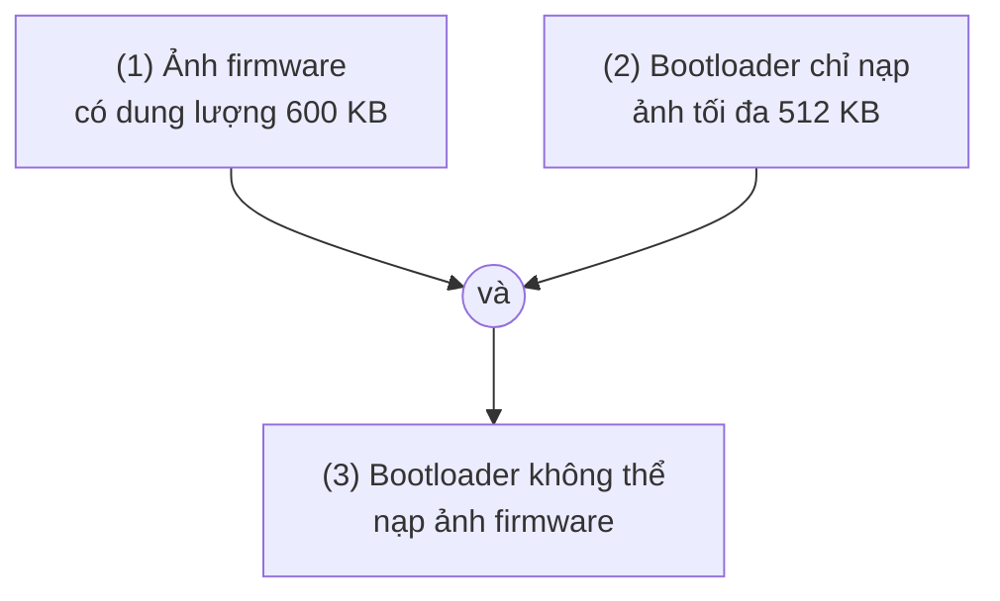
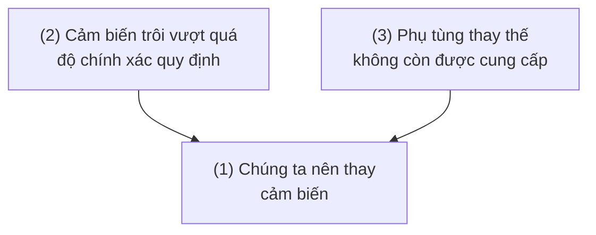
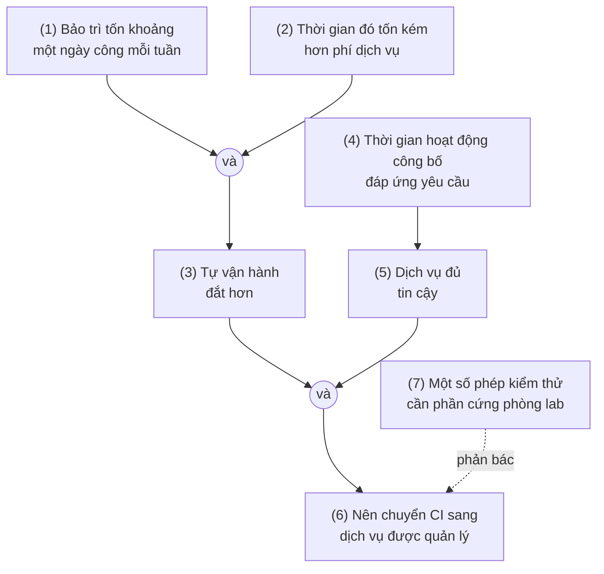

[Bài thứ nhất](/vi/blog/what-is-critical-thinking) của loạt bài đã mô tả tư duy phản biện (critical thinking) là đánh giá các nhận định dựa trên những lý lẽ được đưa ra để ủng hộ chúng, và [bài thứ hai](/vi/blog/meaning-clarity-and-definitions) đã cho thấy cách làm một nhận định đủ rõ để có thể đánh giá. Bài này chuyển sang chính các lý lẽ. Trong lời nói, bài viết và tài liệu kỹ thuật thông thường, lý lẽ được đưa ra dưới dạng lập luận. Phần lớn công việc đánh giá một nhận định nằm ở việc tìm ra lập luận đứng sau nó, trình bày lập luận sao cho cấu trúc của nó hiện ra rõ ràng, và hỏi xem các bộ phận của nó có đứng vững không.

Mục 1 cho biết lập luận là gì và cách nhận ra một lập luận. Mục 2 giới thiệu dạng chuẩn để viết một lập luận ra, và mục 3 cho thấy sơ đồ lập luận thể hiện cấu trúc của những lập luận dài hơn như thế nào. Mục 4 và 5 định nghĩa tính hợp lệ và tính đúng đắn diễn dịch và liệt kê một số kiểu lập luận hợp lệ và không hợp lệ thường gặp. Mục 6 bàn về giả định ẩn, và mục 7 về lập luận quy nạp và lập luận loại suy, những lập luận nhắm tới kết luận có khả năng đúng thay vì chắc chắn đúng. Mục 8 tổng hợp những điều đó thành một lời giải thích về điều gì làm nên một lập luận tốt, và mục 9 áp dụng nó vào việc tranh luận với người khác. Các ký hiệu logic $\neg$, $\land$, $\lor$ và $\to$ (không, và, hoặc, nếu ... thì) được dùng một cách không hình thức; bài thứ tư giới thiệu chúng và bài thứ sáu cho chúng ý nghĩa chính xác.

## 1. Lập luận là gì

### 1.1 Tiền đề và kết luận

Trong logic, một **lập luận** (argument) là một tập hợp các phát biểu (statement), trong đó một số phát biểu, gọi là **tiền đề** (premise), được đưa ra làm lý lẽ để chấp nhận một phát biểu khác, gọi là **kết luận** (conclusion). Từ này chỉ một cấu trúc, không phải một cuộc cãi vã. Một tài liệu thiết kế khuyến nghị kiến trúc này thay vì kiến trúc kia là một lập luận theo nghĩa này, ngay cả khi chưa ai phản đối nó, và một chứng minh trong sách giáo khoa cũng vậy.

Đây là một lập luận ngắn:

> Bộ điều khiển động cơ được định mức tối đa 2 A dòng liên tục. Động cơ mới tiêu thụ liên tục 3 A khi chạy đầy tải. Vậy bộ điều khiển không thể chạy động cơ mới liên tục ở mức đầy tải.

Hai câu đầu là tiền đề và câu thứ ba là kết luận. Mỗi phần là một phát biểu, đúng hoặc sai, theo nghĩa của bài thứ hai, mục 1.1. Một câu hỏi hay một mệnh lệnh không phải là phát biểu, nên tự nó không thể là tiền đề hay kết luận, mặc dù một câu hỏi tu từ thường đứng thay cho một phát biểu.

### 1.2 Từ chỉ báo

Không có quy trình máy móc nào để tìm lập luận trong văn bản, nhưng một số từ thường báo hiệu các bộ phận của chúng. **Từ chỉ báo tiền đề** (premise indicator) gồm "vì", "bởi vì", "do", "cho rằng", "như được chứng tỏ bởi" và "suy cho cùng". **Từ chỉ báo kết luận** (conclusion indicator) gồm "do đó", "vậy", "cho nên", "vì thế", "kết quả là", "suy ra rằng" và "điều đó cho thấy".

Từ chỉ báo là manh mối, không phải bằng chứng. Trong tiếng Anh, "for" mở đầu một tiền đề trong "restart the job, for the lock has expired" (khởi động lại tác vụ đi, vì khóa đã hết hạn) nhưng lại chỉ mục đích trong "a script for nightly backups" (một script dùng cho sao lưu hằng đêm), còn "so" có nghĩa là "rất" trong "the build is so slow" (bản build chậm quá). Tiếng Việt cũng vậy: "vậy" trong "vậy mà" không mở đầu kết luận nào. Nhiều lập luận hoàn toàn không dùng từ chỉ báo, và người đọc phải tự suy ra từ ngữ cảnh phát biểu nào được các phát biểu kia nhằm ủng hộ. Một câu hỏi hữu ích là: tác giả đang muốn tôi tin điều gì, và họ đưa ra điều gì làm căn cứ cho nó?

### 1.3 Điều gì không phải là lập luận

Nhiều đoạn văn chứa các phát biểu mà không chứa một lập luận nào.

- **Một bản tường thuật hay mô tả** liệt kê các sự kiện mà không đưa sự kiện nào ra làm căn cứ cho sự kiện khác: một nhật ký thay đổi, một nhật ký kiểm thử, một bản tường thuật sự cố theo trình tự thời gian.
- **Một phát biểu điều kiện** là một nhận định duy nhất, không phải một lập luận. "Nếu bộ nhớ đệm còn nguội, yêu cầu đầu tiên sẽ chậm" khẳng định một mối liên hệ nhưng không kết luận rằng yêu cầu đầu tiên chậm.
- **Một lời giải thích** trông giống lập luận nhưng có nhiệm vụ khác. "Bản build thất bại vì ổ đĩa đầy" thường không nhằm thuyết phục ai rằng bản build đã thất bại; điều đó đã được chấp nhận. Nó nói vì sao bản build thất bại. Trong một lập luận, kết luận đang bị đặt nghi vấn và các tiền đề ủng hộ nó; trong một lời giải thích, kết luận đã được chấp nhận và các tiền đề lý giải nó.

Cùng một câu có thể làm nhiệm vụ này hoặc nhiệm vụ kia tùy ngữ cảnh. "Cây cầu an toàn vì nó đã được kiểm định tháng trước" là một lập luận nếu có người nghi ngờ sự an toàn của cây cầu, và là một lời giải thích (khá yếu) nếu có người hỏi vì sao cây cầu an toàn. Phân biệt nhiệm vụ nào được dự định là quan trọng, vì hai thứ được đánh giá khác nhau: một lập luận được đánh giá theo việc nó có làm cho kết luận đáng tin không, một lời giải thích theo việc nó có chỉ ra đúng nguyên nhân thực sự không.

## 2. Dạng chuẩn

### 2.1 Viết một lập luận ra

Để phân tích một lập luận, hãy viết nó theo **dạng chuẩn** (standard format): mỗi tiền đề trên một dòng được đánh số riêng, tiếp theo là kết luận, được tách ra bằng một đường kẻ hoặc bằng chữ "do đó".

1. Bộ điều khiển động cơ được định mức tối đa 2 A dòng liên tục.
2. Động cơ mới tiêu thụ liên tục 3 A khi chạy đầy tải.
3. Một bộ điều khiển không thể chạy một động cơ liên tục nếu động cơ tiêu thụ dòng liên tục lớn hơn định mức của bộ điều khiển.

Do đó, bộ điều khiển không thể chạy động cơ mới liên tục ở mức đầy tải.

Tiền đề thứ ba không được phát biểu trong đoạn văn gốc. Viết lập luận ra đã làm lộ nó, và đó là một trong những lợi ích chính của dạng chuẩn (mục 6 xem xét các tiền đề ẩn như vậy một cách có hệ thống). Việc viết lại cũng bao gồm những thay đổi nhỏ giữ nguyên ý nghĩa: chuyển một câu hỏi tu từ thành phát biểu mà nó hàm ý, thay đại từ bằng thứ mà nó chỉ đến, bỏ những chỗ lặp lại và loại bỏ những nhận xét không góp phần vào lập luận.

### 2.2 Nguyên tắc thiện chí

Khi một đoạn văn có thể được tái dựng theo nhiều cách, **nguyên tắc thiện chí** (principle of charity) yêu cầu chọn cách tái dựng làm cho lập luận mạnh nhất trong phạm vi văn bản cho phép: cách đọc hợp lý của một tiền đề mơ hồ, giả định không được nói ra hợp lý nhất. Lý do không phải là phép lịch sự. Bác bỏ một phiên bản yếu của lập luận mà tác giả không hề có ý định, tức một **người rơm** (straw man), để nguyên lập luận thực sự đứng vững, và người làm như vậy không học được gì. Tuy nhiên, thiện chí có giới hạn: cách tái dựng vẫn phải là một cách đọc công bằng điều đã được nói, chứ không phải một lập luận tốt hơn do người đọc tự nghĩ ra.

### 2.3 Ví dụ minh họa: một nhận xét trong buổi duyệt thiết kế

Một người duyệt viết: "Tại sao chúng ta lại đọc cảm biến mỗi mili giây? Nhiệt độ không thể thay đổi đáng kể trong vòng chưa đầy một giây, xét đến nhiệt dung của vỏ thiết bị, và mỗi lần đọc lại đánh thức bộ xử lý và làm tốn pin. Chúng ta nên đọc mỗi giây một lần."

Theo dạng chuẩn:

1. Nhiệt độ bên trong vỏ thiết bị không thể thay đổi đáng kể trong vòng chưa đầy một giây (do nhiệt dung của nó).
2. Đọc thường xuyên hơn tốc độ mà đại lượng được đo có thể thay đổi không đem lại thông tin hữu ích nào.
3. Mỗi lần đọc đánh thức bộ xử lý và tiêu tốn năng lượng pin.
4. Một thiết kế không nên tiêu tốn năng lượng cho những lần đọc không đem lại thông tin hữu ích.

Do đó, nên đọc cảm biến khoảng mỗi giây một lần thay vì mỗi mili giây.

Câu hỏi tu từ đã trở thành một phần của kết luận, phần chen "xét đến nhiệt dung" đã trở thành căn cứ cho tiền đề 1, còn tiền đề 2 và 4 làm rõ các nguyên tắc mà người duyệt đã dựa vào. Giờ đây có thể kiểm tra riêng từng tiền đề. Tiền đề 1 là một nhận định vật lý có thể được kiểm tra bằng một ước lượng nhanh hằng số thời gian nhiệt của vỏ thiết bị. Tiền đề 2 là tiền đề dễ bị chất vấn nhất: việc đọc nhanh có thể cần thiết để lọc nhiễu, hoặc cảm biến có thể được dùng chung với một vòng điều khiển nhanh hơn.

## 3. Sơ đồ lập luận

### 3.1 Tiền đề liên kết và tiền đề độc lập

Các lập luận dài hơn có cấu trúc bên trong: một số tiền đề chỉ có tác dụng khi kết hợp với nhau, những tiền đề khác ủng hộ kết luận một cách riêng rẽ, và một số kết luận lại làm tiền đề cho những kết luận xa hơn. Vẽ cấu trúc đó ra ta được một **sơ đồ lập luận** (argument map): các phát biểu nằm trong các ô, với các mũi tên đi từ mỗi lý lẽ tới điều mà nó ủng hộ.

Các tiền đề là **liên kết** (linked), hay **đồng tiền đề** (co-premises), khi chúng chỉ ủng hộ kết luận khi đi cùng nhau, đến mức bỏ đi một tiền đề sẽ phá hủy sự ủng hộ của các tiền đề còn lại. Trong sơ đồ dưới đây, không tiền đề nào tự nó nói lên được việc trình nạp khởi động (bootloader) có nạp được ảnh firmware hay không; cả hai cùng nhau mới quyết định được điều đó. Nút nối cho thấy các mũi tên kết hợp với nhau trước khi đến kết luận.

Các tiền đề là **độc lập** (independent), hay hội tụ (convergent), khi mỗi tiền đề tự mình ủng hộ kết luận. Nếu bỏ một tiền đề, tiền đề kia vẫn đem lại một mức ủng hộ nào đó, và lập luận bị yếu đi chứ không bị phá hủy.

Sự phân biệt này quan trọng khi đánh giá. Bác bỏ một tiền đề độc lập chỉ làm yếu luận cứ; bác bỏ một tiền đề liên kết thì đánh đổ cả nhóm mà nó thuộc về.

### 3.2 Chuỗi lập luận và lập luận phức hợp

Trong một **chuỗi** (chain), hay lập luận nhiều tầng, một kết luận được một số tiền đề ủng hộ lại trở thành tiền đề cho một kết luận xa hơn. Các phát biểu ở giữa là **kết luận trung gian** (intermediate conclusion), và phát biểu ở trên cùng là **kết luận chính** (main conclusion). Một **lập luận phức hợp** (complex argument) kết hợp các nhóm liên kết, các lý lẽ độc lập và các chuỗi. Một sơ đồ cũng có thể thể hiện một **phản bác** (objection), tức một lý lẽ chống lại một phát biểu, bằng một kiểu mũi tên khác.

### 3.3 Ví dụ minh họa: chuyển hệ thống tích hợp liên tục

Một trưởng nhóm lập luận: "Chúng ta nên chuyển các bản build tích hợp liên tục (continuous integration, CI) sang dịch vụ được quản lý. Việc duy trì các máy build của riêng chúng ta tốn khoảng một ngày công kỹ sư mỗi tuần, và khoảng thời gian đó tốn kém hơn phí dịch vụ cho mức sử dụng của chúng ta, nên tự vận hành là phương án đắt hơn. Thời gian hoạt động được công bố của dịch vụ cũng cao hơn mức chúng ta cần. Mối lo duy nhất là một số phép kiểm thử dùng các giá thử phần cứng trong phòng thí nghiệm của chúng ta, nơi dịch vụ được quản lý không thể truy cập."

Sơ đồ cho thấy nhiều điều mà đoạn văn để ngầm. Phát biểu (3) và (5) là liên kết: một dịch vụ rẻ hơn nhưng không đủ tin cậy, hay một dịch vụ tin cậy nhưng đắt hơn, sẽ không ủng hộ kết luận. Phát biểu (5) dựa trên một tiền đề duy nhất, (4), và đó là một điểm yếu: thời gian hoạt động được công bố là nhận định của nhà cung cấp về quá khứ, và yêu cầu của nhóm có thể liên quan đến những thứ mà con số thời gian hoạt động không đo, chẳng hạn thời gian chờ trong hàng đợi vào giờ cao điểm. Phản bác (7) không được bất cứ điều gì trong lập luận đáp lại. Một luận cứ hoàn chỉnh sẽ hoặc đáp lại nó (chẳng hạn bằng cách giữ một máy chạy tự vận hành nhỏ cho các phép kiểm thử phần cứng), hoặc thu hẹp kết luận lại chỉ còn những bản build không cần đến phòng thí nghiệm.

Vẽ sơ đồ buộc ta đưa ra những quyết định mà việc đọc không đòi hỏi: chính xác mỗi phát biểu nói gì, những phát biểu nào phối hợp với nhau và kết luận nằm ở đâu. Đó là giá trị chính của nó. Nhà nghiên cứu giáo dục Tim van Gelder đã lập luận rằng luyện tập lập sơ đồ lập luận là một cách hiệu quả để phát triển kỹ năng lập luận (van Gelder, 2005).

## 4. Tính hợp lệ diễn dịch

### 4.1 Định nghĩa

Một số lập luận nhằm làm cho kết luận trở nên chắc chắn khi đã có các tiền đề. Tiêu chuẩn thành công của một lập luận như vậy là tính hợp lệ. Một lập luận là **hợp lệ về mặt diễn dịch** (deductively valid), gọi tắt là **hợp lệ** (valid), khi và chỉ khi không có tình huống khả dĩ nào trong đó mọi tiền đề của nó đều đúng mà kết luận lại sai. Nói cách tương đương, nếu các tiền đề đúng thì kết luận buộc phải đúng. Một lập luận không hợp lệ được gọi là **không hợp lệ** (invalid).

Lập luận về bộ điều khiển động cơ ở mục 2.1 là hợp lệ: không có tình huống nào làm cho cả ba tiền đề đều đúng trong khi bộ điều khiển vẫn chạy được động cơ liên tục. So sánh với:

1. Nếu máy chủ bị quá tải, thời gian phản hồi tăng lên.
2. Thời gian phản hồi đã tăng lên.

Do đó, máy chủ bị quá tải.

Lập luận này không hợp lệ. Dễ dàng mô tả một tình huống trong đó cả hai tiền đề đều đúng mà kết luận sai: thời gian phản hồi tăng lên vì tắc nghẽn mạng trong khi máy chủ đang rảnh. Mô tả một tình huống như vậy, tức một **phản ví dụ** (counterexample) cho lập luận, là cách chuẩn để chứng tỏ tính không hợp lệ. Kịch bản đó có thực sự xảy ra hay không không quan trọng; điều quan trọng là không có gì trong các tiền đề loại trừ nó. Ngay cả khi máy chủ thực sự bị quá tải, lập luận vẫn không hợp lệ, vì các tiền đề của nó cũng sẽ đúng trong kịch bản tắc nghẽn mạng.

### 4.2 Hợp lệ không phải là đúng

Tính hợp lệ liên quan đến mối liên hệ giữa tiền đề và kết luận, không liên quan đến việc các phát biểu có đúng hay không. Mọi tổ hợp giá trị chân lý đều có thể xảy ra với các lập luận hợp lệ, trừ một: tiền đề đúng với kết luận sai.

| Lập luận | Tiền đề | Kết luận | Hợp lệ? |
|---|---|---|---|
| Mọi số nguyên chia hết cho 4 đều chẵn. 12 chia hết cho 4. Vậy 12 là số chẵn. | đúng | đúng | hợp lệ |
| Mọi số nguyên tố đều lẻ. 7 là số nguyên tố. Vậy 7 là số lẻ. | một tiền đề sai | đúng | hợp lệ |
| Mọi số nguyên tố đều lẻ. 2 là số nguyên tố. Vậy 2 là số lẻ. | một tiền đề sai | sai | hợp lệ |
| Một số số nguyên tố là số lẻ. 9 là số lẻ. Vậy 9 là số nguyên tố. | đúng | sai | không hợp lệ |
| Một số số nguyên tố là số lẻ. 7 là số lẻ. Vậy 7 là số nguyên tố. | đúng | đúng | không hợp lệ |

Hàng thứ hai và thứ ba có cùng hình thức, vì vậy cả hai đều hợp lệ; tiền đề thứ nhất ("mọi số nguyên tố đều lẻ") sai vì có số 2, và kết luận tình cờ đúng trong trường hợp này và sai trong trường hợp kia. Hai hàng cuối cũng có chung một hình thức; hình thức đó không hợp lệ, như hàng thứ tư cho thấy, nên hàng thứ năm không hợp lệ mặc dù mọi thứ trong đó đều đúng. Có hai hệ quả đáng ghi nhớ:

- Một lập luận có tiền đề đúng và kết luận đúng vẫn có thể không hợp lệ.
- Một lập luận hợp lệ có thể có tiền đề sai và kết luận sai.

Việc tính hợp lệ phụ thuộc vào hình thức, tức khuôn mẫu chung của hàng thứ hai và thứ ba, là chủ đề của [bài tiếp theo](/vi/blog/what-logic-studies).

### 4.3 Tính đúng đắn

Chỉ riêng tính hợp lệ không xác lập được kết luận, vì một lập luận hợp lệ có thể xuất phát từ những tiền đề sai. Một lập luận là **đúng đắn** (sound) nếu nó hợp lệ và mọi tiền đề của nó đều đúng. Kết luận của một lập luận đúng đắn buộc phải đúng. Tính đúng đắn có thể mất theo hai cách, và hai cách này có thể xảy ra cùng lúc: các tiền đề không ủng hộ được kết luận, hoặc một trong các tiền đề sai. Một lập luận mắc một trong hai thất bại đó là **không đúng đắn** (unsound). Chỉ ra kết luận sai chứng minh được rằng có mặt một trong hai thất bại, nhưng không cho biết đó là thất bại nào.

### 4.4 Một số trường hợp khó hiểu

Định nghĩa của tính hợp lệ có những hệ quả khiến người mới học ngạc nhiên. Một lập luận có kết luận lặp lại một tiền đề ("bản build đã chạy qua, vậy bản build đã chạy qua") là hợp lệ, vì tiền đề của nó không thể đúng trong khi kết luận sai. Một lập luận có các tiền đề không thể đồng thời đúng là hợp lệ bất kể kết luận là gì, vì không có tình huống nào làm mọi tiền đề của nó đều đúng. Một lập luận có kết luận không thể sai ("các phép kiểm thử chạy qua; do đó mọi số nguyên đều chẵn hoặc lẻ") là hợp lệ bất kể tiền đề là gì. Cả ba đều thỏa mãn định nghĩa trong khi không đưa ra lý do nào để tin một điều gì mới; mục 8 nói chúng thiếu gì. Dù vậy, định nghĩa này vẫn được giữ vì nó là nền tảng cho các phương pháp hình thức của các bài từ thứ tư đến thứ bảy, và vì các trường hợp kỳ quặc này hiếm khi xuất hiện trong thực tế. (Logic liên quan (relevance logic), loại logic bổ sung yêu cầu rằng tiền đề và kết luận phải có chung nội dung, là một phương án thay thế mà các nhà logic học nghiên cứu.)

## 5. Các kiểu lập luận thường gặp

Một số hình thức lập luận xuất hiện thường xuyên đến mức chúng có tên riêng. Trong bảng, $P$, $Q$ và $R$ đại diện cho bất kỳ phát biểu nào, và cột trước cột "Do đó" liệt kê các tiền đề.

| Tên | Tiền đề | Do đó | Hợp lệ? |
|---|---|---|---|
| Modus ponens | $P \to Q$; $P$ | $Q$ | hợp lệ |
| Modus tollens | $P \to Q$; $\neg Q$ | $\neg P$ | hợp lệ |
| Tam đoạn luận giả định (hypothetical syllogism) | $P \to Q$; $Q \to R$ | $P \to R$ | hợp lệ |
| Tam đoạn luận tuyển (disjunctive syllogism) | $P \lor Q$; $\neg P$ | $Q$ | hợp lệ |
| Song đề kiến tạo (constructive dilemma) | $P \lor Q$; $P \to R$; $Q \to R$ | $R$ | hợp lệ |
| Khẳng định hậu kiện (affirming the consequent) | $P \to Q$; $Q$ | $P$ | không hợp lệ |
| Phủ định tiền kiện (denying the antecedent) | $P \to Q$; $\neg P$ | $\neg Q$ | không hợp lệ |

Modus tollens là logic của một phép thử thất bại: nếu thiết kế đúng thì phép thử sẽ đạt ($P \to Q$); phép thử đã thất bại ($\neg Q$); vậy thiết kế không đúng ($\neg P$). Khẳng định hậu kiện là logic của một phép thử đạt được coi như bằng chứng: nếu thiết kế đúng thì phép thử sẽ đạt; phép thử đã đạt; vậy thiết kế đúng. Suy luận thứ hai không hợp lệ, vì một phép thử có thể đạt với một thiết kế sai. Sự bất đối xứng này, rằng thất bại thì bác bỏ còn thành công thì không chứng minh, là trung tâm của cách bài thứ tám trình bày việc kiểm nghiệm khoa học.

Một phương pháp có liên quan là **reductio ad absurdum** (quy về vô lý): để chứng tỏ một phát biểu là sai, hãy giả định nó rồi suy ra một mâu thuẫn hoặc một phát biểu đã biết là sai. Chứng minh của Euclid rằng không có số nguyên tố lớn nhất thường được trình bày theo dạng này. Giả sử có một số nguyên tố lớn nhất; nhân tất cả các số nguyên tố với nhau rồi cộng thêm 1; kết quả chia cho mọi số nguyên tố trong danh sách đều dư 1, nên các thừa số nguyên tố của nó không nằm trong danh sách, mâu thuẫn với giả định. Bài thứ sáu, [Logic mệnh đề](/vi/blog/sentential-logic), cho thấy vì sao các kiểu lập luận này hợp lệ và đưa ra một phương pháp để chứng minh những kiểu khác.

## 6. Giả định ẩn

### 6.1 Lập luận thiếu tiền đề

Lập luận trong đời thực thường không đầy đủ. Người nói bỏ qua những tiền đề mà họ cho là hiển nhiên, và đôi khi cả những tiền đề mà họ không muốn phải bảo vệ. Một tiền đề không được nói ra mà lập luận cần đến là một **giả định ẩn** (hidden assumption), và một lập luận có giả định ẩn đôi khi được gọi là **tỉnh lược luận** (enthymeme).

Để tìm ra nó, hãy hình dung người nói nhờ bạn hoàn chỉnh lập luận. Bạn phải thêm câu nào để kết luận suy ra được? Thường có nhiều hơn một ứng viên, và chúng khác nhau về độ mạnh. Với "chúng ta nên lưu đệm truy vấn này, vì nó chậm", cầu nối có thể là "mọi truy vấn chậm đều nên được lưu đệm" (đủ mạnh để đem lại tính hợp lệ, nhưng sai) hoặc "truy vấn này chậm, được gọi thường xuyên và trả về dữ liệu ít thay đổi, và những truy vấn như vậy nên được lưu đệm" (hợp lý hơn, nhưng thêm vào những tiền đề mà người nói chưa ủng hộ). Nguyên tắc thiện chí (mục 2.2) chỉ đến ứng viên mà người nói thực sự sẽ tán thành và làm cho lập luận tốt nhất có thể; sự trung thực đòi hỏi phát biểu nó ra một cách rõ ràng, để nó có thể được kiểm tra.

Một khi đã được phát biểu, giả định là một tiền đề như mọi tiền đề khác, và nó thường là tiền đề yếu nhất. Đó thường chính là lý do nó đã không được nói ra.

### 6.2 Ví dụ minh họa

**"Thư viện này an toàn để dùng: nó có hơn 10 000 sao trên trang lưu trữ mã nguồn."** Để trở nên hợp lệ, lập luận cần một giả định như "mọi thư viện có hơn 10 000 sao đều an toàn để dùng". Khi phát biểu rõ ra, giả định này sai: độ phổ biến đo sự chú ý chứ không đo việc rà soát bảo mật. Những thư viện được dùng rộng rãi đã từng phát hành kèm những lỗ hổng nghiêm trọng. Một giả định yếu hơn, rằng các thư viện phổ biến có khả năng cao hơn là đã được phát hiện và sửa lỗi, biến lập luận thành một lập luận quy nạp có một sức nặng nhất định nhưng để kết luận còn xa mới được xác lập.

**"Mô hình đã sẵn sàng triển khai: nó đạt độ chính xác (accuracy) 97% trên tập kiểm tra."** Lập luận có ít nhất ba giả định ẩn. Tập kiểm tra phải đại diện cho các đầu vào mà mô hình sẽ gặp khi triển khai. Độ chính xác phải là thước đo đúng cho mục đích sử dụng này, dù nó có thể che giấu hiệu năng kém trên một lớp hiếm gặp nhưng quan trọng. Và 97% phải đáp ứng yêu cầu. Mỗi điều là một câu hỏi riêng, và lập luận chỉ tốt ngang với giả định yếu nhất trong số đó.

### 6.3 Các điều kiện nền phía sau một nguyên nhân được nêu tên

Một báo cáo sự cố viết: "Mối hàn bị hỏng vì quá tải." Tải trọng được nêu tên, nhưng một tải trọng chỉ làm gãy mối hàn khi kết hợp với những yếu tố khác: độ bền thực của mối hàn, vốn có thể đã bị giảm bởi một khuyết tật rỗ khí ẩn, và nhiệt độ của thép, vốn ảnh hưởng đến độ dai của nó. Những **điều kiện nền** (background conditions) này được báo cáo mặc nhiên thừa nhận, và việc liệt kê chúng có thể làm thay đổi biện pháp khắc phục. Nếu có khuyết tật, việc giới hạn tải trọng chỉ chữa triệu chứng, và điều cần thay đổi là quy trình hàn. Bài thứ tám phát triển ý tưởng này bằng các sơ đồ nhân quả.

## 7. Lập luận quy nạp và lập luận loại suy

### 7.1 Độ mạnh quy nạp

Nhiều lập luận tốt không hợp lệ. Xét:

1. Một lô hàng chứa 10 000 điện trở, trong đó 10 điện trở nằm ngoài dung sai.
2. Điện trở này được lấy ngẫu nhiên từ lô hàng.

Do đó, điện trở này nằm trong dung sai.

Kết luận có thể sai trong khi cả hai tiền đề đều đúng: điện trở có thể là một trong 10 cái kia. Nhưng khi đã có các tiền đề, xác suất để kết luận đúng là $9990/10\,000 = 0.999$. Một lập luận là **mạnh về quy nạp** (inductively strong) nếu kết luận của nó có xác suất cao khi đã có các tiền đề, và **yếu về quy nạp** (inductively weak) trong trường hợp ngược lại. Trong loạt bài này, những lập luận nhắm tới độ mạnh thay vì tính hợp lệ được gọi là lập luận **quy nạp** (inductive). (Một số giáo trình chỉ dùng "quy nạp" cho việc khái quát hóa từ mẫu; ở đây nó bao gồm mọi lập luận có các tiền đề làm cho kết luận có khả năng đúng mà không bảo đảm nó.)

### 7.2 Độ mạnh khác tính hợp lệ như thế nào

Có ba khác biệt quan trọng.

- **Độ mạnh có nhiều mức độ.** Tính hợp lệ là có hoặc không; một lập luận không thể hơi hợp lệ. Độ mạnh biến thiên liên tục: nếu lô hàng có 1 000 điện trở hỏng, xác suất sẽ là 0.9 và lập luận yếu hơn; với 5 000 điện trở hỏng, xác suất là 0.5 và lập luận vô giá trị.
- **Độ mạnh có thể bị thông tin mới phá hủy.** Thêm bất kỳ tiền đề nào vào một lập luận hợp lệ vẫn giữ nó hợp lệ. Thêm một tiền đề vào một lập luận mạnh có thể làm nó yếu đi. Nếu ta biết rằng điện trở được lấy từ thùng hàng loại, các tiền đề ban đầu vẫn đúng nhưng kết luận không còn có khả năng đúng nữa. Vì lý do này, một lập luận quy nạp nên sử dụng mọi bằng chứng liên quan sẵn có, một yêu cầu thường được gọi là **nguyên tắc toàn bộ bằng chứng** (principle of total evidence).
- **Độ mạnh không bảo đảm sự thật.** Một lập luận mạnh với tiền đề đúng vẫn có thể có kết luận sai. Trong nhiều lập luận như vậy, sẽ có một số kết luận sai, và đó không phải là dấu hiệu của lập luận tồi.

Các loại lập luận quy nạp chính là khái quát hóa từ một mẫu, dự đoán từ các quy luật trong quá khứ, suy luận nhân quả và suy luận đến lời giải thích tốt nhất (bài thứ tám, mục 3, bàn về việc lựa chọn giữa các lời giải thích). Chúng là chủ đề của các bài thứ tám và thứ chín, nơi đưa ra các phương pháp và lý thuyết xác suất để đánh giá chúng mạnh đến đâu (Skyrms, 2000).

### 7.3 Lập luận loại suy

Một **lập luận loại suy** (argument from analogy) đi từ sự giống nhau này đến sự giống nhau khác: $A$ và $B$ giống nhau ở một số phương diện, $A$ có thêm một tính chất nữa, vậy $B$ cũng có tính chất đó. Viết ra, nó có dạng sau:

1. $A$ và $B$ cùng có các tính chất $F_1, \ldots, F_n$.
2. $A$ có tính chất $G$.

Do đó, $B$ có tính chất $G$.

Lập luận loại suy rất phổ biến trong kỹ thuật. Một nhóm có thể lập luận: "Chính sách gắp vật của chúng ta thành công trong 95% số lần thử trong mô phỏng; robot mô phỏng khớp với robot thật về động học, khối lượng và hình học của bộ kẹp; vậy chính sách sẽ thành công với tỉ lệ tương tự trên robot thật." Vì hai thứ bất kỳ đều giống nhau ở một số phương diện, việc đếm các điểm giống nhau không chứng minh được gì. Ba câu hỏi sau mới là thứ làm nên việc đánh giá.

1. **$G$ phụ thuộc vào những gì?** Việc gắp thành công phụ thuộc vào hình học và khối lượng, nhưng cũng phụ thuộc vào ma sát ở đầu ngón kẹp, động lực học tiếp xúc, nhiễu cảm biến và ánh sáng cho camera. Liệt kê những yếu tố này là bước thường bị bỏ qua nhất.
2. **Mỗi yếu tố đó có giống nhau không, và điều đó đã được kiểm tra chưa?** Sự khớp nhau về động học thì dễ kiểm chứng; sự khớp nhau về hệ số ma sát thường thì không, và một sự khớp nhau được giả định thay vì được đo thì đóng góp rất ít.
3. **Những khác biệt đã biết nào có ảnh hưởng đến $G$?** Các trình mô phỏng thường mô hình hóa ma sát, tiếp xúc và cảm biến một cách không hoàn hảo, và đó lại nằm trong số các yếu tố được liệt kê ở câu hỏi 1. Các nhà nghiên cứu robot gọi sự sụt giảm hiệu năng do đó là khoảng cách mô phỏng – thực tế (sim-to-real gap).

Lập luận mạnh đến mức mà các câu trả lời cho phép. Ở đây nó ủng hộ một kết luận yếu (chính sách đáng được thử trên robot thật) tốt hơn nhiều so với kết luận mạnh mà nó phát biểu. Các giáo trình logic đưa ra những danh sách kiểm tra dài hơn cho lập luận loại suy, bao gồm chẳng hạn số lượng và tính đa dạng của các trường hợp được so sánh (Copi et al., 2011).

## 8. Điều gì làm nên một lập luận tốt

Tính hợp lệ và độ mạnh chỉ mô tả mối liên kết giữa tiền đề và kết luận. Để thấy một lập luận tốt còn cần gì nữa, hãy xét xem lập luận dùng để làm gì: nó được đưa ra cho một người chưa chấp nhận kết luận, và nó thành công nếu một người hợp lý ở vị trí đó nên đi đến chấp nhận kết luận. Từ mục đích đó suy ra ba điều kiện. Giáo trình được dùng rộng rãi của Govier tổ chức việc đánh giá lập luận quanh một sơ đồ ba phần tương tự: tính chấp nhận được, tính liên quan và căn cứ đầy đủ (Govier, 2010).

1. **Tiền đề đáng tin.** Người hoài nghi phải có căn cứ tốt hơn cho các tiền đề so với cho kết luận; nếu không, lập luận không lay chuyển được gì. Tiền đề đúng là mục tiêu, nhưng trong thực tế phép thử là có bằng chứng cho mỗi tiền đề độc lập với kết luận. Điều kiện này chính là điều mà một lập luận **mắc lỗi lấy kết luận làm tiền đề** (begging the question) vi phạm: một trong các tiền đề của nó chỉ có thể được chấp nhận bởi người đã chấp nhận kết luận. Trường hợp cực đoan, một kết luận lặp lại một tiền đề, là hợp lệ (mục 4.4) và thậm chí có thể đúng đắn, nhưng nó không thể thuyết phục được ai. Những trường hợp tinh vi hơn hoàn toàn không cần phải hợp lệ. "Hệ thống ghi nhật ký chính xác, vì chính nhật ký kiểm toán của nó không báo lỗi nào" không hợp lệ như được phát biểu, nhưng tiền đề của nó chỉ đáng tin đối với người vốn đã tin hệ thống ghi nhật ký.
2. **Một mối liên kết thực sự có tác dụng.** Các tiền đề phải làm cho kết luận chắc chắn (tính hợp lệ) hoặc có khả năng đúng (độ mạnh), và chúng phải làm được điều đó bằng cách nói về kết luận. Trong hai lập luận khó hiểu ở mục 4.4, tính hợp lệ chỉ đến từ một kết luận không thể sai hoặc từ những tiền đề không thể đồng thời đúng; các tiền đề không đóng góp gì, và những lập luận này không thỏa mãn điều kiện này. Lập luận thứ ba, có kết luận lặp lại một tiền đề, thì lại không thỏa mãn điều kiện thứ nhất.
3. **Không có yếu tố bác bỏ đã biết** (defeater). Đối với một lập luận quy nạp, người lập luận không được phớt lờ những bằng chứng sẵn có có thể làm yếu nó: đó là nguyên tắc toàn bộ bằng chứng ở mục 7.2.

Các điều kiện này cũng giải thích bốn suy luận dễ mắc phải sau một buổi phân tích sự cố, và tất cả đều là sai lầm.

- *"Luận cứ của nhà cung cấp cho bản sửa lỗi dựa trên một benchmark có khiếm khuyết, vậy bản sửa lỗi không có tác dụng."* Một lập luận tồi để kết luận của nó không được ủng hộ, chứ không bị bác bỏ. Bản sửa lỗi có thể có tác dụng; cần một phép thử đúng đắn để biết.
- *"Lý do chúng ta đổ lỗi cho bộ nhớ đệm là sai, vậy bộ nhớ đệm không liên quan."* Cùng lỗi đó áp dụng cho một tiền đề: một tiền đề sai làm đổ lập luận, chứ không làm đổ kết luận.
- *"Bản sửa lỗi đã có tác dụng, vậy lập luận trong tài liệu thiết kế là đúng."* Một kết luận đúng có thể suy ra từ một lập luận tồi, như hàng thứ hai của bảng ở mục 4.2 cho thấy. Cơ chế mà tài liệu mô tả có phải là cơ chế đã thực sự vận hành hay không là một câu hỏi riêng.
- *"Mọi sự kiện trong báo cáo đều được kiểm chứng và khuyến nghị của nó là đúng, vậy lập luận của nó hợp lệ."* Tiền đề đúng và kết luận đúng không nói lên điều gì về mối liên kết giữa chúng, như hàng thứ năm của cùng bảng đó cho thấy.

## 9. Tranh luận với người khác

Cấu trúc của các mục từ 1 đến 8 đồng thời là một bản đồ cho thấy hai người có thể bất đồng ở đâu. Viết lập luận của một đồng nghiệp theo dạng chuẩn và đánh dấu dòng duy nhất mà bạn bác bỏ sẽ biến câu "tôi không đồng ý" thành một yêu cầu cụ thể: bằng chứng cho tiền đề 3, một định nghĩa của "tin cậy" (bài thứ hai, mục 4) hoặc một lý do vì sao suy luận đứng vững. Những bất đồng được định vị theo cách này ngắn hơn nhiều so với những bất đồng về kết luận.

Việc định vị một bất đồng dễ hơn khi phía bên kia tin rằng mình đã được hiểu. Daniel Dennett đưa ra một quy trình cho việc này, mà ông ghi công cho nhà tâm lý học xã hội Anatol Rapoport (Dennett, 2013). Diễn đạt lại, có bốn bước theo một thứ tự cố định. Phát biểu lại quan điểm của người kia đủ tốt để họ vui lòng dùng chính cách diễn đạt của bạn. Nói ra những điểm bạn đồng ý, nhất là những điểm không hiển nhiên. Nói ra quan điểm của họ đã dạy bạn điều gì. Chỉ sau đó mới phê bình. Các quy tắc này áp dụng nguyên tắc thiện chí (mục 2.2) cho toàn bộ cuộc trao đổi. Chúng cũng có lợi ích thực tế: một người thấy quan điểm của mình được phát biểu công bằng sẽ dễ lắng nghe phản bác theo sau hơn, và việc phát biểu lại thường cho thấy bất đồng hẹp hơn so với vẻ ngoài của nó.

## 10. Bài tập

**Bài tập 1.** Mỗi đoạn sau có chứa một lập luận không? Nếu có, hãy xác định kết luận. (a) "Trình biên dịch đưa ra một cảnh báo ở dòng 40 và một lỗi ở dòng 52." (b) "Chúng ta không nên hợp nhất thay đổi này hôm nay, vì ngày mai là ngày phát hành và thay đổi chưa được thử trên phần cứng đích." (c) "Quạt bị hỏng vì ổ bi của nó bị kẹt."

*Đáp án.* (a) Không; đó là một bản tường thuật. (b) Có; kết luận là "chúng ta không nên hợp nhất thay đổi này hôm nay". (c) Thường là một lời giải thích, không phải lập luận: nó lý giải một sự kiện đã được chấp nhận chứ không xác lập sự kiện đó.

**Bài tập 2.** Viết theo dạng chuẩn, thêm vào bất kỳ tiền đề ẩn nào cần cho tính hợp lệ: "Robot không thể đã về tới trạm sạc: nhật ký pin của nó cho thấy nó còn dưới 5% điện ở đầu xa của nhà kho."

*Đáp án.* (1) Nhật ký pin cho thấy robot còn dưới 5% điện ở đầu xa của nhà kho. (2) Nhật ký pin là chính xác. (3) Một robot còn dưới 5% điện ở đầu xa không thể đi tới trạm sạc. Do đó, robot đã không về tới trạm sạc. Tiền đề (2) và (3) là ẩn; (3) là tiền đề cần kiểm tra, vì nó phụ thuộc vào khoảng cách và mức tiêu thụ năng lượng của robot.

**Bài tập 3.** Hợp lệ hay không hợp lệ? Với mỗi lập luận không hợp lệ, hãy mô tả một tình huống phản ví dụ. (a) Nếu bản vá được áp dụng thì lỗ hổng được đóng lại. Lỗ hổng không được đóng lại. Vậy bản vá đã không được áp dụng. (b) Nếu bản vá được áp dụng thì lỗ hổng được đóng lại. Bản vá đã không được áp dụng. Vậy lỗ hổng không được đóng lại. (c) Hoặc cầu chì hoặc công tắc bị hỏng. Cầu chì không hỏng. Vậy công tắc bị hỏng.

*Đáp án.* (a) Hợp lệ (modus tollens). (b) Không hợp lệ (phủ định tiền kiện): lỗ hổng có thể đã được đóng lại bằng một thay đổi cấu hình mà không cần bản vá. (c) Hợp lệ (tam đoạn luận tuyển).

**Bài tập 4.** Đúng hay sai? Hãy giải thích. (a) Mọi lập luận đúng đắn đều có kết luận đúng. (b) Một lập luận có kết luận đúng thì buộc phải đúng đắn. (c) Một lập luận không hợp lệ có thể có tiền đề đúng và kết luận đúng. (d) Nếu một lập luận hợp lệ và kết luận của nó sai, thì ít nhất một tiền đề sai.

*Đáp án.* (a) Đúng: một lập luận đúng đắn là hợp lệ với các tiền đề đúng, nên kết luận của nó không thể sai. (b) Sai: hàng thứ hai của bảng ở mục 4.2 có kết luận đúng và một tiền đề sai. (c) Đúng: hàng thứ năm của bảng đó. (d) Đúng: nếu mọi tiền đề đều đúng, tính hợp lệ sẽ làm cho kết luận đúng.

**Bài tập 5.** Vẽ một sơ đồ lập luận (trên giấy) cho: "Chúng ta nên thêm một cảm biến nhiệt độ thứ hai. Một cảm biến đơn lẻ không có cách nào phát hiện hỏng hóc của chính nó, và một hỏng hóc cảm biến âm thầm có thể khiến bộ gia nhiệt làm bồn quá nhiệt. Ngoài ra, tiêu chuẩn an toàn của khách hàng yêu cầu cảm biến dự phòng cho các bộ gia nhiệt có công suất cỡ này." Các tiền đề là liên kết hay độc lập?

*Đáp án.* Hai nhánh độc lập ủng hộ kết luận. Nhánh thứ nhất là một cặp liên kết: "một cảm biến đơn lẻ không thể phát hiện hỏng hóc của chính nó" và "một hỏng hóc cảm biến không được phát hiện có thể khiến bộ gia nhiệt làm bồn quá nhiệt" cùng nhau ủng hộ một kết luận trung gian như "một cảm biến đơn lẻ là không an toàn", và kết luận trung gian này ủng hộ kết luận chính. Nhánh thứ hai là tiền đề duy nhất rằng tiêu chuẩn của khách hàng yêu cầu cảm biến dự phòng. Bác bỏ nhánh thứ nhất vẫn để nguyên nhánh thứ hai.

**Bài tập 6.** Đánh giá lập luận loại suy: "Môi trường staging của chúng ta chạy cùng các container image với môi trường production, nên một bản phát hành chạy được trên staging sẽ chạy được trên production."

*Đáp án.* Điểm giống nhau (cùng image) là có thật và có liên quan, nhưng có những điểm khác biệt quan trọng: production có khối lượng dữ liệu, kiểu lưu lượng truy cập, giá trị cấu hình, thông tin bí mật, cấu trúc mạng và các tích hợp bên thứ ba khác. Lập luận đem lại một lý do nào đó để tin tưởng nhưng còn xa mới là mạnh. Những thực hành như triển khai dần dần tồn tại chính vì phép loại suy này thường thất bại.

## 11. Tóm tắt

| Câu hỏi | Trả lời |
|---|---|
| Lập luận là gì? | Các tiền đề được đưa ra làm lý lẽ cho một kết luận; khác với một bản tường thuật, một phát biểu điều kiện hay một lời giải thích. |
| Một lập luận được trình bày như thế nào? | Theo dạng chuẩn, các tiền đề được đánh số và kết luận ở cuối, được tái dựng với thiện chí. |
| Sơ đồ lập luận cho thấy gì? | Tiền đề liên kết và tiền đề độc lập, các chuỗi kết luận trung gian và các phản bác. |
| Khi nào một lập luận hợp lệ? | Khi không có tình huống khả dĩ nào làm mọi tiền đề đúng và kết luận sai; được chứng tỏ là không hợp lệ bằng một tình huống phản ví dụ. |
| Khi nào nó đúng đắn? | Khi nó hợp lệ và mọi tiền đề của nó đều đúng; khi đó kết luận của nó đúng. |
| Giả định ẩn là gì? | Một tiền đề không được nói ra nhưng cần cho tính hợp lệ hoặc độ mạnh, thường là phần yếu nhất của lập luận. |
| Độ mạnh quy nạp khác tính hợp lệ như thế nào? | Nó có nhiều mức độ, có thể bị bằng chứng mới làm suy yếu và không bảo đảm kết luận đúng. |
| Điều gì làm nên một lập luận tốt? | Tiền đề đáng tin hơn kết luận (nên không lấy kết luận làm tiền đề), một mối liên kết làm cho kết luận chắc chắn hoặc có khả năng đúng thông qua những tiền đề thực sự có tác dụng, và, đối với quy nạp, không có bằng chứng bị phớt lờ. |

Tính hợp lệ của các lập luận trong bài này được đánh giá theo từng trường hợp, bằng cách hình dung các tình huống. Cách đó dùng được cho các lập luận ngắn nhưng không giải thích được vì sao một số lập luận lại hợp lệ. [Bài tiếp theo](/vi/blog/what-logic-studies) trả lời câu hỏi đó: nó giải thích logic học nghiên cứu gì, tính hợp lệ phụ thuộc vào hình thức của một lập luận thay vì vào nội dung của nó như thế nào, và tính nhất quán, quan hệ kéo theo (entailment) và sự tương đương liên hệ với nhau ra sao.

### Tài liệu tham khảo

- I. M. Copi, C. Cohen and K. McMahon, *Introduction to Logic*, 14th ed., Pearson, 2011.
- D. C. Dennett, *Intuition Pumps and Other Tools for Thinking*, W. W. Norton, 2013.
- T. Govier, *A Practical Study of Argument*, 7th ed., Wadsworth, 2010.
- P. J. Hurley, *A Concise Introduction to Logic*, 12th ed., Cengage Learning, 2015.
- J. Y. F. Lau, *An Introduction to Critical Thinking and Creativity: Think More, Think Better*, Wiley, 2011.
- J. Y. F. Lau and J. Chan, *Critical Thinking Web*, Department of Philosophy, The University of Hong Kong, 2004–2026. https://philosophy.hku.hk/think/
- B. Skyrms, *Choice and Chance: An Introduction to Inductive Logic*, 4th ed., Wadsworth, 2000.
- T. van Gelder, "Teaching critical thinking: Some lessons from cognitive science," *College Teaching*, vol. 53, no. 1, pp. 41–46, 2005.
- A. Weston, *A Rulebook for Arguments*, 4th ed., Hackett, 2009.
