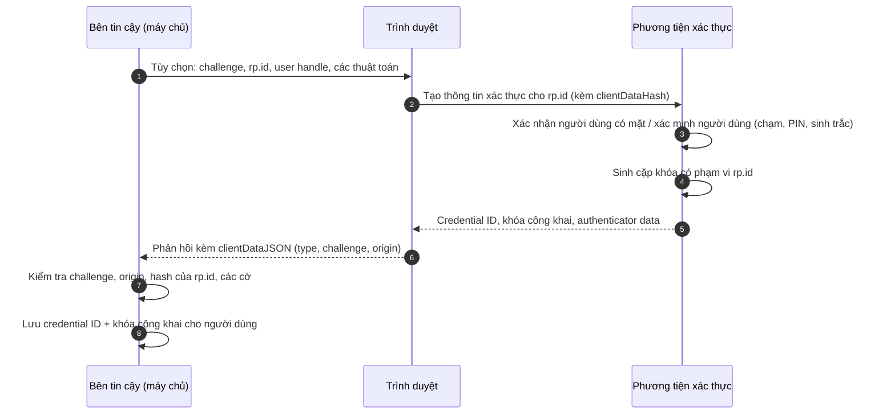

Bài thứ nhất của loạt bài này coi xác thực (authentication) là một ô duy nhất trong một bức tranh lớn hơn: một bên yêu cầu xác thực (claimant) chứng minh với một bên xác minh (verifier) rằng mình kiểm soát một phương tiện xác thực (authenticator), và kết quả được mang tiếp đi trong một phiên (session) hoặc một token. Bài này mở ô đó ra. Với mỗi loại phương tiện xác thực phổ biến, bài đặt ra ba câu hỏi: *bí mật nào tồn tại, và nó nằm ở đâu?* *Bên xác minh kiểm tra chính xác điều gì?* Và *một kẻ tấn công đứng ở một vị trí cụ thể có thể làm gì với những gì nó quan sát được?*

Các câu trả lời giải thích thứ tự mà giới thực hành hiện nay xếp cho các phương tiện xác thực, từ mật khẩu ở đầu yếu đến thông tin xác thực khóa công khai gắn với nguồn gốc ở đầu mạnh, và chúng giải thích vì sao thứ tự đó phản ánh cấu trúc của từng giao thức chứ không phải độ dài hay độ ngẫu nhiên của các bí mật trong đó.

## 1. Khung so sánh các phương tiện xác thực

### 1.1 Bí mật dùng chung và khóa bất đối xứng

Mọi phương tiện xác thực đều dựa trên một bí mật. Điểm phân biệt đầu tiên và quan trọng nhất là **còn ai khác biết bí mật đó**.

- Với một **bí mật dùng chung** (shared secret), cả bên yêu cầu xác thực lẫn bên xác minh đều giữ một thứ cho phép tạo ra bằng chứng. Mật khẩu, mã PIN do máy chủ kiểm tra, và hạt giống (seed) của các bộ sinh mã dùng một lần đều là bí mật dùng chung. Kẻ nào đánh cắp được bản sao của bên xác minh, hoặc quan sát bên yêu cầu xác thực tạo ra bằng chứng, có thể cũng tạo ra được bằng chứng đó.
- Với một **cặp khóa bất đối xứng**, bên yêu cầu xác thực giữ khóa riêng và bên xác minh chỉ lưu khóa công khai tương ứng. Bằng chứng là một chữ ký trên một thách thức (challenge) mới. Cơ sở dữ liệu của bên xác minh không chứa gì cho phép bất kỳ ai ký, và một chữ ký bị ghi lại là vô dụng với mọi thách thức khác.

### 1.2 Kẻ tấn công đứng ở đâu

Độ mạnh của một phương tiện xác thực phụ thuộc vào vị trí của kẻ tấn công. Có bốn vị trí thường gặp:

| Vị trí kẻ tấn công | Ví dụ | Những gì chúng thu được |
|---|---|---|
| Kẻ đoán trực tuyến | Một đoạn script gửi các lần thử đăng nhập | Chỉ các câu trả lời có/không của bên xác minh, với tốc độ do bên xác minh kiểm soát |
| Kẻ đánh cắp cơ sở dữ liệu | Một vụ xâm nhập kho thông tin xác thực của bên xác minh | Mọi bản ghi xác minh được lưu, để tấn công ngoại tuyến với tốc độ không giới hạn |
| Kẻ lừa đảo giả mạo / chuyển tiếp | Một trang trông giống thật mà người dùng bị lừa sử dụng | Mọi thứ người dùng gõ vào hoặc phê duyệt, theo thời gian thực |
| Thiết bị đầu cuối bị chiếm quyền | Mã độc trên thiết bị của người dùng | Có thể là mọi thứ mà thiết bị làm được |

Không phương tiện xác thực nào trụ được khi thiết bị đầu cuối bị chiếm quyền hoàn toàn; ranh giới đó do thiết bị đặt ra, không phải do giao thức. Những khác biệt đáng quan tâm nằm ở ba hàng đầu.

### 1.3 Những tính chất quan trọng

Từ các vị trí này suy ra những tính chất được dùng trong phần còn lại của bài:

- **Khả năng chống đoán trực tuyến**: không gian bí mật, kết hợp với giới hạn tốc độ (rate limiting), có khiến việc đoán trở nên vô vọng không?
- **Khả năng chống việc bên xác minh bị xâm phạm**: sau một vụ xâm nhập kho lưu trữ của máy chủ, kẻ tấn công có xác thực được dưới danh nghĩa người dùng không?
- **Khả năng chống phát lại (replay)**: một bằng chứng bị bắt được có dùng lại được không?
- **Khả năng chống lừa đảo giả mạo (phishing)**: một bằng chứng mà trang giả thu được có dùng được ở trang thật không?

## 2. Mật khẩu

### 2.1 Bên xác minh lưu gì

Một **hàm băm mật mã** (cryptographic hash function) như SHA-256 ánh xạ mọi đầu vào thành một giá trị băm (digest) ngắn, có kích thước cố định; tính nó thì nhanh, nhưng khôi phục đầu vào từ giá trị băm, hoặc tìm hai đầu vào có cùng giá trị băm, là bất khả thi.

Một máy chủ lưu mật khẩu ở dạng rõ trao mọi tài khoản cho bất kỳ ai đọc được cơ sở dữ liệu của nó. Lưu một giá trị băm nhanh như SHA-256 cũng chẳng tốt hơn bao nhiêu: một bộ xử lý đồ họa hiện đại tính được hàng tỉ giá trị băm như vậy mỗi giây, nên kẻ tấn công có bảng băm sẽ thử các mật khẩu phổ biến trên mọi tài khoản.

Thay vào đó, bên xác minh nên lưu đầu ra của một **hàm băm mật khẩu** (password hashing function, còn gọi là hàm dẫn xuất khóa, key derivation function, KDF), được thiết kế để chậm và, lý tưởng là, tốn bộ nhớ (memory-hard):

```text
salt   = random(16 bytes)                       # unique per account
record = (salt, parameters, KDF(password, salt, parameters))
```

Khi đăng nhập, bên xác minh tính lại `KDF(candidate, salt, parameters)` và so sánh kết quả trong thời gian không đổi. Ba yếu tố thiết kế đảm nhận việc bảo vệ:

- **Salt** là ngẫu nhiên cho từng tài khoản, nên các mật khẩu giống nhau tạo ra các bản ghi khác nhau và các bảng tính sẵn trở nên vô dụng; mỗi tài khoản phải bị tấn công riêng.
- **Hệ số công việc** (work factor) khiến mỗi lần đoán tiêu tốn của kẻ tấn công lượng thời gian và bộ nhớ bằng với một lần đăng nhập tiêu tốn của máy chủ, điều không đáng kể với một lần đăng nhập nhưng là khổng lồ với hàng tỉ lần đoán.
- **Tính tốn bộ nhớ** (memory hardness, trong Argon2id và scrypt) buộc mỗi lần đoán phải dùng một lượng bộ nhớ lớn, làm xói mòn lợi thế của bộ xử lý đồ họa và phần cứng chuyên dụng so với máy chủ thông thường.

Argon2id (RFC 9106) thường là lựa chọn đầu tiên; scrypt (RFC 7914) và bcrypt chấp nhận được; PBKDF2 (RFC 8018) được dùng khi bắt buộc phải có một hàm nguyên thủy được tiêu chuẩn phê duyệt, và khi đó nên chạy với số vòng lặp cao. bcrypt bỏ qua phần đầu vào vượt quá 72 byte, điều này quan trọng nếu cho phép cụm mật khẩu (passphrase) dài. Một số hệ thống bổ sung **pepper**: một khóa bí mật, giữ bên ngoài cơ sở dữ liệu (chẳng hạn trong một mô-đun bảo mật phần cứng, hardware security module), được trộn vào mọi giá trị băm, để một cơ sở dữ liệu bị đánh cắp mà không có khóa hoàn toàn không thể bị tấn công.

### 2.2 Đoán: trực tuyến và ngoại tuyến

Độ mạnh của mật khẩu được biểu diễn tốt nhất bằng số lần đoán mà kẻ tấn công cần. Nếu một mật khẩu được chọn đều từ $N$ khả năng, kẻ tấn công thực hiện $k$ lần đoán sẽ thành công với xác suất $k/N$. Mật khẩu do con người chọn không phân bố đều: nhiều người dùng chọn từ một tập nhỏ các lựa chọn phổ biến, nên vài nghìn lần đoán đầu tiên đã thành công với một tỉ lệ đáng kể các tài khoản.

Từ đó có hai chế độ.

- **Trực tuyến**, bên xác minh giới hạn tốc độ. Nếu nó cho phép tối đa $k$ lần thất bại trên mỗi tài khoản trước khi làm chậm hoặc khóa lại, một mật khẩu chỉ cần nằm ngoài $k$ lần đoán đầu tiên của kẻ tấn công. Vì vậy giới hạn tốc độ là biện pháp phòng vệ chính trước việc đoán trực tuyến, và nó phải được áp dụng theo từng tài khoản và theo từng nguồn, vì kẻ tấn công cũng thử một mật khẩu phổ biến trên nhiều tài khoản (*password spraying*).
- **Ngoại tuyến**, sau một vụ xâm nhập, không có giới hạn tốc độ nào ngoài chi phí băm. Chỉ những mật khẩu cách xa các lựa chọn phổ biến mới trụ được, và đó là lý do việc băm chậm mua thêm thời gian để phát hiện vụ xâm nhập và đặt lại thông tin xác thực (credential).

**Credential stuffing** là trường hợp thứ ba: kẻ tấn công hoàn toàn không đoán mà phát lại các cặp tên người dùng và mật khẩu bị rò rỉ từ các trang *khác*. Nó thành công vì người dùng dùng lại mật khẩu, và cả việc băm lẫn giới hạn tốc độ trên trang nạn nhân đều không giải quyết được điều đó.

### 2.3 Chính sách mật khẩu

Hướng dẫn về danh tính số của Viện Tiêu chuẩn và Công nghệ Quốc gia Hoa Kỳ (NIST SP 800-63B, từ bản sửa đổi năm 2017 trở đi) đã đảo ngược nhiều lời khuyên truyền thống, dựa trên bằng chứng rằng các quy tắc về thành phần và việc bắt buộc đổi định kỳ đẩy người dùng tới những mẫu dễ đoán. Hướng dẫn này khuyến nghị:

- cho phép mật khẩu và cụm mật khẩu dài, bao gồm dấu cách và mọi ký tự in được;
- **không** áp đặt quy tắc thành phần kiểu "một chữ số, một ký hiệu";
- **không** yêu cầu đổi định kỳ, nhưng buộc đổi khi có bằng chứng bị xâm phạm;
- kiểm tra mật khẩu mới với danh sách các giá trị thường dùng và đã bị rò rỉ;
- giới hạn số lần thất bại liên tiếp.

### 2.4 Điều mật khẩu không làm được

Kể cả khi được lưu và được chọn tốt, mật khẩu vẫn là một bí mật dùng chung mà người dùng gõ vào bất kỳ trang nào hỏi nó. Nó không có khả năng chống phát lại trước bất kỳ ai nhìn thấy nó, và hoàn toàn không có khả năng chống phishing: một trang giả nhận được đúng những gì trang thật sẽ nhận. Các mục còn lại, về thực chất, là những nỗ lực khắc phục hai thất bại này.

## 3. Mã dùng một lần

### 3.1 HOTP: mã dựa trên bộ đếm

Một bộ sinh mật khẩu dùng một lần (one-time password, OTP) chia sẻ một khóa bí mật $K$ với bên xác minh và dẫn xuất các mã ngắn từ khóa đó. HOTP (RFC 4226) dùng một bộ đếm $C$ mà cả hai bên cùng tăng:

$$
\mathrm{HOTP}(K, C) = \mathrm{Truncate}\big(\mathrm{HMAC\text{-}SHA\text{-}1}(K, C)\big) \bmod 10^{d}
$$

`Truncate` chọn bốn byte trong 20 byte đầu ra của HMAC tại một vị trí do bốn bit cuối của nó xác định và xóa bit cao nhất, tạo ra một số nguyên 31 bit; lấy nó modulo $10^d$ cho một mã gồm $d$ chữ số, thường là $d = 6$. Vì HMAC (một giá trị băm tính trên thông điệp cùng với khóa bí mật, nên chỉ người giữ khóa mới tạo ra được) là một hàm giả ngẫu nhiên, việc thấy các mã trước đây không tiết lộ điều gì hữu ích về các mã sau này. Bên xác minh chấp nhận một cửa sổ nhỏ các giá trị bộ đếm đi trước giá trị của chính nó, để dung thứ những mã đã được sinh ra nhưng chưa bao giờ được dùng, rồi đẩy bộ đếm của mình vượt qua giá trị đã được chấp nhận.

### 3.2 TOTP: mã dựa trên thời gian

TOTP (RFC 6238) thay bộ đếm bằng bước thời gian hiện tại:

$$
C = \left\lfloor \frac{T - T_0}{X} \right\rfloor
$$

trong đó $T$ là thời gian Unix hiện tại, $T_0$ thường bằng $0$, và $X$ là độ dài bước, thường là 30 giây. Mã là $\mathrm{HOTP}(K, C)$. Các ứng dụng xác thực dùng TOTP; khóa dùng chung thường được cấp bằng cách quét một mã QR khi đăng ký. Bên xác minh thường chấp nhận thêm một bước ở mỗi phía của bước hiện tại để dung thứ độ trôi đồng hồ, và nó nên ghi lại bước được chấp nhận gần nhất cho từng người dùng để một mã không thể được dùng hai lần.

### 3.3 Mã dùng một lần bổ sung được gì, và không bổ sung được gì

Mã dùng một lần là một yếu tố thứ hai ("thứ bạn có"), và nó loại bỏ vấn đề phát lại: một mã bị nhìn thấy hôm nay là vô dụng vào ngày mai. Với sáu chữ số, có $10^6$ mã khả dĩ. Một bên xác minh chấp nhận thêm một bước ở mỗi phía của bước hiện tại có ba mã hợp lệ tại mọi thời điểm, nên một kẻ đoán trực tuyến được phép thử năm lần mỗi bước thời gian sẽ thành công với xác suất khoảng $15 / 10^6$ mỗi bước. Do đó bên xác minh cũng phải giới hạn tốc độ xuyên suốt các bước, nếu không kẻ tấn công cứ việc thử mãi.

Vẫn còn hai điểm yếu.

- **Hạt giống là một bí mật dùng chung.** Bên xác minh lưu $K$ ở dạng nó dùng được, nên một vụ xâm nhập cơ sở dữ liệu hạt giống cho phép kẻ tấn công sinh ra mã của mọi người dùng. Hạt giống nên được mã hóa bằng một khóa giữ bên ngoài cơ sở dữ liệu.
- **Mã được gõ vào, nên có thể bị chuyển tiếp.** Một proxy lừa đảo giả mạo đứng giữa người dùng và trang thật sẽ chuyển tiếp mật khẩu rồi đến mã trong cửa sổ 30 giây, và nhận lấy phiên tạo thành. Các bộ công cụ tự động cho kiểu tấn công này có sẵn rộng rãi. Mã dùng một lần đánh bại việc dùng lại mật khẩu và credential stuffing; chúng không đánh bại phishing thời gian thực.

### 3.4 Mã gửi qua SMS hoặc email

Một mã gửi bằng tin nhắn văn bản hoặc email không được sinh ra từ một hạt giống mà người dùng giữ; bên xác minh sinh ra nó và gửi qua một kênh khác. Nó thừa hưởng các điểm yếu của kênh đó. Tin nhắn văn bản có thể bị chuyển hướng bằng cách thuyết phục nhà mạng di động chuyển một số điện thoại sang thẻ SIM mới (*SIM swapping*) hoặc bằng cách lạm dụng mạng báo hiệu giữa các nhà mạng; mã gửi qua email chỉ mạnh bằng tài khoản email. Hướng dẫn của NIST (trong bản sửa đổi năm 2017 của SP 800-63B) xếp việc xác thực qua mạng điện thoại công cộng vào loại *hạn chế* (restricted): dùng được, nhưng kèm rủi ro bổ sung mà bên xác minh phải đánh giá và công bố. Mã SMS vẫn tốt hơn chỉ dùng mật khẩu và kém hơn mọi phương tiện xác thực mà người dùng trực tiếp nắm giữ.

## 4. Phê duyệt ngoài băng

Các phương tiện xác thực dạng đẩy (push) gửi một lời nhắc tới một ứng dụng trên điện thoại đã đăng ký ("Phê duyệt đăng nhập?"), và ứng dụng trả lời qua kênh đã xác thực của riêng nó, thường dùng một cặp khóa giữ trên điện thoại. Không có gì được gõ vào trình duyệt, nên không có mã nào để lừa lấy.

Điểm yếu chuyển sang con người. Một kẻ tấn công đã có mật khẩu có thể kích hoạt lời nhắc liên tục cho đến khi một người dùng mệt mỏi hoặc bối rối phê duyệt một lần (*push fatigue*), và một người dùng đang phê duyệt lời nhắc không thể biết lần đăng nhập ứng với nó do chính họ hay do một proxy lừa đảo khởi tạo. **Khớp số** (number matching), trong đó trình duyệt hiển thị một số ngắn mà người dùng phải nhập hoặc chọn trong ứng dụng, gắn việc phê duyệt với một màn hình đăng nhập cụ thể và chặn việc phê duyệt mù quáng, nhưng nó vẫn không chứng minh rằng màn hình người dùng nhìn thấy là trang thật. Lời nhắc cũng có thể hiển thị vị trí và ứng dụng đang yêu cầu truy cập, điều này giúp ích cho người dùng cẩn thận và không giúp gì cho người dùng vội vàng.

## 5. Thông tin xác thực khóa công khai: WebAuthn và passkey

### 5.1 Ý tưởng

Xác thực Web (Web Authentication, WebAuthn), một tiêu chuẩn của World Wide Web Consortium (W3C), cùng với Giao thức từ client đến phương tiện xác thực (Client to Authenticator Protocol, CTAP) của Liên minh FIDO (FIDO Alliance) (cặp này được gọi là FIDO2), cho phép một trang web yêu cầu trình duyệt tạo và sử dụng một cặp khóa do một **phương tiện xác thực** nắm giữ: một khóa bảo mật (security key), phần cứng bảo mật của nền tảng, hoặc một trình quản lý mật khẩu. Ba lựa chọn thiết kế mang lại cho nó các tính chất của mình:

1. **Mỗi trang một cặp khóa.** Khi đăng ký, phương tiện xác thực tạo một cặp khóa mới có phạm vi là **ID bên tin cậy** (relying party ID) của trang (một tên miền như `example.com`). Trang chỉ lưu khóa công khai và một định danh thông tin xác thực.
2. **Trình duyệt, không phải người dùng, gọi tên trang.** Khi ký, trình duyệt đưa **nguồn gốc** (origin) của trang đã tạo yêu cầu (scheme, host và cổng của nó, chẳng hạn `https://example.com`; bài thứ ba định nghĩa chính xác origin và site) vào dữ liệu được ký. Không thể dụ người dùng cung cấp sai nguồn gốc, vì người dùng không bao giờ cung cấp nó.
3. **Mỗi lần một thách thức mới.** Trang gửi một thách thức ngẫu nhiên, và chữ ký bao trùm thách thức đó, nên không chữ ký nào hợp lệ hai lần.

### 5.2 Đăng ký



Máy chủ kiểm tra rằng `clientDataJSON` trả về chứa thách thức của chính nó và một nguồn gốc được mong đợi, và rằng dữ liệu phương tiện xác thực (authenticator data) bắt đầu bằng giá trị băm SHA-256 của ID bên tin cậy của nó. Tùy chọn, máy chủ có thể yêu cầu một **chứng thực** (attestation): một tuyên bố, được ký bằng khóa của nhà sản xuất phương tiện xác thực, về loại phương tiện xác thực đã tạo ra thông tin xác thực. Phần lớn các trang tiêu dùng không cần chứng thực; các tổ chức phải hạn chế loại phần cứng mà nhân viên sử dụng thì cần.

### 5.3 Xác thực

Khi đăng nhập, máy chủ gửi một thách thức mới; trình duyệt yêu cầu phương tiện xác thực ký nó bằng thông tin xác thực ứng với ID bên tin cậy đó. Phương tiện xác thực trả về:

- **dữ liệu phương tiện xác thực**: giá trị băm của ID bên tin cậy, các cờ và một bộ đếm chữ ký;
- **chữ ký**, tính trên dữ liệu phương tiện xác thực nối với giá trị băm SHA-256 của `clientDataJSON`.

Sau đó máy chủ xác minh, theo thứ tự:

1. `clientDataJSON.type` là `webauthn.get` và `challenge` bằng thách thức mà nó đã phát cho lần thử này (dùng một lần, thời hạn ngắn).
2. `clientDataJSON.origin` là một nguồn gốc mà trang mong đợi.
3. Giá trị băm ID bên tin cậy trong dữ liệu phương tiện xác thực bằng giá trị băm ID bên tin cậy của chính nó.
4. Cờ **người dùng có mặt** (user present) được đặt, và cờ **người dùng đã được xác minh** (user verified) được đặt nếu chính sách yêu cầu PIN hoặc sinh trắc học.
5. Chữ ký được xác minh đúng dưới khóa công khai đã lưu cho credential ID này.
6. Bộ đếm chữ ký đã tăng, nếu phương tiện xác thực duy trì bộ đếm (một bộ đếm luôn bằng không là không được dùng); một bộ đếm không tăng gợi ý một phương tiện xác thực bị nhân bản.

### 5.4 Vì sao cách này chống được phishing

Giả sử một người dùng bị dụ tới `examp1e.com`, một trang trông giống `example.com`. Hai cơ chế độc lập chặn cuộc tấn công:

- Phương tiện xác thực không giữ thông tin xác thực nào cho ID bên tin cậy `examp1e.com`, và trình duyệt sẽ không cho trang đó yêu cầu một chữ ký cho `example.com`, vì một trang chỉ được dùng ID bên tin cậy bằng tên miền của chính nó hoặc là một hậu tố có thể đăng ký (registrable suffix) của tên miền đó.
- Kể cả khi trang giả chuyển tiếp thách thức của trang thật, trình duyệt vẫn ghi `https://examp1e.com` vào `clientDataJSON.origin`, và máy chủ thật sẽ từ chối giá trị này.

Biện pháp phòng vệ không phụ thuộc vào việc người dùng nhận ra điều gì. Đó là ý nghĩa của *ràng buộc tên bên xác minh* (verifier-name binding): đầu ra của phương tiện xác thực bị ràng buộc với danh tính của trang mà nó được tạo ra cho.

### 5.5 Bên xác minh bị xâm phạm

Máy chủ lưu khóa công khai. Một vụ xâm nhập bảng thông tin xác thực của nó không làm lộ điều gì cho phép kẻ tấn công ký; không có gì để bẻ khóa và không có gì để dùng lại ở trang khác, vì mỗi trang có cặp khóa riêng.

### 5.6 Passkey

**Passkey** là tên gọi thông dụng của một thông tin xác thực WebAuthn *có thể tự phát hiện* (discoverable), tức thông tin xác thực mà phương tiện xác thực lưu cùng với user handle, để người dùng có thể đăng nhập mà không cần gõ tên người dùng trước: trang yêu cầu "bất kỳ thông tin xác thực nào cho `example.com`" và phương tiện xác thực đưa ra những thông tin xác thực mà nó đang giữ. Khi có xác minh người dùng (một mã PIN thiết bị hoặc sinh trắc học thực hiện cục bộ), bản thân một passkey là một phương tiện xác thực đa yếu tố (multi-factor authentication, MFA): sở hữu thiết bị cộng với thứ mình biết hoặc thứ mình là.

Passkey có hai dạng.

- Passkey **gắn với thiết bị** (device-bound) không bao giờ rời khỏi phương tiện xác thực, điển hình là một khóa bảo mật phần cứng. Mất thiết bị là mất thông tin xác thực.
- Passkey **đồng bộ** (synced) được sao lưu và đồng bộ giữa các thiết bị của người dùng bởi nền tảng hoặc một trình quản lý mật khẩu, được mã hóa đầu cuối. WebAuthn Level 3 bổ sung các cờ *backup eligible* và *backed up* vào dữ liệu phương tiện xác thực, để máy chủ biết mình đang có loại nào.

Việc đồng bộ giải quyết vấn đề khả dụng chính của khóa phần cứng, tức khôi phục sau khi mất, và làm thay đổi mô hình mối đe dọa: an ninh của thông tin xác thực giờ đây còn phụ thuộc vào tài khoản và lớp mã hóa bảo vệ dịch vụ đồng bộ. Với phần lớn dịch vụ tiêu dùng, sự đánh đổi đó có lợi rõ rệt so với mật khẩu; trong các bối cảnh đòi hỏi mức đảm bảo cao, chính sách có thể yêu cầu thông tin xác thực gắn với thiết bị và chứng thực.

### 5.7 Những rủi ro còn lại

Thông tin xác thực khóa công khai loại bỏ rủi ro phishing và rủi ro bên xác minh bị xâm phạm; chúng không loại bỏ mọi thứ.

- **Đánh cắp phiên sau khi xác thực.** Mã độc đánh cắp cookie phiên từ trình duyệt sẽ vượt qua hoàn toàn phương tiện xác thực. Đó là vấn đề của tầng phiên, được xử lý bằng phiên ngắn, xác thực lại cho các hành động nhạy cảm và ràng buộc phiên với khóa của thiết bị.
- **Khôi phục tài khoản.** Nếu một passkey bị quên có thể được thay thế qua một đường liên kết email hoặc một cuộc gọi tới bộ phận hỗ trợ, kẻ tấn công sẽ tấn công con đường đó thay thế.
- **Phương án dự phòng.** Một trang cung cấp passkey nhưng vẫn chấp nhận mật khẩu và mã SMS trên cùng tài khoản chỉ chống được phishing ở mức của phương thức yếu nhất mà nó chấp nhận.

## 6. So sánh các phương tiện xác thực

| Phương tiện xác thực | Yếu tố | Đoán trực tuyến | Bên xác minh bị xâm phạm | Phát lại | Phishing thời gian thực |
|---|---|---|---|---|---|
| Mật khẩu (băm tốt, có giới hạn tốc độ) | Biết | Chống được nếu không phổ biến | Bẻ khóa ngoại tuyến các mật khẩu yếu | Dễ bị tấn công | Dễ bị tấn công |
| Mã qua SMS / email | Có (kênh) | Chống được khi có giới hạn tốc độ | Mã chỉ tồn tại ngắn hạn | Chống được | Dễ bị tấn công; kênh có thể bị chiếm đoạt |
| Ứng dụng TOTP / HOTP | Có | Chống được khi có giới hạn tốc độ | Hạt giống bị đánh cắp sinh ra mọi mã | Chống được | Dễ bị chuyển tiếp |
| Phê duyệt đẩy có khớp số | Có | Chống được | Tùy cách triển khai | Chống được | Giảm bớt, không loại bỏ |
| Khóa bảo mật WebAuthn / passkey có xác minh người dùng | Có + biết hoặc là | Chống được | Chỉ có khóa công khai | Chống được | Chống được |

Quy luật ở cột cuối mang tính cấu trúc. Mọi phương thức dựa vào việc người dùng chuyển một giá trị, bằng cách gõ nó vào hoặc bằng cách phê duyệt một lời nhắc, đều có thể bị chuyển tiếp bởi một trang mà người dùng nhầm là trang thật. Chỉ phương thức trong đó trình duyệt, chứ không phải người dùng, cho phương tiện xác thực biết trang nào đang yêu cầu mới chống được việc chuyển tiếp đó.

## 7. Khôi phục là một phần của xác thực

Một tài khoản được bảo vệ bởi phương thức yếu nhất có thể giành quyền kiểm soát nó, và khôi phục tài khoản là một phương thức như vậy. Một thiết kế đầu tư vào passkey rồi lại để bất kỳ ai đặt lại chúng bằng một mã gửi tới một địa chỉ email thì chỉ có mức an ninh của tài khoản email đó.

Các thiết kế khôi phục thực tế xếp chồng nhiều biện pháp:

- khuyến khích **nhiều hơn một phương tiện xác thực mạnh** cho mỗi tài khoản (hai khóa bảo mật, hoặc một passkey đồng bộ cộng một passkey gắn với thiết bị), để việc mất một cái là chuyện thường ngày chứ không phải tình huống khẩn cấp;
- cung cấp **mã khôi phục** (recovery code): các giá trị dùng một lần, có entropy cao, chỉ hiển thị một lần khi đăng ký, được lưu ở dạng băm như mật khẩu;
- áp dụng **độ trễ và thông báo** cho việc khôi phục: một lần đặt lại chỉ có hiệu lực sau một khoảng thời gian chờ, kèm cảnh báo tới mọi kênh đã đăng ký, cho chủ sở hữu thật thời gian để phản đối;
- yêu cầu **bằng chứng mạnh hơn** cho việc khôi phục so với đăng nhập thường ngày khi mức độ hệ trọng đòi hỏi, chẳng hạn xác minh danh tính đối với các tài khoản giá trị cao.

## 8. Tóm tắt

| Câu hỏi | Trả lời |
|---|---|
| Vì sao mật khẩu yếu? | Chúng là bí mật dùng chung do người dùng gõ vào: đoán được khi chọn kém, dùng lại được giữa các trang, và bị chuyển tiếp bởi bất kỳ trang giả nào đủ thuyết phục. |
| Nên lưu mật khẩu như thế nào? | Bằng một hàm chậm, có salt, tốt nhất là tốn bộ nhớ như Argon2id, cộng với giới hạn tốc độ và kiểm tra mật khẩu đã bị rò rỉ. |
| Mã dùng một lần khắc phục được gì? | Phát lại và credential stuffing. Chúng bổ sung một yếu tố sở hữu, nhưng mã vẫn có thể bị chuyển tiếp theo thời gian thực và hạt giống là một bí mật dùng chung. |
| Phê duyệt đẩy khắc phục được gì? | Việc gõ; với khớp số, cả việc phê duyệt mù quáng. Nó vẫn dựa vào việc người dùng phán đoán trang nào đang yêu cầu. |
| Vì sao thông tin xác thực WebAuthn chống được phishing? | Trình duyệt ràng buộc mỗi chữ ký với nguồn gốc yêu cầu và phương tiện xác thực giới hạn mỗi khóa cho một bên tin cậy, nên đầu ra tạo ra cho một trang giả là vô dụng ở trang thật. |
| Còn lại gì? | Đánh cắp thiết bị đầu cuối và phiên, các con đường khôi phục yếu, và các phương thức dự phòng yếu hơn vẫn được bật trên cùng tài khoản. |

Bài tiếp theo của loạt bài chuyển từ việc chứng minh danh tính một lần sang việc duy trì bằng chứng đó qua các yêu cầu: định danh phiên, thuộc tính cookie, tấn công cố định phiên (session fixation), giả mạo yêu cầu liên trang (cross-site request forgery) và các quy tắc cùng site (same-site) của trình duyệt.

### Các đặc tả

- Băm mật khẩu: RFC 9106 (Argon2), RFC 7914 (scrypt), RFC 8018 (PBKDF2).
- Mật khẩu dùng một lần: RFC 4226 (HOTP), RFC 6238 (TOTP).
- Thông tin xác thực khóa công khai: W3C Web Authentication (WebAuthn), Level 3 cho các cờ sao lưu; FIDO Alliance Client to Authenticator Protocol (CTAP).
- Hướng dẫn: NIST Special Publication 800-63B, *Digital Identity Guidelines: Authentication and Lifecycle Management* (bản sửa đổi 3, năm 2017, và các bản sửa đổi sau).
