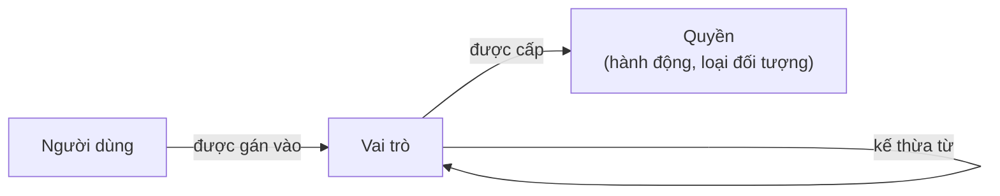
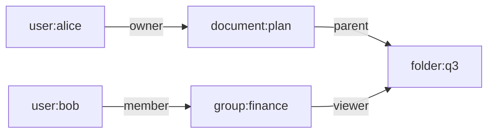

Hai bài trước trong loạt bài này đã xác lập *ai* đang gửi yêu cầu: một phương tiện xác thực (authenticator) đã chứng minh một danh tính, và một phiên (session) mang bằng chứng đó từ yêu cầu này sang yêu cầu khác. Bài này chuyển sang câu hỏi thứ hai của kiểm soát truy cập (access control): *chủ thể đó được phép làm gì?*

Bài thứ nhất trình bày các mô hình phân quyền (authorization) như những hàng trong một bảng. Ở đây, mỗi mô hình được xem như một cách **biểu diễn** chính sách, và lựa chọn cách biểu diễn có hệ quả vượt xa phần mã nói "có" hay "không". Nó quyết định kiểm toán viên trả lời được những câu hỏi nào, một danh sách một nghìn tài liệu được lọc ra sao để chỉ còn những tài liệu người dùng được xem, điều gì xảy ra khi một người chuyển nhóm, và một sai sót trong chính sách dễ bị phát hiện đến mức nào. Bài bắt đầu từ mô hình trừu tượng mà mọi lược đồ đều xấp xỉ, sau đó lần lượt xem xét kiểm soát truy cập dựa trên vai trò, dựa trên thuộc tính và dựa trên quan hệ, và kết thúc với những câu hỏi kỹ thuật quyết định việc chọn giữa chúng.

## 1. Ma trận truy cập

### 1.1 Mô hình của Lampson

Năm 1971, Butler Lampson mô tả cơ chế bảo vệ bằng một **ma trận truy cập** (access matrix). Mỗi hàng là một chủ thể (subject), mỗi cột là một đối tượng (object), và mỗi ô liệt kê các quyền mà chủ thể có trên đối tượng:

|  | `report.pdf` | `payroll.db` | `printer-3` |
|---|---|---|---|
| alice | đọc, ghi | — | in |
| bob | đọc | đọc | in |
| billing-job | — | đọc, ghi | — |

Mọi lược đồ phân quyền trong thực tế đều là một cách lưu trữ, suy ra hoặc xấp xỉ ma trận này mà không phải viết nó ra đầy đủ. Bản thân ma trận thì không dùng được trong thực tế: nó có một hàng cho mỗi chủ thể và một cột cho mỗi đối tượng, và gần như mọi ô đều trống.

### 1.2 Cột và hàng: ACL và năng lực

Hai cách biểu diễn lâu đời nhất lưu ma trận theo cột hoặc theo hàng.

- Một **danh sách kiểm soát truy cập** (access control list, ACL) lưu mỗi cột cùng với đối tượng của nó: `report.pdf` liệt kê alice (đọc, ghi) và bob (đọc). Câu hỏi *ai có thể truy cập đối tượng này?* chỉ cần một lần tra cứu. Câu hỏi *alice có thể truy cập những gì?* đòi hỏi duyệt qua mọi đối tượng.
- Một **danh sách năng lực** (capability list) lưu mỗi hàng cùng với chủ thể của nó: alice giữ một năng lực (capability) cho `report.pdf` (đọc, ghi) và một năng lực cho `printer-3` (in). Năng lực là một tham chiếu không thể giả mạo, vừa chỉ định một đối tượng vừa cấp quyền trên đối tượng đó, nên chỉ cần nắm giữ nó là đủ. Ủy nhiệm (delegation) diễn ra tự nhiên, vì alice có thể chuyển năng lực cho người khác, nhưng thu hồi (revocation) một năng lực đã bị sao chép thì khó, cũng vì lý do khiến việc thu hồi một bearer token khó khăn.

Access token của OAuth trong bài thứ nhất là một năng lực theo nghĩa này: nó chỉ định một máy chủ tài nguyên (resource server) và một tập phạm vi (scope), và chỉ cần nắm giữ nó là đủ để sử dụng.

### 1.3 Ai được thay đổi ma trận

Một trục thứ hai liên quan đến việc ai được thay đổi các ô.

- Theo **kiểm soát truy cập tùy quyền** (discretionary access control, DAC), chủ sở hữu của một đối tượng quyết định những ai khác được truy cập nó, như với quyền trên tệp và chia sẻ tài liệu.
- Theo **kiểm soát truy cập bắt buộc** (mandatory access control, MAC), một chính sách toàn hệ thống quyết định, và chủ sở hữu không thể vượt qua nó. Các ví dụ kinh điển là những mô hình bảo mật đa mức: Bell–LaPadula (1973) bảo vệ tính bí mật bằng các quy tắc "không đọc lên, không ghi xuống" (no read up, no write down) giữa các mức phân loại, còn Biba (1977) bảo vệ tính toàn vẹn bằng các quy tắc ngược lại.

Phần lớn ứng dụng doanh nghiệp kết hợp cả hai: một chính sách toàn tổ chức mà người dùng không thay đổi được (dữ liệu tài chính chỉ nằm trong bộ phận tài chính), cùng với việc chia sẻ tùy quyền bên trong phạm vi đó.

### 1.4 Một lời cảnh báo từ lý thuyết

Năm 1976, Harrison, Ruzzo và Ullman chứng minh rằng với một hệ thống ma trận truy cập tổng quát có các lệnh tạo chủ thể, tạo đối tượng và cấp quyền, *bài toán an toàn* (safety question: liệu chủ thể này có bao giờ giành được quyền này không?) là không quyết định được. Các mô hình thực tế được cố ý giới hạn để những câu hỏi mà người quản trị quan tâm thực sự trả lời được. Đó là một cách hữu ích để đọc các mô hình tiếp theo: mỗi mô hình từ bỏ một phần khả năng biểu đạt để làm cho một số câu hỏi trở nên dễ trả lời.

## 2. Kiểm soát truy cập dựa trên vai trò

### 2.1 Cấu trúc

Kiểm soát truy cập dựa trên vai trò (role-based access control, RBAC), được Ferraiolo và Kuhn hình thức hóa năm 1992, được Sandhu và cộng sự hình thức hóa năm 1996, và được chuẩn hóa thành ANSI INCITS 359 (công bố lần đầu năm 2004, sửa đổi năm 2012), chèn một tầng trung gian giữa chủ thể và quyền:



Một **quyền** (permission) là một hành động trên một loại đối tượng ("duyệt hóa đơn", "đọc đơn hàng"). Quyền được cấp cho các **vai trò** (role) ("nhân viên kế toán phải trả", "nhân viên hỗ trợ"), và người dùng được gán vào vai trò. Một người dùng nắm hợp của các quyền thuộc những vai trò của mình.

Chuẩn định nghĩa các tầng có khả năng tăng dần:

- **Core RBAC** (RBAC lõi): người dùng, vai trò, quyền và hai quan hệ gán, cùng với các *phiên* trong đó người dùng kích hoạt một tập con các vai trò của mình.
- **Hierarchical RBAC** (RBAC phân cấp): vai trò kế thừa từ vai trò khác, nên "nhân viên kế toán cấp cao" bao gồm mọi việc mà "nhân viên kế toán" làm được.
- **Constrained RBAC** (RBAC có ràng buộc): các quy tắc phân tách nhiệm vụ (separation of duty). Phân tách *tĩnh* cấm gán các vai trò xung đột cho cùng một người dùng (người tạo một nhà cung cấp không được đồng thời duyệt các khoản thanh toán cho nhà cung cấp đó); phân tách *động* cấm kích hoạt chúng trong cùng một phiên.

### 2.2 RBAC làm tốt điều gì

RBAC khớp với cách các tổ chức vốn đã mô tả công việc, nên chính sách được rà soát bởi những người hiểu nó. Cả hai chiều kiểm toán đều rẻ: *ai có thể duyệt hóa đơn?* là tập người dùng thuộc những vai trò có quyền đó; *alice có thể làm gì?* là hợp các quyền trên những vai trò của cô. Việc gia nhập, chuyển vị trí và nghỉ việc trở thành thay đổi gán vai trò thay vì sửa hàng nghìn mục ở mức đối tượng.

### 2.3 RBAC gặp khó ở đâu

Quyền trong RBAC nói về các **loại** đối tượng, không phải từng đối tượng riêng lẻ. "Nhân viên hỗ trợ được đọc đơn hàng" thì dễ; "nhân viên hỗ trợ được đọc đơn hàng *của khách hàng thuộc khu vực mình*" thì không biểu đạt được chỉ bằng vai trò. Cách xử lý thường gặp là tạo một vai trò cho mỗi khu vực, rồi cho mỗi tổ hợp khu vực và dòng sản phẩm, và cứ thế tiếp tục: đó là **bùng nổ vai trò** (role explosion), khi số vai trò tiến gần đến số người dùng và các vai trò không còn mô tả điều gì mà kiểm toán viên nhận ra được.

Vấn đề phổ biến thứ hai là **tích tụ đặc quyền** (privilege creep). Người ta chuyển việc và nhận thêm vai trò mới, nhưng vai trò cũ hiếm khi bị gỡ bỏ, vì gỡ một vai trò có thể làm hỏng thứ gì đó còn thêm một vai trò thì không bao giờ. Các đợt rà soát quyền truy cập định kỳ, trong đó một người quản lý xác nhận từng phép gán vai trò, tồn tại chủ yếu để chống lại hiện tượng này.

Vì vậy, RBAC phát huy tốt nhất với các quyền thô trên các loại tài nguyên, kết hợp với một cơ chế khác cho những điều kiện phụ thuộc vào từng đối tượng cụ thể.

## 3. Kiểm soát truy cập dựa trên thuộc tính

### 3.1 Cấu trúc

Kiểm soát truy cập dựa trên thuộc tính (attribute-based access control, ABAC), được mô tả trong NIST Special Publication 800-162, đánh giá các quy tắc trên thuộc tính của bốn thành phần:

- **chủ thể**: phòng ban, mức được phép tiếp cận (clearance), loại hình tuyển dụng, mức bảo đảm (assurance level) của lần xác thực hiện tại;
- **đối tượng**: chủ sở hữu, phòng ban, mức phân loại, trạng thái;
- **hành động**: đọc, cập nhật, duyệt;
- **môi trường**: thời gian, vị trí mạng, tình trạng an ninh của thiết bị (device posture).

Một chính sách là một tập quy tắc trên các thuộc tính này. Viết dưới dạng mã giả:

```text
permit  read  on Order
  when subject.department == "support"
   and  object.region     == subject.region

permit  update on Order
  when subject.id == object.owner_id
   and  object.status in ["draft", "submitted"]

deny    *     on *
  when  environment.network == "untrusted"
   and  subject.auth_assurance < "phishing-resistant"
```

Vai trò không biến mất trong ABAC; một vai trò đơn giản chỉ là một thuộc tính của chủ thể bên cạnh các thuộc tính khác.

### 3.2 Kết hợp các quy tắc

Khi nhiều quy tắc cùng áp dụng cho một yêu cầu và cho kết quả trái ngược nhau, một **thuật toán kết hợp** (combining algorithm) sẽ quyết định. Chuẩn XACML của OASIS đặt tên cho các thuật toán thông dụng:

- **deny-overrides** (từ chối được ưu tiên): bất kỳ quy tắc từ chối nào được áp dụng cũng thắng; đây là mặc định an toàn nhất cho chính sách bảo mật;
- **permit-overrides** (cho phép được ưu tiên): bất kỳ quy tắc cho phép nào được áp dụng cũng thắng; hữu ích cho các ngoại lệ đặt chồng lên một hạn chế mặc định;
- **first-applicable** (quy tắc áp dụng đầu tiên): các quy tắc được đánh giá theo thứ tự và quy tắc đầu tiên áp dụng được sẽ quyết định; dễ suy luận, nhưng dễ hỏng khi bị sắp xếp lại.

Dù kết hợp theo cách nào, kết quả khi **không** có quy tắc nào áp dụng phải là từ chối (nguyên tắc mặc định an toàn (fail-safe defaults) trong bài thứ nhất).

### 3.3 Quyết định được đưa ra ở đâu

ABAC thường được triển khai với sự tách biệt đã giới thiệu trong bài thứ nhất: một **điểm thực thi chính sách** (policy enforcement point, PEP) trong ứng dụng thu thập thông tin về yêu cầu và gọi một **điểm quyết định chính sách** (policy decision point, PDP), nơi đánh giá các quy tắc. Những thuộc tính mà điểm quyết định cần nhưng không được cung cấp sẽ được lấy từ các **điểm thông tin chính sách** (policy information point, PIP): thư mục người dùng, hệ thống nhân sự, cơ sở dữ liệu đơn hàng. Sự tách biệt này cho phép chính sách được quản lý phiên bản, kiểm thử và rà soát độc lập với mã ứng dụng, và cho phép cùng một chính sách được áp dụng trên nhiều dịch vụ.

### 3.4 ABAC làm tốt điều gì, và gặp khó ở đâu

ABAC biểu đạt được những điều kiện mà RBAC không biểu đạt được, mà không gây bùng nổ vai trò: một quy tắc thay thế cho một vai trò trên mỗi khu vực. Nó cũng có thể tính đến ngữ cảnh xác thực, chẳng hạn đòi hỏi một phương tiện xác thực có khả năng chống phishing cho các hành động rủi ro cao.

Cái giá của nó là hình ảnh phản chiếu:

- **Kiểm toán khó.** *Ai có thể đọc đơn hàng 123?* đòi hỏi đánh giá chính sách với thuộc tính của mọi chủ thể; *alice có thể đọc những gì?* đòi hỏi đánh giá nó với mọi đối tượng. Nói chung, không câu hỏi nào có lời đáp rẻ.
- **Chất lượng thuộc tính trở thành một thuộc tính bảo mật.** Nếu hệ thống nhân sự cập nhật phòng ban chậm, chính sách sẽ sai đối với người dùng đó, dù nó được viết cẩn thận đến đâu. Mỗi thuộc tính cần có một người chịu trách nhiệm, một nguồn và một bảo đảm về độ mới.
- **Tương tác giữa các quy tắc gây bất ngờ.** Một quy tắc cho phép mới được viết cho một trường hợp có thể áp dụng cho những trường hợp khác mà tác giả không lường tới. Chính sách cần được kiểm thử như mã: các yêu cầu cụ thể kèm quyết định mong đợi, chạy lại sau mỗi thay đổi.

## 4. Kiểm soát truy cập dựa trên quan hệ

### 4.1 Cấu trúc

Nhiều ứng dụng cấp quyền truy cập dựa trên một **quan hệ** giữa chủ thể và đối tượng: alice có thể sửa tài liệu vì cô sở hữu nó, bob có thể xem vì anh là thành viên của một nhóm được chia sẻ tài liệu đó, carol có thể xem vì tài liệu nằm trong một thư mục được chia sẻ với cô. Kiểm soát truy cập dựa trên quan hệ (relationship-based access control, ReBAC) lấy các quan hệ ấy làm dữ liệu chính.

Chính sách gồm hai phần:

- các **bộ quan hệ** (relationship tuple), được lưu dưới dạng dữ liệu: `document:plan#owner@user:alice`, `document:plan#parent@folder:q3`, `folder:q3#viewer@group:finance#member`, `group:finance#member@user:bob`;
- một **lược đồ** (schema) suy ra quyền từ các quan hệ, chẳng hạn "người xem của một tài liệu gồm chủ sở hữu, người chỉnh sửa, những người dùng được chia sẻ tài liệu, và người xem của thư mục cha chứa nó".



Để quyết định bob có được xem `document:plan` hay không, hệ thống đi theo đồ thị: thư mục cha của tài liệu là `folder:q3`; người xem của thư mục bao gồm các thành viên của `group:finance`; bob là một thành viên. Truy cập được cho phép.

### 4.2 Đánh giá

Một phép kiểm tra là một phép tìm kiếm có giới hạn trên đồ thị, xuất phát từ đối tượng, đi theo các quan hệ mà lược đồ chỉ ra, để tìm chủ thể. Từ đó nảy sinh hai mối quan tâm kỹ thuật:

- **Hiệu năng.** Cây thư mục sâu và các nhóm lồng nhau làm phép tìm kiếm kéo dài. Các hệ thống tính trước hoặc lưu đệm (cache) quan hệ thành viên nhóm, giới hạn độ sâu lồng nhau, và đánh giá các phép kiểm tra song song.
- **Tính nhất quán.** Quan hệ thay đổi. Giả sử bob bị gỡ khỏi danh sách người xem của một tài liệu và, ngay sau đó, tài liệu được cập nhật với nội dung mật. Nếu một phép kiểm tra trên một bản sao dữ liệu lỗi thời vẫn thấy quan hệ cũ, bob sẽ đọc được nội dung được viết sau khi quyền truy cập của anh đã bị gỡ bỏ. Bài báo năm 2019 của Google về Zanzibar, hệ thống phân quyền nội bộ của hãng, gọi đây là vấn đề "kẻ thù mới" (new enemy), và giải quyết nó bằng cách gắn các phiên bản nội dung với token nhất quán (consistency token), sao cho các phép kiểm tra được đánh giá tại một ảnh chụp (snapshot) ít nhất cũng mới bằng nội dung.

### 4.3 ReBAC làm tốt điều gì, và gặp khó ở đâu

ReBAC phù hợp với những ứng dụng mà bản thân mô hình chia sẻ là một đồ thị: tài liệu và thư mục, dự án và tổ chức, kho mã và nhóm. Các quy tắc dựa trên quyền sở hữu, vốn RBAC không biểu đạt được và ABAC chỉ biểu đạt được khi có thuộc tính `owner_id` trên mọi đối tượng, là dạng tự nhiên của nó. Kiểm toán theo chiều *ai có thể truy cập đối tượng này?* là một phép khai triển đồ thị; chiều ngược lại cần một chỉ mục ngược.

Cái giá của nó nằm ở vận hành: dữ liệu quan hệ phải được ghi mỗi khi dữ liệu của chính ứng dụng thay đổi (tạo một tài liệu cũng phải tạo các bộ `owner` và `parent` của nó), hai nguồn dữ liệu này không được lệch nhau, và kho quan hệ trở thành một phụ thuộc trên mọi yêu cầu.

## 5. Lựa chọn và kết hợp

### 5.1 Đặt các mô hình cạnh nhau

| Đặc điểm | ACL | RBAC | ABAC | ReBAC |
|---|---|---|---|---|
| Chính sách được biểu diễn bằng | Các mục trên từng đối tượng | Phép gán vai trò và quyền của vai trò | Quy tắc trên thuộc tính | Bộ quan hệ và một lược đồ |
| Phù hợp tự nhiên với | Tệp, tài nguyên chia sẻ nhỏ | Chức năng công việc trong tổ chức | Điều kiện về ngữ cảnh và dữ liệu | Chia sẻ, quyền sở hữu, cấu trúc phân cấp |
| "Ai có thể truy cập X?" | Tra cứu trực tiếp | Trực tiếp (theo loại đối tượng) | Nói chung là khó | Khai triển đồ thị |
| "S có thể truy cập những gì?" | Duyệt mọi đối tượng | Trực tiếp (theo loại đối tượng) | Nói chung là khó | Cần chỉ mục ngược |
| Kiểu thất bại chính | Danh sách bị lệch, không ai rà soát | Bùng nổ vai trò, tích tụ đặc quyền | Thuộc tính lỗi thời, tương tác giữa các quy tắc | Bộ quan hệ lệch khỏi dữ liệu ứng dụng |

### 5.2 Phân tầng

Hệ thống thực tế hiếm khi chỉ chọn một mô hình. Một cách phân tầng phổ biến và có cơ sở là:

1. **RBAC cho năng lực thô**: công việc của người dùng liên quan đến những tính năng và loại tài nguyên nào ("nhân viên hỗ trợ dùng bảng điều khiển đơn hàng").
2. **ReBAC hoặc kiểm tra quyền sở hữu cho từng đối tượng cụ thể**: những đơn hàng, tài liệu hay dự án nào ("đơn hàng của khách hàng được giao cho nhóm của nhân viên này").
3. **Điều kiện ABAC cho ngữ cảnh**: khi nào quyết định cần thay đổi theo hoàn cảnh ("hoàn tiền vượt một ngưỡng đòi hỏi một lần xác thực chống phishing gần đây").

Mỗi tầng trả lời câu hỏi mà nó trả lời tốt nhất, và mỗi tầng có thể được rà soát bởi những người hiểu nó.

## 6. Những mối quan tâm kỹ thuật quyết định thiết kế

### 6.1 Lọc danh sách

Một phép kiểm tra trả lời câu hỏi "S có được thực hiện A trên đối tượng O không?". Ứng dụng thường cần câu hỏi "S được xem những đối tượng nào?" hơn, để hiển thị một danh sách hoặc trả lời một truy vấn tìm kiếm. Kiểm tra lần lượt từng đối tượng ứng viên thì đúng nhưng chậm, còn lọc *sau khi* phân trang sẽ tạo ra các trang thiếu hoặc trống.

Các cách tiếp cận khả thi là:

- **Đẩy chính sách vào truy vấn.** Với RBAC và các quy tắc sở hữu đơn giản, điều kiện trở thành một mệnh đề `WHERE` (`WHERE organisation_id = :subject_org`). Một số bộ máy chính sách hỗ trợ *đánh giá từng phần* (partial evaluation): khi biết chủ thể và hành động, chúng rút gọn chính sách thành một điều kiện còn lại trên thuộc tính của đối tượng, có thể dịch thành một truy vấn.
- **Hỏi hệ thống phân quyền về tập đối tượng.** Hệ thống ReBAC có thể liệt kê các đối tượng mà một chủ thể chạm tới được qua một quan hệ, rồi ứng dụng lấy giao của tập đó với truy vấn của mình.
- **Lọc trước và kiểm tra sau.** Lấy các ứng viên bằng một bộ lọc xấp xỉ rẻ, sau đó kiểm tra từng đối tượng trước khi trả về, chấp nhận một phần công sức bị lãng phí.

Dù theo cách nào, cùng một chính sách phải chi phối cả phép kiểm tra trên một đối tượng lẫn danh sách. Một danh sách ẩn một đơn hàng trong khi trang chi tiết vẫn trả về đơn hàng đó là một lỗ hổng phân quyền mức đối tượng (broken object-level authorization, mô tả trong bài thứ nhất) đang chờ bị phát hiện.

### 6.2 Dữ liệu phân quyền trong token

Rất dễ bị cám dỗ đưa vai trò hoặc quyền vào access token để máy chủ tài nguyên không cần tra cứu. Cách đó dùng được cho những dữ kiện thô, ít thay đổi. Với mọi thứ khác, token là một **ảnh chụp**: những quyền bị gỡ bỏ sau khi token được cấp vẫn nằm trong nó cho đến khi hết hạn. Quan hệ ở mức đối tượng thì hoàn toàn không vừa trong một token. Một quy tắc hữu ích là token mang danh tính, client cùng các phạm vi của nó, và có thể cả các vai trò thô; máy chủ tài nguyên đánh giá mọi thứ khác tại thời điểm xử lý yêu cầu.

Phạm vi và quyền cũng là hai thứ khác nhau. Phạm vi giới hạn những gì một *client* được làm thay mặt người dùng; quyền nói lên những gì *người dùng* được làm. Máy chủ tài nguyên cần cả hai (Mục 5.2 của bài thứ nhất).

### 6.3 Thay đổi theo thời gian

Chính sách tồn tại lâu hơn tác giả của nó. Những thiết kế bền vững theo thời gian thường có chung một số thói quen:

- **Từ chối theo mặc định**, để một quy tắc bị bỏ quên sẽ thất bại theo hướng đóng (fail closed).
- **Chính sách là sản phẩm được rà soát, quản lý phiên bản và kiểm thử**: mỗi thay đổi có một tác giả, một người rà soát và các ca kiểm thử kèm quyết định mong đợi.
- **Quy trình gia nhập, chuyển vị trí và nghỉ việc** (joiner, mover, leaver) gắn với hệ thống nhân sự hoặc hệ thống khách hàng có thẩm quyền, để các thay đổi về vai trò và thuộc tính diễn ra khi hoàn cảnh của con người thay đổi chứ không phải khi có ai đó nhớ ra.
- **Rà soát quyền truy cập định kỳ**, đặc biệt với các vai trò có quyền lực lớn và với việc chia sẻ tùy quyền mà không ai khác nhìn thấy.
- **Ghi nhật ký quyết định**: ghi lại chủ thể, hành động, đối tượng, quyết định và phiên bản chính sách đã tạo ra quyết định đó. Khi xảy ra sự cố, câu hỏi "vì sao việc này được cho phép?" phải có câu trả lời.

## 7. Tóm tắt

| Câu hỏi | Trả lời |
|---|---|
| Mọi mô hình đều xấp xỉ điều gì? | Ma trận truy cập của Lampson: chủ thể theo hàng, đối tượng theo cột, với các quyền trong mỗi ô. |
| ACL và năng lực khác nhau thế nào? | ACL lưu một cột cùng với đối tượng; năng lực lưu một ô cùng với chủ thể. Năng lực dễ ủy nhiệm nhưng khó thu hồi. |
| RBAC giỏi ở điểm nào? | Quyền thô, dễ rà soát, khớp với chức năng công việc; cả hai chiều kiểm toán đều rẻ. |
| RBAC thất bại ở đâu? | Điều kiện trên từng đối tượng dẫn đến bùng nổ vai trò; vai trò không được gỡ bỏ dẫn đến tích tụ đặc quyền. |
| ABAC bổ sung điều gì? | Quy tắc trên thuộc tính của chủ thể, đối tượng, hành động và môi trường, bao gồm cả ngữ cảnh xác thực, với cái giá là kiểm toán khó hơn và phụ thuộc vào chất lượng thuộc tính. |
| ReBAC bổ sung điều gì? | Quyền suy ra từ một đồ thị quan hệ sở hữu, thành viên và chứa đựng, phù hợp với các mô hình chia sẻ, với cái giá là phải giữ đồ thị nhất quán với dữ liệu ứng dụng. |
| Chúng được kết hợp như thế nào? | Vai trò cho năng lực thô, quan hệ hoặc quyền sở hữu cho từng đối tượng cụ thể, thuộc tính cho ngữ cảnh. |
| Điều gì quyết định thiết kế trong thực tế? | Lọc danh sách, điều gì nên (và không nên) đưa vào token, và cách chính sách được rà soát, kiểm thử và ghi nhật ký khi nó thay đổi. |

Bài tiếp theo quay lại OAuth 2.0 và xem xét chi tiết các luồng cấp quyền (grant) và các loại client của nó: luồng cấp quyền nào hợp với loại client nào, và vì sao.

### Tài liệu tham khảo

- B. W. Lampson, "Protection", *Proceedings of the Fifth Princeton Symposium on Information Sciences and Systems*, 1971.
- M. A. Harrison, W. L. Ruzzo and J. D. Ullman, "Protection in Operating Systems", *Communications of the ACM*, 1976.
- D. F. Ferraiolo and D. R. Kuhn, "Role-Based Access Controls", *15th National Computer Security Conference*, 1992.
- R. S. Sandhu, E. J. Coyne, H. L. Feinstein and C. E. Youman, "Role-Based Access Control Models", *IEEE Computer*, 1996.
- ANSI INCITS 359, *Role Based Access Control* (2004; revised 2012).
- NIST Special Publication 800-162, *Guide to Attribute Based Access Control (ABAC) Definition and Considerations*, 2014.
- OASIS, *eXtensible Access Control Markup Language (XACML)*.
- R. Pang et al., "Zanzibar: Google's Consistent, Global Authorization System", *USENIX Annual Technical Conference*, 2019.
