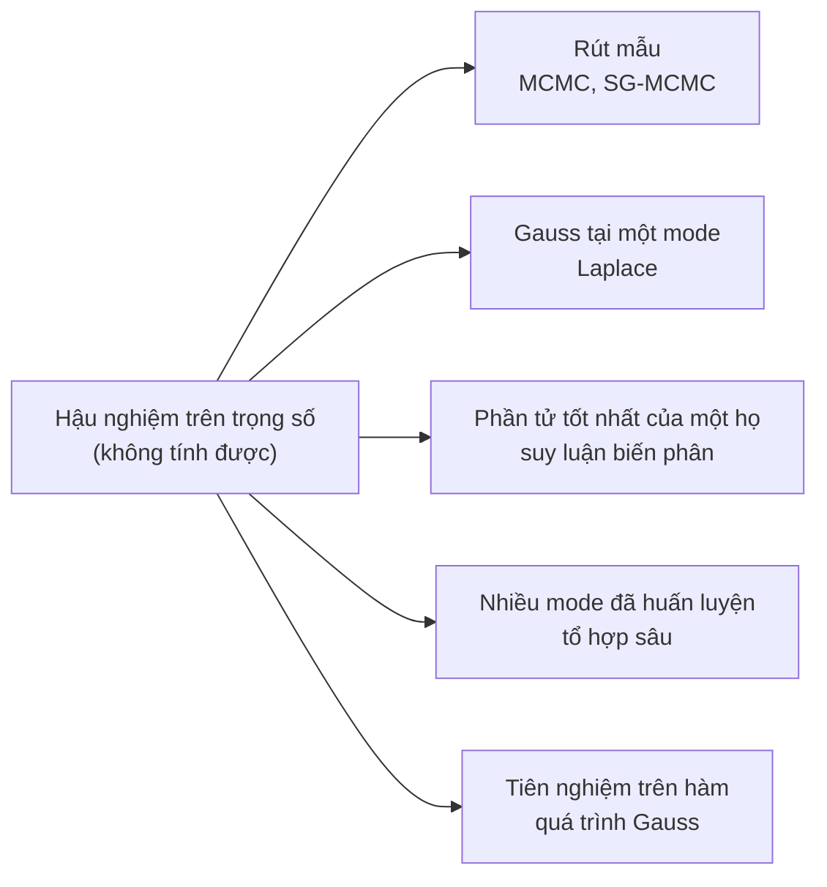

import Figure from '../../../components/Figure.astro';
import BdlPredictiveBand from '../../../components/diagrams/BdlPredictiveBand.astro';

Một mạng nơ-ron đã huấn luyện trả về một câu trả lời cho mọi đầu vào, kể cả những đầu vào không giống bất cứ thứ gì trong tập huấn luyện của nó. Loạt bài [Cơ sở học máy](/vi/series/machine-learning-fundamentals) đã cho thấy một mạng như vậy được khớp như thế nào, bằng cách cực tiểu hóa rủi ro thực nghiệm với [hạ gradient](/blog/gradient-descent-and-its-variants), và sai số huấn luyện của nó có thể lệch xa sai số trên dữ liệu mới đến mức nào ([tổng quát hóa, quá khớp và chính quy hóa](/blog/generalization-overfitting-and-regularization)). Điều loạt bài đó chưa hỏi là mô hình đã khớp chắc chắn đến đâu về một dự đoán cụ thể. Bài này, bài thứ nhất của loạt bài [Học sâu Bayes](/vi/series/bayesian-deep-learning), trình bày khung lý thuyết trả lời câu hỏi đó và trở ngại mà phần còn lại của loạt bài phải tìm cách vượt qua.

Khung lý thuyết đó là suy luận Bayes (Bayesian inference). Thay vì một vector tham số duy nhất, nó giữ một phân phối xác suất trên mọi vector tham số tương thích với dữ liệu, và dự đoán bằng cách lấy trung bình theo phân phối đó. Bài này định nghĩa phân phối hậu nghiệm, phân phối dự đoán hậu nghiệm và hàm hợp lý biên, tách hai loại độ bất định mà một dự đoán có thể mang, và đi qua một mô hình trong đó mọi đại lượng đều tính được chính xác: hồi quy tuyến tính Bayes. Sau đó bài giải thích vì sao cùng phép tính đó nằm ngoài tầm với đối với một mạng nơ-ron, và đưa ra một bản đồ các phép xấp xỉ mà các bài tiếp theo phát triển.

Ký hiệu là ký hiệu chung của loạt bài: $\theta \in \mathbb{R}^P$ là $P$ tham số, $\mathcal{D} = \{(x_n, y_n)\}_{n=1}^N$ là $N$ ví dụ huấn luyện, $p(\theta)$ là tiên nghiệm, $p(\mathcal{D} \mid \theta)$ là hàm hợp lý, $p(\theta \mid \mathcal{D})$ là phân phối hậu nghiệm, còn $x^*$, $y^*$ là một đầu vào kiểm tra và đầu ra của nó. Vector là vector cột, logarit là logarit tự nhiên, và $\mathcal{N}(\mu, \Sigma)$ là phân phối Gauss với kỳ vọng $\mu$ và hiệp phương sai $\Sigma$. Mã dùng Python 3.13 và NumPy 2.5.3 với các hạt giống được ghi rõ.

## 1. Từ ước lượng điểm đến phân phối

### 1.1 Điều mà một mạng đã huấn luyện bỏ sót

Cực tiểu hóa rủi ro thực nghiệm chọn một vector tham số $\hat{\theta}$, vector có mất mát huấn luyện thấp nhất (cộng thêm một hàm phạt nếu việc huấn luyện có chính quy hóa). Nhiều vector tham số khác khớp dữ liệu huấn luyện gần như tốt bằng. Với một mô hình có nhiều tham số hơn số ví dụ huấn luyện, thường có cả những họ vector như vậy, và chúng không nhất thiết đồng ý với nhau ở xa dữ liệu. Hai mạng được huấn luyện từ hai khởi tạo ngẫu nhiên khác nhau có thể cho cùng dự đoán trên mọi đầu vào huấn luyện và cho dự đoán khác nhau trên một đầu vào ở xa tất cả các đầu vào đó. Một ước lượng điểm (point estimate) chỉ báo cáo một phần tử của họ đó và che giấu sự bất đồng.

Sự bất đồng là thông tin. Ở nơi các mô hình hợp lý đồng ý với nhau, có thể tin vào dự đoán trong chừng mực có thể tin vào lớp mô hình. Ở nơi chúng bất đồng, dữ liệu không xác định được câu trả lời, và một quyết định ở khâu sau cần biết điều đó. Suy luận Bayes biến "tập các mô hình hợp lý" thành một phân phối xác suất và sử dụng nó.

### 1.2 Quy tắc Bayes cho tham số

Suy luận Bayes coi các tham số là một biến ngẫu nhiên và gán cho chúng hai phân phối. **Tiên nghiệm** (prior) $p(\theta)$ nói những giá trị tham số nào được coi là hợp lý trước khi thấy dữ liệu. **Hàm hợp lý** (likelihood) $p(\mathcal{D} \mid \theta)$ nói dữ liệu quan sát được có xác suất bao nhiêu dưới mô hình với tham số $\theta$. Với một mô hình có giám sát mà các ví dụ độc lập và cùng phân phối (independent and identically distributed, i.i.d.), như [bài thứ nhất của loạt bài cơ sở](/blog/learning-from-data) đã giả định, và với các đầu vào được coi là cố định, hàm hợp lý phân tích thành tích theo các ví dụ:

$$
p(\mathcal{D} \mid \theta) = \prod_{n=1}^{N} p(y_n \mid x_n, \theta).
$$

Quy tắc Bayes kết hợp hai phân phối này thành **phân phối hậu nghiệm** (posterior), phân phối của các tham số sau khi đã thấy dữ liệu:

$$
p(\theta \mid \mathcal{D}) = \frac{p(\mathcal{D} \mid \theta)\, p(\theta)}{p(\mathcal{D})},
\qquad
p(\mathcal{D}) = \int p(\mathcal{D} \mid \theta)\, p(\theta)\, d\theta .
$$

Mẫu số $p(\mathcal{D})$ là **hàm hợp lý biên** (marginal likelihood), còn gọi là **bằng chứng** (evidence): xác suất của dữ liệu khi lấy trung bình theo tiên nghiệm. Nó không phụ thuộc vào $\theta$, nên chỉ có vai trò chuẩn hóa phân phối hậu nghiệm, nhưng nó lại là phần khó. Tử số, **phân phối hậu nghiệm chưa chuẩn hóa** (unnormalized posterior), có thể được tính tại bất kỳ $\theta$ nào với chi phí một lượt duyệt qua dữ liệu; còn bằng chứng là một tích phân trên toàn bộ $\mathbb{R}^P$.

### 1.3 Huấn luyện có chính quy hóa là một trường hợp riêng

Loạt bài cơ sở đã dùng hai ý tưởng Bayes mà không gọi tên chúng. Các hàm mất mát của nó là logarit âm của hàm hợp lý: mất mát bình phương, sai khác một hằng số, là $-\log p(y_n \mid x_n, \theta)$ với mô hình nhiễu Gauss, và mất mát entropy chéo (cross-entropy) đúng bằng $-\log p(y_n \mid x_n, \theta)$ với mô hình Bernoulli (hoặc, khi có nhiều lớp, mô hình phân loại (categorical)). Còn các hàm phạt của nó là logarit âm của tiên nghiệm. Lấy logarit của phân phối hậu nghiệm,

$$
-\log p(\theta \mid \mathcal{D}) = -\sum_{n=1}^{N} \log p(y_n \mid x_n, \theta) - \log p(\theta) + \log p(\mathcal{D}),
$$

nên vector tham số có mật độ hậu nghiệm cao nhất, tức **ước lượng hậu nghiệm cực đại** (maximum a posteriori, MAP), cực tiểu hóa mất mát huấn luyện cộng với số hạng $-\log p(\theta)$. Với tiên nghiệm Gauss $\theta \sim \mathcal{N}(0, s_0^2 I)$, trong đó $s_0$ là độ lệch chuẩn tiên nghiệm của mỗi trọng số và $I$ là ma trận đơn vị, số hạng đó là $\lVert\theta\rVert^2/(2 s_0^2)$ cộng một hằng số: hồi quy ridge, hay suy giảm trọng số (weight decay). MacKay đã chỉ ra mối liên hệ này cho mạng nơ-ron năm 1992 và dùng nó để chọn hàm phạt từ dữ liệu (MacKay, 1992).

Mục 3 kiểm tra sự tương ứng này bằng số. Điều quan trọng ở đây là huấn luyện MAP vứt bỏ những gì. Nó giữ vị trí có mật độ hậu nghiệm cao nhất và bỏ đi hình dạng, độ rộng và mọi mode khác. Phần còn lại của bài này nói về những gì hình dạng đó mang lại.

## 2. Dự đoán bằng phân phối hậu nghiệm

### 2.1 Phân phối dự đoán hậu nghiệm

Đại lượng cần quan tâm hiếm khi là chính $\theta$; đó là đầu ra $y^*$ tại một đầu vào mới $x^*$. **Phân phối dự đoán hậu nghiệm** (posterior predictive distribution) lấy trung bình dự đoán của mô hình theo phân phối hậu nghiệm:

$$
p(y^* \mid x^*, \mathcal{D}) = \int p(y^* \mid x^*, \theta)\, p(\theta \mid \mathcal{D})\, d\theta
= \mathbb{E}_{\theta \sim p(\theta \mid \mathcal{D})}\big[\, p(y^* \mid x^*, \theta) \,\big].
$$

Mỗi vector tham số bỏ phiếu bằng phân phối dự đoán của riêng nó, với trọng số là mức độ hợp lý của nó sau khi thấy dữ liệu. Quy trình này được gọi là **lấy trung bình mô hình Bayes** (Bayesian model averaging). Nó không giống việc thay một ước lượng duy nhất vào mô hình: $p(y^* \mid x^*, \hat{\theta}_{\text{MAP}})$ bỏ qua mọi $\theta$ hợp lý khác, và với một mô hình phi tuyến thì trung bình của các dự đoán không phải là dự đoán tại tham số trung bình.

Khi có $M$ mẫu $\theta^{(1)}, \dots, \theta^{(M)}$ từ phân phối hậu nghiệm, tích phân được ước lượng bằng **trung bình Monte Carlo**

$$
p(y^* \mid x^*, \mathcal{D}) \approx \frac{1}{M}\sum_{s=1}^{M} p\big(y^* \mid x^*, \theta^{(s)}\big),
$$

có sai số giảm tỉ lệ với $1/\sqrt{M}$ bất kể số chiều $P$. Đó là lý do có nhiều phương pháp trong loạt bài này kết thúc bằng việc tạo ra các mẫu, hoặc một thứ có thể lấy mẫu được: khi đã có mẫu, việc dự đoán trở nên dễ dàng. Việc tạo ra các mẫu là chủ đề của [bài tiếp theo](/vi/blog/sampling-the-posterior-mcmc).

### 2.2 Độ bất định nhận thức và độ bất định ngẫu nhiên

Một phân phối dự đoán có thể rộng vì hai lý do khác nhau, và chúng đòi hỏi những cách ứng xử khác nhau. **Độ bất định ngẫu nhiên** (aleatoric uncertainty) là tính ngẫu nhiên nằm ngay trong quá trình sinh dữ liệu: nhiễu đo, hoặc các nhãn mơ hồ ngay cả với một mô hình hoàn hảo. Nó vẫn còn lại dù có vô hạn ví dụ huấn luyện. **Độ bất định nhận thức** (epistemic uncertainty) là độ bất định về mô hình: dữ liệu thấy được cho đến lúc này chưa xác định chặt được các tham số. Nó giảm dần khi dữ liệu tích lũy ở nơi cần dự đoán. Sự phân biệt này đã có từ lâu trong phân tích rủi ro và độ tin cậy (Der Kiureghian và Ditlevsen, 2009, bàn về nó) và được Kendall và Gal (2017) phổ biến trong học sâu.

Với một mô hình hồi quy, phép tách là chính xác. Viết $\mu_\theta(x^*)$ và $\sigma^2_\theta(x^*)$ cho kỳ vọng và phương sai của $p(y^* \mid x^*, \theta)$. Định luật phương sai toàn phần (law of total variance) cho

$$
\operatorname{Var}\big[y^* \mid x^*, \mathcal{D}\big]
= \underbrace{\mathbb{E}_{\theta}\big[\sigma^2_\theta(x^*)\big]}_{\text{aleatoric}}
+ \underbrace{\operatorname{Var}_{\theta}\big[\mu_\theta(x^*)\big]}_{\text{epistemic}},
$$

trong đó cả hai kỳ vọng đều lấy theo phân phối hậu nghiệm. Số hạng thứ nhất là nhiễu mà mỗi mô hình hợp lý dự đoán; số hạng thứ hai là mức độ các mô hình hợp lý bất đồng về giá trị kỳ vọng.

Với một bộ phân loại, cách tách thông thường dùng entropy, $\mathbb{H}[p] = -\sum_c p_c \log p_c$ cho một vector xác suất $p$ trên các lớp $c$. Viết $\bar{p}$ cho các xác suất dự đoán đã lấy trung bình và $p_\theta$ cho các xác suất của một vector tham số,

$$
\underbrace{\mathbb{H}[\bar{p}]}_{\text{total}}
= \underbrace{\mathbb{E}_{\theta}\big[\mathbb{H}[p_\theta]\big]}_{\text{aleatoric}}
+ \underbrace{\mathbb{H}[\bar{p}] - \mathbb{E}_{\theta}\big[\mathbb{H}[p_\theta]\big]}_{\text{epistemic (mutual information)}} .
$$

Số hạng thứ hai là thông tin tương hỗ (mutual information) giữa $y^*$ và $\theta$, và nó không bao giờ âm (Depeweg và cộng sự, 2018). Hai ví dụ nhị phân cho thấy sự khác biệt. Nếu hai vector tham số đồng khả năng dự đoán $(0.9, 0.1)$ và $(0.1, 0.9)$, trung bình là $(0.5, 0.5)$ với entropy $\log 2 = 0.693$; mỗi thành phần có entropy $0.325$, nên $0.368$ trong tổng là độ bất định nhận thức. Nếu cả hai đều dự đoán $(0.5, 0.5)$, tổng vẫn là $0.693$ nhưng tất cả đều là độ bất định ngẫu nhiên. Trong cả hai trường hợp, dự đoán trung bình đều là cùng một lần tung đồng xu. Chỉ phép phân tách cho thấy rằng ở trường hợp thứ nhất thêm dữ liệu sẽ có ích, còn ở trường hợp thứ hai thì không.

### 2.3 Hàm hợp lý biên như một điểm số cho mô hình

Bằng chứng $p(\mathcal{D})$, đại lượng chuẩn hóa phân phối hậu nghiệm, còn có công dụng thứ hai. Viết ra cho một mô hình $\mathcal{M}$ với tiên nghiệm riêng của nó, $p(\mathcal{D} \mid \mathcal{M})$ là xác suất để mô hình này, với các tham số rút từ tiên nghiệm của nó, sinh ra dữ liệu quan sát được. Một mô hình có tiên nghiệm rải xác suất lên nhiều tập dữ liệu không được quan sát sẽ có điểm thấp hơn một mô hình tập trung vào các tập dữ liệu giống tập đã quan sát. Một mô hình quá cứng nhắc, hoàn toàn không sinh được dữ liệu, còn có điểm thấp hơn nữa. Vì vậy bằng chứng phạt cả việc khớp thiếu (underfitting) lẫn sự linh hoạt thừa, mà không cần tập kiểm định, một hiệu ứng thường được gọi là dao cạo Occam Bayes (Bayesian Occam's razor) (MacKay, 1992; Bishop, 2006, mục 3.4).

Trong thực hành, bằng chứng được dùng để chọn **siêu tham số** (hyperparameter), chẳng hạn thang đo tiên nghiệm $s_0$ hay mức nhiễu, bằng cách cực đại hóa nó: quy trình này được gọi là **Bayes thực nghiệm** (empirical Bayes) hay hợp lý cực đại loại II (type-II maximum likelihood). Mục 3.5 làm điều này cho ví dụ minh họa. Điểm số chỉ tốt đến mức lớp mô hình cho phép: so sánh hai mô hình đặc tả sai bằng bằng chứng của chúng cho biết mô hình nào ít sai hơn về dữ liệu đã thấy, chứ không cho biết mô hình nào dự đoán tốt hơn trên dữ liệu từ nơi khác.

## 3. Ví dụ minh họa: hồi quy tuyến tính Bayes

### 3.1 Mô hình

Có một họ mô hình cho mọi đại lượng ở trên dưới dạng đóng: mô hình tuyến tính theo tham số, với tiên nghiệm Gauss và nhiễu Gauss. Các đầu vào có thể đi vào một cách phi tuyến thông qua một **ánh xạ đặc trưng** (feature map) cố định $\phi(x) \in \mathbb{R}^P$. Ở đây đầu vào là một số vô hướng và các đặc trưng là $P = 11$ hàm bướu Gauss (Gaussian bump) có độ rộng đơn vị, đặt tâm tại $c_k = -5, -4, \dots, 5$:

$$
\phi_k(x) = \exp\!\big(-(x - c_k)^2\big), \qquad
y = \phi(x)^\top \theta + \varepsilon, \qquad
\varepsilon \sim \mathcal{N}(0, \sigma^2), \qquad
\theta \sim \mathcal{N}(0, s_0^2 I).
$$

Độ lệch chuẩn của nhiễu là $\sigma = 0.25$ và được coi là đã biết; độ lệch chuẩn tiên nghiệm là $s_0 = 1$. Dữ liệu gồm $N = 20$ quan sát có nhiễu của $\sin x$, mười quan sát với $x$ rút đều từ $[-3, -1]$ và mười từ $[1, 3]$. Khoảng trống giữa hai cụm và các vùng trống bên ngoài $\lvert x \rvert = 3$ là có chủ ý: đó là những nơi mô hình phải nói rằng nó không biết.

Gom các đặc trưng của các đầu vào huấn luyện vào ma trận thiết kế (design matrix) $\Phi$ cỡ $N \times P$, có hàng thứ $n$ là $\phi(x_n)^\top$, và các đầu ra vào vector $\mathbf{y}$. Một mạng nơ-ron có thể được hiểu là cùng mô hình này với một ánh xạ đặc trưng được học, và đó là lý do ví dụ này còn xuất hiện lại trong loạt bài.

### 3.2 Phân phối hậu nghiệm và phân phối dự đoán dưới dạng đóng

Logarit của phân phối hậu nghiệm là một hàm bậc hai của $\theta$:

$$
\log p(\theta \mid \mathcal{D}) = -\frac{1}{2\sigma^2}\lVert \mathbf{y} - \Phi\theta \rVert^2 - \frac{1}{2 s_0^2}\lVert \theta \rVert^2 + \text{const}.
$$

Một mật độ có logarit bậc hai là một phân phối Gauss, và phép đưa về dạng bình phương đủ xác định nó. Phân phối hậu nghiệm là $\mathcal{N}(m_N, S_N)$ với

$$
S_N = \Big(\frac{1}{\sigma^2}\Phi^\top\Phi + \frac{1}{s_0^2} I\Big)^{-1}, \qquad
m_N = \frac{1}{\sigma^2} S_N \Phi^\top \mathbf{y}.
$$

Một cặp tiên nghiệm và hàm hợp lý mà phân phối hậu nghiệm vẫn nằm trong họ của tiên nghiệm được gọi là **liên hợp** (conjugate). Ma trận $S_N^{-1}$ là **ma trận độ chính xác** (precision) hậu nghiệm: độ chính xác tiên nghiệm $I/s_0^2$ cộng với thông tin mà dữ liệu bổ sung, $\Phi^\top\Phi/\sigma^2$. Kỳ vọng $m_N$ cũng là ước lượng MAP, và nó là nghiệm ridge của loạt bài cơ sở với cường độ phạt $\lambda = \sigma^2/(N s_0^2)$, ở đây bằng $0.0625/20 = 0.003125$ (Bài tập 1 suy ra điều này).

Dự đoán $f^* = \phi(x^*)^\top\theta$ là một hàm tuyến tính của một vector Gauss, nên nó có phân phối Gauss; cộng thêm nhiễu độc lập ta được phân phối dự đoán hậu nghiệm

$$
p(y^* \mid x^*, \mathcal{D}) = \mathcal{N}\Big(\phi(x^*)^\top m_N,\;\; \underbrace{\phi(x^*)^\top S_N\, \phi(x^*)}_{\text{epistemic}} + \underbrace{\sigma^2}_{\text{aleatoric}}\Big).
$$

Hai số hạng của mục 2.2 xuất hiện tách biệt. Số hạng ngẫu nhiên như nhau ở mọi nơi, vì mô hình nhiễu quy định như vậy. Số hạng nhận thức phụ thuộc vào $x^*$ thông qua các đặc trưng, và nó chỉ nhỏ ở nơi dữ liệu đã ràng buộc các trọng số mà $\phi(x^*)$ chọn ra.

Bằng chứng cũng có phân phối Gauss. Dưới tiên nghiệm, $\mathbf{y} = \Phi\theta + \boldsymbol{\varepsilon}$ là tổng của các vector Gauss độc lập có kỳ vọng bằng không, nên

$$
p(\mathcal{D}) = \mathcal{N}\big(\mathbf{y};\; 0,\; s_0^2\, \Phi\Phi^\top + \sigma^2 I_N\big),
$$

trong đó $I_N$ là ma trận đơn vị cỡ $N \times N$ và $\mathcal{N}(\mathbf{y}; \cdot, \cdot)$ ký hiệu mật độ Gauss tính tại $\mathbf{y}$.

### 3.3 Mã

Đoạn mã dựng dữ liệu, tính phân phối hậu nghiệm, in phân phối dự đoán tại ba đầu vào kiểm tra, chấm điểm năm thang đo tiên nghiệm theo logarit bằng chứng và kiểm tra phân phối dự đoán dạng đóng bằng một trung bình Monte Carlo trên các mẫu hậu nghiệm.

```python
import numpy as np

rng = np.random.default_rng(seed=0)
sigma, s0 = 0.25, 1.0                       # noise std (known), prior std of each weight
centers = np.arange(-5.0, 5.5, 1.0)         # 11 Gaussian bumps, width 1

def features(x):
    return np.exp(-(x[:, None] - centers[None, :]) ** 2)

x = np.concatenate([rng.uniform(-3, -1, 10), rng.uniform(1, 3, 10)])
y = np.sin(x) + rng.normal(0.0, sigma, size=x.size)
Phi = features(x)

# Posterior N(m, S) over the 11 weights
S = np.linalg.inv(Phi.T @ Phi / sigma**2 + np.eye(centers.size) / s0**2)
m = S @ Phi.T @ y / sigma**2

# Posterior predictive at three test inputs
for xs in [-2.0, 0.0, 4.5]:
    phi = features(np.array([xs]))[0]
    epi = phi @ S @ phi                       # epistemic variance
    print(f"x* = {xs:4.1f}: mean {phi @ m:6.3f}  epistemic sd {np.sqrt(epi):.3f}  "
          f"total sd {np.sqrt(epi + sigma**2):.3f}")

# Log marginal likelihood for several prior scales
for s in [0.1, 0.3, 1.0, 3.0, 10.0]:
    K = s**2 * Phi @ Phi.T + sigma**2 * np.eye(x.size)   # covariance of y
    _, logdet = np.linalg.slogdet(K)
    print(f"s0 = {s:4.1f}: log p(D) = "
          f"{-0.5 * (y @ np.linalg.solve(K, y) + logdet + x.size * np.log(2 * np.pi)):7.2f}")

# Monte Carlo check of the predictive at x* = 0 with 4000 posterior draws
theta = rng.multivariate_normal(m, S, size=4000)
f0 = theta @ features(np.array([0.0]))[0]
print(f"Monte Carlo at x* = 0: mean {f0.mean():6.3f}  epistemic sd {f0.std():.3f}")
```

Kết quả in ra:

```text
x* = -2.0: mean -0.938  epistemic sd 0.138  total sd 0.286
x* =  0.0: mean  0.039  epistemic sd 0.632  total sd 0.680
x* =  4.5: mean -0.110  epistemic sd 1.061  total sd 1.090
s0 =  0.1: log p(D) =  -46.02
s0 =  0.3: log p(D) =   -9.12
s0 =  1.0: log p(D) =   -5.87
s0 =  3.0: log p(D) =  -11.67
s0 = 10.0: log p(D) =  -20.62
Monte Carlo at x* = 0: mean  0.034  epistemic sd 0.632
```

### 3.4 Đọc phân phối dự đoán

Ba đầu vào kiểm tra rơi vào ba chế độ mà tập dữ liệu được dựng ra để thể hiện.

- **Bên trong dữ liệu**, tại $x^* = -2$, kỳ vọng dự đoán là $-0.938$, gần với $\sin(-2) = -0.909$. Độ lệch chuẩn nhận thức, $0.138$, bằng khoảng một nửa mức nhiễu: mười quan sát của cụm bên trái ràng buộc các trọng số gần $x = -2$. Độ lệch chuẩn toàn phần là $\sqrt{0.138^2 + 0.25^2} = 0.286$, bị phần ngẫu nhiên chi phối.
- **Trong khoảng trống**, tại $x^* = 0$, không có quan sát nào nằm cách đầu vào trong vòng 1. Kỳ vọng, $0.039$, tình cờ gần với $\sin 0 = 0$, nhưng mô hình không khẳng định như vậy: độ lệch chuẩn nhận thức đã tăng lên $0.632$, giờ là số hạng lớn hơn trong hai số hạng.
- **Bên ngoài dữ liệu**, tại $x^* = 4.5$, các đặc trưng hoạt động ở đó mang những trọng số hầu như không bị dữ liệu ràng buộc, nên phân phối hậu nghiệm trên chúng gần với tiên nghiệm. Kỳ vọng trở về gần như kỳ vọng tiên nghiệm, 0 (nó bằng $-0.110$ vì các hàm bướu tại $c_k = 3$ và $c_k = 4$ vẫn chồng lên dữ liệu gần $x = 3$), và độ lệch chuẩn nhận thức, $1.061$, gần với giá trị tiên nghiệm $s_0\lVert\phi(4.5)\rVert = 1.106$.

<Figure caption="Phân phối dự đoán hậu nghiệm của ví dụ minh họa. Dải đậm (±2 độ lệch chuẩn nhận thức) hẹp bên trong hai cụm dữ liệu, rộng ra trong khoảng trống và tăng đến độ rộng tiên nghiệm bên ngoài x = ±3, nơi kỳ vọng trở về 0; dải nhạt cộng thêm nhiễu không đổi.">
  <BdlPredictiveBand />
</Figure>

Hình vẽ cho thấy cùng quy luật trên toàn bộ miền đầu vào. Hai đặc điểm của nó đúng với mọi mô hình Bayes. Độ bất định tăng lên khi đi xa dữ liệu mà không ai phải chỉ ra dữ liệu nằm ở đâu; điều đó suy ra từ phân phối hậu nghiệm. Và ở xa dữ liệu, mô hình quay về tiên nghiệm của nó, chứ không ngoại suy đường khớp. Một ước lượng điểm không cho điều nào trong hai điều đó: đường kỳ vọng của nó vẫn như vậy, nhưng không có gì báo cho người đọc biết phải nghi ngờ nó tại $x = 0$ hay $x = 4.5$.

Dữ liệu trong ví dụ này được rút một lần với hạt giống 0; các hạt giống khác làm dịch chuyển đường cong và dự đoán trong khoảng trống (chẳng hạn với hạt giống 3, kỳ vọng tại $x^* = 0$ là $-0.59$, vẫn cách 0 không quá một độ lệch chuẩn nhận thức) nhưng không làm thay đổi hình dạng của các dải.

Dòng cuối của kết quả lặp lại dự đoán trong khoảng trống bằng Monte Carlo, lấy trung bình $\phi(0)^\top\theta^{(s)}$ trên 4000 mẫu rút từ phân phối hậu nghiệm. Kỳ vọng khác giá trị chính xác $0.005$ và độ lệch chuẩn khớp đến ba chữ số thập phân: ước lượng Monte Carlo của mục 2.1 hoạt động đúng như mô tả một khi đã có mẫu. Ở đây có mẫu vì phân phối hậu nghiệm là một phân phối Gauss đã biết. Với một mạng nơ-ron, tạo ra các mẫu chính là toàn bộ bài toán.

### 3.5 Chọn thang đo tiên nghiệm bằng bằng chứng

Bảng bằng chứng so sánh năm giá trị của $s_0$ trên cùng dữ liệu. Thang đo tiên nghiệm $0.1$ làm cho các trọng số đủ lớn để tạo ra một hàm sin biên độ 1 trở nên khó xảy ra, nên dữ liệu có xác suất thấp dưới nó: $\log p(\mathcal{D}) = -46.02$. Thang đo 10 có thể tạo ra dữ liệu nhưng rải xác suất của nó lên các đường cong có biên độ hàng chục, hầu như không đường nào giống dữ liệu, và nó đạt điểm $-20.62$. Cực đại trên lưới này nằm tại $s_0 = 1$, với $-5.87$, chính là giá trị đã dùng ở trên. Chênh lệch 3.25 về logarit bằng chứng giữa $s_0 = 1$ và $s_0 = 0.3$ có nghĩa là dữ liệu có xác suất dưới giá trị thứ nhất cao gấp $e^{3.25} \approx 26$ lần.

Không dùng đến dữ liệu được giữ riêng nào. Đó là điểm hấp dẫn của bằng chứng đối với mạng nơ-ron, nơi kiểm định chéo nhiều siêu tham số rất tốn kém. [Bài thứ ba](/vi/blog/laplace-approximations) cho thấy xấp xỉ Laplace ước lượng bằng chứng cho một mạng như thế nào, khi bằng chứng không có dạng đóng.

## 4. Vì sao mạng nơ-ron khác biệt

### 4.1 Không có dạng đóng

Thay các đặc trưng cố định bằng một mạng $f_\theta(x)$, chẳng hạn một perceptron nhiều lớp (multilayer perceptron, MLP) mà các lớp ẩn của nó là một phần của $\theta$. Mọi điều trong mục 1 và 2 vẫn đúng với tư cách là định nghĩa. Không điều nào trong mục 3 còn đúng với tư cách là phép tính, vì lập luận liên hợp cần logarit hàm hợp lý là hàm bậc hai của $\theta$, mà $f_\theta(x)$ không tuyến tính theo các trọng số của các lớp ẩn. Phân phối hậu nghiệm không còn là phân phối Gauss hay bất kỳ phân phối có tên nào khác, và các tích phân cho $p(\mathcal{D})$ và cho phân phối dự đoán không có dạng đóng.

Tích phân số cũng không cứu được tình thế. Một lưới chỉ với mười điểm cho mỗi tham số cần $10^P$ lần tính hàm hợp lý. Một MLP nhỏ với một đầu vào, một lớp ẩn 50 nơ-ron và một đầu ra có $50 + 50 + 50 + 1 = 151$ trọng số và độ chệch (bias), nên lưới có $10^{151}$ điểm. Các mạng trong thực tế có từ hàng triệu đến hàng tỉ tham số. Mọi phương pháp hoạt động được trong bối cảnh này đều tránh chạm đến phần lớn không gian tham số.

### 4.2 Hình dạng của phân phối hậu nghiệm

Phân phối hậu nghiệm của một mạng còn khó xấp xỉ vì hình học của nó, chứ không chỉ vì số chiều.

- **Tính đối xứng.** Hoán vị các nơ-ron ẩn của một lớp, cùng với các trọng số vào và ra của chúng, không làm thay đổi hàm. Với một hàm kích hoạt lẻ như $\tanh$, đổi dấu các trọng số vào và ra của một nơ-ron cũng vậy. Do đó lớp 50 nơ-ron ở trên có $50! \cdot 2^{50} \approx 3.4 \times 10^{79}$ vector tham số cho mỗi hàm mà nó tính, và phân phối hậu nghiệm có chừng ấy bản sao giống hệt nhau của mỗi mode.
- **Các mode thực sự khác nhau.** Ngoài các bản sao, các lần huấn luyện khác nhau đi đến những vector tham số tính các hàm khác nhau với mất mát huấn luyện tương tự. Đây là những hàm mà mục 1.1 gọi sự bất đồng giữa chúng là thông tin.
- **Các hướng phẳng và hướng cong cùng tồn tại.** Quanh một mode, một số hướng làm mất mát huấn luyện thay đổi mạnh và một số hướng hầu như không, nên phân phối hậu nghiệm hẹp theo một số hướng và rộng theo các hướng khác, khiến nó có điều kiện xấu (ill-conditioned) theo nghĩa của [bài về hạ gradient](/blog/gradient-descent-and-its-variants).

Các tính đối xứng ít quan trọng hơn so với số lượng của chúng gợi ý, vì các bản sao của một mode cho dự đoán giống hệt nhau, và thứ được dùng là phân phối dự đoán. [Bài thứ bảy](/vi/blog/priors-symmetries-and-identifiability) quay lại vấn đề này. Các mode khác nhau thì rất quan trọng, và các phương pháp của loạt bài này khác nhau nhiều nhất ở cách chúng xử lý các mode đó.

### 4.3 Những gì có thể tính với chi phí thấp

Đối lại những khó khăn này là một sự thật: logarit của phân phối hậu nghiệm chưa chuẩn hóa và gradient của nó tính được với chi phí thấp. Với mọi $\theta$,

$$
\log p(\theta \mid \mathcal{D}) = \sum_{n=1}^{N} \log p(y_n \mid x_n, \theta) + \log p(\theta) + \text{const},
$$

đây chính là hàm mục tiêu huấn luyện lấy dấu âm, và lan truyền ngược (backpropagation) cho gradient của nó với chi phí một lượt truyền xuôi và một lượt truyền ngược. Trên một lô nhỏ (mini-batch) gồm $B$ ví dụ, tổng nhân với $N/B$ là một ước lượng không chệch, đúng như trong hạ gradient ngẫu nhiên (stochastic gradient descent, SGD). Mọi phương pháp thực tế trong loạt bài này đều được xây dựng từ các lần tính đại lượng này, gradient của nó và đôi khi độ cong của nó; chúng khác nhau ở cách sử dụng những thứ đó.

## 5. Bản đồ các phương pháp suy luận xấp xỉ

Các phép xấp xỉ chia thành một vài họ, phân biệt bởi thứ mà chúng đặt vào chỗ phân phối hậu nghiệm chính xác. Hình vẽ nhóm chúng lại, và bảng so sánh chúng; bài trình bày từng họ được nêu ở cột cuối.



| Họ | Thứ thay thế phân phối hậu nghiệm | Chi phí chính | Điểm yếu điển hình | Bài |
|---|---|---|---|---|
| Monte Carlo xích Markov (Markov chain Monte Carlo, MCMC), bao gồm MCMC gradient ngẫu nhiên (stochastic-gradient MCMC, SG-MCMC) | Một dãy mẫu có phân phối tiến dần tới phân phối hậu nghiệm | Nhiều lần tính gradient; lưu trữ hoặc tạo lại các mẫu | Di chuyển chậm giữa các mode; độ chệch khi dùng lô nhỏ | [Thứ hai](/vi/blog/sampling-the-posterior-mcmc) |
| Xấp xỉ Laplace | Một phân phối Gauss đặt tâm tại một mode đã huấn luyện, với hiệp phương sai lấy từ độ cong tại đó | Một lần huấn luyện cộng một phép xấp xỉ ma trận Hesse | Chỉ thấy một mode; hình dạng Gauss | [Thứ ba](/vi/blog/laplace-approximations) |
| Suy luận biến phân (variational inference, VI) | Phần tử của một họ được chọn gần phân phối hậu nghiệm nhất theo độ phân kỳ Kullback–Leibler (KL), tìm được bằng cách cực đại hóa cận dưới của bằng chứng (evidence lower bound, ELBO) | Chi phí huấn luyện gấp vài lần chi phí của mạng | Các họ hạn chế đánh giá thấp phương sai | [Thứ tư](/vi/blog/variational-inference-for-neural-networks) |
| Tổ hợp sâu (deep ensembles) | Một vài mạng được huấn luyện độc lập, lấy trung bình | Một lần huấn luyện đầy đủ cho mỗi thành viên | Ít thành viên; cách hiểu theo Bayes còn tranh cãi | [Thứ năm](/vi/blog/deep-ensembles) |
| Các phương pháp trong không gian hàm | Một tiên nghiệm quá trình Gauss (Gaussian process, GP) trên các hàm, hoặc giới hạn của một mạng khi nó rộng vô hạn | Bậc ba theo $N$ đối với GP chính xác | Lựa chọn hàm nhân; mở rộng đến $N$ lớn | [Thứ sáu](/vi/blog/gaussian-processes-and-kernels) |

Các họ này không loại trừ nhau. Xấp xỉ Laplace cho lớp cuối của một mạng hồi quy với nhiễu Gauss biến lớp đó thành hồi quy tuyến tính Bayes của mục 3, với các kích hoạt ở lớp áp chót của mạng làm đặc trưng. Tổ hợp các xấp xỉ Laplace kết hợp nhiều mode với độ rộng cục bộ, và MCMC có thể được chạy trong một không gian con ít chiều tìm được bằng tối ưu hóa. [Bài thứ tám](/vi/blog/scaling-bayesian-deep-learning) tập hợp hai cách kết hợp đầu tiên khi bàn về chi phí, và [bài thứ mười](/vi/blog/frontiers-of-bayesian-deep-learning) trình bày suy luận trong không gian con.

Các tài liệu gốc cho từng họ được trích dẫn trong bài trình bày họ đó. Để định hướng: MCMC cho mạng nơ-ron bắt nguồn từ Neal (1996), và dạng gradient ngẫu nhiên của nó từ Welling và Teh (2011). Suy luận biến phân cho trọng số của mạng được Blundell và cộng sự (2015) làm cho khả thi trong thực tế, và, dưới dạng dropout, bởi Gal và Ghahramani (2016). Tổ hợp sâu được Lakshminarayanan và cộng sự (2017) giới thiệu, và Daxberger và cộng sự (2021) trình bày một cách hiện đại về xấp xỉ Laplace cho mạng. Rasmussen và Williams (2006) là tài liệu tham khảo chuẩn về quá trình Gauss, Blei và cộng sự (2017) tổng quan về suy luận biến phân, còn Bishop (2006) và Murphy (2023) trình bày toàn bộ khung lý thuyết ở độ dài của một giáo trình.

## 6. Giới hạn của quan điểm Bayes

Suy luận Bayes là lập luận chính xác từ những giả định đã nêu, và kết quả của nó không tốt hơn các giả định đó. Bốn giới hạn áp dụng xuyên suốt loạt bài.

- **Đặc tả sai mô hình (misspecification).** Nếu không có giá trị tham số nào mô tả tốt dữ liệu (nhiễu không phải Gauss, các lớp chồng lấn theo cách khác, các đầu vào kiểm tra đến từ một phân phối khác), phân phối hậu nghiệm tập trung vào những tham số ít tệ nhất và độ bất định của nó mô tả một câu hỏi sai. Dải dự đoán của mục 3 giả định nhiễu có độ lệch chuẩn đã biết; với $\sigma$ sai, dải toàn phần sai ở mọi nơi.
- **Tiên nghiệm trên trọng số khó chọn.** Tiên nghiệm Gauss trên mỗi trọng số rất tiện lợi, nhưng điều nó hàm ý về các hàm phụ thuộc vào kiến trúc và không hiển nhiên. Mục 3.5 đã cho thấy bằng chứng nhạy với thang đo tiên nghiệm ngay cả trong một mô hình tuyến tính.
- **Các phép xấp xỉ làm thay đổi câu trả lời.** Mọi phương pháp trong loạt bài này đều xấp xỉ phân phối hậu nghiệm, và chúng có thể bất đồng đáng kể trên cùng một mạng. Nhãn "Bayes" không bảo đảm rằng độ bất định là đúng. Điều đó được kiểm tra bằng thực nghiệm, với các công cụ của [bài thứ chín](/vi/blog/evaluating-and-using-uncertainty).
- **Hiệu chuẩn là một tính chất riêng.** Một phân phối dự đoán **được hiệu chuẩn** (calibrated) khi các biến cố mà nó gán xác suất 0.8 xảy ra khoảng 80% số lần. Suy luận Bayes chính xác dưới một mô hình đúng là được hiệu chuẩn khi lấy trung bình theo tiên nghiệm; một phân phối hậu nghiệm xấp xỉ hay một mô hình đặc tả sai thì không nhất thiết, và các mạng hiện đại được huấn luyện bằng cách cực tiểu hóa một hàm mất mát thường quá tự tin (Guo và cộng sự, 2017). Wilson và Izmailov (2020) bàn về những gì có thể và không thể kỳ vọng việc lấy trung bình mô hình Bayes khắc phục được.

Không giới hạn nào trong số này là lý do để từ bỏ khung lý thuyết. Chúng là lý do loạt bài đi kèm mỗi phương pháp với các kiểu thất bại của nó và kết thúc bằng cách đánh giá độ bất định.

## 7. Bài tập

**Bài tập 1.** Chứng minh rằng kỳ vọng hậu nghiệm $m_N$ của mục 3.2 cực tiểu hóa hàm mục tiêu ridge $J_\lambda(\theta) = \frac{1}{N}\lVert\Phi\theta - \mathbf{y}\rVert^2 + \lambda\lVert\theta\rVert^2$ với $\lambda = \sigma^2/(N s_0^2)$, và tính $\lambda$ với $\sigma = 0.25$, $s_0 = 1$, $N = 20$.

<details>
<summary>Đáp án</summary>

Cho gradient của $J_\lambda$ bằng không ta được $(\Phi^\top\Phi + N\lambda I)\theta = \Phi^\top\mathbf{y}$. Nhân phương trình định nghĩa $S_N^{-1} m_N = \Phi^\top\mathbf{y}/\sigma^2$ với $\sigma^2$ ta được $(\Phi^\top\Phi + (\sigma^2/s_0^2) I) m_N = \Phi^\top\mathbf{y}$. Hai phương trình trùng nhau khi $N\lambda = \sigma^2/s_0^2$. Về số, $\lambda = 0.0625/20 = 0.003125$. Khác với loạt bài cơ sở, ví dụ này phạt mọi trọng số, vì không có hệ số chặn (intercept) riêng.

</details>

**Bài tập 2.** Hai vector tham số đồng khả năng dự đoán xác suất các lớp $(0.8, 0.2)$ và $(0.4, 0.6)$ cho một đầu vào nhị phân. Tính phần toàn phần, phần ngẫu nhiên và phần nhận thức của entropy dự đoán.

<details>
<summary>Đáp án</summary>

Trung bình là $(0.6, 0.4)$, với entropy $-(0.6\log 0.6 + 0.4\log 0.4) = 0.673$. Các thành phần có entropy $0.500$ và $0.673$, trung bình $0.587$: đó là phần ngẫu nhiên. Phần nhận thức là $0.673 - 0.587 = 0.086$.

</details>

**Bài tập 3.** Trong ví dụ minh họa, điều gì xảy ra với độ lệch chuẩn nhận thức tại $x^* = -2$ nếu số quan sát trong $[-3, -1]$ được nhân lên 100 lần, với cùng mức nhiễu? Điều gì xảy ra với độ lệch chuẩn toàn phần?

<details>
<summary>Đáp án</summary>

Số hạng dữ liệu $\Phi^\top\Phi/\sigma^2$ của độ chính xác tăng khoảng 100 lần theo các hướng mà những quan sát đó ràng buộc, nên phương sai nhận thức tại $x^* = -2$ giảm khoảng chừng ấy lần, và độ lệch chuẩn giảm khoảng 10 lần, còn chừng $0.015$ (tính lại với 1000 quan sát trong khoảng đó cho $0.0146$). Độ lệch chuẩn toàn phần tiến tới mức nhiễu $\sigma = 0.25$ và không giảm hơn nữa: độ bất định ngẫu nhiên không giảm khi có thêm dữ liệu.

</details>

**Bài tập 4.** Một đồng nghiệp đề xuất ước lượng kỳ vọng dự đoán của một mạng bằng cách tính nó tại kỳ vọng hậu nghiệm của các trọng số thay vì lấy trung bình các dự đoán trên các mẫu hậu nghiệm. Giải thích vì sao hai cách này trùng nhau ở mục 3 nhưng không trùng nhau đối với một mạng.

<details>
<summary>Đáp án</summary>

Ở mục 3, kỳ vọng của $f^*$ là $\phi(x^*)^\top\theta$, tuyến tính theo $\theta$, và kỳ vọng của một hàm tuyến tính bằng hàm của kỳ vọng. Đầu ra của một mạng phi tuyến theo các trọng số của nó, nên nói chung $\mathbb{E}[f_\theta(x^*)] \neq f_{\mathbb{E}[\theta]}(x^*)$. Khi có các mode đối xứng, kỳ vọng hậu nghiệm của các trọng số thậm chí có thể nằm giữa các bản sao của một mode, nơi mạng không tính ra điều gì hữu ích.

</details>

**Bài tập 5.** Chạy đoạn mã với `s0 = 0.3` ở dòng gán `sigma, s0` và so sánh độ lệch chuẩn nhận thức tại $x^* = 4.5$ với độ lệch chuẩn ứng với $s_0 = 1$. Làm tương tự tại $x^* = -2$. Vì sao thang đo tiên nghiệm có ảnh hưởng ở xa dữ liệu lớn hơn nhiều so với bên trong dữ liệu?

<details>
<summary>Đáp án</summary>

Ở xa dữ liệu, phân phối hậu nghiệm trên các trọng số đang hoạt động vẫn là tiên nghiệm, nên độ lệch chuẩn nhận thức tỉ lệ với $s_0$: nó giảm từ $1.061$ xuống $0.325$, gần với $0.3\lVert\phi(4.5)\rVert = 0.332$. Tại $x^* = -2$ nó thay đổi ít hơn nhiều, từ $0.138$ xuống $0.112$, vì ở đó số hạng dữ liệu $\Phi^\top\Phi/\sigma^2$ của độ chính xác lấn át số hạng tiên nghiệm $I/s_0^2$. Tiên nghiệm quyết định điều mô hình nói ở nơi nó không có dữ liệu.

</details>

## 8. Tóm tắt

| Khái niệm | Định nghĩa hoặc kết quả |
|---|---|
| Phân phối hậu nghiệm | $p(\theta \mid \mathcal{D}) \propto p(\mathcal{D} \mid \theta)\,p(\theta)$, chuẩn hóa bởi bằng chứng $p(\mathcal{D})$ |
| Ước lượng MAP | Mode của phân phối hậu nghiệm; huấn luyện có chính quy hóa với hàm phạt $-\log p(\theta)$ (suy giảm trọng số với tiên nghiệm Gauss) |
| Phân phối dự đoán hậu nghiệm | $p(y^* \mid x^*, \mathcal{D}) = \mathbb{E}_{\theta \mid \mathcal{D}}[p(y^* \mid x^*, \theta)]$, ước lượng bằng trung bình trên các mẫu hậu nghiệm |
| Độ bất định ngẫu nhiên | Nhiễu trong dữ liệu; kỳ vọng của phương sai dự đoán hoặc entropy của từng mô hình; không giảm khi có thêm dữ liệu |
| Độ bất định nhận thức | Sự bất đồng giữa các mô hình hợp lý; phương sai của kỳ vọng hoặc thông tin tương hỗ; giảm ở nơi dữ liệu tích lũy |
| Hàm hợp lý biên | Xác suất của dữ liệu dưới tiên nghiệm; chấm điểm mô hình và siêu tham số mà không cần dữ liệu giữ riêng |
| Hồi quy tuyến tính Bayes | Phân phối hậu nghiệm Gauss $\mathcal{N}(m_N, S_N)$ và phân phối dự đoán Gauss, tất cả dưới dạng đóng |
| Mạng nơ-ron | Không có dạng đóng, $P$ lên tới hàng triệu, phân phối hậu nghiệm đối xứng và đa mode; chỉ logarit hậu nghiệm chưa chuẩn hóa và gradient của nó là tính được với chi phí thấp |
| Các họ xấp xỉ | Lấy mẫu, Laplace, suy luận biến phân, tổ hợp mô hình, các phương pháp trong không gian hàm |

Ví dụ minh họa đã cho ra phân phối dự đoán tại $x^* = 0$ theo hai cách: từ một công thức, và từ 4000 mẫu của phân phối hậu nghiệm. Với một mạng chỉ có con đường thứ hai, và chỉ khi có thể tạo ra mẫu mà không cần biết hằng số chuẩn hóa. Bài tiếp theo xây dựng các bộ lấy mẫu như vậy, từ thuật toán Metropolis–Hastings đến Monte Carlo Hamilton (Hamiltonian Monte Carlo, HMC) và các phương pháp gradient ngẫu nhiên mở rộng được đến các tập dữ liệu lớn: [Lấy mẫu phân phối hậu nghiệm: từ HMC đến MCMC gradient ngẫu nhiên](/vi/blog/sampling-the-posterior-mcmc).

### Tài liệu tham khảo

- C. M. Bishop, *Pattern Recognition and Machine Learning*, Springer, 2006.
- D. M. Blei, A. Kucukelbir and J. D. McAuliffe, "Variational inference: A review for statisticians," *Journal of the American Statistical Association*, vol. 112, no. 518, pp. 859–877, 2017.
- C. Blundell, J. Cornebise, K. Kavukcuoglu and D. Wierstra, "Weight uncertainty in neural networks," in *Proceedings of the 32nd International Conference on Machine Learning (ICML)*, 2015.
- E. Daxberger, A. Kristiadi, A. Immer, R. Eschenhagen, M. Bauer and P. Hennig, "Laplace redux – effortless Bayesian deep learning," in *Advances in Neural Information Processing Systems 34*, 2021.
- S. Depeweg, J. M. Hernández-Lobato, F. Doshi-Velez and S. Udluft, "Decomposition of uncertainty in Bayesian deep learning for efficient and risk-sensitive learning," in *Proceedings of the 35th International Conference on Machine Learning (ICML)*, 2018.
- A. Der Kiureghian and O. Ditlevsen, "Aleatory or epistemic? Does it matter?," *Structural Safety*, vol. 31, no. 2, pp. 105–112, 2009.
- Y. Gal and Z. Ghahramani, "Dropout as a Bayesian approximation: Representing model uncertainty in deep learning," in *Proceedings of the 33rd International Conference on Machine Learning (ICML)*, 2016.
- C. Guo, G. Pleiss, Y. Sun and K. Q. Weinberger, "On calibration of modern neural networks," in *Proceedings of the 34th International Conference on Machine Learning (ICML)*, 2017.
- A. Kendall and Y. Gal, "What uncertainties do we need in Bayesian deep learning for computer vision?," in *Advances in Neural Information Processing Systems 30*, 2017.
- B. Lakshminarayanan, A. Pritzel and C. Blundell, "Simple and scalable predictive uncertainty estimation using deep ensembles," in *Advances in Neural Information Processing Systems 30*, 2017.
- D. J. C. MacKay, "A practical Bayesian framework for backpropagation networks," *Neural Computation*, vol. 4, no. 3, pp. 448–472, 1992.
- K. P. Murphy, *Probabilistic Machine Learning: Advanced Topics*, MIT Press, 2023.
- R. M. Neal, *Bayesian Learning for Neural Networks*, Lecture Notes in Statistics, vol. 118, Springer, 1996.
- C. E. Rasmussen and C. K. I. Williams, *Gaussian Processes for Machine Learning*, MIT Press, 2006.
- M. Welling and Y. W. Teh, "Bayesian learning via stochastic gradient Langevin dynamics," in *Proceedings of the 28th International Conference on Machine Learning (ICML)*, 2011.
- A. G. Wilson and P. Izmailov, "Bayesian deep learning and a probabilistic perspective of generalization," in *Advances in Neural Information Processing Systems 33*, 2020.
