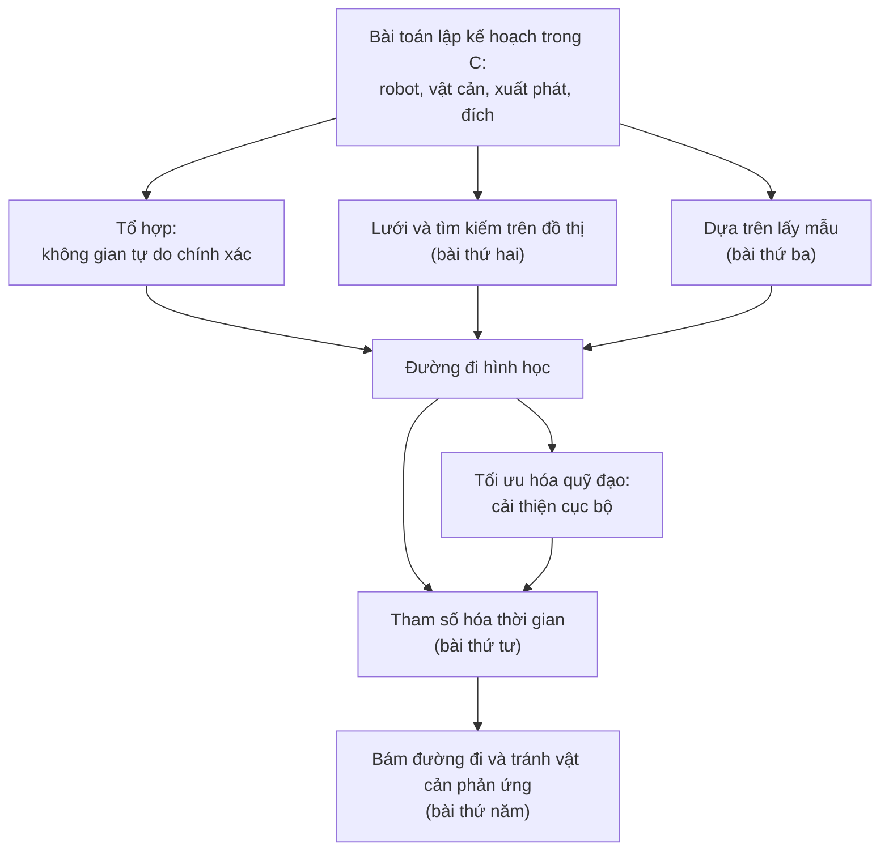

Một cánh tay robot phải chuyển một chi tiết từ đồ gá này sang đồ gá khác, hay một robot di động phải băng qua một căn phòng ngổn ngang đồ đạc, đều đối mặt với cùng một câu hỏi trước khi bất kỳ động cơ nào quay. Chuyển động nào đưa nó từ chỗ đang đứng đến chỗ cần đến mà không chạm vào thứ gì? Trả lời câu hỏi đó chính là **lập kế hoạch chuyển động** (motion planning). Bài thứ nhất này của loạt bài [Lập kế hoạch chuyển động cho robot](/vi/series/motion-planning) phát biểu bài toán một cách chính xác, trong khung mà cả loạt bài sẽ dùng. Khung đó là không gian cấu hình (configuration space), trong đó một robot có hình dạng bất kỳ trở thành một điểm duy nhất và các vật cản của nó trở thành những vùng mà điểm ấy phải tránh.

Bài này dựa trên loạt bài [Nhập môn robot học](/vi/series/introduction-to-robotics): các bậc tự do (degree of freedom) trong [Robot là gì? Các thành phần và vòng cảm nhận – hành động](/vi/blog/what-is-a-robot), các hệ tọa độ trong [Hệ tọa độ và phép biến đổi vật rắn](/vi/blog/coordinate-frames-and-transformations) và trên hết là cánh tay hai khâu cùng không gian làm việc của nó trong [Động học thuận và động học ngược của cánh tay phẳng](/vi/blog/planar-arm-kinematics). Bài xây dựng không gian cấu hình và các vật cản trong đó, định nghĩa những gì một bộ lập kế hoạch có thể bảo đảm, trình bày cách kiểm tra va chạm và đặt các phương pháp của những bài sau lên cùng một bản đồ.

**Quy ước.** Các quy ước sau áp dụng cho cả loạt bài. Một cấu hình được ký hiệu $q$, không gian cấu hình là $\mathcal{C}$, vùng vật cản (obstacle region) là $\mathcal{C}_{\mathrm{obs}}$ và không gian tự do (free space) là $\mathcal{C}_{\mathrm{free}} = \mathcal{C} \setminus \mathcal{C}_{\mathrm{obs}}$; số chiều của $\mathcal{C}$ là $d$. Trong các ví dụ, không gian làm việc $\mathcal{W}$ là mặt phẳng $\mathbb{R}^2$. Cấu hình xuất phát và cấu hình đích là $q_{\mathrm{start}}$ và $q_{\mathrm{goal}}$. Một đường đi (path) là một ánh xạ liên tục $\sigma : [0, 1] \to \mathcal{C}_{\mathrm{free}}$ với $\sigma(0) = q_{\mathrm{start}}$ và $\sigma(1) = q_{\mathrm{goal}}$; một quỹ đạo (trajectory) $q(t)$, $t \in [0, T]$, bổ sung thêm yếu tố thời gian, và bài thứ tư viết nó dưới dạng $q(t) = \sigma(s(t))$ với một phép tham số hóa thời gian (time scaling) $s(t)$. Cánh tay hai khâu có các góc khớp $\theta_1$ và $\theta_2$, trong đó $\theta_2$ đo so với khâu thứ nhất, và độ dài các khâu $l_1 = 1.0$ m và $l_2 = 0.7$ m, như trong loạt bài Nhập môn robot học. Đơn vị là SI, các hệ tọa độ là hệ thuận tay phải và góc tính bằng radian trong mọi phép tính; độ chỉ xuất hiện trong các bảng in ra và trong văn bản, cho dễ đọc. Mã nguồn là Python 3.13 với NumPy 2.5. Các chương trình đều tất định, nên không cần hạt giống ngẫu nhiên (random seed), và mọi kết quả được trích dẫn đều lấy từ việc chạy chúng.

## 1. Bộ lập kế hoạch chuyển động làm gì

### 1.1 Bộ lập kế hoạch trong robot

Bài thứ nhất của loạt bài Nhập môn robot học tổ chức phần mềm của robot xoay quanh cảm nhận, lập kế hoạch và hành động. Bài đó đặt việc lập kế hoạch chuyển động giữa tầng tác vụ và các bộ điều khiển khớp (mục 4 và mục 5 của [bài đó](/vi/blog/what-is-a-robot)). Tầng tác vụ quyết định việc cần làm tiếp theo: nhặt chi tiết, đi đến trạm sạc. Các bộ điều khiển khớp làm cho các khớp bám theo một giá trị đặt. **Bộ lập kế hoạch chuyển động** (motion planner) nối hai tầng này: với một đích và một mô hình của robot cùng môi trường xung quanh, nó tính ra một chuyển động đến được đích và tránh va chạm, rồi chuyển chuyển động đó xuống dưới làm giá trị đặt.

Do đó một bộ lập kế hoạch cần một mô hình hình học của robot (hình dạng các khâu, loại khớp và giới hạn khớp), một mô hình của các vật cản (từ bản đồ, từ mô hình thiết kế có trợ giúp của máy tính của một ô làm việc, hoặc từ hệ thống nhận thức) cùng với cấu hình xuất phát và cấu hình đích. Nó trả về một đường đi gồm các cấu hình không va chạm từ điểm xuất phát đến đích, hoặc một báo cáo rằng nó không tìm được đường đi nào. Nó không thể tránh một vật cản không có trong mô hình của nó; bài thứ năm quay lại vấn đề đó.

### 1.2 Bài toán người khuân đàn piano

Phần cốt lõi hình học của nhiệm vụ này được đặt tên theo việc chuyển đồ đạc. Một cây đại dương cầm được khiêng qua các cửa của một ngôi nhà có thể xoay cũng như trượt, và một chuỗi các phép xoay nhỏ thường là cách duy nhất để lọt qua. Schwartz và Sharir gọi phiên bản tổng quát là **bài toán người khuân đàn piano** (piano movers' problem) trong một loạt bài báo vào đầu thập niên 1980 và đưa ra một thuật toán tổng quát cho nó (Schwartz và Sharir, 1983).

**Bài toán.** Một robot có hình dạng đã biết chuyển động với $d$ bậc tự do giữa các vật cản có hình dạng và vị trí đã biết. Cho một cấu hình xuất phát và một cấu hình đích, hãy tìm một chuyển động liên tục không va chạm từ điểm xuất phát đến đích, hoặc báo cáo đúng rằng không tồn tại chuyển động nào như vậy.

Phát biểu này được cố ý giới hạn hẹp: nó giả định các mô hình chính xác, tĩnh và một robot có thể chuyển động theo bất kỳ hướng nào các khớp cho phép, với bất kỳ tốc độ nào. Các tầng sau bổ sung những gì nó bỏ qua. Bài thứ tư gán thời gian cho một đường đi sao cho tuân thủ các giới hạn vận tốc và gia tốc, còn bài thứ năm cho một robot có bánh với chuyển động bị ràng buộc bám theo một đường đi và tránh những vật cản không có trên bản đồ. Mỗi tầng đều bắt đầu từ một đường đi hình học không va chạm.

### 1.3 Những câu hỏi mà bộ lập kế hoạch trả lời

Có thể đặt cho một bộ lập kế hoạch ba câu hỏi, dẫn đến những thuật toán khác nhau:

- **Tính khả thi**: có tồn tại đường đi không va chạm nào từ $q_{\mathrm{start}}$ đến $q_{\mathrm{goal}}$ hay không, và nếu có thì một đường đi như vậy là gì?
- **Tính tối ưu**: trong tất cả các đường đi không va chạm, đường nào cực tiểu hóa một chi phí đã nêu, chẳng hạn độ dài hoặc thời gian?
- **Nhiều truy vấn**: với một môi trường cố định, làm thế nào trả lời nhanh nhiều cặp điểm xuất phát và đích, chẳng hạn bằng cách xây dựng một lần một bản đồ không gian tự do có thể dùng lại?

Một ô hàn mà các đồ gá không bao giờ di chuyển đặt ra câu hỏi thứ ba; một robot trong môi trường thay đổi đặt ra câu hỏi thứ nhất, thường là nhiều lần mỗi giây.

## 2. Không gian cấu hình

### 2.1 Cấu hình và bậc tự do

Một **cấu hình** (configuration) của robot là một mô tả đầy đủ vị trí của mọi điểm trên robot. Với một vật rắn, một vị trí và một hướng là đủ; với một cánh tay, các góc khớp là đủ, vì khi đó động học thuận xác định mọi khâu. Tập hợp mọi cấu hình là **không gian cấu hình** $\mathcal{C}$, và số tối thiểu các số thực cần để xác định một cấu hình là số chiều $d$ của nó, tức số **bậc tự do** của robot, theo cách đếm ở mục 2.2 của [Robot là gì?](/vi/blog/what-is-a-robot).

Lozano-Pérez đã phát biểu việc lập kế hoạch không gian như một phép tìm kiếm trong không gian các cấu hình và đưa ra các thuật toán tính vùng vật cản của nó cho đa giác và đa diện (Lozano-Pérez, 1983). Cái được là một sự thay đổi góc nhìn: trong không gian làm việc, bộ lập kế hoạch phải suy luận về một hình dạng có kích thước, biết xoay và gập, còn trong không gian cấu hình, toàn bộ robot là một điểm $q$ phải đi từ $q_{\mathrm{start}}$ đến $q_{\mathrm{goal}}$ mà không rời khỏi không gian tự do. Một phương pháp tìm được đường đi cho một điểm trong $d$ chiều có thể lập kế hoạch cho bất kỳ robot nào có $d$ bậc tự do.

Vài ví dụ làm rõ ý tưởng:

- Một **robot điểm** trong mặt phẳng có cấu hình $q = (x, y)$, nên $d = 2$.
- Một **robot hình đĩa** bán kính $r$ trong mặt phẳng cũng có $q = (x, y)$: xoay một hình đĩa không thay đổi gì, nên hướng không thuộc cấu hình.
- Một **đa giác rắn** có thể tịnh tiến và quay trong mặt phẳng có $q = (x, y, \theta)$, nên $d = 3$; một đế di động có bánh có cùng không gian cấu hình, dù, như bài thứ năm cho thấy, nó không thể chuyển động theo mọi hướng của không gian đó.
- Một **vật rắn trong không gian**, chẳng hạn một drone bay tự do, có ba tọa độ vị trí và ba tọa độ hướng, nên $d = 6$.
- **Cánh tay hai khâu** có $q = (\theta_1, \theta_2)$, nên $d = 2$; một cánh tay công nghiệp sáu khớp có $d = 6$, và cũng cánh tay đó đặt trên một đế di động có $d = 9$.

### 2.2 Hình dạng của không gian cấu hình

Số chiều không nói lên mọi điều về $\mathcal{C}$. **Tô pô** (topology) của nó, tức cách các điểm của nó nối với nhau, cũng quan trọng không kém: một bộ lập kế hoạch bỏ qua tô pô sẽ tìm ra những đường đi quá dài hoặc bỏ sót những đường đi có tồn tại.

Với một robot điểm, $\mathcal{C}$ là mặt phẳng $\mathbb{R}^2$. Một khớp quay không có giới hạn thì khác: $\theta$ và $\theta + 2\pi$ mô tả cùng một cấu hình, nên các cấu hình của nó tạo thành một **đường tròn**, ký hiệu $S^1$. Một góc $175^\circ$ và một góc $-175^\circ$ cách nhau $10^\circ$, không phải $350^\circ$, và hiệu giữa các góc được quy về khoảng $(-\pi, \pi]$, chẳng hạn bằng $\operatorname{atan2}(\sin\Delta, \cos\Delta)$, như loạt bài Nhập môn robot học đã làm.

Cánh tay hai khâu không có giới hạn khớp có hai góc như vậy, và không gian cấu hình của nó là tích $S^1 \times S^1$, một **mặt xuyến** (torus). Một hình vuông với $\theta_1$ và $\theta_2$ thuộc $[-\pi, \pi)$ là một bản đồ trung thực của mặt xuyến khi cạnh trái của nó được dán vào cạnh phải và cạnh dưới được dán vào cạnh trên. Một đường đi rời hình vuông ở bên phải sẽ đi vào lại từ bên trái, tức là vai quay qua $\pm 180^\circ$.

Giới hạn khớp lại thay đổi tô pô. Một khớp bị giới hạn trong $\pm 170^\circ$ có một khoảng cấu hình chứ không phải một đường tròn, nên phần lớn cánh tay công nghiệp có không gian cấu hình là một hình hộp trong $\mathbb{R}^d$, trong khi các cổ tay quay liên tục và hướng của một robot di động là các đường tròn. Các hướng của một vật rắn trong không gian tạo thành nhóm quay, mà không bộ ba góc nào phủ được mà không có điểm kỳ dị (singularity). Chương 2 của Lynch và Park (2017), chương 4 của LaValle (2006) và Choset và cộng sự (2005) trình bày chi tiết các không gian này.

Một bộ lập kế hoạch cũng cần một **khoảng cách** trên $\mathcal{C}$, để quyết định những cấu hình nào gần nhau và để đo độ dài của một đường đi. Với cánh tay, một lựa chọn phổ biến là quy từng hiệu góc về khoảng trên rồi gán trọng số cho nó:

$$
\rho(q, q') = \sqrt{w_1\,\Delta_1^2 + w_2\,\Delta_2^2}, \qquad \Delta_i = \operatorname{atan2}\!\big(\sin(\theta_i - \theta_i'), \cos(\theta_i - \theta_i')\big),
$$

trong đó các trọng số $w_i$ (ở đây không thứ nguyên) cho biết một radian của mỗi khớp quan trọng đến mức nào; một radian ở vai di chuyển tay kẹp xa hơn một radian ở khuỷu, nên chọn $w_1 > w_2$ là hợp lý. Với một cấu hình trộn lẫn mét và radian, chẳng hạn $(x, y, \theta)$, trọng số của $\theta$ mang thứ nguyên độ dài, và nói chung không có lựa chọn nào là đúng. Khoảng cách là một quyết định mô hình hóa, và các đường đi mà bộ lập kế hoạch trả về phụ thuộc vào nó.

### 2.3 Không gian làm việc và không gian cấu hình

**Không gian làm việc** (workspace) $\mathcal{W}$ là không gian trong đó robot và các vật cản tồn tại về mặt vật lý: ở đây là mặt phẳng, còn với phần lớn robot thực là không gian ba chiều. Đó là một không gian khác với $\mathcal{C}$, ngay cả khi hai không gian có cùng số chiều, như trường hợp cánh tay hai khâu.

Mối liên hệ giữa chúng là động học thuận. Mỗi cấu hình $q$ xác định tập $\mathcal{A}(q) \subset \mathcal{W}$ gồm các điểm của không gian làm việc mà robot chiếm chỗ. Với cánh tay hai khâu, khuỷu nằm ở $(l_1 \cos\theta_1,\ l_1 \sin\theta_1)$ và tay kẹp nằm ở

$$
x = l_1 \cos\theta_1 + l_2 \cos(\theta_1 + \theta_2), \qquad y = l_1 \sin\theta_1 + l_2 \sin(\theta_1 + \theta_2),
$$

như đã suy ra ở mục 2 của [bài về động học](/vi/blog/planar-arm-kinematics), và $\mathcal{A}(q)$ là cặp khâu đi từ đế qua khuỷu đến tay kẹp. Tay kẹp với tới được hình vành khuyên $0.3 \le \sqrt{x^2 + y^2} \le 1.7$ m, và hầu như mọi điểm của nó đều ứng với hai cấu hình. Vì vậy một vị trí tay kẹp không phải là một cấu hình, và một đường đi không va chạm của tay kẹp không cho biết gì về việc khuỷu hay khâu thứ nhất có va chạm trên đường đi hay không.

## 3. Vật cản trong không gian cấu hình

Một vật cản $\mathcal{O} \subset \mathcal{W}$ cấm mọi cấu hình mà tại đó robot chạm vào nó. Gom các cấu hình đó lại cho mọi vật cản sẽ định nghĩa **vùng vật cản trong không gian cấu hình** (configuration-space obstacle region), hay vùng vật cản C (C-obstacle region),

$$
\mathcal{C}_{\mathrm{obs}} = \{\, q \in \mathcal{C} \;:\; \mathcal{A}(q) \cap \mathcal{O} \neq \emptyset \,\},
$$

và không gian tự do $\mathcal{C}_{\mathrm{free}}$ là phần còn lại. Việc tiếp xúc có được tính là va chạm hay không là một quy ước; bài này coi chạm là va chạm, nên $\mathcal{C}_{\mathrm{free}}$ là một tập mở. Định nghĩa thì ngắn, nhưng $\mathcal{C}_{\mathrm{obs}}$ có thể trông chẳng giống $\mathcal{O}$ chút nào, như ba ví dụ dưới đây cho thấy.

### 3.1 Robot hình đĩa: phình to các vật cản

Với một robot chỉ tịnh tiến, vật cản C có một biểu thức dạng đóng. Đặt điểm tham chiếu của robot tại gốc của hệ tọa độ riêng của nó, sao cho robot ở cấu hình $q$ chiếm $\mathcal{A}(q) = \{\, q + a : a \in \mathcal{A} \,\}$. Nó chạm vào vật cản khi $q + a = o$ với một điểm $a$ nào đó của robot và một điểm $o$ nào đó của vật cản, tức là khi $q = o - a$. Do đó vật cản C là

$$
\mathcal{C}_{\mathrm{obs}} = \mathcal{O} \oplus (-\mathcal{A}) = \{\, o - a \;:\; o \in \mathcal{O},\ a \in \mathcal{A} \,\},
$$

**tổng Minkowski** (Minkowski sum) của vật cản và robot được lấy đối xứng qua điểm tham chiếu của nó. Với một hình đĩa bán kính $r$ có điểm tham chiếu tại tâm, $-\mathcal{A} = \mathcal{A}$, và tổng Minkowski là vật cản được **phình to** (inflated) thêm $r$: mọi điểm nằm trong khoảng cách $r$ tính từ vật cản. Một hình chữ nhật rộng $w$ và cao $h$ phình thành một hình chữ nhật bo tròn góc có diện tích

$$
w h + 2 r (w + h) + \pi r^2,
$$

gồm hình chữ nhật ban đầu, bốn dải rộng $r$ dọc theo các cạnh và bốn phần tư hình tròn ở các góc. Phần mềm robot di động dựa vào kết quả này khi phình to các vật cản trên bản đồ thêm bán kính của robot và lập kế hoạch cho tâm robot như một điểm.

Chương trình sau thực hiện việc đó trên một căn phòng 6 m nhân 4 m với các ô 0.2 m. Hai hình vuông cạnh 1.6 m chừa lại một hành lang rộng 0.8 m giữa $y = 1.6$ m và $y = 2.4$ m, và một ô thuộc $\mathcal{C}_{\mathrm{obs}}$ khi tâm của nó nằm trong khoảng cách $r$ tính từ một vật cản. Đoạn mã lược bỏ phần in kết quả.

```python
import numpy as np

W, H, CELL = 6.0, 4.0, 0.2                      # world size and cell size, m
RECTS = [(2.0, 3.6, 0.0, 1.6), (2.0, 3.6, 2.4, 4.0)]  # (xmin, xmax, ymin, ymax), m

def dist_to_rect(px, py, rect):
    """Euclidean distance from point(s) to an axis-aligned rectangle (0 inside)."""
    xmin, xmax, ymin, ymax = rect
    dx = np.maximum(np.maximum(xmin - px, 0.0), px - xmax)
    dy = np.maximum(np.maximum(ymin - py, 0.0), py - ymax)
    return np.hypot(dx, dy)

def in_c_obstacle(px, py, r):
    """A disk of radius r centered at (px, py) collides iff the center lies
    within distance r of some obstacle: the obstacle grown by r (Minkowski sum)."""
    return np.any([dist_to_rect(px, py, R) <= r for R in RECTS], axis=0)
```

Với $r = 0$ robot là một điểm, và lưới cho thấy chính không gian làm việc (bên trái). Lưới bên phải là không gian cấu hình của một hình đĩa bán kính 0.25 m:

```text
r = 0.0  m: 128 cells            r = 0.25 m: 180 cells
..........########............   .........##########...........
..........########............   .........##########...........
..........########............   .........##########...........
..........########............   .........##########...........
..........########............   .........##########...........
..........########............   .........##########...........
..........########............   .........##########...........
..........########............   .........##########...........
..............................   .........##########...........
..............................   ..............................
..............................   ..............................
..............................   .........##########...........
..........########............   .........##########...........
..........########............   .........##########...........
..........########............   .........##########...........
..........########............   .........##########...........
..........########............   .........##########...........
..........########............   .........##########...........
..........########............   .........##########...........
..........########............   .........##########...........
```

Các vật cản đã phình thêm một ô ở mỗi phía, và hành lang hẹp lại từ bốn hàng ô còn hai. Nói chính xác, tâm của một hình đĩa bán kính 0.25 m có thể đi qua bất cứ đâu giữa $y = 1.85$ m và $y = 2.15$ m, một dải tự do rộng 0.3 m. Với một hình đĩa bán kính 0.45 m, có đường kính 0.9 m vượt quá bề rộng hành lang, dải này biến mất:

```text
r = 0.45 m: 240 cells
........############..........
........############..........
........############..........
...
........############..........
........############..........
grown 1.6 m x 1.6 m rectangle, r = 0.45 m: exact 6.0762 m^2, grid 6.0762 m^2
```

Cả 20 hàng của lưới này đều giống hệt nhau (năm hàng được hiển thị): hai vật cản C đã nhập thành một bức tường, và không có đường đi nào băng qua căn phòng. Dòng cuối kiểm tra công thức diện tích, $2.56 + 2.88 + 0.6362 = 6.0762$ m², bằng cách đếm các ô 1 mm.

Ví dụ này cũng báo trước một vấn đề về độ phân giải. Lưới biểu diễn dải 0.3 m bằng hai hàng ô mà tâm của chúng tình cờ rơi vào trong dải; một robot lớn hơn một chút hoặc một lưới bị dịch đi sẽ để lại một dải hẹp hơn một ô, và lưới có thể bỏ sót nó. Mục 6 của [bài thứ hai](/vi/blog/graph-search-dijkstra-and-a-star) bàn về giới hạn này của lưới.

Với một robot còn quay được, cách dựng này áp dụng riêng cho từng hướng: mỗi giá trị của $\theta$ cho một lát cắt của $\mathcal{C}_{\mathrm{obs}}$ trong mặt phẳng $(x, y)$, và các lát cắt xếp chồng thành một vùng xoắn theo $\theta$ (Lozano-Pérez, 1983). Một robot dài không thể đi ngang qua một khung cửa vẫn có thể đi qua theo chiều dọc, điều mà trong $\mathcal{C}$ là một đường hầm tự do xuyên qua chồng lát cắt ở đúng khoảng giá trị của $\theta$.

### 3.2 Cánh tay hai khâu và một vật cản

Với một cánh tay, không có biểu thức dạng đóng, nhưng có thể tính trực tiếp theo định nghĩa: đặt cánh tay ở một cấu hình, kiểm tra xem có khâu nào gặp vật cản không và lặp lại trên một lưới các cấu hình. Chương trình dưới đây mô hình hóa mỗi khâu là một đoạn thẳng và mỗi vật cản là một hình đĩa, và tính **khoảng hở an toàn** (clearance), tức khoảng cách nhỏ nhất giữa các khâu và một vật cản bất kỳ trừ đi bán kính của vật cản đó. Một cấu hình va chạm khi khoảng hở an toàn bằng không hoặc âm.

```python
import numpy as np

L1, L2 = 1.0, 0.7

def seg_dist(px, py, ax, ay, bx, by):
    """Distance from point P to segment AB (works on arrays)."""
    abx, aby = bx - ax, by - ay
    s = np.clip(((px - ax) * abx + (py - ay) * aby) / (abx**2 + aby**2), 0.0, 1.0)
    return np.hypot(px - (ax + s * abx), py - (ay + s * aby))

def clearance(t1, t2, obstacles):
    """Smallest gap in m between the links (thin segments) and any disk obstacle."""
    ex, ey = L1 * np.cos(t1), L1 * np.sin(t1)                   # elbow
    gx, gy = ex + L2 * np.cos(t1 + t2), ey + L2 * np.sin(t1 + t2)  # gripper
    c = np.inf
    for (ox, oy, rad) in obstacles:
        d = np.minimum(seg_dist(ox, oy, 0.0, 0.0, ex, ey),
                       seg_dist(ox, oy, ex, ey, gx, gy))
        c = np.minimum(c, d - rad)
    return c

def collides(t1, t2, obstacles):
    return clearance(t1, t2, obstacles) <= 0.0
```

Lưới có 36 nhân 36 ô, mỗi ô $10^\circ$, và mỗi ô được kiểm tra tại tâm của nó. Vật cản là một hình đĩa bán kính 0.2 m có tâm tại $(1.2, 0)$ m, nằm trong vành khuyên mà cánh tay với tới được. Trong lưới được in ra, $\theta_1$ tăng từ trái sang phải và $\theta_2$ tăng từ dưới lên trên, và `#` đánh dấu một ô thuộc $\mathcal{C}_{\mathrm{obs}}$:

```text
obstacles [(1.2, 0.0, 0.2)]
60 of 1296 cells in C_obs (4.6%), 1 free component(s) of sizes [1236]
theta2 (deg)   theta1 from -180 (left) to +180 (right) deg
   175        ....................................
   ...
   115        ....................................
   105        .............##.....................
    95        .............####...................
    85        ..............####..................
    75        ..............####..................
    65        ...............###..................
    55        ................##..................
    45        ................##..................
    35        ................###.................
    25        .................##.................
    15        .................##.................
     5        .................##.................
    -5        .................##.................
   -15        .................##.................
   -25        .................##.................
   -35        .................###................
   -45        ..................##................
   -55        ..................##................
   -65        ..................###...............
   -75        ..................####..............
   -85        ..................####..............
   -95        ...................####.............
  -105        .....................##.............
  -115        ....................................
   ...
  -175        ....................................
```

Một vật cản tròn đã trở thành một dải mảnh và cong. Với $\theta_2$ gần bằng không, cánh tay duỗi thẳng và chạm vào hình đĩa khi chĩa thẳng vào nó, nên dải nằm gần $\theta_1 = 0$. Khi khuỷu gập lên ($\theta_2 > 0$), khâu thứ hai xoay ngược chiều kim đồng hồ, và vai phải quay theo chiều ngược lại ($\theta_1 < 0$) để khâu đó quét qua hình đĩa một lần nữa; gập xuống thì đối xứng với trường hợp này. Vượt quá khoảng $|\theta_2| = 110^\circ$, khâu thứ hai gập ngược về phía đế và tránh được hình đĩa với mọi $\theta_1$. Khâu thứ nhất kết thúc ở cách đế 1.0 m, chính là nơi hình đĩa bắt đầu, nên nó cùng lắm chỉ chạm vào hình đĩa.

Vật cản chiếm 60 trong số 1296 ô, tức 4.6% không gian cấu hình, và không gian tự do là một vùng liên thông duy nhất.

### 3.3 Không gian tự do có thể bị tách rời

Đưa các vật cản lại gần đế làm thay đổi bức tranh. Hai hình đĩa nhỏ bán kính 0.1 m có tâm tại $(0.5, 0)$ m và $(-0.5, 0)$ m nằm trong tầm với của khâu thứ nhất; khâu này chạm hình đĩa thứ nhất mỗi khi $|\theta_1| \le \arcsin(0.1/0.5) = 11.54^\circ$, bất kể khuỷu ở vị trí nào, và chạm hình đĩa thứ hai mỗi khi $\theta_1$ cách $\pm 180^\circ$ không quá cùng góc đó. Chương trình gán cho mỗi vùng liên thông gồm các ô tự do một chữ cái, và việc gán nhãn này nối vòng qua cả hai cặp cạnh của lưới, vì không gian cấu hình là một mặt xuyến:

```text
obstacles [(0.5, 0.0, 0.1), (-0.5, 0.0, 0.1)]
172 of 1296 cells in C_obs (13.3%), 2 free component(s) of sizes [562, 562]
theta2 (deg)   theta1 from -180 (left) to +180 (right) deg
   175        #aaaaaaaaaaaaaaa###bbbbbbbbbbbbbbb##
   165        #aaaaaaaaaaaaaa####bbbbbbbbbbbbbb###
   155        #aaaaaaaaaaaa###a##bbbbbbbbbbbb###b#
   145        #aaaaaaaaaaaa#aaa##bbbbbbbbbbbb#bbb#
   135        #aaaaaaaaaaaaaaaa##bbbbbbbbbbbbbbbb#
   ...
  -135        #aaaaaaaaaaaaaaaa##bbbbbbbbbbbbbbbb#
  -145        #aaa#aaaaaaaaaaaa##bbb#bbbbbbbbbbbb#
  -155        #a###aaaaaaaaaaaa##b###bbbbbbbbbbbb#
  -165        ###aaaaaaaaaaaaaa####bbbbbbbbbbbbbb#
  -175        ##aaaaaaaaaaaaaaa###bbbbbbbbbbbbbbb#
IK solution theta = ( -22.9,   80.1) deg: component a
IK solution theta = (  40.4,  -80.1) deg: component b
```

Hai bức tường thẳng đứng là khâu thứ nhất gặp hai hình đĩa; các vùng nhỏ gần $\theta_2 = \pm 150^\circ$ là khâu thứ hai khi gập lại quét ngược qua hình đĩa nằm bên cạnh khâu thứ nhất, cũng chính hình đĩa tạo nên bức tường gần hơn. Các bức tường cắt mặt xuyến thành hai vùng, mỗi vùng 562 ô: `a`, với khâu thứ nhất nằm dưới trục $x$, và `b`, với khâu thứ nhất nằm trên trục đó. Không có chuyển động không va chạm nào nối hai vùng này.

Hai dòng cuối cho thấy vì sao điều này quan trọng. Mục tiêu $(1.3, 0.2)$ m nằm trong vành khuyên với tới được, và động học ngược (inverse kinematics, IK) dạng đóng ở mục 4 của [bài về động học](/vi/blog/planar-arm-kinematics) cho hai nghiệm thuộc hai thành phần khác nhau. Một cánh tay đang nghỉ với khâu thứ nhất chĩa lên trên, trong vùng `b`, chỉ có thể với tới mục tiêu bằng nghiệm $(40.4^\circ, -80.1^\circ)$. Nghiệm kia là một cấu hình không va chạm, nhưng không có đường đi nào dẫn đến nó, và một bộ lập kế hoạch nhận nó làm đích sẽ đối mặt với một bài toán vô nghiệm.

Việc gán nhãn cũng phụ thuộc vào sự nối vòng; Bài tập 6 hỏi một hình đĩa duy nhất tại $(0.5, 0)$ m tác động thế nào đến không gian tự do khi các cạnh của lưới không được dán lại với nhau.

### 3.4 Vì sao bộ lập kế hoạch hiếm khi xây dựng vùng vật cản

Mỗi lưới ở trên tốn 1296 phép kiểm tra va chạm. Cùng độ phân giải $10^\circ$ đó cần $36^6 \approx 2.18 \times 10^9$ ô trong sáu chiều và $36^7 \approx 7.84 \times 10^{10}$ ô trong bảy chiều. Việc dựng tường minh $\mathcal{C}_{\mathrm{obs}}$ khả thi với các đa giác tịnh tiến (tổng Minkowski của hai đa giác lồi có số cạnh không vượt quá tổng số cạnh của hai đa giác) và với các lưới nhỏ, nhưng không khả thi với các cánh tay có sáu hay bảy khớp.

Vì vậy phần lớn các bộ lập kế hoạch thực tế dùng một biểu diễn **ẩn**: một hàm đặt mô hình robot ở một cấu hình và trả lời liệu nó có va chạm hay không. Bộ lập kế hoạch vẫn tìm kiếm trong $\mathcal{C}$, nhưng chỉ biết các vật cản trong đó thông qua những truy vấn như vậy, được mô tả ở mục 5.

## 4. Đường đi, chi phí và những gì bộ lập kế hoạch bảo đảm

### 4.1 Tính khả thi, chi phí và tính tối ưu

Một đường đi $\sigma$ là **khả thi** khi nó liên tục, bắt đầu tại $q_{\mathrm{start}}$, kết thúc tại $q_{\mathrm{goal}}$ và nằm trong $\mathcal{C}_{\mathrm{free}}$; **bài toán khả thi** đòi hỏi một đường đi khả thi bất kỳ. Một **phiếm hàm chi phí** (cost functional) $J(\sigma)$ gán một số cho mỗi đường đi, và **bài toán lập kế hoạch tối ưu** đòi hỏi một đường đi khả thi cực tiểu hóa phiếm hàm đó, với chi phí tối ưu $C^*$.

Chi phí phổ biến nhất là độ dài của đường đi theo khoảng cách $\rho$ ở mục 2.2,

$$
J(\sigma) = \int_0^1 \left\lVert \frac{d\sigma}{ds} \right\rVert_w \, ds,
$$

trong đó $\lVert \cdot \rVert_w$ là chuẩn có trọng số của $\rho$. Với cánh tay và các trọng số bằng một, đây là độ dài Euclid của đường đi trong không gian khớp, tính bằng radian, chứ không phải quãng đường tay kẹp đi được. Các chi phí khác phạt khoảng hở an toàn nhỏ hoặc đo thời gian thực hiện, vốn phụ thuộc vào các giới hạn ở bài thứ tư.

Khi các vật cản chắn đoạn thẳng từ điểm xuất phát đến đích, một đường đi ngắn nhất sẽ chạm vào chúng: với một điểm giữa các đa giác trong mặt phẳng, nó đi thẳng đến một đỉnh rồi đi thẳng tiếp. Vì ở đây chạm được tính là va chạm, khi đó không tồn tại đường đi ngắn nhất trong tập mở $\mathcal{C}_{\mathrm{free}}$, mà chỉ có những đường đi có chi phí gần $C^*$ tùy ý. Trong thực tế, các vật cản được phình to thêm một biên an toàn (mục 5.5) và đường đi tối ưu sượt qua các vật cản đã phình: độ ngắn và độ an toàn kéo về hai hướng ngược nhau, và phiếm hàm chi phí cho biết chúng được đánh đổi ra sao.

### 4.2 Tính đầy đủ

Tính đầy đủ là một tính chất của thuật toán, không phải của một lần chạy, và có ba mức độ:

- Một bộ lập kế hoạch là **đầy đủ** (complete) nếu, với mọi bài toán, nó trả về một đường đi khả thi trong thời gian hữu hạn khi có tồn tại, và báo cáo trong thời gian hữu hạn rằng không tồn tại nếu ngược lại.
- Một bộ lập kế hoạch là **đầy đủ theo độ phân giải** (resolution complete) nếu nó đầy đủ đối với một phép rời rạc hóa, chẳng hạn một lưới: nó tìm ra đường đi mỗi khi có đường đi trong không gian đã rời rạc hóa và chỉ báo thất bại khi không có đường đi nào ở độ phân giải đó.
- Một bộ lập kế hoạch là **đầy đủ theo xác suất** (probabilistically complete) nếu, mỗi khi có tồn tại đường đi, xác suất nó đã tìm ra một đường đi tiến tới 1 khi số mẫu ngẫu nhiên nó đã lấy tiến tới vô cùng.

Các bảo đảm này khác nhau ở ý nghĩa của một lần thất bại. Chỉ một bộ lập kế hoạch đầy đủ mới chứng minh được rằng không tồn tại lời giải. Một bộ lập kế hoạch đầy đủ theo độ phân giải chỉ khẳng định điều đó cho lưới của nó; vẫn có thể tồn tại một đường đi qua một khe hẹp hơn một ô. Một bộ lập kế hoạch đầy đủ theo xác suất không bao giờ báo thất bại một cách chắc chắn được, và bảo đảm của nó giả định một đường đi có khoảng hở an toàn dương, để một mẫu có xác suất dương rơi gần đường đi đó (LaValle, 2006). [Bài thứ ba](/vi/blog/sampling-based-planning-prm-and-rrt) cho thấy các lối đi hẹp làm chậm những bộ lập kế hoạch này như thế nào (mục 5 của bài đó).

### 4.3 Các bảo đảm về tính tối ưu

Tính tối ưu cũng có ba mức độ như vậy. Một bộ lập kế hoạch là **tối ưu** nếu mọi đường đi nó trả về đều có chi phí $C^*$, hoặc gần chi phí đó tùy ý khi cận dưới đúng không đạt được. Nó là **tối ưu theo độ phân giải** (resolution optimal) nếu nó trả về đường đi rẻ nhất trong phép rời rạc hóa của nó, như thuật toán Dijkstra và A* với một hàm heuristic chấp nhận được thực hiện trên một đồ thị. Chi phí đó chỉ tiến tới $C^*$ khi làm mịn nếu phép rời rạc hóa biểu diễn được các đường đi gần tối ưu, điều mà một lưới liên thông 8 hướng không làm được với phần lớn các đường thẳng (mục 2.2 của [bài thứ hai](/vi/blog/graph-search-dijkstra-and-a-star)).

Một bộ lập kế hoạch là **tối ưu tiệm cận** (asymptotically optimal) nếu chi phí đường đi của nó hội tụ về $C^*$ với xác suất một khi số mẫu tăng lên. Karaman và Frazzoli đã chỉ ra rằng cây ngẫu nhiên khám phá nhanh (rapidly-exploring random tree, RRT) và bản đồ lộ trình xác suất (probabilistic roadmap, PRM) nối mỗi mẫu với một số cố định lân cận không phải là tối ưu tiệm cận. Một PRM nối mọi cặp nằm trong một bán kính cố định thì tối ưu tiệm cận nhưng tốn kém. Cùng bài báo đó giới thiệu các biến thể tối ưu tiệm cận với chi phí thấp hơn (Karaman và Frazzoli, 2011); mục 4 của [bài thứ ba](/vi/blog/sampling-based-planning-prm-and-rrt) mô tả chúng, kể cả một hiệu chỉnh về sau cho phép chứng minh đối với RRT*.

Không tính chất nào trong số này hứa hẹn tốc độ trên một bài toán cụ thể. Chúng loại trừ những bộ lập kế hoạch thất bại một cách có hệ thống, và cho biết một báo cáo thất bại có nghĩa là gì.

### 4.4 Bài toán khó đến mức nào

Bài toán tổng quát là khó theo một nghĩa chính xác. Lớp độ phức tạp **không gian đa thức** (polynomial space, PSPACE) chứa các bài toán quyết định giải được với bộ nhớ đa thức theo kích thước đầu vào, bao gồm mọi bài toán giải được trong thời gian đa thức. Một bài toán là **PSPACE-khó** (PSPACE-hard) khi mọi bài toán trong PSPACE đều quy được về nó trong thời gian đa thức, nên một thuật toán thời gian đa thức cho nó sẽ cho ra một thuật toán như vậy cho toàn bộ PSPACE, điều mà người ta tin rộng rãi, dù chưa chứng minh được, là không thể.

Reif đã chứng minh rằng bài toán người khuân vác tổng quát hóa, trong đó robot là một tập hợp các đa diện liên kết với nhau và số bậc tự do tăng theo đầu vào, là PSPACE-khó (Reif, 1979). Về sau Canny đã chỉ ra, trong bài báo năm 1988 của ông về các phép tính đại số và hình học trong PSPACE, rằng bài toán này quyết định được trong không gian đa thức, nên nó là PSPACE-đầy đủ. Kết quả này liên quan đến $d$ tăng dần; nó không làm cho mọi trường hợp cụ thể đều khó.

Với $d$ cố định, các thuật toán đầy đủ chạy trong thời gian đa thức theo số đặc trưng hình học của vật cản. Phép phân rã ô của Schwartz và Sharir có độ phức tạp hàm mũ kép theo $d$ (Schwartz và Sharir, 1983); thuật toán **lộ trình** (roadmap) của Canny, quy không gian tự do về một mạng các đường cong có cùng tính liên thông, có độ phức tạp hàm mũ đơn theo $d$ (Canny, *The Complexity of Robot Motion Planning*, 1988). Các thuật toán này hiếm khi được cài đặt cho robot thực. Các bộ lập kế hoạch ở những bài sau đánh đổi tính đầy đủ lấy tính đầy đủ theo độ phân giải hoặc theo xác suất và thời gian chạy phụ thuộc vào không gian tự do nhiều hơn là vào trường hợp xấu nhất.

## 5. Kiểm tra va chạm

### 5.1 Bộ kiểm tra va chạm như một hộp đen trả lời truy vấn

Một bộ lập kế hoạch biểu diễn $\mathcal{C}_{\mathrm{obs}}$ một cách ẩn cần hai loại truy vấn, và gần như toàn bộ công việc hình học của nó dồn vào đó:

- **kiểm tra cấu hình**: robot ở $q$ có giao với vật cản nào không?
- **kiểm tra cạnh**: đoạn thẳng từ $q$ đến $q'$ trong $\mathcal{C}$ có nằm trọn trong $\mathcal{C}_{\mathrm{free}}$ không?

Một **bộ kiểm tra va chạm** (collision checker) trả lời cả hai. Nó đặt các khâu bằng động học thuận và các phép biến đổi thuần nhất (homogeneous transformation) của loạt bài Nhập môn robot học, rồi kiểm tra chúng với mô hình vật cản. Với các bộ lập kế hoạch dựa trên lấy mẫu, nó là cách duy nhất để tiếp cận hình học và thường chiếm phần lớn thời gian chạy.

### 5.2 Kiểm tra một cạnh bằng cách lấy mẫu

Kiểm tra cạnh khó hơn, vì một đoạn thẳng chứa vô số cấu hình. Cách đơn giản nhất là kiểm tra các cấu hình cách nhau một khoảng cố định, gọi là **độ phân giải kiểm tra va chạm** (collision-checking resolution), và kết luận cạnh là tự do nếu tất cả các cấu hình đó đều tự do. Một vật cản mảnh có thể lọt giữa hai mẫu liên tiếp.

Thí nghiệm sau đây di chuyển cánh tay duỗi thẳng ($\theta_2 = 0$) từ $\theta_1 = -60^\circ$ đến $\theta_1 = 60^\circ$, một đoạn có độ dài $2\pi/3 = 2.0944$ rad trong $\mathcal{C}$. Một hình đĩa nhỏ bán kính 0.03 m nằm cách đế 1.65 m theo hướng $10^\circ$, trên đường đi của phần ngoài của khâu thứ hai. Cánh tay chạm vào nó khi $\theta_1$ nằm giữa $8.958^\circ$ và $11.042^\circ$, một cửa sổ rộng $2.084^\circ$, tức 0.0364 rad. Mỗi phép kiểm tra với bước cố định chia đoạn thẳng thành các bước bằng nhau không dài hơn giá trị đã nêu và dừng ở va chạm đầu tiên tìm thấy:

```text
edge length 2.0944 rad; obstacle radius 0.03 m
obstacle center at 10 deg, 1.65 m from the base
  fixed step 0.20 rad:   12 checks, collision found: False
  fixed step 0.10 rad:   22 checks, collision found: False
  fixed step 0.05 rad:   43 checks, collision found: False
  fixed step 0.02 rad:   62 checks, collision found: True
  fixed step 0.01 rad:  122 checks, collision found: True
  clearance-based:         4 checks, collision found: True (theta1 = 8.93 deg)
```

Các bước 0.2, 0.1 và 0.05 rad rộng hơn cửa sổ 0.0364 rad và báo cạnh là tự do; với bước 0.05 rad, các mẫu rơi vào $8.57^\circ$ và $11.43^\circ$, ở hai bên vật cản. Bước 0.02 rad tìm ra va chạm sau 62 phép kiểm tra. Không có bước cố định nào an toàn với mọi vật cản: một vật cản mảnh hơn, hoặc gần đế hơn, cho một cửa sổ hẹp hơn. Một bộ lập kế hoạch dùng bước cố định trả về những đường đi chỉ không va chạm ở độ phân giải đó.

### 5.3 Một phép kiểm tra không thể bỏ sót

Khoảng hở an toàn giúp có được một phép kiểm tra cạnh có bảo đảm. Nếu khoảng hở an toàn tại một cấu hình là $c$, một chuyển động mà trong suốt quá trình đó mọi điểm của robot di chuyển ít hơn $c$ thì không thể gây va chạm; khi di chuyển đúng bằng $c$, nó cùng lắm chỉ đạt tới tiếp xúc, và phép kiểm tra tiếp theo sẽ phát hiện điều đó.

Với cánh tay hai khâu, quãng di chuyển đó có thể được chặn trên bằng chuyển động của các khớp. Một điểm ở khoảng cách $u \in [0, l_2]$ dọc theo khâu thứ hai nằm tại $p = l_1\,e(\theta_1) + u\,e(\theta_1 + \theta_2)$, trong đó $e(\phi) = (\cos\phi, \sin\phi)$. Lấy đạo hàm theo thời gian và dùng $\lVert de(\phi)/dt \rVert = |\dot\phi|$, ta có:

$$
\lVert \dot p \rVert \le l_1\,|\dot\theta_1| + u\,|\dot\theta_1 + \dot\theta_2| \le (l_1 + l_2)\,|\dot\theta_1| + l_2\,|\dot\theta_2| .
$$

Các điểm trên khâu thứ nhất di chuyển chậm hơn, nhiều nhất là $l_1 |\dot\theta_1|$, nên vế phải là cận trên cho mọi điểm của cánh tay. Dọc theo cạnh $q(s) = q_a + s\,(q_b - q_a)$, $s \in [0, 1]$, với các thay đổi khớp $\Delta\theta_1$ và $\Delta\theta_2$, không điểm nào của cánh tay di chuyển nhanh hơn

$$
D = (l_1 + l_2)\,|\Delta\theta_1| + l_2\,|\Delta\theta_2|
$$

mét trên một đơn vị $s$. Từ một cấu hình có khoảng hở an toàn $c$, tham số cạnh có thể tiến lên một cách an toàn thêm $c / D$, nên các bước dài khi ở xa vật cản và ngắn khi ở gần:

```python
def certified(qa, qb, obstacles, tol=1e-3):
    """Walk from qa to qb in steps that no arm point can cover faster than
    the clearance: D = (l1 + l2)|dtheta1| + l2|dtheta2| per unit of s."""
    dq = qb - qa
    D = (L1 + L2) * abs(dq[0]) + L2 * abs(dq[1])
    s, checks = 0.0, 0
    while True:
        q = qa + s * dq
        c = clearance(q[0], q[1], obstacles)
        checks += 1
        if c <= tol:
            return True, checks, s       # collision, or closer than tol
        if s >= 1.0:
            return False, checks, s      # the whole edge is free
        s = min(1.0, s + c / D)
```

Với cạnh ở trên, $D = 1.7 \times 2.0944 = 3.5605$ m trên một đơn vị $s$. Phương pháp dừng sau 4 phép kiểm tra tại $\theta_1 = 8.93^\circ$, nơi khoảng hở an toàn giảm xuống dưới dung sai 1 mm, ngay trước điểm tiếp xúc tại $8.958^\circ$. Không bước nào có thể nhảy qua một vật cản, vì mỗi bước không dài hơn mức khoảng hở an toàn cho phép; các bước co lại khi tiến gần và dung sai kết thúc quá trình, nên một cạnh đến gần vật cản trong phạm vi 1 mm được tính là va chạm, một sai số thiên về an toàn. Dời hình đĩa ra xa đến 1.75 m tính từ đế để lại một khe hở 0.02 m ở đầu mút của cánh tay duỗi thẳng:

```text
obstacle center at 10 deg, 1.75 m from the base
  fixed step 0.20 rad:   12 checks, collision found: False
  fixed step 0.10 rad:   22 checks, collision found: False
  fixed step 0.05 rad:   43 checks, collision found: False
  fixed step 0.02 rad:  106 checks, collision found: False
  fixed step 0.01 rad:  211 checks, collision found: False
  clearance-based:        12 checks, collision found: False
```

Giờ mọi phương pháp đều báo cạnh là tự do, và điều đó đúng, nhưng chỉ kết quả dựa trên khoảng hở an toàn mới là một chứng minh: các bước cố định thô đã cho cùng câu trả lời với cạnh có va chạm. Phép kiểm tra dựa trên khoảng hở an toàn cần 12 phép kiểm tra để vượt qua khe hở 0.02 m. Chi phí của nó tăng khi khoảng hở an toàn giảm, và nó cần hai thứ mà phép kiểm tra bước cố định không cần: một truy vấn khoảng cách, vốn tốn kém hơn một phép thử có hay không, và một cận trên vận tốc như $D$ cho robot đang xét.

### 5.4 Khối bao và truy vấn khoảng cách

Các mô hình thực là những lưới tam giác (mesh) với hàng nghìn tam giác, và việc kiểm tra mọi cặp tam giác sẽ quá chậm cho việc lập kế hoạch. Các bộ kiểm tra va chạm bao mỗi bộ phận trong một **khối bao** (bounding volume), chẳng hạn một hình cầu, một hình hộp hoặc một hình con nhộng (capsule, một hình trụ có hai đầu là bán cầu), và kiểm tra các khối này trước: nếu hai khối bao không giao nhau thì các bộ phận bên trong cũng không thể giao nhau. Khi được sắp xếp thành một cây mà mỗi nút bao các nút con của nó, các khối tạo thành một **cây phân cấp khối bao** (bounding volume hierarchy, BVH), và một truy vấn chỉ đi xuống những nhánh chồng lấn. Một **pha sơ bộ** (broad phase) dùng các khối bao để tìm những cặp có thể va chạm, và một **pha chi tiết** (narrow phase) kiểm tra chính xác những cặp đó.

Với các hình lồi, phép kiểm tra chính xác có thể là một phép tính khoảng cách, chẳng hạn thuật toán Gilbert–Johnson–Keerthi (GJK), tính khoảng cách giữa hai tập lồi từ các hàm tựa (support function) của chúng (Gilbert và cộng sự, 1988); các bộ phận không lồi được chia thành những mảnh lồi. Một khoảng cách cũng cung cấp khoảng hở an toàn mà mục 5.3 cần.

Các khối bao mang tính thận trọng: những gì chúng báo là tự do thì đúng là tự do, nhưng các khối thô làm co không gian tự do và có thể đóng một lối đi mà robot thực vẫn lọt qua được, giống như việc tăng bán kính hình đĩa ở mục 3.1 từ 0.25 m lên 0.45 m đã đóng hành lang lại.

### 5.5 Khoảng hở an toàn và biên an toàn

Các mô hình mà bộ lập kế hoạch dùng không bao giờ chính xác: bản đồ có sai số cỡ centimet, ô làm việc khác với mô hình thiết kế của nó, cánh tay bị uốn khi chịu tải và bộ điều khiển bám theo với một sai số nào đó. Vì vậy các bộ lập kế hoạch phình to vật cản thêm một **biên an toàn** (safety margin) $\delta$, loại khỏi $\mathcal{C}_{\mathrm{free}}$ mọi cấu hình có khoảng hở an toàn nhỏ hơn $\delta$.

Biên an toàn là một sự đánh đổi: biên lớn hơn bao được sai số lớn hơn nhưng đóng lại các lối đi hẹp. Một thỏa hiệp phổ biến là một biên cứng nhỏ trong bộ kiểm tra va chạm cùng một thành phần chi phí phạt khoảng hở an toàn nhỏ hơn một biên mềm lớn hơn. Biên an toàn nên được xác định từ những sai số mà nó cần bao, và khi một đường đi đã được gán thời gian thì nó được kiểm tra lại, như mục 6 của [bài thứ tư](/vi/blog/trajectories-and-time-scaling) mô tả.

## 6. Bản đồ các phương pháp lập kế hoạch

Các phương pháp của loạt bài này chia thành năm họ, phân biệt bởi cách chúng biểu diễn không gian tự do và những gì chúng bảo đảm. Sơ đồ cho thấy một bài toán đi qua các họ này như thế nào trên đường trở thành chuyển động, và bảng so sánh chúng với nhau.



| Họ phương pháp | Biểu diễn không gian tự do bằng | Bảo đảm | Phù hợp với | Trong loạt bài này |
|---|---|---|---|---|
| Tổ hợp | Một phép phân rã chính xác hoặc một lộ trình của $\mathcal{C}_{\mathrm{free}}$ | Đầy đủ; một số biến thể tối ưu | $d$ thấp và mô hình đa giác hoặc đại số | Tại đây (mục 4.4); đồ thị tầm nhìn ở bài thứ hai |
| Lưới và tìm kiếm trên đồ thị | Một đồ thị gồm các ô hoặc các điểm mạng | Đầy đủ theo độ phân giải và tối ưu theo độ phân giải | $d$ đến khoảng 3 hoặc 4 | Bài thứ hai |
| Dựa trên lấy mẫu | Một đồ thị hoặc một cây gồm các mẫu ngẫu nhiên không va chạm | Đầy đủ theo xác suất; một số biến thể tối ưu tiệm cận | $d$ cao, chẳng hạn cánh tay | Bài thứ ba |
| Tối ưu hóa quỹ đạo | Một đường đi hoặc quỹ đạo được cải thiện bằng tối ưu hóa số | Tối ưu cục bộ, không có tính đầy đủ | Làm trơn và tinh chỉnh một đường đi | Được nhắc đến ở đây; bài thứ ba làm trơn đường đi |
| Phản ứng | Các số đọc cảm biến hiện tại và một chi phí cục bộ | Không có bảo đảm toàn cục | Phản ứng nhanh với vật cản không có trên bản đồ | Bài thứ năm |

**Các bộ lập kế hoạch tổ hợp** (combinatorial planner) tính một biểu diễn chính xác của $\mathcal{C}_{\mathrm{free}}$. Với một điểm giữa các đa giác, đường đi ngắn nhất nằm trên **đồ thị tầm nhìn** (visibility graph), có các cạnh nối những cặp nhìn thấy nhau trong số điểm xuất phát, đích và các đỉnh của vật cản; Lozano-Pérez và Wesley đã áp dụng nó cho các vật cản đa diện đã phình to (Lozano-Pérez và Wesley, 1979). Phân rã ô và lộ trình (mục 4.4) mở rộng việc lập kế hoạch chính xác cho các robot tổng quát.

**Lưới và tìm kiếm trên đồ thị** (graph search) rời rạc hóa $\mathcal{C}$ và tìm kiếm trên đồ thị thu được bằng thuật toán Dijkstra (Dijkstra, 1959) hoặc A* (Hart và cộng sự, 1968). Số ô của nó tăng theo độ phân giải mũ $d$ (mục 3.4), điều giới hạn nó vào những không gian như không gian $(x, y)$ hoặc $(x, y, \theta)$ của một robot di động.

**Các bộ lập kế hoạch dựa trên lấy mẫu** (sampling-based planning) lấy các cấu hình ngẫu nhiên, giữ lại những cấu hình không va chạm và nối chúng bằng các cạnh vượt qua phép kiểm tra cạnh. PRM xây dựng một đồ thị dùng lại được cho nhiều truy vấn (Kavraki và cộng sự, 1996); RRT phát triển một cây từ điểm xuất phát (LaValle và Kuffner, 2001). Các biến thể tối ưu tiệm cận của chúng, PRM* và RRT* (Karaman và Frazzoli, 2011), là một phần của bài thứ ba.

**Tối ưu hóa quỹ đạo** (trajectory optimization) cải thiện một đường đi ban đầu bằng cách cực tiểu hóa một chi phí kết hợp độ trơn với một thành phần phạt sự gần vật cản. Phương pháp tối ưu hóa Hamilton hiệp biến cho lập kế hoạch chuyển động (covariant Hamiltonian optimization for motion planning, CHOMP) làm việc này bằng các bước gradient thuộc loại được mô tả trong [Gradient Descent and Its Variants](/blog/gradient-descent-and-its-variants) (Ratliff và cộng sự, 2009). Phương pháp này nhanh nhưng chỉ tìm được tối ưu cục bộ và có thể mắc kẹt trong va chạm khi đường đi ban đầu nằm sai phía của một vật cản. Loạt bài không đi sâu vào nó.

**Các phương pháp phản ứng** (reactive method) chọn chuyển động tiếp theo từ các số đọc cảm biến hiện tại và một chi phí cục bộ, nên chúng phản ứng trong vòng một chu kỳ điều khiển với một vật cản không có trên bản đồ nào. Trường thế (potential field) (Khatib, 1986) và phương pháp cửa sổ động (dynamic window approach, DWA) (Fox và cộng sự, 1997) được trình bày trong bài thứ năm, cùng với các cực tiểu cục bộ khiến cần có một bộ lập kế hoạch toàn cục ở tầng trên chúng.

## 7. Bài tập

**Bài tập 1.** Hãy cho biết số chiều và tô pô của không gian cấu hình của mỗi robot sau. (a) Một chiếc ô tô trong bãi đỗ xe, được coi là một vật rắn trong mặt phẳng. (b) Một cánh tay sáu khớp trên đế cố định với mọi khớp quay không giới hạn. (c) Cũng cánh tay đó với giới hạn khớp $\pm 170^\circ$ ở mọi khớp. (d) Cánh tay ở (c) đặt trên một đế di động chuyển động trong mặt phẳng.

<details>
<summary>Đáp án</summary>

(a) $q = (x, y, \theta)$: $d = 3$, $\mathbb{R}^2 \times S^1$. Việc ô tô không thể đi ngang hạn chế vận tốc của nó, chứ không hạn chế cấu hình. (b) $d = 6$, mặt xuyến sáu chiều $S^1 \times \dots \times S^1$. (c) $d = 6$, một hình hộp trong $\mathbb{R}^6$: mỗi khớp có một khoảng góc, nên không có gì nối vòng. (d) $d = 9$: đế đóng góp $\mathbb{R}^2 \times S^1$ và cánh tay đóng góp một hình hộp trong $\mathbb{R}^6$.

</details>

**Bài tập 2.** Một robot hình đĩa bán kính 0.3 m chuyển động giữa các vật cản hình vuông cạnh 1.0 m. Diện tích của mỗi vật cản C là bao nhiêu? Hai trong số các hình vuông đứng cạnh nhau với một khe hở 0.5 m giữa chúng. Robot có đi qua được khe hở không, và dải tự do trong không gian cấu hình rộng bao nhiêu?

<details>
<summary>Đáp án</summary>

$w h + 2 r (w + h) + \pi r^2 = 1.0 + 1.2 + 0.2827 = 2.4827$ m². Đường kính của robot, 0.6 m, vượt quá khe hở, nên nó không thể đi qua: mỗi hình vuông phình thêm 0.3 m và các hình vuông đã phình chồng lên nhau $0.6 - 0.5 = 0.1$ m, không để lại dải tự do nào. Một robot bán kính 0.2 m sẽ để lại một dải rộng $0.5 - 0.4 = 0.1$ m.

</details>

**Bài tập 3.** Ở mục 3.3, hình đĩa bán kính 0.1 m tại $(0.5, 0)$ m chặn khâu thứ nhất khi $|\theta_1| \le 11.54^\circ$, bất kể $\theta_2$ bằng bao nhiêu. Hãy giải thích vì sao. Cũng hình đĩa đó có tạo ra một bức tường trải qua mọi giá trị của $\theta_2$ nếu tâm của nó ở $(1.2, 0)$ m không?

<details>
<summary>Đáp án</summary>

Hình đĩa nằm trong tầm với của khâu thứ nhất, mà vị trí của khâu này chỉ phụ thuộc vào $\theta_1$. Khoảng cách từ khâu đến tâm hình đĩa là $0.5\,|\sin\theta_1|$ với $|\theta_1| < 90^\circ$, và khoảng cách này không vượt quá 0.1 m khi $|\theta_1| \le \arcsin(0.2) = 11.54^\circ$, bất kể $\theta_2$ bằng bao nhiêu. Tại $(1.2, 0)$ m, điểm gần nhất của hình đĩa cách đế 1.1 m, vượt ra ngoài khâu thứ nhất, nên chỉ khâu thứ hai có thể gặp nó, và vật cản C trở thành một dải có phạm vi giới hạn theo $\theta_2$, như ở mục 3.2.

</details>

**Bài tập 4.** Cánh tay hai khâu chuyển động dọc theo một cạnh với $\Delta\theta_1 = 0.5$ rad và $\Delta\theta_2 = -0.4$ rad, và khoảng hở an toàn tại điểm đầu của cạnh là 0.05 m. Phép kiểm tra dựa trên khoảng hở an toàn ở mục 5.3 có thể tiến bao xa dọc theo cạnh trước phép thử tiếp theo, tính theo $s$ và theo từng góc khớp?

<details>
<summary>Đáp án</summary>

$D = 1.7 \times 0.5 + 0.7 \times 0.4 = 0.85 + 0.28 = 1.13$ m trên một đơn vị $s$, nên bước là $0.05 / 1.13 = 0.0442$. Các khớp di chuyển $0.0442 \times 0.5 = 0.0221$ rad và $0.0442 \times (-0.4) = -0.0177$ rad, xấp xỉ $1.27^\circ$ và $-1.01^\circ$.

</details>

**Bài tập 5.** Ba bộ lập kế hoạch được chạy trên cùng một bài toán và mỗi bộ đều báo "không tìm thấy đường đi": một bộ lập kế hoạch đầy đủ, một bộ lập kế hoạch lưới với các ô $5^\circ$ đầy đủ theo độ phân giải và một bộ lập kế hoạch đầy đủ theo xác suất được dừng sau $10^5$ mẫu. Có thể kết luận gì từ mỗi báo cáo?

<details>
<summary>Đáp án</summary>

Từ bộ lập kế hoạch đầy đủ: không tồn tại đường đi không va chạm nào. Từ bộ lập kế hoạch lưới: không có đường đi nào qua các ô của lưới đó; vẫn có thể tồn tại một đường đi qua một lối đi hẹp hơn khoảng một ô, và một lưới mịn hơn có thể tìm ra nó. Từ bộ lập kế hoạch dựa trên lấy mẫu: gần như không kết luận được gì; có thể tồn tại một đường đi trong một vùng mà $10^5$ mẫu chưa với tới, thường là một lối đi hẹp. Chỉ báo cáo thứ nhất chứng minh được rằng bài toán vô nghiệm.

</details>

**Bài tập 6.** Không gian cấu hình ở mục 3.3 được gán nhãn lại với chỉ một hình đĩa bán kính 0.1 m tại $(0.5, 0)$ m. Lưới có bao nhiêu thành phần tự do trên mặt xuyến, và bao nhiêu nếu lưới được coi là một hình vuông có các cạnh không được dán lại với nhau? Câu trả lời nào đúng với cánh tay, và một bộ lập kế hoạch dùng câu trả lời kia sẽ làm gì?

<details>
<summary>Đáp án</summary>

Chương trình cho kết quả:

```text
near base: torus 1 component(s), square without wrap 2
```

Bức tường tại $\theta_1 \approx 0$ cắt hình vuông làm hai, nhưng trên mặt xuyến hai phần nối với nhau qua $\theta_1 = \pm 180^\circ$. Mặt xuyến là đúng với một vai không có giới hạn; một bộ lập kế hoạch dùng hình vuông sẽ coi một đích nằm bên kia bức tường là không với tới được, dù cánh tay có thể quay theo chiều ngược lại. Với một vai bị giới hạn trước khi đến $\pm 180^\circ$, $\theta_1$ không còn nối vòng (không gian là một mặt trụ, hoặc là hình vuông nếu khuỷu cũng bị giới hạn), và hai phần không liên thông với nhau.

</details>

## 8. Tóm tắt

| Khái niệm | Kết quả | Giới hạn chính |
|---|---|---|
| Bài toán lập kế hoạch chuyển động | Tìm một đường đi liên tục không va chạm từ $q_{\mathrm{start}}$ đến $q_{\mathrm{goal}}$, hoặc báo cáo rằng không tồn tại đường đi nào | Giả định các mô hình chính xác, tĩnh và bỏ qua động lực học |
| Không gian cấu hình | Mỗi cách đặt robot ứng với một điểm $q$; số chiều $d$ = số bậc tự do | Tô pô có ý nghĩa: $S^1$ với một khớp quay, mặt xuyến $S^1 \times S^1$ với cánh tay hai khâu |
| Vật cản C của robot tịnh tiến | $\mathcal{O} \oplus (-\mathcal{A})$; với hình đĩa, là vật cản phình thêm $r$ | Phép quay biến nó thành một chồng lát cắt |
| Vật cản C của cánh tay | Tính theo từng điểm; một hình đĩa trở thành một dải cong, và các bức tường có thể chia $\mathcal{C}_{\mathrm{free}}$ thành nhiều thành phần | Lưới tường minh cần khoảng $36^d$ ô ở độ phân giải $10^\circ$ |
| Tính khả thi và tính tối ưu | Một đường đi khả thi nằm trong $\mathcal{C}_{\mathrm{free}}$; một đường đi tối ưu cực tiểu hóa $J(\sigma)$, thường là độ dài | Các đường đi ngắn nhất uốn quanh vật cản thì chạm vào chúng; biên an toàn đánh đổi độ dài lấy sự an toàn |
| Tính đầy đủ | Đầy đủ, đầy đủ theo độ phân giải, đầy đủ theo xác suất | Chỉ bộ lập kế hoạch đầy đủ mới chứng minh được rằng không tồn tại đường đi |
| Độ phức tạp | Bài toán tổng quát hóa là PSPACE-khó (Reif) và thuộc PSPACE (Canny) | Các thuật toán đầy đủ có độ phức tạp hàm mũ theo $d$ |
| Kiểm tra cạnh | Lấy mẫu bước cố định bỏ sót những vật cản mảnh hơn bước; khoảng hở an toàn chia cho cận $D$ cho một phép kiểm tra không thể bỏ sót | Cần truy vấn khoảng cách và một cận trên vận tốc |
| Các họ phương pháp | Tổ hợp, tìm kiếm trên lưới, lấy mẫu, tối ưu hóa quỹ đạo, phản ứng | Mỗi họ đánh đổi bảo đảm lấy tốc độ theo một cách khác nhau |

Không gian cấu hình biến một câu hỏi về một hình dạng chuyển động thành một câu hỏi về một điểm chuyển động. Cái giá phải trả là một không gian có hình dạng riêng của nó: các vật cản trông chẳng giống gì với vật cản tương ứng trong không gian làm việc, các góc nối vòng, và những vùng tự do có thể tách thành nhiều mảnh mà không chuyển động nào nối được. Trừ các phương pháp tổ hợp, các bộ lập kế hoạch chỉ nhìn thấy không gian đó qua các truy vấn va chạm, và những gì một bộ lập kế hoạch bảo đảm phụ thuộc vào việc nó thực hiện các truy vấn đó ở đâu và mịn đến mức nào. Bài tiếp theo, [Lập kế hoạch trên đồ thị: thuật toán Dijkstra và A*](/vi/blog/graph-search-dijkstra-and-a-star), đi theo cách tiếp cận trực tiếp nhất: nó chia không gian cấu hình thành các ô, biến các ô thành một đồ thị, tìm trên đồ thị đường đi rẻ nhất và chỉ ra nơi cách tiếp cận đó không còn mở rộng được.

### Tài liệu tham khảo

- J. Canny, *The Complexity of Robot Motion Planning*, MIT Press, 1988.
- J. Canny, "Some algebraic and geometric computations in PSPACE," in *Proceedings of the Twentieth Annual ACM Symposium on Theory of Computing (STOC)*, pp. 460–467, 1988.
- H. Choset, K. M. Lynch, S. Hutchinson, G. Kantor, W. Burgard, L. E. Kavraki and S. Thrun, *Principles of Robot Motion: Theory, Algorithms, and Implementations*, MIT Press, 2005.
- E. W. Dijkstra, "A note on two problems in connexion with graphs," *Numerische Mathematik*, vol. 1, pp. 269–271, 1959.
- D. Fox, W. Burgard and S. Thrun, "The dynamic window approach to collision avoidance," *IEEE Robotics & Automation Magazine*, vol. 4, no. 1, pp. 23–33, 1997.
- E. G. Gilbert, D. W. Johnson and S. S. Keerthi, "A fast procedure for computing the distance between complex objects in three-dimensional space," *IEEE Journal of Robotics and Automation*, vol. 4, no. 2, pp. 193–203, 1988.
- P. E. Hart, N. J. Nilsson and B. Raphael, "A formal basis for the heuristic determination of minimum cost paths," *IEEE Transactions on Systems Science and Cybernetics*, vol. 4, no. 2, pp. 100–107, 1968.
- S. Karaman and E. Frazzoli, "Sampling-based algorithms for optimal motion planning," *International Journal of Robotics Research*, vol. 30, no. 7, pp. 846–894, 2011.
- L. E. Kavraki, P. Švestka, J.-C. Latombe and M. H. Overmars, "Probabilistic roadmaps for path planning in high-dimensional configuration spaces," *IEEE Transactions on Robotics and Automation*, vol. 12, no. 4, pp. 566–580, 1996.
- O. Khatib, "Real-time obstacle avoidance for manipulators and mobile robots," *International Journal of Robotics Research*, vol. 5, no. 1, pp. 90–98, 1986.
- S. M. LaValle, *Planning Algorithms*, Cambridge University Press, 2006.
- S. M. LaValle and J. J. Kuffner, "Randomized kinodynamic planning," *International Journal of Robotics Research*, vol. 20, no. 5, pp. 378–400, 2001.
- T. Lozano-Pérez, "Spatial planning: A configuration space approach," *IEEE Transactions on Computers*, vol. C-32, no. 2, pp. 108–120, 1983.
- T. Lozano-Pérez and M. A. Wesley, "An algorithm for planning collision-free paths among polyhedral obstacles," *Communications of the ACM*, vol. 22, no. 10, pp. 560–570, 1979.
- K. M. Lynch and F. C. Park, *Modern Robotics: Mechanics, Planning, and Control*, Cambridge University Press, 2017.
- N. Ratliff, M. Zucker, J. A. Bagnell and S. Srinivasa, "CHOMP: Gradient optimization techniques for efficient motion planning," in *Proceedings of the IEEE International Conference on Robotics and Automation (ICRA)*, pp. 489–494, 2009.
- J. H. Reif, "Complexity of the mover's problem and generalizations," in *Proceedings of the 20th Annual Symposium on Foundations of Computer Science (FOCS)*, pp. 421–427, 1979.
- J. T. Schwartz and M. Sharir, "On the 'piano movers' problem. II. General techniques for computing topological properties of real algebraic manifolds," *Advances in Applied Mathematics*, vol. 4, no. 3, pp. 298–351, 1983.
