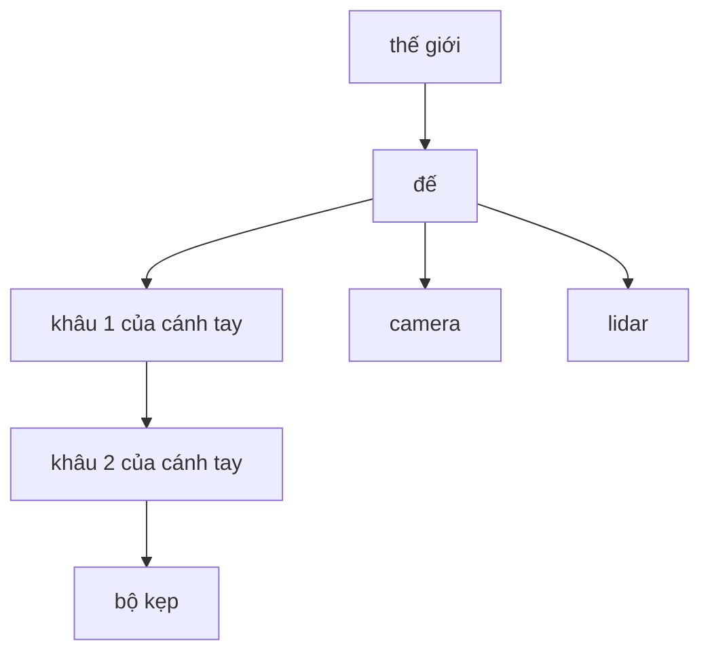

Bài thứ nhất của loạt bài này đã xếp hình học vào số những lý do khiến robot học khó: vị trí và hướng nằm trong những không gian mà trực giác thông thường dễ đánh lừa. Bài này cung cấp công cụ cho phần hình học đó. Mọi chủ đề về sau, từ động học đến ước lượng trạng thái, đều dựa trên chúng.

Bài toán rất dễ phát biểu. Một robot có nhiều bộ phận và cảm biến, và mỗi thứ tự nhiên mô tả thế giới theo góc nhìn của riêng nó. Một lidar báo một vật cản cách 3 mét phía trước *lidar*. Một bộ kẹp phải khép lại quanh một vật tại vị trí được cho *trong góc nhìn của camera*. Một bản đồ lưu các bức tường *trong hệ thế giới*. Trước khi có thể kết hợp bất kỳ thông tin nào trong số này, chúng phải được biểu diễn trong một hệ tọa độ chung, và điều đó đòi hỏi một cách chuyển đổi chính xác, máy móc giữa các hệ tọa độ. Bài này xây dựng bộ công cụ ấy đi từ tổng quát đến cụ thể: trước hết là hệ tọa độ và ký hiệu, tiếp theo là phép quay, rồi sự kết hợp giữa phép quay và phép tịnh tiến, và cuối cùng là cấu trúc thực tiễn mà phần mềm robot dùng để quản lý nhiều hệ tọa độ cùng lúc.

## 1. Hệ tọa độ và ký hiệu

### 1.1 Hệ tọa độ là gì

Một **hệ tọa độ** (coordinate frame) gồm một gốc cùng với một tập các trục đơn vị vuông góc với nhau từng đôi một: $x$, $y$ và, trong không gian, $z$. Trong suốt loạt bài này, các hệ tọa độ đều là **hệ thuận** (right-handed): khi các ngón tay phải cong từ $x$ về phía $y$, ngón cái chỉ theo $z$.

Một robot thường định nghĩa hệ tọa độ cho:

- **thế giới** (hay bản đồ), cố định trong môi trường;
- **đế** (base) của robot, chuyển động cùng robot;
- mỗi **khâu** (link) của cánh tay, chuyển động cùng khâu đó;
- **dụng cụ** hay khâu tác động cuối (end effector);
- mỗi **cảm biến**, chẳng hạn camera hoặc lidar, đặt tại điểm lắp và có quy ước trục riêng.

Không hệ tọa độ nào trong số này có vị trí đặc biệt. Chọn biểu diễn một đại lượng trong hệ nào là vấn đề thuận tiện; yêu cầu cốt yếu là phải biết, tại mọi thời điểm, mỗi con số đang được biểu diễn trong hệ tọa độ nào.

### 1.2 Ký hiệu

Ký hiệu dùng ở đây ghi rõ các hệ tọa độ, để lỗi trở nên nhìn thấy được ngay trên trang giấy.

- ${}^{A}\mathbf{p}$ là vị trí của điểm $\mathbf{p}$ biểu diễn trong hệ $A$.
- ${}^{A}R_{B}$ là **ma trận quay** (rotation matrix) chuyển các hướng biểu diễn trong hệ $B$ sang hệ $A$. Các cột của nó là các trục của $B$ viết theo tọa độ của $A$.
- ${}^{A}\mathbf{t}_{B}$ là vị trí gốc của $B$, biểu diễn trong $A$.
- ${}^{A}T_{B}$ là phép biến đổi (transformation) đầy đủ (quay và tịnh tiến) từ tọa độ $B$ sang tọa độ $A$.

Tính chất hữu ích của ký hiệu này là các chỉ số dưới và chỉ số trên **triệt tiêu** nhau trong một tích hợp lệ: trong ${}^{A}T_{B}\,{}^{B}T_{C}$ hai chữ $B$ ở giữa gặp nhau và kết quả là ${}^{A}T_{C}$. Một tích mà các nhãn ở giữa không khớp, chẳng hạn ${}^{A}T_{B}\,{}^{C}T_{D}$, gần như chắc chắn là một lỗi.

### 1.3 Điểm và vector

Cần phân biệt hai loại đại lượng hình học.

- Một **điểm** là một vị trí: đầu bộ kẹp, một vật cản. Tọa độ của nó thay đổi cả khi hệ tọa độ quay lẫn khi hệ tọa độ tịnh tiến.
- Một **vector tự do** (free vector) là một hướng kèm độ lớn: vận tốc, lực, độ dời giữa hai điểm. Nó không có vị trí, nên tọa độ của nó thay đổi khi hệ tọa độ quay nhưng không thay đổi khi hệ tọa độ tịnh tiến.

Sự khác biệt này trở nên quan trọng ngay khi phép tịnh tiến xuất hiện (Mục 4), và tọa độ thuần nhất được giới thiệu ở đó mã hóa nó một cách trực tiếp.

## 2. Phép quay trong mặt phẳng

### 2.1 Ma trận quay

Xét hệ $B$ quay một góc $\theta$ (ngược chiều kim đồng hồ) so với hệ $A$, có cùng gốc. Trục $x$ của $B$, viết theo tọa độ $A$, là $(\cos\theta, \sin\theta)$, và trục $y$ của nó là $(-\sin\theta, \cos\theta)$. Đặt chúng làm các cột ta được

$$
{}^{A}R_{B} = R(\theta) = \begin{bmatrix} \cos\theta & -\sin\theta \\ \sin\theta & \cos\theta \end{bmatrix},
\qquad
{}^{A}\mathbf{p} = {}^{A}R_{B}\,{}^{B}\mathbf{p} .
$$

Phương trình thứ hai nói rằng một điểm đã biết trong $B$ được chuyển sang $A$ bằng cách lấy các trục của $B$ (nhìn từ $A$) nhân với các tọa độ của điểm trong $B$ làm trọng số. Đó là toàn bộ nội dung của một ma trận quay.

### 2.2 Tính chất

Các cột của $R(\theta)$ có độ dài đơn vị và vuông góc với nhau, nên $R$ là ma trận **trực giao** (orthogonal): $R^{\mathsf T} R = I$. Nghịch đảo của nó là chuyển vị của nó, ${}^{B}R_{A} = ({}^{A}R_{B})^{\mathsf T} = R(-\theta)$, vừa rẻ để tính vừa chính xác. Định thức của nó bằng $+1$; định thức $-1$ sẽ là một phép đối xứng gương, điều mà không phép quay vật lý nào tạo ra được.

Trong mặt phẳng, các phép quay **giao hoán**: $R(\alpha)R(\beta) = R(\beta)R(\alpha) = R(\alpha + \beta)$. Một hướng trong mặt phẳng được mô tả đầy đủ bằng một góc duy nhất, và hợp các phép quay chính là cộng các góc. Mục tiếp theo cho thấy sự đơn giản này mất đi bao nhiêu trong ba chiều.

## 3. Phép quay trong không gian

### 3.1 Ma trận quay

Trong ba chiều, định nghĩa không đổi: ${}^{A}R_{B}$ là ma trận $3 \times 3$ có các cột là các trục $x$, $y$ và $z$ của $B$ biểu diễn trong $A$. Tập hợp mọi ma trận như vậy (trực giao, có định thức $+1$) được gọi là **nhóm trực giao đặc biệt** (special orthogonal group) $SO(3)$. Một ma trận quay có chín phần tử nhưng chỉ có **ba** bậc tự do (degree of freedom), khớp với ba bậc tự do về hướng của một vật rắn đã đếm ở bài thứ nhất; sáu ràng buộc trực chuẩn loại bỏ phần còn lại.

Các phép quay quanh các trục tọa độ là những khối xây dựng cơ bản:

$$
R_x(\theta) = \begin{bmatrix} 1 & 0 & 0 \\ 0 & \cos\theta & -\sin\theta \\ 0 & \sin\theta & \cos\theta \end{bmatrix},\quad
R_y(\theta) = \begin{bmatrix} \cos\theta & 0 & \sin\theta \\ 0 & 1 & 0 \\ -\sin\theta & 0 & \cos\theta \end{bmatrix},\quad
R_z(\theta) = \begin{bmatrix} \cos\theta & -\sin\theta & 0 \\ \sin\theta & \cos\theta & 0 \\ 0 & 0 & 1 \end{bmatrix}.
$$

### 3.2 Các phép quay không giao hoán

Trong không gian, thứ tự của các phép quay có ý nghĩa. Lấy hai phép quay một phần tư vòng, $R_x(90^\circ)$ và $R_z(90^\circ)$:

$$
R_x(90^\circ)\,R_z(90^\circ) = \begin{bmatrix} 0 & -1 & 0 \\ 0 & 0 & -1 \\ 1 & 0 & 0 \end{bmatrix},
\qquad
R_z(90^\circ)\,R_x(90^\circ) = \begin{bmatrix} 0 & 0 & 1 \\ 1 & 0 & 0 \\ 0 & 1 & 0 \end{bmatrix}.
$$

Áp dụng cho vector đơn vị dọc theo $x$, tích thứ nhất cho $(0, 0, 1)$ và tích thứ hai cho $(0, 1, 0)$: cùng hai phép quay nhưng theo thứ tự khác nhau khiến vector chỉ theo những trục khác nhau. Một cuốn sách trên bàn, được xoay một phần tư vòng quanh một cạnh rồi quanh một cạnh khác, sẽ kết thúc ở một hướng khác với hướng đạt được khi thực hiện cùng các phép xoay đó theo thứ tự ngược lại. Chỉ riêng sự thật này đứng sau phần lớn khó khăn trong việc biểu diễn hướng.

### 3.3 Bốn cách biểu diễn hướng

Vì ma trận quay dùng chín con số cho ba bậc tự do, các cách biểu diễn khác cũng phổ biến. Mỗi cách đánh đổi một điều gì đó để có sự gọn nhẹ.

| Cách biểu diễn | Số lượng số | Ưu điểm | Nhược điểm |
|---|---|---|---|
| Ma trận quay | 9 | Phép hợp là phép nhân ma trận; áp dụng lên vector một cách trực tiếp; không có điểm kỳ dị | Dư thừa; trôi số làm nó mất tính trực giao trừ khi được trực chuẩn hóa lại |
| Góc Euler (chẳng hạn roll, pitch, yaw) | 3 | Tối thiểu; trực quan với chuyển động nhỏ của phương tiện | Mười hai quy ước trục khả dĩ; có cấu hình kỳ dị (khóa gimbal); các góc không hợp với nhau bằng phép cộng |
| Trục – góc | 3 (hoặc 4) | Rõ ràng về hình học: một trục đơn vị $\hat{\mathbf u}$ và một góc $\theta$ | Phép hợp đòi hỏi chuyển đổi; trục không xác định khi $\theta = 0$ |
| Quaternion đơn vị | 4 | Gọn; không có điểm kỳ dị; phép hợp rẻ; nội suy trơn | Kém trực quan hơn; $q$ và $-q$ biểu diễn cùng một phép quay |

**Góc Euler.** Một quy ước phổ biến cho phương tiện viết hướng dưới dạng góc yaw $\psi$ quanh $z$, tiếp theo góc pitch $\theta$ quanh trục $y$ mới, rồi góc roll $\phi$ quanh trục $x$ mới, cho $R = R_z(\psi)\,R_y(\theta)\,R_x(\phi)$. Tại pitch $\theta = \pm 90^\circ$, trục quay thứ nhất và trục quay cuối cùng thẳng hàng, và chỉ hiệu $\psi - \phi$ (hoặc tổng, tại $-90^\circ$) ảnh hưởng đến kết quả: chẳng hạn, $\psi = 30^\circ, \phi = 10^\circ$ và $\psi = 50^\circ, \phi = 30^\circ$ cho cùng một ma trận tại $\theta = 90^\circ$. Một bậc tự do đã bị mất trong cách biểu diễn, dù không có gì xảy ra với vật thể vật lý. Đây là **khóa gimbal** (gimbal lock). Gần cấu hình này, những thay đổi nhỏ của hướng đòi hỏi những thay đổi lớn và nhanh của các góc, và đó là lý do các bộ ước lượng và bộ điều khiển cho những phương tiện có thể hướng thẳng lên trên tránh dùng góc Euler bên trong.

**Trục – góc.** Mọi phép quay đều có thể được mô tả như một lần quay duy nhất một góc $\theta$ quanh một trục đơn vị $\hat{\mathbf u}$ nào đó (định lý quay Euler). Ma trận được suy ra từ **công thức Rodrigues** (Rodrigues' formula),

$$
R = I + \sin\theta\,K + (1 - \cos\theta)\,K^2,
\qquad
K = \begin{bmatrix} 0 & -u_z & u_y \\ u_z & 0 & -u_x \\ -u_y & u_x & 0 \end{bmatrix},
$$

trong đó $K$ là ma trận tính tích có hướng $\hat{\mathbf u} \times \mathbf v$. Để kiểm tra, với $\hat{\mathbf u}$ dọc theo $z$, công thức cho lại đúng $R_z(\theta)$.

**Quaternion đơn vị.** Một **quaternion** là một số có bốn thành phần $q = w + x\,i + y\,j + z\,k$, được William Rowan Hamilton đưa ra năm 1843 như một mở rộng của số phức, với $i^2 = j^2 = k^2 = ijk = -1$; các quaternion được nhân với nhau như đa thức theo các quy tắc đó, và phép nhân không giao hoán, giống hệt các phép quay. Viết dưới dạng $(w, x, y, z)$, một quaternion đơn vị (có độ dài 1) mã hóa một phép quay bằng bốn con số

$$
q = \left(\cos\tfrac{\theta}{2},\ \hat{\mathbf u}\,\sin\tfrac{\theta}{2}\right),
$$

với chuẩn bằng một. Chẳng hạn, một phép quay một phần tư vòng quanh $z$ là $q = (0.7071, 0, 0, 0.7071)$. Các quaternion hợp với nhau bằng phép nhân quaternion, chỉ cần một bước chuẩn hóa lại rẻ để giữ tính hợp lệ, không có cấu hình kỳ dị nào, và nội suy trơn giữa các hướng, nên chúng là cách biểu diễn nội bộ thông dụng trong ước lượng và hoạt hình máy tính. Nửa góc dẫn đến một hệ quả đáng nhớ: $q$ và $-q$ mô tả cùng một phép quay, nên hai quaternion cần được so sánh khi bỏ qua dấu.

## 4. Phép biến đổi vật rắn

### 4.1 Quay cộng tịnh tiến

Khi hệ $B$ vừa quay vừa dời chỗ so với $A$, một điểm được chuyển đổi theo

$$
{}^{A}\mathbf{p} = {}^{A}R_{B}\,{}^{B}\mathbf{p} + {}^{A}\mathbf{t}_{B} .
$$

Quay tọa độ của điểm về hướng của $A$, rồi cộng thêm vị trí gốc của $B$ trong $A$. Một vector tự do chỉ được chuyển đổi bằng phép quay, như Mục 1.3 đã nói trước.

### 4.2 Tọa độ thuần nhất

Viết phép quay và phép tịnh tiến thành một ma trận duy nhất biến phép hợp thành một tích duy nhất. Thêm số 1 vào cuối tọa độ của một điểm, và lập **phép biến đổi thuần nhất** (homogeneous transformation) $4 \times 4$ (trong không gian) hoặc $3 \times 3$ (trong mặt phẳng):

$$
{}^{A}T_{B} = \begin{bmatrix} {}^{A}R_{B} & {}^{A}\mathbf{t}_{B} \\ \mathbf{0}^{\mathsf T} & 1 \end{bmatrix},
\qquad
\begin{bmatrix} {}^{A}\mathbf{p} \\ 1 \end{bmatrix} = {}^{A}T_{B} \begin{bmatrix} {}^{B}\mathbf{p} \\ 1 \end{bmatrix}.
$$

Vector tự do nhận số 0 thay vì số 1 ở tọa độ cuối, nên cột tịnh tiến được nhân với không và biến mất. Nhờ vậy điểm và vector được phân biệt ngay bởi chính dữ liệu.

Tập hợp mọi phép biến đổi như vậy là **nhóm Euclid đặc biệt** (special Euclidean group) $SE(3)$ (trong mặt phẳng là $SE(2)$). Một phép biến đổi có sáu bậc tự do trong không gian và ba trong mặt phẳng, đúng với số bậc tự do của vật rắn đã nêu ở bài thứ nhất.

### 4.3 Phép hợp và phép nghịch đảo

Các phép biến đổi hợp với nhau bằng phép nhân, với các nhãn triệt tiêu nhau:

$$
{}^{A}T_{C} = {}^{A}T_{B}\;{}^{B}T_{C} .
$$

Phép nghịch đảo không được tính bằng phép nghịch đảo ma trận tổng quát, vốn chậm hơn và kém chính xác hơn, mà từ cấu trúc của ma trận:

$$
{}^{B}T_{A} = \left({}^{A}T_{B}\right)^{-1} = \begin{bmatrix} {}^{A}R_{B}^{\mathsf T} & -\,{}^{A}R_{B}^{\mathsf T}\,{}^{A}\mathbf{t}_{B} \\ \mathbf{0}^{\mathsf T} & 1 \end{bmatrix}.
$$

Phép quay được đảo ngược bằng phép chuyển vị; phần tịnh tiến trở thành vị trí của gốc cũ nhìn từ hệ mới, và đó là lý do nó vừa nhận thêm ma trận quay chuyển vị vừa đổi dấu.

## 5. Một ví dụ tính toán trong mặt phẳng

Một robot di động ở vị trí $(2, 1)$ trong hệ thế giới, hướng $90^\circ$ (trục $x$ của nó chỉ theo trục $y$ của thế giới). Lidar của nó, lắp tại gốc của hệ robot và hướng về phía trước (nên hệ lidar và hệ robot trùng nhau), báo một vật cản tại ${}^{R}\mathbf{p} = (3, 0)$: cách 3 mét ngay phía trước robot. Vật cản ở đâu trong hệ thế giới?

$$
{}^{W}T_{R} = \begin{bmatrix} 0 & -1 & 2 \\ 1 & 0 & 1 \\ 0 & 0 & 1 \end{bmatrix},
\qquad
{}^{W}\mathbf{p} = {}^{W}T_{R} \begin{bmatrix} 3 \\ 0 \\ 1 \end{bmatrix} = \begin{bmatrix} 2 \\ 4 \\ 1 \end{bmatrix}.
$$

Vật cản ở $(2, 4)$: robot hướng theo trục $y$ của thế giới, nên "3 mét phía trước" cộng thêm 3 vào tọa độ $y$. Phép nghịch đảo đi theo chiều ngược lại:

$$
{}^{R}T_{W} = \begin{bmatrix} 0 & 1 & -1 \\ -1 & 0 & 2 \\ 0 & 0 & 1 \end{bmatrix},
\qquad
{}^{R}T_{W} \begin{bmatrix} 2 \\ 4 \\ 1 \end{bmatrix} = \begin{bmatrix} 3 \\ 0 \\ 1 \end{bmatrix},
$$

và cho lại đúng phép đo của lidar, như phải vậy.

Bây giờ giả sử một camera được lắp cách hệ đế của robot $0.5$ m về phía trước, hướng cùng chiều, và nhìn thấy một điểm đánh dấu tại ${}^{C}\mathbf{p} = (1, 0.2)$. Chuỗi hệ tọa độ là thế giới, robot, camera:

$$
{}^{W}\mathbf{p} = {}^{W}T_{R}\;{}^{R}T_{C}\;{}^{C}\mathbf{p},
\qquad
{}^{R}T_{C} = \begin{bmatrix} 1 & 0 & 0.5 \\ 0 & 1 & 0 \\ 0 & 0 & 1 \end{bmatrix},
$$

cho ${}^{W}\mathbf{p} = (1.8, 2.5)$. Các nhãn triệt tiêu từ trái sang phải ($W$–$R$, $R$–$C$, $C$), và phép tính không bao giờ đòi hỏi ai phải suy luận xem camera đang hướng về đâu; các phép biến đổi đã mang sẵn hiểu biết đó.

## 6. Hai cách đọc cùng một ma trận

Một phép biến đổi có thể được đọc theo hai cách, và nhầm lẫn giữa chúng là một nguồn lỗi phổ biến.

- **Bị động (đổi tọa độ).** Điểm đứng yên; ta mô tả nó trong một hệ tọa độ khác. ${}^{A}T_{B}$ chuyển tọa độ $B$ thành tọa độ $A$. Đây là cách đọc được dùng trong suốt bài này.
- **Chủ động (chuyển động).** Hệ tọa độ đứng yên, còn điểm (hoặc một vật) được di chuyển. Cùng ma trận đó di chuyển một điểm từ vị trí này sang vị trí khác, cả hai đều biểu diễn trong một hệ tọa độ duy nhất.

Các ma trận giống hệt nhau; chỉ cách diễn giải khác nhau. Một điểm tinh tế liên quan mật thiết là phép hợp. Một tích $R_1 R_2$ có thể được đọc là "quay theo $R_2$ quanh các trục của hệ cố định, rồi theo $R_1$ quanh các trục của hệ cố định", hoặc tương đương là "quay theo $R_1$, rồi theo $R_2$ quanh các trục *mới*, đã được quay". Quy ước roll–pitch–yaw ở Mục 3.3 được viết theo cách đọc thứ hai. Các thư viện ghi rõ chúng dùng cách đọc nào, và mã kết hợp hai thư viện phải kiểm tra điều này.

## 7. Quản lý nhiều hệ tọa độ

### 7.1 Cây hệ tọa độ

Một robot thực có hàng chục hệ tọa độ, và phần lớn các phép biến đổi giữa chúng không được lưu trực tiếp. Thay vào đó, phần mềm robot giữ một **cây** (tree) hệ tọa độ, trong đó mỗi hệ chỉ lưu phép biến đổi của nó so với hệ cha:

Để tìm phép biến đổi giữa hai hệ bất kỳ, phần mềm đi ngược lên từ mỗi hệ tới tổ tiên chung của chúng và hợp các phép biến đổi dọc theo đường đi, lấy nghịch đảo ở những chỗ đường đi ngược chiều một cạnh. Chẳng hạn, vị trí của bộ kẹp trong hệ camera là ${}^{C}T_{G} = ({}^{B}T_{C})^{-1}\;{}^{B}T_{L_1}\;{}^{L_1}T_{L_2}\;{}^{L_2}T_{G}$.

Các cạnh thay đổi với những tốc độ khác nhau. Phép biến đổi lắp đặt của camera là cố định và được đo một lần, bằng hiệu chuẩn (calibration). Phép biến đổi của các khâu cánh tay thay đổi mỗi khi các khớp chuyển động, và được tính từ các góc khớp (chủ đề của bài tiếp theo). Phép biến đổi của đế trong hệ thế giới thay đổi khi robot di chuyển và được ước lượng từ các cảm biến (chủ đề của bài cuối cùng).

### 7.2 Thời gian

Vì các hệ tọa độ chuyển động, một phép biến đổi chỉ có giá trị tại một thời điểm cụ thể. Một ảnh camera chụp tại thời điểm $t_1$ phải được kết hợp với tư thế (pose) của robot tại $t_1$, chứ không phải với tư thế của nó tại lúc ảnh được xử lý. Vì vậy, các cài đặt cây hệ tọa độ lưu một lịch sử ngắn của mỗi phép biến đổi kèm nhãn thời gian và nội suy giữa chúng. Nội suy phép quay đúng cách đòi hỏi một phương pháp luôn nằm trong tập các phép quay hợp lệ, chẳng hạn nội suy tuyến tính cầu (spherical linear interpolation) của quaternion; lấy trung bình các phần tử ma trận thì không đáp ứng được điều đó.

## 8. Những lỗi thường gặp

| Lỗi | Triệu chứng | Cách khắc phục |
|---|---|---|
| Nhân các phép biến đổi sai thứ tự | Kết quả đúng với một số tư thế và sai với những tư thế khác | Giữ nhãn hệ tọa độ trong ký hiệu; kiểm tra các nhãn ở giữa triệt tiêu nhau |
| Dùng ${}^{A}T_{B}$ ở chỗ cần ${}^{B}T_{A}$ | Các điểm bị đối xứng qua gốc của hệ tọa độ hoặc bị quay sai chiều | Đặt tên biến theo quy ước, chẳng hạn `T_world_robot` |
| Trộn lẫn độ và radian | Góc nhỏ gần đúng, góc lớn sai hoàn toàn | Dùng radian bên trong; chỉ chuyển đổi ở đầu vào và đầu ra |
| Thứ tự thành phần quaternion không nhất quán | Hướng bị xáo trộn khi dữ liệu đi qua các thư viện | Một số thư viện lưu $(w, x, y, z)$, số khác lưu $(x, y, z, w)$; chuyển đổi một cách tường minh |
| Trừ góc mà không quy về khoảng chuẩn | Một lần quay từ $350^\circ$ đến $10^\circ$ bị tính thành $-340^\circ$ thay vì $+20^\circ$ | Quy hiệu số về khoảng $(-180^\circ, 180^\circ]$, chẳng hạn bằng $\operatorname{atan2}(\sin\Delta, \cos\Delta)$, hàm arctang hai đối số, trả về góc của điểm $(\cos\Delta, \sin\Delta)$ trong toàn khoảng $(-180^\circ, 180^\circ]$ |
| Sai số làm tròn tích lũy trong ma trận quay | Độ dài và góc bị méo dần sau nhiều lần hợp | Trực chuẩn hóa lại định kỳ, hoặc lưu hướng dưới dạng quaternion đã chuẩn hóa |
| Quy ước trục khác nhau giữa các cảm biến | Hệ quang học của camera (thường $z$ hướng trước, $x$ sang phải, $y$ xuống dưới) bị coi như hệ thân (với robot mặt đất thường là $x$ hướng trước, $y$ sang trái, $z$ lên trên; với máy bay và nhiều drone là $x$ hướng trước, $y$ sang phải, $z$ xuống dưới) | Biểu diễn việc đổi quy ước như một phép biến đổi cố định riêng trong cây |

## 9. Tóm tắt

| Câu hỏi | Trả lời |
|---|---|
| Hệ tọa độ là gì? | Một gốc cùng các trục đơn vị vuông góc từng đôi một, theo quy tắc tay phải. |
| Các cột của ${}^{A}R_{B}$ là gì? | Các trục của hệ $B$ viết theo tọa độ của hệ $A$. |
| Nghịch đảo một phép quay như thế nào? | Bằng cách chuyển vị nó. |
| Các phép quay có giao hoán không? | Trong mặt phẳng thì có; trong không gian thì không. |
| Vì sao tránh dùng góc Euler bên trong? | Chúng có cấu hình kỳ dị (khóa gimbal) và không hợp với nhau bằng phép cộng. |
| Một phép biến đổi thuần nhất chứa gì? | Một phép quay và một phép tịnh tiến, trong một ma trận hợp với nhau bằng phép nhân; điểm mang số 1 ở cuối, vector tự do mang số 0. |
| Nghịch đảo ${}^{A}T_{B}$ như thế nào? | Chuyển vị phần quay; phần tịnh tiến mới là $-R^{\mathsf T}\mathbf t$. |
| Phần mềm xử lý nhiều hệ tọa độ như thế nào? | Bằng một cây các phép biến đổi tương đối so với hệ cha, có nhãn thời gian, được hợp dọc theo đường đi khi có yêu cầu. |

Bài tiếp theo áp dụng các công cụ này cho một cánh tay robot: tính vị trí của bộ kẹp từ các góc khớp, và bài toán khó hơn nhiều là chọn các góc khớp để đưa bộ kẹp đến vị trí mong muốn.

### Tài liệu tham khảo

- K. M. Lynch and F. C. Park, *Modern Robotics: Mechanics, Planning, and Control*, Cambridge University Press, 2017.
- B. Siciliano, L. Sciavicco, L. Villani and G. Oriolo, *Robotics: Modelling, Planning and Control*, Springer, 2009.
- J. J. Craig, *Introduction to Robotics: Mechanics and Control*, 3rd edition, Pearson Prentice Hall, 2005.
