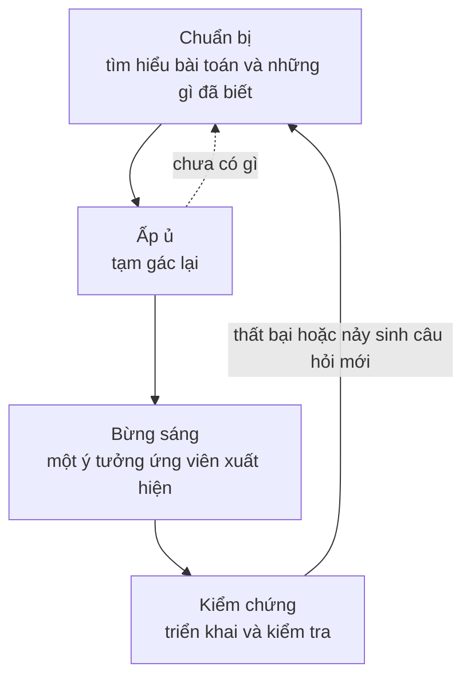

import Figure from '../../../components/Figure.astro';
import CtDivergeConverge from '../../../components/diagrams/CtDivergeConverge.astro';

Mười hai bài trước bài này đều nói về việc đánh giá ý tưởng: làm rõ một nhận định có nghĩa là gì, kiểm tra một lập luận có hợp lệ không, cân nhắc bằng chứng, so sánh các phương án và phát hiện sai lầm trong tất cả những việc đó. [Bài trước](/vi/blog/fallacies-and-cognitive-biases) đã gom những sai lầm ấy về một chỗ. Tuy nhiên, đánh giá cần có thứ để đánh giá. Một buổi thẩm định thiết kế không thể chọn ra một kiến trúc tốt hơn những kiến trúc đã được đề xuất, và một thí nghiệm không thể kiểm tra một giả thuyết mà chưa ai nghĩ ra. Bài cuối cùng này chuyển sang nửa còn lại của tư duy tốt: tạo ra các phương án ứng viên ngay từ đầu.

Bài bắt đầu từ một định nghĩa về sáng tạo (creativity) và một mô hình gắn việc tạo ra ý tưởng với việc đánh giá. Sau đó bài mô tả ba cách tạo ra ý tưởng mới, sự luân phiên giữa tư duy phân kỳ và tư duy hội tụ, các giai đoạn của quá trình sáng tạo và những gì nghiên cứu cho biết về giai đoạn ấp ủ và sự cố định tư duy, cùng bằng chứng về sáng tạo trong nhóm. Bài kết thúc với các giới hạn, bài tập và một cái nhìn lại các mục tiêu của toàn bộ loạt bài. Kế hoạch chủ đề đi theo học phần sáng tạo của *Critical Thinking Web* (Lau and Chan, 2004–2026), và Lau (2011) trình bày tư duy phản biện cùng sáng tạo trong một cuốn giáo trình; cấu trúc, ví dụ và nguồn tham khảo ở đây là của riêng bài này. Bài không dùng mã nguồn; vài phép đếm chỉ là tích và logarit đơn giản.

## 1. Sáng tạo là gì

### 1.1 Độc đáo và hiệu quả

Các nhà nghiên cứu về sáng tạo phần lớn đồng ý với một định nghĩa gồm hai phần: một ý tưởng hay sản phẩm sáng tạo vừa **độc đáo** (original) vừa **hiệu quả** (effective), tức là vừa mới vừa hữu ích hoặc phù hợp với một mục đích nào đó (Runco and Jaeger, 2012). Mỗi phần loại bỏ một thứ. Một chuỗi ký tự ngẫu nhiên thì độc đáo nhưng vô dụng. Một bản sao chính xác của một thuật toán đã biết thì hữu ích nhưng không độc đáo. Một thủ tục sắp xếp mới chạy nhanh hơn trên đúng loại dữ liệu mà một hệ thống cụ thể nhận được thì thỏa mãn cả hai.

Tính hiệu quả được đánh giá theo một mục đích, nên cùng một ý tưởng có thể sáng tạo trong bối cảnh này mà không sáng tạo trong bối cảnh khác. Một bộ nhớ đệm khéo léo loại bỏ được một điểm nghẽn là sáng tạo trong một dịch vụ bị giới hạn bởi độ trễ, nhưng vô nghĩa trong một tác vụ batch chạy qua đêm.

### 1.2 Mới đối với ai?

Boden (2004) tách hai nghĩa của "mới". Một ý tưởng **sáng tạo về mặt tâm lý** (psychologically creative, P-creative) nếu nó mới đối với chính người nghĩ ra nó, bất kể người khác đã từng nghĩ gì trước đó, và **sáng tạo về mặt lịch sử** (historically creative, H-creative) nếu chưa ai từng nghĩ ra nó. Phần lớn sáng tạo trong kỹ thuật là sáng tạo về mặt tâm lý: một kỹ sư tự mình tìm ra một kỹ thuật đã có trong tài liệu vẫn là đã giải bài toán một cách sáng tạo. Sự phân biệt này quan trọng vì hai lý do. Nó cho thấy sáng tạo là một hoạt động thường ngày chứ không phải thuộc tính của một vài phát kiến lịch sử. Nó cũng giải thích vì sao việc tra cứu tài liệu (Mục 4.2) là một phần của công việc sáng tạo. Việc tra cứu biến một ý tưởng sáng tạo về mặt tâm lý thành một ý tưởng đã biết trước khi công sức bị lãng phí vào việc xây dựng lại nó, hoặc xác nhận rằng nó có thể là sáng tạo về mặt lịch sử.

### 1.3 Biến dị và chọn lọc

Campbell (1960) đề xuất rằng tư duy sáng tạo vận hành giống như các quá trình thu nhận tri thức khác, kể cả tiến hóa sinh học. Nó cần một nguồn **biến dị** (variation), tức nhiều ứng viên được tạo ra mà không biết trước cái nào sẽ thành công. Nó cũng cần một quá trình **giữ lại có chọn lọc** (selective retention) để kiểm tra các ứng viên và giữ lại số ít vượt qua. Mô hình này là một sự đơn giản hóa, nhưng nó cho một bức tranh rõ ràng về cách tư duy sáng tạo và tư duy phản biện (critical thinking) khớp với nhau. Việc tạo ra ý tưởng cung cấp biến dị; các phương pháp đánh giá của những bài trước thực hiện việc chọn lọc. Không cái nào hữu ích khi đứng một mình. Chọn lọc mà không có biến dị chỉ có thể chọn trong những gì đã có, còn biến dị mà không có chọn lọc chỉ tạo ra nhiễu.

Mô hình cũng giải thích một quy tắc thực hành. Nếu các ứng viên bị phán xét ngay khi chúng xuất hiện, bước chọn lọc bắt đầu kìm hãm biến dị: những ứng viên khác thường bị gạt bỏ trước khi chúng kịp được phát triển hay kết hợp. Mục 3 cho thấy việc chủ động tách hai bước giúp tránh điều này ra sao, và Mục 5 đưa ra bằng chứng từ làm việc nhóm.

## 2. Ba cách tạo ra cái mới

Boden (2004) phân biệt ba cách tạo ra ý tưởng mới. Chúng không loại trừ nhau, nhưng mỗi cách gợi ý một kỹ thuật khác nhau.

### 2.1 Kết hợp và loại suy

**Sáng tạo kết hợp** (combinational creativity) ghép những ý tưởng quen thuộc theo một cách lạ. Một công cụ kiểm tra văn phong cho văn bản, đánh dấu các từ bị cấm và các từ viết tắt chưa được giải thích trong bài viết, ghép ý tưởng về một công cụ phân tích mã tĩnh với ý tưởng về một cẩm nang văn phong nội bộ. Quản lý phiên bản cho tập dữ liệu ghép mô hình quản lý phiên bản của mã nguồn với bài toán theo dõi lượng dữ liệu lớn liên tục thay đổi. Không cái nào cần một yếu tố mới; mỗi cái chỉ cần một người nhận ra rằng hai yếu tố đã có khớp được với nhau.

**Loại suy** (analogy) là kiểu kết hợp giàu kết quả nhất, vì nó mang cả một cấu trúc từ lĩnh vực này sang lĩnh vực khác. Lý thuyết ánh xạ cấu trúc (structure-mapping) của Gentner (1983) cho rằng một phép loại suy tốt ánh xạ các *quan hệ* giữa các đối tượng chứ không phải các thuộc tính bề mặt của chúng. Hai ví dụ từ tin học cho thấy khuôn mẫu này:

- **Mô phỏng luyện kim** (simulated annealing) ánh xạ quá trình làm nguội chậm một kim loại, trong đó các nguyên tử ổn định vào một sắp xếp có năng lượng thấp, sang bài toán tối ưu hóa. Kirkpatrick, Gelatt và Vecchi (1983) biến điều này thành một phương pháp tìm kiếm đôi khi chấp nhận một lời giải tệ hơn, với xác suất giảm dần khi một tham số "nhiệt độ" được hạ xuống, để nó có thể thoát khỏi những cực tiểu cục bộ vốn giữ chân một phép tìm kiếm thuần túy tham lam.
- **Thuật toán di truyền** (genetic algorithm) ánh xạ tiến hóa sinh học sang bài toán tìm kiếm: một quần thể các lời giải ứng viên được cải thiện qua chọn lọc, tái tổ hợp và đột biến (Holland, 1975).

Không phép loại suy nào trao sẵn một phương pháp hoàn chỉnh. Mỗi phép gợi ý một cấu trúc mà các chi tiết của nó phải được triển khai và kiểm tra. Một thói quen hữu ích là viết phép loại suy ra thành danh sách các quan hệ tương ứng rồi đánh dấu những chỗ nó không còn đúng, vì những điểm thất bại ấy là nơi cấu trúc vay mượn phải được sửa đổi.

### 2.2 Khám phá một không gian

**Sáng tạo khám phá** (exploratory creativity) làm việc bên trong một không gian khả năng đã được xác lập và tìm ra những điểm trong đó mà chưa ai ghé tới. Trong thiết kế, không gian này có thể được làm cho tường minh. **Phân tích hình thái** (morphological analysis), do nhà vật lý thiên văn Fritz Zwicky (1969) phát triển, liệt kê các thuộc tính độc lập của một thiết kế và các giá trị khả dĩ của từng thuộc tính; mỗi tổ hợp giá trị là một ứng viên. Một tay kẹp robot có thể có ba phương thức dẫn động (điện, khí nén, thủy lực), bốn kiểu tiếp xúc (hai ngón, ba ngón, giác hút, ngón mềm), ba mức cảm biến (không có, cảm biến lực, thị giác) và hai loại bề mặt (cứng, đàn hồi). Như vậy có $3 \times 4 \times 3 \times 2 = 72$ ứng viên. Các ràng buộc sẽ tỉa bớt bảng: nếu dẫn động thủy lực bị loại cho một trạm xử lý thực phẩm, $4 \times 3 \times 2 = 24$ ứng viên bị bỏ và còn lại 48. Phần lớn số còn lại sẽ không đáng quan tâm, nhưng bảng này đưa ra trước mắt những tổ hợp mà không ai tự đề xuất nếu không được gợi ý.

Khi không gian lớn và có thứ tự, khám phá nó tốt nghĩa là tìm kiếm trong nó một cách hiệu quả. Lệnh `git bisect` tìm ra commit đã đưa lỗi vào bằng cách kiểm tra điểm giữa của khoảng nghi vấn và loại bỏ nửa không có lỗi; 1000 commit nghi vấn cần nhiều nhất $\lceil \log_2 1000 \rceil = 10$ lần kiểm tra. Các thí nghiệm sàng lọc trong kỹ thuật làm điều tương tự cho những yếu tố có thể ảnh hưởng đến một quá trình: nhiều yếu tố được thử ở hai mức trong một thí nghiệm được thiết kế nhỏ, và chỉ những yếu tố có ảnh hưởng lớn mới được nghiên cứu chi tiết.

### 2.3 Biến đổi không gian

**Sáng tạo biến đổi** (transformational creativity) thay đổi chính không gian bằng cách bỏ đi hoặc sửa đổi một trong những quy tắc đã định nghĩa nó, để những ý tưởng trước đây bất khả thi trở nên khả thi. Trong giải quyết vấn đề, các quy tắc thường là những phần chưa được xem xét trong cách bài toán được phát biểu. Có ba thao tác thay đổi chúng:

- **Phát biểu lại mục tiêu.** "Làm cho lượt chạy kiểm thử hằng đêm nhanh hơn" mời gọi việc tối ưu từng kiểm thử riêng lẻ. "Báo cho lập trình viên về các lỗi tích hợp sớm hơn" thì còn cho phép chạy trước những kiểm thử có khả năng thất bại cao nhất, kiểm thử song song từng commit, hoặc chuyển một số bước kiểm tra lên trước khi merge.
- **Tạm gỡ bỏ một ràng buộc.** "Ta sẽ xây dựng gì nếu độ trễ không quan trọng?" cho thấy bao nhiêu phần của thiết kế hiện tại được định hình bởi chỉ một yêu cầu đó, và yêu cầu ấy có cố định như vẫn giả định hay không.
- **Thêm một ràng buộc.** "Nếu nó phải chạy trên một vi điều khiển có 32 kilobyte bộ nhớ thì sao?" buộc việc tìm kiếm rời khỏi lời giải quen thuộc và có thể làm lộ ra một lời giải đơn giản hơn.

[Bài thứ mười một](/vi/blog/strategic-thinking-and-decisions) (Mục 2.1) đã dùng bốn giai đoạn trong cuốn *How to Solve It* (1945) của Pólya làm một chu trình giải quyết vấn đề. Cho giai đoạn lập kế hoạch, Pólya bổ sung các gợi ý tìm tòi (heuristic) cùng loại: giải trước một bài toán phụ hay một bài toán đặc biệt hơn, tổng quát hóa bài toán để cấu trúc của nó lộ ra, hoặc làm ngược từ điều cần tìm.

## 3. Tư duy phân kỳ và tư duy hội tụ

### 3.1 Hai kiểu tạo sinh

Guilford (1967), trong mô hình cấu trúc trí tuệ của ông, phân biệt **tạo sinh phân kỳ** (divergent production), tức tạo ra nhiều câu trả lời khác nhau cho một câu hỏi mở, với **tạo sinh hội tụ** (convergent production), tức tìm ra câu trả lời duy nhất mà một câu hỏi được xác định rõ đòi hỏi. "Dịch vụ này có thể hỏng theo bao nhiêu cách?" đòi hỏi kiểu thứ nhất; "thiết kế nào trong ba thiết kế này đáp ứng yêu cầu với chi phí thấp nhất?" đòi hỏi kiểu thứ hai. Trước đó, trong bài diễn văn về sáng tạo, Guilford đã lập luận rằng tâm lý học đã bỏ quên chủ đề này và rằng các bài kiểm tra trí thông minh, vốn thưởng cho những câu trả lời hội tụ, không thể đo được nó (Guilford, 1950).

Công trình của Guilford cũng đưa ra các thước đo thông dụng cho đầu ra phân kỳ: *độ trôi chảy* (fluency, số lượng ý tưởng), *độ linh hoạt* (flexibility, số loại ý tưởng khác nhau), *độ độc đáo* (originality, mức độ hiếm gặp của các ý tưởng) và *độ chi tiết* (elaboration, mức độ chúng được phát triển). Độ linh hoạt là thước đo đáng theo dõi nhất trong kỹ thuật. Hai mươi kiểu hỏng hóc đều là biến thể của "ổ đĩa bị đầy" thì trôi chảy; một danh sách cùng độ dài nhưng bao quát cả mạng, đồng hồ, cấu hình và người vận hành thì hữu ích hơn.

### 3.2 Luân phiên giữa hai chế độ

Theo cách nói của Campbell, tạo sinh phân kỳ là biến dị còn tạo sinh hội tụ là chọn lọc. Các phương pháp thiết kế làm cho sự luân phiên này trở nên tường minh, và thường áp dụng nó hai lần: một lần để quyết định bài toán là gì và một lần để giải nó.

<Figure caption="Hai pha phân kỳ – hội tụ. Trong mỗi pha, nửa bên trái mở rộng khi các phương án được tạo ra với việc phán xét được hoãn lại, và nửa bên phải thu hẹp khi chúng được đánh giá và chọn lọc. Pha thứ nhất xác định bài toán là gì; pha thứ hai xác định cách giải nó. Việc kiểm tra lời giải được chọn thường làm lộ ra một bài toán mới, và chu trình bắt đầu lại."><CtDivergeConverge /></Figure>

Có hai kiểu thất bại phổ biến. Một là hội tụ quá sớm: ý tưởng hợp lý đầu tiên được chấp nhận và thời gian còn lại được dùng để triển khai chi tiết nó. Kiểu kia là không bao giờ hội tụ, vì lựa chọn đồng nghĩa với từ bỏ các phương án. Pha thứ nhất trong hình phòng ngừa một kiểu thất bại thứ ba mà các bài trước đã gặp dưới những hình thức khác: giải bài toán như nó được phát biểu ban đầu, trong khi bài toán được phát biểu không phải là bài toán thực sự quan trọng.

## 4. Quá trình sáng tạo

### 4.1 Bốn giai đoạn của Wallas

Cuốn *The Art of Thought* (1926) của Graham Wallas đưa ra một mô tả về quá trình sáng tạo mà những tác giả về sau đã đổi tên và chia nhỏ nhưng hiếm khi thay thế. Mô tả này có bốn giai đoạn:

- **Chuẩn bị** (preparation): làm việc có chủ đích, có ý thức với bài toán.
- **Ấp ủ** (incubation): một khoảng thời gian bài toán không được làm việc một cách có ý thức.
- **Bừng sáng** (illumination): khoảnh khắc một ý tưởng hứa hẹn xuất hiện, thường bất ngờ.
- **Kiểm chứng** (verification): công việc có ý thức để kiểm tra ý tưởng và phát triển nó thành một dạng dùng được.

Các giai đoạn được vẽ thành một vòng lặp vì công việc thực tế đi qua chúng nhiều lần. Bước kiểm chứng thường cho thấy một ý tưởng thất bại hoặc chỉ thành công một phần, và thất bại ấy trở thành chất liệu mới cho bước chuẩn bị. Bừng sáng và kiểm chứng tương ứng với biến dị và chọn lọc của Mục 1.3; chuẩn bị và ấp ủ là những gì làm cho biến dị hữu ích có nhiều khả năng xảy ra.

### 4.2 Chuẩn bị

Giai đoạn chuẩn bị của Wallas là việc nghiên cứu có chủ đích, và đó là giai đoạn mà hình dung phổ biến về sáng tạo bỏ qua. Trong công việc kỹ thuật, các nhiệm vụ chính của nó là phát biểu bài toán một cách chính xác, thu thập những quan sát mà mọi lời giải đều phải giải thích được (log lỗi, số đo, những trường hợp hoạt động bình thường) và tìm hiểu những gì đã được biết. Nhiệm vụ cuối cùng là nơi sự phân biệt giữa sáng tạo về mặt tâm lý và sáng tạo về mặt lịch sử ở Mục 1.2 trở nên thiết thực. Một lần tra cứu ngắn trong tài liệu, hệ thống theo dõi issue hay các tài liệu tham khảo chuẩn hoặc tìm ra một lời giải sẵn có, hoặc cho thấy các cách tiếp cận đã biết thất bại thế nào trong trường hợp này, và thất bại ấy chỉ rõ một ý tưởng mới phải làm được gì.

### 4.3 Ấp ủ và sự cố định tư duy

Nhiều người kể rằng lời giải đến với họ khi đang tắm, khi đi dạo hay sau một đêm ngủ. Liệu việc tạm rời bài toán có giúp ích thật, hay người ta chỉ nhớ những lần nó có vẻ giúp ích, là một câu hỏi thực nghiệm. Sio và Ormerod (2009) đã tổng hợp kết quả của nhiều thí nghiệm về ấp ủ trong một phân tích gộp (meta-analysis). Họ báo cáo một hiệu ứng tích cực của ấp ủ nói chung, lớn hơn với những bài toán có nhiều câu trả lời khả dĩ so với những bài toán chỉ có một câu trả lời, và lớn hơn khi giai đoạn ấp ủ đến sau một giai đoạn chuẩn bị dài hơn. Bằng chứng ủng hộ việc nghỉ giữa chừng khi giải những bài toán khó sau khi đã làm việc nghiêm túc với chúng; nó không ủng hộ việc chờ cảm hứng thay cho làm việc.

Một cách giải thích được đề xuất cho hiệu ứng ấp ủ là sự giải phóng khỏi **sự cố định tư duy** (fixation), xu hướng cứ quay lại một cách tiếp cận đã thất bại. Duncker (1945) mô tả **sự cố định chức năng** (functional fixedness), tức khó khăn trong việc nhận ra một công dụng mới của một vật khi nó đã được trình bày trong vai trò thông thường. Trong bài toán nổi tiếng nhất của ông, những người được yêu cầu gắn một cây nến lên tường gặp khó khăn trong việc nhận ra rằng chiếc hộp đựng đinh ghim có thể dùng làm giá đỡ, nhất là khi chiếc hộp được đưa ra trong tình trạng đựng đầy đinh ghim. Jansson và Smith (1991) tìm thấy một phiên bản thiết kế của hiệu ứng này: những kỹ sư được xem một lời giải mẫu trước khi làm một nhiệm vụ thiết kế có xu hướng tái tạo các đặc điểm của nó, kể cả các khiếm khuyết. Sự cố định tư duy là lý do các thao tác ở Mục 2.3 có tác dụng: phát biểu lại mục tiêu hay gỡ bỏ một ràng buộc phá vỡ khuôn mẫu đang giữ việc tìm kiếm ở nguyên một chỗ.

### 4.4 Ví dụ chi tiết: một robot liên tục trượt khỏi trạm sạc

Một robot di động trong nhà kho không cắm được vào trạm sạc với tỉ lệ khoảng một lần trong mười lần thử.

**Chuẩn bị.** Người kỹ sư phát biểu bài toán thành một tỉ lệ thất bại đo được, thu thập log của các lần thử thất bại và đọc ghi chú thiết kế của bộ điều khiển cắm sạc. Log cho thấy phần lớn thất bại xảy ra khi robot đến trạm theo một góc lệch. Một khảo sát các thiết kế hiện có cho thấy đèn hiệu hồng ngoại, dấu mốc thị giác, các thanh dẫn hướng cơ khí lùa robot vào đúng vị trí và các thiết kế tiếp điểm chịu được lệch vị trí.

**Tạo sinh phân kỳ.** Với việc phán xét được hoãn lại, người kỹ sư liệt kê các ứng viên. Danh sách gồm tinh chỉnh bộ điều khiển, thêm một camera và một dấu mốc thị giác, thêm một đèn hiệu thứ hai để đo góc, định hình lại trạm sạc để nó lùa robot vào, mở rộng các tiếp điểm, tiếp cận từ một điểm trung gian cố định và tự động thử lại sau khi thất bại.

**Ấp ủ và một phép biến đổi.** Quay lại vào hôm sau, người kỹ sư nhận ra rằng gần như mọi ứng viên đều giả định *robot* phải trở nên chính xác hơn. Khi được phát biểu lại thành "làm cho việc cắm sạc chịu được độ chính xác mà robot vốn đã có", bài toán nghiêng về các ứng viên cơ khí, vốn không cần thêm cảm biến nào.

**Chọn lọc hội tụ và kiểm chứng.** Các ứng viên được chấm điểm theo các tiêu chí có trọng số như ở Mục 5 của bài thứ mười một. Một thanh dẫn hướng cơ khí cộng với cơ chế tự động thử lại được chọn và được kiểm tra qua vài trăm lần cắm sạc trước khi được áp dụng. Nếu tỉ lệ thất bại không giảm, log của những thất bại mới sẽ khởi đầu vòng chuẩn bị tiếp theo.

## 5. Ý tưởng trong nhóm

### 5.1 Động não và những gì bằng chứng cho thấy

Alex Osborn, một nhà quản lý ngành quảng cáo, đã phổ biến phương pháp **động não** (brainstorming) trong cuốn *Applied Imagination* (1953). Các quy tắc của nó đưa Mục 1.3 vào thực hành cho một nhóm: tạm ngưng phê phán, nhắm đến nhiều ý tưởng, hoan nghênh những ý tưởng khác thường và phát triển tiếp từ ý tưởng của người khác. Osborn kỳ vọng các nhóm tuân theo những quy tắc này sẽ vượt trội so với các cá nhân.

Các thí nghiệm, được Diehl và Stroebe (1987) tổng quan, nhiều lần cho thấy điều ngược lại. Một nhóm động não cùng nhau thường tạo ra ít ý tưởng hơn một **nhóm danh nghĩa** (nominal group): cùng số người làm việc riêng rẽ, với các danh sách được gộp lại sau đó. Diehl và Stroebe sau đó kiểm tra ba cách giải thích: **tắc nghẽn tạo sinh** (production blocking, tại một thời điểm chỉ một người được nói, nên những người khác phải chờ và đánh mất hoặc giữ lại ý tưởng), **lo ngại bị đánh giá** (evaluation apprehension, nỗi sợ người khác sẽ đánh giá một ý tưởng ra sao, ngay cả khi việc phê phán bị cấm) và ỷ lại (free riding, để người khác làm việc). Trong các thí nghiệm của họ, tắc nghẽn tạo sinh giải thích phần lớn mức sụt giảm.

### 5.2 Tư duy nhóm

Một kiểu thất bại khác liên quan đến sự hội tụ thay vì việc tạo ra ý tưởng. Janis (1972), khi nghiên cứu những quyết định chính sách đã sai lầm nghiêm trọng, mô tả **tư duy nhóm** (groupthink): một nhóm gắn kết, coi trọng sự đồng thuận, thôi xem xét các phương án khác, xem nhẹ các cảnh báo và trở nên quá tự tin vào đường lối đã chọn. Trong số các biện pháp khắc phục ông đề xuất có: người lãnh đạo không nêu phương án mình ưa thích ngay từ đầu, một thành viên được phân công phản biện quan điểm của đa số, và các chuyên gia bên ngoài được mời đến để phê bình kế hoạch của nhóm. Tư duy nhóm là dạng tập thể của thiên kiến xác nhận và sự quá tự tin đã được mô tả ở Mục 6 của bài trước.

### 5.3 Các phương pháp rút ra từ bằng chứng

Mỗi phát hiện gợi ý một thay đổi về quy trình:

- **Chống tắc nghẽn tạo sinh**, hãy tạo ý tưởng song song. Mỗi người tự viết ý tưởng trong một khoảng thời gian cố định trước bất kỳ cuộc thảo luận nào, rồi các danh sách được gộp lại; các biến thể viết ra giấy của cách này thường được gọi là *brainwriting*. Thu các danh sách trước khi ai lên tiếng cũng ngăn ý tưởng được nói ra đầu tiên neo giữ tất cả những ý tưởng còn lại.
- **Chống lo ngại bị đánh giá**, hãy để việc tạo ý tưởng ẩn danh khi chênh lệch vị thế lớn, chẳng hạn bằng cách thu thập ý tưởng trong một tài liệu dùng chung không ghi tên.
- **Chống tư duy nhóm**, hãy thiết kế pha hội tụ để dung nạp ý kiến bất đồng: thành viên thâm niên nhất phát biểu sau cùng, một thành viên được phân công phản bác phương án đang dẫn đầu, và một người ngoài nhóm thẩm định lựa chọn.
- **Để có biến dị**, hãy chọn thành viên từ những chuyên ngành khác nhau. Kết hợp và loại suy (Mục 2.1) chỉ có thể dùng những yếu tố mà ai đó trong phòng biết đến.

## 6. Giới hạn

### 6.1 Không phương pháp nào bảo đảm ý tưởng tốt

Không phương pháp nào trong số này là một thuật toán tạo ra ý tưởng tốt theo yêu cầu. Chúng làm tăng số lượng và phạm vi các ứng viên, nhờ đó làm cho ý tưởng tốt có nhiều khả năng xuất hiện hơn, nhưng chúng không thể cho biết ứng viên nào là đúng. Theo cách nói của Campbell, chúng tác động lên biến dị; việc chọn lọc vẫn dựa vào các phương pháp của những bài trước: logic để kiểm tra tính nhất quán, các thí nghiệm của [bài thứ tám](/vi/blog/scientific-reasoning-and-causation) để kiểm định, thống kê để đo lường và phân tích quyết định để lựa chọn.

### 6.2 Cái mới không phải là giá trị

Vì tính độc đáo thì dễ thấy còn tính hiệu quả cần công sức mới xác lập được, người ta dễ bị cám dỗ đề cao ý tưởng mới hơn ý tưởng tốt. Một kiến trúc mới lạ mà không ai trong nhóm bảo trì được thì không đạt nửa thứ hai của định nghĩa ở Mục 1.1. Định nghĩa hai phần là chuẩn mực cần giữ, và một ý tưởng sáng tạo về mặt tâm lý hóa ra đã được biết rõ không phải là một thất bại mà là một sự tiết kiệm công sức.

### 6.3 Chuyên môn là con dao hai lưỡi

Tri thức cung cấp các yếu tố cho sự kết hợp và tấm bản đồ cho việc khám phá, nhưng Mục 4.3 đã cho thấy sự quen thuộc cũng cố định sự chú ý vào những lời giải thông thường. Các cách phòng vệ là những cách đã được mô tả: các thao tác biến đổi làm thay đổi cách phát biểu bài toán, giai đoạn ấp ủ sau một thời gian làm việc vất vả, và các đồng nghiệp từ những chuyên ngành khác không có cùng những sự cố định tư duy.

## 7. Bài tập

1. **Đếm theo phân tích hình thái.** Một thiết kế nút cảm biến có các thuộc tính sau: nguồn năng lượng (pin, điện lưới, thu năng lượng từ môi trường), sóng vô tuyến (không có, Bluetooth Low Energy, LoRa, Wi-Fi) và cấp bảo vệ vỏ (trong nhà, ngoài trời). Có bao nhiêu thiết kế ứng viên? Nếu trong ứng dụng này việc thu năng lượng từ môi trường không đủ cấp nguồn cho Wi-Fi, còn lại bao nhiêu thiết kế?
2. **Độ trôi chảy và độ linh hoạt.** Trong năm phút, hãy liệt kê càng nhiều càng tốt những cách mà một dịch vụ web có thể trở nên không khả dụng. Sau đó nhóm danh sách lại theo loại nguyên nhân. Có bao nhiêu nhóm, và những loại nguyên nhân nào còn thiếu?
3. **Biến đổi bài toán.** Một nhóm phát biểu vấn đề của mình là "lượt chạy kiểm thử tích hợp hằng đêm của chúng tôi mất chín giờ". Hãy viết ba cách phát biểu lại mục tiêu, mỗi cách cho phép những lời giải mà cách phát biểu ban đầu không cho phép.
4. **Loại suy.** Hãy tìm một phép loại suy từ bên ngoài tin học cho bộ nhớ đệm (cache). Liệt kê hai quan hệ được chuyển sang và một điểm mà phép loại suy không còn đúng.
5. **Chẩn đoán một cuộc họp.** Trong một cuộc họp thiết kế, kỹ sư thâm niên nhất đề xuất một lời giải trước tiên, hai người khác đặt câu hỏi về nó và năm người còn lại không nói gì. Cuộc họp chấp nhận đề xuất. Dựa vào Mục 5, hãy nêu ba nguyên nhân có khả năng dẫn đến kết quả hạn hẹp này và một thay đổi quy trình cho mỗi nguyên nhân.
6. **Tìm kiếm.** Một sự suy giảm hiệu năng đã xuất hiện ở đâu đó trong 3000 commit gần nhất. Số lần build lớn nhất cần thiết để tìm ra commit lỗi đầu tiên bằng phương pháp chia đôi là bao nhiêu, giả sử mỗi lần build cho một kết quả tốt hoặc xấu rõ ràng?

**Đáp án.**

1. $3 \times 4 \times 2 = 24$. Loại bỏ tổ hợp thu năng lượng từ môi trường với Wi-Fi bớt đi $1 \times 1 \times 2 = 2$ ứng viên, còn lại 22.
2. Câu trả lời có thể khác nhau. Các nhóm điển hình là phần cứng, mạng, lỗi phần mềm, cấu hình, dung lượng và tải, sự phụ thuộc vào các dịch vụ khác, sự cố bảo mật và thao tác của con người. Những danh sách viết vội thường trôi chảy trong một hoặc hai nhóm và bỏ sót cấu hình, sự phụ thuộc và lỗi của người vận hành; đếm số nhóm là đo độ linh hoạt.
3. Các cách phát biểu lại khả dĩ: "lập trình viên biết về các lỗi tích hợp trong vòng một giờ" (cho phép chạy trước một tập con nhanh, có rủi ro cao); "chúng tôi có thể biết commit nào làm hỏng tích hợp" (cho phép kiểm thử song song từng commit); "các vấn đề tích hợp được phát hiện trước khi merge" (cho phép chuyển các bước kiểm tra lên sớm hơn). Mỗi cách gỡ bỏ một giả định ẩn trong cách phát biểu ban đầu, cụ thể là toàn bộ bộ kiểm thử phải chạy, chạy một lượt, mỗi đêm.
4. Một phép loại suy: bộ nhớ đệm giống như một chiếc bàn đặt cạnh các giá sách của thư viện. Các quan hệ được chuyển sang: những cuốn sách hay dùng được để trong tầm tay, và chiếc bàn thì nhỏ, nên phải trả một cuốn về khi một cuốn mới được mang tới (loại bỏ khỏi bộ nhớ đệm, eviction). Chỗ phép loại suy không còn đúng: cuốn sách trên bàn chính là cuốn sách thuộc về giá, trong khi một giá trị trong bộ nhớ đệm là một bản sao sẽ trở nên lỗi thời khi bản gốc thay đổi, nên phép loại suy che giấu vấn đề vô hiệu hóa bộ nhớ đệm.
5. Các nguyên nhân có khả năng: bị neo vào đề xuất đầu tiên và tắc nghẽn tạo sinh (thay đổi: mọi người tự viết ý tưởng trước khi có ai trình bày); lo ngại bị đánh giá trước một đồng nghiệp thâm niên (thay đổi: thu thập ý tưởng ẩn danh, hoặc để kỹ sư thâm niên phát biểu sau cùng); tư duy nhóm trong pha hội tụ (thay đổi: phân công một thành viên phản bác phương án đang dẫn đầu).
6. $\lceil \log_2 3000 \rceil = 12$, vì $2^{11} = 2048 < 3000 \le 4096 = 2^{12}$.

## 8. Tóm tắt

| Chủ đề | Điểm chính |
|---|---|
| Định nghĩa | Một ý tưởng sáng tạo vừa độc đáo vừa hiệu quả; chỉ mới thôi là chưa đủ. |
| Mới đối với ai | Ý tưởng sáng tạo về mặt tâm lý là mới đối với người nghĩ ra, ý tưởng sáng tạo về mặt lịch sử là mới đối với lịch sử; phần lớn sáng tạo trong kỹ thuật thuộc loại thứ nhất. |
| Biến dị và chọn lọc | Việc tạo ra ý tưởng cung cấp ứng viên và việc đánh giá thực hiện chọn lọc; chúng cản trở nhau khi được làm cùng một lúc. |
| Ba cách tạo ra ý tưởng | Kết hợp và loại suy, khám phá một không gian (phân tích hình thái, tìm kiếm có hệ thống), biến đổi không gian (phát biểu lại mục tiêu, thay đổi ràng buộc). |
| Tư duy phân kỳ và hội tụ | Mở rộng với việc phán xét được hoãn lại, rồi thu hẹp với việc phán xét được áp dụng, cho cả bài toán lẫn lời giải. |
| Quá trình | Chuẩn bị, ấp ủ, bừng sáng và kiểm chứng, lặp đi lặp lại; ấp ủ có ích sau khi đã chuẩn bị thực sự, một phần nhờ giải phóng sự cố định tư duy. |
| Nhóm | Động não tương tác thua việc gộp kết quả làm việc cá nhân, chủ yếu do tắc nghẽn tạo sinh; hãy tạo ý tưởng song song và thiết kế pha hội tụ để dung nạp ý kiến bất đồng. |
| Giới hạn | Các phương pháp làm tăng khả năng có ý tưởng tốt nhưng không lựa chọn giữa chúng; việc đánh giá mới quyết định. |

Bài này hoàn tất loạt bài, nên nó kết thúc ở nơi [phần tổng quan của loạt bài](/vi/series/critical-thinking) đã bắt đầu, với năm mục tiêu của nó. Mục tiêu thứ nhất, giải thích tư duy phản biện là gì và phân tích một nhận định thành ý nghĩa, tiền đề, kết luận và các giả định ẩn của nó, là công việc của ba bài đầu tiên. Mục tiêu thứ hai, đánh giá tính hợp lệ, tính đúng đắn và độ mạnh quy nạp của lập luận bằng biểu đồ Venn, bảng chân trị, suy diễn tự nhiên và logic lượng từ, là khóa học ngắn về logic hình thức của các bài thứ tư đến thứ bảy. Mục tiêu thứ ba, thẩm định các nhận định về nhân quả, khoa học và thống kê, được bài thứ tám và bài thứ chín đảm nhận. Mục tiêu thứ tư, phân tích phán đoán giá trị và quyết định, là chủ đề của bài thứ mười và bài thứ mười một. Mục tiêu thứ năm có hai nửa: nhận diện ngụy biện và thiên kiến là nhiệm vụ của bài thứ mười hai, còn tạo ra và phát triển ý tưởng mới là nhiệm vụ của bài này.

Gộp lại, các bài mô tả một cách thực hành duy nhất. Hãy tạo ra nhiều ứng viên hơn những gì nảy ra trong đầu đầu tiên, rồi đặt từng ứng viên trước những chuẩn mực về ý nghĩa, logic và bằng chứng mà loạt bài đã đề ra. Một người đọc làm được cả hai việc đó, với những câu hỏi kỹ thuật cũng như những câu hỏi thường ngày, đã đạt được những mục tiêu mà loạt bài tự đặt ra.

### Tài liệu tham khảo

- M. A. Boden, *The Creative Mind: Myths and Mechanisms*, 2nd ed., Routledge, 2004.
- D. T. Campbell, "Blind variation and selective retention in creative thought as in other knowledge processes," *Psychological Review*, vol. 67, no. 6, pp. 380–400, 1960.
- M. Diehl and W. Stroebe, "Productivity loss in brainstorming groups: Toward the solution of a riddle," *Journal of Personality and Social Psychology*, vol. 53, no. 3, pp. 497–509, 1987.
- K. Duncker, "On problem-solving," *Psychological Monographs*, vol. 58, no. 5, 1945.
- D. Gentner, "Structure-mapping: A theoretical framework for analogy," *Cognitive Science*, vol. 7, no. 2, pp. 155–170, 1983.
- J. P. Guilford, "Creativity," *American Psychologist*, vol. 5, no. 9, pp. 444–454, 1950.
- J. P. Guilford, *The Nature of Human Intelligence*, McGraw-Hill, 1967.
- J. H. Holland, *Adaptation in Natural and Artificial Systems*, University of Michigan Press, 1975.
- D. G. Jansson and S. M. Smith, "Design fixation," *Design Studies*, vol. 12, no. 1, pp. 3–11, 1991.
- I. L. Janis, *Victims of Groupthink*, Houghton Mifflin, 1972.
- S. Kirkpatrick, C. D. Gelatt and M. P. Vecchi, "Optimization by simulated annealing," *Science*, vol. 220, no. 4598, pp. 671–680, 1983.
- J. Y. F. Lau, *An Introduction to Critical Thinking and Creativity: Think More, Think Better*, Wiley, 2011.
- J. Y. F. Lau and J. Chan, *Critical Thinking Web*, Department of Philosophy, The University of Hong Kong, 2004–2026. https://philosophy.hku.hk/think/
- A. F. Osborn, *Applied Imagination: Principles and Procedures of Creative Thinking*, Charles Scribner's Sons, 1953.
- G. Pólya, *How to Solve It*, Princeton University Press, 1945.
- M. A. Runco and G. J. Jaeger, "The standard definition of creativity," *Creativity Research Journal*, vol. 24, no. 1, pp. 92–96, 2012.
- U. N. Sio and T. C. Ormerod, "Does incubation enhance problem solving? A meta-analytic review," *Psychological Bulletin*, vol. 135, no. 1, pp. 94–120, 2009.
- G. Wallas, *The Art of Thought*, Jonathan Cape, 1926.
- F. Zwicky, *Discovery, Invention, Research Through the Morphological Approach*, Macmillan, 1969.
