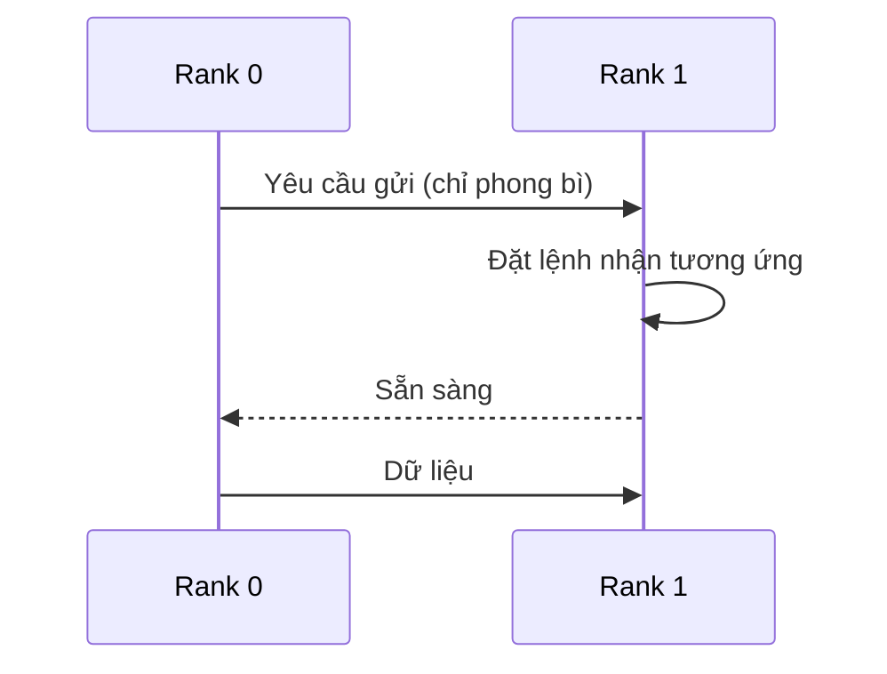
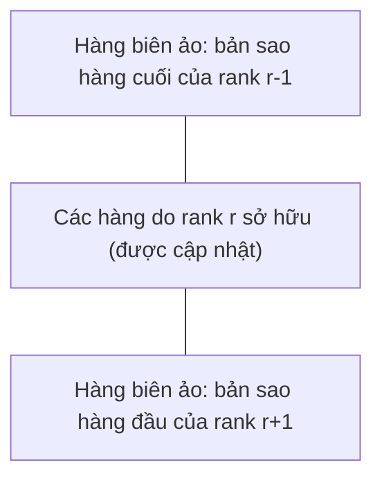

Bốn bài đầu của loạt bài này giữ toàn bộ phép tính bên trong một máy. [Bài thứ ba](/vi/blog/threads-and-shared-memory-parallelism) cho các luồng (thread) đọc và ghi cùng những mảng dữ liệu. Phần lớn bài đó dành cho những gì hỏng khi chúng làm vậy một cách bất cẩn, từ [tranh chấp dữ liệu](/vi/blog/threads-and-shared-memory-parallelism) (data race, mục 3 của bài đó) đến chia sẻ giả (false sharing). [Bài thứ tư](/vi/blog/data-parallelism-vector-units-and-gpus) chuyển dữ liệu sang bộ xử lý đồ họa (graphics processor) rồi chuyển về, và nhận thấy rằng chính việc truyền dữ liệu quyết định chuyển tải tính toán (offloading) có đáng hay không. Bài cuối cùng này loại bỏ hẳn bộ nhớ dùng chung (shared memory): các tiến trình (process) trên những máy tính riêng biệt chỉ phối hợp với nhau bằng cách gửi thông điệp, và chi phí của các thông điệp đó thêm một số hạng mới vào các định luật về hệ số tăng tốc (speedup) của [bài thứ nhất](/vi/blog/performance-models-and-scaling-laws).

Bài này giới thiệu mô hình truyền thông điệp và giao diện chuẩn của nó, Message Passing Interface (MPI), rồi xây dựng một mô hình chi phí cho nó. Trước hết là các thông điệp điểm – điểm dạng chặn và không chặn, kể cả một trường hợp bế tắc chỉ xuất hiện khi thông điệp vượt quá một kích thước nhất định. Sau đó, chi phí của một thông điệp, được đo và khớp thành mô hình, cho ta chi phí của các thao tác tập thể và của việc phân phối lưới của một phép tính stencil thuộc loại đã xét trong [Finite Differences for Heat and Waves](/blog/finite-differences-for-heat-and-waves). Cuối cùng, cũng mô hình đó dự đoán khả năng mở rộng của phép tính stencil ấy trên một cụm máy giả định, đây là mục tiêu cuối cùng của loạt bài.

**Quy ước.** Như trong các bài trước, $T_1$ là thời gian chạy của chương trình tuần tự tốt nhất, $T_p$ là thời gian chạy trên $p$ tiến trình, $S(p) = T_1/T_p$ là hệ số tăng tốc và $E(p) = S(p)/p$ là hiệu suất song song (efficiency). Mã nguồn là C11, biên dịch bằng GNU Compiler Collection (GCC) 13.3 thông qua trình bao `mpicc` của Open MPI 4.1.6, còn các mô hình được viết bằng Python 3.13 với NumPy 2.5. Mọi chương trình đều được chạy trên máy tham chiếu: một máy ảo khách Kernel-based Virtual Machine (KVM) với bốn lõi (core) của một bộ xử lý Intel Xeon được báo cáo ở 2.1 GHz, 2 MiB bộ nhớ đệm L2 cho mỗi lõi, 16 GiB bộ nhớ và hệ điều hành Linux. Mọi tiến trình của một lần chạy dùng chung máy duy nhất này, nên thông điệp của chúng đi qua bộ nhớ dùng chung chứ không qua mạng. Máy này còn chạy các công việc khác và thời gian đo được có nhiễu: mỗi thời gian nêu ra là trung vị của nhiều lần lặp và chỉ mô tả máy này. Các số liệu về mạng của cụm máy được ghi rõ là giả định. Kích thước thông điệp $m$ tính bằng byte; băng thông tính bằng gigabyte mỗi giây (GB/s), tức $10^9$ byte mỗi giây.

## 1. Bộ nhớ phân tán và mô hình truyền thông điệp

### 1.1 Vì sao cần cụm máy

Một máy bộ nhớ dùng chung đơn lẻ có giới hạn trên. Số lõi, dung lượng bộ nhớ và băng thông bộ nhớ của nó bị cố định bởi số socket và số kênh bộ nhớ. Những bài toán cần nhiều bộ nhớ hơn hoặc nhiều phép tính số học hơn mức một máy có thể cung cấp được chạy trên một **cụm máy** (cluster): nhiều **nút** (node), mỗi nút là một máy tính hoàn chỉnh với bộ xử lý và bộ nhớ riêng, được nối với nhau bằng một mạng. Thêm nút là thêm dung lượng bộ nhớ và băng thông theo tỉ lệ tương ứng.

Cái giá phải trả là một nút không thể nạp hay ghi vào bộ nhớ của nút khác bằng các lệnh thông thường. Đó là **bộ nhớ phân tán** (distributed memory): mỗi tiến trình có một **không gian địa chỉ riêng** (private address space), và một địa chỉ trong tiến trình này không có ý nghĩa gì trong tiến trình khác. Dữ liệu mà một tiến trình nắm giữ và một tiến trình khác cần phải được sao chép một cách tường minh qua mạng.

### 1.2 Tiến trình, rank và communicator

Mô hình lập trình chủ đạo cho bộ nhớ phân tán là **truyền thông điệp** (message passing). Một chương trình song song là một tập các tiến trình, mỗi tiến trình làm việc trên dữ liệu của riêng nó: một tiến trình gọi thao tác gửi, chỉ rõ một vùng đệm và một đích đến, và tiến trình đích gọi thao tác nhận, chỉ rõ nơi dữ liệu cần được đặt vào. Không có gì được dùng chung, nên không có tranh chấp dữ liệu theo nghĩa của bài thứ ba; các lỗi tương ứng ở đây là những thông điệp không bao giờ được gửi, không bao giờ được nhận, hoặc bị ghép cặp sai.

Gần như mọi chương trình truyền thông điệp đều được viết theo kiểu **một chương trình, nhiều dữ liệu** (single program, multiple data, SPMD): một tệp thực thi được khởi động thành $p$ tiến trình, và mỗi tiến trình quyết định việc mình làm dựa trên danh tính của nó. Danh tính đó là **rank** của tiến trình, một số nguyên từ $0$ đến $p - 1$ bên trong một **communicator**, tức một đối tượng đặt tên cho một nhóm tiến trình và cung cấp cho các thông điệp của nhóm một ngữ cảnh riêng. Mọi tiến trình đều thuộc communicator định nghĩa sẵn `MPI_COMM_WORLD`, chứa tất cả các tiến trình được khởi động cùng nhau.

### 1.3 Chuẩn MPI

**Message Passing Interface** (MPI) là giao diện thư viện chuẩn cho mô hình này. Nó do MPI Forum định nghĩa; phiên bản được trích dẫn ở đây là Version 4.1 (Message Passing Interface Forum, 2023), và Version 5.0 ra đời sau đó vào năm 2025 (Message Passing Interface Forum, 2025). MPI quy định các hàm và ngữ nghĩa của chúng cho C và Fortran, không quy định một bản cài đặt cụ thể, nên cùng một mã nguồn có thể biên dịch với Open MPI, MPICH hay thư viện của một nhà cung cấp. Open MPI 4.1.6 cài đặt MPI 3.1. Mọi hàm dùng trong bài này, trừ `MPI_Init_thread` (được thêm vào ở MPI 2.0), đều đã có trong chuẩn từ phiên bản đầu tiên, và ngữ nghĩa của chúng không thay đổi ở Version 4.1. Gropp, Lusk và Skjellum (2014) trình bày giao diện này theo lối giáo trình.

Chương trình MPI nhỏ nhất khởi động thư viện, hỏi rank của mình và kích thước của `MPI_COMM_WORLD`, rồi tắt thư viện:

```c
#include <mpi.h>
#include <stdio.h>

int main(int argc, char **argv)
{
    MPI_Init(&argc, &argv);
    int rank, size;
    MPI_Comm_rank(MPI_COMM_WORLD, &rank);   /* who am I? 0 .. size-1 */
    MPI_Comm_size(MPI_COMM_WORLD, &size);   /* how many processes?   */
    printf("rank %d of %d\n", rank, size);
    MPI_Finalize();
    return 0;
}
```

Khi được biên dịch bằng `mpicc -O2 -Wall -o hello hello.c` và khởi động bằng `mpirun --allow-run-as-root --oversubscribe -np 4 ./hello` (cờ thứ nhất cần thiết vì máy tham chiếu chạy dưới quyền root, cờ thứ hai cho phép chạy nhiều tiến trình hơn số khe được phát hiện), nó in ra:

```text
rank 0 of 4
rank 3 of 4
rank 1 of 4
rank 2 of 4
```

Thứ tự các dòng thay đổi giữa các lần chạy, vì không có gì sắp xếp đầu ra của các tiến trình chạy đồng thời. Trên một cụm máy, `mpirun` sẽ đặt các bản sao lên những nút khác nhau.

### 1.4 Chương trình lai

Nhiều chương trình chạy một tiến trình MPI trên mỗi nút hoặc mỗi socket, với nhiều luồng bên trong, dùng OpenMP như ở bài thứ ba hoặc một bộ xử lý đồ họa như ở bài thứ tư. Mô hình **lai** (hybrid) này dùng bộ nhớ dùng chung bên trong một nút và thông điệp giữa các nút, nhờ đó giảm số tiến trình phải trao đổi thông điệp. Nó khởi động MPI bằng `MPI_Init_thread`, khai báo cách các luồng sẽ gọi MPI; với `MPI_THREAD_FUNNELED`, chỉ luồng chính gọi MPI. Bài này dùng một tiến trình đơn luồng cho mỗi lõi.

## 2. Truyền điểm – điểm với MPI

### 2.1 Gửi và nhận

Các thao tác cơ bản là `MPI_Send` và `MPI_Recv`. Một lệnh gửi chỉ rõ một vùng đệm (địa chỉ, số phần tử và **kiểu dữ liệu** (datatype), chẳng hạn `MPI_DOUBLE`), một rank đích, một **nhãn** (tag) là số nguyên và một communicator. Một lệnh nhận chỉ rõ một vùng đệm, một rank nguồn, một nhãn và một communicator, và nó ghép với thông điệp đầu tiên đến từ nguồn đó, mang nhãn đó, trong communicator đó; `MPI_ANY_SOURCE` và `MPI_ANY_TAG` ghép với bất kỳ nguồn hay nhãn nào. Nhãn dùng để phân biệt các thông điệp mang ý nghĩa khác nhau từ cùng một bên gửi. MPI bảo đảm rằng hai thông điệp từ một bên gửi tới một bên nhận trong cùng một communicator, nếu cả hai cùng ghép được với một lệnh nhận, sẽ được nhận theo đúng thứ tự chúng được gửi.

Cả hai lời gọi đều là **chặn** (blocking), một khái niệm mà trong MPI có nghĩa chính xác và hạn hẹp: lời gọi trả về khi vùng đệm của nó có thể được dùng lại. Với lệnh nhận, đó là lúc thông điệp đã đến vùng đệm. Với lệnh gửi ở chế độ chuẩn mà `MPI_Send` dùng, chuẩn cho phép hai cách hành xử: thư viện có thể chép thông điệp vào một vùng đệm nội bộ và trả về ngay, hoặc có thể chờ cho đến khi lệnh nhận tương ứng đã bắt đầu và dữ liệu đã được truyền xong. Lựa chọn này được để cho bản cài đặt quyết định. Một chương trình mà tiến triển của nó phụ thuộc vào cách hành xử thứ nhất được chuẩn gọi là **không an toàn** (unsafe).

### 2.2 Giao thức gửi sớm và giao thức hẹn gặp

Các bản cài đặt thực hiện lựa chọn này bằng hai giao thức. Theo **giao thức gửi sớm** (eager protocol), bên gửi truyền thông điệp ngay lập tức, kèm theo phong bì (envelope) của nó (nguồn, nhãn, communicator), và bên nhận lưu nó trong một vùng đệm của thư viện cho đến khi một lệnh nhận tương ứng được đặt (posted); lệnh gửi trả về ngay khi dữ liệu đã rời khỏi vùng đệm của người dùng. Gửi sớm có độ trễ (latency) thấp nhất nhưng cần chỗ trong vùng đệm của bên nhận cho những thông điệp chưa được yêu cầu, nên chỉ được dùng cho thông điệp ngắn. Theo **giao thức hẹn gặp** (rendezvous protocol), bên gửi trước hết chỉ gửi phong bì, chờ đến khi bên nhận đã đặt một lệnh nhận tương ứng và trả lời, rồi mới truyền dữ liệu thẳng vào vùng đệm nhận. Lệnh gửi không thể hoàn tất cho đến khi bên nhận tham gia.



*Giao thức hẹn gặp cho một thông điệp lớn: rank 0 không thể hoàn tất lệnh gửi cho đến khi rank 1 đã đặt lệnh nhận tương ứng. Nếu chính rank 1 cũng đang bị chặn trong một lệnh gửi tới rank 0, thì không bên nào đặt được lệnh nhận.*

Kích thước mà tại đó một bản cài đặt chuyển từ gửi sớm sang hẹn gặp là **ngưỡng gửi sớm** (eager limit) của nó. Trong Open MPI 4.1.6, với tầng điểm – điểm `ob1` và cơ chế truyền qua bộ nhớ dùng chung `vader` được chọn trên máy tham chiếu, tham số `btl_vader_eager_limit` báo giá trị 4 096 byte, đã tính cả phần tiêu đề của giao thức.

### 2.3 Một trường hợp bế tắc phụ thuộc vào kích thước thông điệp

Chương trình sau ghép rank 0 với rank 1 và rank 2 với rank 3. Ở chế độ mặc định, mỗi rank trước hết gửi $n$ số double cho bên kia rồi nhận $n$ số double từ bên đó.

```c
/* Two ranks swap a buffer of n doubles.
   default:    both call MPI_Send, then MPI_Recv   (unsafe)
   "sendrecv": MPI_Sendrecv                        (safe)
   "isend":    MPI_Irecv + MPI_Isend + MPI_Waitall (safe) */
#include <mpi.h>
#include <stdio.h>
#include <stdlib.h>
#include <string.h>

int main(int argc, char **argv)
{
    MPI_Init(&argc, &argv);
    int rank;
    MPI_Comm_rank(MPI_COMM_WORLD, &rank);
    int n = atoi(argv[1]);
    const char *mode = argc > 2 ? argv[2] : "send-first";
    int other = rank ^ 1;          /* partners: 0-1, 2-3, ... (even size) */
    double *out = malloc(n * sizeof *out), *in = malloc(n * sizeof *in);
    for (int i = 0; i < n; i++) out[i] = rank;

    if (strcmp(mode, "sendrecv") == 0) {
        MPI_Sendrecv(out, n, MPI_DOUBLE, other, 0,
                     in,  n, MPI_DOUBLE, other, 0,
                     MPI_COMM_WORLD, MPI_STATUS_IGNORE);
    } else if (strcmp(mode, "isend") == 0) {
        MPI_Request req[2];
        MPI_Irecv(in,  n, MPI_DOUBLE, other, 0, MPI_COMM_WORLD, &req[0]);
        MPI_Isend(out, n, MPI_DOUBLE, other, 0, MPI_COMM_WORLD, &req[1]);
        MPI_Waitall(2, req, MPI_STATUSES_IGNORE);  /* buffers reusable now */
    } else {
        MPI_Send(out, n, MPI_DOUBLE, other, 0, MPI_COMM_WORLD);
        MPI_Recv(in,  n, MPI_DOUBLE, other, 0, MPI_COMM_WORLD,
                 MPI_STATUS_IGNORE);
    }
    if (rank == 0)
        printf("%s, %d doubles (%zu bytes): received %.0f\n",
               mode, n, n * sizeof(double), in[n - 1]);
    free(out); free(in);
    MPI_Finalize();
    return 0;
}
```

Chương trình được chạy với bốn tiến trình cho bốn bộ tham số, mỗi lần chạy bị giới hạn 10 s bằng lệnh `timeout`, và một dòng thông báo được in ra khi lệnh này phải dừng một lần chạy:

```sh
for a in "505" "506" "506 sendrecv" "1000000 isend"; do
  timeout 10 mpirun --allow-run-as-root --oversubscribe -np 4 ./exchange $a ||
    echo "($a: no output after 10 s, killed by timeout)"
done
```

```text
send-first, 505 doubles (4040 bytes): received 1
(506: no output after 10 s, killed by timeout)
sendrecv, 506 doubles (4048 bytes): received 1
isend, 1000000 doubles (8000000 bytes): received 1
```

Với 4 040 byte dữ liệu, thông điệp cùng phần tiêu đề nằm dưới ngưỡng gửi sớm, cả hai lệnh gửi trả về ngay và cả hai lệnh nhận đều thấy thông điệp của mình đang chờ sẵn. Với 4 048 byte, cả hai lệnh gửi dùng giao thức hẹn gặp, và mỗi lệnh chờ một lệnh nhận mà bên kia chỉ đặt sau khi lệnh gửi của chính nó trả về. Chương trình treo trong tình trạng **bế tắc** (deadlock), một trạng thái trong đó mọi tiến trình đều chờ một sự kiện mà chỉ một tiến trình khác cũng đang chờ mới có thể gây ra. Ngưỡng này sẽ khác đi với một thư viện, một cơ chế truyền hay một thiết lập khác, nên một phép thử với thông điệp nhỏ không chứng minh được điều gì về một chương trình như vậy.

### 2.4 Trao đổi an toàn

Có ba cách sửa chuẩn. Cách thứ nhất là sắp xếp thứ tự các lời gọi sao cho mỗi lệnh gửi đều gặp một lệnh nhận: các rank chẵn gửi trước, các rank lẻ nhận trước. Cách thứ hai là `MPI_Sendrecv`, một lời gọi duy nhất thực hiện cả gửi lẫn nhận và để thư viện lập lịch cho chúng sao cho một cuộc trao đổi theo cặp không thể bế tắc. Cách thứ ba là **truyền thông không chặn** (nonblocking communication). `MPI_Isend` và `MPI_Irecv` khởi động một thao tác và trả về ngay với một handle **yêu cầu** (request); thao tác hoàn tất sau đó, và `MPI_Wait` hoặc `MPI_Waitall` chặn cho đến khi nó hoàn tất. Trước khi hoàn tất, chương trình không được sửa vùng đệm gửi hay đọc vùng đệm nhận. Cả hai phiên bản an toàn đều hoàn tất ở mọi kích thước đã thử, từ 1 đến 1 000 000 số double (8 đến 8 000 000 byte), kể cả 505 và 506. Các thao tác không chặn còn có công dụng thứ hai, được bàn ở Mục 5.4: tính toán trên dữ liệu khác trong khi một lượt truyền đang diễn ra.

## 3. Mô hình độ trễ – băng thông

### 3.1 Độ trễ và nghịch đảo băng thông

Mô hình hữu ích đơn giản nhất cho thời gian gửi một thông điệp, được Hockney (1994) dùng để đặc trưng hóa khả năng truyền thông của các máy song song, là một hàm affine theo kích thước thông điệp $m$:

$$
t(m) = \alpha + \beta\,m .
$$

Ở đây $\alpha$ là **độ trễ** tính bằng giây, tức thời gian gửi một thông điệp rỗng, bao gồm chi phí phụ của phần mềm, việc thiết lập lượt truyền và thời gian tín hiệu đi trên đường truyền. Hệ số $\beta$ là thời gian truyền mỗi byte, tính bằng s/byte, nghịch đảo của **băng thông** tiệm cận $1/\beta$. Cách đặc trưng hóa của Hockney viết cùng mô hình này với tốc độ tiệm cận $r_\infty = 1/\beta$ và **kích thước thông điệp nửa hiệu năng** (half-performance message size) $n_{1/2}$, tức kích thước thông điệp mà tại đó băng thông đạt được $m/t(m)$ bằng một nửa $1/\beta$. Đặt $m/(\alpha + \beta m) = 1/(2\beta)$ ta được $\beta m = \alpha$, do đó

$$
n_{1/2} = \frac{\alpha}{\beta} .
$$

Những thông điệp ngắn hơn nhiều so với $n_{1/2}$ tốn khoảng $\alpha$ bất kể độ dài của chúng, và bị giới hạn bởi độ trễ; những thông điệp dài hơn nhiều tốn khoảng $\beta m$ và bị giới hạn bởi băng thông. Hai thông điệp kích thước $m$ tốn hơn một thông điệp kích thước $2m$ một lượng $\alpha$, nên các thông điệp nhỏ nên được gộp lại khi thuật toán cho phép.

### 3.2 Một phép đo ping-pong

Phép đo chuẩn cho $\alpha$ và $\beta$ là **ping-pong**: rank 0 gửi một thông điệp cho rank 1, rank 1 gửi trả lại, và một nửa thời gian khứ hồi là thời gian một chiều. Chương trình dưới đây lặp lại điều này cho các kích thước thông điệp từ 0 byte đến 8 MiB. Với mỗi kích thước, nó chạy một đợt khởi động và 11 đợt có đo thời gian, mỗi đợt gồm nhiều lượt khứ hồi, và báo cáo thời gian trung vị của các đợt tính cho mỗi thông điệp một chiều (chỉ vòng lặp đo thời gian được trình bày).

```c
    for (int s = 0; s < nsizes; s++) {
        long m = sizes[s];
        int reps = m <= 32768 ? 2000 : (m <= 262144 ? 400 : 40);
        double t[BATCHES];
        for (int b = -1; b < BATCHES; b++) {          /* b = -1: warm-up */
            MPI_Barrier(MPI_COMM_WORLD);
            double t0 = MPI_Wtime();
            for (int r = 0; r < reps; r++) {
                if (rank == 0) {
                    MPI_Send(buf, (int)m, MPI_BYTE, 1, 0, MPI_COMM_WORLD);
                    MPI_Recv(buf, (int)m, MPI_BYTE, 1, 0, MPI_COMM_WORLD,
                             MPI_STATUS_IGNORE);
                } else if (rank == 1) {
                    MPI_Recv(buf, (int)m, MPI_BYTE, 0, 0, MPI_COMM_WORLD,
                             MPI_STATUS_IGNORE);
                    MPI_Send(buf, (int)m, MPI_BYTE, 0, 0, MPI_COMM_WORLD);
                }
            }
            if (b >= 0) t[b] = (MPI_Wtime() - t0) / (2.0 * reps);
        }
        qsort(t, BATCHES, sizeof t[0], cmp);
        if (rank == 0) printf("%10ld %14.3f\n", m, t[BATCHES / 2] * 1e6);
    }
```

Chạy với hai tiến trình (`mpirun --allow-run-as-root --oversubscribe -np 2 ./pingpong`):

```text
     bytes   one-way (us)
         0          0.315
         8          0.365
        64          0.447
       256          0.525
      1024          1.019
      2048          1.622
      4000          1.859
      8192          3.725
     32768          8.566
    131072         21.535
    524288         61.161
   2097152        240.503
   8388608       1016.844
```

Đây là các phép sao chép từ bộ nhớ sang bộ nhớ giữa hai lõi của cùng một máy, không phải các lượt truyền qua mạng. Các lần chạy lặp lại chênh nhau tới khoảng 15% với các thông điệp lớn nhất, nên chỉ hai chữ số có nghĩa đầu tiên của thời gian ứng với thông điệp lớn là có ý nghĩa.

### 3.3 Khớp mô hình

Phép khớp bình phương tối thiểu thông thường sẽ bị các thông điệp lớn chi phối và nói lên rất ít về $\alpha$, nên phép khớp dưới đây cực tiểu hóa tổng bình phương các sai số *tương đối*: mỗi hàng của hệ tuyến tính $[1,\ m_i]\,[\alpha,\ \beta]^{\mathsf T} = t_i$ được chia cho $t_i$. Nó khớp toàn bộ các kích thước, rồi khớp riêng các kích thước dưới ngưỡng gửi sớm và các kích thước trên ngưỡng đó.

```python
def fit(m, t):
    A = np.column_stack([np.ones_like(m), m]) / t[:, None]
    (alpha, beta), *_ = np.linalg.lstsq(A, np.ones_like(t), rcond=None)
    return alpha, beta
```

```text
all sizes          alpha =  0.423 us, 1/beta =  6.99 GB/s, n_1/2 =   2957 B, measured/model in [0.74, 2.33]
m <= 4000 (eager)  alpha =  0.366 us, 1/beta =  2.13 GB/s, n_1/2 =    779 B, measured/model in [0.83, 1.22]
m >= 8192          alpha =  3.086 us, 1/beta =  8.30 GB/s, n_1/2 =  25620 B, measured/model in [0.91, 1.22]
```

Một đường thẳng duy nhất không mô tả được máy này: ở một số kích thước, thời gian đo được bằng 2.33 lần giá trị của mô hình. Hai đường thẳng, mỗi đường cho một giao thức, khớp mọi điểm của lần chạy này với sai lệch trong phạm vi hệ số 1.22; băng thông ở vùng gửi sớm là giá trị khớp có độ lặp lại kém nhất. Giao thức gửi sớm có độ trễ khoảng 0.37 µs và băng thông thấp, phù hợp với việc mỗi thông điệp được chép vào một vùng đệm dùng chung rồi chép ra lại. Giao thức cho thông điệp lớn tốn khoảng 3.1 µs để thiết lập lượt truyền rồi chuyển dữ liệu với tốc độ khoảng 8.3 GB/s. Mô hình affine đúng trên một dải kích thước mà trong đó bản cài đặt hành xử theo cùng một cách; một thư viện có nhiều giao thức cần một cặp $(\alpha, \beta)$ cho mỗi giao thức. Có thể kiểm tra kích thước nửa hiệu năng bằng phép khớp cho thông điệp lớn. Một thông điệp 25 620 byte đạt $25620/(3.086 \times 10^{-6} + 25620/8.30 \times 10^{9}) \approx 4.15 \times 10^9$ byte mỗi giây, bằng một nửa 8.30 GB/s.

Với các ví dụ về cụm máy trong phần còn lại của bài, mạng được **giả định** có $\alpha = 2$ µs và $1/\beta = 10$ GB/s, nên $\beta = 0.1$ ns mỗi byte và $n_{1/2} = 20{,}000$ byte. Các giá trị này mang tính minh họa, không phải số đo của bất kỳ mạng cụ thể nào.

### 3.4 Những gì mô hình bỏ qua, và LogP

Mô hình affine mô tả một thông điệp giữa hai tiến trình đang rỗi. Nó không nói gì về việc bộ xử lý bận bao lâu trong một lệnh gửi, có bao nhiêu thông điệp có thể đang được truyền cùng lúc, hay điều gì xảy ra khi nhiều tiến trình dùng chung một đường truyền. **Mô hình LogP** (LogP model) của Culler và cộng sự (1993) tách các hiệu ứng này bằng bốn tham số: độ trễ mạng $L$, chi phí phụ (overhead) $o$ của bộ xử lý khi gửi hoặc nhận một thông điệp, khoảng cách (gap) $g$ (thời gian tối thiểu giữa hai thông điệp liên tiếp từ một bộ xử lý, mà nghịch đảo của nó là tốc độ thông điệp của mỗi bộ xử lý) và số bộ xử lý $P$. Một thuật toán được phân tích theo LogP phải chịu chi phí phụ mà nó không thể chồng lấp và khoảng cách mà nó phải tôn trọng. Mô hình affine gộp các chi phí phụ và độ trễ vào $\alpha$ (với một thông điệp ngắn, $\alpha \approx L + 2o$) và không có đại lượng nào tương ứng với khoảng cách, vì nó mô tả từng thông điệp một. Bài này dùng mô hình đơn giản hơn, vốn đủ cho các ước lượng ở Mục 6.

## 4. Thao tác tập thể

### 4.1 Một thao tác tập thể làm gì

Nhiều mẫu truyền thông liên quan đến mọi tiến trình của một communicator cùng một lúc. MPI cung cấp chúng dưới dạng các **thao tác tập thể** (collective operation), được tất cả tiến trình của communicator gọi với các đối số tương thích:

- `MPI_Bcast` (**phát quảng bá**, broadcast): một tiến trình gốc gửi cùng một vùng đệm cho tất cả các tiến trình khác;
- `MPI_Reduce` (**rút gọn**, reduce): mọi tiến trình đóng góp một vùng đệm, và tiến trình gốc nhận kết quả kết hợp từng phần tử theo một phép toán như `MPI_SUM` hay `MPI_MAX`;
- `MPI_Allreduce` (**allreduce**): một phép rút gọn (reduction) mà kết quả được chuyển tới mọi tiến trình;
- `MPI_Gather` và `MPI_Gatherv`: tiến trình gốc nhận một khối từ mỗi tiến trình, theo thứ tự rank (dạng `v` cho phép các khối có kích thước khác nhau);
- `MPI_Barrier` (**rào chắn**, barrier): không tiến trình nào rời khỏi lời gọi cho đến khi mọi tiến trình đã vào lời gọi đó.

Một thao tác tập thể nêu điều gì được tính, không nêu tính như thế nào; thư viện chọn thuật toán theo kích thước thông điệp và số tiến trình. Thakur, Rabenseifner và Gropp (2005) mô tả các thuật toán dùng trong bản cài đặt MPICH và chi phí của chúng theo mô hình độ trễ – băng thông; các chi phí dưới đây theo phân tích đó (allreduce vòng theo Patarasuk và Yuan, 2009) nhưng bỏ qua số hạng ứng với phép tính số học của phép rút gọn, vốn tỉ lệ với $m$.

### 4.2 Chi phí của các thuật toán cơ bản

**Phát quảng bá theo cây nhị thức.** Ở vòng đầu tiên, tiến trình gốc gửi cho một tiến trình; ở mỗi vòng sau, mọi tiến trình đã có dữ liệu gửi nó cho một tiến trình chưa có. Số tiến trình nắm giữ dữ liệu tăng gấp đôi sau mỗi vòng, nên $\lceil \log_2 p \rceil$ vòng là đủ, mỗi vòng tốn một thông điệp:

$$
T_{\mathrm{bcast}} = \lceil \log_2 p \rceil\,(\alpha + \beta m).
$$

Cùng cây đó, khi duyệt theo chiều về gốc, cho một phép rút gọn với cùng chi phí cộng thêm phần tính toán số học.

**Allreduce nhân đôi đệ quy.** Ở vòng $k$ ($k = 0, 1, \dots$), mỗi tiến trình trao đổi kết quả từng phần hiện tại của mình với tiến trình có rank khác ở bit thứ $k$ và kết hợp hai kết quả. Sau $\log_2 p$ vòng (với $p$ là lũy thừa của hai), mọi tiến trình đều nắm giữ kết quả đầy đủ:

$$
T_{\mathrm{rd}} = \log_2 p\,(\alpha + \beta m).
$$

Số hạng độ trễ của nó là nhỏ nhất, điều này phù hợp với các thông điệp ngắn như con số duy nhất của một phép kiểm tra hội tụ.

**Allreduce vòng.** Với thông điệp dài, vùng đệm được chia thành $p$ phần, mỗi phần $m/p$ byte, và các tiến trình được xếp thành một vòng. Trong $p-1$ bước của một **reduce-scatter**, mỗi tiến trình gửi một phần cho tiến trình kề bên phải và cộng phần nhận được từ tiến trình kề bên trái, sao cho cuối cùng mỗi tiến trình nắm giữ một phần đã được rút gọn hoàn toàn. Trong $p-1$ bước của một **allgather**, các phần đã rút gọn đi vòng quanh cho đến khi mọi tiến trình có đủ tất cả. Mỗi bước trong $2(p-1)$ bước gửi $m/p$ byte:

$$
T_{\mathrm{ring}} = 2(p-1)\,\alpha + 2\,\frac{p-1}{p}\,\beta m.
$$

Số hạng băng thông nhỏ hơn $2\beta m$ với mọi $p$, và Patarasuk và Yuan (2009) đã chứng minh một cận dưới cho lượng dữ liệu mà một allreduce phải truyền, cận mà khối lượng này đạt đúng. Tuy nhiên, số hạng độ trễ tăng tuyến tính theo $p$. Thuật toán của Rabenseifner, được Thakur và cộng sự mô tả, đạt cùng số hạng băng thông với chỉ $2\log_2 p$ số hạng độ trễ, bằng cách thực hiện reduce-scatter theo kiểu chia đôi đệ quy (recursive halving) và allgather theo kiểu nhân đôi đệ quy (recursive doubling).

**Rào chắn.** Một rào chắn không mang dữ liệu, nên chỉ độ trễ là đáng kể. Mọi rào chắn đều cần ít nhất $\lceil \log_2 p \rceil$ vòng thông điệp nếu mỗi tiến trình nhận nhiều nhất một thông điệp mỗi vòng: một tiến trình chỉ có thể rời đi sau khi biết rằng cả $p$ tiến trình đã đến, và sau $k$ vòng nó chỉ có thể biết về sự có mặt của nhiều nhất $2^k$ tiến trình trong số đó.

### 4.3 Dùng thuật toán nào khi nào

Chương trình sau tính giá trị các công thức này trên cụm máy giả định ($\alpha = 2$ µs, $1/\beta = 10$ GB/s) cho một thông điệp gồm một số double và một thông điệp 8 MiB:

```python
def binomial_bcast(p, m):
    return math.ceil(math.log2(p)) * (ALPHA + BETA * m)


def recursive_doubling_allreduce(p, m):
    return math.ceil(math.log2(p)) * (ALPHA + BETA * m)


def ring_allreduce(p, m):
    return 2 * (p - 1) * ALPHA + 2 * (p - 1) / p * BETA * m
```

```text
    p  m (bytes)  bcast tree  allr. rec.dbl  allr. ring   (microseconds)
    8          8         6.0            6.0        28.0
    8    8388608      2522.6         2522.6      1496.0
   64          8        12.0           12.0       252.0
   64    8388608      5045.2         5045.2      1903.5
 1024          8        20.0           20.0      4092.0
 1024    8388608      8408.6         8408.6      5768.1
```

Với một số double trên 1 024 tiến trình, nhân đôi đệ quy mất 20 µs còn thuật toán vòng mất khoảng 4.1 ms; với 8 MiB trên 64 tiến trình, thuật toán vòng mất 1.9 ms còn nhân đôi đệ quy mất 5.0 ms. Không có thuật toán nào tốt nhất trong mọi trường hợp, đó là lý do các thư viện chuyển đổi thuật toán theo kích thước, và vì sao một lời gọi `MPI_Allreduce` thường nhanh hơn một phép rút gọn tự viết.

### 4.4 Một allreduce trên máy tham chiếu

Chương trình dưới đây tính $\sum_{k=1}^{N} 1/k^2$ với $N = 10^8$. Rank $r$ đảm nhận các số hạng $k = r + 1, r + 1 + p, r + 1 + 2p, \dots$ (phân phối xoay vòng), và `MPI_Allreduce` cộng bốn tổng từng phần rồi trao tổng cho mọi rank. Sau đó chương trình đo thời gian 20 000 lần allreduce một số double trong mỗi đợt của 11 đợt và báo cáo thời gian trung vị cho mỗi lời gọi.

```c
    const long N = 100000000;
    double part = 0.0, total;
    for (long k = rank + 1; k <= N; k += p)
        part += 1.0 / ((double)k * (double)k);
    MPI_Allreduce(&part, &total, 1, MPI_DOUBLE, MPI_SUM, MPI_COMM_WORLD);
    printf("rank %d: partial %.15f  total %.15f\n", rank, part, total);
    ...
    for (int b = -1; b < BATCHES; b++) {
        MPI_Barrier(MPI_COMM_WORLD);
        double t0 = MPI_Wtime();
        for (int r = 0; r < REPS; r++)
            MPI_Allreduce(&x, &y, 1, MPI_DOUBLE, MPI_SUM, MPI_COMM_WORLD);
        if (b >= 0) t[b] = (MPI_Wtime() - t0) / REPS;
    }
```

```text
rank 3: partial 0.102808376677488  total 1.644934057091932
rank 0: partial 1.074833069903280  total 1.644934057091932
rank 1: partial 0.308425135027883  total 1.644934057091932
rank 2: partial 0.158867475483280  total 1.644934057091932
pi^2/6 - total = 9.756e-09 (tail of the series: about 1/N = 1e-08)
MPI_Allreduce of one double on 4 ranks: 1.11 us (median)
```

Mọi rank nhận cùng một tổng, và tổng này khác giới hạn $\pi^2/6$ một lượng $9.8 \times 10^{-9}$, gần với phần đuôi $\sum_{k \gt N} 1/k^2 \approx 1/N$ mà tổng hữu hạn bỏ qua. Phần còn lại $2.4 \times 10^{-10}$ là sai số làm tròn tích lũy trong bốn tổng từng phần. Tổng phụ thuộc vào thứ tự cộng các số hạng và các tổng từng phần, vì phép cộng dấu phẩy động (floating point) không có tính kết hợp, nên một số tiến trình khác hoặc một thư viện khác có thể làm thay đổi các chữ số cuối của nó.

Có thể so sánh 1.11 µs đo được với mô hình. Với phép khớp cho giao thức gửi sớm ở Mục 3.3, nhân đôi đệ quy trên bốn tiến trình tốn $2\,(0.366 + 8/2130)$ µs $\approx 0.74$ µs. Số đo cao hơn khoảng 50%: mô hình bỏ qua phần tính toán số học, việc các tiến trình đến vào những thời điểm không đều nhau và công việc quản lý nội bộ của thư viện, và Open MPI có thể dùng một thuật toán khác. Bậc độ lớn là đúng.

## 5. Phân rã miền và trao đổi biên

### 5.1 Phân phối một lưới

Các phép tính stencil của loạt bài [Mô phỏng số](/vi/series/numerical-simulation) cập nhật mọi điểm của một lưới từ các điểm lân cận của nó. Một trường hợp mẫu là **phép lặp Jacobi** (Jacobi iteration) cho phương trình Laplace trên một lưới vuông gồm $N \times N$ điểm trong: mỗi giá trị mới là trung bình của bốn giá trị cũ lân cận,

$$
u_{i,j}^{\mathrm{new}} = \tfrac14\left(u_{i-1,j} + u_{i+1,j} + u_{i,j-1} + u_{i,j+1}\right),
$$

với các giá trị biên cố định. Đó là phương pháp Jacobi của [Solving Large Linear Systems](/blog/solving-large-linear-systems#42-jacobi-gaussseidel-and-successive-over-relaxation) áp dụng cho ma trận năm điểm, và cũng là dạng hai chiều của [lược đồ hiển tiến theo thời gian, sai phân trung tâm theo không gian](/blog/finite-differences-for-heat-and-waves#21-forward-in-time-centered-in-space) (forward-time, centered-space) cho phương trình truyền nhiệt với tỉ số lưới $\mu = 1/4$, tỉ số lớn nhất còn ổn định trong hai chiều. (Phép phân tích Fourier ở [Mục 2.2 của bài đó](/blog/finite-differences-for-heat-and-waves#22-stability-by-fourier-modes), khi lặp lại với một mode theo mỗi chiều, cho hệ số khuếch đại $1 - 4\mu\,(\sin^2(\theta_x/2) + \sin^2(\theta_y/2))$. Hệ số này nằm trong $[-1, 1]$ với mọi góc khi và chỉ khi $\mu \le 1/4$.) Việc cập nhật mỗi điểm chỉ phụ thuộc vào lượt quét (sweep) trước, nên mọi điểm của một lượt quét có thể được cập nhật song song.

Trên bộ nhớ phân tán, bản thân lưới phải được chia ra. **Phân rã miền** (domain decomposition) giao cho mỗi tiến trình một phần liền khối của lưới, gọi là **miền con** (subdomain) của nó, để lưu trữ và cập nhật. Cách chia đơn giản nhất cắt lưới thành các **dải** (strips) gồm các hàng nguyên vẹn: với $p$ tiến trình, tiến trình $r$ sở hữu khoảng $N/p$ hàng liên tiếp.

### 5.2 Ô biên ảo và trao đổi biên

Một tiến trình có thể cập nhật phần trong của dải mình từ dữ liệu của chính nó, nhưng hàng đầu và hàng cuối của dải cần các hàng lân cận, vốn thuộc về các tiến trình phía trên và phía dưới. Vì vậy mỗi tiến trình lưu thêm một hàng ở mỗi phía, gọi là các **ô biên ảo** (ghost cells, hay hàng biên ảo), chứa bản sao các hàng rìa của tiến trình lân cận. Trước mỗi lượt quét, mọi tiến trình gửi hàng đầu của mình cho tiến trình phía trên và hàng cuối cho tiến trình phía dưới, và nhận các hàng của tiến trình lân cận vào các hàng biên ảo của mình. Bước này là **trao đổi biên** (halo exchange), và vùng biên ảo mà nó lấp đầy là **vùng biên** (halo).



*Mảng cục bộ của một tiến trình trong phân rã theo dải. Các hàng biên ảo được đọc trong lượt quét nhưng không bao giờ được cập nhật; trao đổi biên nạp lại chúng trước mỗi lượt quét.*

Trong chương trình dưới đây, tiến trình $r$ lưu $n$ hàng của mình thành các hàng cục bộ từ $1$ đến $n$, với các hàng biên ảo $0$ và $n+1$, mỗi hàng gồm $N + 2$ giá trị kể cả các cột biên (biến `W` trong mã). Tiến trình trên cùng và dưới cùng không có tiến trình lân cận ở một phía; MPI cung cấp rank rỗng `MPI_PROC_NULL`, một đích hay nguồn mà lệnh gửi hoặc nhận tới đó hoàn tất ngay và không làm gì cả, nên mã không cần xử lý trường hợp đặc biệt. Sau lượt quét, một `MPI_Allreduce` cộng bình phương các thay đổi của mọi điểm, đại lượng mà một phép kiểm tra hội tụ sẽ dùng.

```c
    for (int it = 0; it < ITER; it++) {
        double s;
        if (!overlap) {
            MPI_Sendrecv(&u[1 * W], W, MPI_DOUBLE, up, 0,          /* first row up   */
                         &u[(n + 1) * W], W, MPI_DOUBLE, down, 0,  /* ghost below    */
                         MPI_COMM_WORLD, MPI_STATUS_IGNORE);
            MPI_Sendrecv(&u[n * W], W, MPI_DOUBLE, down, 1,        /* last row down  */
                         &u[0], W, MPI_DOUBLE, up, 1,              /* ghost above    */
                         MPI_COMM_WORLD, MPI_STATUS_IGNORE);
            s = update_rows(u, v, W, 1, n);
        } else {
            MPI_Request req[4];
            MPI_Irecv(&u[0], W, MPI_DOUBLE, up, 1, MPI_COMM_WORLD, &req[0]);
            MPI_Irecv(&u[(n + 1) * W], W, MPI_DOUBLE, down, 0, MPI_COMM_WORLD, &req[1]);
            MPI_Isend(&u[1 * W], W, MPI_DOUBLE, up, 0, MPI_COMM_WORLD, &req[2]);
            MPI_Isend(&u[n * W], W, MPI_DOUBLE, down, 1, MPI_COMM_WORLD, &req[3]);
            s = update_rows(u, v, W, 2, n - 1);       /* interior: no ghost needed */
            MPI_Waitall(4, req, MPI_STATUSES_IGNORE);
            s += update_rows(u, v, W, 1, 1);
            if (n > 1) s += update_rows(u, v, W, n, n);
        }
        double stot;
        MPI_Allreduce(&s, &stot, 1, MPI_DOUBLE, MPI_SUM, MPI_COMM_WORLD);
        change = sqrt(stot);
        double *tmp = u; u = v; v = tmp;
    }
```

Hàm `update_rows` áp dụng stencil cho một khoảng các hàng cục bộ, ghi các giá trị mới vào `v` và trả về tổng bình phương các thay đổi. `MPI_Sendrecv` thứ nhất dịch dữ liệu lên trên, cái thứ hai dịch xuống dưới; không cái nào có thể bế tắc. Nhánh `overlap` được bàn ở Mục 5.4.

### 5.3 Đối chiếu với một lần chạy tuần tự

Một chương trình tuần tự riêng (`jacobi_serial.c`, cùng vòng lặp nhưng không có MPI) và chương trình MPI đều chạy với $N = 1000$, biên trên ở $u = 1$, ba biên còn lại ở $u = 0$, giá trị khởi đầu $u = 0.5$ ở phần trong và 2 000 lượt quét. Chương trình MPI gom các hàng trong về rank 0 bằng `MPI_Gatherv` và ghi toàn bộ lưới ra một tệp, rồi một đoạn script NumPy ngắn so sánh từng giá trị của nó với lưới tuần tự. Mỗi cấu hình được chạy ba lần; dòng so sánh đứng sau ba lần chạy:

```text
serial: N = 1000, 2000 iterations, last change 2.276740971204042e-02, 2.417 s
serial: N = 1000, 2000 iterations, last change 2.276740971204042e-02, 2.298 s
serial: N = 1000, 2000 iterations, last change 2.276740971204042e-02, 2.129 s
mpi blocking, p = 1: N = 1000, 2000 iterations, last change 2.276740971204042e-02, 2.254 s
...
max |u_mpi - u_serial| = 0.0e+00 over 1004004 values; bitwise identical: True
mpi blocking, p = 2: N = 1000, 2000 iterations, last change 2.276740971204580e-02, 1.224 s
mpi blocking, p = 2: N = 1000, 2000 iterations, last change 2.276740971204580e-02, 1.353 s
mpi blocking, p = 2: N = 1000, 2000 iterations, last change 2.276740971204580e-02, 1.311 s
max |u_mpi - u_serial| = 0.0e+00 over 1004004 values; bitwise identical: True
mpi blocking, p = 4: N = 1000, 2000 iterations, last change 2.276740971204639e-02, 0.883 s
mpi blocking, p = 4: N = 1000, 2000 iterations, last change 2.276740971204639e-02, 0.721 s
mpi blocking, p = 4: N = 1000, 2000 iterations, last change 2.276740971204639e-02, 0.771 s
max |u_mpi - u_serial| = 0.0e+00 over 1004004 values; bitwise identical: True
mpi overlap, p = 4: N = 1000, 2000 iterations, last change 2.276740971204644e-02, 0.691 s
mpi overlap, p = 4: N = 1000, 2000 iterations, last change 2.276740971204644e-02, 0.653 s
mpi overlap, p = 4: N = 1000, 2000 iterations, last change 2.276740971204644e-02, 0.645 s
max |u_mpi - u_serial| = 0.0e+00 over 1004004 values; bitwise identical: True
```

Các lưới giống hệt nhau đến từng bit với mọi số tiến trình: mỗi điểm được tính bằng cùng các phép toán, theo cùng thứ tự, từ cùng các đầu vào, bất kể nó được lưu ở đâu. Chuẩn của độ thay đổi, một đại lượng vô hướng, chỉ khớp đến độ chênh lệch tương đối $2.6 \times 10^{-13}$, vì nó là một tổng trên mọi điểm, và chương trình song song cộng các tổng của từng tiến trình theo một thứ tự khác. Một sai khác trong lưới sẽ chỉ ra lỗi ở vùng biên, chẳng hạn một hàng biên ảo bị cũ.

Các thời gian trung vị cho $S(2) = 2.298/1.311 = 1.75$ và $S(4) = 2.298/0.771 = 2.98$ với trao đổi chặn, và $S(4) = 2.298/0.653 = 3.52$ với phiên bản chồng lấp. Trên một máy ảo dùng chung có nhiễu, các con số này chỉ là gần đúng. Ba lần chạy chặn ở $p = 4$ trải từ 0.72 s đến 0.88 s, một khoảng rộng hơn mức 0.12 s giữa trung vị của bản chặn và bản chồng lấp, nên các lần chạy này không chứng tỏ được rằng việc chồng lấp có ích.

Phiên bản đầu tiên của thí nghiệm này bắt đầu từ $u = 0$ ở phần trong. Lần chạy bốn tiến trình của nó mất 1.95 s, và việc đo thời gian từng tiến trình cho thấy rank 2 và rank 3, vốn sở hữu nửa dưới của lưới, tính toán lâu hơn rank 0 khoảng 2.5 lần. Nguyên nhân nằm ở chính phép tính số học. Ở mặt đầu sóng của các giá trị lan ra từ biên nóng, một dải có tới khoảng 23 000 điểm (2.3% lưới) chứa các **số dưới chuẩn** (subnormal numbers), những giá trị dấu phẩy động nhỏ hơn số double chuẩn nhỏ nhất ($2.2 \times 10^{-308}$), mà bộ xử lý này xử lý chậm hơn nhiều so với số chuẩn. Với giá trị khởi đầu 0.5, không xuất hiện giá trị dưới chuẩn nào và bốn tiến trình tính toán trong những khoảng thời gian tương đương nhau.

Ở mỗi lần trao đổi, mọi tiến trình đều chờ tiến trình chậm nhất, nên bất kỳ sự mất cân bằng nào trong khối lượng công việc giữa các tiến trình cũng trở thành thời gian rỗi ở tất cả các tiến trình còn lại.

### 5.4 Chồng lấp truyền thông với tính toán

Chỉ hàng đầu và hàng cuối của một dải cần đến các hàng biên ảo. Nhánh `overlap` của đoạn mã khởi động bốn lượt truyền bằng `MPI_Irecv` và `MPI_Isend`, cập nhật các hàng từ $2$ đến $n-1$ trong khi các thông điệp đang được truyền, chờ các lượt truyền bằng `MPI_Waitall` rồi cập nhật hai hàng rìa. Nếu các lượt truyền tiến triển trong khi tiến trình tính toán, chi phí trao đổi biên được che đi, và thời gian mỗi lượt quét trở thành giá trị lớn hơn trong hai phần tính toán và truyền thông, thay vì tổng của chúng.

Việc chúng có tiến triển hay không phụ thuộc vào thư viện và phần cứng. Một bộ điều hợp mạng có thể chuyển dữ liệu bằng **truy cập bộ nhớ trực tiếp từ xa** (remote direct memory access, RDMA), tức ghi vào bộ nhớ của một nút khác mà không cần bộ xử lý của nút đó tham gia, có thể hoàn tất một lượt truyền ở chế độ nền. Một thư viện chỉ đẩy các giao thức của nó tiến lên bên trong các lời gọi MPI có thể để một lượt truyền hẹn gặp nằm chờ cho đến khi chương trình gọi tới `MPI_Waitall`, và khi đó không có chồng lấp nào xảy ra. Chồng lấp là một cơ hội mà mã nguồn tạo ra và chỉ phép đo trên hệ thống đích mới xác nhận được; việc sắp xếp lại thứ tự thì đúng trong mọi trường hợp.

### 5.5 Dải, khối và tỉ số bề mặt – thể tích

Chi phí trao đổi biên của một cách phân rã phụ thuộc vào biên của miền con, còn phần tính toán phụ thuộc vào diện tích. Với dải, mỗi tiến trình cập nhật $N^2/p$ điểm và trao đổi $2N$ giá trị mỗi lượt quét. Với **khối** (blocks), lưới được cắt thành một mảng $\sqrt{p} \times \sqrt{p}$ các hình vuông cạnh $N/\sqrt{p}$, và mỗi tiến trình trao đổi bốn cạnh, mỗi cạnh $N/\sqrt{p}$ giá trị, tổng cộng $4N/\sqrt{p}$. Tỉ số giữa số giá trị được truyền và số điểm được tính, tức **tỉ số bề mặt – thể tích** (surface-to-volume ratio; trong hai chiều là chu vi trên diện tích), bằng

$$
\text{strips: } \frac{2N}{N^2/p} = \frac{2p}{N}, \qquad
\text{blocks: } \frac{4N/\sqrt{p}}{N^2/p} = \frac{4\sqrt{p}}{N}.
$$

Với $p \gt 4$, cách chia khối truyền ít dữ liệu hơn trên mỗi điểm, và lợi thế này tăng theo $\sqrt{p}/2$. Với $p = 4$, khối lượng dữ liệu bằng nhau, nhưng cách chia khối cần bốn thông điệp thay vì hai nên phải trả gấp đôi độ trễ. Cách chia khối còn có hai cái giá thực tế. Một cạnh theo cột không liền nhau trong một mảng lưu theo hàng, nên nó phải được đóng gói vào một vùng đệm hoặc được mô tả bằng một kiểu dữ liệu dẫn xuất như `MPI_Type_vector`. Và lưới tiến trình tốt nhất nên được thiết lập bằng `MPI_Cart_create`, hàm đánh số các tiến trình theo vị trí trên lưới và cung cấp rank của các tiến trình lân cận.

## 6. Dự đoán khả năng mở rộng

### 6.1 Mô hình của một lượt quét

Giờ đây các thành phần kết hợp lại thành một mô hình cho thời gian của một lượt quét Jacobi trên $p$ tiến trình:

$$
T_p = \frac{N^2\,t_c}{p} + T_{\mathrm{halo}}(p) + T_{\mathrm{allreduce}}(p),
$$

trong đó $t_c$ là thời gian cập nhật một điểm lưới. Với dải, trao đổi biên gồm hai pha theo cặp, mỗi pha một hàng, $T_{\mathrm{halo}} = 2\,(\alpha + 8\beta(N+2))$, với giả thiết mỗi tiến trình có thể gửi và nhận cùng lúc. Với khối, nó gồm bốn pha, mỗi pha một cạnh, $T_{\mathrm{halo}} = 4\,(\alpha + 8\beta N/\sqrt{p})$. Allreduce một số double bằng nhân đôi đệ quy tốn $\lceil \log_2 p \rceil\,(\alpha + 8\beta)$. Thời gian cập nhật một điểm được đo: lần chạy tuần tự trung vị ở Mục 5.3 cho $t_c = 2.298\ \text{s}/(2000 \times 10^6) = 1.149$ ns.

Trước hết, mô hình được đối chiếu với máy tham chiếu, dùng hai phép khớp ở Mục 3.3 (các hàng 8 016 byte dùng phép khớp cho thông điệp lớn, allreduce dùng phép khớp gửi sớm):

```text
t_c = 1.149 ns per point (measured, serial N = 1000)

1. This machine, N = 1000, 2000 iterations, strips
   p = 2: compute 1.149 s + halo 0.0162 s + allreduce 0.0007 s = 1.166 s
   p = 4: compute 0.575 s + halo 0.0162 s + allreduce 0.0015 s = 0.592 s
```

Các giá trị dự đoán 1.17 s và 0.59 s so với trung vị đo được 1.31 s và 0.77 s (0.65 s với phiên bản chồng lấp), nên mô hình lạc quan hơn thực tế từ 10% đến 30%. Truyền thông chỉ chiếm khoảng 3% thời gian dự đoán ở $p = 4$, nên khoảng chênh không nằm ở trao đổi biên; nó nằm ở những yếu tố mà mô hình đã giả định là không có. Bốn tiến trình dùng chung hệ thống bộ nhớ của một máy và bị các công việc khác trên máy làm nhiễu, và chúng không đến mỗi lần trao đổi vào cùng một thời điểm. $t_c$ cũng không phải là một con số duy nhất. Trong một lần chạy bốn tiến trình được đo thời gian riêng, các lượt quét của bốn tiến trình mất từ 0.56 s đến 0.65 s, so với 0.575 s dự đoán. Các tiến trình tranh nhau hệ thống bộ nhớ dùng chung, và một miền con nhỏ hơn sử dụng bộ nhớ đệm (cache) theo cách khác (chủ đề của [bài thứ hai](/vi/blog/memory-hierarchy-and-locality)). Một mô hình như vậy cho hình dạng của đường cong mở rộng, chứ không cho thời gian chạy chính xác đến vài phần trăm.

### 6.2 Mở rộng mạnh trên một cụm máy giả định

Với **mở rộng mạnh** (strong scaling), bài toán cố định và $p$ tăng lên. Mô hình được tính với $N = 8192$ (khoảng 67 triệu điểm) trên cụm máy giả định ($\alpha = 2$ µs, $1/\beta = 10$ GB/s), giữ $t_c = 1.149$ ns và giả định một tiến trình trên mỗi nút để mọi thông điệp trao đổi biên đều đi qua mạng. Cột cuối là tỉ lệ tuần tự (serial fraction) xác định bằng thực nghiệm $e = (1/S - 1/p)/(1 - 1/p)$ của Karp và Flatt (1990), tức giá trị $f$ của Amdahl sẽ cho cùng hệ số tăng tốc, đã được giới thiệu ở [mục 2.3 của bài thứ nhất](/vi/blog/performance-models-and-scaling-laws).

```text
Assumed cluster: alpha = 2 us, 1/beta = 10 GB/s

2. Strong scaling, N = 8192 (fixed problem)
    p  layout  T_p (ms)  comm %     S(p)   E(p)  e (Karp-Flatt)
    4  strips   19.2981     0.1      4.0   1.00         0.00037
    4  blocks   19.3021     0.1      4.0   1.00         0.00043
   16  strips    4.8444     0.5     15.9   0.99         0.00035
   16  blocks    4.8418     0.5     15.9   1.00         0.00031
   64  strips    1.2339     2.4     62.5   0.98         0.00038
   64  blocks    1.2281     1.9     62.8   0.98         0.00031
  256  strips    0.3343     9.9    230.6   0.90         0.00043
  256  blocks    0.3268     7.8    235.9   0.92         0.00033
 1024  strips    0.1124    33.0    685.9   0.67         0.00048
 1024  blocks    0.1041    27.7    740.5   0.72         0.00037
 4096  strips    0.0599    68.6   1286.3   0.31         0.00053
 4096  blocks    0.0512    63.3   1504.7   0.37         0.00042
```

Cho đến 64 tiến trình, hiệu suất vẫn ở mức 0.98 trở lên. Vượt quá mức đó, phần tính toán của mỗi tiến trình co lại theo $1/p$ trong khi phần truyền thông thì không: vùng biên của dải giữ nguyên $2N$ giá trị bất kể $p$, vùng biên của khối chỉ co lại theo $1/\sqrt{p}$, còn allreduce tăng theo $\log_2 p$. Ở 4 096 tiến trình, truyền thông chiếm hai phần ba thời gian và hiệu suất chỉ còn khoảng một phần ba. Cách chia khối thắng cách chia dải từ $p = 16$ trở đi, đúng như Mục 5.5 dự đoán, nhưng ở $p = 4$ nó chậm hơn một chút vì hai thông điệp thêm của nó tốn $2\alpha$.

So với [định luật Amdahl](/vi/blog/performance-models-and-scaling-laws), chương trình này hoàn toàn không có phần tuần tự, vậy mà hệ số tăng tốc của nó vẫn chững lại như thể nó có một phần tuần tự khoảng 0.04%. Tỉ lệ tuần tự tương đương $e$ không phải là hằng số: với dải, nó tăng từ 0.00035 lên 0.00053 khi $p$ tăng, vì truyền thông là một chi phí phụ tăng theo $p$ chứ không phải một tỉ lệ cố định của khối lượng công việc, đúng trường hợp ở [mục 2.2 của bài thứ nhất](/vi/blog/performance-models-and-scaling-laws). Khác với cận của Amdahl, hệ số tăng tốc của mô hình rốt cuộc sẽ giảm khi $p$ tiếp tục tăng, vì số hạng allreduce $\log_2 p$ tiếp tục tăng trong khi số hạng tính toán tiến về không.

### 6.3 Mở rộng yếu trên một cụm máy giả định

Với **mở rộng yếu** (weak scaling), mỗi tiến trình giữ một khối lượng công việc cố định khi $p$ tăng, ở đây là $1000 \times 1000$ điểm, nên lưới toàn cục có cạnh $N = 1000\sqrt{p}$. Hệ số tăng tốc theo quy mô (scaled speedup) là $S_s(p) = p\,T_1^{\mathrm{local}}/T_p$, trong đó $T_1^{\mathrm{local}}$ là thời gian một tiến trình cần để làm riêng phần việc của mình, còn $f_s$, tương tự tỉ lệ tuần tự của Gustafson, ở đây là tỉ lệ của $T_p$ dành cho truyền thông.

```text
3. Weak scaling, 1000 x 1000 points per process
    p  layout  T_p (ms)     f_s    S_s(p)      E
    4  strips    1.1602  0.0097       4.0  0.990
    4  blocks    1.1642  0.0131       3.9  0.987
   16  strips    1.1674  0.0158      15.7  0.984
   16  blocks    1.1682  0.0164      15.7  0.984
   64  strips    1.1778  0.0245      62.4  0.976
   64  blocks    1.1722  0.0198      62.7  0.980
  256  strips    1.1946  0.0382     246.2  0.962
  256  blocks    1.1762  0.0231     250.1  0.977
 1024  strips    1.2242  0.0614     961.1  0.939
 1024  blocks    1.1802  0.0264     996.9  0.974
 4096  strips    1.2794  0.1019    3678.5  0.898
 4096  blocks    1.1842  0.0297    3974.2  0.970
```

Mở rộng yếu thuận lợi hơn nhiều. Với khối, mọi thông điệp giữ nguyên độ dài (1 000 giá trị) khi $p$ tăng, và số hạng duy nhất tăng lên là allreduce, nên hiệu suất vẫn đạt 0.97 ở 4 096 tiến trình. Với dải, mỗi hàng có $1000\sqrt{p}$ giá trị, nên vùng biên tăng theo $\sqrt{p}$ trong khi khối lượng công việc của mỗi tiến trình giữ nguyên, và hiệu suất giảm xuống 0.90. Đây là tình huống mà [định luật Gustafson](/vi/blog/performance-models-and-scaling-laws) mô tả: với $f_s$ là tỉ lệ truyền thông đo trên lần chạy song song, $f_s + (1 - f_s)\,p$ cho $0.029733 + 0.970267 \times 4096 \approx 3974.24$ đối với khối ở $p = 4096$, so với 3974.22 từ mô hình. Hai giá trị chênh nhau đúng bằng $f_s$, vì truyền thông, khác với một phần tuần tự, không tốn thời gian khi chỉ có một tiến trình. Định luật còn khớp chừng nào $f_s$ còn nhỏ và gần như không đổi, điều mà cách chia khối đạt được còn cách chia dải thì không.

### 6.4 Những gì mô hình bỏ qua

Mô hình coi mạng như các đường truyền độc lập với $\alpha$ và $\beta$ cố định, và coi mọi tiến trình đều giống hệt nhau. Các hệ thống thực sai khác với điều đó theo những cách làm khả năng mở rộng kém hơn dự đoán:

- **Cạnh tranh đường truyền** (contention). Khi nhiều tiến trình gửi cùng lúc, các thông điệp dùng chung đường truyền và bộ chuyển mạch, và $\beta$ hiệu dụng tăng lên.
- **Tô-pô mạng** (topology). Chi phí của một thông điệp phụ thuộc vào số bộ chuyển mạch nằm giữa hai nút, và vào việc các tiến trình trao đổi biên với nhau có được đặt trên những nút gần nhau hay không; một lưới tiến trình được ánh xạ cẩu thả lên máy sẽ gửi các thông điệp giữa tiến trình lân cận đi khắp toàn bộ mạng.
- **Nhiễu** (noise). Hoạt động của hệ điều hành, các công việc khác và cơ chế quản lý năng lượng làm chậm từng tiến trình vào những thời điểm ngẫu nhiên. Vì mọi lượt quét đều kết thúc bằng một allreduce mang tính đồng bộ, lượt quét kéo dài bằng tiến trình chậm nhất của nó, và xác suất có một tiến trình nào đó bị chậm tăng theo $p$.
- **Mất cân bằng và cấu trúc nút.** Khối lượng công việc không đều giữa các tiến trình (các số dưới chuẩn ở Mục 5.3, một lưới không chia đều được, lưới không đều) làm tăng thời gian rỗi; và khi có nhiều tiến trình trên mỗi nút, các tiến trình dùng chung một bộ điều hợp mạng và một hệ thống bộ nhớ, nên cả $t_c$ lẫn $\beta$ đều không phải hằng số.

Mô hình cũng giả định không có chồng lấp; ở nơi chồng lấp của Mục 5.4 phát huy tác dụng, kết quả sẽ tốt hơn dự đoán. Những đầu ra hữu ích của nó là các xu hướng: từ đâu truyền thông bắt đầu đáng kể, cách phân rã nào mở rộng được và số hạng nào giới hạn nó. Với một cụm máy thực, các tham số của mô hình phải được đo ngay trên đó bằng phép đo ping-pong của Mục 3, và các dự đoán của nó phải được đối chiếu với vài lần chạy thực.

## 7. Bài tập

**Bài tập 1.** Trên cụm máy giả định ($\alpha = 2$ µs, $1/\beta = 10$ GB/s), một thông điệp 1 MB ($10^6$ byte) mất bao lâu, và một thông điệp 1 000 byte đạt băng thông bao nhiêu?

<details>
<summary>Đáp án</summary>

$t = 2\ \mu\text{s} + 10^6 \times 0.1\ \text{ns} = 102$ µs. Với 1 000 byte, $t = 2.1$ µs, nên băng thông đạt được là $1000/(2.1 \times 10^{-6}) \approx 0.48$ GB/s, chưa tới 5% của băng thông tiệm cận 10 GB/s. Thông điệp này nhỏ hơn rất nhiều so với $n_{1/2} = 20{,}000$ byte và bị giới hạn bởi độ trễ.

</details>

**Bài tập 2.** Chương trình trao đổi ở Mục 2.3 hoàn tất với 505 số double và treo với 506. Hãy giải thích vì sao, và đưa ra một cách sửa vẫn giữ `MPI_Send` và `MPI_Recv`. Chương trình có treo với 506 số double dưới mọi bản cài đặt MPI hay không?

<details>
<summary>Đáp án</summary>

Đến 4 040 byte, các thông điệp được gửi sớm, nên mỗi `MPI_Send` trả về trước khi bên kia đặt lệnh nhận. Từ 4 048 byte, chúng dùng giao thức hẹn gặp, và mỗi lệnh gửi chờ một lệnh nhận mà bên kia chỉ đặt sau khi lệnh gửi của chính nó trả về: một tình trạng bế tắc. Nếu giữ nguyên hai lời gọi, các rank chẵn có thể gửi trước rồi nhận, còn các rank lẻ nhận trước rồi gửi. Một bản cài đặt, cơ chế truyền hay thiết lập ngưỡng gửi sớm khác sẽ dịch chuyển ngưỡng này, nên ở nơi khác chương trình có thể không treo ở 506 số double; nhưng nó không an toàn theo chuẩn MPI ở mọi kích thước, vì chuẩn không bao giờ bảo đảm rằng `MPI_Send` dùng vùng đệm.

</details>

**Bài tập 3.** Trên cụm máy giả định với $p = 16$, hãy so sánh phát quảng bá theo cây nhị thức, allreduce nhân đôi đệ quy và allreduce vòng với $m = 10^6$ byte, bỏ qua phần tính toán số học của phép rút gọn.

<details>
<summary>Đáp án</summary>

$\log_2 16 = 4$ và $\beta m = 100$ µs. Phát quảng bá: $4\,(2 + 100) = 408$ µs. Allreduce nhân đôi đệ quy: cũng $408$ µs. Allreduce vòng: $2 \times 15 \times 2 + 2 \times (15/16) \times 100 = 60 + 187.5 = 247.5$ µs. Với kích thước này, allreduce vòng rẻ hơn cả phát quảng bá, vì mỗi tiến trình chỉ gửi lượng dữ liệu bằng $2(p-1)/p$ lần thông điệp thay vì $\log_2 p$ lần.

</details>

**Bài tập 4.** Trong trường hợp mở rộng mạnh với cách chia khối ở $p = 4096$, giả sử chồng lấp ở Mục 5.4 che hoàn toàn trao đổi biên phía sau phần tính toán, sao cho một lượt quét tốn giá trị lớn hơn trong hai phần đó cộng với allreduce. Hãy tính hệ số tăng tốc và hiệu suất. Giờ đây số hạng nào giới hạn chương trình, và thay đổi nào trong thuật toán sẽ giảm được nó?

<details>
<summary>Đáp án</summary>

Mỗi lượt quét: tính toán $8192^2/4096 \times 1.149$ ns $= 18.8$ µs, trao đổi biên $4\,(2 + 8 \times 128 \times 0.1 \times 10^{-3}) = 8.4$ µs, allreduce $12\,(2 + 0.0008) = 24.0$ µs. Không có chồng lấp thì $T_p = 51.2$ µs, như trong bảng. Với chồng lấp hoàn hảo, $T_p = \max(18.8, 8.4) + 24.0 = 42.8$ µs; với $T_1 = 8192^2 \times 1.149$ ns $= 77.1$ ms, ta có $S = 1800$ và $E = 0.44$. Allreduce của phép kiểm tra hội tụ giờ tốn nhiều hơn cả phần tính toán. Chỉ kiểm tra hội tụ sau mỗi 10 lượt quét sẽ giảm chi phí trung bình của nó xuống 2.4 µs mỗi lượt quét, cho $T_p = 21.2$ µs, $S \approx 3630$ và $E \approx 0.89$, với cái giá là có thể phải chạy thừa tối đa chín lượt quét so với mức cần thiết.

</details>

## 8. Tóm tắt

| Câu hỏi | Trả lời |
|---|---|
| Bộ nhớ phân tán là gì? | Mỗi tiến trình có một không gian địa chỉ riêng; dữ liệu chỉ di chuyển giữa các tiến trình dưới dạng thông điệp tường minh. |
| Một chương trình MPI được tổ chức thế nào? | SPMD: một chương trình được khởi động thành $p$ tiến trình, mỗi tiến trình được định danh bằng rank của nó trong một communicator như `MPI_COMM_WORLD`. |
| Một lệnh gửi chặn bảo đảm điều gì? | Chỉ bảo đảm vùng đệm của nó có thể được dùng lại; nó có thể chờ hoặc không chờ bên nhận, tùy giao thức và kích thước. |
| Vì sao một cuộc trao đổi có thể bế tắc khi vượt quá một kích thước nhất định? | Trên ngưỡng gửi sớm, giao thức hẹn gặp buộc mỗi lệnh gửi phải chờ một lệnh nhận tương ứng; hãy dùng `MPI_Sendrecv` hoặc các lời gọi không chặn. |
| Một thông điệp tốn bao nhiêu? | $t(m) = \alpha + \beta m$; trên máy tham chiếu, khoảng 0.37 µs và 2.1 GB/s dưới ngưỡng gửi sớm, 3.1 µs và 8.3 GB/s trên ngưỡng đó. |
| $n_{1/2}$ là gì? | $\alpha/\beta$, kích thước thông điệp đạt một nửa băng thông tiệm cận. |
| Các thao tác tập thể tốn bao nhiêu? | Phát quảng bá nhị thức $\lceil \log_2 p \rceil(\alpha + \beta m)$; allreduce nhân đôi đệ quy $\log_2 p\,(\alpha + \beta m)$; allreduce vòng $2(p-1)\alpha + 2\frac{p-1}{p}\beta m$. |
| Một phép tính stencil được song song hóa thế nào? | Phân rã miền với các ô biên ảo được nạp lại bằng trao đổi biên ở mỗi lượt quét; với $p \gt 4$, cách chia khối có tỉ số bề mặt – thể tích thấp hơn cách chia dải. |
| Kiểm tra nó thế nào? | Lưới phải khớp chính xác với một lần chạy tuần tự; các tổng toàn cục chỉ khớp trong phạm vi sai số làm tròn của một tổng được sắp xếp lại ($2.6 \times 10^{-13}$ tương đối ở đây). |
| Nó mở rộng ra sao? | $T_p = N^2 t_c/p + T_{\mathrm{halo}} + T_{\mathrm{allreduce}}$: mở rộng yếu vẫn hiệu quả với cách chia khối, còn mở rộng mạnh kết thúc khi truyền thông sánh ngang phần tính toán đang co lại. |

Bài này hoàn tất loạt bài bằng cách đạt mục tiêu cuối cùng của nó: Mục 3 và Mục 4 dự đoán chi phí của thông điệp và thao tác tập thể bằng mô hình độ trễ – băng thông, và Mục 6 dùng mô hình đó để ước lượng mở rộng mạnh và mở rộng yếu. Các ước lượng khả năng mở rộng đánh giá kết quả của chúng bằng hệ số tăng tốc, hiệu suất và các định luật Amdahl và Gustafson từ [bài thứ nhất](/vi/blog/performance-models-and-scaling-laws). Thời gian cập nhật một điểm $t_c$ nằm ở trung tâm của các ước lượng này phụ thuộc vào nơi dữ liệu được lưu, chủ đề của [bài thứ hai](/vi/blog/memory-hierarchy-and-locality), và vì lý do đó nó đã khác nhau giữa các tiến trình ở đây. [Bài thứ ba](/vi/blog/threads-and-shared-memory-parallelism) giúp các luồng dùng chung một bộ nhớ một cách an toàn; bên trong một nút, một chương trình lai (Mục 1.4) có thể dùng các luồng đó thay cho các tiến trình bổ sung. [Bài thứ tư](/vi/blog/data-parallelism-vector-units-and-gpus) nhận thấy rằng chi phí truyền dữ liệu quyết định chuyển tải tính toán có đáng hay không, và cũng phép so sánh giữa việc di chuyển dữ liệu và việc tính toán trên dữ liệu đó đã quyết định khả năng mở rộng của phép tính stencil ở đây.

Thông điệp lặp lại, ở một tầng cao hơn, khuôn mẫu của các bài trước. Mô hình độ trễ – băng thông đóng vai trò đối với thông điệp giống như mô hình roofline (roofline model) đối với bộ nhớ, và tỉ lệ giữa truyền thông và tính toán, ở đây là tỉ số bề mặt – thể tích, quyết định một chương trình mở rộng được đến đâu. Xuyên suốt năm bài, một chương trình song song chạy nhanh khi nó làm rất ít việc ngoài tính toán số học trên những dữ liệu đã nằm sẵn ở gần. Một mô hình đơn giản, được phát biểu rõ ràng, về chi phí di chuyển dữ liệu cho thấy thiết kế nào có thể đạt được điều đó trước khi chương trình được tinh chỉnh, và các phép đo trên máy đích sau đó sẽ xác nhận điều này.

### Tài liệu tham khảo

- D. Culler, R. Karp, D. Patterson, A. Sahay, K. E. Schauser, E. Santos, R. Subramonian and T. von Eicken, "LogP: Towards a realistic model of parallel computation," in *Proceedings of the Fourth ACM SIGPLAN Symposium on Principles and Practice of Parallel Programming (PPoPP)*, pp. 1–12, 1993.
- W. Gropp, E. Lusk and A. Skjellum, *Using MPI: Portable Parallel Programming with the Message-Passing Interface*, 3rd ed., MIT Press, 2014.
- R. W. Hockney, "The communication challenge for MPP: Intel Paragon and Meiko CS-2," *Parallel Computing*, vol. 20, no. 3, pp. 389–398, 1994.
- A. H. Karp and H. P. Flatt, "Measuring parallel processor performance," *Communications of the ACM*, vol. 33, no. 5, pp. 539–543, 1990.
- Message Passing Interface Forum, *MPI: A Message-Passing Interface Standard*, Version 4.1, 2023.
- Message Passing Interface Forum, *MPI: A Message-Passing Interface Standard*, Version 5.0, 2025.
- P. Patarasuk and X. Yuan, "Bandwidth optimal all-reduce algorithms for clusters of workstations," *Journal of Parallel and Distributed Computing*, vol. 69, no. 2, pp. 117–124, 2009.
- R. Thakur, R. Rabenseifner and W. Gropp, "Optimization of collective communication operations in MPICH," *International Journal of High Performance Computing Applications*, vol. 19, no. 1, pp. 49–66, 2005.
