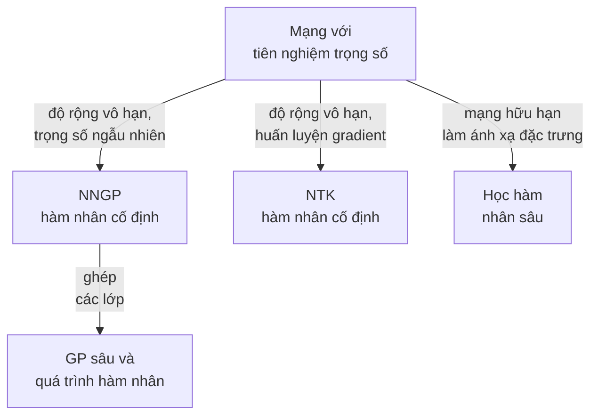

import Figure from '../../../components/Figure.astro';
import BdlGpPriorPosterior from '../../../components/diagrams/BdlGpPriorPosterior.astro';

Các bài trước đặt một tiên nghiệm (prior) lên các tham số $\theta$ của một mạng và tìm cách xấp xỉ phân phối hậu nghiệm (posterior) $p(\theta \mid \mathcal{D})$, bằng [lấy mẫu](/vi/blog/sampling-the-posterior-mcmc), bằng [xấp xỉ Laplace](/vi/blog/laplace-approximations), bằng [suy luận biến phân](/vi/blog/variational-inference-for-neural-networks) hoặc bằng một [tổ hợp mô hình](/vi/blog/deep-ensembles). Trong mọi trường hợp, đối tượng quan tâm không phải là bản thân $\theta$ mà là các hàm mà nó tạo ra: dự đoán chỉ phụ thuộc vào $\theta$ thông qua $f_\theta(x^*)$.

Bài này chuyển góc nhìn từ trọng số sang hàm. Bài cho thấy một tiên nghiệm trên trọng số sinh ra một tiên nghiệm trên hàm được mô tả bởi một **hàm nhân** (kernel) như thế nào, định nghĩa quá trình Gauss (Gaussian process, GP), và suy ra hồi quy GP chính xác, kể cả hàm hợp lý biên (marginal likelihood) dùng để đặt các siêu tham số của hàm nhân. Sau đó bài giải thích một kết quả kinh điển của Neal (1996): một mạng khởi tạo ngẫu nhiên có một lớp ẩn trở thành một GP khi lớp đó rộng vô hạn, tức giới hạn **quá trình Gauss của mạng nơ-ron** (neural network Gaussian process, NNGP). Một mục ngắn hơn điểm qua hàm nhân tiếp tuyến nơ-ron (neural tangent kernel, NTK), mô tả cách mạng được huấn luyện khi độ rộng của nó tăng không giới hạn, và các mục cuối cho thấy học hàm nhân sâu, GP sâu và quá trình hàm nhân sâu mang trở lại điều mà giới hạn độ rộng vô hạn đã loại bỏ: các đặc trưng được học.

Bài giả định người đọc đã biết hồi quy tuyến tính Bayes của [bài thứ nhất](/vi/blog/bayesian-inference-for-neural-networks), có phân phối hậu nghiệm Gauss ở dạng đóng. Các ví dụ dùng Python 3.13 và NumPy 2.5.3 với các hạt giống ngẫu nhiên (random seed) được ghi trong mã. Rasmussen và Williams (2006) là tài liệu tham khảo chuẩn cho các mục 1 và 2.

## 1. Từ trọng số đến hàm

### 1.1 Một tiên nghiệm trên trọng số là một tiên nghiệm trên hàm

Xét một mô hình tuyến tính $f(x) = \phi(x)^\top \theta$ với một ánh xạ đặc trưng cố định $\phi$ từ đầu vào vào $\mathbb{R}^P$ và một tiên nghiệm Gauss $\theta \sim \mathcal{N}(0, \Sigma_p)$ trên trọng số, với ma trận hiệp phương sai tiên nghiệm $\Sigma_p$. Với mọi đầu vào $x$, giá trị $f(x)$ là một hàm tuyến tính của một vector Gauss, nên nó có phân phối Gauss với trung bình bằng không. Với hai đầu vào $x$ và $x'$, hiệp phương sai của các giá trị hàm là

$$
\operatorname{Cov}\big(f(x), f(x')\big) = \mathbb{E}\big[\phi(x)^\top \theta\, \theta^\top \phi(x')\big] = \phi(x)^\top \Sigma_p\, \phi(x') =: k(x, x') .
$$

Khi đó mọi tập hữu hạn các giá trị hàm $f(x_1), \dots, f(x_n)$ có phân phối Gauss đồng thời với ma trận hiệp phương sai $K_{ij} = k(x_i, x_j)$. Tiên nghiệm trên $\theta$ đã được thay bằng một phát biểu về hàm hoàn toàn không nhắc đến $\theta$: chỉ còn lại hàm $k$. Với ví dụ minh họa của bài thứ nhất, với $\Sigma_p = s_0^2 I$, hàm nhân là $s_0^2\,\phi(x)^\top\phi(x')$, và bằng chứng (evidence) tính ở đó, $\mathcal{N}(\mathbf{y}; 0, s_0^2\Phi\Phi^\top + \sigma^2 I)$, có hiệp phương sai đúng bằng ma trận Gram này cộng nhiễu.

### 1.2 Hàm nhân

Một **hàm nhân** là một hàm $k(x, x')$ đối xứng và **nửa xác định dương** (positive semi-definite): với mọi tập hữu hạn đầu vào, **ma trận Gram** (Gram matrix) $K$ với các phần tử $k(x_i, x_j)$ thỏa $a^\top K a \ge 0$ với mọi vector $a$. Mọi hàm nhân dạng $\phi(x)^\top \Sigma_p \phi(x')$ đều thỏa điều này, vì $a^\top K a = \operatorname{Var}\big(\sum_i a_i f(x_i)\big) \ge 0$. Ngược lại, định lý Mercer và các kết quả họ hàng của nó cho thấy mọi hàm nhân nửa xác định dương đều viết được dưới dạng $\phi(x)^\top\phi(x')$ với một ánh xạ đặc trưng $\phi$ phù hợp, mà đầu ra có thể có vô hạn thành phần (Schölkopf và Smola, 2002).

Chiều ngược lại đó là **thủ thuật hàm nhân** (kernel trick): một thuật toán chỉ chạm tới các đặc trưng thông qua tích vô hướng có thể làm việc trực tiếp với $k$ mà không bao giờ tính $\phi$, kể cả khi $\phi$ có số chiều vô hạn. Ví dụ được dùng nhiều nhất là **hàm nhân mũ bình phương** (squared-exponential kernel) cho đầu vào vô hướng, còn gọi là hàm nhân cơ sở bán kính (radial basis function, RBF) hay hàm nhân Gauss,

$$
k(x, x') = \sigma_f^2 \exp\!\Big(-\frac{(x - x')^2}{2\ell^2}\Big),
$$

với **độ lệch chuẩn tín hiệu** (signal standard deviation) $\sigma_f$, xác định độ lớn điển hình của hàm, và **thang độ dài** (lengthscale) $\ell$, khoảng cách mà trong đó các giá trị hàm còn tương quan mạnh. Nó tương ứng với vô hạn đặc trưng dạng bướu Gauss. Các hàm nhân thông dụng khác là hàm nhân tuyến tính $x^\top x'$, hàm nhân tuần hoàn, và họ Matérn, có các hàm mẫu kém trơn hơn so với hàm nhân mũ bình phương. Tổng và tích của các hàm nhân là hàm nhân, nên có thể xây dựng hàm nhân cho một bài toán từ các phần đơn giản, chẳng hạn một hàm nhân tuần hoàn nhân với một hàm nhân mũ bình phương cho một mẫu hình theo mùa có trôi dạt.

## 2. Quá trình Gauss

### 2.1 Định nghĩa

Một **quá trình Gauss** là một tập hợp các biến ngẫu nhiên, đánh chỉ số theo đầu vào $x$, trong đó mọi số hữu hạn biến có phân phối Gauss đồng thời. Nó được xác định bởi một hàm trung bình $m(x) = \mathbb{E}[f(x)]$ và một hàm hiệp phương sai $k(x, x')$, và được viết là $f \sim \mathcal{GP}(m, k)$. Bài này lấy $m = 0$, một lựa chọn phổ biến sau khi trừ đi giá trị trung bình của các giá trị đích. Mục 1.1 đã cho thấy hồi quy tuyến tính Bayes là một GP với hàm nhân $\phi(x)^\top\Sigma_p\phi(x')$; một GP với hàm nhân mũ bình phương là cùng ý tưởng đó với vô hạn đặc trưng.

Lấy mẫu từ một tiên nghiệm GP chỉ cần một lưới: tính $K$ trên các đầu vào của lưới, phân tích $K = LL^\top$ bằng phân tích Cholesky, rồi nhân $L$ với một vector các giá trị chuẩn tắc độc lập. Khung bên trái của hình ở mục 2.4 cho thấy ba mẫu như vậy.

### 2.2 Phân phối hậu nghiệm bằng phép lấy điều kiện Gauss

Hồi quy GP dựa trên một sự kiện về vector Gauss. Nếu

$$
\begin{bmatrix} a \\ b \end{bmatrix} \sim \mathcal{N}\!\left(0, \begin{bmatrix} A & R \\ R^\top & B \end{bmatrix}\right),
$$

thì phân phối có điều kiện của $a$ khi biết $b$ quan sát được là $\mathcal{N}\big(R B^{-1} b,\; A - R B^{-1} R^\top\big)$, trong đó $R$ là hiệp phương sai chéo của $a$ và $b$. Chứng minh dùng phép bù bình phương trong số mũ của mật độ đồng thời; hiệp phương sai $A - RB^{-1}R^\top$ là phần bù Schur (Schur complement) của $B$.

Bây giờ cho các giá trị đích huấn luyện là các giá trị hàm có nhiễu, $y_n = f(x_n) + \varepsilon_n$ với nhiễu độc lập $\varepsilon_n \sim \mathcal{N}(0, \sigma^2)$. Ký hiệu $X$ là $N$ đầu vào huấn luyện, $K = k(X, X)$ là ma trận Gram $N \times N$ của chúng, $k_* = k(X, x^*)$ là vector hiệp phương sai giữa các đầu vào huấn luyện và một đầu vào kiểm tra, và $k_{**} = k(x^*, x^*)$. Dưới tiên nghiệm, các giá trị đích $y$ và giá trị kiểm tra $f_* = f(x^*)$ có phân phối Gauss đồng thời:

$$
\begin{bmatrix} y \\ f_* \end{bmatrix} \sim \mathcal{N}\!\left(0, \begin{bmatrix} K + \sigma^2 I & k_* \\ k_*^\top & k_{**} \end{bmatrix}\right).
$$

Lấy điều kiện theo $y$ bằng sự kiện ở trên, với $a = f_*$ và $b = y$, cho phân phối dự đoán hậu nghiệm của giá trị hàm:

$$
\mathbb{E}[f_* \mid \mathcal{D}] = k_*^\top (K + \sigma^2 I)^{-1} y, \qquad
\operatorname{Var}[f_* \mid \mathcal{D}] = k_{**} - k_*^\top (K + \sigma^2 I)^{-1} k_* .
$$

Với một quan sát có nhiễu mới $y^*$, phương sai tăng thêm $\sigma^2$. Có ba tính chất đáng đọc ra từ đây. Giá trị trung bình là tổng có trọng số của các hàm nhân đặt tâm tại các đầu vào huấn luyện, $\sum_n \alpha_n k(x_n, x^*)$ với $\alpha = (K + \sigma^2 I)^{-1} y$. Phương sai là phương sai tiên nghiệm trừ đi một số hạng không âm, lớn khi $x^*$ tương quan mạnh với các đầu vào huấn luyện; ở xa tất cả chúng, $k_*$ tiến về không và phương sai trở về giá trị tiên nghiệm $k_{**}$. Và phương sai không phụ thuộc vào các giá trị đích $y$, chỉ phụ thuộc vào vị trí của các đầu vào. Khác với tổ hợp mô hình của [bài thứ năm](/vi/blog/deep-ensembles), phân phối hậu nghiệm này là chính xác: không có phép xấp xỉ nào ngoài việc chọn tiên nghiệm và hàm hợp lý (likelihood).

### 2.3 Hàm hợp lý biên

Hàm nhân có các **siêu tham số** (hyperparameter), ở đây là $\sigma_f$, $\ell$ và nhiễu $\sigma$. Cách Bayes để đặt chúng dùng xác suất của các giá trị đích khi $f$ đã được lấy tích phân ra ngoài, tức **hàm hợp lý biên** hay bằng chứng. Vì $y \sim \mathcal{N}(0, K_y)$ với $K_y = K + \sigma^2 I$,

$$
\log p(y \mid X) = -\tfrac{1}{2}\, y^\top K_y^{-1} y \;-\; \tfrac{1}{2}\log\lvert K_y\rvert \;-\; \tfrac{N}{2}\log 2\pi .
$$

Số hạng thứ nhất thưởng cho việc khớp dữ liệu; số hạng thứ hai phạt một ma trận hiệp phương sai trải xác suất của nó lên nhiều tập dữ liệu có thể có, điều mà một hàm nhân linh hoạt (thang độ dài ngắn) làm. Cực đại hóa nó theo các siêu tham số tự động cân bằng hai yếu tố này, một trường hợp của hệ số Occam (Occam factor) mà MacKay (1992) đã mô tả cho mạng nơ-ron. Đây chính là bằng chứng mà [bài thứ nhất](/vi/blog/bayesian-inference-for-neural-networks) dùng để so sánh mô hình, ở đây có sẵn ở dạng đóng.

### 2.4 Một ví dụ minh họa

Đoạn mã khớp một GP với hàm nhân mũ bình phương ($\sigma_f = 1$) với bảy quan sát có nhiễu của $\sin x$ với độ lệch chuẩn nhiễu $\sigma = 0.1$, chọn thang độ dài trên một lưới theo logarit hàm hợp lý biên, và dự đoán tại năm đầu vào kiểm tra. Mã dùng thừa số Cholesky $L$ của $K_y$ để giải các hệ tuyến tính và để tính $\log\lvert K_y\rvert = 2\sum_i \log L_{ii}$, ổn định hơn so với việc lập $K_y^{-1}$.

```python
import numpy as np

rng = np.random.default_rng(4)
x = np.array([-4.0, -3.2, -2.5, -1.0, 0.5, 1.2, 3.5])     # training inputs
sigma = 0.1                                               # noise sd
y = np.sin(x) + sigma * rng.normal(size=x.size)

def k_se(a, b, ell=1.0, sf=1.0):                            # squared-exponential kernel
    return sf ** 2 * np.exp(-0.5 * (a[:, None] - b[None, :]) ** 2 / ell ** 2)

def gp_fit(x, y, ell):
    K = k_se(x, x, ell) + sigma ** 2 * np.eye(x.size)
    L = np.linalg.cholesky(K)                               # K = L L^T
    alpha = np.linalg.solve(L.T, np.linalg.solve(L, y))     # alpha = K^-1 y
    lml = (-0.5 * y @ alpha - np.log(np.diag(L)).sum()
           - 0.5 * x.size * np.log(2 * np.pi))              # log marginal likelihood
    return L, alpha, lml

def gp_predict(x, L, alpha, xs, ell):
    Ks = k_se(x, xs, ell)                                   # n x m cross-covariances
    mean = Ks.T @ alpha
    V = np.linalg.solve(L, Ks)
    var_f = k_se(xs, xs, ell).diagonal() - (V ** 2).sum(0)  # latent-function variance
    return mean, np.sqrt(var_f), np.sqrt(var_f + sigma ** 2)

for ell in [0.3, 1.0, 3.0]:
    print(f"lengthscale {ell}: log marginal likelihood {gp_fit(x, y, ell)[2]:.2f}")

grid = np.arange(0.2, 4.01, 0.05)
ell = grid[np.argmax([gp_fit(x, y, e)[2] for e in grid])]
print(f"best lengthscale on the grid: {ell:.2f} "
      f"(log marginal likelihood {gp_fit(x, y, ell)[2]:.2f})")
L, alpha, _ = gp_fit(x, y, ell)
xs = np.array([-3.2, -0.25, 2.3, 5.0, 8.0])
mean, sd_f, sd_y = gp_predict(x, L, alpha, xs, ell)
print("    x*   sin(x*)   mean   sd of f*   sd of y*")
for row in zip(xs, np.sin(xs), mean, sd_f, sd_y):
    print("{:6.2f} {:8.3f} {:7.3f} {:9.3f} {:10.3f}".format(*row))
```

Mã in ra:

```text
lengthscale 0.3: log marginal likelihood -7.64
lengthscale 1.0: log marginal likelihood -6.18
lengthscale 3.0: log marginal likelihood -16.80
best lengthscale on the grid: 1.60 (log marginal likelihood -5.13)
    x*   sin(x*)   mean   sd of f*   sd of y*
 -3.20    0.058   0.072     0.079      0.128
 -0.25   -0.247  -0.352     0.111      0.149
  2.30    0.746   0.700     0.248      0.268
  5.00   -0.959  -0.724     0.720      0.727
  8.00    0.989  -0.027     1.000      1.005
```

Hàm hợp lý biên ưa thang độ dài 1.6, với logarit hàm hợp lý biên bằng $-5.13$. Nó loại bỏ cả $\ell = 0.3$ quá gợn sóng (thấp hơn 2.5 nat) lẫn $\ell = 3$ quá trơn (thấp hơn 11.7 nat). Tại đầu vào huấn luyện $x^* = -3.2$, độ lệch chuẩn của giá trị hàm, 0.079, thấp hơn mức nhiễu: nhiều quan sát lân cận lấy trung bình loại bớt một phần nhiễu. Ở khoảng trống tại $x^* = 2.3$ nó tăng lên 0.248, tại $x^* = 5$ vượt ra ngoài quan sát cuối cùng nó lên 0.720, và tại $x^* = 8$ giá trị trung bình gần như đã trở về trung bình tiên nghiệm 0 (nó bằng $-0.027$) và độ lệch chuẩn về giá trị tiên nghiệm 1. Ở mọi hàng, giá trị thật nằm trong phạm vi hai độ lệch chuẩn quanh giá trị trung bình, đây là hành vi mà tổ hợp mô hình đơn giản của bài thứ năm không đạt được ở xa dữ liệu.

<Figure caption="Trái: ba mẫu rút từ tiên nghiệm GP (thang độ dài 1.6) cùng dải rộng hai độ lệch chuẩn tiên nghiệm. Phải: phân phối hậu nghiệm sau bảy quan sát, với giá trị trung bình, dải và ba mẫu hậu nghiệm. Hãy nhìn cách dải thắt lại tại mỗi quan sát và nở trở lại độ rộng tiên nghiệm khi ra xa dữ liệu.">
  <BdlGpPriorPosterior />
</Figure>

### 2.5 Chi phí

Việc khớp đòi hỏi phân tích Cholesky một ma trận $N \times N$, tốn $O(N^3)$ phép toán và $O(N^2)$ bộ nhớ; sau đó mỗi dự đoán tốn $O(N)$ cho giá trị trung bình và $O(N^2)$ cho phương sai. Vì vậy GP chính xác khả thi đến khoảng vài chục nghìn điểm trên một máy. Các bài toán lớn hơn dùng **điểm cảm sinh** (inducing points), một tập $N_u \ll N$ đầu vào giả tóm tắt dữ liệu, với huấn luyện biến phân (Titsias, 2009) có thể dùng lô nhỏ (mini-batch) (Hensman, Fusi và Lawrence, 2013). [Bài thứ tám](/vi/blog/scaling-bayesian-deep-learning) quay lại các phương pháp này.

## 3. Mạng rộng vô hạn là quá trình Gauss

### 3.1 Lập luận của Neal

Xét một mạng có một lớp ẩn gồm $H$ đơn vị:

$$
f(x) = \frac{1}{\sqrt{H}} \sum_{h=1}^{H} v_h\, \varphi\big(u_h(x)\big), \qquad u_h(x) = w_h^\top x + b_h ,
$$

trong đó $\varphi$ là hàm kích hoạt ($\varphi$, không phải ánh xạ đặc trưng $\phi$ của mục 1), $w_h$ và $b_h$ là trọng số đầu vào và độ chệch (bias) của đơn vị $h$, và $v_h$ là trọng số đầu ra của nó. Cho mọi trọng số các tiên nghiệm độc lập có trung bình bằng không, với $\operatorname{Var}(v_h) = s_v^2$, và lưu ý hệ số $1/\sqrt{H}$, giữ cho phương sai tiên nghiệm của $f$ cố định khi $H$ tăng. Mỗi đơn vị đóng góp một số hạng $v_h \varphi(u_h(x))$, và các số hạng này độc lập và cùng phân phối theo $h$, với trung bình bằng không và hiệp phương sai

$$
\operatorname{Cov}\big(v_h\varphi(u_h(x)),\, v_h\varphi(u_h(x'))\big) = s_v^2\, \mathbb{E}\big[\varphi(u(x))\,\varphi(u(x'))\big] ,
$$

như nhau với mọi đơn vị. Các giá trị hàm tại mọi tập hữu hạn đầu vào bằng $1/\sqrt{H}$ nhân với tổng của $H$ vector độc lập như vậy, nên theo định lý giới hạn trung tâm nhiều chiều, chúng trở thành phân phối Gauss đồng thời khi $H \to \infty$. Các phân phối hữu hạn chiều Gauss tại mọi tập đầu vào xác định một GP, với hàm nhân

$$
K(x, x') = s_v^2\, \mathbb{E}_{w, b}\big[\varphi(w^\top x + b)\, \varphi(w^\top x' + b)\big].
$$

Đây là kết quả của Neal (1996). Tiên nghiệm trên trọng số, khi được đẩy qua một lớp rộng vô hạn, là một tiên nghiệm GP trên hàm, và suy luận Bayes trong mạng rộng vô hạn là hồi quy GP với hàm nhân này. Williams (1997) đã tính hàm nhân ở dạng đóng cho hàm kích hoạt hàm sai số (error function) và hàm kích hoạt Gauss.

### 3.2 Hàm nhân cho đơn vị ReLU

Với đơn vị tuyến tính chỉnh lưu (rectified linear unit, ReLU), $\varphi(u) = \max(u, 0)$, kỳ vọng có dạng đóng. Gộp độ chệch vào đầu vào bằng cách viết $\tilde x = (x, 1)$ và $\tilde w = (w, b)$, sao cho $w^\top x + b = \tilde w^\top \tilde x$, và lấy $\tilde w \sim \mathcal{N}(0, I)$. Hàm nhân arc-cosine của Cho và Saul (2009), áp dụng cho $\tilde x$, cho

$$
\mathbb{E}\big[\varphi(\tilde w^\top \tilde x)\,\varphi(\tilde w^\top \tilde x')\big] = \frac{\lVert\tilde x\rVert\,\lVert\tilde x'\rVert}{2\pi}\big(\sin t + (\pi - t)\cos t\big),
$$

trong đó $t$ là góc giữa $\tilde x$ và $\tilde x'$. Với $x = x'$, góc bằng không và giá trị là $\lVert\tilde x\rVert^2/2$, vì một nửa các tiền kích hoạt (pre-activation) Gauss là dương.

Có hai điều đáng kiểm tra bằng số. Hiệp phương sai của $f$ bằng $K$ ở mọi độ rộng, vì mỗi đơn vị đóng góp cùng một hiệp phương sai và hệ số $1/\sqrt{H}$ lấy trung bình chúng; chỉ có hình dạng của phân phối thay đổi theo $H$. Và hình dạng đó tiến tới phân phối Gauss với một tốc độ tính được. Khi biết các kích hoạt ẩn $a_h = \varphi(u_h(x))$, $f(x)$ có phân phối Gauss với phương sai $V = \frac{1}{H}\sum_h a_h^2$ (lấy $v_h \sim \mathcal{N}(0, 1)$), nên $f(x)$ là một hỗn hợp tỉ lệ (scale mixture) của các phân phối Gauss. Độ nhọn vượt (excess kurtosis) của nó, tức mômen bậc bốn chuẩn hóa trừ đi giá trị 3 của phân phối Gauss, bằng $3\operatorname{Var}(V)/\mathbb{E}[V]^2 = 3\operatorname{Var}(a^2)/\big(H\,\mathbb{E}[a^2]^2\big)$. Tại $x = 0$, tiền kích hoạt là độ chệch $b \sim \mathcal{N}(0,1)$, nên $\mathbb{E}[a^2] = 1/2$, $\mathbb{E}[a^4] = 3/2$, $\operatorname{Var}(a^2) = 5/4$, và độ nhọn vượt bằng $15/H$.

```python
import numpy as np

rng = np.random.default_rng(5)
X = np.array([[0.0, 1.0], [1.0, 1.0], [-2.0, 1.0]])    # three scalar inputs 0, 1, -2 with a constant 1

def relu_kernel(a, b):                                   # E[relu(w.a) relu(w.b)], w ~ N(0, I)
    na, nb = np.linalg.norm(a), np.linalg.norm(b)
    t = np.arccos(np.clip(a @ b / (na * nb), -1, 1))
    return na * nb * (np.sin(t) + (np.pi - t) * np.cos(t)) / (2 * np.pi)

K = np.array([[relu_kernel(a, b) for b in X] for a in X])

def sample_outputs(H, nets=10_000, chunk=500):
    out = []
    for _ in range(nets // chunk):
        W = rng.normal(size=(chunk, H, 2))               # hidden weights and biases
        V = rng.normal(size=(chunk, H))                  # output weights
        A = np.maximum(W @ X.T, 0)                       # chunk x H x 3 hidden activations
        out.append(np.einsum('ch,chi->ci', V, A) / np.sqrt(H))
    return np.concatenate(out)                           # nets x 3 network outputs

print("NNGP kernel:\n", np.round(K, 3))
for H in [1, 10, 100, 1000]:
    F = sample_outputs(H)
    cov = np.cov(F.T)
    z = F[:, 0] / F[:, 0].std()
    print(f"H={H:5d}  max|cov - K| = {np.abs(cov - K).max():.3f}   "
          f"excess kurtosis of f(0) = {np.mean(z ** 4) - 3:6.2f}")
```

Mã chạy trong khoảng một giây và in ra:

```text
NNGP kernel:
 [[0.5   0.534 0.642]
 [0.534 1.    0.279]
 [0.642 0.279 2.5  ]]
H=    1  max|cov - K| = 0.072   excess kurtosis of f(0) =  15.28
H=   10  max|cov - K| = 0.073   excess kurtosis of f(0) =   1.27
H=  100  max|cov - K| = 0.028   excess kurtosis of f(0) =   0.07
H= 1000  max|cov - K| = 0.063   excess kurtosis of f(0) =  -0.05
```

Đường chéo của $K$ khớp với công thức $\lVert\tilde x\rVert^2/2$: 0.5, 1 và 2.5 cho $x = 0, 1, -2$. Sai số hiệp phương sai ở mức sai số Monte Carlo với 10 000 mạng ở mọi độ rộng, kể cả $H = 1$, đúng như dự đoán. Độ nhọn vượt theo sát $15/H$ (15, 1.5, 0.15, 0.015) trong phạm vi sai số lấy mẫu: một đơn vị ReLU duy nhất cho một tiên nghiệm có đuôi rất nặng trên $f(0)$, và 100 đơn vị đã cho một tiên nghiệm gần như Gauss.

### 3.3 Mạng sâu

Lập luận mở rộng được theo từng lớp. Lee và cộng sự (2018) và Matthews và cộng sự (2018) chứng minh rằng khi độ rộng của mọi lớp ẩn tăng đến vô hạn, một mạng sâu kết nối đầy đủ với tiên nghiệm Gauss trên trọng số hội tụ về một GP có hàm nhân tuân theo một hệ thức truy hồi. Với phương sai trọng số $s_w^2$ chia cho số đầu vào của lớp (fan-in) và phương sai độ chệch $s_b^2$, hàm nhân tiền kích hoạt của lớp $l + 1$ là

$$
K^{(l+1)}(x, x') = s_b^2 + s_w^2\, \mathbb{E}_{(u, u') \sim \mathcal{N}(0, \Sigma^{(l)})}\big[\varphi(u)\,\varphi(u')\big],
$$

trong đó $\Sigma^{(l)}$ là ma trận hiệp phương sai $2 \times 2$ của các tiền kích hoạt lớp $l$ tại $x$ và $x'$, xây từ $K^{(l)}(x, x)$, $K^{(l)}(x, x')$ và $K^{(l)}(x', x')$. Với ReLU, kỳ vọng lại là công thức arc-cosine. Lee và cộng sự (2018) báo cáo rằng hồi quy GP với các hàm nhân này cạnh tranh được với các mạng kết nối đầy đủ hữu hạn huấn luyện bằng hạ gradient ngẫu nhiên (stochastic gradient descent, SGD) trên các bộ dữ liệu chuẩn (benchmark) về ảnh mà họ thử.

### 3.4 Giới hạn đánh mất điều gì

Giới hạn NNGP cho một mạng Bayes chính xác với cái giá là một hàm nhân cố định. Mỗi đơn vị ẩn có ảnh hưởng tiến về không lên đầu ra, nên việc lấy điều kiện theo dữ liệu không thể thay đổi biểu diễn ẩn; phân phối hậu nghiệm chỉ dịch chuyển lớp đọc ra (readout). Nói cách khác, một mạng rộng vô hạn trong giới hạn này không học đặc trưng, vốn là tính chất khiến các mạng sâu hữu hạn hiệu quả trên ảnh, văn bản và tiếng nói. Giới hạn này là một điểm tham chiếu cho ý nghĩa của một tiên nghiệm trên trọng số ([bài thứ bảy](/vi/blog/priors-symmetries-and-identifiability) sử dụng nó), không phải một công thức để có các mô hình chính xác cho ảnh hay văn bản.

## 4. Hàm nhân tiếp tuyến nơ-ron

NNGP mô tả một mạng lúc khởi tạo và phân phối hậu nghiệm Bayes chính xác của nó. Một giới hạn khác mô tả những gì hạ gradient làm với một mạng có độ rộng lớn. Tuyến tính hóa mạng quanh các tham số ban đầu $\theta_0$:

$$
f_\theta(x) \approx f_{\theta_0}(x) + J(x)\,(\theta - \theta_0), \qquad J(x) = \frac{\partial f_\theta(x)}{\partial \theta}\Big|_{\theta_0},
$$

trong đó $J(x)$ là vector hàng các đạo hàm của đầu ra theo mọi tham số. **Hàm nhân tiếp tuyến nơ-ron** là $\Theta(x, x') = J(x)\,J(x')^\top$, tích vô hướng của các đặc trưng gradient này. Dưới dòng gradient (gradient flow) trên hàm mất mát bình phương, các đầu ra huấn luyện khi đó tiến triển theo $\frac{d}{dt} f(X) = -\eta\, \Theta(X, X)\,(f(X) - y)$, với tốc độ học $\eta$.

Jacot, Gabriel và Hongler (2018) chứng minh rằng, với một cách chia tỉ lệ trọng số cụ thể (tham số hóa NTK), $\Theta$ hội tụ khi độ rộng tăng về một hàm nhân tất định giữ nguyên không đổi trong quá trình huấn luyện. Khi đó mạng đã huấn luyện là hồi quy hàm nhân với $\Theta$: sau khi huấn luyện đến hội tụ, dự đoán của nó là $f_{\theta_0}(x^*) + \Theta(x^*, X)\,\Theta(X, X)^{-1}\big(y - f_{\theta_0}(X)\big)$. Lee và cộng sự (2019) chứng minh rằng các mạng rộng với độ sâu bất kỳ tiến triển như các phiên bản tuyến tính hóa của chúng dưới hạ gradient, và suy ra phân phối kết quả của các dự đoán theo các khởi tạo ngẫu nhiên. Phân phối đó là một GP, nhưng nói chung không phải phân phối hậu nghiệm NNGP: huấn luyện một mạng bằng hạ gradient từ một điểm xuất phát ngẫu nhiên không phải là suy luận Bayes, kể cả trong giới hạn.

Ba lưu ý giữ kết quả này ở đúng tầm của nó. Thứ nhất, chế độ hàm nhân không đổi, mà Chizat, Oyallon và Bach (2019) gọi là **huấn luyện lười** (lazy training), là hệ quả của cách chia tỉ lệ. Các trọng số dịch chuyển ít đến mức các đặc trưng không thay đổi, điều này lại cho một mô hình không học đặc trưng. Yang và Hu (2021) chỉ ra rằng một cách chia tỉ lệ khác cho khởi tạo và tốc độ học cho một giới hạn độ rộng vô hạn trong đó đặc trưng được học. Thứ hai, Arora và cộng sự (2019) tính chính xác NTK của các mạng tích chập cho bộ dữ liệu chuẩn phân loại ảnh CIFAR-10 và thấy nó mạnh hơn các phương pháp hàm nhân trước đó nhưng yếu hơn các mạng đã huấn luyện tương ứng. Thứ ba, các đặc trưng Jacobi $J(x)$ chính là các đặc trưng xuất hiện trong xấp xỉ Laplace tuyến tính hóa của [bài thứ ba](/vi/blog/laplace-approximations), mà ma trận hiệp phương sai Gauss–Newton tổng quát (generalized Gauss–Newton, GGN) của nó biến một mạng đã huấn luyện thành một GP với hàm nhân xây từ $J$. Ở đó ma trận Jacobi được lấy tại các tham số đã huấn luyện chứ không phải lúc khởi tạo, nên các đặc trưng là đặc trưng đã học.

Các giới hạn và mô hình của bài này có thể được sắp xếp theo những gì chúng giữ cố định và những gì chúng học.



## 5. Mang việc học đặc trưng trở lại

### 5.1 Học hàm nhân sâu

**Học hàm nhân sâu** (deep kernel learning; Wilson, Hu, Salakhutdinov và Xing, 2016) giữ một mạng hữu hạn $g_\psi$ với tham số $\psi$ làm bộ trích xuất đặc trưng và đặt một GP lên đầu ra của nó: hàm nhân là $k\big(g_\psi(x), g_\psi(x')\big)$ với một hàm nhân cơ sở $k$ như hàm nhân mũ bình phương. Các trọng số của mạng được coi là siêu tham số của hàm nhân và được huấn luyện đồng thời với $\sigma_f$, $\ell$ và $\sigma$ bằng cách cực đại hóa logarit hàm hợp lý biên ở mục 2.3. Với một đầu vào kiểm tra $x^*$, mạng đã huấn luyện được chạy một lần để có $g_\psi(x^*)$, và giá trị trung bình cùng phương sai dự đoán là của một GP thông thường có đầu vào là đầu ra của mạng, cho bởi các công thức ở mục 2.2. Một phiên bản biến phân ngẫu nhiên với điểm cảm sinh mở rộng được cho các tập dữ liệu lớn và xử lý được các hàm hợp lý phân loại; nó xuất hiện trong một bài báo đi kèm của cùng các tác giả trong cùng năm.

Phương pháp này có một kiểu thất bại đã biết. Hàm hợp lý biên chỉ bảo vệ khỏi quá khớp khi có ít siêu tham số; với hàng triệu siêu tham số, nó có thể bị đẩy lên bằng cách làm cho mọi điểm huấn luyện tương quan với nhau, nên mô hình khớp dữ liệu huấn luyện gần như hoàn hảo và báo rất ít độ bất định. Ober, Rasmussen và van der Wilk (2021) phân tích hành vi này và thấy rằng khi đó học hàm nhân sâu có thể quá khớp tệ hơn một mạng thông thường, và việc xử lý bộ trích xuất đặc trưng theo cách Bayes, thay vì tối ưu hóa nó, có thể tránh được vấn đề. Một rủi ro liên quan là ánh xạ đặc trưng đưa các đầu vào ở xa dữ liệu huấn luyện tới gần các đặc trưng huấn luyện, nên GP không thấy khoảng cách nào và báo độ bất định thấp; [bài thứ tám](/vi/blog/scaling-bayesian-deep-learning) mô tả các bộ trích xuất đặc trưng bảo toàn khoảng cách nhằm giải quyết điều này.

### 5.2 Quá trình Gauss sâu

Một **quá trình Gauss sâu** (deep Gaussian process; Damianou và Lawrence, 2013) hợp thành các GP: $f = f_L \circ \dots \circ f_1$, trong đó mỗi lớp $f_l$ là một hàm có phân phối GP của đầu ra lớp trước. Phân phối có điều kiện của mỗi lớp là Gauss, nhưng phép hợp thành thì không, nên một GP sâu có thể biểu diễn các hàm không dừng, các chuyển tiếp đột ngột và các phân phối dự đoán đuôi nặng hoặc đa mode mà một GP đơn với hàm nhân dừng không biểu diễn được. Cái giá là phân phối hậu nghiệm không còn ở dạng đóng. Salimbeni và Deisenroth (2017) huấn luyện GP sâu bằng suy luận biến phân ngẫu nhiên kép (doubly stochastic variational inference), lấy mẫu xuyên qua các lớp với các điểm cảm sinh trong mỗi lớp. Độ sâu cũng có một bệnh lý riêng: Duvenaud và cộng sự (2014) chỉ ra rằng với một số tiên nghiệm, khi số lớp tăng, các hàm mẫu trở nên phẳng gần như ở mọi nơi với những bước nhảy đột ngột, nên tiên nghiệm phải được thiết kế có tính đến độ sâu.

### 5.3 Quá trình hàm nhân sâu

Một GP sâu với các lớp độ rộng hữu hạn có thể được viết lại sao cho các đối tượng ngẫu nhiên duy nhất là các ma trận Gram. Khi biết ma trận Gram của lớp $l$ trên các đầu vào, ma trận Gram của lớp $l + 1$ là một ma trận ngẫu nhiên có phân phối chỉ phụ thuộc vào lớp trước thông qua ma trận Gram đó; với các hàm nhân phù hợp, đó là một phân phối Wishart. Aitchison, Yang và Ober (2021) gọi các mô hình như vậy là **quá trình hàm nhân sâu** (deep kernel processes) và thực hiện suy luận trực tiếp trên các ma trận Gram, điều này tránh được các đối xứng của biểu diễn đặc trưng (mọi phép quay các đặc trưng của một lớp đều giữ nguyên ma trận Gram của nó). Yang và cộng sự (2023) sau đó lấy một giới hạn độ rộng vô hạn của họ mô hình này mà, khác với giới hạn NNGP, vẫn giữ được việc học biểu diễn, và gọi nó là máy hàm nhân sâu (deep kernel machines). Các mô hình này còn mới và ít được kiểm nghiệm hơn phần còn lại của bài; chúng quan trọng ở đây vì cho thấy góc nhìn hàm nhân và việc học đặc trưng không loại trừ nhau.

### 5.4 Siêu học (meta-learning) các hàm nhân sâu

Khi có nhiều tác vụ liên quan, mỗi tác vụ có ít mẫu, một hàm nhân sâu có thể được dùng chung cho chúng. Trong chuyển giao hàm nhân sâu (deep kernel transfer; Patacchiola và cộng sự, 2020), bộ trích xuất đặc trưng và các siêu tham số của hàm nhân được học bằng cách cực đại hóa tổng các hàm hợp lý biên của nhiều tác vụ huấn luyện. Một tác vụ mới sau đó được giải bằng suy luận GP trên số ít mẫu có nhãn của nó, với độ bất định phản ánh việc chúng ít như thế nào. Cách tiếp cận này thừa hưởng rủi ro quá khớp ở mục 5.1, giờ trải trên nhiều tác vụ, khiến rủi ro nhỏ hơn khi các tác vụ nhiều và thực sự liên quan với nhau.

## 6. Giới hạn và các kiểu thất bại

- **Chi phí bậc ba.** GP chính xác có chi phí $O(N^3)$; vượt quá vài chục nghìn điểm, chúng cần các phép xấp xỉ ở mục 2.5, mỗi phép có sai số riêng.
- **Hàm nhân chính là mô hình.** Dự đoán và độ bất định của một GP chỉ tốt bằng hàm nhân của nó. Một hàm nhân mũ bình phương trên các điểm ảnh thô đo khoảng cách điểm ảnh, vốn nói rất ít về nội dung; đó là động lực cho các hàm nhân sâu.
- **Khớp siêu tham số.** Cực đại hóa hàm hợp lý biên có thể rơi vào các cực trị cục bộ kém (một thang độ dài nhỏ hơn nhiều so với khoảng cách giữa các điểm dữ liệu, giải thích mọi thứ là tín hiệu, hoặc một thang độ dài lớn hơn nhiều so với dải đầu vào, giải thích mọi thứ là nhiễu), và với nhiều siêu tham số nó có thể quá khớp (mục 5.1).
- **Các giới hạn độ rộng vô hạn là lý tưởng hóa.** NNGP và NTK mô tả các mạng không học đặc trưng. Chúng giải thích tiên nghiệm và động lực học huấn luyện, nhưng độ chính xác của chúng trên các tác vụ tri giác khó nhìn chung thấp hơn các mạng hữu hạn đã huấn luyện trong các so sánh đã công bố.
- **Chỉ hàm hợp lý Gauss mới cho kết quả chính xác.** Phân loại và các hàm hợp lý không Gauss khác làm cho phân phối hậu nghiệm không còn Gauss, nên phân loại GP cần các phép xấp xỉ Laplace, biến phân hoặc lấy mẫu của các bài trước.

## 7. Bài tập

**Bài tập 1.** Một GP với hàm nhân mũ bình phương ($\sigma_f = 1$, $\ell = 1$) và độ lệch chuẩn nhiễu $\sigma = 0.1$ quan sát một điểm duy nhất, $y = 1$ tại $x = 0$. Tính giá trị trung bình và độ lệch chuẩn hậu nghiệm của $f$ tại $x^* = 1$.

<details>
<summary>Đáp án</summary>

$k_* = e^{-1/2} \approx 0.6065$ và $K + \sigma^2 = 1.01$. Giá trị trung bình là $0.6065/1.01 \approx 0.600$. Phương sai là $1 - 0.6065^2/1.01 = 1 - 0.3679/1.01 \approx 0.636$, nên độ lệch chuẩn khoảng 0.797.

</details>

**Bài tập 2.** Chứng minh rằng tổng của hai hàm nhân là một hàm nhân.

<details>
<summary>Đáp án</summary>

Tính đối xứng được bảo toàn. Với mọi tập đầu vào và vector $a$, ma trận Gram của $k_1 + k_2$ là $K_1 + K_2$, và $a^\top (K_1 + K_2) a = a^\top K_1 a + a^\top K_2 a \ge 0$. Theo ngôn ngữ hàm: tổng của hai GP độc lập là một GP có hiệp phương sai bằng tổng các hiệp phương sai.

</details>

**Bài tập 3.** Dùng kết quả $15/H$, cần bao nhiêu đơn vị ReLU để độ nhọn vượt của $f(0)$ ở mục 3.2 giảm xuống dưới 0.1? Hiệp phương sai của $f$ có phụ thuộc vào lựa chọn đó không?

<details>
<summary>Đáp án</summary>

$15/H < 0.1$ đòi hỏi $H > 150$. Hiệp phương sai không phụ thuộc vào $H$: trong mô hình này nó bằng hàm nhân NNGP ở mọi độ rộng; chỉ các mômen bậc cao hơn tiến tới giá trị Gauss khi $H$ tăng.

</details>

**Bài tập 4.** Kiểm tra phần tử 0.279 của hàm nhân NNGP cho các đầu vào $x = 1$ và $x' = -2$.

<details>
<summary>Đáp án</summary>

$\tilde x = (1, 1)$ và $\tilde x' = (-2, 1)$ có chuẩn $\sqrt 2$ và $\sqrt 5$ và tích vô hướng $-1$, nên $\cos t = -1/\sqrt{10} \approx -0.316$ và $t \approx 1.893$. Khi đó $\sin t \approx 0.949$ và $(\pi - t)\cos t \approx 1.249 \times (-0.316) \approx -0.395$, nên hàm nhân bằng $\sqrt{10}\,(0.949 - 0.395)/(2\pi) \approx 0.279$.

</details>

**Bài tập 5.** Vì sao phương sai hậu nghiệm của GP ở mục 2.2 không phụ thuộc vào các giá trị đích quan sát được, và khi nào điều đó là một điểm yếu?

<details>
<summary>Đáp án</summary>

Lấy điều kiện một vector Gauss đồng thời làm thay đổi hiệp phương sai một lượng $RB^{-1}R^\top$, chỉ chứa các hiệp phương sai chứ không chứa các giá trị quan sát. Đó là một điểm yếu khi các siêu tham số được cố định trước: các giá trị đích bất ngờ (phần dư lớn) không làm dải rộng ra. Khớp các siêu tham số bằng hàm hợp lý biên, vốn có phụ thuộc vào $y$, khôi phục được phần nào độ nhạy đó.

</details>

## 8. Tóm tắt

| Câu hỏi | Trả lời |
|---|---|
| Một tiên nghiệm Gauss trên trọng số sinh ra gì trên hàm? | Một quá trình Gauss có hàm nhân $\phi(x)^\top\Sigma_p\phi(x')$. |
| Hàm nhân là gì? | Một hàm đối xứng nửa xác định dương; một tích vô hướng của các đặc trưng có thể có số chiều vô hạn. |
| Phân phối hậu nghiệm của hồi quy GP là gì? | Trung bình $k_*^\top(K + \sigma^2 I)^{-1}y$, phương sai $k_{**} - k_*^\top(K + \sigma^2 I)^{-1}k_*$; chính xác với nhiễu Gauss. |
| Các siêu tham số được đặt thế nào? | Bằng cách cực đại hóa logarit hàm hợp lý biên, vốn cân bằng độ khớp dữ liệu với độ phức tạp. |
| Giới hạn NNGP là gì? | Một mạng có một (hoặc nhiều) lớp ẩn rộng vô hạn và trọng số ngẫu nhiên là một GP (Neal, 1996; Lee và cộng sự, 2018; Matthews và cộng sự, 2018). |
| NTK là gì? | Hàm nhân của các đặc trưng gradient; các mạng rộng vô hạn huấn luyện bằng hạ gradient theo cách chia tỉ lệ NTK thực hiện hồi quy hàm nhân với nó. |
| Cả hai giới hạn đánh mất điều gì? | Việc học đặc trưng. |
| Làm sao khôi phục nó? | Học hàm nhân sâu, GP sâu, quá trình và máy hàm nhân sâu, và các hàm nhân sâu dùng chung giữa các tác vụ. |
| Các kiểu thất bại chính? | Chi phí bậc ba, phụ thuộc vào hàm nhân, quá khớp siêu tham số, các giới hạn lý tưởng hóa. |

GP làm cho ý nghĩa của một tiên nghiệm trở nên nhìn thấy được: một hàm nhân cho biết những hàm nào có khả năng xảy ra trước khi thấy bất kỳ dữ liệu nào, và giới hạn NNGP cho thấy một tiên nghiệm Gauss trên trọng số nói gì về các hàm của một mạng rộng. [Bài tổng quan tiếp theo](/vi/blog/priors-symmetries-and-identifiability) đặt câu hỏi đó cho các mạng hữu hạn: các tiên nghiệm trên trọng số và trên hàm biểu đạt điều gì, và các đối xứng của một mạng làm cho tham số của nó không khả định danh như thế nào. Trước bài đó, các chương đầy đủ của Phần V của loạt bài nối tiếp bài tổng quan này, mỗi chương một bài.

### Tài liệu tham khảo

- L. Aitchison, A. X. Yang and S. W. Ober, "Deep kernel processes," in *Proceedings of the 38th International Conference on Machine Learning (ICML)*, 2021.
- S. Arora, S. S. Du, W. Hu, Z. Li, R. Salakhutdinov and R. Wang, "On exact computation with an infinitely wide neural net," in *Advances in Neural Information Processing Systems 32*, 2019.
- L. Chizat, E. Oyallon and F. Bach, "On lazy training in differentiable programming," in *Advances in Neural Information Processing Systems 32*, 2019.
- Y. Cho and L. K. Saul, "Kernel methods for deep learning," in *Advances in Neural Information Processing Systems 22*, 2009.
- A. Damianou and N. D. Lawrence, "Deep Gaussian processes," in *Proceedings of the 16th International Conference on Artificial Intelligence and Statistics (AISTATS)*, 2013.
- D. Duvenaud, O. Rippel, R. P. Adams and Z. Ghahramani, "Avoiding pathologies in very deep networks," in *Proceedings of the 17th International Conference on Artificial Intelligence and Statistics (AISTATS)*, 2014.
- J. Hensman, N. Fusi and N. D. Lawrence, "Gaussian processes for big data," in *Proceedings of the 29th Conference on Uncertainty in Artificial Intelligence (UAI)*, 2013.
- A. Jacot, F. Gabriel and C. Hongler, "Neural tangent kernel: Convergence and generalization in neural networks," in *Advances in Neural Information Processing Systems 31*, 2018.
- J. Lee, Y. Bahri, R. Novak, S. S. Schoenholz, J. Pennington and J. Sohl-Dickstein, "Deep neural networks as Gaussian processes," in *Proceedings of the International Conference on Learning Representations (ICLR)*, 2018.
- J. Lee et al., "Wide neural networks of any depth evolve as linear models under gradient descent," in *Advances in Neural Information Processing Systems 32*, 2019.
- D. J. C. MacKay, "A practical Bayesian framework for backpropagation networks," *Neural Computation*, vol. 4, no. 3, pp. 448–472, 1992.
- A. G. de G. Matthews, J. Hron, M. Rowland, R. E. Turner and Z. Ghahramani, "Gaussian process behaviour in wide deep neural networks," in *Proceedings of the International Conference on Learning Representations (ICLR)*, 2018.
- R. M. Neal, *Bayesian Learning for Neural Networks*, Lecture Notes in Statistics, vol. 118, Springer, 1996.
- S. W. Ober, C. E. Rasmussen and M. van der Wilk, "The promises and pitfalls of deep kernel learning," in *Proceedings of the 37th Conference on Uncertainty in Artificial Intelligence (UAI)*, 2021.
- M. Patacchiola, J. Turner, E. J. Crowley, M. O'Boyle and A. Storkey, "Bayesian meta-learning for the few-shot setting via deep kernels," in *Advances in Neural Information Processing Systems 33*, 2020.
- C. E. Rasmussen and C. K. I. Williams, *Gaussian Processes for Machine Learning*, MIT Press, 2006.
- H. Salimbeni and M. Deisenroth, "Doubly stochastic variational inference for deep Gaussian processes," in *Advances in Neural Information Processing Systems 30*, 2017.
- B. Schölkopf and A. J. Smola, *Learning with Kernels*, MIT Press, 2002.
- M. Titsias, "Variational learning of inducing variables in sparse Gaussian processes," in *Proceedings of the 12th International Conference on Artificial Intelligence and Statistics (AISTATS)*, 2009.
- C. K. I. Williams, "Computing with infinite networks," in *Advances in Neural Information Processing Systems 9*, 1997.
- A. G. Wilson, Z. Hu, R. Salakhutdinov and E. P. Xing, "Deep kernel learning," in *Proceedings of the 19th International Conference on Artificial Intelligence and Statistics (AISTATS)*, 2016.
- A. G. Wilson, Z. Hu, R. Salakhutdinov and E. P. Xing, "Stochastic variational deep kernel learning," in *Advances in Neural Information Processing Systems 29*, 2016.
- A. X. Yang, M. Robeyns, E. Milsom, B. Anson, N. Schoots and L. Aitchison, "A theory of representation learning gives a deep generalisation of kernel methods," in *Proceedings of the 40th International Conference on Machine Learning (ICML)*, 2023.
- G. Yang and E. J. Hu, "Tensor programs IV: Feature learning in infinite-width neural networks," in *Proceedings of the 38th International Conference on Machine Learning (ICML)*, 2021.
