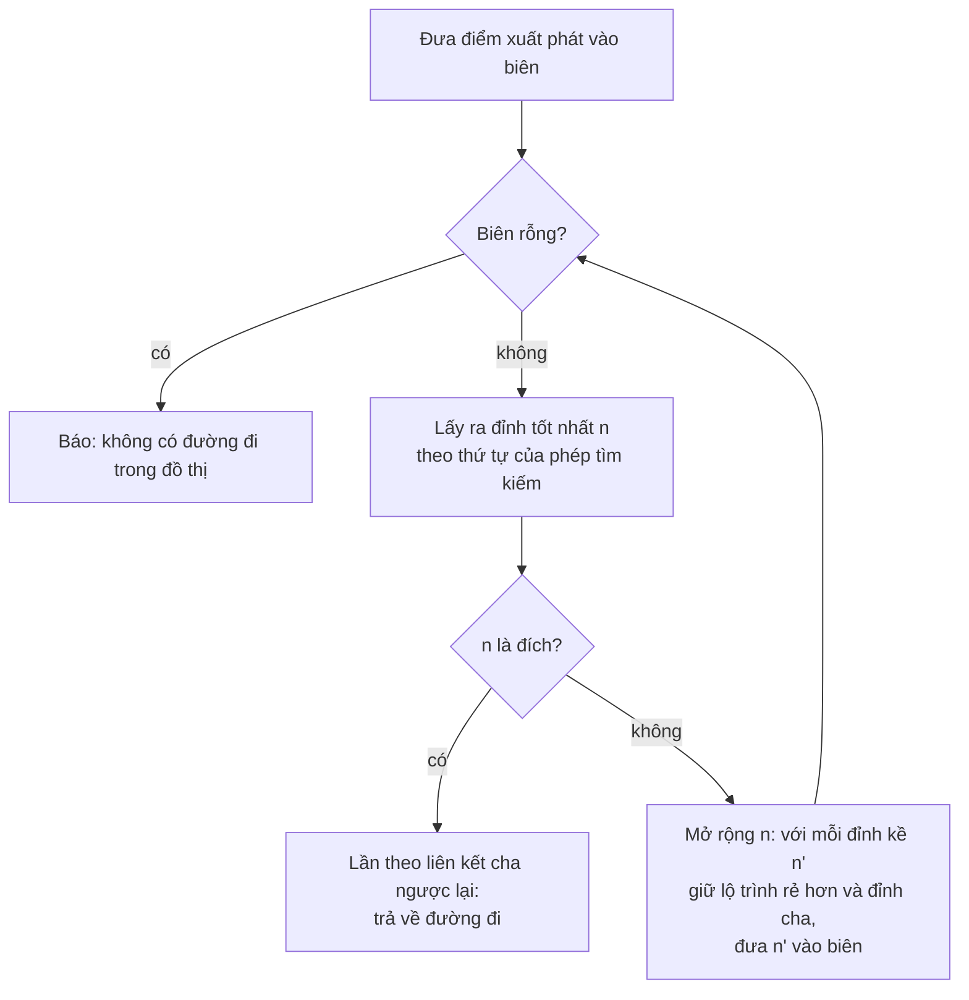
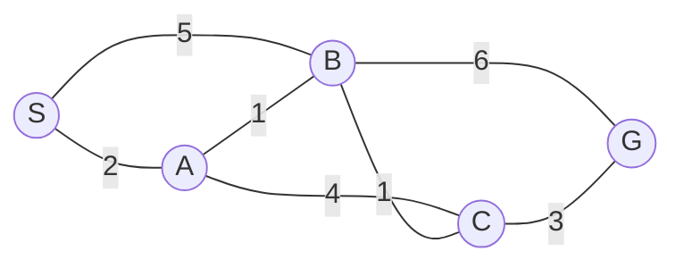

[Bài thứ nhất](/vi/blog/configuration-space-and-the-planning-problem) của loạt bài [Lập kế hoạch chuyển động cho robot](/vi/series/motion-planning) đã phát biểu bài toán lập kế hoạch trong không gian cấu hình (configuration space): robot trở thành một điểm $q$, các vật cản trở thành vùng $\mathcal{C}_{\mathrm{obs}}$, và một lời giải là một đường đi (path) qua không gian tự do (free space) $\mathcal{C}_{\mathrm{free}}$ từ $q_{\mathrm{start}}$ đến $q_{\mathrm{goal}}$. Bài này bàn về họ phương pháp lưới và tìm kiếm trên đồ thị trong bản đồ các phương pháp của bài đó: rời rạc hóa không gian tự do thành một đồ thị, rồi tìm kiếm trên đồ thị ấy. Thuật toán Dijkstra và A* trả về đường đi tối ưu trên một đồ thị như vậy, và chính các lập luận chứng minh điều đó cũng cho biết khi nào một hàm heuristic là an toàn và việc chấp nhận mất đi một lượng tối ưu có giới hạn tiết kiệm được bao nhiêu công sức. Các bảo đảm này chỉ đúng trên đồ thị, và một lưới tăng theo hàm mũ với số chiều của không gian cấu hình, đó là lý do bài tiếp theo chuyển sang phương pháp lấy mẫu.

Bài này dựa trên các định nghĩa về chi phí đường đi, tính đầy đủ và tính tối ưu ở mục 4 của [bài thứ nhất](/vi/blog/configuration-space-and-the-planning-problem) và trên cách bài đó xử lý vật cản. Bài giả định người đọc biết đồ thị và hàng đợi là gì và đọc được Python.

**Quy ước.** Một đồ thị gồm một tập đỉnh (node, vertex) và một tập cạnh, và chi phí của cạnh từ đỉnh $n$ đến đỉnh $n'$ là $c(n, n') \ge 0$. Trong quá trình tìm kiếm, $g(n)$ là chi phí của đường đi tốt nhất từ điểm xuất phát tìm được cho đến lúc đó, $h(n)$ là ước lượng heuristic của chi phí từ $n$ đến đích, và $f(n) = g(n) + h(n)$. Chi phí của một đường đi tối ưu từ điểm xuất phát đến đích là $C^*$, và $h^*(n)$ là chi phí thực của một đường đi tối ưu từ $n$ đến đích.

Các ô lưới được đánh chỉ số (hàng, cột) bắt đầu từ 0, với hàng 0 ở trên cùng của mỗi bản đồ được in ra; chi phí trên lưới tính theo đơn vị kích thước ô, sao cho một bước thẳng tốn 1 và một bước chéo tốn $\sqrt{2}$. Cánh tay hai khâu ở mục 6.3 có $l_1 = 1.0$ m và $l_2 = 0.7$ m, như trong [Động học thuận và động học ngược của cánh tay phẳng](/vi/blog/planar-arm-kinematics), và các góc khớp $\theta_1, \theta_2$ tính bằng radian. Mã nguồn là Python 3.13 với thư viện chuẩn, và NumPy 2.5 ở những chỗ cần bản đồ ngẫu nhiên hoặc cánh tay; mọi phép tìm kiếm đều tất định, và bản đồ ngẫu nhiên duy nhất có ghi rõ hạt giống (seed). Các đoạn mã trình bày phần lõi của từng thuật toán; phần định nghĩa bản đồ và mã in kết quả được lược bỏ.

## 1. Lập kế hoạch như một bài toán tìm kiếm trên đồ thị

**Tìm kiếm trên đồ thị** (graph search) trả lời một phiên bản rời rạc của câu hỏi lập kế hoạch: cho một tập hữu hạn các trạng thái, các bước chuyển được phép giữa chúng và chi phí của mỗi bước chuyển, hãy tìm một dãy bước chuyển từ trạng thái xuất phát đến trạng thái đích, rẻ nhất nếu có thể. Cuốn *Planning Algorithms* của LaValle trình bày bài toán lập kế hoạch rời rạc này trước mọi phương pháp liên tục. Một bộ lập kế hoạch chuyển động (motion planner) trước hết xây dựng một đồ thị mà các đỉnh là cấu hình trong $\mathcal{C}_{\mathrm{free}}$ và các cạnh là những chuyển động ngắn đã được bộ kiểm tra va chạm xác nhận, rồi tìm kiếm trên đồ thị đó. Phép tìm kiếm tìm ra đường đi tốt nhất *trong đồ thị*; chính đồ thị quyết định đường đi ấy gần với đường đi tốt nhất trong $\mathcal{C}_{\mathrm{free}}$ đến mức nào.

Mọi thuật toán trong bài này đều là một trường hợp của cùng một vòng lặp. Phép tìm kiếm duy trì một **biên tìm kiếm** (frontier), còn gọi là danh sách mở (open list), tức tập các đỉnh đã được chạm tới nhưng chưa được xử lý, và một **tập đóng** (closed set) gồm các đỉnh đã xử lý xong. Ở mỗi bước, nó lấy một đỉnh ra khỏi biên và **mở rộng** (expand) đỉnh đó: xét từng đỉnh kề, ghi nhận một cách đến đỉnh kề rẻ hơn khi tìm thấy, và đưa đỉnh kề vào biên. Phép tìm kiếm dừng khi lấy ra đỉnh đích, hoặc báo thất bại khi biên rỗng.



Các phương pháp chỉ khác nhau ở nghĩa của chữ "tốt nhất". Một hàng đợi vào trước, ra trước cho ra **tìm kiếm theo chiều rộng** (breadth-first search), phương pháp tìm được đường đi có ít cạnh nhất, tối ưu khi mọi cạnh có cùng chi phí. Một hàng đợi ưu tiên (priority queue) sắp theo $g(n)$ cho ra thuật toán Dijkstra (mục 3), và một hàng đợi sắp theo $f(n) = g(n) + h(n)$ cho ra A* (mục 4). Trên một đồ thị hữu hạn, một phép tìm kiếm không bao giờ loại bỏ một đỉnh tới được là đầy đủ (complete) *trên đồ thị*: nó trả về một đường đi nếu đồ thị chứa đường đi. Việc thất bại có nghĩa là không tồn tại đường đi trong $\mathcal{C}_{\mathrm{free}}$ hay không là câu hỏi của mục 6.

Bài này so sánh các phép tìm kiếm theo **số lần mở rộng đỉnh** (node expansions), một đại lượng không phụ thuộc vào tốc độ của máy và đi theo số lần kiểm tra va chạm, thứ thường tốn kém hơn chính phép tìm kiếm trên một robot.

## 2. Từ bản đồ đến đồ thị

### 2.1 Lưới chiếm dụng

Một loại bản đồ phổ biến cho robot di động là **lưới chiếm dụng** (occupancy grid): mặt phẳng được chia thành các ô vuông bằng nhau, và mỗi ô chứa xác suất ô đó bị chiếm. Moravec và Elfes đưa ra cách biểu diễn này cho việc lập bản đồ bằng sonar, và Elfes phát triển nó thành một khuôn khổ xác suất. [Bài về ước lượng trạng thái của loạt bài Nhập môn robot học](/vi/blog/sensing-and-state-estimation) (mục 7.2) nêu một lưới như vậy là một dạng bản đồ trong bài toán định vị và lập bản đồ đồng thời, khi robot vừa xây dựng bản đồ vừa tự định vị. Để lập kế hoạch, các xác suất được phân ngưỡng thành ô trống, ô bị chiếm và ô chưa biết. Coi ô chưa biết là trống là cách lạc quan, và robot chỉ biết sự thật khi đến nơi; coi chúng là bị chiếm là cách an toàn nhưng có thể dẫn đến báo rằng không có đường đi. Mục 5.4 quay lại lựa chọn lạc quan.

Một lưới ô mô tả không gian làm việc $\mathcal{W}$, không phải không gian cấu hình. Với một robot hình đĩa bán kính $r$ có thể di chuyển theo mọi hướng, bài thứ nhất đã chỉ ra rằng vật cản trong không gian cấu hình là vật cản trong không gian làm việc được nở rộng thêm $r$ (tổng Minkowski (Minkowski sum) ở mục 3 của [bài thứ nhất](/vi/blog/configuration-space-and-the-planning-problem)). Trên lưới, **phép nở vật cản** (inflation) này đánh dấu mọi ô nằm trong khoảng $r$ tính từ một ô bị chiếm là bị chặn, sau đó robot được lập kế hoạch như một điểm di chuyển giữa các ô trống. Khi đó lưới là một $\mathcal{C}_{\mathrm{free}}$ đã rời rạc hóa với số chiều $d = 2$, và kích thước ô là **độ phân giải** (resolution) của nó.

### 2.2 Tính liên thông và chi phí cạnh

Mỗi ô trống trở thành một đỉnh, và các cạnh nối những ô trống kề nhau. Có hai kiểu lân cận phổ biến. Với **tính liên thông 4** (4-connectivity), một ô nối với bốn ô có chung cạnh với nó, với chi phí 1. Với **tính liên thông 8** (8-connectivity), nó còn nối với bốn ô chéo, với chi phí $\sqrt{2}$, là khoảng cách giữa các tâm ô. Một bước chéo đi qua giữa hai ô có chung cạnh với cả hai đầu mút của nó, nên cách cài đặt dùng ở đây chỉ cho phép bước chéo khi cả hai ô đó đều trống; nếu không, đường đi sẽ cắt qua góc của một vật cản.

Kiểu lân cận giới hạn mức độ một đường đi trên lưới có thể xấp xỉ một đường thẳng. Trong vùng trống, một dịch chuyển $\Delta x$ cột và $\Delta y$ hàng, với $\Delta x \ge \Delta y \ge 0$, có độ dài đường thẳng $\sqrt{\Delta x^2 + \Delta y^2}$. Trên lưới liên thông 4, đường đi ngắn nhất có chi phí $\Delta x + \Delta y$. Viết hướng của đường thẳng dưới dạng góc $\phi$ so với trục $x$, tỉ số giữa hai đại lượng là $\cos\phi + \sin\phi$, đạt $\sqrt{2} \approx 1.414$ tại $\phi = 45°$: một đường đi liên thông 4 có thể dài hơn đường thẳng 41.4%. Trên lưới liên thông 8, đường đi ngắn nhất gồm $\Delta y$ bước chéo và $\Delta x - \Delta y$ bước thẳng, với chi phí

$$
\Delta x + (\sqrt{2} - 1)\,\Delta y,
$$

và tỉ số $\cos\phi + (\sqrt{2} - 1)\sin\phi$ đạt cực đại $\sqrt{1 + (\sqrt{2} - 1)^2} = \sqrt{4 - 2\sqrt{2}} \approx 1.0824$ tại $\tan\phi = \sqrt{2} - 1$, tức $\phi = 22.5°$. Các kiểu lân cận lớn hơn (16 đỉnh kề trở lên) thu nhỏ thêm phần dư này, với cái giá là nhiều cạnh hơn trên mỗi đỉnh và các cạnh dài hơn cần kiểm tra va chạm.

Các ví dụ ở mục 3 đến mục 5 dùng bản đồ sau gồm 15 hàng và 26 cột, với hai bức tường dày một ô. Điểm xuất phát `S` là ô (7, 2) và đích `G` là ô (7, 24); 370 trong số 390 ô là ô trống.

```text
..........................
..........................
..........#...............
..........#.......#.......
..........#.......#.......
..........#.......#.......
..........#.......#.......
..S.......#.......#.....G.
..........#.......#.......
..........#.......#.......
..........#.......#.......
..................#.......
..................#.......
..................#.......
..........................
```

### 2.3 Đồ thị tầm nhìn

Lưới không phải là đồ thị duy nhất mà một bản đồ có thể cho ra. Giữa các vật cản đa giác trong mặt phẳng, đường đi ngắn nhất của một điểm là một đường gấp khúc chỉ gập tại các đỉnh của vật cản, vì một chỗ gập trong vùng trống luôn có thể rút ngắn được. Lozano-Pérez và Wesley đã dùng tính chất này trong **đồ thị tầm nhìn** (visibility graph), có các đỉnh là điểm xuất phát, đích và các đỉnh của vật cản, với một cạnh giữa mọi cặp đỉnh mà đoạn thẳng nối chúng không đi vào phần trong của một vật cản. Một phép tìm kiếm trên đồ thị này trả về đúng đường đi ngắn nhất.

Với bản đồ trên, mỗi bức tường là một hình chữ nhật, nên đồ thị tầm nhìn có 10 đỉnh (điểm xuất phát, đích và tám góc tường) và, như chương trình `anyangle.py` tìm ra, 18 cạnh. Thuật toán Dijkstra trên đồ thị này trả về một đường đi dài 25.4691 lần kích thước ô, qua hai góc trên của bức tường thứ nhất và góc trên bên phải của bức tường thứ hai:

```text
visibility graph         cost 25.4691  graph 10 vertices, 18 edges  path [(2.0, 7.0), (9.5, 1.5), (10.5, 1.5), (18.5, 2.5), (24.0, 7.0)]
```

Các tọa độ là $(x, y) = $ (cột, hàng), với mỗi ô là một hình vuông đơn vị có tâm tại các chỉ số của nó. Đường đi có **khoảng hở an toàn** (clearance), tức khoảng cách giữa robot và vật cản gần nhất, bằng không, nên trong thực tế các vật cản được nở rộng thêm bán kính robot cộng một lề an toàn trước khi xây dựng đồ thị. Kiểm tra mọi cặp trong $n$ đỉnh với mọi cạnh của vật cản sẽ xây dựng đồ thị trong thời gian $O(n^3)$; Choset và cộng sự mô tả một phép quét mặt phẳng xoay (rotational plane sweep) cần $O(n^2 \log n)$. Phương pháp này không mở rộng được sang ba chiều, nơi đường đi ngắn nhất giữa các khối đa diện có thể đi dọc theo các cạnh của vật cản thay vì qua các đỉnh. Đồ thị tầm nhìn phù hợp với bản đồ gồm một vài đa giác; lưới chiếm dụng phù hợp với bản đồ xây dựng từ dữ liệu cảm biến, và phần còn lại của bài này dùng lưới chiếm dụng.

## 3. Thuật toán Dijkstra

### 3.1 Thuật toán

**Thuật toán Dijkstra** (Dijkstra's algorithm) tìm đường đi rẻ nhất từ một đỉnh xuất phát đến mọi đỉnh khác của một đồ thị có chi phí cạnh không âm. Dijkstra công bố thuật toán năm 1959, trong một ghi chú dài ba trang cũng đưa ra một thuật toán cho cây khung nhỏ nhất. Ý tưởng là chốt các đỉnh theo thứ tự khoảng cách của chúng từ điểm xuất phát. Biên tìm kiếm là một hàng đợi ưu tiên sắp theo $g(n)$; đỉnh được lấy ra luôn là một đỉnh có $g$ nhỏ nhất, và khi được lấy ra, giá trị $g$ của nó là cuối cùng. Mở rộng một đỉnh $n$ sẽ **nới lỏng** (relax) từng cạnh đến một đỉnh kề $n'$: nếu $g(n) + c(n, n') < g(n')$ thì lộ trình qua $n$ rẻ hơn, nên $g(n')$ được hạ xuống và $n$ được ghi nhận là đỉnh cha của $n'$.

Trong đồ thị năm đỉnh dưới đây, nhãn của các cạnh là chi phí:



Chương trình `dijkstra_trace.py` in ra từng lần mở rộng:

```text
expand S (g=0): g(A)=2, g(B)=5
expand A (g=2): g(B)=3, g(C)=6
expand B (g=3): g(C)=4, g(G)=9
expand C (g=4): g(G)=7
expand G (g=7): no change
path S-A-B-C-G cost 7
```

Các giá trị tạm thời giảm dần khi xuất hiện những lộ trình rẻ hơn: $B$ giảm từ 5 xuống 3 và $G$ từ 9 xuống 7. Một đỉnh, khi đã được mở rộng, giữ nguyên giá trị của nó.

### 3.2 Vì sao thuật toán đúng

Khẳng định là: khi một đỉnh $u$ được lấy ra khỏi biên, $g(u)$ bằng chi phí $g^*(u)$ của đường đi rẻ nhất từ điểm xuất phát đến $u$. Chứng minh bằng phản chứng trên đỉnh đầu tiên mà khẳng định sai. Giả sử $u$ là đỉnh đó, tức $g(u) > g^*(u)$ trong khi mọi đỉnh được mở rộng trước $u$ đều có chi phí đúng. Xét một đường đi rẻ nhất từ điểm xuất phát đến $u$. Điểm xuất phát đã được mở rộng còn $u$ thì chưa, nên đường đi này có một đỉnh đầu tiên $y$ chưa được mở rộng; đỉnh đứng trước nó trên đường đi là $x$ đã được mở rộng với $g(x) = g^*(x)$, và việc mở rộng $x$ đã nới lỏng cạnh đến $y$, nên $g(y) \le g^*(x) + c(x, y) = g^*(y)$. Vì chi phí cạnh không âm, phần đường đi từ $y$ đến $u$ có chi phí ít nhất bằng không, nên $g^*(y) \le g^*(u)$. Gộp lại,

$$
g(y) \le g^*(y) \le g^*(u) < g(u),
$$

nên $y$ có khóa nhỏ hơn $u$ và lẽ ra đã được lấy ra trước. Mâu thuẫn này chứng minh khẳng định. Bước $g^*(y) \le g^*(u)$ là chỗ cần đến chi phí không âm: với một cạnh âm, một đỉnh được mở rộng sớm về sau có thể được tới với chi phí rẻ hơn (bài tập 3).

### 3.3 Chi phí của phép tìm kiếm

Mỗi đỉnh được mở rộng nhiều nhất một lần và mỗi cạnh được nới lỏng nhiều nhất một lần theo mỗi chiều, nên thời gian chạy do hàng đợi ưu tiên quyết định. Cách cài đặt ở đây dùng một đống nhị phân (binary heap) với **xóa trễ** (lazy deletion): khi $g(n')$ giảm, nó đẩy vào một mục mới thay vì cập nhật mục cũ, và loại bỏ một mục có đỉnh đã đóng khi mục đó lên đến đỉnh đống. Khi đó đống chứa nhiều nhất một mục cho mỗi lần nới lỏng, và trên một đồ thị có $V$ đỉnh và $E$ cạnh, thời gian chạy là $O((V + E)\log V)$. Đống Fibonacci của Fredman và Tarjan giảm cận này xuống $O(E + V \log V)$. Một lưới có nhiều nhất bốn cạnh cho mỗi ô với tính liên thông 8 (mỗi cạnh được hai ô dùng chung), nên $E = O(V)$ và phép tìm kiếm cần $O(V \log V)$.

Nếu không dừng lại ở đích, thuật toán Dijkstra tính chi phí rẻ nhất từ điểm xuất phát đến mọi đỉnh tới được. Chạy ngược từ đích, nó cho ra chi phí còn lại (cost-to-go) $h^*(n)$ của mọi đỉnh. Mục 4.4 dùng một bảng như vậy để đánh giá các hàm heuristic.

### 3.4 Thuật toán Dijkstra trên lưới

Một hàm duy nhất cài đặt các phép tìm kiếm trên lưới ở mục 3, 4 và 5.1. Với hàm heuristic $h = 0$, nó là thuật toán Dijkstra; với một hàm heuristic, nó là A*, và trọng số `w` cho ra A* có trọng số (mục 5.1). Khi độ ưu tiên bằng nhau, đỉnh có $g$ lớn hơn được chọn trước, rồi đến thứ tự đưa vào. Hàm này cũng đếm số bước thẳng và bước chéo, để mỗi chi phí đường đi có thể được viết chính xác dưới dạng $a + b\sqrt{2}$.

```python
# Python 3.13. The grid search of Sections 3, 4 and 5.1 (from gridsearch.py).
import heapq, math
SQRT2 = math.sqrt(2.0)

def neighbors(cell, conn):
    """Yield (neighbor, cost, is_diagonal). 8-connectivity forbids cutting a corner."""
    r, c = cell
    for dr, dc in ((-1, 0), (1, 0), (0, -1), (0, 1)):
        nr, nc = r + dr, c + dc
        if 0 <= nr < ROWS and 0 <= nc < COLS and FREE[nr][nc]:
            yield (nr, nc), 1.0, False
    if conn == 8:
        for dr, dc in ((-1, -1), (-1, 1), (1, -1), (1, 1)):
            nr, nc = r + dr, c + dc
            if (0 <= nr < ROWS and 0 <= nc < COLS and FREE[nr][nc]
                    and FREE[r][nc] and FREE[nr][c]):
                yield (nr, nc), SQRT2, True

def zero(a, b): return 0.0
def manhattan(a, b): return abs(a[0] - b[0]) + abs(a[1] - b[1])
def euclidean(a, b): return math.hypot(a[0] - b[0], a[1] - b[1])
def octile(a, b):
    dx, dy = abs(a[0] - b[0]), abs(a[1] - b[1])
    return max(dx, dy) + (SQRT2 - 1.0) * min(dx, dy)

def astar(start, goal, conn, h, w=1.0):
    """Best-first search on f = g + w*h. Ties in f go to the larger g, then FIFO.
    Returns (path, cost, expansions, straight moves, diagonal moves)."""
    g = {start: 0.0}
    parent = {start: None}
    diag = {start: (0, 0)}          # (straight, diagonal) move counts on the best path
    closed = set()
    counter = 0
    frontier = [(w * h(start, goal), 0.0, counter, start)]
    expansions = 0
    while frontier:
        f, neg_g, _, n = heapq.heappop(frontier)
        if n in closed:
            continue                 # stale entry: n was already expanded
        closed.add(n)
        expansions += 1
        if n == goal:
            path = []
            while n is not None:
                path.append(n); n = parent[n]
            s, d = diag[goal]
            return path[::-1], g[goal], expansions, s, d
        for m, cost, is_diag in neighbors(n, conn):
            if m in closed:
                continue
            gm = g[n] + cost
            if gm < g.get(m, math.inf) - 1e-12:
                g[m], parent[m] = gm, n
                s, d = diag[n]
                diag[m] = (s, d + 1) if is_diag else (s + 1, d)
                counter += 1
                heapq.heappush(frontier, (gm + w * h(m, goal), -gm, counter, m))
    return None, math.inf, expansions, 0, 0
```

Trên bản đồ ở mục 2.2, thuật toán Dijkstra cho ra hai dòng sau của bảng do `gridsearch.py` in ra (bảng đầy đủ ở mục 4.5):

```text
search                         conn  expanded  moves  cost
Dijkstra                          4       363     34  34.0000 = 34
Dijkstra                          8       359     22  26.9706 = 10 + 12*sqrt(2)
```

Cả hai phép tìm kiếm mở rộng gần như toàn bộ bản đồ, 363 và 359 trong số 370 ô trống, trước khi lấy ra đỉnh đích. Thuật toán Dijkstra phát triển một mặt sóng đẳng chi phí quanh điểm xuất phát mà không có thông tin gì về vị trí của đích, nên nó khám phá các ô phía sau điểm xuất phát kỹ lưỡng như các ô phía trước. Đường đi liên thông 8 rẻ hơn đường đi liên thông 4 là 20.7% (26.9706 so với 34) nhưng vẫn dài hơn đường đi ngắn nhất chính xác ở mục 2.3 (25.4691) là 5.9%.

## 4. A* và hàm heuristic chấp nhận được

### 4.1 Dẫn hướng phép tìm kiếm bằng một ước lượng

**A*** sắp xếp biên theo $f(n) = g(n) + h(n)$ thay vì $g(n)$. Giá trị $f(n)$ ước lượng chi phí của đường đi rẻ nhất từ điểm xuất phát đến đích *đi qua* $n$: chi phí đã trả cộng với ước lượng chi phí còn lại. Hàm $h$ là **hàm heuristic** (heuristic), con đường qua đó tri thức về bài toán đi vào phép tìm kiếm. Hart, Nilsson và Raphael đưa ra thuật toán này năm 1968, chứng minh rằng nó trả về một đường đi tối ưu bất cứ khi nào $h$ không bao giờ ước lượng vượt, và đưa ra điều kiện nhất quán ở mục 4.3. Với $h = 0$, thuật toán chính là thuật toán Dijkstra; với $h = h^*$, mọi đỉnh trên một đường đi tối ưu có $f = C^*$, và phép tìm kiếm có thể đi thẳng đến đích (bài tập 6). Các hàm heuristic hữu ích nằm ở giữa: rẻ để tính và gần $h^*$ nhất có thể mà không vượt quá nó.

### 4.2 Tính chấp nhận được và tính tối ưu

Một hàm heuristic là **chấp nhận được** (admissible) nếu nó không bao giờ ước lượng vượt: $h(n) \le h^*(n)$ với mọi đỉnh $n$, và đặc biệt $h(\text{goal}) = 0$. Khẳng định là A* với một hàm heuristic chấp nhận được trả về một đường đi có chi phí $C^*$, với điều kiện nó mở lại một đỉnh đã đóng khi tìm thấy đường đi rẻ hơn đến đỉnh đó (mục 4.3 chỉ ra rằng một hàm heuristic nhất quán khiến việc mở lại là không cần thiết). Phác thảo chứng minh dựa trên một sự kiện: chừng nào đích chưa được mở rộng, biên còn chứa một đỉnh $n'$ nằm trên một đường đi tối ưu và đã được tới dọc theo đường đi đó, nên $g(n') = g^*(n')$, chi phí thực từ điểm xuất phát. Điều này đúng lúc ban đầu với điểm xuất phát, và khi một đỉnh như vậy được mở rộng, đỉnh kế tiếp của nó trên đường đi tối ưu sẽ thế chỗ. Với đỉnh đó,

$$
f(n') = g^*(n') + h(n') \le g^*(n') + h^*(n') = C^*.
$$

Giả sử phép tìm kiếm lấy ra đích với $g(\text{goal}) > C^*$. Vì $h(\text{goal}) = 0$, khóa của đích sẽ là $f(\text{goal}) > C^* \ge f(n')$, nên $n'$ lẽ ra đã được lấy ra trước. Do đó đích chỉ rời khỏi biên với $g = C^*$.

### 4.3 Tính nhất quán

Một hàm heuristic là **nhất quán** (consistent), hay đơn điệu (monotone), nếu nó thỏa mãn một bất đẳng thức tam giác dọc theo mọi cạnh:

$$
h(n) \le c(n, n') + h(n') \quad \text{for every edge } (n, n'), \qquad h(\text{goal}) = 0.
$$

Tính nhất quán kéo theo tính chấp nhận được: cộng bất đẳng thức dọc theo một đường đi tối ưu từ $n$ đến đích cho $h(n) \le h^*(n)$.

Cách dễ hiểu nhất về tính nhất quán là qua một phép thay đổi chi phí cạnh. Định nghĩa **chi phí rút gọn** (reduced cost) $c'(n, n') = c(n, n') - h(n) + h(n')$. Tính nhất quán nói đúng rằng $c'(n, n') \ge 0$. Dọc theo bất kỳ đường đi nào từ điểm xuất phát $s$ đến một đỉnh $n$, các chi phí rút gọn triệt tiêu dần theo kiểu lồng nhau:

$$
\sum c' = \sum c - h(s) + h(n) = g(n) + h(n) - h(s) = f(n) - h(s).
$$

Đại lượng $h(s)$ là cùng một hằng số với mọi đỉnh, nên sắp xếp biên theo $f$ cũng giống như sắp xếp theo chi phí đường đi trong đồ thị rút gọn. Vì vậy A* với một hàm heuristic nhất quán chính là thuật toán Dijkstra trên một đồ thị có chi phí cạnh không âm $c'$, và chứng minh ở mục 3.2 áp dụng nguyên vẹn: khi một đỉnh được mở rộng, giá trị $g$ của nó là cuối cùng, không đỉnh nào bị mở lại và đường đi là tối ưu. Giá trị $f$ của các đỉnh được mở rộng không bao giờ giảm, nên mọi đỉnh có $f(n) < C^*$ đều được mở rộng trước đích, còn một đỉnh có $f(n) = C^*$ có thể được mở rộng hoặc không, tùy theo cách xử lý khi bằng nhau. Một hàm heuristic tốt hơn nâng $f$ lên và do đó loại các đỉnh khỏi vùng dưới $C^*$; đó là nguồn gốc của sự tiết kiệm mà A* mang lại.

Một hàm heuristic chấp nhận được nhưng không nhất quán vẫn cho một đường đi tối ưu khi các đỉnh đã đóng được mở lại, nhưng khi đó một đỉnh có thể bị mở rộng nhiều lần. Cách cài đặt ở mục 3.4 không bao giờ mở lại một đỉnh, điều này chỉ đúng với một hàm heuristic nhất quán.

### 4.4 Hàm heuristic cho lưới

Trên lưới, chi phí của đường đi rẻ nhất trong một lưới không có vật cản là một hàm heuristic tự nhiên: vật cản chỉ có thể làm đường đi dài thêm, nên nó không bao giờ ước lượng vượt. Trên lưới liên thông 4, chi phí đó là **khoảng cách Manhattan** (Manhattan distance) $|\Delta x| + |\Delta y|$. Trên lưới liên thông 8, nó là **khoảng cách octile** (octile distance) đã suy ra ở mục 2.2,

$$
h_{\mathrm{oct}}(n) = \max(|\Delta x|, |\Delta y|) + (\sqrt{2} - 1)\min(|\Delta x|, |\Delta y|),
$$

trong đó $\Delta x$ và $\Delta y$ là độ lệch cột và hàng từ $n$ đến đích. **Khoảng cách Euclid** (Euclidean distance) $\sqrt{\Delta x^2 + \Delta y^2}$ chấp nhận được trên cả hai loại lưới, vì không đường đi nào ngắn hơn một đường thẳng, nhưng nó yếu hơn, vì nó bỏ qua việc lưới cấm hầu hết các hướng. Mỗi hàm heuristic này đều nhất quán: mỗi hàm thỏa mãn bất đẳng thức tam giác, và chi phí của một cạnh ít nhất bằng khoảng cách theo hàm heuristic giữa hai đầu mút của nó (bài tập 2). Khoảng cách Manhattan trên lưới liên thông 8 không chấp nhận được: một bước chéo tốn $\sqrt{2}$, nhưng khoảng cách Manhattan qua bước đó là 2.

Chương trình `heuristics.py` kiểm tra các phát biểu này trên bản đồ. Nó tính $h^*$ cho mọi ô trống bằng cách chạy thuật toán Dijkstra ngược từ đích, rồi kiểm tra tính chấp nhận được và tính nhất quán trên mọi ô và mọi cạnh, và báo cáo tỉ số $h/h^*$, đại lượng đo xem mỗi hàm heuristic nắm bắt được bao nhiêu phần chi phí thực:

```text
heuristic   conn  max h/h*  mean h/h*  admissible  consistent
manhattan      4     1.000      0.855        True        True
euclidean      4     1.000      0.700        True        True
manhattan      8     1.414      1.039       False       False
euclidean      8     1.000      0.848        True        True
octile         8     1.000      0.893        True        True
```

Trên lưới liên thông 8, khoảng cách octile là lựa chọn chấp nhận được chứa nhiều thông tin nhất, trung bình đạt 89.3% chi phí thực; khoảng cách Euclid đạt 84.8%. Khoảng cách Manhattan ước lượng vượt tới hệ số $\sqrt{2}$, là tỉ số giữa 2 và $\sqrt{2}$ trên một bước thuần chéo.

### 4.5 So sánh số lần mở rộng đỉnh

Bảng dưới đây, do `gridsearch.py` in ra, chạy mọi phép tìm kiếm trên bản đồ ở mục 2.2. Cột "moves" là số cạnh trong đường đi.

```text
grid 15 x 26, free cells 370, start (7, 2), goal (7, 24)
search                         conn  expanded  moves  cost
Dijkstra                          4       363     34  34.0000 = 34
A*, Manhattan                     4       206     34  34.0000 = 34
Dijkstra                          8       359     22  26.9706 = 10 + 12*sqrt(2)
A*, Euclidean                     8       208     22  26.9706 = 10 + 12*sqrt(2)
A*, octile                        8       174     22  26.9706 = 10 + 12*sqrt(2)
A*, Manhattan (inadmissible)      8       187     22  26.9706 = 10 + 12*sqrt(2)
weighted A*, octile, w=1.5        8       103     24  28.9706 = 12 + 12*sqrt(2)
weighted A*, octile, w=2          8        82     24  29.7990 = 10 + 14*sqrt(2)
weighted A*, octile, w=5          8        59     29  33.5563 = 18 + 11*sqrt(2)

8-connected A*, octile heuristic:
..........................
.........***..............
........*.#.********......
.......*..#.......#.*.....
......*...#.......#..*....
.....*....#.......#...*...
....*.....#.......#....*..
..S*......#.......#.....G.
..........#.......#.......
..........#.......#.......
..........#.......#.......
..................#.......
..................#.......
..................#.......
..........................
```

Mọi phép tìm kiếm chấp nhận được đều trả về cùng một chi phí, đúng như mục 4.2 đòi hỏi: 34 trên lưới liên thông 4 và $10 + 12\sqrt{2} = 26.9706$ trên lưới liên thông 8. Chúng khác nhau ở khối lượng công việc. Trên lưới liên thông 8, A* với khoảng cách octile mở rộng 174 ô so với 359 ô của thuật toán Dijkstra, giảm 52%, còn khoảng cách Euclid, ít thông tin hơn, cần 208 ô. Khi không có tường, mức tiết kiệm lớn hơn nhiều (xem bên dưới); các bức tường làm giảm mức tiết kiệm vì chúng đánh lừa mọi hàm heuristic. Tất cả các hàm đều chỉ thẳng về đích, xuyên qua bức tường thứ nhất, và phép tìm kiếm phải lấp đầy cái túi phía trước bức tường cho đến khi các giá trị $f$ ở đó vượt quá chi phí đi vòng qua nó. Đường đi chạy phía trên cả hai bức tường. Khe hở bên dưới bức tường thứ nhất gần hàng xuất phát hơn, nhưng bức tường thứ hai kéo xuống tận hàng 13, nên lộ trình phía trên cả hai bức tường rẻ hơn; nó chạy thẳng dọc hàng 2 qua đỉnh của bức tường thứ hai.

Những dòng cuối cùng mà `gridsearch.py` in ra lặp lại các phép tìm kiếm liên thông 8 trên cùng lưới, cùng điểm xuất phát và đích, với mọi ô đều trống:

```text
same grid with no walls:
Dijkstra                          8       345     22  22.0000
A*, Euclidean                     8        23     22  22.0000
A*, octile                        8        23     22  22.0000
```

Khi không có tường, A* với khoảng cách octile chỉ mở rộng 23 ô trên đường đi của nó so với 345 ô của thuật toán Dijkstra, giảm 93%, và khoảng cách Euclid cũng làm được như vậy; các bức tường kéo mức giảm xuống còn 52%.

Các con số này phụ thuộc vào cách xử lý khi bằng nhau (tie-breaking). Lưới liên thông 8 chứa nhiều đường đi có chi phí bằng nhau, và việc ưu tiên $g$ lớn hơn giữa các $f$ bằng nhau đẩy phép tìm kiếm về phía đích. Các giá trị $f$ bằng nhau trong số học chính xác cũng có thể khác nhau ở bit cuối cùng của một số dấu phẩy động (floating point), điều này làm thay đổi thứ tự mở rộng (bài tập 6). Các con số là chính xác với chương trình này; một cách cài đặt đúng khác có thể cho các con số khác trên cùng bản đồ.

### 4.6 Khi hàm heuristic ước lượng vượt

Khoảng cách Manhattan trên lưới liên thông 8 đã tìm được một đường đi tối ưu ở trên, nhưng không có gì bảo đảm điều đó. Một hàm heuristic ước lượng vượt có thể khiến một đỉnh trên đường đi tối ưu trông tệ hơn một đỉnh trên một lộ trình đắt hơn, và khi đó phép tìm kiếm đi theo lộ trình đắt hơn. Chương trình `inadmissible.py` cho thấy một trường hợp như vậy trên một bản đồ ngẫu nhiên 10 x 14 ô, mỗi ô bị chặn với xác suất 0.25 (`numpy.random.default_rng(7)`), từ góc trên bên trái đến góc dưới bên phải:

```text
octile    expanded  24  cost 17.3137 = 6 + 8*sqrt(2)
*..#..#.......
.*....##.##...
..*###.#.#.#..
..*.#.....#..#
...***.#.#.#.#
....#.**.##..#
.....##.*...#.
##.......*....
#.#..#..#.**.#
#.#.........**
manhattan expanded  19  cost 19.6569 = 14 + 4*sqrt(2)
*..#..#.......
.*....##.##...
..*###.#.#.#..
..*.#.....#..#
...*...#.#.#.#
...*#....##..#
...*.##.....#.
##..*.........
#.#.*#..#....#
#.#.**********
```

Phép tìm kiếm với khoảng cách Manhattan mở rộng ít ô hơn (19 so với 24) và trả về một đường đi đắt hơn 13.5%. Tính phí 2 cho một bước chéo có chi phí $\sqrt{2}$ khiến các lộ trình cần bước chéo trông tệ hơn thực tế, nên phép tìm kiếm đi xuống theo mép trái và kết thúc bằng chín bước thẳng dọc hàng dưới cùng. A* có trọng số thực hiện cùng sự đánh đổi này một cách có chủ ý, với một cận đã biết.

## 5. Tìm kiếm nhanh hơn, góc bất kỳ và tăng dần

### 5.1 A* có trọng số

**A* có trọng số** (weighted A*) nhân hàm heuristic với một hệ số $w \ge 1$ và sắp xếp biên theo $f_w(n) = g(n) + w\,h(n)$. Pohl đã nghiên cứu các cách đặt trọng số như vậy giữa chi phí đường đi và ước lượng heuristic vào năm 1970. Giá trị $w$ lớn hơn làm phép tìm kiếm tham lam hơn: nó tin vào ước lượng nhiều hơn và tốn ít công sức hơn cho các đỉnh gần điểm xuất phát. Cái giá phải trả là tính tối ưu, nhưng có cận. Nếu $h$ chấp nhận được, đường đi trả về có chi phí nhiều nhất bằng $w$ lần giá trị tối ưu:

$$
C \le w\,C^*.
$$

Chứng minh đi theo mục 4.2. Chừng nào đích chưa được mở rộng, có một đỉnh $n'$ nào đó trên một đường đi tối ưu nằm trong biên với $g(n') = g^*(n')$. Khi đích được lấy ra với chi phí $C$,

$$
C = f_w(\text{goal}) \le f_w(n') = g^*(n') + w\,h(n') \le w\,\bigl(g^*(n') + h^*(n')\bigr) = w\,C^*.
$$

Sự tồn tại của $n'$ là hiển nhiên khi các đỉnh đã đóng được mở lại. Cách cài đặt ở đây không mở lại chúng; Likhachev, Gordon và Thrun đã chứng minh, cho thuật toán anytime Anytime Repairing A* (ARA*) của họ, rằng với một $h$ nhất quán, cận này vẫn đúng mà không cần mở lại, điều này bao gồm cả khoảng cách octile.

Ba dòng cuối của bảng ở mục 4.5 cho thấy sự đánh đổi. Các tỉ số $C/C^*$ là 1.074 với $w = 1.5$, 1.105 với $w = 2$ và 1.244 với $w = 5$, nằm sâu bên trong các cận, trong khi số lần mở rộng giảm từ 174 xuống 103, 82 và 59. Cận này là trường hợp xấu nhất, và số lần mở rộng không nhất thiết giảm đơn điệu theo $w$ trên mọi bản đồ. ARA* xây dựng dựa trên cận này: nó chạy A* có trọng số với $w$ lớn để nhanh chóng có một đường đi, rồi hạ $w$ xuống và tái sử dụng công sức tìm kiếm trước đó để cải thiện đường đi trong khi vẫn còn thời gian.

### 5.2 Khai thác tính đối xứng của lưới

Một lưới liên thông 8 với chi phí đồng nhất chứa nhiều đường đi tối ưu giữa hai ô chỉ khác nhau ở thứ tự các bước, và A* tiêu tốn phần lớn công sức cho tất cả các đường đi đó. **Tìm kiếm điểm nhảy** (jump point search) của Harabor và Grastien cắt tỉa tính đối xứng này. Từ mỗi ô được mở rộng, nó quét dọc theo các đường thẳng và đường chéo, bỏ qua những ô mà một đường đi tối ưu theo một thứ tự chuẩn tắc đã tới được, và chỉ đưa vào biên các điểm nhảy (jump point), nơi một đường đi có thể cần rẽ. Nó trả về đường đi tối ưu mà không cần tiền xử lý và không cần thêm bộ nhớ, và các tác giả báo cáo mức tăng tốc so với A* từ một bậc độ lớn trở lên trên các bản đồ thử nghiệm của họ. Nó dựa vào chi phí đồng nhất: trên các bản đồ chi phí phạt việc ở gần vật cản, tính đối xứng không còn tồn tại.

### 5.3 Đường đi góc bất kỳ: Theta*

Một đường đi trên lưới chỉ có thể rẽ theo bội số của 45°, nên nó đi zigzag ở những chỗ một đường thẳng là đủ. Làm trơn (smoothing) đường đi sau khi tìm kiếm sẽ rút ngắn nó nhưng không thể thay đổi việc nó đi qua phía nào của một vật cản. **Theta*** của Nash, Daniel, Koenig và Felner đưa bước này vào trong phép tìm kiếm. Nó là A* trên lưới liên thông 8 với một thay đổi: khi mở rộng $n$ và xét một đỉnh kề $n'$, nó kiểm tra xem đỉnh cha của $n$ có nhìn thấy $n'$ hay không, tức là đoạn thẳng giữa chúng có nằm ngoài các ô bị chặn hay không (trong cách cài đặt ở đây, các đỉnh là tâm ô). Nếu có, $n'$ nhận đỉnh cha của $n$ làm đỉnh cha của chính nó, với $g(n') = g(\mathrm{parent}(n)) + \lVert \mathrm{parent}(n) - n' \rVert$; nếu không, cạnh lưới từ $n$ được sử dụng. Khi đó các đoạn của đường đi có thể có góc bất kỳ, và hàm heuristic là khoảng cách Euclid, vì khoảng cách octile có thể vượt quá chi phí của những đường đi như vậy.

Chương trình `anyangle.py` so sánh ba loại đường đi trên bản đồ:

```text
8-connected A* (octile)  cost 26.9706  expanded 174
Theta* (Euclidean)       cost 26.1265  expanded 191  vertices [(2.0, 7.0), (10.0, 1.0), (19.0, 2.0), (24.0, 7.0)]
visibility graph         cost 25.4691  graph 10 vertices, 18 edges  path [(2.0, 7.0), (9.5, 1.5), (10.5, 1.5), (18.5, 2.5), (24.0, 7.0)]
grid path / shortest = 1.0590   Theta* / shortest = 1.0258
```

Đường đi của Theta* có ba đoạn thẳng thay vì 22 bước trên lưới, và chi phí của nó chỉ cách đường đi ngắn nhất thực sự 2.6%, so với 5.9% của đường đi trên lưới. Nó không phải là đường đi ngắn nhất. Cách cài đặt này chỉ rẽ tại tâm ô, trong khi đường đi ngắn nhất rẽ tại các góc của vật cản. Tổng quát hơn, Theta* chỉ xét làm đỉnh cha của một đỉnh hoặc là đỉnh được mở rộng, hoặc là đỉnh cha của đỉnh đó, và Nash cùng cộng sự khẳng định rằng Theta* không được bảo đảm tìm ra đường đi ngắn nhất. Cái giá nằm ở phép tìm kiếm: Theta* đã mở rộng 191 ô, nhiều hơn A* một chút, và mỗi lần mở rộng đều chạy các phép kiểm tra tầm nhìn thẳng (line of sight), tốn kém hơn nhiều so với việc cộng một chi phí cạnh.

### 5.4 Lập lại kế hoạch tăng dần: D* Lite

Một robot lập kế hoạch trên bản đồ do chính các cảm biến của nó xây dựng sẽ phát hiện ra bản đồ sai khi nó di chuyển: một cánh cửa bị đóng, một người đứng trong hành lang. Lập kế hoạch lại từ đầu sau mỗi thay đổi sẽ lặp lại gần như toàn bộ công việc trước đó. **Tìm kiếm tăng dần** (incremental search) tái sử dụng phép tìm kiếm trước và chỉ sửa chữa phần mà thay đổi làm mất hiệu lực. D* của Stentz là một thuật toán sớm thuộc loại này dùng cho dẫn đường robot; **D* Lite**, do Koenig và Likhachev đưa ra năm 2002, cho ra cùng các đường đi với một thuật toán đơn giản hơn, và bài báo tạp chí của họ chỉ ra rằng nó hiệu quả ít nhất bằng D*.

D* Lite dựa trên ba ý tưởng, được mô tả ở đây mà không kèm phần ghi chép sổ sách của chúng. Thứ nhất, nó tìm kiếm ngược, từ đích đến robot, để các giá trị nó tính là chi phí đến đích, vốn vẫn còn hiệu lực khi robot di chuyển. Thứ hai, mỗi đỉnh giữ hai ước lượng: $g$, chi phí hiện tại của nó đến đích, và một giá trị nhìn trước một bước, là giá trị nhỏ nhất trên các đỉnh kế tiếp của nó của chi phí cạnh cộng với $g$ của đỉnh kế tiếp. Một đỉnh có hai giá trị khác nhau là **không nhất quán cục bộ** (locally inconsistent), và chỉ những đỉnh như vậy được đưa vào hàng đợi. Khi chi phí một cạnh thay đổi, các đỉnh ở hai đầu cạnh được cập nhật và, nếu không nhất quán, được đưa vào hàng đợi. Sau đó phép tìm kiếm sửa chữa các giá trị lan ra từ chúng cho đến khi đỉnh của robot nhất quán và không đỉnh nào trong hàng đợi có thể hạ thấp chi phí của nó.

Thứ ba, chuyển động của robot làm thay đổi hàm heuristic của mọi đỉnh trong hàng đợi, vì hàm heuristic ước lượng khoảng cách đến robot; thay vì sắp xếp lại hàng đợi, D* Lite cộng quãng đường đã di chuyển vào một độ lệch trong các khóa ưu tiên. Phương pháp này đánh đổi bộ nhớ và độ phức tạp lấy tốc độ. Những thay đổi gần robot, vốn là những thay đổi mà cảm biến của nó nhìn thấy, làm mất hiệu lực rất ít của một phép tìm kiếm ngược, trong khi một thay đổi gần đích có thể làm mất hiệu lực phần lớn. Giống như A*, nó trả về các đường đi tối ưu đối với bản đồ như hiện được biết, với các ô chưa biết được coi là trống. [Bài thứ năm](/vi/blog/path-tracking-and-reactive-avoidance) quay lại việc lập lại kế hoạch (replanning) như một phần của một hệ thống dẫn đường nhiều tầng (mục 6 của bài đó).

### 5.5 Mỗi phương pháp đánh đổi điều gì

| Phương pháp | Bảo đảm trên đồ thị | Được | Phải trả bằng |
|---|---|---|---|
| Thuật toán Dijkstra | Tối ưu | Chi phí đến mọi đỉnh; không cần hàm heuristic | Mở rộng mọi đỉnh rẻ hơn đích |
| A*, $h$ nhất quán | Tối ưu; không đỉnh nào bị mở rộng hai lần | Ít lần mở rộng hơn, càng ít hơn với $h$ tốt hơn | Cần một hàm heuristic; mức tiết kiệm giảm khi vật cản đánh lừa nó |
| A* có trọng số | Chi phí nhiều nhất $w\,C^*$ | Ít lần mở rộng hơn khi $w$ tăng | Chất lượng đường đi, trong phạm vi cận |
| Tìm kiếm điểm nhảy | Tối ưu trên lưới chi phí đồng nhất | Bỏ qua các đường đi đối xứng | Chỉ giới hạn ở chi phí đồng nhất |
| Theta* | Không có bảo đảm về độ dài đường đi | Đường đi góc bất kỳ gần với đường ngắn nhất | Kiểm tra tầm nhìn thẳng ở mỗi lần mở rộng |
| D* Lite | Tối ưu với bản đồ hiện tại | Sửa chữa thay vì lập lại kế hoạch | Bộ nhớ cho trạng thái tìm kiếm; độ phức tạp |

## 6. Giới hạn của lưới

### 6.1 Độ phân giải và tính đầy đủ theo độ phân giải

Một bộ lập kế hoạch trên lưới trả lời một câu hỏi về lưới, không phải về $\mathcal{C}_{\mathrm{free}}$: nếu nó báo thất bại, không gian tự do vẫn có thể chứa một đường đi mà lưới không biểu diễn được. Mục 4 của [bài thứ nhất](/vi/blog/configuration-space-and-the-planning-problem) đã định nghĩa bảo đảm áp dụng ở đây. Một bộ lập kế hoạch là **đầy đủ theo độ phân giải** (resolution complete) nếu nó tìm ra một đường đi bất cứ khi nào tồn tại đường đi ở độ phân giải đã chọn, và báo thất bại trong trường hợp ngược lại. Với một lưới, điều này có nghĩa đại khái là một lối đi rộng hơn vài ô sẽ được tìm thấy, còn một lối đi hẹp hơn một ô có thể biến mất.

Quy tắc đánh dấu quyết định bộ lập kế hoạch mắc loại sai sót nào. Đánh dấu một ô là bị chặn nếu bất kỳ phần nào của nó bị chiếm là cách bảo thủ: đường đi an toàn, nhưng các lối đi hẹp bị đóng lại. Đánh dấu một ô chỉ theo tâm của nó là cách lạc quan: các lối đi vẫn mở, nhưng một đường đi có thể sượt qua một vật cản giữa các tâm ô. Độ phân giải mịn hơn làm giảm cả hai loại sai sót, với một cái giá mà mục 6.4 làm cụ thể.

### 6.2 Các sai lệch do lưới

Ngay cả một đường đi đúng trên lưới cũng có các sai lệch do lưới gây ra. Hướng đi của nó bị giới hạn trong các hướng của lưới, nên nó đi zigzag qua các vùng trống và có thể dài hơn đường thẳng 8.24% trên lưới liên thông 8 (mục 2.2). Đường đi nào trong số nhiều đường đi tối ưu được trả về phụ thuộc vào cách xử lý khi bằng nhau, và đường được trả về có thể đi sát một vật cản trong khi một đường khác có cùng chi phí lại đi giữa hành lang; một chi phí tăng lên khi đến gần vật cản, như trong các bản đồ chi phí (cost map), là cách khắc phục thông thường. Các chỗ rẽ của nó là tức thời, điều mà một robot có khối lượng không thể thực hiện; [bài thứ tư](/vi/blog/trajectories-and-time-scaling) bổ sung các biên dạng vận tốc và gia tốc. Cuối cùng, một lưới trên $(x, y)$ bỏ qua hướng của một robot dẫn động vi sai (differential-drive robot), loại robot không thể di chuyển sang ngang; bài thứ năm bàn về việc bám đường đi dưới ràng buộc đó.

### 6.3 Lưới trên không gian cấu hình của cánh tay

Một lưới có thể rời rạc hóa bất kỳ không gian cấu hình nào có số chiều thấp. Chương trình `arm_grid.py` lập kế hoạch cho cánh tay hai khâu với một vật cản hình đĩa bán kính 0.25 m có tâm tại (1.0, 0.6) m trong hệ tọa độ đế của cánh tay. Mỗi góc khớp được chia thành $N$ bước bằng nhau, cho $N^2$ ô trên mặt xuyến (torus) của bài thứ nhất: ra khỏi lưới ở một mép theo $\theta_1$ hoặc $\theta_2$ thì đi vào lại ở mép đối diện. Một ô bị chặn khi một trong hai khâu, xem như một đoạn thẳng, đến gần tâm vật cản trong vòng 0.25 m tại cấu hình ứng với tâm ô, tức quy tắc lạc quan của mục 6.1; mục 5 của [bài thứ nhất](/vi/blog/configuration-space-and-the-planning-problem) bàn về các rủi ro của những phép kiểm tra như vậy.

Phép tìm kiếm tuân theo các quy tắc của mục 3.4, được cài đặt lại với cơ chế quấn vòng và với khoảng cách octile tính từ các độ lệch đã quấn vòng; chi phí là độ dài của đường đi trong không gian khớp, tính bằng radian. Cánh tay di chuyển từ $(\theta_1, \theta_2) = (-0.2, 0.3)$ rad đến $(1.4, -0.3)$ rad, mỗi cấu hình được làm tròn về tâm ô gần nhất.

```text
start (-0.2, 0.3)  goal (1.4, -0.3)  obstacle center (1.0, 0.6) m, radius 0.25 m
   N   cells  blocked  Dijkstra exp   A* exp  path length (rad)
  36    1296      121           994      231             5.0016
  72    5184      478          3893      845             4.9293
 180   32400     3004         24475     5600             4.9377
 360  129600    11847         97680    20593             4.9407
theta1 blocked for every theta2 (N = 360): 0.3840 to 0.6981 rad
straight line in joint space: 1.7088 rad
```

Đường thẳng giữa hai cấu hình trong không gian khớp dài 1.7088 rad, nhưng mọi đường đi tìm được đều dài từ 4.93 đến 5.00 rad. Tâm vật cản nằm cách đế 1.166 m, tức vượt quá tầm với 1.0 m của khâu thứ nhất một khoảng nhỏ hơn bán kính của vật cản. Vì vậy riêng khâu thứ nhất đã chạm vào đĩa với mọi $\theta_1$ trong khoảng từ khoảng 0.367 đến 0.714 rad, bất kể $\theta_2$ là bao nhiêu; lưới với $N = 360$ đánh dấu từ 0.3840 đến 0.6981 rad. Mục 3.3 của [bài thứ nhất](/vi/blog/configuration-space-and-the-planning-problem) cho thấy cùng loại bức tường này. Dải này chặn lộ trình trực tiếp, và việc gập khuỷu không giúp được gì, nên bộ lập kế hoạch đi theo chiều ngược lại quanh mặt xuyến: $\theta_1$ giảm qua $-\pi$ rồi quay lại 1.4 rad. Một lưới coi $\theta_1 = -\pi$ và $\theta_1 = \pi$ là hai mép tách biệt sẽ báo thất bại.

Số ô và số lần mở rộng tăng theo $N^2$. A* mở rộng khoảng một phần năm số ô mà thuật toán Dijkstra mở rộng, nhưng hàm heuristic của nó chỉ xuyên qua dải bị chặn, và phép tìm kiếm phải vét cạn phía gần trước khi tìm ra đường vòng dài. Độ dài đường đi không hội tụ đơn điệu theo $N$, vì điểm xuất phát và đích được làm tròn về các tâm ô khác nhau ở mỗi độ phân giải.

### 6.4 Lời nguyền số chiều

Một lưới với $N$ ô dọc theo mỗi trục trong $d$ trục có $N^d$ ô. Số ô tăng theo hàm mũ với số chiều của không gian cấu hình, đó là **lời nguyền số chiều** (curse of dimensionality) đối với lưới. Chương trình `scaling.py` lập bảng số ô và bộ nhớ cần để lưu một bit cho mỗi ô, một cận dưới cho kích thước của riêng bản đồ:

```text
 d  N = 100 cells   1 bit/cell  N = 360 cells   1 bit/cell
 2      1.000e+04      1.25 kB      1.296e+05      16.2 kB
 3      1.000e+06       125 kB      4.666e+07      5.83 MB
 6      1.000e+12       125 GB      2.177e+15       272 TB
 7      1.000e+14      12.5 TB      7.836e+17   9.8e+04 TB
```

Một robot di động phẳng có tính đến hướng ($d = 3$) vẫn dễ dàng xử lý ở bất kỳ độ phân giải nào trong số này. Một cánh tay có sáu khớp quay với 1° mỗi ô ($N = 360$) có $2.18 \times 10^{15}$ ô, cần 272 terabyte (TB) chỉ để ghi lại ô nào bị chặn, và mỗi ô cần một lần kiểm tra va chạm với toàn bộ hình học của cánh tay. Làm thô lưới cũng không cứu được: với 100 ô mỗi khớp, tức bước 3.6°, cánh tay vẫn có $10^{12}$ ô, và một bước như vậy ở khớp vai dịch chuyển một điểm cách 1 m khoảng 6 cm, đủ để bước qua một vật cản mỏng. A* giảm tỉ lệ số ô được mở rộng, không giảm sự tăng theo hàm mũ của không gian, và mục 6.3 đã cho thấy tỉ lệ đó có thể lớn. Các lưới đa độ phân giải, với ô mịn chỉ ở gần vật cản, giảm số ô trên các bản đồ thưa nhưng không thay đổi tốc độ tăng của nó theo $d$.

## 7. Bài tập

**Bài tập 1.** Trên một lưới không có vật cản, một robot di chuyển từ ô (0, 0) đến ô (3, 7), tức 7 cột và 3 hàng. Tính chi phí của đường đi liên thông 4 ngắn nhất, đường đi liên thông 8 ngắn nhất và đường thẳng, rồi so sánh phần dư của mỗi đường đi trên lưới với các cận ở mục 2.2.

<details>
<summary>Đáp án</summary>

Với $\Delta x = 7$ và $\Delta y = 3$: chi phí liên thông 4 là 10, chi phí liên thông 8 là $7 + (\sqrt{2} - 1) \times 3 = 4 + 3\sqrt{2} = 8.2426$ và đường thẳng là $\sqrt{58} = 7.6158$. Các đường đi trên lưới dài hơn lần lượt 31.3% và 8.23%. Hướng $\phi = \arctan(3/7) = 23.2°$ gần với góc 22.5° tại đó phần dư liên thông 8 đạt đỉnh 8.24%; phần dư liên thông 4 chỉ đạt đỉnh 41.4% tại 45°.

</details>

**Bài tập 2.** Chứng minh rằng khoảng cách octile là một hàm heuristic nhất quán trên lưới liên thông 8 có vật cản, và giải thích vì sao khoảng cách Euclid cũng nhất quán trên lưới đó.

<details>
<summary>Đáp án</summary>

Khoảng cách octile $h_{\mathrm{oct}}(a, b)$ là chi phí của đường đi rẻ nhất từ $a$ đến $b$ trên lưới liên thông 8 không có vật cản, nên nó tuân theo bất đẳng thức tam giác $h_{\mathrm{oct}}(n, \text{goal}) \le h_{\mathrm{oct}}(n, n') + h_{\mathrm{oct}}(n', \text{goal})$. Với một cạnh lưới từ $n$ đến một đỉnh kề $n'$, $h_{\mathrm{oct}}(n, n')$ bằng 1 với đỉnh kề thẳng và $\sqrt{2}$ với đỉnh kề chéo, đúng bằng chi phí cạnh $c(n, n')$; vật cản loại bỏ các cạnh nhưng không thay đổi chi phí của các cạnh còn lại. Thay vào ta được $h(n) \le c(n, n') + h(n')$, và $h(\text{goal}) = 0$. Khoảng cách Euclid cũng tuân theo bất đẳng thức tam giác, và độ dài Euclid của mỗi cạnh (1 hoặc $\sqrt{2}$) bằng chi phí của nó, nên cùng lập luận đó áp dụng được.

</details>

**Bài tập 3.** Một đồ thị có hướng có các cạnh $S \to A$ với chi phí 2, $S \to B$ với chi phí 3 và $B \to A$ với chi phí $-2$. Chạy thuật toán Dijkstra từ $S$ và tìm bước nào trong chứng minh ở mục 3.2 bị sai.

<details>
<summary>Đáp án</summary>

Mở rộng $S$ đặt $g(A) = 2$ và $g(B) = 3$. Tiếp theo thuật toán lấy ra $A$, với $g(A) = 2$, và coi giá trị đó là cuối cùng. Sau đó mở rộng $B$ tìm ra lộ trình $S \to B \to A$ với chi phí $3 - 2 = 1$, nhưng $A$ đã bị đóng. Bước sai là $g^*(y) \le g^*(u)$: với $u = A$ và $y = B$ trên đường đi rẻ nhất đến $A$, phần còn lại của đường đi, tức cạnh $B \to A$, có chi phí âm, nên $g^*(B) = 3 > g^*(A) = 1$. Đồ thị có cạnh âm cần một thuật toán như Bellman–Ford.

</details>

**Bài tập 4.** A* có trọng số với $w = 3$ và một hàm heuristic chấp nhận được trả về một đường đi có chi phí 48 cho một bài toán chưa biết chi phí tối ưu. Có thể nói gì về $C^*$? Có thể nói gì về số lần mở rộng so với A*?

<details>
<summary>Đáp án</summary>

Cận $C \le w\,C^*$ cho $C^* \ge 48/3 = 16$, và $C^* \le 48$ vì tồn tại một đường đi có chi phí 48. Không có gì được bảo đảm về số lần mở rộng: $w$ lớn hơn thường mở rộng ít đỉnh hơn, như ở mục 4.5, nhưng một phép tìm kiếm tham lam hơn có thể bị đánh lừa và mở rộng nhiều hơn.

</details>

**Bài tập 5.** Một cánh tay phẳng có ba khớp quay được lập kế hoạch trên một lưới với bước 2° cho mỗi khớp. Lưới có bao nhiêu ô, và một bit cho mỗi ô chiếm bao nhiêu bộ nhớ? Làm lại với một cánh tay sáu khớp.

<details>
<summary>Đáp án</summary>

Mỗi khớp có $360/2 = 180$ bước. Ba khớp cho $180^3 = 5{,}832{,}000$ ô, tức 729 kB với một bit mỗi ô. Sáu khớp cho $180^6 = 3.40 \times 10^{13}$ ô, khoảng 4.25 TB, trước cả khi thực hiện một lần kiểm tra va chạm nào. Bước 4° chia con số đó cho $2^6 = 64$ và vẫn còn khoảng 66 gigabyte (GB).

</details>

**Bài tập 6.** Chương trình `perfect_h.py` chạy A* trên bản đồ liên thông 8 ở mục 4.5 với $h = 0$ và với hàm heuristic hoàn hảo $h = h^*$, được tính bằng một phép tìm kiếm Dijkstra ngược. Hãy giải thích hàm heuristic hoàn hảo lẽ ra cần bao nhiêu lần mở rộng, và vì sao lần chạy với $h = h^*$ dưới đây lại mở rộng nhiều hơn.

```text
h = 0                  expanded 359  path cells 23  cost 26.9706
h = h*                 expanded  33  path cells 23  cost 26.9706
h = h*, rounded keys   expanded  23  cost 26.9706
```

<details>
<summary>Đáp án</summary>

Với $h = h^*$, mọi đỉnh trên một đường đi tối ưu có $f = C^*$ và mọi đỉnh khác có $f > C^*$. Khi các trường hợp bằng nhau được xử lý theo hướng ưu tiên $g$ lớn hơn, phép tìm kiếm luôn tiếp tục từ đỉnh sâu nhất có $f = C^*$, nên nó chỉ mở rộng 23 ô của một đường đi tối ưu (22 bước cộng với điểm xuất phát). Lần chạy với $h = h^*$ mở rộng 33 ô vì các giá trị $f$ bằng nhau trong số học chính xác là tổng của các số 1 và $\sqrt{2}$ được cộng theo những thứ tự khác nhau, và chúng khác nhau ở các bit cuối trong biểu diễn dấu phẩy động. Khi đó quy tắc xử lý khi bằng nhau không bao giờ gặp trường hợp bằng nhau, và phép tìm kiếm lạc sang các đường đi tối ưu khác. Làm tròn các khóa đến chín chữ số thập phân khôi phục các trường hợp bằng nhau, và phép tìm kiếm mở rộng đúng 23 ô.

</details>

## 8. Tóm tắt

| Khái niệm | Kết quả | Giới hạn chính |
|---|---|---|
| Đồ thị từ bản đồ | Lưới chiếm dụng với vật cản được nở rộng; tính liên thông 4 hoặc 8; đường đi trên lưới dài hơn đường thẳng tới 41.4% hoặc 8.24% | Độ phân giải quyết định những gì đồ thị biểu diễn được |
| Đồ thị tầm nhìn | Đường đi ngắn nhất chính xác giữa các đa giác qua các đỉnh của vật cản; xây dựng trong $O(n^2 \log n)$ | Khoảng hở an toàn bằng không; không mở rộng được sang ba chiều |
| Thuật toán Dijkstra | Tối ưu với $c \ge 0$; $O((V + E)\log V)$ với đống nhị phân; chi phí đến mọi đỉnh | Mở rộng mọi đỉnh rẻ hơn đích (ở đây 359 trong 370 ô) |
| A* | Tối ưu với $h$ chấp nhận được; với $h$ nhất quán, tương đương Dijkstra trên chi phí rút gọn, không mở lại đỉnh | Mức tiết kiệm số lần mở rộng giảm khi vật cản đánh lừa $h$ (ở đây 174 ô) |
| Hàm heuristic cho lưới | Manhattan cho liên thông 4, octile cho liên thông 8, Euclid cho cả hai | Manhattan ước lượng vượt tới $\sqrt{2}$ trên lưới liên thông 8 |
| A* có trọng số | Chi phí nhiều nhất $w\,C^*$; ở đây bằng 1.074 đến 1.244 lần tối ưu với $w$ từ 1.5 đến 5 | Ít lần mở rộng hơn, không phải lúc nào cũng đơn điệu |
| Theta* và D* Lite | Đường đi góc bất kỳ cách đường ngắn nhất trong phạm vi 2.6% ở đây; sửa chữa tăng dần sau khi bản đồ thay đổi | Chi phí kiểm tra tầm nhìn thẳng; bộ nhớ và độ phức tạp |
| Lời nguyền số chiều | Một lưới có $N^d$ ô: $2.18 \times 10^{15}$ với sáu khớp ở 1° | Lưới chỉ thực tế với một vài chiều |

Thuật toán Dijkstra và A* trả về đường đi tối ưu trên đồ thị, và A* với một hàm heuristic nhất quán làm được điều đó trong khi chỉ mở rộng các đỉnh có $f(n) \le C^*$. Các bảo đảm chỉ đúng trên đồ thị, và một lưới trên không gian cấu hình tăng theo hàm mũ với số chiều của nó: cánh tay hai khâu vừa trong 129,600 ô, nhưng một cánh tay sáu khớp không vừa trong bất kỳ lưới nào đủ mịn để hữu ích. Bản đồ lộ trình xác suất (probabilistic roadmap, PRM) và cây ngẫu nhiên khám phá nhanh (rapidly-exploring random tree, RRT) từ bỏ lưới. Bài tiếp theo, [Lập kế hoạch dựa trên lấy mẫu: bản đồ lộ trình xác suất và RRT](/vi/blog/sampling-based-planning-prm-and-rrt), cho thấy chúng xây dựng đồ thị từ các mẫu ngẫu nhiên của $\mathcal{C}_{\mathrm{free}}$ như thế nào, dùng bộ kiểm tra va chạm làm cách duy nhất để tiếp cận hình học, và thay tính đầy đủ theo độ phân giải bằng một bảo đảm xác suất.

### Tài liệu tham khảo

- H. Choset, K. M. Lynch, S. Hutchinson, G. Kantor, W. Burgard, L. E. Kavraki and S. Thrun, *Principles of Robot Motion: Theory, Algorithms, and Implementations*, MIT Press, 2005.
- E. W. Dijkstra, "A note on two problems in connexion with graphs," *Numerische Mathematik*, vol. 1, pp. 269–271, 1959.
- A. Elfes, "Using occupancy grids for mobile robot perception and navigation," *Computer*, vol. 22, no. 6, pp. 46–57, 1989.
- M. L. Fredman and R. E. Tarjan, "Fibonacci heaps and their uses in improved network optimization algorithms," *Journal of the ACM*, vol. 34, no. 3, pp. 596–615, 1987.
- D. Harabor and A. Grastien, "Online graph pruning for pathfinding on grid maps," in *Proceedings of the Twenty-Fifth AAAI Conference on Artificial Intelligence*, pp. 1114–1119, 2011.
- P. E. Hart, N. J. Nilsson and B. Raphael, "A formal basis for the heuristic determination of minimum cost paths," *IEEE Transactions on Systems Science and Cybernetics*, vol. 4, no. 2, pp. 100–107, 1968.
- S. Koenig and M. Likhachev, "D* Lite," in *Proceedings of the Eighteenth National Conference on Artificial Intelligence (AAAI-02)*, pp. 476–483, 2002.
- S. Koenig and M. Likhachev, "Fast replanning for navigation in unknown terrain," *IEEE Transactions on Robotics*, vol. 21, no. 3, pp. 354–363, 2005.
- S. M. LaValle, *Planning Algorithms*, Cambridge University Press, 2006.
- M. Likhachev, G. Gordon and S. Thrun, "ARA*: Anytime A* with provable bounds on sub-optimality," in *Advances in Neural Information Processing Systems 16*, pp. 767–774, 2004.
- T. Lozano-Pérez and M. A. Wesley, "An algorithm for planning collision-free paths among polyhedral obstacles," *Communications of the ACM*, vol. 22, no. 10, pp. 560–570, 1979.
- H. Moravec and A. Elfes, "High resolution maps from wide angle sonar," in *Proceedings of the IEEE International Conference on Robotics and Automation*, pp. 116–121, 1985.
- A. Nash, K. Daniel, S. Koenig and A. Felner, "Theta*: Any-angle path planning on grids," in *Proceedings of the Twenty-Second AAAI Conference on Artificial Intelligence*, pp. 1177–1183, 2007.
- I. Pohl, "Heuristic search viewed as path finding in a graph," *Artificial Intelligence*, vol. 1, no. 3–4, pp. 193–204, 1970.
- A. Stentz, "Optimal and efficient path planning for partially-known environments," in *Proceedings of the IEEE International Conference on Robotics and Automation*, vol. 4, pp. 3310–3317, 1994.
