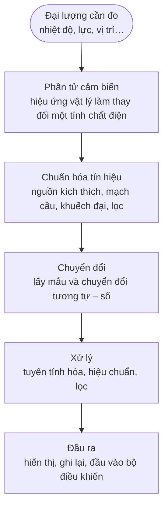

import Figure from '../../../components/Figure.astro';
import SensorNonlinearity from '../../../components/diagrams/SensorNonlinearity.astro';

Một bộ điều nhiệt, bộ điều khiển túi khí của ô tô, một robot trong nhà máy và một trạm giám sát chất lượng nước đều dựa vào cùng một thao tác: biến một đại lượng của thế giới vật lý (nhiệt độ, gia tốc, vị trí, nồng độ) thành một con số mà máy tính có thể sử dụng. Thao tác đó là **phép đo (measurement)**, và thiết bị khởi đầu nó là **cảm biến (sensor)**. Bài này trình bày phép đo là gì, cảm biến nằm ở đâu trong một hệ thống đo lớn hơn, và bộ thuật ngữ dùng để mô tả một cảm biến tốt đến mức nào. Các bài tiếp theo trong loạt bài sẽ lần theo tín hiệu qua từng tầng của hệ thống đó.

Cách tiếp cận đi từ ngoài vào trong: trước hết là khái niệm phép đo và độ không đảm bảo không thể tránh khỏi của nó, sau đó là chuỗi các thành phần tạo ra giá trị đo, tiếp theo là các tính chất đặc trưng cho cảm biến khi đầu vào ổn định và khi đầu vào thay đổi, và cuối cùng là cách ước lượng, báo cáo sai số và giảm sai số bằng hiệu chuẩn.

## 1. Phép đo là gì

### 1.1 Đại lượng cần đo, giá trị và đơn vị

Đại lượng mà ta muốn đo là **đại lượng cần đo (measurand)**: chẳng hạn nhiệt độ của nước trong một bồn cụ thể, chứ không phải "nhiệt độ" nói chung. **Phép đo** là quá trình thu được một giá trị cho đại lượng cần đo, biểu diễn dưới dạng một con số nhân với một **đơn vị (unit)**: 20.13 °C, 3.2 m/s².

Các đơn vị được định nghĩa bởi **Hệ đơn vị quốc tế (International System of Units, SI)**. Kể từ lần sửa đổi có hiệu lực năm 2019, cả bảy đơn vị cơ bản của SI (giây, mét, kilôgam, ampe, kelvin, mol và candela) đều được định nghĩa bằng cách cố định giá trị số của các hằng số vật lý, như tốc độ ánh sáng và hằng số Boltzmann, thay vì dựa vào các vật mẫu. Điều này quan trọng đối với cảm biến vì mọi phép đo đáng tin cậy, xét cho cùng, phải so sánh được với các định nghĩa đó, thông qua một chuỗi các lần hiệu chuẩn gọi là **tính liên kết chuẩn (traceability)** (Mục 6).

### 1.2 Mọi phép đo đều có độ không đảm bảo

Không phép đo nào cho ra chính xác giá trị thực của đại lượng cần đo. Cảm biến phản ứng với nhiều thứ hơn là chỉ đại lượng cần đo, mạch điện tử thêm nhiễu vào, chuẩn dùng để hiệu chuẩn cảm biến tự nó cũng không hoàn hảo, và bản thân đại lượng cần đo có thể thay đổi trong lúc đang được đo. Vì vậy, một giá trị đo là chưa đầy đủ nếu không kèm theo **độ không đảm bảo đo (measurement uncertainty)**: một khoảng được định lượng mà giá trị thực được cho là nằm trong đó với một mức tin cậy xác định. "20.13 °C" cho biết ít thông tin hơn "20.13 °C ± 0.11 °C với mức tin cậy khoảng 95 %".

Thuật ngữ trong bài này tuân theo hai văn bản mà các nhà đo lường học (chuyên gia về khoa học đo lường) sử dụng trên phạm vi quốc tế: *International Vocabulary of Metrology* (Từ vựng quốc tế về đo lường học, VIM, JCGM 200:2012) cho thuật ngữ, và *Guide to the Expression of Uncertainty in Measurement* (Hướng dẫn biểu thị độ không đảm bảo đo, GUM, JCGM 100:2008) cho độ không đảm bảo đo.

## 2. Chuỗi đo

### 2.1 Từ đại lượng cần đo đến con số

Hiếm khi một cảm biến tự nó tạo ra được một con số dùng ngay được. Nó là mắt xích đầu tiên trong một **chuỗi đo (measurement chain)**:

Mỗi tầng có phần riêng trong loạt bài này. **Phần tử cảm biến (sensing element)** sử dụng một hiệu ứng vật lý, chẳng hạn sự thay đổi điện trở của kim loại theo nhiệt độ, để biến đại lượng cần đo thành một đại lượng điện. **Chuẩn hóa tín hiệu (signal conditioning)** biến đại lượng đó thành một điện áp có độ lớn và băng thông phù hợp. **Chuyển đổi (conversion)** lấy mẫu điện áp và biến nó thành một con số. **Xử lý (processing)** hiệu chỉnh con số đó theo những khiếm khuyết đã biết của chuỗi. Sai số có thể xâm nhập ở mọi tầng, và độ không đảm bảo của kết quả cuối cùng phản ánh tất cả các sai số đó.

### 2.2 Cảm biến, bộ chuyển đổi, cơ cấu chấp hành

Ba thuật ngữ sau thường bị nhầm lẫn.

- **Bộ chuyển đổi (transducer)** biến đổi năng lượng hoặc tín hiệu từ một dạng vật lý sang một dạng khác, theo cả hai chiều.
- **Cảm biến** là một bộ chuyển đổi dùng để thu thông tin về đại lượng cần đo, biến nó thành một tín hiệu (hầu như luôn là tín hiệu điện).
- **Cơ cấu chấp hành (actuator)** là một bộ chuyển đổi dùng theo chiều ngược lại, biến một lệnh điện thành một tác động vật lý như chuyển động hoặc lực.

Cùng một nguyên lý vật lý có thể đảm nhận cả hai vai trò. Một tinh thể áp điện (piezoelectric crystal) tạo ra điện áp khi bị nén (cảm biến) và thay đổi hình dạng khi được đặt một điện áp (cơ cấu chấp hành).

### 2.3 Cảm biến tích cực và thụ động

Cảm biến được chia thành hai nhóm theo nguồn gốc năng lượng của tín hiệu ra.

- **Cảm biến tự phát (self-generating sensor)** (hay cảm biến tích cực) tạo ra tín hiệu điện từ chính năng lượng của đại lượng cần đo: cặp nhiệt điện (thermocouple) tạo ra điện áp từ chênh lệch nhiệt độ, điốt quang (photodiode) tạo ra dòng điện từ ánh sáng, cảm biến áp điện tạo ra điện tích từ lực.
- **Cảm biến điều chế (modulating sensor)** (hay cảm biến thụ động) làm thay đổi một tính chất điện, như điện trở, điện dung hoặc điện cảm, và cần một **nguồn kích thích (excitation)** bên ngoài (một điện áp hoặc dòng điện được cấp vào) để biến sự thay đổi đó thành tín hiệu: nhiệt điện trở (resistance thermometer), cảm biến biến dạng (strain gauge), cảm biến độ ẩm kiểu điện dung.

Sự phân biệt này có ý nghĩa trong thiết kế. Tín hiệu ra của cảm biến điều chế phụ thuộc vào nguồn kích thích, nên sai số của nguồn kích thích trở thành sai số đo, và bản thân dòng kích thích có thể làm nhiễu loạn đại lượng cần đo, chẳng hạn do làm nóng nhiệt điện trở.

## 3. Đặc tính tĩnh

**Đặc tính tĩnh (static characteristics)** mô tả cảm biến khi đầu vào đã ngừng thay đổi và đầu ra đã ổn định.

### 3.1 Hàm truyền

**Hàm truyền (transfer function)** (hay đường đặc tính) liên hệ đầu ra của cảm biến với đầu vào của nó. Nhiệt điện trở bạch kim (platinum resistance thermometer) là một ví dụ tốt để theo xuyên suốt. Điện trở $R$ của nó ở nhiệt độ $T$ (tính bằng °C, với $0 \le T \le 850$ °C) tuân theo phương trình Callendar–Van Dusen:

$$
R(T) = R_0\left(1 + A\,T + B\,T^2\right),
$$

trong đó $R_0$ là điện trở ở 0 °C và, đối với cảm biến bạch kim công nghiệp, các hệ số $A = 3.9083 \times 10^{-3}\ ^\circ\text{C}^{-1}$ và $B = -5.775 \times 10^{-7}\ ^\circ\text{C}^{-2}$ được tiêu chuẩn hóa trong IEC 60751. **PT100** là một cảm biến như vậy với $R_0 = 100\ \Omega$. Ở 100 °C, điện trở của nó là

$$
R(100) = 100\,(1 + 0.39083 - 0.005775) = 138.51\ \Omega .
$$

### 3.2 Dải đo, khoảng đo và độ nhạy

- **Dải đo (measuring range)** là tập các giá trị đầu vào mà trong đó cảm biến được quy định là hoạt động; **khoảng đo (span)** là hiệu giữa hai giới hạn của dải đo. Một cảm biến dùng từ 0 đến 100 °C có khoảng đo 100 °C.
- **Độ nhạy (sensitivity)** là lượng thay đổi của đầu ra trên một đơn vị thay đổi của đầu vào: độ dốc của hàm truyền. Với PT100 trong khoảng từ 0 đến 100 °C, độ nhạy trung bình là $(138.51 - 100)/100 = 0.385\ \Omega/^\circ\text{C}$. Vì đường cong bị uốn, độ dốc cục bộ thay đổi: $0.391\ \Omega/^\circ\text{C}$ ở 0 °C và $0.379\ \Omega/^\circ\text{C}$ ở 100 °C.
- **Độ lệch không (offset)** (hay sai số điểm không) là đầu ra khi đầu vào bằng không, hoặc phần chênh lệch so với đầu ra lý tưởng tại điểm đó.

### 3.3 Độ tuyến tính

Mạch điện tử và phần mềm sẽ đơn giản hơn khi đầu ra tỉ lệ với đầu vào, vì vậy cảm biến thường được mô tả qua mức độ chúng lệch khỏi một đường thẳng. **Độ phi tuyến (nonlinearity)** là độ lệch lớn nhất của hàm truyền thực so với một đường tham chiếu được chọn, biểu diễn theo đơn vị của đầu vào hoặc theo phần trăm khoảng đo. Đường tham chiếu phải được nêu rõ, vì các lựa chọn khác nhau cho ra các con số khác nhau: đường thẳng đi qua hai điểm đầu mút, đường khớp tốt nhất theo phương pháp bình phương tối thiểu, hoặc đường thẳng đi qua gốc.

Với PT100 trong khoảng 0–100 °C, khi dùng đường thẳng qua hai điểm đầu mút, độ lệch lớn nhất là $0.144\ \Omega$ tại 50 °C, tương ứng với $0.144 / 0.385 = 0.375$ °C, tức 0.375 % khoảng đo. Do đó, một hệ thống coi cảm biến là tuyến tính sẽ sai tới 0.375 °C ở giữa dải đo, ngay cả khi mạch điện tử hoàn hảo. Việc hiệu chỉnh sai số này là một phần của tầng xử lý (Mục 2.1), dựa trên hàm truyền đã biết.

<Figure caption="Sai số phi tuyến của PT100 trong khoảng từ 0 đến 100 °C, so với đường thẳng đi qua hai điểm đầu mút. Sai số bằng không ở cả hai đầu và lớn nhất, 0.375 °C, tại 50 °C.">
  <SensorNonlinearity />
</Figure>

### 3.4 Độ phân giải, ngưỡng và độ trễ

- **Độ phân giải (resolution)** là lượng thay đổi nhỏ nhất của đầu vào tạo ra một thay đổi phát hiện được ở đầu ra. Trong hệ thống số, nó thường được quyết định bởi bộ chuyển đổi (một bài sau sẽ bàn về lượng tử hóa), nhưng nhiễu thường giới hạn nó trước tiên.
- **Ngưỡng (threshold)** (hay vùng chết, dead band) là lượng thay đổi nhỏ nhất của đầu vào, tính từ không, tạo ra được bất kỳ đầu ra nào.
- **Độ trễ (hysteresis)** là hiệu giữa các đầu ra ứng với cùng một giá trị đầu vào khi tiến đến giá trị đó từ phía dưới và từ phía trên. Nó phát sinh do ma sát, các hiệu ứng từ hoặc sự hồi phục của vật liệu.

### 3.5 Độ lặp lại, độ ổn định và độ trôi

- **Độ lặp lại (repeatability)** là mức độ gần nhau giữa các kết quả đo lặp lại của cùng một đại lượng cần đo trong cùng điều kiện, trong một khoảng thời gian ngắn.
- **Độ ổn định (stability)** mô tả mức độ cảm biến giữ được các đặc tính của nó theo thời gian. Sự thay đổi chậm của đầu ra khi đầu vào không đổi là **độ trôi (drift)**: trôi điểm không làm dịch độ lệch không, trôi độ nhạy làm thay đổi độ dốc.

### 3.6 Tính chọn lọc và đại lượng ảnh hưởng

Một cảm biến lý tưởng chỉ phản ứng với đại lượng cần đo của nó. Cảm biến thực còn phản ứng với các **đại lượng ảnh hưởng (influence quantities)**: những điều kiện khác như nhiệt độ môi trường, điện áp nguồn, độ ẩm hoặc rung động. Chẳng hạn, một cảm biến biến dạng thay đổi điện trở theo nhiệt độ cũng như theo biến dạng. **Độ nhạy chéo (cross-sensitivity)** định lượng phản ứng đối với một đại lượng ảnh hưởng. Các thiết kế giảm nó bằng bù trừ, ví dụ dùng một cảm biến biến dạng thứ hai không chịu biến dạng trong cùng mạch cầu, một kỹ thuật mà bài về chuẩn hóa tín hiệu sẽ trở lại.

## 4. Đặc tính động

Đặc tính tĩnh không cho biết gì về việc cảm biến bám theo một đầu vào thay đổi nhanh đến đâu. **Đặc tính động (dynamic characteristics)** mô tả điều đó, dựa trên các mô hình của [loạt bài về hệ thống điều khiển](/vi/blog/introduction-to-control-systems).

### 4.1 Cảm biến bậc một

Nhiều cảm biến hoạt động như một **hệ bậc một (first-order system)**: sau một thay đổi dạng bậc thang ở đầu vào, đầu ra tiến đến giá trị mới theo hàm mũ. Một đầu dò nhiệt kế đặt vào nước nóng phải tự nóng lên, và số chỉ $y(t)$ của nó tăng dần về nhiệt độ mới theo

$$
y(t) = y_\infty\left(1 - e^{-t/\tau}\right),
$$

trong đó $\tau$ là **hằng số thời gian (time constant)**. Sau một hằng số thời gian, số chỉ đã đi được 63.2 % bước nhảy, sau ba hằng số thời gian là 95.0 % và sau năm là 99.3 %. Vì thế, một đầu dò có $\tau = 4$ s phải được để khoảng 20 s thì số chỉ mới nằm trong phạm vi 1 % của một thay đổi đột ngột. Hằng số thời gian phụ thuộc vào cách lắp đặt cũng như vào cảm biến: cùng một đầu dò đáp ứng nhanh hơn trong nước được khuấy so với trong không khí tĩnh.

### 4.2 Cảm biến bậc hai

Các cảm biến có khối lượng và độ cứng, như gia tốc kế (accelerometer) và màng áp suất (pressure diaphragm), hoạt động như một **hệ bậc hai (second-order system)**, được đặc trưng bởi **tần số dao động riêng (natural frequency)** $\omega_n$ và **hệ số tắt dần (damping ratio)** $\zeta$. Chúng có thể dao động và vọt lố sau một bước nhảy, và khuếch đại các đầu vào có tần số gần tần số riêng của chúng. Do đó, gia tốc kế được sử dụng ở tần số thấp hơn nhiều so với tần số riêng, nơi đáp ứng của nó phẳng.

### 4.3 Băng thông và thời gian đáp ứng

Để sử dụng trong thực tế, các mô hình này được tóm tắt bằng một vài con số:

- **băng thông (bandwidth)**: dải tần số đầu vào mà trong đó biên độ đầu ra nằm trong một dung sai xác định (thường là 3 dB, tức hệ số khoảng 0.71) so với giá trị của nó ở tần số thấp;
- **thời gian đáp ứng (response time)**: thời gian cần để đạt một tỉ lệ xác định (thường là 90 %) của một thay đổi bậc thang;
- **thời gian tăng (rise time)**: thời gian cần để đi từ 10 % đến 90 % của bước nhảy.

Một hệ thống đo không thể nhanh hơn tầng chậm nhất của nó, và một bộ lọc tương tự được thêm vào phía sau (Mục 2.1) rất có thể chậm hơn chính cảm biến.

## 5. Sai số và độ không đảm bảo đo

### 5.1 Sai số hệ thống và sai số ngẫu nhiên

**Sai số đo (measurement error)** là hiệu giữa giá trị đo được và giá trị thực. Nó có hai thành phần với cách khắc phục khác nhau.

- **Sai số hệ thống (systematic error)** giữ nguyên, hoặc thay đổi theo cách dự đoán được, khi phép đo được lặp lại: độ lệch không, sai số hệ số khuếch đại, độ phi tuyến của PT100 ở Mục 3.3. Lấy trung bình không loại bỏ được nó; hiệu chuẩn và hiệu chỉnh thì làm được.
- **Sai số ngẫu nhiên (random error)** thay đổi không dự đoán được giữa các lần đo lặp lại: nhiễu điện tử, những dao động nhỏ của đại lượng cần đo. Lấy trung bình $n$ số đọc độc lập làm giảm ảnh hưởng của nó đi $\sqrt{n}$ lần.

Theo thuật ngữ của VIM, mức độ gần với giá trị thực tính trung bình là **độ đúng (trueness)** (sai số hệ thống nhỏ), mức độ gần nhau của các số đọc lặp lại là **độ chụm (precision)** (sai số ngẫu nhiên nhỏ), và **độ chính xác (accuracy)** kết hợp cả hai. Một cảm biến có thể chụm nhưng không đúng: các số đọc của nó tụ sát nhau quanh một giá trị sai.

### 5.2 Đánh giá độ không đảm bảo đo

Giá trị thực là chưa biết, nên không thể tính trực tiếp sai số. Thay vào đó, GUM ước lượng một **độ không đảm bảo chuẩn (standard uncertainty)** $u$ (độ lệch chuẩn của một phân bố xác suất mô tả những gì đã biết) cho từng thành phần đóng góp, theo một trong hai cách:

- Đánh giá **loại A (Type A)** dùng thống kê của các số đọc lặp lại: với $n$ số đọc có độ lệch chuẩn $s$, độ không đảm bảo chuẩn của giá trị trung bình là $u = s/\sqrt{n}$.
- Đánh giá **loại B (Type B)** dùng các thông tin khác: giấy chứng nhận hiệu chuẩn, một giới hạn trong bảng dữ liệu kỹ thuật (datasheet), độ phân giải của màn hiển thị. Một giá trị chỉ biết là nằm trong khoảng $\pm a$, không có giá trị nào được ưu tiên bên trong, được mô hình hóa bằng phân bố đều (phân bố chữ nhật), với $u = a/\sqrt{3}$.

Với các thành phần độc lập, **độ không đảm bảo chuẩn tổng hợp (combined standard uncertainty)** là căn bậc hai của tổng bình phương, và **độ không đảm bảo mở rộng (expanded uncertainty)** $U$ bằng nó nhân với một **hệ số phủ (coverage factor)** $k$:

$$
u_c = \sqrt{u_1^2 + u_2^2 + \dots + u_n^2},
\qquad
U = k\,u_c .
$$

Với $k = 2$ và một kết quả có phân bố xấp xỉ Gauss, $U$ xác định một khoảng chứa giá trị thực với xác suất khoảng 95 %.

### 5.3 Một ví dụ lập bảng ngân sách độ không đảm bảo

Nhiệt độ của nước được đo mười lần bằng một nhiệt kế số đã hiệu chuẩn.

| Thành phần | Thông tin | Cách đánh giá | Độ không đảm bảo chuẩn |
|---|---|---|---|
| Độ lặp lại | Trung bình 20.13 °C, độ lệch chuẩn $s = 0.05$ °C, $n = 10$ | Loại A: $s/\sqrt{n}$ | 0.016 °C |
| Hiệu chuẩn | Giấy chứng nhận ghi ± 0.1 °C với $k = 2$ | Loại B: $0.1/2$ | 0.050 °C |
| Độ phân giải màn hiển thị | Chữ số cuối 0.01 °C, nên ± 0.005 °C | Loại B, phân bố chữ nhật: $0.005/\sqrt{3}$ | 0.003 °C |

Độ không đảm bảo chuẩn tổng hợp là $\sqrt{0.016^2 + 0.050^2 + 0.003^2} = 0.053$ °C, và độ không đảm bảo mở rộng với $k = 2$ là $U = 0.11$ °C. Kết quả được báo cáo là **20.13 °C ± 0.11 °C ($k = 2$)**.

Bảng ngân sách cho thấy công sức nên được bỏ vào đâu. Thành phần hiệu chuẩn chiếm ưu thế: lấy một trăm số đọc thay vì mười hầu như không làm thay đổi kết quả, trong khi một lần hiệu chuẩn tốt hơn thì có.

## 6. Hiệu chuẩn

**Hiệu chuẩn (calibration)** thiết lập mối quan hệ giữa số chỉ của cảm biến và các giá trị do một chuẩn tham chiếu có độ không đảm bảo đã biết và nhỏ hơn cung cấp, trong những điều kiện xác định. Kết quả thường là một số hiệu chỉnh hoặc một đường cong hiệu chuẩn, kèm theo độ không đảm bảo của mối quan hệ đó.

Cách hiệu chỉnh đơn giản nhất là **hiệu chuẩn hai điểm (two-point calibration)**, hiệu chỉnh độ lệch không và hệ số khuếch đại. Giả sử một nhiệt kế chỉ 0.4 °C trong bể nước đá (0 °C) và 99.1 °C trong một bể chuẩn ở 100 °C. Khi đó giá trị đã hiệu chỉnh là

$$
T = g\,(r - r_0), \qquad g = \frac{100 - 0}{99.1 - 0.4} = 1.0132,
$$

trong đó $r$ là số đọc thô và $r_0 = 0.4$ °C. Một số đọc thô 50.0 °C trở thành $1.0132 \times 49.6 = 50.25$ °C. Hai điểm loại bỏ được sai số độ lệch không và sai số hệ số khuếch đại, nhưng không loại bỏ được độ phi tuyến; một cảm biến có hàm truyền dạng cong, như PT100, cần nhiều điểm hơn hoặc phương trình đã biết của đường cong đó.

Một lần hiệu chuẩn chỉ có ý nghĩa nếu bản thân chuẩn tham chiếu được hiệu chuẩn theo một chuẩn tốt hơn, và cứ thế lên đến một viện đo lường quốc gia, nơi hiện thực hóa các đơn vị SI. Chuỗi không đứt đoạn đó, với độ không đảm bảo được nêu ở mỗi bước, là **tính liên kết chuẩn đo lường (metrological traceability)**. Kết quả hiệu chuẩn cũng bị lão hóa: độ trôi (Mục 3.5) khiến cảm biến phải được hiệu chuẩn lại sau những chu kỳ được chọn dựa trên độ ổn định của nó và hậu quả của một sai số không bị phát hiện. [Bài cuối cùng](/blog/calibration-and-multisensor-fusion) của loạt bài này sẽ bàn sâu hơn về hiệu chuẩn trong thực tế.

## 7. Lựa chọn cảm biến

Các đặc tính trên biến việc lựa chọn cảm biến thành một tập hợp câu hỏi:

| Câu hỏi | Đặc tính cần kiểm tra |
|---|---|
| Cần đo những giá trị nào? | Dải đo, giới hạn quá tải |
| Cần phát hiện thay đổi nhỏ đến mức nào? | Độ phân giải, nhiễu, ngưỡng |
| Kết quả phải gần giá trị thực đến mức nào? | Thông số độ chính xác, độ không đảm bảo hiệu chuẩn |
| Đại lượng cần đo thay đổi nhanh đến đâu? | Hằng số thời gian, băng thông, thời gian đáp ứng |
| Còn những gì khác thay đổi trong môi trường? | Đại lượng ảnh hưởng, độ nhạy chéo, điều kiện vận hành |
| Cảm biến phải hoạt động không cần giám sát trong bao lâu? | Độ ổn định, độ trôi, chu kỳ hiệu chuẩn |
| Cảm biến có làm nhiễu loạn đối tượng nó đo không? | Hiệu ứng tải: khối lượng, nhiệt dung, công suất kích thích |
| Phần còn lại của chuỗi đo cần gì? | Loại đầu ra (tự phát hay điều chế), mức tín hiệu, giao diện |

Hàng áp chót đáng được nhấn mạnh. Cảm biến lấy năng lượng từ đại lượng cần đo. Một gia tốc kế nặng làm thay đổi dao động của một kết cấu nhẹ; một nhiệt kế lớn làm nguội một mẫu nhỏ; một PT100 với dòng kích thích 1 mA tiêu tán công suất $I^2 R = 0.14$ mW ở 100 °C, làm nó nóng lên cao hơn một chút so với nước mà nó đang đo. Những **hiệu ứng tải (loading)** này là các sai số hệ thống do chính hành động đo gây ra.

## 8. Tóm tắt

| Câu hỏi | Trả lời |
|---|---|
| Phép đo là gì? | Thu được một giá trị, kèm đơn vị và độ không đảm bảo, cho một đại lượng cần đo cụ thể. |
| Chuỗi đo là gì? | Phần tử cảm biến, chuẩn hóa tín hiệu, chuyển đổi, xử lý và đầu ra, mỗi tầng đều có thể là nguồn sai số. |
| Cảm biến tự phát và cảm biến điều chế khác nhau thế nào? | Cảm biến tự phát lấy năng lượng đầu ra từ đại lượng cần đo; cảm biến điều chế làm thay đổi một tính chất và cần nguồn kích thích. |
| Các đặc tính tĩnh chính là gì? | Dải đo, độ nhạy, độ lệch không, độ tuyến tính, độ phân giải, độ trễ, độ lặp lại, độ trôi và độ nhạy chéo. |
| Tốc độ của cảm biến bậc một được mô tả thế nào? | Bằng hằng số thời gian: đạt 63.2 % bước nhảy sau $\tau$, 99.3 % sau $5\tau$. |
| Sai số hệ thống và sai số ngẫu nhiên khác nhau thế nào? | Sai số hệ thống lặp lại và được loại bỏ bằng hiệu chuẩn; sai số ngẫu nhiên thay đổi và được giảm bằng lấy trung bình. |
| Độ không đảm bảo được tổng hợp và báo cáo thế nào? | Các độ không đảm bảo chuẩn được tổng hợp theo căn bậc hai của tổng bình phương, rồi nhân với hệ số phủ, thường là $k = 2$. |
| Hiệu chuẩn mang lại gì? | Một phép hiệu chỉnh có tính liên kết chuẩn, liên hệ số chỉ với các giá trị chuẩn, kèm độ không đảm bảo của chính nó. |

Bài tiếp theo chuyển sang bản thân phần tử cảm biến: các hiệu ứng vật lý (điện trở, điện dung, điện cảm, áp điện, nhiệt điện, quang và điện hóa) biến đại lượng cần đo thành tín hiệu điện.

### Tài liệu tham khảo

- JCGM 200:2012, *International Vocabulary of Metrology: Basic and General Concepts and Associated Terms* (VIM), Joint Committee for Guides in Metrology.
- JCGM 100:2008, *Evaluation of Measurement Data: Guide to the Expression of Uncertainty in Measurement* (GUM), Joint Committee for Guides in Metrology.
- IEC 60751, *Industrial Platinum Resistance Thermometers and Platinum Temperature Sensors*, International Electrotechnical Commission (các ấn bản 2008 và 2022, cho cùng các hệ số).
- J. Fraden, *Handbook of Modern Sensors: Physics, Designs, and Applications*, ấn bản lần thứ 5, Springer, 2016.
- P. Regtien và E. Dertien, *Sensors for Mechatronics*, ấn bản lần thứ 2, Elsevier, 2018.
- J. P. Bentley, *Principles of Measurement Systems*, ấn bản lần thứ 4, Pearson, 2005.
