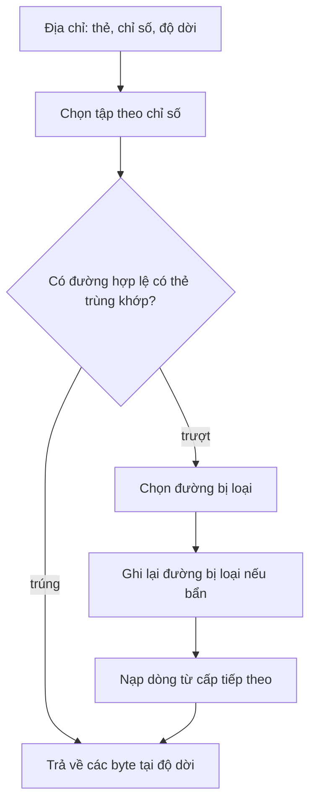

[Bài thứ nhất](/vi/blog/performance-models-and-scaling-laws) đã xây dựng cận roofline (roofline bound) $P \le \min(P_{\mathrm{peak}}, B\,I)$ của Williams, Waterman và Patterson (2009), trình bày ở mục 5 của bài đó. Cận này giới hạn hiệu năng đạt được $P$ của một kernel bởi tốc độ số học đỉnh $P_{\mathrm{peak}}$ của nó và bởi tích của băng thông bộ nhớ $B$ với cường độ số học (arithmetic intensity) $I$, tức số phép toán dấu phẩy động (FLOP) thực hiện trên mỗi byte được di chuyển. Bài góc nhìn [Giới hạn bởi tính toán hay bởi bộ nhớ?](/vi/insights/compute-bound-or-memory-bound) đã cho thấy một kernel như $y \leftarrow y + a x$ nằm rất xa bên dưới điểm gãy (ridge point) $I^* = P_{\mathrm{peak}}/B$. Cả hai đều coi $B$ và số byte được di chuyển là đã cho. Bài này đi sâu vào hai đại lượng đó: các byte đến từ đâu, vì sao cùng một vòng lặp có thể di chuyển số byte gấp tám lần khi được viết theo một thứ tự khác, và làm thế nào để cấu trúc lại chương trình sao cho mỗi byte được nạp về được dùng nhiều lần.

Bài này giả định người đọc đã nắm cận roofline và cách đo hiệu năng của bài thứ nhất, và đọc hiểu được C và Python. Mọi chương trình đều chạy trên một lõi, trừ phép thử băng thông ở cuối bài. Mỗi hiệu ứng được đo trên một máy, hoặc, khi phép đo thời gian chỉ cho thấy thứ tự là quan trọng mà không cho biết vì sao, được đếm chính xác bằng một bộ mô phỏng bộ nhớ đệm nhỏ mà người đọc có thể tự chạy.

**Quy ước.** Các chương trình C viết theo C11, biên dịch bằng GNU Compiler Collection (GCC) 13.3 ở mức tối ưu hóa ghi kèm mỗi đoạn mã; bộ mô phỏng và phép so sánh nhân ma trận dùng Python 3.13 và NumPy 2.5. Phép thử băng thông dùng các luồng (thread) Open Multi-Processing (OpenMP) thông qua `gcc -fopenmp`. Máy tham chiếu là một máy ảo khách của Kernel-based Virtual Machine (KVM) với bốn lõi (core) của một bộ xử lý Intel Xeon được báo cáo ở 2.1 GHz, có tập lệnh Advanced Vector Extensions 512 bit (AVX-512), các kích thước bộ nhớ đệm liệt kê trong mục 1.2 và 16 GiB RAM, chạy Linux.

Máy này được dùng chung với các máy ảo khác, nên các phép đo thời gian có nhiễu: mỗi số liệu là trung vị của năm hoặc mười lần lặp, chỉ mô tả riêng máy này, và chỉ hỗ trợ những kết luận rút ra từ các chênh lệch lớn hơn nhiều so với độ dao động giữa các lần chạy ([mục 6 của bài thứ nhất](/vi/blog/performance-models-and-scaling-laws)). Dữ liệu là các số double 8 byte, mảng C lưu theo hàng và chỉ số bắt đầu từ 0. Kích thước bộ nhớ đệm và bộ nhớ tính bằng KiB và MiB (lũy thừa của hai), băng thông tính bằng gigabyte mỗi giây (GB/s, $10^9$ byte mỗi giây) và tốc độ số học tính bằng giga phép toán dấu phẩy động mỗi giây (GFLOP/s, $10^9$ FLOP mỗi giây).

## 1. Vì sao bộ nhớ giới hạn hiệu năng

### 1.1 Khoảng cách giữa bộ xử lý và bộ nhớ

Một lõi hiện đại có thể bắt đầu vài phép toán số học trong mỗi chu kỳ xung nhịp dài chưa tới một nano giây, trong khi một lần đọc từ bộ nhớ chính, được xây dựng từ **RAM động** (dynamic RAM, DRAM), mất cỡ một trăm nano giây (mục 1.3). Trong nhiều thập kỷ, tốc độ bộ xử lý tăng nhanh hơn mức cải thiện độ trễ (latency) bộ nhớ; Wulf và McKee (1995) gọi hệ quả này là **bức tường bộ nhớ** (memory wall), thời điểm mà việc nạp dữ liệu, chứ không phải việc tính toán trên dữ liệu, quyết định tốc độ của chương trình. Băng thông được cải thiện nhanh hơn độ trễ (Patterson, 2004) nhưng chậm hơn hiệu năng số học đỉnh, nên tỉ số giữa hai đại lượng này, mà McCalpin (1995) gọi là **độ cân bằng máy** (machine balance) và mô hình roofline gọi là điểm gãy $I^*$, đã tăng dần theo thời gian.

**Phân cấp bộ nhớ** (memory hierarchy) là lời giải kỹ thuật cho vấn đề này. Giữa các thanh ghi và DRAM có vài cấp **bộ nhớ đệm** (cache): những bộ nhớ nhỏ làm từ **RAM tĩnh** (static RAM, SRAM) nhanh, nằm gần lõi, chứa bản sao của dữ liệu vừa được dùng. Chúng được đánh số từ lõi ra ngoài: cấp 1 (L1), cấp 2 (L2) và cấp 3 (L3). Một bộ nhớ nhỏ thì nhanh vì tín hiệu đi quãng đường ngắn, nên một cấp nhỏ và nhanh đặt trước một cấp lớn và chậm cho thời gian truy cập trung bình gần với thời gian của cấp nhỏ, miễn là phần lớn các truy cập tìm thấy dữ liệu ở đó (Hennessy và Patterson, 2017, chương 2). Bộ nhớ đệm do phần cứng quản lý: chương trình đọc một địa chỉ, còn phần cứng quyết định bản sao được lấy từ đâu. Chương trình không nhìn thấy phân cấp này, nhưng tốc độ của nó phụ thuộc vào phân cấp này.

$B$ trong mô hình roofline là băng thông của cấp nào mà dữ liệu được lấy từ đó, và các byte trong $I$ là những byte đi qua ranh giới của cấp đó. Trên máy tham chiếu, một lõi đạt khoảng 90.6 GFLOP/s trong chương trình đo vi mô (microbenchmark) dùng lệnh nhân – cộng hợp nhất (fused multiply-add, FMA) ở mục 5.4 của [bài thứ nhất](/vi/blog/performance-models-and-scaling-laws) và duy trì 13.4 GB/s từ DRAM với phép triad duyệt tuần tự (streaming triad) ở mục 6.3 dưới đây. Do đó điểm gãy của một lõi vào khoảng $90.6/13.4 = 6.8$ FLOP/byte, gần với giá trị 7.08 mà bài thứ nhất tìm được cho bốn lõi: một kernel nạp mọi toán hạng từ DRAM cần khoảng 54 phép toán trên mỗi số double thì số học mới có thể trở thành giới hạn. Rất ít vòng lặp làm nhiều việc như vậy trên mỗi phần tử. Những vòng lặp chạy nhanh là nhờ phần lớn toán hạng của chúng đến từ một bộ nhớ đệm.

### 1.2 Các cấp trên máy tham chiếu

Hệ điều hành báo cáo kích thước các bộ nhớ đệm. `lscpu` cho tổng trên cả bốn lõi, còn `getconf` cho giá trị của một lõi (đầu ra đã được lược bớt; `PAGESIZE` được dùng trong mục 6):

```text
$ lscpu | grep -E 'Model name|^CPU\(s\)|L1d|L2|L3|Hypervisor'
CPU(s):                                  4
Model name:                              Intel(R) Xeon(R) Processor @ 2.10GHz
Hypervisor vendor:                       KVM
L1d cache:                               192 KiB (4 instances)
L2 cache:                                8 MiB (4 instances)
L3 cache:                                260 MiB (1 instance)
$ for v in LEVEL1_DCACHE_SIZE LEVEL1_DCACHE_ASSOC LEVEL1_DCACHE_LINESIZE \
>          LEVEL2_CACHE_SIZE LEVEL2_CACHE_ASSOC LEVEL3_CACHE_SIZE PAGESIZE; do
>   printf '%-24s %s\n' "$v" "$(getconf $v)"; done
LEVEL1_DCACHE_SIZE       49152
LEVEL1_DCACHE_ASSOC      12
LEVEL1_DCACHE_LINESIZE   64
LEVEL2_CACHE_SIZE        2097152
LEVEL2_CACHE_ASSOC       16
LEVEL3_CACHE_SIZE        272629760
PAGESIZE                 4096
```

| Cấp | Dung lượng | Tổ chức (mục 2) | Dùng chung bởi |
|---|---|---|---|
| Thanh ghi | 32 thanh ghi vector 64 byte (AVX-512) | Được lệnh gọi theo tên | Một lõi |
| Bộ nhớ đệm dữ liệu L1 | 48 KiB | Dòng 64 byte, 12 đường, 64 tập | Một lõi |
| Bộ nhớ đệm L2 | 2 MiB | Dòng 64 byte, 16 đường, 2048 tập | Một lõi |
| Bộ nhớ đệm L3 | 260 MiB theo báo cáo | Dòng 64 byte | Mọi lõi của bộ xử lý |
| Bộ nhớ chính (DRAM) | 16 GiB trong máy ảo này | Trang 4 KiB (mục 6.1) | Toàn hệ thống |

Mỗi cấp lớn hơn và chậm hơn cấp trước nó. Con số của L3 là giá trị mà bộ xử lý ảo báo cáo; mục 1.3 cho thấy máy ảo này không hoạt động như thể nó có toàn bộ dung lượng đó.

### 1.3 Đo độ trễ bằng cách dò theo con trỏ

**Độ trễ** của một cấp là thời gian từ lúc phát lệnh nạp (load) đến lúc có giá trị, khi dữ liệu nằm ở cấp đó. Phép **dò theo con trỏ** (pointer chasing) đo đại lượng này: một mảng được điền các con trỏ tạo thành một chu trình dài duy nhất, và vòng lặp đi theo chúng, `p = p->next`. Địa chỉ của mỗi lệnh nạp là kết quả của lệnh nạp trước, nên bộ xử lý không thể cho chúng chồng lên nhau và vòng lặp chạy với tốc độ một độ trễ cho mỗi bước. Mỗi phần tử chiếm riêng một dòng cache (cache line) 64 byte (mục 2.1), và thứ tự của chu trình được xáo trộn để phần cứng không đoán được địa chỉ tiếp theo (mục 6.2). Thay đổi tổng kích thước của chu trình, tức **tập làm việc** (working set), sẽ đo lần lượt từng cấp.

```c
/* C11. Load-to-use latency by pointer chasing. Each element is one 64-byte
   cache line holding a pointer to the next element. The elements form one
   cycle; in "rand" mode the cycle visits the lines in a shuffled order, in
   "seq" mode in address order. Every load depends on the one
   before it, so the time per step is the latency of one access.
   Build: gcc -std=c11 -O2 -Wall -o latency latency.c
   Usage: ./latency rand|seq 4k|huge [min_KiB max_KiB]                        */
#define _GNU_SOURCE
#include <stdint.h>
#include <stdio.h>
#include <stdlib.h>
#include <string.h>
#include <sys/mman.h>
#include <time.h>

struct line { struct line *next; char pad[56]; };

static double now_s(void) {
    struct timespec ts;
    clock_gettime(CLOCK_MONOTONIC, &ts);
    return ts.tv_sec + ts.tv_nsec * 1e-9;
}

static uint64_t rng = 88172645463325252ull;     /* xorshift64, fixed seed */
static uint64_t next_rand(void) {
    rng ^= rng << 13; rng ^= rng >> 7; rng ^= rng << 17;
    return rng;
}

static int cmp(const void *a, const void *b) {
    double x = *(const double *)a, y = *(const double *)b;
    return (x > y) - (x < y);
}

int main(int argc, char **argv) {
    int seq = argc > 1 && strcmp(argv[1], "seq") == 0;
    int huge = argc > 2 && strcmp(argv[2], "huge") == 0;
    const size_t max_bytes = (size_t)1 << 30;    /* 1 GiB */
    struct line *buf = mmap(NULL, max_bytes, PROT_READ | PROT_WRITE,
                            MAP_PRIVATE | MAP_ANONYMOUS, -1, 0);
    if (buf == MAP_FAILED) return 1;
    madvise(buf, max_bytes, huge ? MADV_HUGEPAGE : MADV_NOHUGEPAGE);
    size_t *perm = malloc((max_bytes / 64) * sizeof *perm);

    printf("mode %s, pages %s\n", seq ? "seq" : "rand", huge ? "huge" : "4 KiB");
    printf("%12s %10s\n", "working set", "ns/load");
    size_t lo = argc > 3 ? strtoull(argv[3], NULL, 10) * 1024 : 4096;
    size_t hi = argc > 4 ? strtoull(argv[4], NULL, 10) * 1024 : max_bytes;
    for (size_t bytes = lo; bytes <= hi; bytes *= 2) {
        size_t n = bytes / sizeof(struct line);
        for (size_t i = 0; i < n; i++) perm[i] = i;
        if (!seq)                                /* shuffle the visit order */
            for (size_t i = n - 1; i > 0; i--) {
                size_t j = next_rand() % i;
                size_t t = perm[i]; perm[i] = perm[j]; perm[j] = t;
            }
        for (size_t i = 0; i < n; i++)           /* link perm[i] -> perm[i+1] */
            buf[perm[i]].next = &buf[perm[(i + 1) % n]];

        const long steps = 1L << 23;
        double t[5];
        struct line *p = &buf[perm[0]];
        for (long s = 0; s < (long)n; s++) p = p->next;      /* warm up */
        for (int r = 0; r < 5; r++) {
            double t0 = now_s();
            for (long s = 0; s < steps; s++) p = p->next;
            t[r] = (now_s() - t0) / steps * 1e9;
        }
        qsort(t, 5, sizeof t[0], cmp);
        if (p == NULL) puts("");                  /* keep the chase live */
        if (bytes < 1024 * 1024)
            printf("%8zu KiB %10.2f\n", bytes / 1024, t[2]);
        else
            printf("%8zu MiB %10.2f\n", bytes / (1024 * 1024), t[2]);
        fflush(stdout);
    }
    return 0;
}
```

Chạy thành hai phần, `./latency rand 4k 4 32768` và `./latency rand 4k 65536 1048576`, chương trình in ra (trung vị của năm lần đo $2^{23}$ bước cho mỗi kích thước; các hàng 8 KiB, 128 KiB, 512 KiB và 8 MiB được lược bỏ, và `...` đánh dấu chỗ bắt đầu lần chạy thứ hai):

```text
mode rand, pages 4 KiB
 working set    ns/load
       4 KiB       1.59
      16 KiB       1.47
      32 KiB       1.50
      64 KiB       5.25
     256 KiB       4.98
       1 MiB       9.84
       2 MiB      45.53
       4 MiB      57.56
      16 MiB      68.96
      32 MiB     114.74
...
      64 MiB     182.63
     128 MiB     202.10
     256 MiB     222.16
     512 MiB     251.54
    1024 MiB     269.39
```

Đầu ra có các vùng bằng phẳng và các bậc. Đến 32 KiB, một lệnh nạp mất khoảng 1.5 ns: chu trình nằm gọn trong L1 48 KiB. Từ 64 KiB đến 512 KiB, nó mất khoảng 5 ns, đó là độ trễ L2. Tại kích thước 2 MiB của L2, nó nhảy lên 45 đến 115 ns, và vượt quá 32 MiB thì tăng dần từ khoảng 180 ns đến 270 ns tại 1 GiB, khoảng 180 lần độ trễ L1.

Các bậc không sắc nét: một tập làm việc bằng đúng kích thước L2 đã bị trượt, vì bộ nhớ đệm còn chứa dữ liệu khác. Thời gian vượt ra ngoài L2 cũng bao gồm việc dịch địa chỉ, vì mỗi bước rơi vào một trang 4 KiB ngẫu nhiên (mục 6.1 tách riêng hai yếu tố này). Cuối cùng, bậc chuyển sang độ trễ cỡ DRAM xuất hiện giữa 32 và 64 MiB, thấp hơn nhiều so với 260 MiB được báo cáo cho L3. L3 được dùng chung với các lõi của những máy ảo khác trên máy chủ; một cách hiểu hợp lý, mà phép đo này không thể xác nhận, là máy khách này chỉ nhận được vài chục MiB của nó.

Máy ảo che giấu tần số xung nhịp thực, nên thời gian không được quy đổi ra chu kỳ. Các lần chạy lặp lại làm từng hàng thay đổi đến khoảng 50% (hàng 1 MiB cho 6.25 ns ở một lần chạy khác), nhưng không làm thay đổi các vùng bằng phẳng và các bậc.

## 2. Bộ nhớ đệm hoạt động như thế nào

### 2.1 Dòng, tập và thẻ

Bộ nhớ đệm không lưu từng byte riêng lẻ. Nó lưu các **dòng cache** (còn gọi là khối), những đoạn bộ nhớ được căn chỉnh có kích thước cố định, 64 byte trên máy tham chiếu. Khi một lệnh nạp bị trượt, toàn bộ dòng chứa byte được yêu cầu được đưa vào. Độ mịn này là lý do đầu tiên khiến thứ tự truy cập quan trọng: một dòng được nạp về cho một số double cũng mang theo bảy số double bên cạnh, không tốn thêm chi phí nếu chúng được dùng sớm.

Để tìm một dòng nhanh chóng, bộ nhớ đệm được chia thành các **tập** (set), và mỗi địa chỉ dòng chỉ có thể nằm trong một tập. Một bộ nhớ đệm dung lượng $C$ byte với kích thước dòng $L$ byte và **độ kết hợp** (associativity) $N_{\mathrm{ways}}$ (số dòng, hay số **đường** (way), trong mỗi tập) có

$$
N_{\mathrm{sets}} = \frac{C}{L\,N_{\mathrm{ways}}}
$$

tập; với bộ nhớ đệm dữ liệu L1 của máy tham chiếu, $N_{\mathrm{sets}} = 49\,152/(64 \times 12) = 64$. Một địa chỉ được đọc thành ba trường. $\log_2 L = 6$ bit thấp là **độ dời** (offset) bên trong dòng, $\log_2 N_{\mathrm{sets}} = 6$ bit tiếp theo là **chỉ số** (index) chọn tập, và các bit còn lại là **thẻ** (tag), được lưu cùng dòng để phân biệt các dòng dùng chung một tập. Mỗi dòng còn mang một **bit hợp lệ** (valid bit) và, trong bộ nhớ đệm ghi sau, một **bit bẩn** (dirty bit) (mục 2.3). Với địa chỉ `0x7ffd1234`, độ dời là `0x34` = 52 và chỉ số là $(\mathtt{0x7ffd1234} \gg 6) \bmod 64 = 8$. Mọi địa chỉ khác địa chỉ này một bội số của $64 \times 64 = 4096$ byte đều có cùng chỉ số và cạnh tranh cùng 12 đường.

Một lần tra cứu chọn tập theo chỉ số, so sánh thẻ với thẻ của tất cả các đường trong tập đó một cách song song, rồi hoặc trả về dữ liệu (một lần **trúng**, hit) hoặc bắt đầu một lần **trượt** (miss):



Một bộ nhớ đệm **ánh xạ trực tiếp** (direct-mapped) có một đường mỗi tập ($N_{\mathrm{ways}} = 1$), nên hai dòng có cùng chỉ số sẽ đẩy nhau ra ngay cả khi phần còn lại của bộ nhớ đệm trống. Một bộ nhớ đệm **kết hợp toàn phần** (fully associative) chỉ có một tập, nên bất kỳ dòng nào cũng có thể nằm ở bất kỳ đâu, nhưng mỗi lần tra cứu phải so sánh mọi thẻ đã lưu, điều chỉ khả thi với các cấu trúc nhỏ. Các bộ nhớ đệm thực tế là **kết hợp theo tập** (set-associative), nằm ở giữa hai trường hợp đó.

### 2.2 Thay thế

Khi phải đưa một dòng vào một tập đã đầy, một dòng trong tập đó bị loại ra. Chính sách **ít được dùng gần đây nhất** (least recently used, LRU) loại dòng có lần truy cập cuối cùng cách đây lâu nhất. LRU chính xác trên nhiều đường thì tốn kém, nên phần cứng dùng các phép xấp xỉ mà chi tiết hiếm khi được nhà sản xuất công bố; LRU chính xác của bộ mô phỏng trong mục 3.3 đủ tốt để đếm số lần trượt của các vòng lặp đều đặn nhưng không phải là mô hình của bất kỳ bộ xử lý cụ thể nào.

### 2.3 Thao tác ghi

Một bộ nhớ đệm **ghi xuyên** (write-through) gửi mọi lệnh ghi (store) xuống cấp tiếp theo ngay lập tức. Một bộ nhớ đệm **ghi sau** (write-back) chỉ cập nhật bản sao của chính nó và đánh dấu dòng là bẩn; dòng được ghi xuống cấp tiếp theo khi bị loại ra. Ghi sau tiết kiệm lưu lượng khi một dòng được ghi nhiều lần, và đây là lựa chọn thông thường cho các bộ nhớ đệm dữ liệu của bộ xử lý hiện nay (Hennessy và Patterson, 2017, phụ lục B).

Một lệnh ghi bị trượt đặt ra câu hỏi thứ hai. Với **cấp phát khi ghi** (write-allocate), dòng được đọc vào bộ nhớ đệm trước rồi mới được sửa đổi tại đó; với **không cấp phát khi ghi** (no-write-allocate), lệnh ghi đi vòng qua bộ nhớ đệm. Bộ nhớ đệm ghi sau thường cấp phát khi ghi. Vì vậy một vòng lặp chỉ ghi một mảng, chẳng hạn `a[i] = 0`, vẫn đọc mọi dòng của `a` trước khi ghi đè, và di chuyển số byte gấp đôi so với những gì mã nguồn gợi ý. Các **lệnh ghi không lưu tạm** (non-temporal store, còn gọi là streaming store) tránh lần đọc này cho những dữ liệu sẽ không sớm được dùng lại (Drepper, 2007).

### 2.4 Ba loại trượt cache

Các lần trượt có những nguyên nhân khác nhau, và cách khắc phục phụ thuộc vào nguyên nhân. Một cách phân loại do M. D. Hill đưa ra, được Hennessy và Patterson (2017, phụ lục B) trình bày, chia chúng thành ba loại:

- **Trượt bắt buộc** (compulsory, hay cold miss) là các lần truy cập đầu tiên vào một dòng. Ngay cả một bộ nhớ đệm vô hạn cũng có chúng.
- **Trượt do dung lượng** (capacity) xảy ra vì bộ nhớ đệm không thể chứa mọi thứ chương trình dùng giữa hai lần truy cập vào cùng một dòng: đó là những lần trượt mà một bộ nhớ đệm LRU kết hợp toàn phần cùng kích thước cũng sẽ gặp. Một tập làm việc nhỏ hơn, như chia khối mang lại trong mục 4, loại bỏ chúng.
- **Trượt do xung đột** (conflict) là phần còn lại, gây ra bởi quá nhiều dòng tranh nhau một tập trong khi các tập khác ít được dùng. Thay đổi địa chỉ, chẳng hạn bằng cách thêm **phần đệm** (padding) vào mảng (mục 3.3), loại bỏ chúng.

Một bộ mô phỏng có thể áp dụng trực tiếp các định nghĩa này bằng cách chạy một bộ nhớ đệm LRU kết hợp toàn phần cùng dung lượng song song với bộ nhớ đệm thực. Trên một bộ xử lý nhiều lõi xuất hiện loại thứ tư, **trượt do nhất quán** (coherence), khi một lõi khác ghi vào một dòng mà lõi này đang giữ; chúng là chủ đề của mục về chia sẻ giả trong [bài thứ ba](/vi/blog/threads-and-shared-memory-parallelism) (mục 5).

## 3. Tính cục bộ trong vòng lặp

### 3.1 Tính cục bộ không gian và thời gian

Bộ nhớ đệm có ích vì chương trình không ngẫu nhiên. **Tính cục bộ thời gian** (temporal locality) là xu hướng truy cập lại cùng dữ liệu trong thời gian ngắn: một biến tích lũy, một hàng được dùng lại trong vòng lặp trong. **Tính cục bộ không gian** (spatial locality) là xu hướng truy cập dữ liệu nằm gần dữ liệu vừa được truy cập: các phần tử liên tiếp của mảng, các trường của một cấu trúc. Bộ nhớ đệm khai thác tính chất thứ nhất bằng cách giữ các dòng vừa dùng, và tính chất thứ hai bằng cách nạp nguyên dòng.

Tính cục bộ thuộc về thứ tự truy cập, không thuộc về dữ liệu, và trong mã tính toán số nó chủ yếu được quyết định bởi thứ tự vòng lặp và bố cục mảng. **Bước nhảy** (stride) của một mẫu truy cập là khoảng cách trong bộ nhớ giữa các lần truy cập liên tiếp: bước nhảy 8 byte dùng mọi byte của mọi dòng được nạp về, còn bước nhảy từ 64 byte trở lên chỉ dùng một số double trên mỗi dòng và lãng phí bảy số còn lại.

### 3.2 Duyệt theo hàng và duyệt theo cột

Một mảng C `double a[n][n]` được lưu theo **thứ tự hàng** (row-major), phần tử `a[i][j]` nằm ở độ dời byte $8\,(i\,n + j)$. Cộng dồn mảng với `j` ở vòng lặp trong cho bước nhảy 8 byte; với `i` ở vòng lặp trong, bước nhảy là cả một hàng, 32 KiB khi $n = 4096$, nên mỗi truy cập chạm vào một dòng khác và một trang khác. Chương trình sau đo cả hai thứ tự, với các hàng dài đúng 4096 phần tử và với các hàng được thêm phần đệm để đạt **chiều dẫn đầu** (leading dimension, khoảng cách tính bằng phần tử giữa điểm bắt đầu của hai hàng liên tiếp) bằng 4104, rồi quét một mảng 256 MiB với các bước nhảy tăng dần:

```c
/* C11. Row-order and column-order traversal of an n x n array of doubles
   stored in row-major order, and a strided sweep over a large array.
   Build: gcc -std=c11 -O2 -Wall -o traverse traverse.c
   Prints the median of 5 repetitions of each measurement.                   */
#define _POSIX_C_SOURCE 200809L
#include <stdio.h>
#include <stdlib.h>
#include <time.h>

static double now_s(void) {
    struct timespec ts;
    clock_gettime(CLOCK_MONOTONIC, &ts);
    return ts.tv_sec + ts.tv_nsec * 1e-9;
}

static int cmp(const void *a, const void *b) {
    double x = *(const double *)a, y = *(const double *)b;
    return (x > y) - (x < y);
}

static double sum_rows(const double *a, size_t n, size_t ld) {
    double s = 0;
    for (size_t i = 0; i < n; i++)
        for (size_t j = 0; j < n; j++) s += a[i * ld + j];
    return s;
}

static double sum_cols(const double *a, size_t n, size_t ld) {
    double s = 0;
    for (size_t j = 0; j < n; j++)
        for (size_t i = 0; i < n; i++) s += a[i * ld + j];
    return s;
}

static double sum_stride(const double *a, size_t len, size_t stride) {
    double s = 0;
    for (size_t i = 0; i < len; i += stride) s += a[i];
    return s;
}

int main(void) {
    const size_t n = 4096;
    volatile double sink = 0;
    double t[5];
    /* ld is the leading dimension: the distance in elements between rows. */
    size_t lds[2] = {4096, 4104};
    for (int k = 0; k < 2; k++) {
        size_t ld = lds[k];
        double *a = malloc(n * ld * sizeof *a);
        for (size_t i = 0; i < n * ld; i++) a[i] = 1.0;
        for (int which = 0; which < 2; which++) {
            for (int r = 0; r < 5; r++) {
                double t0 = now_s();
                sink += which ? sum_cols(a, n, ld) : sum_rows(a, n, ld);
                t[r] = now_s() - t0;
            }
            qsort(t, 5, sizeof t[0], cmp);
            printf("n = %zu, row length ld = %zu, %s order: %7.1f ms, %5.2f ns/element\n",
                   n, ld, which ? "column" : "row   ", t[2] * 1e3, t[2] / (n * n) * 1e9);
        }
        free(a);
    }

    const size_t len = (size_t)1 << 25;            /* 256 MiB of doubles */
    double *b = malloc(len * sizeof *b);
    for (size_t i = 0; i < len; i++) b[i] = 1.0;
    for (size_t stride = 1; stride <= 64; stride *= 2) {
        for (int r = 0; r < 5; r++) {
            double t0 = now_s();
            sink += sum_stride(b, len, stride);
            t[r] = now_s() - t0;
        }
        qsort(t, 5, sizeof t[0], cmp);
        printf("stride %2zu doubles (%3zu bytes): %6.1f ms total, %5.2f ns per element read\n",
               stride, stride * 8, t[2] * 1e3, t[2] / (len / stride) * 1e9);
    }
    return sink == 0;
}
```

```text
n = 4096, row length ld = 4096, row    order:    18.0 ms,  1.07 ns/element
n = 4096, row length ld = 4096, column order:   202.9 ms, 12.10 ns/element
n = 4096, row length ld = 4104, row    order:    14.9 ms,  0.89 ns/element
n = 4096, row length ld = 4104, column order:   166.8 ms,  9.94 ns/element
stride  1 doubles (  8 bytes):   43.3 ms total,  1.29 ns per element read
stride  2 doubles ( 16 bytes):   29.6 ms total,  1.76 ns per element read
stride  4 doubles ( 32 bytes):   22.4 ms total,  2.67 ns per element read
stride  8 doubles ( 64 bytes):   17.6 ms total,  4.19 ns per element read
stride 16 doubles (128 bytes):   11.7 ms total,  5.56 ns per element read
stride 32 doubles (256 bytes):   10.9 ms total, 10.36 ns per element read
stride 64 doubles (512 bytes):    5.7 ms total, 10.95 ns per element read
```

Thứ tự cột chậm hơn thứ tự hàng 11 lần trên cùng 128 MiB, với cùng các phép cộng. Thứ tự hàng dùng cả tám số double của mỗi dòng nó nạp về. Thứ tự cột dùng một số rồi đi tiếp. Khi nó quay lại cho cột kế tiếp, sau 4096 dòng (256 KiB), dòng đó đã bị loại khỏi L1 48 KiB từ lâu. Với các hàng dài đúng 4096 số double, một cột còn chỉ ánh xạ vào 4 trong 2048 tập của L2, nên nó cũng bị loại khỏi L2 (cơ chế của mục 3.3), và mảng được nạp từ bên ngoài L2 đến tám lần. Với các hàng có phần đệm, cột nằm gọn trong L2. Trong cả hai trường hợp, mỗi truy cập rơi vào một trang 4 KiB khác, nên việc dịch địa chỉ (mục 6.1) làm tăng thêm chi phí. Thêm phần đệm vào các hàng làm cả hai thứ tự nhanh hơn đôi chút trong lần chạy này.

Thời gian của thứ tự hàng không phải là giới hạn bộ nhớ: ở `-O2`, khi không được phép sắp xếp lại các phép cộng dấu phẩy động, mỗi phép cộng vào biến tích lũy duy nhất phải chờ phép cộng trước. Chuỗi phụ thuộc này cũng làm cho lần quét bước nhảy 1 chậm hơn về tổng thời gian so với lần quét bước nhảy 8, vốn đọc mỗi dòng một lần. Từ bước nhảy 8 trở đi, mỗi phần tử được đọc nằm ở một dòng khác, và chi phí mỗi lần đọc tăng từ 4.2 ns lên khoảng 11 ns khi bước nhảy dài ra. Một cách hiểu là cơ chế nạp trước của mục 6.2 che giấu được ít độ trễ hơn khi khoảng cách giữa các dòng lớn dần: đọc một dòng trong tám dòng (bước nhảy 64) mất một phần ba thời gian đọc mọi dòng, chứ không phải một phần tám. Bryant và O'Hallaron (2016, chương 6) vẽ cùng hai biến này, kích thước tập làm việc và bước nhảy, thành một mặt cong mà họ gọi là núi bộ nhớ (memory mountain).

### 3.3 Đếm số lần trượt bằng bộ mô phỏng

Phép đo thời gian cho thấy thứ tự là quan trọng, nhưng không cho biết vì sao. Bên trong máy ảo thường không có bộ đếm trượt cache của phần cứng, nên chương trình Python sau đếm số lần trượt trong một mô hình. Nó mô phỏng một cấp bộ nhớ đệm (kết hợp theo tập, LRU chính xác, ghi sau và cấp phát khi ghi), đồng thời đưa mọi truy cập vào một bộ nhớ đệm LRU kết hợp toàn phần cùng dung lượng, và phân loại mỗi lần trượt theo các định nghĩa của mục 2.4. Các hàm `traversal` và `matmul` sinh địa chỉ của các vòng lặp trong mục này và trong mục 4.

```python
"""Python 3. A small set-associative cache with least-recently-used (LRU)
replacement, write-back and write-allocate, that counts misses and classifies
them as compulsory, capacity or conflict (Hill's three categories):

- compulsory: the first access ever to the line;
- capacity: also a miss in a fully associative LRU cache of the same size;
- conflict: every other miss (a fully associative cache would have hit).

Addresses are byte addresses; doubles are 8 bytes; arrays are row-major.
The model is deterministic: running it again gives the same counts.
"""
from collections import OrderedDict


class Cache:
    def __init__(self, size, line=64, ways=4):
        self.line, self.ways = line, ways
        self.nsets = size // (line * ways)
        self.sets = [OrderedDict() for _ in range(self.nsets)]  # tag -> dirty
        self.full = OrderedDict()            # fully associative shadow, same size
        self.capacity_lines = size // line
        self.seen = set()
        self.accesses = 0
        self.miss = {"compulsory": 0, "capacity": 0, "conflict": 0}
        self.writebacks = 0

    def access(self, addr, write=False):
        self.accesses += 1
        ln = addr // self.line
        # Shadow fully associative LRU cache, used only to classify misses.
        full_hit = ln in self.full
        if full_hit:
            self.full.move_to_end(ln)
        else:
            self.full[ln] = True
            if len(self.full) > self.capacity_lines:
                self.full.popitem(last=False)
        # The real set-associative cache.
        s = self.sets[ln % self.nsets]
        tag = ln // self.nsets
        if tag in s:
            s.move_to_end(tag)               # now most recently used
            s[tag] = s[tag] or write
            return
        if ln not in self.seen:
            kind = "compulsory"
        elif not full_hit:
            kind = "capacity"
        else:
            kind = "conflict"
        self.seen.add(ln)
        self.miss[kind] += 1
        if len(s) == self.ways:              # evict the least recently used
            _, dirty = s.popitem(last=False)
            self.writebacks += dirty
        s[tag] = write                       # write-allocate

    def report(self, label):
        m = self.miss
        total = sum(m.values())
        print(f"{label:<34} accesses {self.accesses:>7}  misses {total:>6}"
              f"  (compulsory {m['compulsory']:>5}, capacity {m['capacity']:>6},"
              f" conflict {m['conflict']:>6})  write-backs {self.writebacks:>5}")


def traversal(n, ld, order, size=4096, ways=4):
    """Sum an n x n array of doubles whose rows are ld elements apart."""
    c = Cache(size, 64, ways)
    if order == "row":
        for i in range(n):
            for j in range(n):
                c.access(8 * (i * ld + j))
    else:
        for j in range(n):
            for i in range(n):
                c.access(8 * (i * ld + j))
    return c


def matmul(n, ld, variant, size=4096, ways=4, b=16):
    """C += A B for n x n matrices of doubles, rows ld elements apart, stored
    one after another. Scalars held in registers are not memory accesses."""
    c = Cache(size, 64, ways)
    A, B, C = 0, 8 * n * ld, 16 * n * ld
    a = lambda i, k: A + 8 * (i * ld + k)
    bb = lambda k, j: B + 8 * (k * ld + j)
    cc = lambda i, j: C + 8 * (i * ld + j)
    if variant == "ijk":
        for i in range(n):
            for j in range(n):
                c.access(cc(i, j))                       # s = C[i][j]
                for k in range(n):
                    c.access(a(i, k)); c.access(bb(k, j))
                c.access(cc(i, j), write=True)           # C[i][j] = s
    elif variant == "ikj":
        for i in range(n):
            for k in range(n):
                c.access(a(i, k))                        # r = A[i][k]
                for j in range(n):
                    c.access(cc(i, j)); c.access(bb(k, j))
                    c.access(cc(i, j), write=True)
    else:                                                # blocked ikj
        for ii in range(0, n, b):
            for kk in range(0, n, b):
                for jj in range(0, n, b):
                    for i in range(ii, ii + b):
                        for k in range(kk, kk + b):
                            c.access(a(i, k))
                            for j in range(jj, jj + b):
                                c.access(cc(i, j)); c.access(bb(k, j))
                                c.access(cc(i, j), write=True)
    return c


if __name__ == "__main__":
    print("Traversal of an n x n array of doubles, 4 KiB cache, 64-byte lines, 4-way")
    for n, ld in ((64, 64), (64, 72), (128, 128)):
        for order in ("row", "column"):
            traversal(n, ld, order).report(f"n={n:<3} ld={ld:<3} {order} order")
    print()
    print("Matrix multiply, n = 64, 4 KiB cache, 64-byte lines, 4-way")
    for ld in (64, 72):
        for v, b in (("ijk", 0), ("ikj", 0), ("blocked", 8), ("blocked", 16)):
            label = f"ld={ld:<3} {v}" + (f" b={b}" if b else "")
            matmul(64, ld, v, b=b).report(label)
```

Bộ nhớ đệm mô phỏng được cố ý chọn nhỏ, 4 KiB với dòng 64 byte và 4 đường (64 dòng trong 16 tập), để các mảng nhỏ cho thấy điều mà các mảng lớn cho thấy trên L1 hoặc L2 thực. Phần đầu ra về phép duyệt là:

```text
Traversal of an n x n array of doubles, 4 KiB cache, 64-byte lines, 4-way
n=64  ld=64  row order             accesses    4096  misses    512  (compulsory   512, capacity      0, conflict      0)  write-backs     0
n=64  ld=64  column order          accesses    4096  misses   4096  (compulsory   512, capacity      0, conflict   3584)  write-backs     0
n=64  ld=72  row order             accesses    4096  misses    512  (compulsory   512, capacity      0, conflict      0)  write-backs     0
n=64  ld=72  column order          accesses    4096  misses    512  (compulsory   512, capacity      0, conflict      0)  write-backs     0
n=128 ld=128 row order             accesses   16384  misses   2048  (compulsory  2048, capacity      0, conflict      0)  write-backs     0
n=128 ld=128 column order          accesses   16384  misses  16384  (compulsory  2048, capacity  14336, conflict      0)  write-backs     0
```

Mọi con số đều có thể suy ra bằng tay:

- **Thứ tự hàng.** Một mảng $64 \times 64$ số double có kích thước 32 KiB, tức 512 dòng, mỗi dòng được chạm tám lần liên tiếp: 512 lần trượt, tất cả đều là trượt bắt buộc.
- **Thứ tự cột, hàng 64 phần tử.** Một cột chạm 64 dòng, vừa đúng dung lượng, nên một bộ nhớ đệm kết hợp toàn phần sẽ giữ chúng cho bảy cột tiếp theo và chỉ gặp 512 lần trượt bắt buộc. Bộ nhớ đệm thực bị trượt ở mọi truy cập. Phần tử $(i, j)$ nằm ở dòng $8i + \lfloor j/8 \rfloor$, có tập là số thứ tự dòng modulo 16; dọc theo một cột, chỉ số tập tăng theo bước 8 và chỉ nhận hai giá trị. Sáu mươi tư dòng tranh nhau 8 đường của hai tập trong khi 14 tập bỏ trống: 3584 lần trượt do xung đột.
- **Thứ tự cột, hàng có phần đệm thành 72 phần tử.** Bây giờ một hàng là 9 dòng, chỉ số tập tăng theo bước 9 modulo 16 và đi qua cả 16 tập, mỗi tập bốn dòng. Tám số double không dùng trên mỗi hàng đã loại bỏ bảy phần tám số lần trượt.
- **Thứ tự cột, $128 \times 128$.** Một cột chạm 128 dòng, gấp đôi dung lượng, nên ngay cả một bộ nhớ đệm kết hợp toàn phần cũng trượt ở mọi truy cập: đó là trượt do dung lượng, mà phần đệm không thể loại bỏ; chỉ một cách duyệt khác mới làm được.

L1 thực có khoảng cách 4 KiB giữa các địa chỉ cùng chỉ số (mục 2.1), nên một độ dài hàng là bội số của 4 KiB sẽ ánh xạ cả một cột vào một tập, cùng cơ chế đó ở quy mô lớn hơn.

## 4. Chia khối để tái sử dụng

### 4.1 Tái sử dụng trong phép nhân ma trận

Phép tính $C \leftarrow C + A B$ với hai ma trận $n \times n$ thực hiện $2n^3$ FLOP trên $3n^2$ phần tử. Nếu mỗi phần tử chỉ đi qua giao diện bộ nhớ một lần (đọc với $A$ và $B$, đọc và ghi với $C$), cường độ sẽ là

$$
I = \frac{2n^3}{32\,n^2} = \frac{n}{16}\ \text{FLOP/byte},
$$

($n/12$ nếu không tính lần ghi $C$, như trong mục 5.2 của [bài thứ nhất](/vi/blog/performance-models-and-scaling-laws)), tức 64 FLOP/byte khi $n = 1024$, cao hơn rất nhiều so với bất kỳ điểm gãy nào: mỗi phần tử của $A$ và $B$ tham gia vào $n$ phép nhân. Một chương trình có hiện thực được mức tái sử dụng này hay không phụ thuộc vào việc một phần tử còn nằm trong bộ nhớ đệm khi nó được cần lại hay không.

### 4.2 Thứ tự vòng lặp

Vòng lặp trong sách giáo khoa tính mỗi $C_{ij}$ như tích vô hướng của hàng $i$ của $A$ với cột $j$ của $B$, với $k$ ở trong cùng (thứ tự **ijk**), nên nó đọc $B$ theo cột. Hoán đổi hai vòng lặp trong cho thứ tự **ikj**, trong đó vòng lặp trong nhân $A_{ik}$, được giữ trong một thanh ghi, với hàng $k$ của $B$ và cộng kết quả vào hàng $i$ của $C$: cả hai đều được duyệt theo hàng.

```c
static void mm_ijk(size_t n, const double *A, const double *B, double *C) {
    for (size_t i = 0; i < n; i++)
        for (size_t j = 0; j < n; j++) {
            double s = C[i * n + j];
            for (size_t k = 0; k < n; k++) s += A[i * n + k] * B[k * n + j];
            C[i * n + j] = s;
        }
}

static void mm_ikj(size_t n, const double *A, const double *B, double *C) {
    for (size_t i = 0; i < n; i++)
        for (size_t k = 0; k < n; k++) {
            double r = A[i * n + k];
            for (size_t j = 0; j < n; j++) C[i * n + j] += r * B[k * n + j];
        }
}
```

Với $n$ lớn, cột của $B$ trong ijk chạm $n$ dòng; khi số dòng này vượt quá bộ nhớ đệm, mọi truy cập vào $B$ đều trượt, một dòng 64 byte cho 2 FLOP. Như vậy còn tệ hơn mức 0.125 FLOP/byte mà [bài thứ nhất](/vi/blog/performance-models-and-scaling-laws) tính cho một vòng lặp không có tái sử dụng (mục 5.2 của bài đó), vốn giả định rằng chỉ 8 byte cần thiết được di chuyển. Trong ikj, $B$ và $C$ mỗi mảng nhận nhiều nhất một dòng mới sau mỗi tám vòng lặp, ít hơn tám lần số lần trượt. Nhưng ikj vẫn đọc toàn bộ $B$ cho mỗi hàng của $C$, nên khi $B$ không nằm gọn trong bộ nhớ đệm, cường độ của nó so với cấp tiếp theo vẫn quanh mức $2/8 = 0.25$ FLOP/byte, bất kể $n$ bằng bao nhiêu.

### 4.3 Chia khối theo ô

**Chia khối** (blocking, tiling) cấu trúc lại một tổ vòng lặp để nó làm việc trên các ma trận con đủ nhỏ để nằm lại trong bộ nhớ đệm trong khi được tái sử dụng. Ba vòng lặp ngoài bước qua các ô $b \times b$, còn ba vòng lặp trong nhân một ô của $A$ với một ô của $B$ và cộng vào một ô của $C$, ở đây theo thứ tự ikj:

```c
static void mm_blocked(size_t n, size_t b, const double *A, const double *B,
                       double *C) {
    for (size_t ii = 0; ii < n; ii += b)
        for (size_t kk = 0; kk < n; kk += b)
            for (size_t jj = 0; jj < n; jj += b)
                for (size_t i = ii; i < ii + b && i < n; i++)
                    for (size_t k = kk; k < kk + b && k < n; k++) {
                        double r = A[i * n + k];
                        for (size_t j = jj; j < jj + b && j < n; j++)
                            C[i * n + j] += r * B[k * n + j];
                    }
}
```

Có $(n/b)^3$ phép nhân ô. Mỗi phép thực hiện $2b^3$ phép toán và, nếu ba ô của nó nằm lại trong bộ nhớ đệm suốt thời gian thực hiện, nạp $24b^2$ byte từ cấp tiếp theo và ghi lại $8b^2$ byte của $C$, nên cường độ so với cấp tiếp theo là

$$
I = \frac{2b^3}{24\,b^2 + 8\,b^2} = \frac{b}{16}\ \text{FLOP/byte},
$$

hoặc $b/12$ nếu không tính các lần ghi lại. Con số này phụ thuộc vào thứ tự của các vòng lặp ô: nếu `kk` ở trong cùng, một ô $C$ nằm lại trong bộ nhớ đệm trong suốt tổng theo $k$, chỉ $16b^2$ byte được di chuyển cho mỗi phép nhân ô, và cường độ là $b/8$, như đã suy ra ở mục 5.2 của [bài thứ nhất](/vi/blog/performance-models-and-scaling-laws). Dù theo cách nào, cường độ cũng tăng tỉ lệ với kích thước ô, mà kích thước ô bị bộ nhớ đệm giới hạn: ba ô phải vừa trong $M$ byte, $24\,b^2 \le M$, nên lưu lượng cho toàn bộ phép nhân tỉ lệ với $n^3/\sqrt{M}$. Hong và Kung (1981) đã chứng minh rằng mức này là tối ưu sai khác một hằng số. Mọi cách tính $n^3$ tích của thuật toán chuẩn với một bộ nhớ nhanh $M$ byte đều di chuyển cỡ $n^3/\sqrt{M}$ byte giữa bộ nhớ nhanh và bộ nhớ chậm (họ đếm theo từ, điều này chỉ làm thay đổi hằng số).

Điều kiện "ba ô vừa trong bộ nhớ đệm" bỏ qua xung đột. Lam, Rothberg và Wolf (1991) đã chỉ ra rằng một ô có thể tự xung đột với chính nó: các hàng của nó cách nhau $8n$ byte, và với những giá trị $n$ không may, chúng ánh xạ vào ít tập, nên một ô vừa về dung lượng vẫn bị loại ra liên tục (thrashing). Do đó tỉ lệ trượt của một vòng lặp chia khối thay đổi mạnh theo kích thước ma trận; các tác giả đã bàn đến việc chọn kích thước ô theo ma trận cụ thể và sao chép các ô vào vùng lưu trữ liên tục như những cách khắc phục.

### 4.4 Đếm số lần trượt

Phần đầu ra của bộ mô phỏng về phép nhân ma trận, với $n = 64$ (ba ma trận, mỗi ma trận 512 dòng) trong cùng bộ nhớ đệm, với hàng 64 phần tử và hàng có phần đệm thành 72:

```text
Matrix multiply, n = 64, 4 KiB cache, 64-byte lines, 4-way
ld=64  ijk                         accesses  532480  misses 271744  (compulsory  1536, capacity 270208, conflict      0)  write-backs  4088
ld=64  ikj                         accesses  790528  misses  33792  (compulsory  1536, capacity  32256, conflict      0)  write-backs   504
ld=64  blocked b=8                 accesses  819200  misses  38216  (compulsory  1536, capacity   7168, conflict  29512)  write-backs  4088
ld=64  blocked b=16                accesses  802816  misses  36864  (compulsory  1536, capacity   4608, conflict  30720)  write-backs  2040
ld=72  ijk                         accesses  532480  misses 172596  (compulsory  1536, capacity 171060, conflict      0)  write-backs  4095
ld=72  ikj                         accesses  790528  misses  33792  (compulsory  1536, capacity  32256, conflict      0)  write-backs   504
ld=72  blocked b=8                 accesses  819200  misses   8704  (compulsory  1536, capacity   7168, conflict      0)  write-backs  4071
ld=72  blocked b=16                accesses  802816  misses   6144  (compulsory  1536, capacity   4608, conflict      0)  write-backs  2032
```

1536 lần trượt bắt buộc là như nhau trong mọi trường hợp. Phần còn lại có thể kiểm tra bằng tay.

- **ijk** trượt ở gần như mọi truy cập vào $B$: một cột 64 dòng cộng một hàng của $A$ không vừa trong 64 dòng, nên LRU loại mỗi dòng của $B$ ra ngay trước khi nó được cần lại. $64^3 = 262\,144$ truy cập vào $B$ chiếm phần lớn trong 271 744 lần trượt.
- **ikj** gặp đúng $64 \times 528 = 33\,792$ lần trượt: với mỗi hàng $i$, 512 dòng của $B$ và 8 dòng của hàng $i$ của mỗi ma trận $A$ và $C$. Ít hơn ijk tám lần.
- **Chia khối, có phần đệm, $b = 16$** gặp đúng $64 \times 96 = 6144$ lần trượt: 64 phép nhân ô, mỗi phép nạp ba ô 32 dòng. Ba ô không cùng vừa trong 64 dòng, nhưng theo thứ tự ikj chỉ ô $B$ phải nằm lại trong bộ nhớ đệm trong khi các hàng của $A$ và $C$ lần lượt đi qua. Ít hơn ikj 5.5 lần.
- **Chia khối, không có phần đệm.** Với các hàng 64 số double, các hàng của một ô rơi vào hai hoặc bốn tập, đó là hiện tượng tự xung đột của Lam, Rothberg và Wolf: khoảng 30 000 lần trượt do xung đột, nên vòng lặp chia khối gặp nhiều lần trượt hơn ikj (38 216 và 36 864 so với 33 792). Kích thước ô đúng; các địa chỉ thì sai.

Số lần ghi lại (các dòng bẩn bị loại trong lúc chạy) của các vòng lặp chia khối xấp xỉ một ô $C$ cho mỗi phép nhân ô (các dòng còn bẩn khi kết thúc lần chạy không được tính), tức số hạng $8b^2$ ở trên.

### 4.5 Đo trên máy tham chiếu

Ba kernel C được đo thời gian trong một chương trình (`matmul.c`, biên dịch bằng `gcc -std=c11 -O3 -march=native`) kiểm tra mọi kết quả so với tích ikj và báo cáo trung vị của năm lần lặp; đầu ra ghép từ bốn lần chạy:

```text
n = 1024, ijk             7402.3 ms,  0.29 GFLOP/s, max difference 0
n = 1000, ijk              938.4 ms,  2.13 GFLOP/s, max difference 0
n = 1024, ikj              337.5 ms,  6.36 GFLOP/s, max difference 0
n = 1024, blocked b=64     257.6 ms,  8.34 GFLOP/s, max difference 0
n = 2048, ikj             2913.7 ms,  5.90 GFLOP/s, max difference 0
n = 2048, blocked b=64    2032.1 ms,  8.45 GFLOP/s, max difference 0
```

Có bốn kết quả nổi bật.

- **Riêng thứ tự vòng lặp đã cho hệ số 22** với $n = 1024$, với cùng các phép toán và cùng trình biên dịch; GCC ở `-O3` không hoán đổi các vòng lặp.
- **Lũy thừa của hai làm ijk chậm hơn tám lần** so với tại $n = 1000$, trong khi khối lượng công việc chỉ nhiều hơn 7%. Với các hàng 8192 byte, một cột của $B$ ánh xạ vào một tập của L1 (mục 2.1) và vào 16 trong 2048 tập của L2, mà chỉ số của L2 lặp lại sau mỗi 128 KiB; các tập đó chứa 256 dòng, so với 1024 dòng trong một cột.
- **Chia khối còn tăng thêm 31% đến 43%** so với ikj, vốn đã duyệt tuần tự các hàng, kiểu truy cập mà bộ nạp trước xử lý tốt. Với $b = 64$, ba ô (96 KiB) vừa trong L2 nhưng không vừa trong L1, và vòng lặp trong có lẽ bị giới hạn bởi số lệnh phải thực thi cũng nhiều như bởi bộ nhớ. Mức lợi tăng lên tại $n = 2048$, khi một ma trận (32 MiB) không còn nằm lại được trong các bộ nhớ đệm.
- **Các vòng lặp này còn cách xa năng lực của máy.** Một thư viện được tinh chỉnh nhân cùng các ma trận này nhanh hơn vòng lặp chia khối bảy lần.

Thư viện trong phép so sánh này là bản hiện thực OpenBLAS của Basic Linear Algebra Subprograms (BLAS) đi kèm NumPy, được `a @ b` của NumPy gọi đến; ở đây nó bị giới hạn ở một luồng bằng `OPENBLAS_NUM_THREADS=1`:

```text
n = 1024, NumPy a @ b:     34.8 ms,  61.69 GFLOP/s
n = 2048, NumPy a @ b:    305.4 ms,  56.25 GFLOP/s
```

Nó đạt khoảng hai phần ba tốc độ đo được bằng chương trình đo vi mô trên một lõi của bài thứ nhất. Nó chia khối cho các thanh ghi, các bộ nhớ đệm và bộ đệm dịch địa chỉ (translation lookaside buffer, TLB; mục 6.1), đóng gói các ô vào những vùng đệm liên tục để chúng không thể xung đột, và giữ một khối của $C$ trong các thanh ghi vector trong một kernel viết tay (Goto và van de Geijn, 2008). Đại số tuyến tính trên ma trận đặc nên được giao cho một thư viện như vậy; các nguyên lý của mục này dành cho những vòng lặp mà không thư viện nào cung cấp, chẳng hạn các stencil.

## 5. Bố cục dữ liệu

### 5.1 Căn chỉnh và phần đệm bên trong cấu trúc

Thứ tự vòng lặp quyết định thứ tự bộ nhớ được ghé thăm; **bố cục dữ liệu** (data layout) quyết định cái gì nằm cạnh cái gì. Trên Linux x86-64, mỗi kiểu vô hướng cơ bản, như `int` hay `double`, có **căn chỉnh** (alignment) bằng kích thước của nó. Một cấu trúc được bố trí theo thứ tự khai báo, có chèn các byte **phần đệm** (padding) để căn chỉnh mọi thành viên, cộng thêm phần đệm ở cuối để căn chỉnh phần tử kế tiếp của mảng, nên thứ tự thành viên làm thay đổi kích thước. Một chương trình in ra kích thước và độ dời (`layout.c`, biên dịch bằng `gcc -std=c11 -O3 -march=native`) cho thấy điều này:

```c
struct padded  { char tag; double value; char flag; };   /* badly ordered */
struct ordered { double value; char tag; char flag; };   /* large first   */
```

```text
struct padded:  size 24, offsets tag 0, value 8, flag 16
struct ordered: size 16, offsets value 0, tag 8, flag 9
```

Cấu trúc thứ nhất lãng phí 14 trong 24 byte của nó. Khai báo các thành viên từ căn chỉnh lớn nhất đến nhỏ nhất tiết kiệm một phần ba bộ nhớ, cùng một phần ba số dòng cache và băng thông, cho mọi mảng gồm các cấu trúc đó. Ở quy mô dòng cache, một đối tượng nằm vắt qua hai dòng tốn hai lần trượt, và `alignas(64)` hay `aligned_alloc` giữ dữ liệu được dùng thường xuyên trong càng ít dòng càng tốt.

### 5.2 Mảng cấu trúc và cấu trúc mảng

Một tập hạt, mỗi hạt có vị trí, vận tốc, khối lượng và điện tích, có thể được lưu dưới dạng **mảng cấu trúc** (array of structures, AoS), một cấu trúc cho mỗi hạt, hoặc dưới dạng **cấu trúc mảng** (structure of arrays, SoA), một mảng cho mỗi trường:

```c
struct particle { double x, y, z, vx, vy, vz, mass, charge; };  /* 64 bytes */
struct particles { double *x, *y, *z, *vx, *vy, *vz, *mass, *charge; };

static void move_aos(struct particle *p, size_t n, double dt) {
    for (size_t i = 0; i < n; i++) p[i].x += p[i].vx * dt;
}

static void move_soa(struct particles *p, size_t n, double dt) {
    double *restrict x = p->x;
    const double *restrict vx = p->vx;
    for (size_t i = 0; i < n; i++) x[i] += vx[i] * dt;
}
```

AoS phù hợp với mã dùng tất cả các trường của một hạt cùng lúc; SoA phù hợp với mã áp dụng một phép toán lên vài trường của mọi hạt, như phép cập nhật $x$ này. Đo trên $2^{24}$ hạt (1 GiB với bố cục nào cũng vậy):

```text
struct particle: size 64
AoS: x += vx*dt for 16777216 particles: 100.97 ms,  6.02 ns/particle
SoA: x += vx*dt for 16777216 particles:  20.56 ms,  1.23 ns/particle
```

Vòng lặp SoA nhanh hơn 4.9 lần. Trong AoS mỗi hạt là một dòng: vòng lặp đọc toàn bộ 1 GiB để dùng 16 byte trong mỗi 64 byte, và mọi dòng đều trở nên bẩn và được ghi lại, khoảng 2 GiB lưu lượng. SoA đọc `x` và `vx` (256 MiB) và ghi lại `x` (128 MiB). Tỉ số lưu lượng, $2048/384 = 5.3$, gần với con số đo được 4.9. Tính theo cách này, cả hai vòng lặp di chuyển khoảng 20 GB/s (21.3 và 19.6 GB/s), nhiều hơn đôi chút so với 17.9 GB/s mà phép triad một lõi của mục 6.3 di chuyển. Một lõi duy trì được bao nhiêu phụ thuộc vào tỉ lệ giữa đọc và ghi, nhưng cả hai vòng lặp đều bị giới hạn bởi băng thông bộ nhớ, không phải bởi số học.

Bố cục cũng quyết định cách trình biên dịch có thể dùng **lệnh vector** (vector instruction), những lệnh áp dụng một phép toán lên nhiều giá trị kề nhau. Báo cáo của GCC (`-fopt-info-vec-optimized`) cho hai vòng lặp ở bên dưới. Báo cáo này được tạo bằng GCC 13.3 với `-march=sapphirerapids` thay cho `-march=native`, vì máy tham chiếu không còn khả dụng khi báo cáo được tạo lại; đầu ra của trình biên dịch không phụ thuộc vào máy chạy trình biên dịch, và báo cáo là như nhau với các đích AVX-512 khác đã được kiểm tra.

```text
layout.c:29:26: optimized: loop vectorized using 32 byte vectors
layout.c:35:26: optimized: loop vectorized using 32 byte vectors
layout.c:35:26: optimized:  loop versioned for vectorization because of possible aliasing
```

Cả hai vòng lặp đều được vector hóa, nhưng không theo cùng một cách. Vòng lặp SoA (dòng 35) nạp bốn giá trị `x` liên tiếp và bốn giá trị `vx` liên tiếp, mỗi nhóm bằng một lệnh. Trong vòng lặp AoS (dòng 29), các giá trị `x` cách nhau 64 byte, nên trình biên dịch nạp nguyên các cấu trúc rồi gom các trường vào vector bằng các lệnh hoán vị, một khối lượng công việc thêm mà các trường có bước nhảy đơn vị tránh được. Một lệnh nạp vector đọc vùng bộ nhớ liên tiếp, nên các trường có bước nhảy đơn vị là thứ mà các đơn vị vector cần, như mục 2 của [bài thứ tư](/vi/blog/data-parallelism-vector-units-and-gpus) cho thấy; ở đây cả hai vòng lặp đều bị giới hạn bởi băng thông, nên khác biệt này không đáng kể. Một dạng lai, **mảng các cấu trúc mảng** (array of structures of arrays), lưu các nhóm hạt nhỏ theo từng trường.

### 5.3 Bố cục và luồng

Với các luồng, bố cục có thêm một hệ quả. Tính nhất quán được duy trì theo từng dòng, nên hai luồng ghi vào hai biến khác nhau trong cùng một dòng 64 byte buộc dòng đó phải chuyền qua lại giữa các lõi của chúng dù chúng không dùng chung dữ liệu nào. Hiện tượng **chia sẻ giả** (false sharing) này có một cách khắc phục bằng bố cục: thêm phần đệm hoặc căn chỉnh dữ liệu riêng của từng luồng vào các dòng riêng biệt; mục 5 của [bài thứ ba](/vi/blog/threads-and-shared-memory-parallelism) đo hiện tượng này.

## 6. Dịch địa chỉ, nạp trước và băng thông

### 6.1 Bộ nhớ ảo và dịch địa chỉ

Chương trình dùng **địa chỉ ảo**, mà bộ xử lý dịch sang địa chỉ vật lý thông qua các bảng trang do hệ điều hành quản lý, theo các **trang** (page) 4 KiB trên máy tham chiếu. Để khỏi phải duyệt các bảng ở mỗi lần truy cập, bộ xử lý lưu đệm các bản dịch gần đây trong một **bộ đệm dịch địa chỉ** (TLB). Một lần trượt TLB kích hoạt một lần **duyệt bảng trang** (page walk), gồm vài truy cập bộ nhớ phụ thuộc nhau qua các cấp của bảng trang (Drepper, 2007).

**Tầm phủ** (reach) của một TLB là số mục của nó nhân với kích thước trang. Bộ xử lý ảo này không báo cáo kích thước TLB. Nếu giả định có 2048 mục, tầm phủ sẽ là 8 MiB với trang 4 KiB; vượt quá mức đó, một mẫu truy cập ngẫu nhiên cũng trượt cả trong TLB. **Trang lớn** (huge pages) 2 MiB (hoặc 1 GiB nếu được hỗ trợ) nhân tầm phủ lên 512 lần. Linux cung cấp chúng dưới dạng **trang lớn trong suốt** (transparent huge pages), trên máy tham chiếu chỉ cho những vùng được đánh dấu bằng `madvise(..., MADV_HUGEPAGE)`, như chương trình đo độ trễ làm khi nhận đối số `huge`. Hai lần chạy thứ tự ngẫu nhiên đặt cạnh nhau (một số hàng chọn lọc):

| Tập làm việc | Thứ tự ngẫu nhiên, trang 4 KiB (ns) | Thứ tự ngẫu nhiên, trang 2 MiB (ns) |
|---|---|---|
| 32 KiB | 1.50 | 1.48 |
| 256 KiB | 4.98 | 5.05 |
| 1 MiB | 9.84 | 6.51 |
| 2 MiB | 45.53 | 39.45 |
| 16 MiB | 68.96 | 64.49 |
| 32 MiB | 114.74 | 74.96 |
| 64 MiB | 182.63 | 148.36 |
| 256 MiB | 222.16 | 174.76 |
| 1024 MiB | 269.39 | 210.10 |

Trong phạm vi L1 và L2, kích thước trang tạo ra khác biệt không đáng kể so với độ dao động giữa các lần chạy. Từ 32 MiB trở lên, trang lớn bớt đi 34 đến 59 ns cho mỗi truy cập, khoảng một phần năm đến một phần ba độ trễ, nên một phần của mức tăng từ 64 MiB đến 1 GiB là do dịch địa chỉ, không phải do DRAM. Cái giá của trang lớn là việc cấp phát thô hơn, và chúng chủ yếu có ích cho những tập làm việc lớn được truy cập không đều, như bảng băm, đồ thị và ma trận thưa; các vòng lặp có bước nhảy đơn vị dùng mỗi mục TLB cho 4096 byte liên tiếp và được lợi rất ít.

### 6.2 Nạp trước bằng phần cứng

Phép dò theo con trỏ của mục 1.3 cố ý đánh bại bộ xử lý. Phần lớn các vòng lặp thân thiện hơn: các **bộ nạp trước phần cứng** (hardware prefetcher) theo dõi chuỗi các lần trượt, nhận ra các mẫu tuần tự và các mẫu có bước nhảy không đổi, và yêu cầu các dòng trước khi chương trình cần đến chúng (Drepper, 2007). Chương trình đo độ trễ với chu trình theo thứ tự địa chỉ (`./latency seq 4k 4 1048576`, một số hàng chọn lọc) cho thấy hiệu ứng này:

```text
mode seq, pages 4 KiB
 working set    ns/load
      32 KiB       1.58
       1 MiB       1.66
       2 MiB       2.62
      32 MiB       3.71
     128 MiB       3.57
     256 MiB       6.52
    1024 MiB       7.52
```

Mỗi bước vẫn là một lệnh nạp phụ thuộc, vậy mà tại 1 GiB phép dò tuần tự chỉ mất 7.5 ns mỗi bước so với 269 ns theo thứ tự ngẫu nhiên, nhanh hơn 36 lần. Độ trễ vẫn còn đó, nhưng bộ nạp trước cho nó chồng lên công việc hữu ích, điều chỉ khả thi vì các địa chỉ tương lai đoán trước được.

Do đó các vòng lặp có bước nhảy đơn vị và bước nhảy nhỏ được nạp trước miễn phí; các cấu trúc dựa trên con trỏ (danh sách, cây, đồ thị) thì không. Các bộ nạp trước nhìn chung không vượt qua ranh giới trang 4 KiB, nên các bước nhảy dài mất đi sự trợ giúp của chúng. `__builtin_prefetch` của GCC cho phép phần mềm yêu cầu các dòng có địa chỉ mà nó biết, với rủi ro lãng phí băng thông nếu đoán sai hoặc đoán quá sớm.

### 6.3 Đo băng thông duy trì được

Băng thông nên đưa vào mô hình roofline là **băng thông duy trì được** (sustainable bandwidth), đo bằng các vòng lặp đơn giản trên những mảng lớn hơn nhiều so với các bộ nhớ đệm, chứ không phải giá trị đỉnh trong bảng thông số. Bộ đo STREAM của McCalpin (McCalpin, 1995) là chuẩn mực thuộc loại này; một trong các kernel của nó là phép **triad** $a_i = b_i + s\,c_i$. Phép triad kiểu STREAM sau đây không phải bộ đo chính thức nhưng hoạt động theo cùng cách: các mảng 1 GiB, được khởi tạo với cùng cách lập lịch tĩnh như phép triad, và số byte được đếm theo cách STREAM đếm.

```c
/* C11 + OpenMP. A STREAM-style triad, a[i] = b[i] + s * c[i], on arrays of
   2^27 doubles (1 GiB each), with 1, 2 and 4 threads. Bandwidth is counted
   as STREAM counts it, 24 bytes per element (two reads and one write); the
   write-allocate read of a[i] is not counted. Prints the median and the best
   of 10 repetitions.
   Build: gcc -std=c11 -O3 -march=native -fopenmp -Wall -o triad triad.c     */
#include <omp.h>
#include <stdio.h>
#include <stdlib.h>

static int cmp(const void *a, const void *b) {
    double x = *(const double *)a, y = *(const double *)b;
    return (x > y) - (x < y);
}

int main(void) {
    const long n = 1L << 27;
    double *a = malloc(n * sizeof *a), *b = malloc(n * sizeof *b);
    double *c = malloc(n * sizeof *c);
    const double s = 3.0;
    int counts[3] = {1, 2, 4};
    for (int k = 0; k < 3; k++) {
        int p = counts[k];
        omp_set_num_threads(p);
        /* Initialized with the triad's schedule. (Pages are placed at their first
           touch, in the 1-thread pass; this machine has one memory node, so
           placement does not matter.) */
        #pragma omp parallel for schedule(static)
        for (long i = 0; i < n; i++) { a[i] = 0.0; b[i] = 1.0; c[i] = 2.0; }
        double t[10];
        for (int r = 0; r < 10; r++) {
            double t0 = omp_get_wtime();
            #pragma omp parallel for schedule(static)
            for (long i = 0; i < n; i++) a[i] = b[i] + s * c[i];
            t[r] = omp_get_wtime() - t0;
        }
        qsort(t, 10, sizeof t[0], cmp);
        double bytes = 24.0 * n;
        printf("%d thread%s: median %6.1f ms = %5.1f GB/s, best %5.1f GB/s, a[7] = %g\n",
               p, p > 1 ? "s" : " ", (t[4] + t[5]) / 2 * 1e3,
               bytes / ((t[4] + t[5]) / 2) * 1e-9, bytes / t[0] * 1e-9, a[7]);
    }
    return 0;
}
```

```text
1 thread : median  241.0 ms =  13.4 GB/s, best  13.8 GB/s, a[7] = 7
2 threads: median  130.2 ms =  24.7 GB/s, best  26.5 GB/s, a[7] = 7
4 threads: median   70.6 ms =  45.6 GB/s, best  49.5 GB/s, a[7] = 7
```

Các chỉ thị OpenMP chia vòng lặp cho các luồng ([bài thứ ba](/vi/blog/threads-and-shared-memory-parallelism) giải thích chúng). STREAM báo cáo lần lặp tốt nhất; trung vị cũng được hiển thị vì trên một máy dùng chung, lần chạy tốt nhất có thể chỉ là một lần may mắn. Với cường độ $2/24 = 0.083$ FLOP/byte, cận roofline của phép triad là 3.8 GFLOP/s ngay cả ở 45.6 GB/s.

Con số 24 byte mỗi phần tử đánh giá thấp lưu lượng. Với cấp phát khi ghi (mục 2.3), dòng của `a` được đọc trước khi được ghi, nên thực ra một lõi đã di chuyển $13.4 \times 32/24 = 17.9$ GB/s. Mục 5.3 của [bài thứ nhất](/vi/blog/performance-models-and-scaling-laws) đã ghi nhận điều tương tự; tốc độ một luồng 12.3 đến 13.2 GB/s ở đó khớp với các con số ở đây.

### 6.4 Điều gì giới hạn một lõi, và điều gì giới hạn nhiều lõi

Một lõi đạt 13.4 GB/s và bốn lõi đạt 45.6 GB/s, gấp 3.4 lần. **Định luật Little** (Little's law) phát biểu rằng ở trạng thái dừng, số yêu cầu trung bình trong một hệ bằng tốc độ đến của chúng nhân với thời gian mỗi yêu cầu lưu lại trong hệ (Little, 1961). Với bộ nhớ, số byte đang trên đường truyền bằng băng thông nhân với độ trễ. Ở 17.9 GB/s và khoảng 150 ns (con số với trang lớn tại 64 MiB), đó là $17.9 \times 10^9 \times 150 \times 10^{-9} \approx 2700$ byte, khoảng 42 dòng, tại mọi thời điểm. Một lõi chỉ theo dõi được một số lượng hạn chế các lần trượt đang chờ, nên băng thông của nó bị chặn bởi số đó chia cho độ trễ; nhiều lõi hơn mang lại nhiều bộ theo dõi hơn.

Mức tăng này không kéo dài vô hạn. Các bộ điều khiển bộ nhớ và các kênh được dùng chung bởi mọi lõi của một bộ xử lý, nên khi đủ nhiều lõi cùng truyền dữ liệu, tổng băng thông bão hòa và phần của mỗi lõi giảm xuống. Bốn luồng chưa chạm tới điểm đó trên bộ xử lý máy chủ bên dưới máy ảo này; đây là một suy luận từ khả năng mở rộng gần tuyến tính, không phải một phép đo vị trí của điểm bão hòa. Vì vậy $B$ phụ thuộc vào số lõi dùng chung nó, một điểm mà [bài thứ ba](/vi/blog/threads-and-shared-memory-parallelism) sẽ quay lại.

## 7. Bài tập

**Bài tập 1.** Với bộ nhớ đệm L1 của máy tham chiếu (48 KiB, dòng 64 byte, 12 đường), hãy tính chỉ số tập của các địa chỉ `0x10000` và `0x13040`. Một vòng lặp lặp đi lặp lại việc đọc một số double từ mỗi mảng trong 16 mảng có địa chỉ bắt đầu cách nhau 64 KiB. L1 có thể giữ cùng lúc bao nhiêu trong 16 dòng, và vòng lặp gặp loại trượt nào?

<details>
<summary>Đáp án</summary>

Có 64 tập, nên chỉ số là $(\text{address} \gg 6) \bmod 64$. Với `0x10000` = 65 536: $65\,536/64 = 1024$, và $1024 \bmod 64 = 0$, tập 0. Với `0x13040` = 77 888: $77\,888/64 = 1217$, và $1217 \bmod 64 = 1$, tập 1. Các địa chỉ cách nhau 64 KiB khác nhau một bội số của 4 KiB, nên cả 16 dòng đều ánh xạ vào cùng một tập, vốn chỉ chứa được 12: với LRU và thứ tự xoay vòng, mọi truy cập đều trượt sau vòng đầu tiên. Đó là trượt do xung đột, vì một bộ nhớ đệm kết hợp toàn phần 768 dòng sẽ giữ được cả 16 dòng. Thêm phần đệm để dịch điểm bắt đầu của mỗi mảng đi một bội số khác nhau của 64 byte sẽ loại bỏ chúng.

</details>

**Bài tập 2.** Với bộ nhớ đệm 4 KiB, 4 đường của bộ mô phỏng, hãy dự đoán số lần trượt khi duyệt theo cột một mảng $32 \times 32$ số double có hàng dài 32 phần tử, và phân loại chúng. Kiểm tra dự đoán bằng `traversal(32, 32, "column").report("")`.

<details>
<summary>Đáp án</summary>

Mảng có kích thước 8 KiB, 128 dòng; một hàng là 256 byte, 4 dòng. Phần tử $(i, j)$ nằm ở dòng $4i + \lfloor j/8 \rfloor$, nên một cột chạm 32 dòng có chỉ số tập $(4i + \lfloor j/8 \rfloor) \bmod 16$ nhận bốn giá trị: 32 dòng trong $4 \times 4 = 16$ đường. Một bộ nhớ đệm kết hợp toàn phần 64 dòng sẽ giữ được 32 dòng của một cột và phục vụ bảy cột tiếp theo, nên chỉ gặp 128 lần trượt bắt buộc; bộ nhớ đệm thực trượt ở mọi truy cập trong 1024 truy cập, với $1024 - 128 = 896$ lần trượt do xung đột. Bộ mô phỏng in ra `misses 1024 (compulsory 128, capacity 0, conflict 896)`.

</details>

**Bài tập 3.** Hãy chọn kích thước ô $b$ để chia khối một phép nhân ma trận độ chính xác kép cho bộ nhớ đệm L2 2 MiB của máy tham chiếu, theo quy tắc ba ô phải vừa trong bộ nhớ đệm. Theo mục 4.3, cường độ so với L3 là bao nhiêu, và nó so sánh thế nào với điểm gãy một lõi của mục 1.1?

<details>
<summary>Đáp án</summary>

$24\,b^2 \le 2\,097\,152$ cho $b \le 295$; $b = 256$ dùng 1.5 MiB cho ba ô và còn chỗ cho dữ liệu khác. Cường độ là $b/16 = 16$ FLOP/byte (khoảng 21 nếu không tính các lần ghi lại), cao hơn nhiều so với điểm gãy một lõi khoảng 6.8 FLOP/byte, nên lưu lượng bên ngoài L2 sẽ không còn giới hạn phép nhân; khi đó cấp L1 và cấp thanh ghi cần được chia khối riêng.

</details>

**Bài tập 4.** Một vòng lặp cập nhật `p[i].vx += p[i].fx * dt` và `p[i].x += p[i].vx * dt` cho các hạt được lưu dưới dạng một mảng các cấu trúc 64 byte có thêm trường `fx` (giả sử một trường được thêm vào thay cho `charge`), với $10^7$ hạt không vừa trong bất kỳ bộ nhớ đệm nào. Tính cả các lần ghi lại, hãy ước lượng số byte di chuyển cho mỗi hạt với bố cục AoS và SoA, và thời gian mỗi cách mất ở 20 GB/s.

<details>
<summary>Đáp án</summary>

AoS: mọi dòng đều được đọc (64 byte) và, vì bị bẩn, được ghi lại (64 byte): 128 byte mỗi hạt, 1.28 GB, khoảng 64 ms. SoA: đọc `x`, `vx` và `fx` (24 byte) và ghi lại `x` và `vx` (16 byte): 40 byte mỗi hạt, 0.40 GB, khoảng 20 ms. Tỉ số là 3.2, nhỏ hơn 5.3 của mục 5.2 vì vòng lặp này dùng ba trường của mỗi cấu trúc, không phải hai.

</details>

## 8. Tóm tắt

| Chủ đề | Kết quả chính |
|---|---|
| Khoảng cách | Một lệnh nạp ngẫu nhiên từ bên ngoài các bộ nhớ đệm mất 180 đến 270 ns trên máy tham chiếu, so với 1.5 ns từ L1; điểm gãy một lõi vào khoảng 6.8 FLOP/byte. |
| Phân cấp | Thanh ghi, L1 (48 KiB), L2 (2 MiB), một L3 dùng chung và DRAM; mỗi cấp lớn hơn và chậm hơn. Phép dò theo con trỏ cho thấy một vùng bằng phẳng ở mỗi cấp. |
| Tổ chức bộ nhớ đệm | $N_{\mathrm{sets}} = C/(L\,N_{\mathrm{ways}})$ tập; một địa chỉ tách thành thẻ, chỉ số và độ dời; thay thế kiểu LRU; ghi sau với cấp phát khi ghi. |
| Trượt cache | Bắt buộc (lần chạm đầu tiên), do dung lượng (quá nhỏ ngay cả khi kết hợp toàn phần), do xung đột (quá nhiều dòng trong một tập); mỗi loại có cách khắc phục riêng. |
| Tính cục bộ | Duyệt theo hàng một mảng lưu theo hàng nhanh hơn duyệt theo cột 11 lần; bước nhảy từ một dòng trở lên chỉ dùng một giá trị trên mỗi dòng được nạp về. |
| Chia khối | Các ô kích thước $b$ nâng cường độ của phép nhân ma trận lên $b/16$ đến $b/8$ FLOP/byte, tùy thứ tự các vòng lặp ô; lưu lượng cỡ $n^3/\sqrt{M}$ là tối ưu (Hong và Kung). |
| Xung đột | Chiều dẫn đầu là lũy thừa của hai ánh xạ các cột và các ô vào ít tập; phần đệm đã loại bỏ 3584 trong 4096 lần trượt mô phỏng, và ijk chạy chậm hơn tám lần tại $n = 1024$ so với tại $n = 1000$. |
| Bố cục | Sắp các thành viên cấu trúc theo kích thước; SoA di chuyển ít byte hơn AoS 5.3 lần cho một phép cập nhật một trường và chạy nhanh hơn 4.9 lần. |
| Dịch địa chỉ | TLB lưu đệm các bản dịch trang; trang lớn giảm độ trễ truy cập ngẫu nhiên bên ngoài các bộ nhớ đệm khoảng một phần năm đến một phần ba. |
| Nạp trước | Truy cập tuần tự trên 1 GiB chạy nhanh hơn truy cập ngẫu nhiên 36 lần với cùng các lệnh nạp phụ thuộc. |
| Băng thông | Một phép triad kiểu STREAM duy trì 13.4 GB/s trên một lõi (17.9 GB/s nếu tính cấp phát khi ghi) và 45.6 GB/s trên bốn lõi; băng thông được dùng chung bởi mọi lõi. |

Phân cấp bộ nhớ ưu ái những chương trình dùng dữ liệu ngay sau khi nó được nạp về và dùng cùng với các dữ liệu lân cận. Thứ tự vòng lặp, chia khối và bố cục dữ liệu sắp xếp để điều đó xảy ra. Chúng thay đổi số byte được di chuyển, tức $I$ của mô hình roofline, và cùng với đó là thời gian chạy: trên máy tham chiếu, riêng thứ tự vòng lặp đã cho hệ số 22 với phép nhân ma trận, và bố cục hạt cho hệ số 4.9. Ngoài phép thử băng thông, mọi thứ ở đây đều chạy trên một lõi. [Bài thứ ba](/vi/blog/threads-and-shared-memory-parallelism) đưa nhiều lõi vào làm việc thông qua các luồng dùng chung phân cấp này, và kèm theo đó là các tranh chấp dữ liệu (data race), chi phí đồng bộ hóa và hiện tượng chia sẻ giả đã được báo trước ở mục 5.3.

### Tài liệu tham khảo

- R. E. Bryant and D. R. O'Hallaron, *Computer Systems: A Programmer's Perspective*, 3rd ed., Pearson, 2016.
- U. Drepper, "What every programmer should know about memory," Red Hat, 2007.
- K. Goto and R. A. van de Geijn, "Anatomy of high-performance matrix multiplication," *ACM Transactions on Mathematical Software*, vol. 34, no. 3, article 12, pp. 12:1–12:25, 2008.
- J. L. Hennessy and D. A. Patterson, *Computer Architecture: A Quantitative Approach*, 6th ed., Morgan Kaufmann, 2017.
- J.-W. Hong and H. T. Kung, "I/O complexity: The red-blue pebble game," in *Proceedings of the 13th Annual ACM Symposium on Theory of Computing*, pp. 326–333, 1981.
- M. S. Lam, E. E. Rothberg and M. E. Wolf, "The cache performance and optimizations of blocked algorithms," in *Proceedings of the Fourth International Conference on Architectural Support for Programming Languages and Operating Systems (ASPLOS IV)*, pp. 63–74, 1991.
- J. D. C. Little, "A proof for the queuing formula: L = λW," *Operations Research*, vol. 9, no. 3, pp. 383–387, 1961.
- J. D. McCalpin, "Memory bandwidth and machine balance in current high performance computers," *IEEE Computer Society Technical Committee on Computer Architecture (TCCA) Newsletter*, pp. 19–25, December 1995.
- D. A. Patterson, "Latency lags bandwidth," *Communications of the ACM*, vol. 47, no. 10, pp. 71–75, 2004.
- S. Williams, A. Waterman and D. Patterson, "Roofline: An insightful visual performance model for multicore architectures," *Communications of the ACM*, vol. 52, no. 4, pp. 65–76, 2009, doi: 10.1145/1498765.1498785.
- W. A. Wulf and S. A. McKee, "Hitting the memory wall: Implications of the obvious," *ACM SIGARCH Computer Architecture News*, vol. 23, no. 1, pp. 20–24, 1995.
