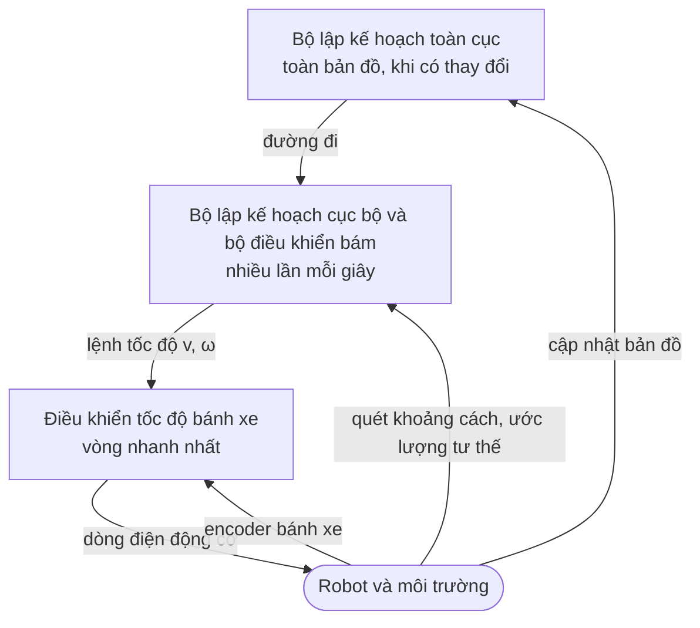

[Bài trước](/vi/blog/trajectories-and-time-scaling) đã biến một đường đi (path) hình học thành một quỹ đạo (trajectory), tức một chuyển động có lịch thời gian tôn trọng các giới hạn vận tốc và gia tốc. Một kế hoạch như vậy được tính một lần, từ một bản đồ, cho một mô hình robot không bao giờ chính xác. Bánh xe bị trượt, bộ truyền động đáp ứng chậm, ước lượng tư thế (pose) của robot bị trôi, và người đi vào những hành lang mà bản đồ cho là trống. Bài cuối cùng này của loạt bài [Lập kế hoạch chuyển động cho robot](/vi/series/motion-planning) khép vòng giữa kế hoạch và robot đang chuyển động: các bộ điều khiển giữ một robot di động trên đường đi hoặc quỹ đạo của nó, và các phương pháp phản xạ (reactive) lái robot vòng qua những vật cản mà bộ lập kế hoạch chưa từng thấy.

Bài này dựa trên cả bốn bài trước: không gian cấu hình của [bài thứ nhất](/vi/blog/configuration-space-and-the-planning-problem); các bộ lập kế hoạch trên lưới của [bài thứ hai](/vi/blog/graph-search-dijkstra-and-a-star) và các bộ lập kế hoạch dựa trên lấy mẫu của [bài thứ ba](/vi/blog/sampling-based-planning-prm-and-rrt), được mục 6 dùng để lập lại kế hoạch (replanning); và các tham chiếu theo thời gian của bài thứ tư, mà phép bám quỹ đạo đi theo. Phần mềm robot phân lớp trong [Robot là gì?](/vi/blog/what-is-a-robot) (mục 5.3) là khung cho toàn bộ bài, và ý tưởng phản hồi lấy từ [Phản hồi và hành vi của hệ thống](/vi/blog/feedback-and-system-behavior). Các ví dụ mô phỏng một robot dẫn động vi sai (differential-drive robot) nhỏ và coi ước lượng tư thế của nó là chính xác; mục 6.4 quay lại giả định đó.

**Quy ước.** Các quy ước sau áp dụng cho toàn bài. Robot chuyển động trong mặt phẳng $\mathcal{W} = \mathbb{R}^2$ với một hệ tọa độ thế giới có trục $x$ hướng sang phải và trục $y$ hướng lên; tư thế của robot là $(x, y, \theta)$, với hướng đi $\theta$ đo ngược chiều kim đồng hồ từ trục $x$, tính bằng radian. Không gian cấu hình của nó là $\mathcal{C} = \mathbb{R}^2 \times S^1$, tích của mặt phẳng với một đường tròn, như ở bài thứ nhất. Các đầu vào là tốc độ tiến $v$ tính bằng m/s và tốc độ góc $\omega$ tính bằng rad/s, dương theo chiều ngược kim đồng hồ; độ cong của chuyển động là $\kappa = \omega / v$, tính bằng 1/m. Các bánh xe có bán kính $r$ và cách nhau một khoảng $b$ (bề rộng vệt bánh, track width). Hệ tọa độ robot có trục $x$ dọc theo hướng đi và trục $y$ về phía bên trái robot, nên một sai số ngang dương có nghĩa là "lệch sang trái". Khoảng nhìn trước (look-ahead distance) của thuật toán pure pursuit là $L_d$. Một đường đi tham chiếu là $\sigma$ và một quỹ đạo tham chiếu là $q_r(t) = (x_r(t), y_r(t), \theta_r(t))$ với các tốc độ tham chiếu $v_r(t)$ và $\omega_r(t)$. Mã nguồn là Python 3.13 với NumPy 2.5; mọi chương trình đều tất định (không rút số ngẫu nhiên nào), và mọi kết quả được trích đều có được từ việc chạy chương trình.

## 1. Lập kế hoạch và hành động ở các tốc độ khác nhau

Một bộ lập kế hoạch chuyển động (motion planner) trả lời câu hỏi "chuyển động nào đến được đích mà không va chạm?" cho thế giới như bản đồ mô tả. Trong khi robot di chuyển, còn hai câu hỏi nữa phải được trả lời. "Bánh xe phải quay thế nào ngay lúc này để robot ở lại trên kế hoạch?" là việc của một **bộ điều khiển bám** (tracking controller). "Robot nên làm gì với một vật cản mà kế hoạch không biết đến?" là việc của một **bộ lập kế hoạch cục bộ** (local planner), hay lớp phản xạ (reactive layer), vốn chỉ nhìn vào môi trường xung quanh robot như các cảm biến hiện đang báo về.

Ba câu hỏi này được trả lời ở các tốc độ khác nhau, vì phạm vi của chúng khác nhau. Một **bộ lập kế hoạch toàn cục** (global planner) tìm kiếm trên toàn bộ bản đồ, bằng các phương pháp của bài thứ hai và bài thứ ba, và chạy lại khi đích hoặc bản đồ thay đổi. Một bộ lập kế hoạch cục bộ xét vài mét và một đến hai giây phía trước, và chạy lại nhiều lần mỗi giây. Một bộ điều khiển bám biến sai số tư thế hiện tại thành một lệnh tốc độ, và các bộ điều khiển bánh xe bên dưới nó biến lệnh đó thành dòng điện động cơ. Đây chính là bức tranh vòng trong vòng ở mục 4 của [Robot là gì?](/vi/blog/what-is-a-robot): mỗi lớp coi lớp nhanh hơn bên dưới như một cơ cấu chấp hành (actuator) lý tưởng, điều chỉ đúng khi các tốc độ cách biệt rõ.



*Hình: các lớp của phần mềm dẫn đường và điều khiển của một robot di động. Mỗi mũi tên đi xuống là một lệnh, mỗi mũi tên đi lên là thông tin mà lớp đó dùng để khép vòng; lớp càng cao thì phạm vi càng lớn và tốc độ càng thấp.*

Theo các thuật ngữ ở mục 5 của [Robot là gì?](/vi/blog/what-is-a-robot), bộ lập kế hoạch toàn cục là lớp suy tính (deliberative layer), còn bộ lập kế hoạch cục bộ và bộ điều khiển bám tạo thành lớp phản xạ. Một lớp điều hành (executive) nằm giữa hai lớp đó quyết định khi nào một kế hoạch đã thất bại (cách mô tả ba lớp trong chương sách năm 1998 của Gat). Các mục 3 đến 5 bàn về lớp phản xạ và mục 6 về phần việc của lớp điều hành. Cách chia lớp này cũng cho phép bộ lập kế hoạch toàn cục dùng một mô hình robot thô, chẳng hạn hình đĩa ở mục 3 của [bài thứ nhất](/vi/blog/configuration-space-and-the-planning-problem): các lớp bên dưới hấp thụ phần chênh lệch.

## 2. Robot dẫn động vi sai

### 2.1 Mô hình unicycle

Một **robot dẫn động vi sai** có hai bánh chủ động trên cùng một trục, mỗi bánh có động cơ riêng, và các bánh xe tự lựa (caster) bị động đỡ một phần trọng lượng. Tốc độ hai bánh bằng nhau làm robot đi thẳng, tốc độ khác nhau làm nó quay quanh một điểm trên đường thẳng chứa trục bánh, và tốc độ ngược chiều làm nó quay tại chỗ. Nhiều robot hút bụi và nền tảng nghiên cứu trong nhà được chế tạo theo cách này.

Lấy điểm tham chiếu ở chính giữa hai bánh. Nếu bánh xe không trượt, điểm đó chuyển động dọc theo hướng đi với tốc độ $v$, và hướng đi thay đổi với tốc độ $\omega$:

$$
\dot{x} = v \cos\theta, \qquad \dot{y} = v \sin\theta, \qquad \dot{\theta} = \omega .
$$

Đây là **mô hình unicycle** (unicycle model); các giáo trình về robot bánh xe, chẳng hạn của Siciliano và cộng sự và của Lynch và Park, dẫn ra mô hình này và các quan hệ bánh xe ở mục 2.3 một cách tổng quát hơn. Đây là một mô hình thuần động học: $v$ và $\omega$ được giả định là đặt trực tiếp được, nên khối lượng, giới hạn mô-men và lực lốp không xuất hiện. Ở khoảng 0.5 m/s, đó là một mô hình ban đầu hợp lý, và mục 2.4 bổ sung hiệu ứng động lực học duy nhất có ý nghĩa cho các ví dụ, đó là độ trễ của bộ truyền động.

### 2.2 Ràng buộc không holonom

Mô hình có ba biến trạng thái nhưng chỉ có hai đầu vào, và hướng bị thiếu là hướng ngang. Vận tốc của điểm tham chiếu luôn nằm dọc theo hướng đi, nên thành phần vuông góc với hướng đi bằng không:

$$
\dot{x} \sin\theta - \dot{y} \cos\theta = 0 .
$$

Một ràng buộc lên vận tốc mà không thể tích phân thành một ràng buộc lên vị trí được gọi là **không holonom** (nonholonomic), thuật ngữ đã được giới thiệu ở mục 2.2 của [Robot là gì?](/vi/blog/what-is-a-robot). Ràng buộc này không tích phân được: robot có thể đạt tới mọi tư thế trong $\mathcal{C}$, nhưng chỉ bằng cách thực hiện các thao tác cơ động (maneuvering), như một chiếc ô tô khi đỗ xe.

Hai hệ quả định hình phần còn lại của bài. Thứ nhất, một đường đi cho robot dẫn động vi sai không nhất thiết phải trơn, vì robot có thể dừng lại và quay tại chỗ, nhưng một đường đi có góc gãy buộc robot phải dừng, và biên dạng tốc độ của bài thứ tư phải tạo ra điểm dừng đó. Thứ hai, lái robot đến một tư thế cố định là việc khó. Năm 1983, Brockett đưa ra một điều kiện cần cho việc ổn định hóa bằng phản hồi trơn mà hệ này không thỏa mãn, nên không có luật phản hồi trơn nào chỉ phụ thuộc vào trạng thái có thể ổn định tiệm cận hệ về một tư thế cố định. Các luật bám ở mục 3 và mục 4 tránh được khó khăn này bằng cách bám một đường đi hoặc một tham chiếu chuyển động với tốc độ khác không, vốn là điều mà việc dẫn đường cần đến trong mọi trường hợp.

### 2.3 Tốc độ bánh xe

Các lệnh mà một bộ lập kế hoạch hoặc bộ điều khiển tạo ra là $(v, \omega)$, còn các động cơ cần tốc độ góc của bánh xe. Với tốc độ bánh phải và bánh trái $\omega_R$ và $\omega_L$ tính bằng rad/s, tốc độ vành bánh là $r\,\omega_R$ và $r\,\omega_L$. Tốc độ tiến là trung bình của chúng và tốc độ góc là hiệu của chúng chia cho bề rộng vệt bánh:

$$
v = \frac{r\,(\omega_R + \omega_L)}{2}, \qquad \omega = \frac{r\,(\omega_R - \omega_L)}{b},
$$

và nghịch đảo cặp công thức này cho

$$
\omega_R = \frac{v + \omega\, b/2}{r}, \qquad \omega_L = \frac{v - \omega\, b/2}{r} .
$$

Robot trong bài này có $r = 0.05$ m và $b = 0.30$ m. Chương trình `wheels.py` tính ánh xạ ngược cho ba lệnh:

```text
v = 0.5 m/s, omega = 0.0 rad/s -> right 10.00 rad/s, left 10.00 rad/s
v = 0.5 m/s, omega = 0.5 rad/s -> right 11.50 rad/s, left 8.50 rad/s
v = 0.0 m/s, omega = 1.0 rad/s -> right 3.00 rad/s, left -3.00 rad/s
```

Dòng thứ hai là robot chạy trên một đường tròn bán kính $v/\omega = 1$ m. Vì mỗi bánh xe có một tốc độ tối đa, các lệnh đạt được tạo thành một hình thoi trong mặt phẳng $(v, \omega)$: quay càng gắt thì càng ít tốc độ bánh xe còn lại cho việc tiến về phía trước. Phương pháp cửa sổ động ở mục 5.3 tìm kiếm trực tiếp trên mặt phẳng này.

### 2.4 Mô hình mô phỏng

Các ví dụ ở mục 3 và mục 4 dùng chung một mô phỏng. Các phương trình unicycle được tích phân bằng bước Euler hiển 0.01 s; bộ điều khiển chạy mỗi năm bước một lần (20 Hz) và giữ nguyên lệnh giữa các lần cập nhật. Cả $v$ và $\omega$ đều đi theo lệnh của chúng qua một khâu trễ bậc nhất với hằng số thời gian 0.1 s, đại diện cho các vòng điều khiển tốc độ bánh xe và quán tính của robot, và $|\omega| \le 1.5$ rad/s. Nếu không có độ trễ, giới hạn và việc lấy mẫu 20 Hz, độ lợi của một bộ điều khiển bám có thể tăng không giới hạn mà vòng vẫn ổn định; khi có chúng, độ lợi quá lớn gây vọt lố, dao động hoặc mất ổn định. Riêng việc lấy mẫu đã đủ gây ra điều đó. Xét vòng pure pursuit tuyến tính hóa ở mục 3.3 trên một đường thẳng, với mỗi lệnh được giữ trong 0.05 s và không có độ trễ hay giới hạn: điểm cực (pole) vòng kín lớn nhất có độ lớn 0.833 khi $L_d = 0.15$ m nhưng 2.032 khi $L_d = 0.02$ m, tức một vòng không ổn định (chương trình `zoh.py`).

**Đường đi tham chiếu** chạy dọc trục $x$ từ $(0, 0)$ đến $(6, 0)$, rẽ trái theo một cung phần tư đường tròn bán kính 1 m đến $(7, 1)$ rồi đi thẳng lên đến $(7, 6)$, tính bằng mét. Độ cong của nó nhảy từ 0 lên 1 m⁻¹ rồi trở lại, như một con đường gồm các đoạn thẳng và khúc cua tròn. Robot xuất phát tại $(0, -0.5)$ m với hướng đi 0, cách đường đi 0.5 m về bên phải. **Sai số ngang** (cross-track error) $e$ là khoảng cách có dấu đến điểm gần nhất trên đường đi, dương ở bên trái chiều chuyển động. Các đoạn mã ở mục 3 và mục 4 chỉ trình bày các luật điều khiển; phần dựng đường đi, đo sai số và vòng lặp mô phỏng được lược bỏ.

## 3. Pure pursuit

### 3.1 Hình học

**Pure pursuit** lái robot hướng tới một điểm trên đường đi cách robot một khoảng cố định về phía trước, giống như người lái xe nhìn xa xuống mặt đường chứ không nhìn vào vạch kẻ làn ngay cạnh bánh xe. Ở mỗi lần cập nhật, bộ điều khiển chọn **điểm đích** (goal point), tức điểm trên đường đi phía trước robot, cách robot một khoảng $L_d$ (**khoảng nhìn trước**). Sau đó nó tính cung tròn bắt đầu tại robot, tiếp xúc với hướng đi của robot và đi qua điểm đích, rồi ra lệnh theo độ cong của cung đó. Báo cáo kỹ thuật năm 1992 của Coulter tại Đại học Carnegie Mellon ghi lại một bản cài đặt phương pháp này, dẫn ra công thức độ cong và khảo sát hiệu năng của nó phụ thuộc thế nào vào khoảng nhìn trước.

Độ cong suy ra từ một phương trình. Trong hệ tọa độ robot, robot ở gốc tọa độ, quay mặt theo trục $x$, và điểm đích ở $(x_g, y_g)$ với $x_g^2 + y_g^2 = L_d^2$. Một đường tròn tiếp xúc với trục $x$ tại gốc tọa độ có tâm nằm trên trục $y$, tại $(0, R)$ với bán kính $R$ ($R$ âm khi tâm ở bên phải). Điểm đích nằm trên đường tròn đó khi

$$
x_g^2 + (y_g - R)^2 = R^2 \quad\Longrightarrow\quad x_g^2 + y_g^2 = 2\, y_g R \quad\Longrightarrow\quad \kappa = \frac{1}{R} = \frac{2\, y_g}{L_d^2} .
$$

Với $\alpha$ là góc phương vị của điểm đích trong hệ tọa độ robot, $y_g = L_d \sin\alpha$, ta được dạng thường gặp

$$
\kappa = \frac{2 \sin\alpha}{L_d}, \qquad \omega = v\,\kappa .
$$

Làm ví dụ, lấy điểm đích tại $(0.5, 0.3)$ m trong hệ tọa độ robot. Khi đó $L_d = \sqrt{0.5^2 + 0.3^2} = 0.5831$ m, $\alpha = \arctan(0.3/0.5) = 0.5404$ rad và $\kappa = 2 \times 0.3 / 0.34 = 1.7647$ m⁻¹, một đường tròn bán kính 0.567 m. Ở $v = 0.5$ m/s, lệnh là $\omega = 0.8824$ rad/s; `wheels.py` in ra đúng bốn số này.

### 3.2 Cài đặt

Đường đi được lưu dưới dạng các điểm cách nhau 0.01 m. Bộ điều khiển bắt đầu tìm từ điểm trên đường đi gần robot nhất và đi tiếp về phía trước cho đến khi gặp một điểm cách robot ít nhất $L_d$, nên điểm đích luôn nằm phía trước dọc theo đường đi:

```python
def pure_pursuit(pose, path, i_near, Ld):
    """Return (omega, index of goal point) for the look-ahead distance Ld."""
    x, y, th = pose
    j = i_near
    while j < len(path) - 1 and np.hypot(path[j, 0] - x, path[j, 1] - y) < Ld:
        j += 1
    dx, dy = path[j, 0] - x, path[j, 1] - y
    alpha = np.arctan2(dy, dx) - th               # bearing in the robot frame
    kappa = 2.0 * np.sin(alpha) / np.hypot(dx, dy)  # curvature of the arc
    return V * kappa, j
```

Tốc độ tiến là hằng số, `V = 0.5` m/s, và $\omega$ bị chặn ở 1.5 rad/s. Khi robot cách đường đi xa hơn $L_d$, vòng lặp dừng ngay tại điểm gần nhất, nên robot lái thẳng về phía đường đi; đây là cách đơn giản nhất trong vài cách xử lý trường hợp này.

### 3.3 Ảnh hưởng của khoảng nhìn trước

Chương trình `pure_pursuit.py` chạy đường đi tham chiếu với bốn khoảng nhìn trước. Với đoạn thẳng đầu tiên ($x < 5$ m), chương trình báo độ vọt lố (overshoot), tức sai số lớn nhất về bên trái đường đi sau khi xuất phát cách đường đi 0.5 m về bên phải, và thời gian xác lập, tức thời điểm cuối cùng sai số còn vượt quá 0.02 m. Với vùng khúc cua ($x > 5$ m, $y < 2.5$ m), chương trình báo sai số lớn nhất ở phía trong và phía ngoài khúc cua. Cột cuối cùng là sai số căn quân phương (root-mean-square, RMS) sau $t = 10$ s, bao gồm khúc cua và đoạn thẳng cuối:

```text
L_d (m)  overshoot (m)  settle (s)  corner in (m)  corner out (m)  RMS t>10 s (m)
   0.15          0.258        4.92          0.004           0.004          0.0029
   0.30          0.059        2.59          0.008           0.008          0.0035
   0.60          0.026        4.03          0.031           0.034          0.0134
   1.20          0.023        8.19          0.150           0.112          0.0719
```

Khoảng nhìn trước dài cho sự hội tụ êm và chậm: với $L_d = 1.2$ m, robot mất 8.19 s để vào trong phạm vi 0.02 m quanh đường đi, và nó cắt góc 0.150 m. Khoảng nhìn trước ngắn bám khúc cua trong phạm vi 0.004 m nhưng hiệu chỉnh quá tay độ lệch ban đầu, vọt lố 0.258 m khi $L_d = 0.15$ m. Ở đây $L_d = 0.3$ m là lựa chọn dung hòa tốt nhất, với thời gian xác lập ngắn nhất và sai số dưới 1 cm trong khúc cua. Cột RMS, bao gồm khúc cua và đoạn thẳng cuối, đi theo các sai số ở góc cua: nó tăng từ 0.0035 m khi $L_d = 0.3$ m lên 0.0719 m ở 1.2 m.

Một mô hình tuyến tính giải thích được phần lớn các con số này. Xét đoạn thẳng, với robot có sai số ngang $e$ nhỏ và sai số hướng $\theta$ nhỏ. Điểm đích nằm khoảng $L_d$ phía trước dọc theo đường đi, nên trong hệ tọa độ robot $y_g \approx -e - L_d \theta$, và lệnh độ cong là $\kappa \approx -2e/L_d^2 - 2\theta/L_d$. Sai số ngang thay đổi theo $\dot{e} = v \sin\theta \approx v\theta$, nên $\ddot{e} = v\dot{\theta} = v^2 \kappa$. Thay $\theta = \dot{e}/v$ ta được

$$
\ddot{e} + \frac{2v}{L_d}\,\dot{e} + \frac{2v^2}{L_d^2}\, e = 0 ,
$$

một hệ bậc hai với tần số dao động riêng $\omega_n = \sqrt{2}\, v / L_d$ và hệ số tắt dần $\zeta = 1/\sqrt{2} \approx 0.707$, bất kể khoảng nhìn trước là bao nhiêu. Trong mô hình này, $L_d$ chỉ thay đổi tốc độ của đáp ứng: độ vọt lố là $e^{-\pi\zeta/\sqrt{1-\zeta^2}} = e^{-\pi} = 4.3\%$ của sai số ban đầu, ở đây là 0.022 m, và mô phỏng cho 0.026 m khi $L_d = 0.6$ m và 0.023 m ở 1.2 m. Khi $L_d = 0.15$ m, sai số ban đầu 0.5 m, lớn hơn ba lần $L_d$, đẩy $\omega$ lên giới hạn 1.5 rad/s. Độ trễ của bộ truyền động còn thêm độ trễ pha, vì $\omega_n = 4.7$ rad/s không còn nhỏ so với băng thông $1/0.1 = 10$ rad/s của bộ truyền động và tần số cập nhật 20 Hz. Chương trình `pure_pursuit.py` cũng chạy lại trường hợp này với từng hiệu ứng bị tắt. Độ vọt lố là 0.018 m khi không có cả hai, 0.029 m khi chỉ có độ trễ, 0.166 m khi chỉ có giới hạn và 0.258 m khi có cả hai. Do đó khoảng nhìn trước có một giới hạn dưới do bộ truyền động của robot đặt ra, ở đây chủ yếu do giới hạn tốc độ quay của nó.

Khúc cua cho thấy giới hạn ngược lại. Trên một đường tròn, robot nằm đúng trên đường đi sẽ ra lệnh đúng bằng độ cong của đường đi, vì cung tròn qua robot và điểm đích chính là đường đi. Sai số phát sinh ở nơi độ cong thay đổi: điểm đích đi vào khúc cua trong khi robot vẫn còn trên đoạn thẳng, nên robot rẽ sớm khoảng $L_d$ và cắt vào phía trong, 0.008 m khi $L_d = 0.3$ m và 0.150 m ở 1.2 m.

### 3.4 Những gì pure pursuit không làm được

Pure pursuit bám một đường đi chứ không bám một quỹ đạo: nó cần một tốc độ do nơi khác cung cấp và không thể hiệu chỉnh một robot nằm trên đường đi nhưng chậm so với lịch thời gian. Tham số duy nhất của nó ràng buộc độ êm với độ chính xác; cho tham số tỉ lệ với tốc độ, $L_d = k\,v$ với $k$ tính bằng giây, giữ $\omega_n = \sqrt{2}/k$ không đổi khi tốc độ thay đổi. Nó truyền thẳng mọi bước nhảy của ước lượng tư thế vào lệnh. Đổi lại, tham số duy nhất của nó có ý nghĩa hình học, các bước nhảy độ cong không cần xử lý đặc biệt, và một robot ở xa đường đi sẽ hướng trở lại về phía đường đi.

## 4. Bám quỹ đạo bằng phản hồi

### 4.1 Bám đường đi và bám quỹ đạo

Một bộ điều khiển **bám quỹ đạo** (trajectory tracking) đi theo một tham chiếu chuyển động theo thời gian: tại thời điểm $t$, robot phải ở $q_r(t)$, chuyển động với tốc độ $v_r(t)$ và quay với tốc độ $\omega_r(t)$. Bài thứ tư đã tạo ra các tham chiếu như vậy bằng cách tham số hóa thời gian (time scaling) một đường đi, $q(t) = \sigma(s(t))$ (mục 1 của [bài đó](/vi/blog/trajectories-and-time-scaling)). Việc theo đúng lịch thời gian quan trọng khi robot phải đến đúng giờ hoặc phối hợp với robot khác, và nó cung cấp một thành phần **truyền thẳng** (feedforward): $v_r$ và $\omega_r$ sẽ giữ một robot hoàn hảo trên tham chiếu, nên phản hồi chỉ phải hiệu chỉnh sai số.

### 4.2 Sai số trong hệ tọa độ robot

Sai số hữu ích nhất khi biểu diễn trong hệ tọa độ robot, vì robot có thể hiệu chỉnh sai số dọc theo hướng đi bằng cách thay đổi $v$, còn sai số vuông góc với hướng đi thì chỉ bằng cách quay. Quay hiệu vị trí trong hệ tọa độ thế giới một góc $-\theta$ cho

$$
\begin{bmatrix} e_x \\ e_y \end{bmatrix} =
\begin{bmatrix} \cos\theta & \sin\theta \\ -\sin\theta & \cos\theta \end{bmatrix}
\begin{bmatrix} x_r - x \\ y_r - y \end{bmatrix},
\qquad e_\theta = \theta_r - \theta ,
$$

trong đó $e_x$ là khoảng tham chiếu nằm phía trước robot, $e_y$ là khoảng tham chiếu nằm về bên trái robot, và $e_\theta$ là sai số hướng, được quy về khoảng $(-\pi, \pi]$. Lấy đạo hàm, với mô hình unicycle cho cả robot và tham chiếu, ta được động học sai số

$$
\dot{e}_x = \omega\, e_y - v + v_r \cos e_\theta, \qquad
\dot{e}_y = -\omega\, e_x + v_r \sin e_\theta, \qquad
\dot{e}_\theta = \omega_r - \omega .
$$

Các số hạng $\omega e_y$ và $-\omega e_x$ sinh ra từ chính chuyển động quay của hệ tọa độ robot.

### 4.3 Luật bám Kanayama

Năm 1990, Kanayama, Kimura, Miyazaki và Noguchi đề xuất một luật bám kết hợp các tốc độ truyền thẳng với phản hồi theo ba sai số:

$$
v = v_r \cos e_\theta + K_x\, e_x, \qquad
\omega = \omega_r + v_r \left( K_y\, e_y + K_\theta \sin e_\theta \right),
$$

với các độ lợi dương $K_x$ tính bằng 1/s, $K_y$ tính bằng 1/m² và $K_\theta$ tính bằng 1/m. Lệnh tốc độ tăng lên khi tham chiếu ở phía trước và giảm xuống khi tham chiếu ở phía sau. Lệnh quay cộng thêm vào chuyển động quay của chính tham chiếu một hiệu chỉnh lái về phía vị trí ngang của tham chiếu và căn hướng đi theo hướng của tham chiếu. Nhân các số hạng ngang với $v_r$ biến hiệu chỉnh thành một độ cong, nên tốc độ quay được lệnh cho một sai số cho trước tỉ lệ với tốc độ. Kanayama và cộng sự đã chứng minh bằng một hàm Lyapunov rằng sai số bằng không là ổn định với mọi độ lợi dương khi tham chiếu chuyển động về phía trước ($v_r > 0$).

Động học tuyến tính hóa cho một quy tắc chọn độ lợi. Trên một tham chiếu thẳng ($\omega_r = 0$) với sai số nhỏ, với $\cos e_\theta \approx 1$ và $\sin e_\theta \approx e_\theta$, thay luật vào động học sai số và bỏ các tích của sai số, ta được $\dot{e}_x \approx -K_x e_x$, $\dot{e}_y \approx v_r e_\theta$ và $\dot{e}_\theta \approx -v_r (K_y e_y + K_\theta e_\theta)$. Sai số dọc tự suy giảm với hằng số thời gian $1/K_x$. Lấy đạo hàm $\dot{e}_y$ thêm một lần, ta được

$$
\ddot{e}_y + v_r K_\theta\, \dot{e}_y + v_r^2 K_y\, e_y = 0 ,
$$

với tần số dao động riêng $v_r \sqrt{K_y}$ và hệ số tắt dần $\zeta = K_\theta / (2\sqrt{K_y})$. Đáp ứng tắt dần tới hạn khi $K_y = K_\theta^2/4$. Với $v_r = 0.5$ m/s và $K_\theta = 4$ m⁻¹, điều đó cho $K_y = 4$ m⁻², ứng với một điểm cực kép tại $-1$ s⁻¹; $K_y = 16$ và $64$ m⁻² cho $\zeta = 0.5$ và $0.25$. Đoạn mã cài đặt luật đúng như đã viết:

```python
def kanayama(pose, ref, v_r, w_r, Kx, Ky, Kth):
    """Tracking law: errors in the robot frame, then (v, omega)."""
    x, y, th = pose
    xr, yr, thr = ref
    c, s = np.cos(th), np.sin(th)
    ex = c * (xr - x) + s * (yr - y)          # along the robot's heading
    ey = -s * (xr - x) + c * (yr - y)         # to the robot's left
    eth = np.arctan2(np.sin(thr - th), np.cos(thr - th))
    v = v_r * np.cos(eth) + Kx * ex
    w = w_r + v_r * (Ky * ey + Kth * np.sin(eth))
    return (v, w), (ex, ey, eth)
```

### 4.4 Hành vi trong mô phỏng

Chương trình `kanayama.py` dùng đường đi tham chiếu của mục 2.4, được đi qua với $v_r = 0.5$ m/s từ gốc tọa độ tại $t = 0$, nên $\omega_r = 0$ trên các đoạn thẳng và $\omega_r = 0.5$ rad/s trên khúc cua, nơi tham chiếu đi qua từ 12.0 s đến 15.1 s. Robot xuất phát tại $(-0.5, -0.5)$ m với hướng đi 0: chậm hơn tham chiếu 0.5 m và lệch 0.5 m về bên phải nó. Mô phỏng là mô phỏng của mục 2.4, với lệnh tốc độ tiến cũng bị chặn trong khoảng $0 \le v \le 1.0$ m/s. Với $K_x = 1$ s⁻¹ và $K_\theta = 4$ m⁻¹, chương trình in sai số cho ba giá trị của $K_y$ (khối ở giữa, $K_y = 16$ m⁻², được lược bỏ ở đây):

```text
K_x = 1.0 1/s, K_theta = 4.0 1/m, K_y = 4.0 1/m^2
  t (s)   e_x (m)   e_y (m)   e_theta (rad)
    0.0     0.500     0.500       0.000
    1.0     0.261     0.242      -0.295
    2.0     0.071     0.136      -0.188
    3.0     0.017     0.069      -0.101
    4.0     0.004     0.033      -0.050
    6.0     0.000     0.007      -0.011
    8.0     0.000     0.002      -0.002
  t >= 11 s (corner at 12.0-15.1 s): max |e_x| = 0.0037 m, max |e_y| = 0.0098 m
...
K_x = 1.0 1/s, K_theta = 4.0 1/m, K_y = 64.0 1/m^2
  t (s)   e_x (m)   e_y (m)   e_theta (rad)
    0.0     0.500     0.500       0.000
    1.0     0.307     0.010      -0.394
    2.0     0.101    -0.001      -0.013
    3.0     0.032     0.000      -0.003
    4.0     0.010     0.000       0.000
    6.0     0.001     0.000      -0.002
    8.0     0.000     0.000       0.001
  t >= 11 s (corner at 12.0-15.1 s): max |e_x| = 0.0013 m, max |e_y| = 0.0054 m
```

Có ba nhận xét. Thứ nhất, sai số dọc biến mất: robot tăng tốc lên giới hạn 1.0 m/s và đuổi kịp tham chiếu trong khoảng 4 s, trong khi pure pursuit với tốc độ không đổi sẽ vẫn chậm 0.5 m. Thứ hai, với thành phần truyền thẳng $\omega_r$, robot bắt đầu quay cùng lúc với tham chiếu, và sai số ngang lớn nhất từ 11 s trở đi nhỏ hơn 1 cm với mọi bộ độ lợi.

Thứ ba, phân tích tuyến tính chỉ mô tả đúng đáp ứng khi sai số đã nhỏ. Với $K_y = 4$ m⁻², sai số ngang giảm khoảng một nửa mỗi giây trong khoảng từ 2 s đến 4 s, phù hợp với một điểm cực kép tại $-1$ s⁻¹. Với $K_y = 64$ m⁻², mô hình dự đoán dao động với $\zeta = 0.25$, nhưng giới hạn tốc độ quay chi phối giây đầu tiên, sai số ngang gần như mất hẳn ở $t = 1$ s, và dao động chỉ còn lại dưới dạng một sai số hướng vài miliradian. Vì vậy, một lựa chọn độ lợi dựa trên phân tích tuyến tính phải được kiểm tra bằng mô phỏng với các giới hạn thực.

### 4.5 Giới hạn của bám quỹ đạo

Một tham chiếu theo thời gian là một cam kết mà robot có thể không giữ được. Nếu robot bị chặn trong 5 s, tham chiếu đi trước 2.5 m và luật đòi hỏi một tốc độ mà robot không đạt được hoặc không nên dùng khi ở gần người. Vì thế các hệ thống thực tế làm chậm tham chiếu khi sai số tăng, hoặc tính lại phép tham số hóa thời gian từ vị trí thực của robot. Luật cần $v_r > 0$, nên việc dừng tại một tư thế cần một bộ điều khiển khác cho vài centimet cuối, và theo kết quả của Brockett (mục 2.2), bộ điều khiển đó không thể là một hàm trơn chỉ của trạng thái. Mô hình cũng bỏ qua trượt bánh và mọi động lực học của bộ truyền động ngoài một khâu trễ bậc nhất.

## 5. Tránh vật cản phản xạ: trường thế và cửa sổ động

### 5.1 Phương pháp phản xạ dùng để làm gì

Kế hoạch toàn cục tránh các vật cản có trong bản đồ. Một phương pháp **phản xạ** (reactive) tránh các vật cản trong lần quét cảm biến mới nhất, chẳng hạn một chiếc hộp bị bỏ lại giữa lối đi hay một người đang đi ngang qua. Nó tính một lệnh từ các số đọc hiện tại và trạng thái của robot, không tìm kiếm trên bản đồ, nên có thể chạy ở tốc độ của cảm biến. Cái giá phải trả là tầm nhìn cục bộ: cả hai phương pháp trong mục này đều có thể bị dẫn vào những tình huống mà tự chúng không thoát ra được (mục 5.2 và 5.3).

### 5.2 Trường thế

Trong một bài báo năm 1986, Khatib đề xuất coi robot như một hạt trong một **trường thế nhân tạo** (artificial potential field): đích hút nó, các vật cản đẩy nó, và robot di chuyển xuống dốc trên tổng của các thế đó. Trường được tính từ các khoảng cách đến vật cản hiện tại ở tốc độ điều khiển, cho cả tay máy lẫn robot di động. Với một robot dạng điểm tại vị trí $p$ và đích $p_g$, một thế hút thường dùng, theo dạng do Choset và cộng sự đưa ra, có dạng bậc hai gần đích và dạng nón ở xa đích:

$$
U_{\mathrm{att}}(p) =
\begin{cases}
\tfrac{1}{2} k_a \lVert p - p_g \rVert^2, & \lVert p - p_g \rVert \le d^*, \\[4pt]
k_a d^* \lVert p - p_g \rVert - \tfrac{1}{2} k_a {d^*}^2, & \text{otherwise},
\end{cases}
$$

sao cho lực hút tăng theo khoảng cách cho đến $d^*$ rồi giữ độ lớn $k_a d^*$. Mỗi vật cản thêm vào một thế đẩy theo dạng của Khatib,

$$
U_{\mathrm{rep}}(p) =
\begin{cases}
\tfrac{1}{2} k_r \left( \dfrac{1}{\rho(p)} - \dfrac{1}{\rho_0} \right)^2, & \rho(p) \le \rho_0, \\[4pt]
0, & \rho(p) > \rho_0,
\end{cases}
$$

trong đó $\rho(p)$ là khoảng cách từ $p$ đến điểm gần nhất của vật cản và $\rho_0$ là **khoảng ảnh hưởng** (influence distance), vượt quá khoảng này vật cản không còn tác dụng. Lực đẩy tăng không giới hạn khi robot tiến tới bề mặt vật cản. Gradient của nó là $-k_r (1/\rho - 1/\rho_0)\, \nabla\rho / \rho^2$, với $\nabla\rho$ là vector đơn vị hướng từ điểm gần nhất của vật cản đến $p$. Chương trình `potential_field.py` dùng $k_a = 1$, $d^* = 2$ m, $k_r = 1$ và $\rho_0 = 1$ m, và di chuyển robot một bước cố định 0.01 m mỗi lần lặp theo chiều âm của gradient:

```python
def descend(start, goal, obstacles, max_iter=4000):
    q = np.array(start, float)
    goal = np.array(goal, float)
    hist = [q.copy()]
    for k in range(max_iter):
        g = grad_att(q, goal) + grad_rep(q, obstacles)
        if np.linalg.norm(q - goal) < STEP:
            return "goal", k, q, np.linalg.norm(g), hist
        q = q - STEP * g / np.linalg.norm(g)
        hist.append(q.copy())
        if k >= 200 and np.linalg.norm(hist[-1] - hist[-201]) < 0.05:
            return "stuck", k, q, np.linalg.norm(g), hist
    return "max_iter", max_iter, q, np.linalg.norm(g), hist
```

Các hàm `grad_att` và `grad_rep` tính hai gradient nêu trên cho vật cản hình đĩa và các đoạn tường. Phép kiểm tra cuối cùng kết luận robot bị kẹt khi 200 lần lặp, vốn có thể đưa nó đi 2 m, chỉ di chuyển nó chưa đến 0.05 m. Robot xuất phát tại $(0, 0)$ và đích ở $(10, 0)$, trong ba cảnh:

- (A) một đĩa bán kính 0.5 m có tâm tại $(5, 0.6)$, nằm ngay cạnh đường thẳng;
- (B) một bức tường hình chữ U mở về phía robot, với hai cạnh từ $x = 4$ m đến 6 m tại $y = \pm 1.5$ m và đầu kín tại $x = 6$ m;
- (C) hai đĩa bán kính 0.4 m có tâm tại $(5, \pm 0.8)$, để lại một khe 0.8 m giữa hai bề mặt.

Chương trình in ra:

```text
A: one disk off the line: goal after 1024 steps, final (10.00, 0.00), distance to goal 0.00 m
B: U-shaped wall: stuck after 736 steps, final (5.41, 0.00), distance to goal 4.59 m
   last 200 steps stay within x in [5.38, 5.42], y in [0.00, 0.00]
C: gap of 0.8 m: stuck after 632 steps, final (4.37, 0.00), distance to goal 5.63 m
   last 200 steps stay within x in [4.34, 4.38], y in [0.00, 0.00]
```

Trong cảnh A, trường làm đúng điều nó hứa hẹn: robot vòng qua đĩa và đến đích. Trong cảnh B, nó đi vào trong chữ U và dừng lại cách đầu kín 0.59 m, nơi lực hút không đổi có độ lớn $k_a d^* = 2$ cân bằng đúng với lực đẩy của bức tường cuối (bài tập 4 tính điểm này). Chương trình `ascii_maps.py` vẽ lần chạy trên một lưới ô 0.25 m, với `#` cho tường, `.` cho đường đi và `X` cho vị trí cuối cùng:

```text
                #########
                        #
                        #
                        #
                        #
                        #
S.....................X #               G
                        #
                        #
                        #
                        #
                        #
                #########
```

Điểm $X$ là một **cực tiểu cục bộ** (local minimum) của thế tổng: mọi dịch chuyển nhỏ đều làm thế tăng, nên một phương pháp chỉ biết đi xuống không thể thoát ra. Cảnh C thất bại theo một cách khác. Khe 0.8 m đủ rộng cho một robot dạng điểm, nhưng cả hai đĩa đều nằm trong khoảng ảnh hưởng của đường tâm khe. Các lực đẩy của chúng cộng lại, và robot dừng tại $(4.37, 0)$, cách đường thẳng nối hai tâm 0.63 m, nơi hai lực đẩy cộng lại cân bằng với lực hút.

Những thất bại này không phải là sản phẩm của việc chọn tham số. Trong một bài báo năm 1991, Koren và Borenstein đã chỉ ra các vấn đề cố hữu của phương pháp trường thế cho robot di động: tình huống bẫy do cực tiểu cục bộ, không có lối đi giữa các vật cản đặt gần nhau, và dao động gần vật cản và trong các lối đi hẹp. Chỉnh $k_r$ và $\rho_0$ chỉ dời các bẫy đi chứ không loại bỏ chúng: một $\rho_0$ nhỏ hơn mở được khe của cảnh C nhưng để robot tiến gần hơn tới mọi vật cản, và không lựa chọn nào làm trống được chữ U của cảnh B.

Có thể xây dựng một trường không có cực tiểu giả. Rimon và Koditschek (1992) đã xây dựng các **hàm dẫn đường** (navigation function), tức các thế có cực tiểu duy nhất là đích, sao cho robot hội tụ từ hầu hết mọi cấu hình xuất phát, cho các thế giới có vật cản hình cầu và, thông qua một phép đổi tọa độ, cho các thế giới có thể ánh xạ về dạng đó. Tuy nhiên, một hàm dẫn đường cần biết toàn bộ không gian tự do (free space) từ trước, điều khiến nó là một bộ lập kế hoạch toàn cục trá hình chứ không phải một phương pháp phản xạ. Trong thực tế, trường thế tồn tại dưới dạng một thành phần cục bộ: một lực đẩy giữ robot hoặc cánh tay tránh xa các vật cản gần đó trong khi một thành phần khác cung cấp lộ trình.

### 5.3 Phương pháp cửa sổ động

**Phương pháp cửa sổ động** (dynamic window approach, DWA), được Fox, Burgard và Thrun công bố năm 1997, tìm kiếm trên các lệnh vận tốc của robot thay vì trên vị trí của nó. Phương pháp được phát triển cho robot dẫn động đồng bộ (synchro-drive), nhưng lập luận của nó áp dụng cho mọi robot được điều khiển bằng một tốc độ tiến và một tốc độ góc. Ở mỗi chu kỳ điều khiển, nó thu hẹp không gian tìm kiếm qua ba bước:

- **Cung tròn.** Mỗi ứng viên $(v, \omega)$ được giả định là giữ nguyên trong suốt tầm dự báo, nên nó đưa robot đi theo một cung có độ cong $\omega/v$ (một đường thẳng khi $\omega = 0$). Không gian tìm kiếm là mặt phẳng $(v, \omega)$, hai chiều, bất kể hình dạng của vật cản.
- **Vận tốc chấp nhận được.** Một ứng viên là **chấp nhận được** (admissible) nếu robot, sau khi thực hiện nó, vẫn có thể phanh dừng lại trước vật cản đầu tiên trên cung của nó.
- **Cửa sổ động.** Chỉ xét những vận tốc đạt được trong một chu kỳ điều khiển $\Delta t$ dưới các giới hạn gia tốc: $v \in [v_0 - \dot{v}_{\max}\Delta t,\ v_0 + \dot{v}_{\max}\Delta t]$ và $\omega \in [\omega_0 - \dot{\omega}_{\max}\Delta t,\ \omega_0 + \dot{\omega}_{\max}\Delta t]$, lấy giao với các giới hạn tốc độ của robot, trong đó $(v_0, \omega_0)$ là lệnh hiện tại.

Trong số các ứng viên chấp nhận được trong cửa sổ, DWA chọn ứng viên có tổng có trọng số của ba thành phần lớn nhất. Thành phần hướng thưởng cho việc quay mặt về phía đích, thành phần khoảng hở an toàn (clearance) thưởng cho khoảng cách đến vật cản gần nhất trên cung, và thành phần vận tốc thưởng cho tốc độ. Chương trình `dwa.py` cài đặt một biến thể đơn giản hóa với các thành phần khác bài báo gốc ở chi tiết. Robot là một đĩa bán kính 0.2 m với biên an toàn 0.05 m, và các giới hạn của nó là $v \in [0, 0.6]$ m/s, $|\omega| \le 1.5$ rad/s, $\dot{v}_{\max} = 0.5$ m/s² và $\dot{\omega}_{\max} = 2.0$ rad/s². Chu kỳ điều khiển $\Delta t = 0.25$ s giữ cho các con số dễ đọc và chậm hơn mức một robot thực sẽ dùng. Cửa sổ được lấy mẫu mỗi 0.025 m/s và 0.1 rad/s, và vật cản là các điểm cách nhau 0.05 m, như một cảm biến khoảng cách trả về. Ba thành phần là:

- hướng: $1 - |\phi|/\pi$, trong đó $\phi$ là góc giữa hướng đi của robot và hướng tới đích sau khi đi theo cung trong 1 s;
- khoảng hở an toàn: độ dài cung $s_{\mathrm{hit}}$ đến điểm tiếp xúc đầu tiên, tìm trong phạm vi 3 m và chia cho 3 m (nên một cung không vướng gì đạt điểm 1);
- tốc độ: $v / v_{\max}$.

Hàm mục tiêu là $G = 0.6 \cdot \text{heading} + 0.3 \cdot \text{clearance} + 0.1 \cdot \text{speed}$. Phép kiểm tra tính chấp nhận được tính đến việc robot giữ lệnh trong một chu kỳ trước khi bắt đầu phanh, nên một ứng viên là chấp nhận được khi $v\,\Delta t + v^2/(2\dot{v}_{\max}) \le s_{\mathrm{hit}}$:

```python
def evaluate(pose, v, w, goal, obs):
    """(admissible, heading, clearance, speed) terms for one candidate."""
    s_hit = first_contact(pose, v, w, obs)
    ok = v * DT_CTRL + v**2 / (2 * A_V) <= s_hit  # one period at v, then braking, stops short
    end = arc(pose, v, w, T=T_PRED, dt=T_PRED)[-1]
    bearing = np.arctan2(goal[1] - end[1], goal[0] - end[0])
    err = np.arctan2(np.sin(bearing - end[2]), np.cos(bearing - end[2]))
    return ok, 1.0 - abs(err) / np.pi, min(s_hit, S_MAX) / S_MAX, v / V_MAX
```

Hàm `first_contact` lấy mẫu đường cong của ứng viên mỗi 0.02 m và trả về độ dài cung tại đó đĩa của robot, tính cả biên an toàn, lần đầu chạm một điểm vật cản; `arc` tích phân chính xác mô hình unicycle với $(v, \omega)$ không đổi.

Làm ví dụ, đặt robot tại gốc tọa độ, hướng theo trục $x$, với lệnh hiện tại $(v_0, \omega_0) = (0.4, 0)$, đích tại $(5, 0)$ m, và một bức tường dài 0.6 m chắn ngang đường tại $x = 1.5$ m, từ $y = -0.4$ m đến $0.2$ m. Cửa sổ là $v \in [0.4 - 0.125,\ 0.4 + 0.125] = [0.275, 0.525]$ m/s và $\omega \in [-0.5, 0.5]$ rad/s. Chương trình `dwa_demo.py` in ra cửa sổ, ba ứng viên tốt nhất, bốn ứng viên khác để so sánh, và lựa chọn cuối cùng:

```text
window: v in [0.275, 0.525] m/s, omega in [-0.50, 0.50] rad/s
candidates 121, admissible 121
G = 0.6 heading + 0.3 clearance + 0.1 speed
   v      omega   heading  clearance  speed     G
  0.475  +0.20    0.933    1.000     0.792   0.939
  0.450  +0.20    0.933    1.000     0.750   0.935
  0.425  +0.20    0.933    1.000     0.708   0.931
  0.525  +0.20    0.933    0.453     0.875   0.783
  0.525  +0.00    1.000    0.420     0.875   0.814
  0.400  +0.00    1.000    0.420     0.667   0.793
  0.275  +0.50    0.836    1.000     0.458   0.848
chosen: v = 0.475 m/s, omega = +0.20 rad/s
```

Mọi ứng viên đều chấp nhận được: cung thẳng chỉ gặp bức tường sau $s_{\mathrm{hit}} = 1.26$ m theo lấy mẫu (1.25 m theo giải tích), và ở 0.525 m/s robot cần $0.525 \times 0.25 + 0.525^2/1.0 = 0.41$ m để dừng. Đi thẳng đạt điểm cao nhất về hướng nhưng kém về khoảng hở an toàn ($1.26/3 = 0.420$), nên $0.6 \times 1.000 + 0.3 \times 0.420 + 0.1 \times 0.875 = 0.814$ thua một cú rẽ trái nhẹ có cung đi qua phía trên bức tường. Hàng thứ tư cho thấy tốc độ và việc quay tương tác với nhau. Với cùng $\omega = 0.20$ rad/s nhưng $v = 0.525$ m/s, độ cong giảm từ 0.42 xuống 0.38 m⁻¹, nên cung rộng hơn quệt vào đầu trên của bức tường sau 1.36 m và khoảng hở an toàn giảm xuống 0.453.

Tính chấp nhận được bắt đầu có tác dụng ràng buộc khi robot đến gần bức tường hơn. Với robot tại $(0.9, 0)$ m, hướng theo trục $x$ với $v_0 = 0.5$ m/s, cung thẳng chạm tường sau $s_{\mathrm{hit}} = 1.5 - 0.9 - 0.25 = 0.35$ m, và điều kiện phanh cho phép nhiều nhất $v = 0.480$ m/s (bài tập 5). Bước lấy mẫu 0.02 m của chương trình cho 0.36 m, làm cận dịch thành 0.488 m/s và không thay đổi gì trên lưới 0.025 m/s. Chương trình báo:

```text
at x = 0.9 m, v0 = 0.5 m/s: window v in [0.375, 0.600], 55 inadmissible:
  v = 0.500: 11 values of omega, from -0.5 to +0.5
  v = 0.525: 11 values of omega, from -0.5 to +0.5
  v = 0.550: 11 values of omega, from -0.5 to +0.5
  v = 0.575: 11 values of omega, from -0.5 to +0.5
  v = 0.600: 11 values of omega, from -0.5 to +0.5
  s_hit of the straight arc as sampled: 0.36 m (at the origin: 1.26 m)
  chosen: v = 0.475 m/s, omega = +0.00 rad/s
```

Mọi tốc độ từ 0.5 m/s trở lên đều bị loại, bất kể góc rẽ, vì mỗi cung đó đều gặp bức tường trong phạm vi quãng đường dừng. Với thành phần hướng có trọng số gấp đôi thành phần khoảng hở an toàn, robot giảm tốc xuống 0.475 m/s nhưng vẫn quay mặt về đích, để việc rẽ lại cho một chu kỳ sau ở tốc độ thấp hơn.

Chạy trong vòng kín từ gốc tọa độ ở trạng thái đứng yên, cùng bộ lập kế hoạch này đến được đích sau khi vượt qua bức tường, và thất bại trong một bẫy hình chữ U với hai cạnh từ $x = 1.5$ m đến 3 m tại $y = \pm 0.8$ m và đầu kín tại $x = 3$ m:

```text
wall: goal at t = 11.50 s, final (4.91, 0.03), minimum clearance 0.054 m
U trap: timeout at t = 40.00 s, final (2.75, -0.06), minimum clearance 0.051 m
```

Chương trình chỉ đo khoảng hở này tại các thời điểm điều khiển. Sau đó, bằng cách lấy mẫu mỗi cung đã thực hiện mỗi 0.005 s, nó in ra khoảng cách gần nhất dọc theo toàn bộ đường đi:

```text
wall: closest approach along the path 0.0499 m
U trap: closest approach along the path 0.0508 m
```

Lần chạy với bức tường đến trong phạm vi 0.1 m quanh đích sau 11.50 s; đường đi của nó, do `ascii_maps.py` vẽ, rẽ trái phía trên bức tường rồi trở về trục:

```text
       ....
     ...  ......
   ...#        ....
S...  #           ..X
      #
      #
```

Khoảng cách gần nhất, 0.050 m dọc theo đường đi (0.054 m tại các thời điểm điều khiển), do biên an toàn 0.05 m quyết định. Thành phần khoảng hở an toàn đo khoảng cách dọc theo cung chứ không phải sang hai bên, nên DWA sẽ đi sượt qua một vật cản nằm cạnh cung được chọn. Trong bẫy chữ U, robot đi vào và phanh trước đầu kín, cách nó khoảng 0.05 m, cho đến khi hết giới hạn 40 s. Nó không bao giờ va chạm, như tính chấp nhận được bảo đảm, nhưng nó bị kẹt không khác gì trường thế: thành phần hướng kéo nó về phía đích, và không có gì trong tầm nhìn cục bộ của nó cho thấy lối ra nằm ở phía sau.

### 5.4 So sánh hai phương pháp

Cả hai phương pháp đều nhanh và độc lập với bản đồ, và cả hai đều chỉ nhìn cục bộ. Chúng khác nhau ở thứ chúng tìm kiếm và ở điều chúng bảo đảm.

| Tính chất | Trường thế | Cửa sổ động |
|---|---|---|
| Tìm kiếm trên | Vị trí (gradient tại một điểm) | Lệnh vận tốc trong cửa sổ đạt được |
| Mô hình robot | Một điểm, hoặc một vật holonom | Unicycle với giới hạn tốc độ và gia tốc |
| Bảo đảm không va chạm | Không có, ngoài độ dốc của lực đẩy | Lệnh chấp nhận được luôn phanh kịp, nếu vật cản không di chuyển |
| Thất bại điển hình | Cực tiểu cục bộ, khe bị đóng, dao động | Bẫy vì cùng lý do; đi sượt vật cản cạnh cung; chỉnh trọng số |
| Chi phí mỗi lần cập nhật | Một gradient | Một lần kiểm tra va chạm cho mỗi cung ứng viên (ở đây là 121) |

Không phương pháp nào tự nó là một hệ thống dẫn đường: cả hai đều cần một bộ lập kế hoạch toàn cục cung cấp lộ trình thoát khỏi các bẫy.

## 6. Lập lại kế hoạch và dẫn đường phân lớp

### 6.1 Kết hợp các lớp

Trong một hệ thống dẫn đường phân lớp, lớp phản xạ không lái về phía đích cuối cùng như ở mục 5, mà về phía một điểm trên đường đi toàn cục cách vài mét phía trước, thường kèm một thành phần thưởng cho việc ở gần đường đi. Điểm này đóng vai trò của điểm đích trong pure pursuit. Đường đi toàn cục cung cấp lộ trình mà phương pháp phản xạ không nhìn thấy được, và phương pháp phản xạ hấp thụ những sai khác nhỏ giữa bản đồ và thế giới. Một bộ lập kế hoạch toàn cục biết về bức tường hình chữ U ở mục 5.3 hẳn đã vạch đường đi vòng qua nó, và DWA đi theo đường đi đó sẽ không bao giờ đi vào trong.

Cách bố trí này chỉ hoạt động khi bộ lập kế hoạch toàn cục biết được các vật cản có ý nghĩa. Vì vậy các lần quét cảm biến cập nhật một **bản đồ chi phí** (cost map), tức một lưới chiếm dụng (occupancy grid) thuộc loại đã giới thiệu ở [bài thứ hai](/vi/blog/graph-search-dijkstra-and-a-star) (mục 2), trong đó các ô gần vật cản đã phát hiện mang chi phí cao. Bộ lập kế hoạch cục bộ đọc các ô quanh robot; bộ lập kế hoạch toàn cục lập lại kế hoạch trên toàn lưới.

### 6.2 Lập lại kế hoạch khi bản đồ thay đổi

Lập lại kế hoạch từ đầu sau mỗi lần cập nhật bản đồ là lãng phí, vì một vật cản mới thường chỉ làm thay đổi một phần nhỏ của phép tìm kiếm. D* Lite, do Koenig và Likhachev giới thiệu năm 2002 và được mô tả ở mục 5.4 của [bài thứ hai](/vi/blog/graph-search-dijkstra-and-a-star), giữ lại phép tìm kiếm trước đó và chỉ sửa phần chịu ảnh hưởng của các chi phí cạnh đã thay đổi. Vì nó tìm kiếm ngược từ đích, một thay đổi gần robot chỉ cần một lần sửa nhỏ. Khi đó việc dẫn đường trở thành một chu trình: lập kế hoạch với những gì đã biết, di chuyển, cảm nhận, sửa chữa.

Trong các không gian có số chiều cao hơn, chẳng hạn một cánh tay làm việc bên cạnh con người, các bộ lập kế hoạch dựa trên lấy mẫu của [bài thứ ba](/vi/blog/sampling-based-planning-prm-and-rrt) đảm nhận vai trò này: một cây được mọc lại từ cấu hình hiện tại, hoặc các phần bị vô hiệu của một bản đồ lộ trình được loại bỏ và phần còn lại được dùng lại. Dù theo cách nào, tốc độ lập lại kế hoạch cũng bị giới hạn bởi thời gian chạy của bộ lập kế hoạch, nên lớp phản xạ nhanh vẫn cần thiết giữa các lần lập lại kế hoạch.

### 6.3 Hành vi phục hồi

Mỗi lớp đều có thể thất bại theo cách mà tự nó không phát hiện được: bộ lập kế hoạch cục bộ không tìm được lệnh chấp nhận được nào, robot không tiến triển (như trong bẫy chữ U), hoặc bộ lập kế hoạch toàn cục không tìm được đường đi vì một cánh cửa đã đóng. Lớp điều hành theo dõi các điều kiện này, bằng những phép kiểm tra như phép kiểm tra "bị kẹt" ở mục 5.2, và chạy các **hành vi phục hồi** (recovery behaviors), gần như theo thứ tự chi phí tăng dần, chẳng hạn:

- dừng lại và chờ vài giây, phòng khi vật cản là một người sẽ đi chỗ khác;
- xóa khỏi bản đồ chi phí các vật cản cũ hơn vài giây và cảm nhận lại, phòng khi chúng chỉ là tạm thời hoặc là phát hiện sai;
- quay tại chỗ, để các cảm biến thấy được những gì ở phía sau hoặc bên cạnh robot;
- lùi lại dọc theo đoạn đường vừa đi qua, vốn được biết là trống;
- yêu cầu bộ lập kế hoạch toàn cục một đường đi mới tránh vùng mà robot không tiến triển được;
- báo thất bại cho tầng nhiệm vụ hoặc cho một người vận hành.

Các hành vi đầu rẻ và an toàn; các hành vi sau loại bỏ thông tin hoặc trao quyền điều khiển cho nơi khác. Hành vi phục hồi là các phương pháp heuristic không có bảo đảm, và robot có thể lần lượt thử hết chúng mà vẫn không thoát ra, nhưng chúng khiến một hệ thống được xây dựng từ các phương pháp có kiểu thất bại đã biết thất bại một cách lộ rõ, và thường phục hồi được sau thất bại.

### 6.4 Những gì vẫn còn khó

Bốn vấn đề vẫn còn bỏ ngỏ trong thực tế, và các phương pháp của loạt bài này chỉ giải quyết được một phần.

- **Vật cản chuyển động.** Bảo đảm về tính chấp nhận được của DWA và các kế hoạch toàn cục đều giả định vật cản đứng yên. Con người di chuyển, và tránh họ đòi hỏi dự đoán họ sẽ ở đâu, điều phụ thuộc vào cách họ phản ứng với robot.
- **Độ bất định của tư thế.** Các bộ điều khiển ở mục 3 và mục 4 coi ước lượng từ [Cảm nhận và ước lượng trạng thái](/vi/blog/sensing-and-state-estimation) (mục 7.2) là sự thật, nên sai số của ước lượng trở thành sai số bám hoặc vật cản bị đặt sai chỗ.
- **Động lực học ở tốc độ cao.** Trên một phương tiện nhanh hoặc nặng, cung thực tế khác với cung được lệnh, và các bảo đảm động học không còn đúng.
- **Chỉnh định và kiểm chứng.** Độ lợi, khoảng nhìn trước, trọng số chi phí và ngưỡng tương tác với nhau và thường được tìm bằng thử nghiệm. Chứng minh rằng một hệ thống đã chỉnh định là an toàn trong mọi tình huống khó hơn nhiều so với cho thấy nó hoạt động trong các tình huống đã thử; bài nhận định [Khoảng cách mô phỏng – thực tế: cần thu hẹp hay cần đo?](/vi/insights/closing-the-sim-to-real-gap) bàn về khoảng cách giữa hành vi mô phỏng và hành vi thực.

## 7. Bài tập

**Bài tập 1.** Robot ở mục 2.3 ($r = 0.05$ m, $b = 0.30$ m) nhận lệnh $v = 0.3$ m/s và $\omega = -0.6$ rad/s. Tính tốc độ các bánh xe, bán kính và chiều của cú rẽ.

<details>
<summary>Đáp án</summary>

$\omega_R = (0.3 - 0.6 \times 0.15)/0.05 = 0.21/0.05 = 4.2$ rad/s và $\omega_L = (0.3 + 0.09)/0.05 = 7.8$ rad/s. Bánh trái quay nhanh hơn, nên robot quay theo chiều kim đồng hồ (rẽ phải), trên một đường tròn bán kính $|v/\omega| = 0.5$ m.

</details>

**Bài tập 2.** Một bộ điều khiển pure pursuit tìm được điểm đích tại $(1.0, -0.2)$ m trong hệ tọa độ robot. Tính $L_d$, độ cong và tốc độ góc khi $v = 0.8$ m/s.

<details>
<summary>Đáp án</summary>

$L_d = \sqrt{1.0^2 + 0.2^2} = \sqrt{1.04} = 1.0198$ m. $\kappa = 2 y_g / L_d^2 = 2 \times (-0.2)/1.04 = -0.3846$ m⁻¹, một cú rẽ phải bán kính 2.6 m. $\omega = v\kappa = 0.8 \times (-0.3846) = -0.3077$ rad/s.

</details>

**Bài tập 3.** Một tham chiếu chuyển động với $v_r = 0.4$ m/s. Chọn $K_\theta$ và $K_y$ cho luật Kanayama sao cho sai số ngang tuyến tính hóa có một điểm cực kép tại $-0.8$ s⁻¹.

<details>
<summary>Đáp án</summary>

Đa thức đặc trưng, theo biến $\lambda$, là $\lambda^2 + v_r K_\theta \lambda + v_r^2 K_y$, và một điểm cực kép tại $-0.8$ s⁻¹ đòi hỏi $\lambda^2 + 1.6 \lambda + 0.64$. Khi đó $K_\theta = 1.6/0.4 = 4$ m⁻¹ và $K_y = 0.64/0.16 = 4$ m⁻², thỏa mãn $K_y = K_\theta^2/4$ như điều kiện tắt dần tới hạn đòi hỏi. Các điểm cực tỉ lệ với $v_r$, nên cùng bộ độ lợi cho hiệu chỉnh chậm hơn ở tốc độ thấp hơn.

</details>

**Bài tập 4.** Trong cảnh B của mục 5.2, robot dừng trên trục, trước bức tường cuối tại $x = 6$ m. Tìm điểm dừng từ các tham số $k_a = 1$, $d^* = 2$ m, $k_r = 1$ và $\rho_0 = 1$ m, và giải thích vì sao các tường bên không đóng vai trò gì.

<details>
<summary>Đáp án</summary>

Robot cách đích hơn $d^* = 2$ m, nên lực hút có độ lớn không đổi $k_a d^* = 2$. Lực đẩy của bức tường cuối ở khoảng cách $\rho$ có độ lớn $(1/\rho - 1)/\rho^2$. Cho hai lực bằng nhau ta được $1/\rho - 1 = 2\rho^2$, tức $2\rho^3 + \rho - 1 = 0$, có nghiệm $\rho \approx 0.590$ m; robot dừng tại $x = 6 - 0.59 = 5.41$ m, đúng như chương trình tìm được. Các tường bên cách trục 1.5 m, vượt quá khoảng ảnh hưởng 1 m, nên chúng không tác dụng lực nào; một dịch chuyển nhỏ ra khỏi trục bị lực hút kéo trở lại, điều khiến điểm này là một cực tiểu chứ không phải một điểm yên ngựa.

</details>

**Bài tập 5.** Trong quyết định DWA thứ hai ở mục 5.3, $s_{\mathrm{hit}} = 0.35$ m cho cung thẳng, $\Delta t = 0.25$ s và $\dot{v}_{\max} = 0.5$ m/s². Tìm tốc độ chấp nhận được lớn nhất và đối chiếu với kết quả của chương trình.

<details>
<summary>Đáp án</summary>

Điều kiện $v\,\Delta t + v^2/(2\dot{v}_{\max}) \le s_{\mathrm{hit}}$ trở thành $v^2 + 0.25 v - 0.35 \le 0$, có nghiệm dương $v = (-0.25 + \sqrt{0.0625 + 1.4})/2 = 0.480$ m/s. Trên lưới 0.025 m/s, 0.475 m/s là chấp nhận được còn 0.500 m/s thì không, như kết quả cho thấy. Nếu không có số hạng cho chu kỳ trước khi phanh, cận sẽ là $\sqrt{2 \times 0.5 \times 0.35} = 0.592$ m/s, và một robot dùng cận đó sẽ không dừng được trước khoảng cách tiếp xúc.

</details>

## 8. Tóm tắt

| Chủ đề | Kết quả chính | Giới hạn chính |
|---|---|---|
| Dẫn đường phân lớp | Bộ lập kế hoạch toàn cục trên bản đồ, bộ lập kế hoạch cục bộ trên các lần quét hiện tại, bộ điều khiển bám trên sai số tư thế, ở các tốc độ tăng dần | Mỗi lớp giả định lớp bên dưới hoạt động lý tưởng |
| Dẫn động vi sai | $\dot{x} = v\cos\theta$, $\dot{y} = v\sin\theta$, $\dot{\theta} = \omega$; $\omega_{R,L} = (v \pm \omega b/2)/r$ | Không chuyển động ngang được; không có phản hồi trạng thái trơn nào ổn định hóa được một tư thế cố định |
| Pure pursuit | $\kappa = 2\sin\alpha / L_d$; tuyến tính hóa $\zeta = 0.707$, $\omega_n = \sqrt{2}\,v/L_d$ | $L_d$ ngắn gây vọt lố do giới hạn tốc độ quay và độ trễ truyền động; $L_d$ dài cắt góc; không có lịch thời gian |
| Bám kiểu Kanayama | $v = v_r\cos e_\theta + K_x e_x$, $\omega = \omega_r + v_r(K_y e_y + K_\theta \sin e_\theta)$; tắt dần tới hạn khi $K_y = K_\theta^2/4$ | Cần một tham chiếu theo thời gian với $v_r > 0$; bão hòa chi phối khi sai số lớn |
| Trường thế | Lực hút về đích cộng lực đẩy của Khatib, đi theo chiều xuống dốc | Cực tiểu cục bộ và khe bị đóng; hàm dẫn đường cần toàn bộ bản đồ |
| Cửa sổ động | Tìm $(v, \omega)$ chấp nhận được đạt được trong một chu kỳ; cực đại hóa tổng có trọng số của hướng, khoảng hở an toàn và tốc độ | Bẫy cục bộ; các trọng số tương tác; giả định vật cản đứng yên |
| Lập lại kế hoạch và phục hồi | Cập nhật bản đồ chi phí, lập lại kế hoạch gia tăng (D* Lite), hành vi phục hồi theo thứ tự chi phí | Vật cản chuyển động, độ bất định tư thế và kiểm chứng vẫn còn khó |

Loạt bài đặt mục tiêu giải thích cách một robot tìm ra một chuyển động không va chạm và thực hiện nó. [Bài thứ nhất](/vi/blog/configuration-space-and-the-planning-problem) phát biểu bài toán trong không gian cấu hình; [bài thứ hai](/vi/blog/graph-search-dijkstra-and-a-star) và [bài thứ ba](/vi/blog/sampling-based-planning-prm-and-rrt) tìm kiếm trong không gian đó bằng đồ thị và bằng mẫu ngẫu nhiên; [bài thứ tư](/vi/blog/trajectories-and-time-scaling) gán cho đường đi một lịch thời gian trong phạm vi các giới hạn vận tốc và gia tốc. Bài này đi theo một kế hoạch như vậy trên một robot dẫn động vi sai và tránh những vật cản mà kế hoạch không biết đến, và các bẫy của nó cho thấy vì sao bộ lập kế hoạch toàn cục và hành vi phục hồi vẫn cần thiết. Cùng nhau, các bài đáp ứng các mục tiêu nêu trên [trang loạt bài](/vi/series/motion-planning); các vấn đề bỏ ngỏ ở mục 6.4 là nơi chủ đề này tiếp tục.

### Tài liệu tham khảo

- R. W. Brockett, "Asymptotic stability and feedback stabilization," in R. W. Brockett, R. S. Millman and H. J. Sussmann, Eds., *Differential Geometric Control Theory*, Birkhäuser, pp. 181–191, 1983.
- H. Choset, K. M. Lynch, S. Hutchinson, G. Kantor, W. Burgard, L. E. Kavraki and S. Thrun, *Principles of Robot Motion: Theory, Algorithms, and Implementations*, MIT Press, 2005.
- R. C. Coulter, *Implementation of the Pure Pursuit Path Tracking Algorithm*, Technical Report CMU-RI-TR-92-01, Robotics Institute, Carnegie Mellon University, 1992.
- D. Fox, W. Burgard and S. Thrun, "The dynamic window approach to collision avoidance," *IEEE Robotics & Automation Magazine*, vol. 4, no. 1, pp. 23–33, 1997.
- E. Gat, "On Three-Layer Architectures," in D. Kortenkamp, R. P. Bonasso and R. Murphy, Eds., *Artificial Intelligence and Mobile Robots*, AAAI Press/MIT Press, 1998.
- Y. Kanayama, Y. Kimura, F. Miyazaki and T. Noguchi, "A stable tracking control method for an autonomous mobile robot," in *Proceedings of the 1990 IEEE International Conference on Robotics and Automation*, pp. 384–389, 1990.
- O. Khatib, "Real-time obstacle avoidance for manipulators and mobile robots," *International Journal of Robotics Research*, vol. 5, no. 1, pp. 90–98, 1986.
- S. Koenig and M. Likhachev, "D* Lite," in *Proceedings of the Eighteenth National Conference on Artificial Intelligence (AAAI-02)*, pp. 476–483, 2002.
- Y. Koren and J. Borenstein, "Potential field methods and their inherent limitations for mobile robot navigation," in *Proceedings of the 1991 IEEE International Conference on Robotics and Automation*, pp. 1398–1404, 1991.
- K. M. Lynch and F. C. Park, *Modern Robotics: Mechanics, Planning, and Control*, Cambridge University Press, 2017.
- E. Rimon and D. E. Koditschek, "Exact robot navigation using artificial potential functions," *IEEE Transactions on Robotics and Automation*, vol. 8, no. 5, pp. 501–518, 1992.
- B. Siciliano, L. Sciavicco, L. Villani and G. Oriolo, *Robotics: Modelling, Planning and Control*, Springer, 2009.
