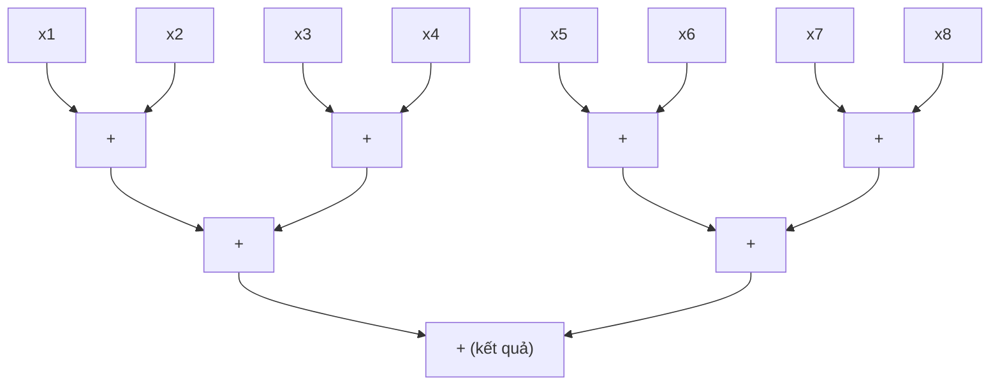

Một chương trình song song chỉ đáng với độ phức tạp của nó nếu nó nhanh hơn, và "nhanh hơn" cần một con số cùng một mốc so sánh. Bài thứ nhất của loạt bài [Tính toán song song và hiệu năng cao](/vi/series/parallel-and-high-performance-computing) xây dựng các thước đo và mô hình mà phần còn lại của loạt bài dùng để đánh giá mọi kết quả. Thời gian chạy, hệ số tăng tốc (speedup) và hiệu suất song song (efficiency) cho biết một chương trình nhanh hơn bao nhiêu; định luật Amdahl và định luật Gustafson chặn mức độ mà chương trình có thể mở rộng; khối lượng công việc (work) và độ dài đường găng (span) mô tả một thuật toán chứa bao nhiêu độ song song (parallelism); và cận roofline cho biết số học hay lưu lượng bộ nhớ giới hạn một kernel. Bài kết thúc bằng các quy tắc đo hiệu năng, để các con số thực sự mang ý nghĩa mà chúng tuyên bố.

Mục về roofline phát triển tiếp bài góc nhìn [Giới hạn bởi tính toán hay bởi bộ nhớ?](/vi/insights/compute-bound-or-memory-bound) mà không lặp lại nó, nên đọc bài góc nhìn đó trước sẽ có ích. Bài này giả định người đọc đọc được C và Python, biết chi phí của một vòng lặp và một lần truy cập mảng trong mã tuần tự, và quen thuộc với đại số và logarit. Không cần kinh nghiệm lập trình song song: các bài sau sẽ giới thiệu luồng (thread), đơn vị vector và truyền thông điệp (message passing).

**Quy ước.** Các quy ước sau áp dụng cho toàn bộ loạt bài. $T_1$ là thời gian chạy theo đồng hồ thực (wall-clock) của chương trình tuần tự tốt nhất cho một bài toán, và $T_p$ là thời gian chạy trên $p$ bộ xử lý, trong đó một bộ xử lý là một lõi (core), một luồng hay một tiến trình (process) tùy theo ngữ cảnh. **Hệ số tăng tốc** là $S(p) = T_1/T_p$ và **hiệu suất song song** là $E(p) = S(p)/p$. Trong định luật Amdahl, $f$ là phần thời gian chạy tuần tự không thể song song hóa; trong định luật Gustafson, $f_s$ là tỉ lệ tuần tự (serial fraction) của thời gian chạy đo trên máy song song, và $S_s(p)$ là hệ số tăng tốc theo quy mô (scaled speedup). Một phép tính có khối lượng công việc $W$ (tổng số phép toán) và độ dài đường găng $D$ (chuỗi dài nhất các phép toán phụ thuộc nhau). Cận roofline là $P \le \min(P_{\mathrm{peak}}, B\,I)$ với hiệu năng đạt được $P$, tốc độ số học đỉnh $P_{\mathrm{peak}}$, băng thông bộ nhớ $B$, cường độ số học (arithmetic intensity) $I$ và điểm gãy (ridge point) $I^* = P_{\mathrm{peak}}/B$. Bài thứ năm bổ sung chi phí thông điệp $t(m) = \alpha + \beta m$, với độ trễ (latency) $\alpha$ tính bằng s và thời gian truyền mỗi byte $\beta$ tính bằng s/byte.

Một phép toán dấu phẩy động (floating-point operation, FLOP) là một phép cộng hoặc một phép nhân trên các số độ chính xác kép, mỗi số chiếm 8 byte. Tốc độ được cho bằng giga phép toán dấu phẩy động mỗi giây (GFLOP/s, $10^9$ FLOP mỗi giây) và gigabyte mỗi giây (GB/s, $10^9$ byte mỗi giây), và khối lượng dữ liệu bằng megabyte (MB, $10^6$ byte), còn kích thước bộ nhớ đệm (cache) và bộ nhớ dùng KiB, MiB và GiB (lũy thừa của hai). Mảng trong C được lưu theo thứ tự hàng. Mã được viết bằng C11 và biên dịch bằng GNU Compiler Collection (GCC) 13.3. Hai phép đo bốn lõi ở mục 5 dùng OpenMP, một tập chỉ thị trình biên dịch như `#pragma omp parallel for` chia một vòng lặp cho các luồng, với số luồng đặt bằng `OMP_NUM_THREADS`; [mục 2 của bài thứ ba](/vi/blog/threads-and-shared-memory-parallelism) giải thích nó. Các mô hình được viết bằng Python 3.13 với thư viện chuẩn của nó.

Mọi số đo thời gian đều lấy từ một **máy tham chiếu**: một máy ảo chạy dưới trình ảo hóa Kernel-based Virtual Machine (KVM) với bốn lõi của một bộ xử lý Intel Xeon được báo là chạy ở 2.1 GHz và hỗ trợ tập lệnh Advanced Vector Extensions 512 (AVX-512). Mỗi lõi có 48 KiB bộ nhớ đệm dữ liệu cấp 1 (L1) và 2 MiB bộ nhớ đệm cấp 2 (L2); các lõi dùng chung một bộ nhớ đệm cấp 3 (L3) mà hệ điều hành báo là 260 MiB. Dòng cache (cache line) dài 64 byte, máy có 16 GiB bộ nhớ và chạy Linux. Máy này được dùng chung với các máy ảo khác, nên số đo thời gian của nó có nhiễu; chúng chỉ mô tả riêng máy này, và các số liệu cho phần cứng khác được ghi rõ là giả định.

## 1. Các thước đo hiệu năng

### 1.1 Thời gian chạy và thông lượng

Thước đo trực tiếp nhất của một chương trình là **thời gian chạy** (run time) của nó, tức thời gian thực trôi qua từ lúc bắt đầu đến lúc kết thúc, như một đồng hồ bấm giờ sẽ cho thấy. Nó khác với thời gian bộ xử lý mà hệ điều hành tính cho chương trình, vốn là tổng thời gian của mọi luồng. Một chương trình giữ bốn lõi bận trong 1 s đã dùng 4 s thời gian bộ xử lý, còn thời gian chạy của nó vẫn là 1 s. Song song hóa nhằm giảm thời gian chạy, nên thời gian chạy là đại lượng cần đo.

**Thông lượng** (throughput) là khối lượng công việc hoàn thành trong một đơn vị thời gian: FLOP mỗi giây với một kernel số, byte mỗi giây với một phép sao chép, yêu cầu mỗi giây với một dịch vụ. Với một khối lượng công việc cố định, nó mang cùng thông tin như thời gian chạy, nhưng đây là dạng có thể so sánh với những gì phần cứng có thể cung cấp, như cận roofline ở mục 5 làm.

### 1.2 Hệ số tăng tốc và hiệu suất song song

Hệ số tăng tốc $S(p) = T_1/T_p$ cho biết chương trình chạy nhanh hơn bao nhiêu lần trên $p$ bộ xử lý, và giá trị của nó phụ thuộc vào cách chọn $T_1$. Loạt bài luôn lấy $T_1$ từ **chương trình tuần tự tốt nhất**: cài đặt tuần tự nhanh nhất đã biết, được biên dịch cẩn thận như chương trình song song. Nếu thay vào đó chia cho thời gian chạy của chương trình song song trên một bộ xử lý thì ta được **hệ số tăng tốc tương đối** (relative speedup), lớn hơn mỗi khi phiên bản song song mang những chi phí phụ mà một chương trình tuần tự không có (tạo luồng, khóa, mảng phụ, một thuật toán kém hiệu quả hơn được chọn vì nó song song hóa được).

Với các số giả định: giả sử chương trình tuần tự tốt nhất mất 10.0 s, chương trình song song mất 12.0 s trên một lõi và 3.5 s trên bốn lõi. Khi đó $S(4) = 10.0/3.5 = 2.86$, còn hệ số tăng tốc tương đối là $12.0/3.5 = 3.43$. Hiệu suất song song là $E(4) = 2.86/4 = 0.71$: trung bình mỗi lõi làm việc có ích trong 71% thời gian chạy.

### 1.3 Chi phí và chi phí phụ

**Chi phí** (cost) của một lần chạy song song là $p\,T_p$, thời gian bộ xử lý mà nó chiếm, tính bằng bộ-xử-lý-giây. Với các số ở trên, chi phí là $4 \times 3.5 = 14.0$ bộ-xử-lý-giây cho một công việc mất 10.0 s khi chạy tuần tự. Hiệu $T_o = p\,T_p - T_1$ là **chi phí phụ** (overhead), ở đây là 4.0 bộ-xử-lý-giây: mọi thứ mà lần chạy song song làm hoặc chờ đợi còn lần chạy tuần tự thì không, chẳng hạn thời gian rảnh, đồng bộ hóa, truyền thông và công việc thừa. Ba thước đo này gắn với nhau:

$$
E(p) = \frac{T_1}{p\,T_p} = \frac{T_1}{T_1 + T_o}.
$$

Hiệu suất song song chỉ giữ gần 1 khi chi phí phụ còn nhỏ so với công việc có ích. Một thuật toán song song được gọi là **tối ưu chi phí** (cost-optimal) khi chi phí của nó tăng cùng tốc độ với $T_1$ khi bài toán lớn lên, sao cho hiệu suất song song luôn bị chặn dưới bởi một số dương.

### 1.4 Hệ số tăng tốc siêu tuyến tính

Có thể nghĩ rằng luôn có $S(p) \le p$, và dưới một mô hình đơn giản điều này đúng. Một bộ xử lý có thể mô phỏng $p$ bộ xử lý bằng cách lần lượt chạy các phép toán của chúng, việc này mất nhiều nhất $p\,T_p$ nếu mọi phép toán có cùng chi phí trong cả hai trường hợp; chương trình tuần tự tốt nhất ít nhất cũng nhanh bằng sự mô phỏng này, nên $T_1 \le p\,T_p$. Do đó, một **hệ số tăng tốc siêu tuyến tính** (superlinear speedup), $S(p) > p$, có nghĩa là một trong các giả thiết của mô hình đã không còn đúng.

Nguyên nhân thường gặp là phân cấp bộ nhớ (memory hierarchy). Trên máy tham chiếu, mỗi lõi có 2 MiB bộ nhớ đệm L2, nên bốn lõi cộng lại có 8 MiB. Một phép tính quét nhiều lần qua một tập dữ liệu làm việc 6 MiB không vừa trong L2 của một lõi, nhưng mỗi phần tư của nó, 1.5 MiB, vừa trong L2 của lõi sở hữu phần đó. Khi đó lần chạy song song trả ít hơn cho mỗi lần truy cập bộ nhớ so với lần chạy tuần tự, và hệ số tăng tốc có thể vượt quá $p$. [Bài thứ hai](/vi/blog/memory-hierarchy-and-locality) giải thích vì sao chi phí của một lần truy cập phụ thuộc vào nơi dữ liệu đang nằm. Một nguyên nhân khác là tìm kiếm: khi $p$ tác nhân cùng khám phá song song một không gian, một tác nhân có thể tìm ra lời giải sớm và các tác nhân khác dừng lại, nên lần chạy song song làm ít việc hơn lần chạy tuần tự.

Một kết quả siêu tuyến tính đo được là có thật, nhưng nó cũng là một lời cảnh báo về mốc so sánh: một chương trình tuần tự xử lý dữ liệu theo từng mảnh vừa với bộ nhớ đệm, hoặc xen kẽ việc tìm kiếm, thường sẽ xóa bỏ lợi thế đó, và khi ấy chương trình đó mới là chương trình tuần tự tốt nhất.

## 2. Định luật Amdahl và mở rộng mạnh

### 2.1 Tỉ lệ tuần tự chặn hệ số tăng tốc

Giữ bài toán cố định trong khi $p$ tăng được gọi là **mở rộng mạnh** (strong scaling). Trong một bài báo năm 1967 tại Spring Joint Computer Conference của American Federation of Information Processing Societies (AFIPS), G. M. Amdahl lập luận, bằng lời văn và không có công thức, rằng phần của một phép tính buộc phải chạy tuần tự sẽ giới hạn lợi ích của bất kỳ số lượng bộ xử lý nào. Công thức ngày nay gọi là **định luật Amdahl** (Amdahl's law), ở dạng mà các giáo trình như của Hennessy và Patterson trình bày, phát biểu lập luận của ông dưới dạng một cận.

Chia thời gian chạy tuần tự thành một phần $f\,T_1$ không thể song song hóa (đọc dữ liệu vào, một bước khởi tạo tuần tự, một bước tổng hợp cuối cùng) và một phần $(1-f)\,T_1$ chia đều hoàn hảo cho $p$ bộ xử lý. Ngay cả khi không có chi phí phụ nào, thời gian chạy song song cũng ít nhất là

$$
T_p \ge f\,T_1 + \frac{(1-f)\,T_1}{p},
$$

và chia $T_1$ cho nó ta được

$$
S(p) \le \frac{1}{f + (1-f)/p}, \qquad \lim_{p \to \infty} S(p) = \frac{1}{f}.
$$

Cận của hiệu suất song song có được bằng cách chia cho $p$: $E(p) \le 1/(1 + f\,(p-1))$. Nó giảm xuống một nửa tại $p = 1 + 1/f$; với $f = 0.05$ đó là $p = 21$, khi đó $S(21) = 1/(0.05 + 0.95/21) = 10.5$. Một chương trình có 5% thời gian tuần tự không thể dùng quá khoảng 20 bộ xử lý mà vẫn đạt dù chỉ 50% hiệu suất, và không số lượng bộ xử lý nào làm nó nhanh hơn quá 20 lần.

Chương trình sau lập bảng cận này cho ba tỉ lệ tuần tự.

```python
# Python 3. Amdahl bound and a model with overhead that grows with p.
f_values = [0.01, 0.05, 0.10]
ps = [1, 2, 4, 8, 16, 64, 256, 1024]

def amdahl(f, p):
    return 1.0 / (f + (1.0 - f) / p)

print("Amdahl bound S(p) = 1/(f + (1-f)/p)")
print("p     " + "".join(f"  f={f:<5}" for f in f_values))
for p in ps:
    print(f"{p:<6}" + "".join(f"  {amdahl(f, p):7.2f}" for f in f_values))
print("limit " + "".join(f"  {1/f:7.2f}" for f in f_values))
```

```text
Amdahl bound S(p) = 1/(f + (1-f)/p)
p       f=0.01   f=0.05   f=0.1
1          1.00     1.00     1.00
2          1.98     1.90     1.82
4          3.88     3.48     3.08
8          7.48     5.93     4.71
16        13.91     9.14     6.40
64        39.26    15.42     8.77
256       72.11    18.62     9.66
1024      91.18    19.64     9.91
limit    100.00    20.00    10.00
```

Với $p$ nhỏ, hệ số tăng tốc gần bằng $p$ bất kể $f$ là bao nhiêu, đó là lý do một chương trình mở rộng tốt trên bốn lõi cho biết rất ít về 64 lõi. Khi $p$ tiến gần $1/f$, mỗi lần nhân đôi số bộ xử lý mang lại ít hơn, và vượt quá vài lần $1/f$ thì các bộ xử lý thêm vào gần như bị lãng phí: đi từ 256 lên 1024 bộ xử lý với $f = 0.05$ chỉ nâng cận từ 18.62 lên 19.64.

### 2.2 Chi phí phụ tăng theo số bộ xử lý

Cận Amdahl giả định rằng phần song song được chia mà không tốn chi phí gì. Các chương trình song song thực phải trả những chi phí phụ tăng theo $p$: một rào chắn (barrier) tại đó mọi luồng chờ luồng chậm nhất, một phép rút gọn (reduction) kết hợp $p$ kết quả bộ phận, các thông điệp trao đổi giữa các tiến trình, sự cạnh tranh (contention) trên một bus bộ nhớ dùng chung. Một cách đơn giản để mô hình hóa chúng là thêm một số hạng tỉ lệ với $p - 1$, với hằng số $c$ đo bằng một phần của $T_1$:

$$
\frac{T_p}{T_1} = f + \frac{1-f}{p} + c\,(p-1).
$$

Số hạng thứ hai giảm theo $p$ còn số hạng thứ ba tăng, nên thời gian chạy có một cực tiểu. Cho đạo hàm theo $p$ bằng không ta được $(1-f)/p^2 = c$, nên số bộ xử lý tốt nhất là $p^* = \sqrt{(1-f)/c}$. Cùng chương trình đó tính mô hình với $f = 0.05$ và $c = 0.001$, tức chi phí phụ bằng 0.1% thời gian chạy tuần tự cho mỗi bộ xử lý thêm vào:

```python
f, c = 0.05, 0.001
print(f"With overhead: T_p/T_1 = f + (1-f)/p + c(p-1), f={f}, c={c}")
for p in [1, 2, 4, 8, 16, 24, 31, 32, 48, 64, 128]:
    s = 1.0 / (f + (1 - f) / p + c * (p - 1))
    print(f"p={p:<4} S={s:6.2f}  E={s/p:5.2f}")
print(f"p* = sqrt((1-f)/c) = {((1-f)/c)**0.5:.1f}")
```

```text
With overhead: T_p/T_1 = f + (1-f)/p + c(p-1), f=0.05, c=0.001
p=1    S=  1.00  E= 1.00
p=2    S=  1.90  E= 0.95
p=4    S=  3.44  E= 0.86
p=8    S=  5.69  E= 0.71
p=16   S=  8.04  E= 0.50
p=24   S=  8.88  E= 0.37
p=31   S=  9.04  E= 0.29
p=32   S=  9.03  E= 0.28
p=48   S=  8.56  E= 0.18
p=64   S=  7.82  E= 0.12
p=128  S=  5.42  E= 0.04
p* = sqrt((1-f)/c) = 30.8
```

Hệ số tăng tốc đạt đỉnh khoảng 9.04 gần $p^* = 30.8$ rồi giảm: với 128 bộ xử lý chương trình chạy chậm hơn so với 8 bộ xử lý. Cận Amdahl không có chi phí phụ sẽ cho phép 12.55 tại $p = 32$. Một khi chi phí phụ tăng theo $p$, việc thêm bộ xử lý có thể làm chương trình chậm đi. Những chi phí phụ tăng chậm hơn, như $\log_2 p$ bước của một phép rút gọn dạng cây, dời đỉnh về phía $p$ lớn hơn nhưng không xóa bỏ nó. [Bài thứ năm](/vi/blog/distributed-memory-and-message-passing) thay $c\,(p-1)$ bằng một mô hình truyền thông xây dựng từ độ trễ và băng thông của mỗi thông điệp, đo trên máy tham chiếu và giả định cho một cụm máy.

### 2.3 Ước lượng tỉ lệ tuần tự từ số đo

Tỉ lệ $f$ hiếm khi được biết trước. Karp và Flatt đề xuất tính ngược nó từ một hệ số tăng tốc đo được. Giải công thức Amdahl theo $f$ cho ta **tỉ lệ tuần tự xác định bằng thực nghiệm** (experimentally determined serial fraction)

$$
e = \frac{1/S(p) - 1/p}{1 - 1/p}.
$$

Với $S(4) = 3.2$ đo được, $e = (0.3125 - 0.25)/0.75 = 0.083$. Con số này hữu ích không phải vì giá trị của nó mà vì xu hướng của nó. Nếu $e$ giữ không đổi khi $p$ tăng, chương trình hành xử đúng như mô hình Amdahl nói và phần tuần tự là giới hạn. Nếu $e$ tăng theo $p$, tổn thất đến từ chi phí phụ tăng theo $p$, như ở mục 2.2, và cách khắc phục là giảm chi phí phụ đó (ít lần đồng bộ hóa hơn, truyền thông rẻ hơn).

### 2.4 Những gì định luật Amdahl bỏ qua

Định luật có ba giới hạn. Nó giả định rằng phần song song được chia đều, nên nó không nói gì về mất cân bằng tải (load imbalance), vấn đề mà [bài thứ ba](/vi/blog/threads-and-shared-memory-parallelism) xem xét. Nó bỏ qua chi phí phụ trừ khi thêm một số hạng. Và $f$ thuộc về một kích thước bài toán cụ thể: với hầu hết các chương trình, phần tuần tự tăng chậm hơn phần song song khi bài toán lớn lên, nên một bài toán lớn hơn có $f$ nhỏ hơn. Nhận xét đó dẫn đến định luật tiếp theo.

## 3. Định luật Gustafson và mở rộng yếu

### 3.1 Mở rộng bài toán theo máy

Định luật Amdahl hỏi một bài toán cố định chạy nhanh hơn bao nhiêu trên nhiều bộ xử lý hơn. Người dùng các máy lớn thì thường hỏi một bài toán lớn đến đâu có thể giải được trong cùng một khoảng thời gian: một mô hình khí hậu chạy trên máy lớn hơn dùng một lưới mịn hơn, chứ không chạy cùng lưới đó nhanh hơn. Tăng bài toán theo tỉ lệ với $p$, sao cho khối lượng công việc trên mỗi bộ xử lý giữ cố định, được gọi là **mở rộng yếu** (weak scaling). Năm 1988, J. L. Gustafson lập luận rằng đây là tình huống quan trọng đối với các máy song song lớn, và trong tình huống đó triển vọng tốt hơn nhiều so với những gì định luật Amdahl gợi ý.

Điểm xuất phát của Gustafson là lần chạy trên máy song song. Chuẩn hóa thời gian chạy của nó về 1 và gọi $f_s$ là phần thời gian đó dành cho mã tuần tự, như vậy $1 - f_s$ dành cho mã song song trên $p$ bộ xử lý. Cùng bài toán đó trên một bộ xử lý sẽ mất thời gian tuần tự cộng với $p$ lần thời gian song song, tức $f_s + (1 - f_s)\,p$. Tỉ số này là **hệ số tăng tốc theo quy mô** (scaled speedup)

$$
S_s(p) = f_s + (1 - f_s)\,p = p - f_s\,(p - 1),
$$

tăng tuyến tính theo $p$ với hệ số góc $1 - f_s$. Với $f_s = 0.05$, 1024 bộ xử lý cho $S_s = 972.85$, so với giới hạn 20 của định luật Amdahl khi $f = 0.05$.

Nếu $T(p, n)$ là thời gian chạy của một bài toán kích thước $n$ trên $p$ bộ xử lý và $n_1$ là kích thước bài toán giao cho một bộ xử lý, thì hiệu suất mở rộng yếu là $T(1, n_1)/T(p, p\,n_1)$: trong trường hợp lý tưởng, thời gian chạy giữ không đổi khi bài toán và máy cùng lớn lên.

### 3.2 Hai định luật, hai câu hỏi

Hai định luật không mâu thuẫn nhau; chúng mô tả những bài toán khác nhau. $f$ của Amdahl là một phần của lần chạy tuần tự của một bài toán cố định, còn $f_s$ của Gustafson là một phần của lần chạy song song của một bài toán đã được mở rộng theo máy. Bài toán đã mở rộng, khi chạy trên một bộ xử lý, mất $f_s + (1 - f_s)\,p$ theo đơn vị chuẩn hóa, trong đó $f_s$ là tuần tự. Do đó tỉ lệ Amdahl của nó là

$$
f = \frac{f_s}{f_s + (1 - f_s)\,p}.
$$

Thay $f$ này vào công thức Amdahl, ta được $f + (1 - f)/p = 1/(f_s + (1 - f_s)\,p)$, nên định luật Amdahl áp dụng cho bài toán đã mở rộng cho đúng hệ số tăng tốc theo quy mô của Gustafson. Chương trình dưới đây kiểm tra điều này bằng số:

```python
# Python 3. Gustafson scaled speedup, and its consistency with Amdahl's law.
fs = 0.05
print(f"Scaled speedup S_s(p) = f_s + (1 - f_s) p, f_s = {fs}")
for p in [1, 4, 16, 64, 256, 1024]:
    ss = fs + (1 - fs) * p
    # The scaled problem run on one processor: T_1 = f_s + (1 - f_s) p (units of T_p).
    # Its Amdahl serial fraction is therefore:
    f = fs / (fs + (1 - fs) * p)
    amdahl = 1 / (f + (1 - f) / p)
    print(f"p={p:<5} S_s={ss:8.2f}  equivalent f={f:.5f}  Amdahl with that f={amdahl:8.2f}")
```

```text
Scaled speedup S_s(p) = f_s + (1 - f_s) p, f_s = 0.05
p=1     S_s=    1.00  equivalent f=0.05000  Amdahl with that f=    1.00
p=4     S_s=    3.85  equivalent f=0.01299  Amdahl with that f=    3.85
p=16    S_s=   15.25  equivalent f=0.00328  Amdahl with that f=   15.25
p=64    S_s=   60.85  equivalent f=0.00082  Amdahl with that f=   60.85
p=256   S_s=  243.25  equivalent f=0.00021  Amdahl with that f=  243.25
p=1024  S_s=  972.85  equivalent f=0.00005  Amdahl with that f=  972.85
```

Bài toán đã mở rộng trên 1024 bộ xử lý có tỉ lệ Amdahl là 0.00005, vì phần song song của nó đã tăng 1024 lần còn phần tuần tự thì không. Định luật nào được áp dụng phụ thuộc vào câu hỏi. Một người dùng phải xử lý một tập dữ liệu cố định trước một hạn chót đối mặt với mở rộng mạnh và cận Amdahl. Một người dùng sẽ dùng các bộ xử lý thêm vào để làm mịn một mô hình đối mặt với mở rộng yếu, và hệ số tăng tốc theo quy mô là con số phù hợp.

### 3.3 Khi nào mở rộng yếu không còn đúng

Định luật Gustafson giả định rằng thời gian tuần tự giữ cố định trong khi công việc song song tăng theo $p$. Hai tình huống phổ biến phá vỡ giả định đó. Thứ nhất, phần tuần tự có thể tăng theo bài toán, như khi một bước tuần tự đọc một tệp đầu vào lớn hơn $p$ lần.

Thứ hai, khối lượng công việc có thể tăng nhanh hơn bộ nhớ. Mở rộng yếu thường giữ cố định bộ nhớ trên mỗi bộ xử lý. Với phân tích ma trận đặc trên một ma trận $n \times n$, bộ nhớ tăng theo $n^2$ còn khối lượng công việc theo $n^3$. Giữ $n^2/p$ cố định nghĩa là $n \propto \sqrt{p}$, nên khối lượng công việc tăng theo $p^{3/2}$ và, ngay cả với độ song song hoàn hảo, thời gian chạy trên mỗi bộ xử lý tăng theo $p^{3/2}/p = \sqrt{p}$. Với số bộ xử lý gấp 64 lần và bộ nhớ gấp 64 lần, lần chạy mất thời gian gấp 8 lần. Trong hầu hết các chương trình, truyền thông cũng tăng theo $p$, và [mục 6 của bài thứ năm](/vi/blog/distributed-memory-and-message-passing) đưa nó vào các dự đoán về mở rộng mạnh và mở rộng yếu.

## 4. Khối lượng công việc, độ dài đường găng và độ song song

### 4.1 Đồ thị phụ thuộc tác vụ

Định luật Amdahl nén một chương trình vào một con số duy nhất, $f$; một mô tả chi tiết hơn ghi lại phép toán nào phụ thuộc vào phép toán nào. Một **đồ thị phụ thuộc tác vụ** (task dependence graph) là một đồ thị có hướng không chu trình (directed acyclic graph, DAG) có các đỉnh là các tác vụ, mỗi tác vụ là một phần công việc tuần tự, và các cạnh cho biết một tác vụ cần kết quả của một tác vụ khác trước khi có thể bắt đầu. Hai tác vụ không có đường đi nào nối giữa chúng có thể chạy cùng lúc.

Hai con số tóm tắt một đồ thị như vậy khi mỗi tác vụ mất một đơn vị thời gian. **Khối lượng công việc** $W$ là số tác vụ, cũng là thời gian chạy trên một bộ xử lý. **Độ dài đường găng** $D$ (còn gọi là độ sâu (depth) hay độ dài đường tới hạn, critical-path length) là số tác vụ trên đường đi dài nhất, cũng là thời gian chạy trên một số lượng bộ xử lý không giới hạn, vì mỗi tác vụ trên đường đó phải chờ tác vụ đứng trước nó. Từ đó suy ra ngay hai cận dưới cho mọi lịch trình trên $p$ bộ xử lý:

$$
T_p \ge \frac{W}{p} \quad \text{(work law)}, \qquad T_p \ge D \quad \text{(span law)}.
$$

Tỉ số $W/D$ là **độ song song** của phép tính. Theo định luật span (span law), $S(p) = W/T_p \le W/D$, nên độ song song là hệ số tăng tốc lớn nhất mà bất kỳ số lượng bộ xử lý nào có thể mang lại; các bộ xử lý vượt quá khoảng $W/D$ sẽ không có việc gì để làm.

### 4.2 Lập lịch tham lam và cận Brent

Các cận dưới cho biết điều mà không lịch trình nào vượt qua được. Một **bộ lập lịch tham lam** (greedy scheduler) không bao giờ để một bộ xử lý rảnh khi đang có một tác vụ sẵn sàng: ở mỗi bước nó chạy $\min(p, r)$ tác vụ sẵn sàng, trong đó $r$ là số tác vụ sẵn sàng. Thời gian chạy của nó thỏa mãn

$$
T_p \le \frac{W}{p} + D.
$$

Lập luận chia các bước thành hai loại. Trong một bước *đầy đủ*, cả $p$ bộ xử lý đều chạy tác vụ; có nhiều nhất $W/p$ bước như vậy, vì chỉ có $W$ tác vụ. Trong một bước *không đầy đủ*, có ít hơn $p$ tác vụ sẵn sàng và tất cả chúng đều được chạy. Mọi tác vụ mở đầu một đường đi dài nhất còn lại đều sẵn sàng, nên nó được chạy và độ dài đường găng của đồ thị còn lại giảm đi một; do đó có nhiều nhất $D$ bước không đầy đủ. Cộng hai số đếm lại ta được cận. Vì $\max(W/p, D) \ge (W/p + D)/2$, một lịch trình tham lam không bao giờ dài hơn quá hai lần lịch trình tốt nhất có thể. Kiểu lập luận này bắt nguồn từ phân tích lập lịch theo danh sách (list scheduling) của Graham. Brent đã chứng minh cận có liên quan chặt chẽ $T_p \le (W - D)/p + D$ cho một lịch trình chạy đồ thị theo từng mức: nếu mức $k$ chứa $a_k$ tác vụ độc lập, nó mất $\lceil a_k/p \rceil \le (a_k - 1)/p + 1$ bước, và lấy tổng trên $D$ mức ta được kết quả.

Cận này dựa trên một mô hình: mọi tác vụ mất cùng thời gian, việc lập lịch không tốn gì, các bộ xử lý giống hệt nhau và bộ xử lý nào cũng có thể chạy bất kỳ tác vụ sẵn sàng nào mà không cần lấy dữ liệu của nó trước. Các hệ thống thời gian chạy thực tiến gần đến cận này khi các tác vụ dài hơn nhiều so với chi phí lập lịch, và bài thứ ba cho thấy điều gì xảy ra [khi công việc không đồng đều](/vi/blog/threads-and-shared-memory-parallelism) (mục 6 của bài đó). Mô hình cũng bỏ qua lưu lượng bộ nhớ, thứ mà mục 5 sẽ bổ sung.

### 4.3 Ví dụ tính toán: phép rút gọn dạng cây

Một vòng lặp cộng $n$ số vào một biến tích lũy duy nhất tạo thành một chuỗi: mỗi phép cộng cần tổng trước đó. Khối lượng công việc của nó là $W = n - 1$ và độ dài đường găng cũng là $D = n - 1$, nên độ song song của nó là 1, và ở dạng đó không số lượng bộ xử lý nào làm nó nhanh hơn được. Phép cộng có tính kết hợp trong số học chính xác, nên cùng tổng đó có thể được tính theo dạng cây: cộng từng cặp, rồi từng cặp của các cặp, và cứ thế tiếp tục. Với $n = 8$, cây có ba mức.



Mỗi đỉnh "+" là một phép cộng; các phép cộng trên cùng một hàng độc lập với nhau. Cây vẫn thực hiện $W = n - 1 = 7$ phép cộng, nhưng độ dài đường găng của nó là $D = \lceil \log_2 n \rceil = 3$. Tổng quát, mỗi mức giảm một nửa số giá trị (một giá trị lẻ ra sẽ chờ đến mức tiếp theo), nên độ dài đường găng là $\lceil \log_2 n \rceil$ và độ song song là $(n - 1)/\lceil \log_2 n \rceil$. Chương trình dưới đây đếm số phép cộng ở mỗi mức, tính lịch trình theo từng mức của Brent và so sánh nó với các cận:

```python
# Python 3. Work, span and Brent's schedule for a tree reduction of n numbers.
import math

def tree_levels(n):
    """Number of independent additions at each level of a pairwise tree."""
    levels, m = [], n
    while m > 1:
        levels.append(m // 2)
        m = (m + 1) // 2          # an odd element waits for the next level
    return levels

def level_time(n, p):
    # One addition = one time unit. Brent's schedule runs the tree level by
    # level; level k, with a_k independent additions, takes ceil(a_k / p) steps.
    return sum(math.ceil(a / p) for a in tree_levels(n))

print(f"{'n':>8} {'p':>4} {'W':>8} {'D':>3} {'W/D':>9} {'level T_p':>10} {'W/p+D':>9} {'lower max(W/p,D)':>17}")
for n in [8, 1000, 10**6]:
    W, D = n - 1, len(tree_levels(n))
    assert D == math.ceil(math.log2(n)) and sum(tree_levels(n)) == W
    for p in [1, 4, 64, 1024]:
        T = level_time(n, p)
        print(f"{n:>8} {p:>4} {W:>8} {D:>3} {W/D:>9.1f} {T:>10} {W/p + D:>9.1f} {max(W/p, D):>17.1f}")
```

```text
       n    p        W   D       W/D  level T_p     W/p+D  lower max(W/p,D)
       8    1        7   3       2.3          7      10.0               7.0
       8    4        7   3       2.3          3       4.8               3.0
       8   64        7   3       2.3          3       3.1               3.0
       8 1024        7   3       2.3          3       3.0               3.0
    1000    1      999  10      99.9        999    1009.0             999.0
    1000    4      999  10      99.9        253     259.8             249.8
    1000   64      999  10      99.9         21      25.6              15.6
    1000 1024      999  10      99.9         10      11.0              10.0
 1000000    1   999999  20   49999.9     999999 1000019.0          999999.0
 1000000    4   999999  20   49999.9     250006  250019.8          249999.8
 1000000   64   999999  20   49999.9      15638   15645.0           15625.0
 1000000 1024   999999  20   49999.9        991     996.6             976.6
```

Các thời gian theo từng mức nằm giữa cận dưới và $W/p + D$. Với $n = 1000$, độ song song khoảng 100, và bảng cho thấy điều đó có nghĩa gì: 64 bộ xử lý hoàn thành trong 21 bước, còn 1024 bộ xử lý cần 10 bước, đúng bằng độ dài đường găng, với phần lớn số bộ xử lý ngồi không. Với $n = 10^6$, độ song song khoảng 50 000, và ngay cả 1024 bộ xử lý vẫn nằm trong phạm vi 2% so với cận khối lượng công việc.

Trong thực tế $p$ nhỏ hơn $n$ rất nhiều, và một cách làm tốt hơn là tránh cây chi tiết đến từng phần tử. Mỗi bộ xử lý cộng tuần tự một khối liên tiếp gồm $n/p$ số, sau đó $p$ tổng bộ phận được kết hợp bằng một cây. Với $n = 10^6$ và $p = 4$, việc này mất $249{,}999 + 2 = 250{,}001$ bước, ít hơn một chút so với lịch trình theo từng mức, và chỉ có $p$ giá trị phải di chuyển giữa các bộ xử lý. Các phép rút gọn trong thư viện cũng theo cùng khuôn mẫu: các tổng bộ phận riêng được kết hợp ở cuối. Mệnh đề `reduction` của OpenMP để ngỏ thứ tự kết hợp, và GCC 13.3 cộng tổng bộ phận của từng luồng vào kết quả bằng một phép cập nhật nguyên tử, lần lượt từng luồng một; các thư viện truyền thông điệp thường kết hợp các tổng bộ phận theo một cây. Bài thứ ba xem xét mệnh đề của OpenMP và bài thứ năm xem xét các phép rút gọn trong truyền thông điệp.

Phép cộng dấu phẩy động (floating point) không có tính kết hợp, nên cây và vòng lặp làm tròn khác nhau và có thể khác nhau ở các chữ số cuối; bài góc nhìn [Sai số làm tròn dấu phẩy động trong các mô phỏng dài](/vi/insights/floating-point-in-long-simulations) bàn về khi nào điều đó quan trọng. Mục 6.3 cho thấy một khác biệt như vậy trong một phép đo thực.

## 5. Cận roofline

### 5.1 Từ phép toán đến byte

Mô hình khối lượng công việc – độ dài đường găng đếm các phép toán và coi dữ liệu là miễn phí. Cận roofline của Williams, Waterman và Patterson bổ sung chi phí di chuyển dữ liệu. Như [bài góc nhìn](/vi/insights/compute-bound-or-memory-bound) giải thích, một kernel không thể chạy nhanh hơn $\min(P_{\mathrm{peak}}, B\,I)$, trong đó **cường độ số học** $I$ là số FLOP mà kernel thực hiện trên mỗi byte nó di chuyển giữa bộ nhớ chính và bộ xử lý. Bài góc nhìn xem xét phép cập nhật $y \leftarrow a\,x + y$, với $I = 2/24 \approx 0.083$ FLOP/byte. Mục này bổ sung hai kernel, cho thấy cường độ phụ thuộc vào việc tái sử dụng dữ liệu và đo cả hai thông số của máy tham chiếu.

### 5.2 Cường độ của ba kernel

**Tích vô hướng** $s = \sum_i x_i y_i$ thực hiện một phép nhân và một phép cộng trên mỗi phần tử và đọc hai số double, 16 byte, trong khi không ghi gì ngoài một số vô hướng. Cường độ của nó là $I = 2/16 = 0.125$ FLOP/byte. Giống như phép cập nhật trong bài góc nhìn, nó bị giới hạn bởi băng thông bộ nhớ trên mọi bộ xử lý hiện nay mỗi khi các vector quá lớn so với bộ nhớ đệm.

**Phép nhân ma trận đặc** $C \leftarrow C + A B$ với các ma trận $n \times n$ thực hiện $n^3$ cặp nhân – cộng, tức $2n^3$ FLOP. Cường độ của nó không do phép toán quyết định; nó phụ thuộc vào số lần mỗi phần tử đi qua giao diện bộ nhớ.

- Nếu mỗi phần tử ma trận đi qua đúng một lần (cả ba ma trận đều nằm trong bộ nhớ đệm), lưu lượng là $3n^2 \times 8$ byte để đọc $A$, $B$ và $C$, cộng thêm $8n^2$ để ghi $C$ trở lại. Bỏ qua phần ghi, cường độ là $2n^3/(24 n^2) = n/12$ FLOP/byte, tăng theo $n$; với $n = 2000$ nó khoảng 167.
- Nếu không có gì được tái sử dụng, như trong một vòng lặp ba tầng ngây thơ trên các ma trận lớn hơn nhiều so với bộ nhớ đệm, mỗi phép nhân – cộng nạp một phần tử của $A$ và một phần tử của $B$ từ bộ nhớ, 16 byte cho 2 FLOP, và cường độ giảm xuống $2/16 = 0.125$, bằng với tích vô hướng.
- Giữa hai thái cực này, **chia khối** (blocking) chia $C$ thành các khối $b \times b$ và tính mỗi khối từ các dải rộng $b$ của $A$ và $B$ trong khi khối đó vẫn nằm trong bộ nhớ đệm. Mỗi khối cần $2nb$ phần tử của $A$ và $B$, tức $16nb$ byte, và có $(n/b)^2$ khối, nên lưu lượng khoảng $16n^3/b$ byte và cường độ khoảng $2n^3/(16n^3/b) = b/8$ FLOP/byte.

Chia khối biến một kernel bị giới hạn bởi bộ nhớ (memory-bound) thành một kernel bị giới hạn bởi tính toán (compute-bound) bằng cách chọn $b$ sao cho $b/8$ vượt quá điểm gãy trong khi ba khối $b \times b$, tức $24b^2$ byte, vẫn vừa trong một bộ nhớ đệm. [Bài thứ hai](/vi/blog/memory-hierarchy-and-locality) xem xét kỹ thuật này ở mục 4; điều cần thấy ở đây là cường độ thuộc về thuật toán và cách nó di chuyển dữ liệu, chứ không chỉ thuộc về phép toán toán học.

Các số đếm này giả định rằng một lần ghi di chuyển 8 byte cho mỗi phần tử. Với chính sách **cấp phát khi ghi** (write-allocate), mà các bộ nhớ đệm của máy tham chiếu dùng cho các lệnh ghi thông thường, một dòng cache được đọc vào trước khi được ghi, nên việc ghi một mảng chưa được đọc tốn 16 byte cho mỗi phần tử, trừ khi các lệnh ghi không lưu tạm (non-temporal store) đi vòng qua bộ nhớ đệm. Phép cập nhật trong bài góc nhìn vẫn đọc $y$; còn phép triad ở mục tiếp theo không đọc mảng mà nó ghi.

### 5.3 Đo băng thông bộ nhớ

Băng thông $B$ được đo chứ không lấy từ bảng thông số, vì tốc độ duy trì được thấp hơn tốc độ danh định và phụ thuộc vào số lõi gửi yêu cầu. Công cụ thường dùng là phép triad trong bộ đo STREAM của McCalpin, $a_i = b_i + s\,c_i$ trên các mảng lớn hơn nhiều so với mọi bộ nhớ đệm. Chương trình dưới đây là một phiên bản tối giản được viết cho bài này, không phải chính bộ đo STREAM. Nó cấp phát ba mảng gồm $4 \times 10^7$ số double (mỗi mảng 320 MB, tổng cộng 960 MB, vượt xa 260 MiB mà hệ thống báo cho L3) và khởi tạo chúng song song, để mỗi luồng chạm vào các trang mà nó sẽ dùng. Sau đó nó đo thời gian mười lần lặp phép triad.

```c
/* C11 + OpenMP. A STREAM-style triad a[i] = b[i] + s*c[i] to estimate
   sustainable memory bandwidth. Bytes are counted as 24 per element
   (read b, read c, write a), the STREAM convention. */
#include <omp.h>
#include <stdio.h>
#include <stdlib.h>

#define N (40L * 1000 * 1000)    /* 320 MB per array, 960 MB in total */
#define REPS 10

static int cmp(const void *x, const void *y) {
    double a = *(const double *)x, b = *(const double *)y;
    return (a > b) - (a < b);
}

int main(void) {
    double *a = malloc(N * sizeof *a), *b = malloc(N * sizeof *b),
           *c = malloc(N * sizeof *c);
    if (!a || !b || !c) return 1;
    #pragma omp parallel for schedule(static)
    for (long i = 0; i < N; i++) { a[i] = 0.0; b[i] = 1.0; c[i] = 2.0; }

    const double s = 3.0;
    double t[REPS];
    for (int r = 0; r < REPS; r++) {
        double t0 = omp_get_wtime();
        #pragma omp parallel for schedule(static)
        for (long i = 0; i < N; i++) a[i] = b[i] + s * c[i];
        t[r] = omp_get_wtime() - t0;
    }
    qsort(t, REPS, sizeof t[0], cmp);
    double bytes = 24.0 * N;
    printf("threads=%d  N=%ld  check a[N-1]=%.1f\n", omp_get_max_threads(), N, a[N-1]);
    printf("time   min %.4f s  median %.4f s  max %.4f s\n",
           t[0], (t[REPS/2 - 1] + t[REPS/2]) / 2, t[REPS-1]);
    printf("rate   best %.1f GB/s  median %.1f GB/s\n",
           bytes / t[0] / 1e9, bytes / ((t[REPS/2 - 1] + t[REPS/2]) / 2) / 1e9);
    free(a); free(b); free(c);
    return 0;
}
```

Biên dịch bằng `gcc -std=c11 -O3 -march=native -fopenmp` và chạy với `OMP_NUM_THREADS=1` rồi với 4, cùng `OMP_PROC_BIND=close` để giữ mỗi luồng trên một lõi, chương trình in ra:

```text
threads=1  N=40000000  check a[N-1]=7.0
time   min 0.0729 s  median 0.0782 s  max 0.0804 s
rate   best 13.2 GB/s  median 12.3 GB/s
threads=4  N=40000000  check a[N-1]=7.0
time   min 0.0193 s  median 0.0204 s  max 0.0254 s
rate   best 49.7 GB/s  median 47.1 GB/s
```

Năm lần chạy tiếp theo với bốn luồng cho tốc độ tốt nhất từ 47.6 đến 51.6 GB/s và trung vị từ 42.8 đến 49.0 GB/s. Các lần chạy thử trước đó, thực hiện khi máy chủ dùng chung có vẻ bận hơn, cho trung vị thấp tới 17 GB/s, vì một máy ảo dùng chung hệ thống bộ nhớ với những máy lân cận mà nó không nhìn thấy. Do đó bài này lấy $B \approx 50$ GB/s làm **ước lượng cho máy ảo này** trong điều kiện thuận lợi. Với cấp phát khi ghi, phần cứng di chuyển khoảng 32 byte cho mỗi phần tử, chứ không phải 24 byte được đếm, nên lưu lượng vật lý cao hơn khoảng một phần ba so với tốc độ hữu ích được báo.

Một lõi đơn lẻ đạt khoảng 13 GB/s, xấp xỉ một phần tư tốc độ bốn lõi, nên một kernel bị giới hạn bởi bộ nhớ được lợi khi dùng tất cả các lõi ngay cả khi phần số học của nó chỉ cần một lõi. Bài thứ hai sẽ quay lại câu hỏi điều gì giới hạn băng thông của một lõi.

### 5.4 Tốc độ số học đỉnh

Đỉnh lý thuyết là tích của số lõi, tần số xung nhịp và số FLOP mỗi lõi có thể hoàn thành trong một chu kỳ. Một thanh ghi AVX-512 chứa tám số double, và một lệnh **nhân – cộng hợp nhất** (fused multiply-add, FMA) tính $a \times b + c$ trên cả tám số với một lần làm tròn, được tính là 16 FLOP. Thông số sản phẩm của Intel ghi một hoặc hai đơn vị FMA AVX-512 trên mỗi lõi, tùy theo mẫu Xeon, còn máy ảo chỉ báo một tên mẫu chung chung, nên không thể đọc số đơn vị từ `lscpu`. Giả sử có hai đơn vị (không phải một con số đã được xác nhận), mỗi lõi hoàn thành 32 FLOP mỗi chu kỳ, và ở tần số được báo 2.1 GHz, đỉnh lý thuyết là

$$
P_{\mathrm{peak}} = 4 \times 2.1 \times 10^9 \times 32 = 268.8\ \text{GFLOP/s}.
$$

Một chương trình đo vi mô (microbenchmark) kiểm tra con số đó. Chương trình dưới đây giữ 12 chuỗi FMA độc lập trong thanh ghi, để các đơn vị FMA không bao giờ phải chờ một kết quả trước đó, và đếm số FLOP chúng hoàn thành:

```c
/* C11 + AVX-512 intrinsics + OpenMP. 12 independent chains of 512-bit fused
   multiply-adds per thread, kept in registers, so the throughput of the FMA
   units limits the loop, not their latency. One such FMA = 16 FLOP. */
#include <immintrin.h>
#include <omp.h>
#include <stdio.h>

#define ITERS 50000000L
#define F(a) a = _mm512_fmadd_pd(a, x, y)

int main(void) {
    double total = 0.0, t0 = omp_get_wtime();
    #pragma omp parallel reduction(+:total)
    {
        const __m512d x = _mm512_set1_pd(0.999999), y = _mm512_set1_pd(1e-7);
        __m512d a0 = _mm512_set1_pd(0), a1 = _mm512_set1_pd(1), a2 = _mm512_set1_pd(2),
                a3 = _mm512_set1_pd(3), a4 = _mm512_set1_pd(4), a5 = _mm512_set1_pd(5),
                a6 = _mm512_set1_pd(6), a7 = _mm512_set1_pd(7), a8 = _mm512_set1_pd(8),
                a9 = _mm512_set1_pd(9), a10 = _mm512_set1_pd(10), a11 = _mm512_set1_pd(11);
        for (long i = 0; i < ITERS; i++) {
            F(a0); F(a1); F(a2); F(a3); F(a4); F(a5);
            F(a6); F(a7); F(a8); F(a9); F(a10); F(a11);
        }
        __m512d s = _mm512_add_pd(_mm512_add_pd(_mm512_add_pd(a0, a1), _mm512_add_pd(a2, a3)),
                    _mm512_add_pd(_mm512_add_pd(a4, a5), _mm512_add_pd(a6, a7)));
        s = _mm512_add_pd(s, _mm512_add_pd(_mm512_add_pd(a8, a9), _mm512_add_pd(a10, a11)));
        total += _mm512_reduce_add_pd(s);   /* use the result */
    }
    double t = omp_get_wtime() - t0;
    double flops = (double)omp_get_max_threads() * ITERS * 12 * 16;
    printf("threads=%d  %.1f GFLOP/s  (%.1f FLOP per 2.1 GHz cycle per thread)\n",
           omp_get_max_threads(), flops / t / 1e9,
           flops / t / 2.1e9 / omp_get_max_threads());
    (void)total;
    return 0;
}
```

Biên dịch bằng `gcc -std=c11 -O2 -march=native -fopenmp` và chạy năm lần với một luồng và năm lần với bốn luồng:

```text
threads=1  88.8 GFLOP/s  (42.3 FLOP per 2.1 GHz cycle per thread)
threads=1  90.6 GFLOP/s  (43.1 FLOP per 2.1 GHz cycle per thread)
threads=1  88.4 GFLOP/s  (42.1 FLOP per 2.1 GHz cycle per thread)
threads=1  98.3 GFLOP/s  (46.8 FLOP per 2.1 GHz cycle per thread)
threads=1  91.9 GFLOP/s  (43.8 FLOP per 2.1 GHz cycle per thread)
threads=4  354.0 GFLOP/s  (42.1 FLOP per 2.1 GHz cycle per thread)
threads=4  366.8 GFLOP/s  (43.7 FLOP per 2.1 GHz cycle per thread)
threads=4  364.2 GFLOP/s  (43.4 FLOP per 2.1 GHz cycle per thread)
threads=4  347.2 GFLOP/s  (41.3 FLOP per 2.1 GHz cycle per thread)
threads=4  339.7 GFLOP/s  (40.4 FLOP per 2.1 GHz cycle per thread)
```

Tốc độ đo được, trung vị 354.0 GFLOP/s với bốn luồng, cao hơn mức "lý thuyết" 268.8 GFLOP/s, và con số biểu kiến 42 FLOP mỗi chu kỳ 2.1 GHz vượt quá 32 mà hai đơn vị có thể cung cấp. Lời giải thích có khả năng nhất là các lõi không chạy ở 2.1 GHz: hệ điều hành khách báo một tần số danh định cố định, trong khi bộ xử lý vật lý có thể tăng xung nhịp khi điều kiện công suất và nhiệt độ cho phép. Nếu mỗi lõi hoàn thành 32 FLOP mỗi chu kỳ, các tốc độ đo được ngụ ý xung nhịp trung bình $354.0/(4 \times 32) \approx 2.77$ GHz với bốn luồng và $90.6/32 \approx 2.83$ GHz với một luồng. Với chỉ một đơn vị FMA, cùng các tốc độ đó sẽ đòi hỏi xung nhịp trung bình khoảng 5.5 GHz, điều khó tin đối với một bộ xử lý máy chủ, nên phép đo phù hợp với giả thiết hai đơn vị, nhưng không chứng minh được số đơn vị.

Vì vậy, một giá trị đỉnh tính từ xung nhịp danh định không phải là cận trên, cũng không phải là con số điển hình khi xung nhịp thay đổi; trên một số bộ xử lý, như Intel ghi nhận cho các bộ xử lý Xeon Scalable của hãng, tải AVX-512 nặng lại làm giảm xung nhịp. Với roofline của máy này, bài dùng giá trị đo được $P_{\mathrm{peak}} \approx 354$ GFLOP/s, một ước lượng cho máy ảo này, và giữ 268.8 GFLOP/s làm con số danh định.

### 5.5 Roofline của máy tham chiếu

Với $P_{\mathrm{peak}} = 354.0$ GFLOP/s và $B = 50$ GB/s, điểm gãy là $I^* = 354.0/50 = 7.08$ FLOP/byte: một kernel cần khoảng 7 FLOP trên mỗi byte lưu lượng bộ nhớ thì số học, thay vì bộ nhớ, mới trở thành giới hạn của nó. Chương trình dưới đây tính cận cho các kernel ở mục 5.2:

```python
# Python 3. Roofline bounds P <= min(P_peak, B*I) for three kernels on the
# reference machine, using the figures measured in this entry (estimates).
P_peak = 354.0   # GFLOP/s, median of five 4-thread FMA microbenchmark runs
B = 50.0         # GB/s, best 4-thread triad rate, typical of several executions
print(f"ridge point I* = P_peak/B = {P_peak / B:.2f} FLOP/byte")
n = 2000
kernels = [
    ("axpy  y = a x + y", 2 / 24),
    ("dot   s = x . y", 2 / 16),
    ("matmul, no reuse (2 loads per FMA)", 2 / 16),
    ("matmul, 64x64 blocks (I ~ b/8)", 64 / 8),
    (f"matmul, ideal reuse n={n} (n/12)", n / 12),
]
for name, I in kernels:
    P = min(P_peak, B * I)
    kind = "memory" if B * I < P_peak else "compute"
    print(f"{name:<38} I = {I:7.3f}  bound = {P:6.1f} GFLOP/s ({kind})")
```

```text
ridge point I* = P_peak/B = 7.08 FLOP/byte
axpy  y = a x + y                      I =   0.083  bound =    4.2 GFLOP/s (memory)
dot   s = x . y                        I =   0.125  bound =    6.2 GFLOP/s (memory)
matmul, no reuse (2 loads per FMA)     I =   0.125  bound =    6.2 GFLOP/s (memory)
matmul, 64x64 blocks (I ~ b/8)         I =   8.000  bound =  354.0 GFLOP/s (compute)
matmul, ideal reuse n=2000 (n/12)      I = 166.667  bound =  354.0 GFLOP/s (compute)
```

Trên các vector lớn, phép cập nhật và tích vô hướng chỉ có thể đạt nhiều nhất 1.2% và 1.8% đỉnh số học; chỉ có giảm số byte phải di chuyển mới giúp được chúng. Phép nhân ma trận không tái sử dụng cũng thiếu dữ liệu như vậy, còn cùng phép toán đó với các khối 64 nhân 64 thì chạm tới mái tính toán. Ba khối như vậy chiếm $24 \times 64^2 = 98{,}304$ byte, tức 96 KiB, vượt quá bộ nhớ đệm L1 48 KiB nhưng vừa trong L2 2 MiB. Do đó, với kernel chia khối, các byte quan trọng là các byte đi giữa L2 và bộ nhớ, còn lưu lượng giữa L1 và L2 cần một cận riêng.

Nhận xét đó chỉ ra giới hạn của một roofline đơn lẻ. Nó dùng băng thông của bộ nhớ chính, trong khi một kernel có dữ liệu vừa trong một bộ nhớ đệm sẽ thấy băng thông cao hơn của bộ nhớ đệm đó. $P_{\mathrm{peak}}$ của nó đòi hỏi các lệnh FMA vector ở mọi chu kỳ, và mã không được vector hóa có một mái thấp hơn, như [bài thứ tư](/vi/blog/data-parallelism-vector-units-and-gpus) cho thấy ở mục 2. Và trên một máy ảo dùng chung, cả hai con số đều thay đổi theo tải của máy chủ. Cận này là một mức trần cho thấy tài nguyên nào giới hạn một kernel, không phải một dự đoán về tốc độ của nó.

## 6. Đo hiệu năng một cách trung thực

### 6.1 Những gì có thể sai

Các phép đo chương trình song song rất dễ sai theo những cách tô đẹp kết quả. Các lỗi thường gặp là một đồng hồ đo sai thứ, một lần chạy duy nhất tình cờ nhanh hoặc chậm, một lần chạy đầu tiên phải trả các chi phí một lần, một kích thước bài toán được chọn để vừa với bộ nhớ đệm, một thiết lập trình biên dịch không được nêu và một hệ số tăng tốc tính so với một mốc so sánh yếu. Hoefler và Belli đã phân loại các lỗi như vậy trong các kết quả tính toán song song đã công bố và đề xuất các quy tắc báo cáo; các cách làm dưới đây tuân theo cùng những nguyên tắc đó.

### 6.2 Đồng hồ, chạy khởi động và các lần lặp

Thời gian chạy là thời gian thực, nên đồng hồ phải là một đồng hồ đo thời gian thực (wall clock) không thể nhảy. Trên các hệ thống tuân theo Portable Operating System Interface (POSIX), `clock_gettime(CLOCK_MONOTONIC, ...)` đọc một đồng hồ chỉ tiến về phía trước và không bị điều chỉnh khi thời gian hệ thống được đặt lại, như chuẩn POSIX quy định; đặc tả OpenMP định nghĩa `omp_get_wtime()` trả về thời gian thực đã trôi qua tính bằng giây. Hai lỗi thường gặp là dùng `clock()`, hàm mà trong C trả về thời gian bộ xử lý và do đó cộng dồn thời gian của mọi luồng và che mất mọi sự tăng tốc, và dùng đồng hồ giờ hệ thống (real-time clock) (`CLOCK_REALTIME` hoặc `gettimeofday`), đồng hồ có thể nhảy khi giờ trong ngày được hiệu chỉnh. Khoảng thời gian được đo cũng phải dài so với độ phân giải của đồng hồ và chi phí đọc nó.

Lần thực thi đầu tiên của một đoạn mã thường phải trả những chi phí mà các lần sau không phải trả: lỗi trang (page fault) khi bộ nhớ được chạm vào lần đầu, bộ nhớ đệm và bộ đệm dịch địa chỉ còn nguội, và xung nhịp bộ xử lý chưa kịp tăng. Vì vậy, một chương trình đo hiệu năng chạy đoạn mã vài lần mà không đo (**chạy khởi động**, warm-up), sau đó đo thời gian nhiều **lần lặp** (repetitions) và báo cáo một bản tóm tắt phân bố của chúng. Số đo thời gian trên một máy bận có đuôi trên dài, vì một sự gián đoạn chỉ có thể làm tăng thời gian, nên **trung vị** (median) mô tả lần chạy điển hình tốt hơn giá trị trung bình, còn giá trị nhỏ nhất và lớn nhất hoặc một cặp phân vị mô tả độ phân tán. Giá trị nhỏ nhất ước lượng điều mà phần cứng có thể làm khi không bị can thiệp, trung vị là điều mà người dùng sẽ thấy; một báo cáo phải nói rõ nó đưa ra giá trị nào.

Chương trình sau áp dụng các quy tắc này cho tích vô hướng ở mục 5.2 trên hai vector gồm $2^{20}$ số double (mỗi vector 8 MiB):

```c
/* C11 + POSIX. Timing a dot product honestly: monotonic clock, one cold run,
   warm-up, repetitions, and the minimum, median and maximum. */
#define _POSIX_C_SOURCE 199309L
#include <stdio.h>
#include <stdlib.h>
#include <time.h>

#define N (1L << 20)          /* 2^20 doubles = 8 MiB per vector */
#define WARMUP 5
#define REPS 51

static double now(void) {
    struct timespec ts;
    clock_gettime(CLOCK_MONOTONIC, &ts);
    return ts.tv_sec + 1e-9 * ts.tv_nsec;
}

static double dot(const double *x, const double *y, long n) {
    double s = 0.0;
    for (long i = 0; i < n; i++) s += x[i] * y[i];
    return s;
}

static int cmp(const void *a, const void *b) {
    double u = *(const double *)a, v = *(const double *)b;
    return (u > v) - (u < v);
}

int main(void) {
    double *x = malloc(N * sizeof *x), *y = malloc(N * sizeof *y);
    if (!x || !y) return 1;
    for (long i = 0; i < N; i++) { x[i] = 1.0 / (i + 1); y[i] = 1.0; }

    volatile double sink;                 /* keeps the result alive */
    double t0 = now();
    sink = dot(x, y, N);
    double cold = now() - t0;             /* first call after initialization */

    for (int r = 0; r < WARMUP; r++) sink = dot(x, y, N);
    double t[REPS];
    for (int r = 0; r < REPS; r++) {
        t0 = now();
        sink = dot(x, y, N);
        t[r] = now() - t0;
    }
    qsort(t, REPS, sizeof t[0], cmp);
    printf("first %.3f ms | min %.3f  median %.3f  max %.3f ms | %.2f GFLOP/s | dot = %.17g\n",
           1e3 * cold, 1e3 * t[0], 1e3 * t[REPS / 2], 1e3 * t[REPS - 1],
           2.0 * N / t[REPS / 2] / 1e9, sink);
    (void)sink;
    free(x); free(y);
    return 0;
}
```

Kết quả được lưu vào một biến `volatile` và được in ra, để trình biên dịch không thể loại bỏ một phép tính có kết quả không bao giờ được dùng, một cách phổ biến khiến một chương trình đo hiệu năng chẳng đo được gì. Biên dịch bằng `gcc -std=c11 -O2` và thực thi năm lần liên tiếp:

```text
first 2.017 ms | min 0.684  median 0.754  max 1.290 ms | 2.78 GFLOP/s | dot = 14.440159752936799
first 0.813 ms | min 0.766  median 0.828  max 1.209 ms | 2.53 GFLOP/s | dot = 14.440159752936799
first 1.603 ms | min 0.779  median 0.834  max 0.938 ms | 2.51 GFLOP/s | dot = 14.440159752936799
first 1.562 ms | min 0.758  median 0.801  max 1.294 ms | 2.62 GFLOP/s | dot = 14.440159752936799
first 0.743 ms | min 0.682  median 0.727  max 0.803 ms | 2.88 GFLOP/s | dot = 14.440159752936799
```

Trong một lần thực thi, giá trị lớn nhất lên tới khoảng 1.7 lần trung vị, đúng với đuôi trên dài có thể dự đoán trên một máy dùng chung. Lần gọi đầu tiên đôi khi chậm nhất với khoảng cách lớn (2.017 ms) và đôi khi thì không (0.743 ms); ở đây vòng lặp khởi tạo vừa chạm vào các vector ngay trước đó, nên hình phạt của lần chạy nguội nhỏ và thất thường. Trong một chương trình mà lần gọi đầu tiên cũng chạm vào vùng bộ nhớ mới, hình phạt đó sẽ lớn. Và bản thân trung vị cũng khác nhau giữa các lần thực thi, từ 0.727 đến 0.834 ms, khoảng 15%. Một cải thiện được tuyên bố nhỏ hơn mức đó, đo từ một lần thực thi của mỗi phiên bản, không thể phân biệt được với nhiễu của máy này.

### 6.3 Kích thước bài toán và thiết lập trình biên dịch

Tập dữ liệu làm việc 16 MiB của chương trình này lớn hơn L2 2 MiB của một lõi nhưng nhỏ hơn L3 được báo, nên tích vô hướng đọc từ L3. Nó đạt khoảng 2.5 đến 2.9 GFLOP/s, cao hơn hẳn mức 1.6 GFLOP/s mà băng thông 13.2 GB/s từ bộ nhớ chính đo được của một lõi cho phép. Một phép đo hiệu năng phải báo kích thước bài toán và, với các kernel bị giới hạn bởi bộ nhớ, kích thước đó nằm ở đâu so với các bộ nhớ đệm; nếu không, người đọc không thể biết mái nào áp dụng.

Các tùy chọn trình biên dịch thay đổi kết quả nhiều không kém việc thay đổi mã. Cùng chương trình đó được dựng theo bốn cách và thực thi mỗi cách một lần:

```text
-O0                            first 2.574 ms | min 2.663  median 3.448  max 4.642 ms | 0.61 GFLOP/s | dot = 14.440159752936799
-O2                            first 0.810 ms | min 0.769  median 0.800  max 1.581 ms | 2.62 GFLOP/s | dot = 14.440159752936799
-O3 -march=native              first 0.777 ms | min 0.767  median 0.811  max 1.012 ms | 2.59 GFLOP/s | dot = 14.440159752936799
-O3 -march=native -ffast-math  first 0.719 ms | min 0.609  median 0.667  max 0.774 ms | 3.14 GFLOP/s | dot = 14.440159752937785
```

(Kịch bản chạy bốn bản dựng in các cờ ở cột đầu tiên; chương trình in phần còn lại.) Bản dựng không tối ưu chậm hơn khoảng bốn lần, nên một hệ số tăng tốc tính so với một mốc so sánh `-O0` phần lớn chỉ đo trình tối ưu hóa. Thêm `-O3 -march=native` không thay đổi gì đo được ở đây: GCC vector hóa các phép nhân, nhưng khi không được phép sắp xếp lại các phép cộng, nó giữ chúng trong một chuỗi tuần tự duy nhất, như ở mục 4.3. Cờ `-ffast-math` cho phép điều đó, cùng với những điều khác. Khi đó trình biên dịch tách tổng thành các tổng bộ phận vector. Trong lần thực thi duy nhất này, trung vị giảm khoảng 17%, gần với độ phân tán 15% giữa các lần chạy ở mục 6.2, nên riêng lần chạy này chỉ cho thấy hướng của thay đổi chứ không cho thấy độ lớn của nó. Kết quả thay đổi ở chữ số có nghĩa thứ 14 vì các phép cộng được thực hiện theo một thứ tự khác. Một thay đổi như vậy có chấp nhận được hay không là một câu hỏi về số học, không phải về hiệu năng.

Các giá trị mặc định cũng che giấu hành vi. Với `-std=c11`, GCC không gộp một phép nhân và một phép cộng thành một lệnh FMA trừ khi được yêu cầu: phép triad ở mục 5.3 được biên dịch thành các lệnh nhân và cộng riêng rẽ với `-std=c11` và thành các lệnh FMA với `-std=gnu11`. Với `-march=native` trên máy này, GCC cũng ưu tiên vector 256 bit hơn vector 512 bit, nên mã buộc phải dùng FMA 512 bit, như chương trình đo vi mô, an toàn nhất là viết bằng các hàm nội tại (intrinsics). [Bài thứ tư](/vi/blog/data-parallelism-vector-units-and-gpus) sẽ quay lại việc sinh mã vector.

### 6.4 Danh sách kiểm tra khi báo cáo

Một kết quả hiệu năng phải cho phép người đọc lặp lại và đánh giá nó. Các phép đo trong loạt bài này báo cáo các mục sau:

- máy (bộ xử lý, số lõi, bộ nhớ, máy ảo hay máy dùng chung) và các phiên bản phần mềm;
- trình biên dịch và mọi cờ, cùng số luồng và cách bố trí luồng (`OMP_NUM_THREADS`, `OMP_PROC_BIND`);
- kích thước bài toán, với tập dữ liệu làm việc được so sánh với kích thước các bộ nhớ đệm;
- đồng hồ được dùng, số lần chạy khởi động và số lần lặp, và đại lượng thống kê được báo (trung vị, giá trị nhỏ nhất) cùng độ phân tán của nó;
- mốc so sánh: $T_1$ từ chương trình tuần tự tốt nhất, dựng với cùng các cờ, với thời gian chạy tuyệt đối của nó được nêu rõ;
- một phép kiểm tra rằng kết quả đúng, để một câu trả lời sai nhưng nhanh không bị tính là tiến bộ.

## 7. Bài tập

**Bài tập 1.** Một chương trình dành 2% thời gian chạy tuần tự của nó cho mã không thể song song hóa. Định luật Amdahl cho phép hệ số tăng tốc và hiệu suất song song bao nhiêu trên 32 bộ xử lý, và giới hạn là bao nhiêu?

<details>
<summary>Đáp án</summary>

$S(32) \le 1/(0.02 + 0.98/32) = 1/0.050625 = 19.75$, nên $E(32) \le 19.75/32 = 0.62$. Giới hạn là $1/0.02 = 50$. Gần 40% thời gian của các bộ xử lý bị mất vì một phần tuần tự chỉ 2%.

</details>

**Bài tập 2.** Các hệ số tăng tốc đo được của một chương trình là $S(2) = 1.9$, $S(4) = 3.4$ và $S(8) = 5.6$. Tính tỉ lệ tuần tự Karp-Flatt $e$ cho từng trường hợp và cho biết xu hướng đó gợi ý điều gì.

<details>
<summary>Đáp án</summary>

$e = (1/S - 1/p)/(1 - 1/p)$ cho 0.0526 với $p = 2$, 0.0588 với $p = 4$ và 0.0612 với $p = 8$. Tỉ lệ này tăng theo $p$, nên có một chi phí phụ nào đó tăng theo số bộ xử lý (đồng bộ hóa, truyền thông hoặc mất cân bằng), và giảm nó sẽ có ích hơn so với thu nhỏ mã tuần tự.

</details>

**Bài tập 3.** Trong một lần chạy mở rộng yếu trên 64 bộ xử lý, 10% thời gian chạy song song là tuần tự. Hệ số tăng tốc theo quy mô là bao nhiêu? Định luật Amdahl sẽ gán tỉ lệ tuần tự $f$ nào cho chính bài toán đã mở rộng đó?

<details>
<summary>Đáp án</summary>

$S_s(64) = 0.1 + 0.9 \times 64 = 57.7$. Bài toán đã mở rộng mất 57.7 đơn vị thời gian trên một bộ xử lý, trong đó 0.1 là tuần tự, nên $f = 0.1/57.7 = 0.00173$; định luật Amdahl với $f$ này và $p = 64$ cho cùng giá trị 57.7.

</details>

**Bài tập 4.** Một phép tính có khối lượng công việc $W = 10^6$ tác vụ đơn vị và độ dài đường găng $D = 10^3$. Hãy chặn thời gian chạy của nó dưới một bộ lập lịch tham lam trên 100 và trên 10 000 bộ xử lý. Máy thứ hai có đáng dùng không?

<details>
<summary>Đáp án</summary>

Trên 100 bộ xử lý, $\max(10^4, 10^3) = 10^4 \le T_{100} \le 10^4 + 10^3 = 1.1 \times 10^4$, hệ số tăng tốc ít nhất là 90.9. Trên 10 000 bộ xử lý, $\max(100, 1000) = 1000 \le T_{10^4} \le 1100$, hệ số tăng tốc ít nhất là 909 nhưng nhiều nhất là 1000. Độ song song $W/D = 1000$ chặn hệ số tăng tốc, nên 10 000 bộ xử lý chạy với hiệu suất song song nhiều nhất là 10%. Không máy nào có thể hoàn thành trong ít hơn $D = 1000$ bước, và 1000 bộ xử lý đã bảo đảm $T_{1000} \le 2000$, nên số bộ xử lý gấp mười lần chỉ đem lại nhiều nhất gấp hai lần tốc độ.

</details>

**Bài tập 5.** Một phép nhân ma trận thưa với vector ở dạng hàng thưa nén (compressed sparse row) thực hiện một phép nhân – cộng cho mỗi phần tử khác không được lưu và đọc, cho mỗi phần tử khác không, một giá trị 8 byte và một chỉ số cột 4 byte. Bỏ qua các vector, cường độ số học của nó là bao nhiêu, và roofline ở mục 5.5 cho phép bao nhiêu trên máy tham chiếu?

<details>
<summary>Đáp án</summary>

$I = 2/12 \approx 0.167$ FLOP/byte, thấp hơn rất nhiều so với điểm gãy 7.08. Cận là $50 \times 0.167 = 8.33$ GFLOP/s, khoảng 2.4% của 354 GFLOP/s đo được. Việc đọc các vector làm tăng thêm lưu lượng, nên cận thực còn thấp hơn nữa; lưu các chỉ số gọn hơn giúp kernel này nhiều hơn là số học nhanh hơn.

</details>

**Bài tập 6.** Một báo cáo nêu rằng một mã OpenMP mới đạt hệ số tăng tốc 4.6 trên bốn lõi, khi so sánh với chính mã đó chạy với một luồng, cả hai đều biên dịch không có cờ tối ưu hóa. Hãy liệt kê những gì sai trong tuyên bố đó và những gì nên đo thay vào đó.

<details>
<summary>Đáp án</summary>

Đó là một hệ số tăng tốc tương đối, bị thổi phồng bởi mọi chi phí phụ có mặt khi chạy một luồng. Cả hai bản dựng đều không được tối ưu, và mục 6.3 đã cho thấy trình tối ưu hóa làm thời gian chạy thay đổi bốn lần, nên mốc so sánh chậm hơn rất nhiều so với một mã tuần tự thực sự. Một kết quả lớn hơn $p$ là siêu tuyến tính và cần được giải thích (mục 1.4). Báo cáo nên nêu $T_1$ từ một chương trình tuần tự đã tối ưu, các cờ, kích thước bài toán so với các bộ nhớ đệm, cùng trung vị và độ phân tán của một số lần lặp.

</details>

## 8. Tóm tắt

| Khái niệm | Kết quả | Giới hạn chính |
|---|---|---|
| Hệ số tăng tốc, hiệu suất song song | $S(p) = T_1/T_p$ với $T_1$ từ chương trình tuần tự tốt nhất; $E(p) = S(p)/p = T_1/(T_1 + T_o)$ | Một mốc so sánh yếu thổi phồng cả hai |
| Hệ số tăng tốc siêu tuyến tính | $S(p) > p$ chỉ khi chi phí mỗi phép toán hoặc tổng khối lượng công việc thay đổi, thường là qua bộ nhớ đệm | Thường là dấu hiệu của một mốc so sánh yếu |
| Định luật Amdahl (mở rộng mạnh) | $S(p) \le 1/(f + (1-f)/p) \to 1/f$; hiệu suất bằng một nửa tại $p = 1 + 1/f$ | Bỏ qua chi phí phụ; với chi phí phụ $c\,(p-1)$, hệ số tăng tốc đạt đỉnh tại $p^* = \sqrt{(1-f)/c}$ |
| Định luật Gustafson (mở rộng yếu) | $S_s(p) = f_s + (1-f_s)\,p$; nhất quán với Amdahl khi $f = f_s/(f_s + (1-f_s)\,p)$ | Không đúng khi thời gian tuần tự hoặc khối lượng công việc trên mỗi đơn vị bộ nhớ tăng theo bài toán |
| Khối lượng công việc và độ dài đường găng | $\max(W/p, D) \le T_p \le W/p + D$ với một lịch trình tham lam; độ song song $W/D$ | Tác vụ đơn vị, lập lịch không tốn chi phí, không di chuyển dữ liệu |
| Phép rút gọn dạng cây | $W = n - 1$, $D = \lceil \log_2 n \rceil$ | Thay đổi thứ tự làm tròn dấu phẩy động |
| Roofline | $P \le \min(P_{\mathrm{peak}}, B\,I)$; máy tham chiếu khoảng 354 GFLOP/s, 50 GB/s, $I^* \approx 7$ FLOP/byte (ước lượng) | Một băng thông duy nhất, một giá trị đỉnh giả định vector hóa hoàn toàn, các con số có nhiễu |
| Đo lường trung thực | Đồng hồ đơn điệu đo thời gian thực, chạy khởi động, các lần lặp, trung vị và độ phân tán, nêu rõ kích thước và cờ | Các khác biệt nhỏ hơn độ phân tán giữa các lần chạy (ở đây khoảng 15%) không phải là kết quả |

Các mô hình trong bài này có chung một kết luận: tốc độ của một chương trình song song bị chặn bởi một thứ khác ngoài số bộ xử lý, dù đó là tỉ lệ tuần tự, độ dài đường găng, các chi phí phụ hay số byte phải di chuyển. Trên máy tham chiếu, roofline đặt điểm gãy gần 7 FLOP mỗi byte, và các kernel vector thông thường nằm thấp hơn nó rất nhiều, nên với hầu hết chúng, giới hạn ràng buộc là bộ nhớ. Bài tiếp theo, [Phân cấp bộ nhớ và tính cục bộ](/vi/blog/memory-hierarchy-and-locality), đi sâu vào giới hạn đó: bộ nhớ đệm hoạt động như thế nào, vì sao thứ tự của một vòng lặp làm thay đổi số byte đi tới bộ nhớ và chia khối nâng cường độ của phép nhân ma trận từ 0.125 lên gần mái tính toán như thế nào.

### Tài liệu tham khảo

- G. M. Amdahl, "Validity of the single processor approach to achieving large scale computing capabilities," in *AFIPS Conference Proceedings, Spring Joint Computer Conference*, vol. 30, pp. 483–485, 1967.
- R. P. Brent, "The parallel evaluation of general arithmetic expressions," *Journal of the ACM*, vol. 21, no. 2, pp. 201–206, 1974.
- R. L. Graham, "Bounds for certain multiprocessing anomalies," *Bell System Technical Journal*, vol. 45, no. 9, pp. 1563–1581, 1966.
- J. L. Gustafson, "Reevaluating Amdahl's law," *Communications of the ACM*, vol. 31, no. 5, pp. 532–533, 1988, doi: 10.1145/42411.42415.
- J. L. Hennessy and D. A. Patterson, *Computer Architecture: A Quantitative Approach*, 6th ed., Morgan Kaufmann, 2017.
- T. Hoefler and R. Belli, "Scientific benchmarking of parallel computing systems: Twelve ways to tell the masses when reporting performance results," in *Proceedings of the International Conference for High Performance Computing, Networking, Storage and Analysis (SC15)*, pp. 73:1–73:12, 2015, doi: 10.1145/2807591.2807644.
- IEEE Std 1003.1-2017, *IEEE Standard for Information Technology: Portable Operating System Interface (POSIX) Base Specifications*, Issue 7, IEEE, 2018.
- A. H. Karp and H. P. Flatt, "Measuring parallel processor performance," *Communications of the ACM*, vol. 33, no. 5, pp. 539–543, 1990.
- J. D. McCalpin, "Memory bandwidth and machine balance in current high performance computers," *IEEE Computer Society Technical Committee on Computer Architecture (TCCA) Newsletter*, pp. 19–25, December 1995.
- OpenMP Architecture Review Board, *OpenMP Application Programming Interface*, version 5.2, 2021.
- S. Williams, A. Waterman and D. Patterson, "Roofline: An insightful visual performance model for multicore architectures," *Communications of the ACM*, vol. 52, no. 4, pp. 65–76, 2009, doi: 10.1145/1498765.1498785.
