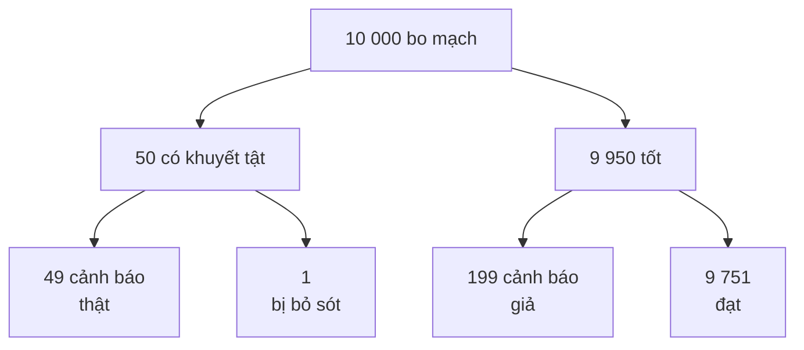
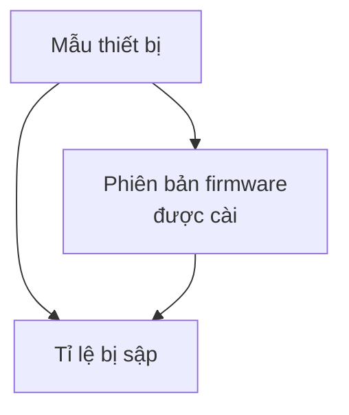

import Figure from '../../../components/Figure.astro';
import CtStatNormalTails from '../../../components/diagrams/CtStatNormalTails.astro';
import CtStatBayesPosterior from '../../../components/diagrams/CtStatBayesPosterior.astro';

[Bài trước](/vi/blog/scientific-reasoning-and-causation) đã cho thấy các giả thuyết được kiểm tra và các nguyên nhân được tìm ra như thế nào, nhưng để lại hai câu hỏi chưa có câu trả lời bằng con số. Một mẩu bằng chứng nên làm thay đổi mức độ tin tưởng mạnh đến đâu? Một khác biệt quan sát được phải lớn đến mức nào thì ngẫu nhiên mới thôi là một lời giải thích tốt? Bài này cung cấp công cụ cho cả hai câu hỏi. Bài coi xác suất là logic của lập luận trong điều kiện không chắc chắn, giống như [bài thứ sáu](/vi/blog/sentential-logic) đã coi bảng chân trị là logic của lập luận chắc chắn.

Bài trình bày ý nghĩa và các quy tắc của xác suất, những lỗi thường gặp nhất khi áp dụng chúng, giá trị kỳ vọng và định lý Bayes. Sau đó bài chuyển sang thống kê về mẫu: sai lệch, sai số chọn mẫu, khoảng tin cậy, kiểm định ý nghĩa và nghịch lý rằng dữ liệu gộp có thể đảo ngược một phép so sánh. Bài chỉ đòi hỏi đại số phổ thông. Hai đoạn mã dùng Python 3 (chạy với phiên bản 3.13) và chỉ dùng thư viện chuẩn (`fractions`, `itertools`, `math`, `random`, `statistics`), và đầu ra của chúng được trích nguyên văn như khi chạy.

## 1. Xác suất là gì

### 1.1 Thang đo

Một **xác suất** (probability) $P(A)$ đo mức độ mà cách bố trí hoặc bằng chứng ủng hộ một biến cố $A$, trên một thang đi từ 0 (không thể xảy ra) đến 1 (chắc chắn xảy ra). Một khả năng 25% và $P(A) = 0.25$ là cùng một phát biểu.

### 1.2 Ba cách diễn giải

Các nhà triết học phân biệt nhiều quan niệm về điều mà một phát biểu xác suất khẳng định (Hacking, 2001). Ba quan niệm có ý nghĩa ở đây, và các quy tắc của Mục 2 đều đúng theo cả ba.

- Theo quan niệm **cổ điển** (classical), xác suất đến từ tính đối xứng giữa các trường hợp đồng khả năng: một yêu cầu được giao cho một khe được chọn ngẫu nhiên của một bộ lập lịch xoay vòng (round-robin) tám khe sẽ rơi vào khe 3 với xác suất 1/8.
- Theo quan niệm **tần suất** (frequency), xác suất là tỉ lệ số lần một kết cục xảy ra trong một chuỗi dài các phép thử: tỉ lệ điện trở từ một dây chuyền sản xuất nằm ngoài dung sai, được ước lượng từ hồ sơ kiểm tra.
- Theo quan niệm **chủ quan** (subjective) hay **Bayes** (Bayesian), xác suất là một mức độ tin tưởng, được các quy tắc xác suất giữ cho nhất quán: con số 0.7 mà một kỹ sư gán cho khả năng lỗi nằm ở bộ nguồn chứ không phải ở firmware.

Tần suất phù hợp với các quá trình lặp lại được; mức độ tin tưởng là cần thiết cho những giả thuyết chỉ xảy ra một lần, chẳng hạn điều gì đã gây ra sự cố ngừng dịch vụ đêm qua, vốn không có tần suất dài hạn nào áp dụng được.

### 1.3 Tỉ số cược

Xác suất đôi khi được phát biểu dưới dạng **tỉ số cược** (odds). Tỉ số cược $a$ ăn $b$ chống lại một biến cố nghĩa là khả năng nó không xảy ra và khả năng nó xảy ra có tỉ lệ $a : b$, nên xác suất của nó là $b/(a+b)$. Tỉ số cược 4 ăn 1 chống lại cho $P = 1/5 = 0.2$, chứ không phải 1/4. Tỉ số cược ủng hộ là tỉ lệ ngược lại. Dạng tỉ số cược xuất hiện trở lại trong định lý Bayes (Mục 5.3), nơi nó biến việc cập nhật thành một phép nhân duy nhất.

## 2. Các quy tắc xác suất

### 2.1 Phần bù và quy tắc cộng

Với một biến cố $A$ bất kỳ, xác suất để $A$ không xảy ra là

$$
P(\neg A) = 1 - P(A).
$$

Với hai biến cố $A$ và $B$, xác suất để ít nhất một trong hai xảy ra được cho bởi **quy tắc cộng** (addition rule)

$$
P(A \lor B) = P(A) + P(B) - P(A \land B).
$$

Số hạng cuối loại bỏ các kết cục trong đó cả hai cùng xảy ra, vốn bị hai số hạng đầu đếm hai lần. Khi $A$ và $B$ **xung khắc** (mutually exclusive, không thể cùng xảy ra), $P(A \land B) = 0$ và các xác suất được cộng trực tiếp.

Một ví dụ có lời giải cho thấy vì sao số hạng hiệu chỉnh này quan trọng. Một bản build hằng đêm có hai giai đoạn thất bại độc lập với nhau: kiểm thử đơn vị thất bại với xác suất 0.2 và kiểm thử tích hợp với xác suất 0.3. Xác suất để bản build thất bại ở một giai đoạn nào đó không phải là $0.2 + 0.3 = 0.5$, vì những đêm cả hai giai đoạn cùng thất bại sẽ bị đếm hai lần. Tính độc lập cho $P(A \land B) = 0.2 \times 0.3 = 0.06$ (Mục 2.2), nên $P(A \lor B) = 0.5 - 0.06 = 0.44$. Quy tắc phần bù cho cùng đáp số nhanh hơn: cả hai giai đoạn cùng thành công với xác suất $0.8 \times 0.7 = 0.56$, và $1 - 0.56 = 0.44$.

### 2.2 Xác suất có điều kiện và quy tắc nhân

**Xác suất có điều kiện** (conditional probability) của $A$ khi biết $B$ là xác suất của $A$ khi đã biết rằng $B$ xảy ra:

$$
P(A \mid B) = \frac{P(A \land B)}{P(B)}, \qquad P(B) > 0.
$$

Sắp xếp lại, ta được **quy tắc nhân** (multiplication rule) cho xác suất để cả hai biến cố cùng xảy ra:

$$
P(A \land B) = P(A \mid B)\, P(B).
$$

Các biến cố là **độc lập** (independent) khi việc biết một biến cố đã xảy ra không làm thay đổi xác suất của biến cố kia, $P(A \mid B) = P(A)$. Chỉ khi đó quy tắc mới rút gọn thành $P(A \land B) = P(A)\,P(B)$.

### 2.3 Tính độc lập trong kỹ thuật độ tin cậy

Các phép tính độ tin cậy cho thấy cả sức mạnh của quy tắc nhân lẫn mối nguy của việc giả định tính độc lập. Giả sử một máy bơm hoạt động suốt một năm với xác suất 0.95. Một hệ thống cần ba máy bơm như vậy hoạt động nối tiếp sẽ hoạt động với xác suất $0.95^3 = 0.857$ nếu các hỏng hóc của chúng độc lập. Hai máy bơm song song, chỉ cần một trong hai là đủ, cùng hỏng với xác suất $0.05^2 = 0.0025$, nên cặp dự phòng hoạt động với xác suất 0.9975.

Con số dự phòng này chỉ tốt bằng giả định độc lập. Nếu cả hai máy bơm dùng chung một bộ nguồn, một bộ lọc hay cùng chịu một lỗi bảo trì, các hỏng hóc của chúng tương quan với nhau, $P(\text{second fails} \mid \text{first fails})$ lớn hơn 0.05 rất nhiều, và xác suất thật để cả hai cùng hỏng có thể gấp nhiều lần 0.0025. Những nguyên nhân chung như vậy được gọi là hỏng hóc **do nguyên nhân chung** (common-cause failure, hay common-mode failure), và kỹ thuật độ tin cậy dành nhiều công sức cho chúng chính vì quy tắc nhân dạng đặc biệt che giấu chúng.

### 2.4 Kiểm tra các quy tắc bằng tính toán

Đoạn mã thứ nhất kiểm tra kết quả về bản build bằng cách đếm các trường hợp đồng khả năng và mô phỏng bài toán ba cánh cửa của Mục 3.3. Nó cũng giải một bài toán theo truyền thống được gán cho Chevalier de Méré và được Pascal cùng Fermat thảo luận trong thư từ trao đổi năm 1654: được một mặt sáu trong 4 lần gieo một con xúc xắc có dễ xảy ra hơn được một cặp sáu trong 24 lần gieo hai con xúc xắc không?

```python
from fractions import Fraction
from itertools import product
import random

# Two independent build stages: unit tests fail with probability 2/10,
# integration tests with probability 3/10. Model each stage as ten
# equally likely outcomes and count the pairs with at least one failure.
pairs = list(product(range(10), repeat=2))
hits = sum(1 for u, i in pairs if u < 2 or i < 3)
print("P(at least one stage fails) =", Fraction(hits, len(pairs)))

# The two bets of the Chevalier de Mere, by the complement rule
p_four = 1 - Fraction(5, 6) ** 4
p_24 = 1 - Fraction(35, 36) ** 24
print(f"one six in 4 rolls: {float(p_four):.4f}")
print(f"double six in 24 rolls: {float(p_24):.4f}")

# Three-door game: simulate staying and switching
random.seed(1)
trials, stay, switch = 100_000, 0, 0
for _ in range(trials):
    prize, pick = random.randrange(3), random.randrange(3)
    opened = next(d for d in range(3) if d != pick and d != prize)
    other = next(d for d in range(3) if d != pick and d != opened)
    stay += pick == prize
    switch += other == prize
print(f"win rate staying: {stay / trials:.3f}, switching: {switch / trials:.3f}")
```

```text
P(at least one stage fails) = 11/25
one six in 4 rolls: 0.5177
double six in 24 rolls: 0.4914
win rate staying: 0.333, switching: 0.667
```

Lập luận hấp dẫn "mỗi lần gieo cho 1/6, nên bốn lần gieo cho 4/6" cộng xác suất của những biến cố không xung khắc. Quy tắc phần bù cho $1 - (5/6)^4 = 0.5177$ với cược thứ nhất và $1 - (35/36)^{24} = 0.4914$ với cược thứ hai, nên cược thứ nhất có lợi còn cược thứ hai thì không, mặc dù lập luận ngây thơ đánh giá chúng ngang nhau ($4/6 = 24/36$).

## 3. Những lỗi thường gặp với xác suất

### 3.1 Ngụy biện của người đánh bạc

**Ngụy biện của người đánh bạc** (gambler's fallacy) là niềm tin rằng các phép thử độc lập sẽ tự cân bằng trong ngắn hạn. Ví dụ là niềm tin rằng một kiểm thử chập chờn (flaky test) đã thành công 30 lần liên tiếp thì "đến lượt" thất bại, hay một bộ sinh bit ngẫu nhiên đã sinh ra tám bit một thì "đến lượt" ra bit không. Khi các phép thử độc lập, kết cục tiếp theo có cùng xác suất bất kể điều gì đã xảy ra trước đó. Lập luận này chỉ đúng khi kết cục phụ thuộc vào quá khứ. Một dụng cụ cắt bị mòn thì đúng là càng dùng càng dễ gãy, và một tác vụ được lập lịch mỗi giờ một lần thì càng lâu kể từ lần chạy trước càng có nhiều khả năng bắt đầu trong phút tiếp theo.

### 3.2 Nhân các xác suất không độc lập

Lỗi ngược lại là nhân xác suất của những biến cố không độc lập, như ví dụ máy bơm ở Mục 2.3 đã cho thấy. Một hồ sơ an toàn đánh giá xác suất ba cảm biến cùng hỏng đồng thời là $10^{-3} \times 10^{-3} \times 10^{-3} = 10^{-9}$ mỗi giờ chỉ tốt bằng giả định rằng không có gì ảnh hưởng đến cả ba cùng lúc. Nếu chúng dùng chung một đường nguồn, một lỗi firmware hay một quy trình hiệu chuẩn, con số thật do nguyên nhân chung đó quyết định và có thể lớn hơn nhiều bậc độ lớn.

### 3.3 Lấy điều kiện theo cách thông tin được tạo ra

Trong một câu đố nổi tiếng, một phần thưởng nằm sau một trong ba cánh cửa. Người chơi chọn một cửa; người dẫn chương trình, vốn biết phần thưởng ở đâu và luôn mở một cửa không có phần thưởng, mở một trong hai cửa còn lại; sau đó người chơi có thể đổi lựa chọn. Nhiều người cho rằng hai cửa còn lại có khả năng như nhau. Không phải vậy: lựa chọn đầu tiên đúng với xác suất 1/3, và hành động của người dẫn chương trình không làm thay đổi điều đó, vì người dẫn chương trình luôn có thể mở một cửa trống. Do đó đổi lựa chọn sẽ thắng với xác suất 2/3, điều mà mô phỏng ở Mục 2.4 xác nhận. Bài học là phải lấy điều kiện theo cách thông tin được tạo ra, chứ không chỉ theo điều mà thông tin nói.

### 3.4 Hồi quy về giá trị trung bình

Khi một đại lượng biến thiên một phần do ngẫu nhiên, một phép đo cực trị bất thường có xu hướng được theo sau bởi một phép đo gần trung bình hơn, vì thành phần ngẫu nhiên đã làm nó cực trị khó có thể lặp lại với toàn bộ cường độ. Đây là **hồi quy về giá trị trung bình** (regression to the mean). Nó gây hiểu lầm mỗi khi một hành động được thực hiện vì một phép đo ở mức cực trị: một dây chuyền sản xuất được tinh chỉnh lại sau tuần tệ nhất của nó, hay một tủ máy chủ được chuyển sang vùng làm mát mới sau tuần nóng nhất của nó, thường sẽ trông khá hơn vào lần sau ngay cả khi hành động đó không có tác dụng gì. Một đánh giá công bằng so sánh với một nhóm đối chứng được chọn theo cùng cách (bài trước, Mục 8).

## 4. Giá trị kỳ vọng

**Giá trị kỳ vọng** (expected value) của một đại lượng $X$ nhận các giá trị $x_i$ với các xác suất $p_i$ là trung bình có trọng số theo xác suất

$$
E[X] = \sum_i p_i\, x_i .
$$

Một người lập kế hoạch bảo trì phải quyết định có nên dự trữ một bộ truyền động dự phòng giá 400 đô la hay không. Không có bộ dự phòng, một lần hỏng của bộ đang lắp đặt sẽ làm dừng một dây chuyền sản xuất với chi phí 10 000 đô la, và người lập kế hoạch ước lượng xác suất xảy ra một lần hỏng như vậy trong năm là 0.05. Chi phí kỳ vọng của việc không dự trữ là $0.05 \times 10\,000 = 500$ đô la, nhiều hơn 400 đô la giá của bộ dự phòng, nên dự trữ là chính sách tốt hơn xét theo chi phí kỳ vọng.

Một giá trị kỳ vọng là trung bình dài hạn trên mỗi quyết định, không phải là dự báo cho bất kỳ kết cục đơn lẻ nào: trong một năm cụ thể, dây chuyền hoặc dừng hoặc không, và chi phí là 0 hoặc 10 000 đô la, không bao giờ là 500. Một trò cược có giá trị kỳ vọng bằng không được gọi là **công bằng** (fair). [Bài thứ mười một](/vi/blog/strategic-thinking-and-decisions) dùng giá trị kỳ vọng để so sánh các quyết định và, trong số các giới hạn của nó, nêu cách độ hữu dụng (utility) thay thế cho tiền khi thái độ đối với rủi ro có vai trò.

## 5. Định lý Bayes

### 5.1 Định lý

Áp dụng quy tắc nhân theo cả hai chiều, $P(H \land E) = P(H \mid E)\,P(E) = P(E \mid H)\,P(H)$, rồi chia cho $P(E)$, ta được **định lý Bayes** (Bayes' theorem):

$$
P(H \mid E) = \frac{P(E \mid H)\, P(H)}{P(E)}, \qquad
P(E) = P(E \mid H)\,P(H) + P(E \mid \neg H)\,P(\neg H).
$$

Ở đây $H$ là một giả thuyết và $E$ là bằng chứng. $P(H)$ là xác suất **tiên nghiệm** (prior) của giả thuyết trước khi có bằng chứng, $P(E \mid H)$ là **hàm hợp lý** (likelihood) của bằng chứng nếu giả thuyết đúng, và $P(H \mid E)$ là xác suất **hậu nghiệm** (posterior) sau khi đã tính đến bằng chứng.

### 5.2 Tỉ lệ nền

Một hệ thống kiểm tra quang học tự động kiểm tra các mối hàn. Giả sử 0.5% số bo mạch từ một quy trình có khuyết tật (**tỉ lệ nền**, base rate), hệ thống phát cảnh báo trên 98% số bo mạch có khuyết tật (**độ nhạy**, sensitivity) và cũng phát cảnh báo trên 2% số bo mạch tốt (**tỉ lệ dương tính giả**, false-positive rate). Một cảnh báo được phát trên một bo mạch. Khả năng bo mạch đó có khuyết tật là bao nhiêu? Với $D$ là "có khuyết tật" và $A$ là "có cảnh báo",

$$
P(D \mid A) = \frac{0.98 \times 0.005}{0.98 \times 0.005 + 0.02 \times 0.995} = \frac{0.0049}{0.0248} = 0.198 .
$$

Dù độ nhạy là 98%, chỉ khoảng một trong năm cảnh báo là khuyết tật thật. Kết quả này làm phần lớn mọi người ngạc nhiên vì nó bị tỉ lệ nền chi phối: các bo mạch tốt nhiều hơn hẳn, đến mức 2% cảnh báo giả của chúng nhiều gấp bốn lần số cảnh báo thật. Việc bỏ qua tỉ lệ nền, **sự bỏ qua tỉ lệ nền** (base-rate neglect), là một trong những lỗi được ghi nhận rõ nhất của phán đoán trực giác (Tversky và Kahneman, 1974).

Cùng phép tính đó dễ theo dõi hơn khi dùng **tần số tự nhiên** (natural frequencies), tức số trường hợp trên một tổng cố định, mà nghiên cứu cho thấy con người diễn giải chính xác hơn xác suất có điều kiện (Gigerenzer và Hoffrage, 1995). Trong 10 000 bo mạch:



*Hình 1. Ví dụ kiểm tra dưới dạng tần số tự nhiên cho 10 000 bo mạch. Hãy so sánh hai ô cảnh báo: cảnh báo giả từ rất nhiều bo mạch tốt nhiều hơn cảnh báo thật từ số ít bo mạch có khuyết tật.*

Có $49 + 199 = 248$ cảnh báo, trong đó 49 cảnh báo là thật: $49/248 = 0.198$, cùng một đáp số.

### 5.3 Dạng tỉ số cược và bằng chứng lặp lại

Chia định lý Bayes cho $H$ cho chính định lý đó cho $\neg H$ sẽ loại bỏ $P(E)$ và cho **dạng tỉ số cược** (odds form):

$$
\frac{P(H \mid E)}{P(\neg H \mid E)} = \frac{P(H)}{P(\neg H)} \times \frac{P(E \mid H)}{P(E \mid \neg H)} .
$$

Tỉ số cược hậu nghiệm bằng tỉ số cược tiên nghiệm nhân với **tỉ số hợp lý** (likelihood ratio, LR), đại lượng đo xem bằng chứng có khả năng xảy ra cao hơn bao nhiêu lần nếu giả thuyết đúng so với nếu giả thuyết sai. Với hệ thống kiểm tra, $\text{LR} = 0.98/0.02 = 49$. Tỉ số cược tiên nghiệm của một khuyết tật là $0.005/0.995$, nên tỉ số cược hậu nghiệm là $0.2462$, tương ứng xác suất $0.2462/1.2462 = 0.198$ như trước.

Nếu một bo mạch đã phát cảnh báo được kiểm tra lại bằng một phương pháp thứ hai, độc lập, có cùng các đặc tính và cũng phát cảnh báo, tỉ số cược lại được nhân thêm 49 lần ($\text{LR} = 49^2 = 2401$ tổng cộng) và xác suất có khuyết tật tăng lên 0.923. Chữ "độc lập" mang toàn bộ sức nặng ở đây: chạy lại cùng camera trên cùng bo mạch sẽ lặp lại đúng cảnh báo giả đó, và tỉ số hợp lý của nó sẽ gần bằng 1.

<Figure caption="Hình 2. Xác suất hậu nghiệm của một khuyết tật theo xác suất tiên nghiệm, tính từ dạng tỉ số cược của định lý Bayes, với các tỉ số hợp lý 1, 49 và 2401. Đường nét đứt đánh dấu xác suất tiên nghiệm 0.005 dùng trong bài: một cảnh báo nâng nó lên 0.20 và hai cảnh báo độc lập nâng lên 0.92. Bằng chứng mạnh đẩy một xác suất tiên nghiệm thấp đi rất xa nhưng không nhất thiết đến gần chắc chắn.">
  <CtStatBayesPosterior />
</Figure>

### 5.4 Sự xác nhận theo Bayes

Định lý Bayes làm chính xác khái niệm xác nhận được dùng trong bài trước (Howson và Urbach, 2006). Bằng chứng $E$ **xác nhận** (confirms) một giả thuyết $H$ khi $P(H \mid E) > P(H)$, **làm suy yếu** (disconfirms) nó khi $P(H \mid E) < P(H)$, và trung lập khi hai đại lượng bằng nhau. Theo dạng tỉ số cược, $E$ xác nhận $H$ đúng khi tỉ số hợp lý lớn hơn 1, tức là khi $E$ có khả năng xảy ra cao hơn nếu $H$ đúng so với nếu $H$ sai. Một dự đoán có lẽ vẫn đúng ngay cả khi $H$ sai thì có tỉ số hợp lý gần 1 và xác nhận rất ít; một dự đoán mạo hiểm, chính xác thì có tỉ số lớn và xác nhận rất nhiều. Đây là lý do, đã được phát biểu không hình thức ở bài trước, khiến các dự đoán gây bất ngờ là những phép thử có giá trị nhất.

## 6. Mẫu và sai lệch

### 6.1 Tổng thể và mẫu

Thống kê thường lập luận từ một **mẫu** (sample), tức các trường hợp được khảo sát, đến một **tổng thể** (population), tức toàn bộ tập các trường hợp được quan tâm: mọi điện trở từ một lô sản xuất, mọi người dùng của một dịch vụ, mọi yêu cầu được phục vụ trong một tuần. Một con số được tính từ mẫu, chẳng hạn tỉ lệ điện trở bị lỗi, là một **thống kê** (statistic); con số tương ứng của tổng thể là một **tham số** (parameter), và thống kê được dùng để ước lượng nó.

### 6.2 Mẫu ngẫu nhiên và mẫu bị sai lệch

Một **mẫu ngẫu nhiên** (random sample) được rút bằng một quy trình cho mọi phần tử của tổng thể cùng một cơ hội được chọn, chẳng hạn đánh số các chi tiết trong một lô và rút số bằng một bộ sinh số ngẫu nhiên. Một người kiểm tra nhặt chi tiết "một cách ngẫu nhiên" bằng tay thì không phải là quy trình như vậy. Khi quy trình ưu tiên một số phần tử, mẫu bị **sai lệch** (biased), và các thống kê của nó có thể khác các tham số một cách có hệ thống, dù mẫu lớn đến đâu. Các nguồn sai lệch thường gặp gồm những nguồn sau.

- **Sai lệch chọn lọc** (selection bias): khung chọn mẫu bỏ sót một phần tổng thể. Số liệu hỏng hóc ngoài hiện trường chỉ lấy từ các thiết bị được trả lại theo bảo hành sẽ bỏ sót các hỏng hóc ở những thiết bị đã hết bảo hành hoặc những thiết bị mà khách hàng không buồn trả lại.
- **Sai lệch do không phản hồi** (non-response bias): những người phản hồi khác với những người không phản hồi. Một khảo sát mức độ hài lòng được 5% người dùng trả lời chủ yếu phản ánh những người dùng chọn trả lời khảo sát.
- **Lấy mẫu thuận tiện** (convenience sampling): khảo sát những gì dễ tiếp cận, chẳng hạn lớp chi tiết trên cùng trong một thùng, vốn có thể đến từ cuối một đợt sản xuất.
- **Sai lệch kẻ sống sót** (survivorship bias): chỉ nghiên cứu những trường hợp đã sống sót qua một bộ lọc nào đó, chẳng hạn các công ty khởi nghiệp vẫn còn hoạt động, rồi suy ra điều gì đã làm chúng thành công.

Một mẫu bị sai lệch lớn hơn không phải là một mẫu tốt hơn; nó chỉ ước lượng sai đại lượng một cách chính xác hơn.

## 7. Sai số chọn mẫu và khoảng tin cậy

### 7.1 Sai số chọn mẫu

Ngay cả một mẫu ngẫu nhiên hoàn hảo cũng không tái hiện chính xác tổng thể: các mẫu ngẫu nhiên khác nhau cho các thống kê khác nhau. **Sai số chọn mẫu** (sampling error) sinh ra từ đó giảm khi mẫu lớn lên. Với trung bình của $n$ phép đo độc lập có độ lệch chuẩn $s$, độ lớn điển hình của sai số chọn mẫu là **sai số chuẩn** (standard error)

$$
\text{SE} = \frac{s}{\sqrt{n}} ,
$$

nên tăng mẫu lên bốn lần thì sai số giảm một nửa. Với nhiều thống kê tính từ mẫu lớn, phân phối mẫu gần với một **phân phối chuẩn** (normal distribution), đường cong hình chuông dưới đây. Khoảng 68.3% giá trị của nó nằm trong phạm vi một độ lệch chuẩn quanh trung bình, 95.4% trong phạm vi hai độ lệch chuẩn và 95% trong phạm vi 1.96 (Freedman, Pisani và Purves, 2007).

<Figure caption="Hình 3. Mật độ phân phối chuẩn tắc, tính từ φ(z) = exp(−z²/2)/√(2π). Vùng trung tâm giữa −1.96 và 1.96 chứa 95% diện tích; mỗi đuôi được tô chứa 2.5%. Đây là các ngưỡng đứng sau một khoảng tin cậy 95% và một kiểm định hai phía ở mức 5%.">
  <CtStatNormalTails />
</Figure>

### 7.2 Khoảng tin cậy

Với mẫu lớn, một **khoảng tin cậy** (confidence interval) 95% cho trung bình tổng thể là trung bình mẫu cộng hoặc trừ $1.96\,\text{SE}$. Con số 95% mô tả quy trình, không phải một khoảng cụ thể: nếu rút ra nhiều mẫu ngẫu nhiên và tính một khoảng từ mỗi mẫu, khoảng 95% số khoảng đó sẽ chứa trung bình thật. Bất kỳ một khoảng nào đã tính ra thì hoặc chứa nó, hoặc không.

Với một tỉ lệ $\hat p$ ước lượng từ $n$ câu trả lời, sai số chuẩn là $\sqrt{\hat p(1-\hat p)/n}$, và nửa độ rộng $1.96\sqrt{\hat p(1-\hat p)/n}$ là **biên sai số** (margin of error) được công bố kèm các cuộc khảo sát. Tại $\hat p = 0.5$, trường hợp xấu nhất, $n = 1000$ cho biên sai số 3.1 điểm phần trăm, và để giảm xuống 2 điểm cần $n = (1.96 \times 0.5/0.02)^2 = 2401$, khoảng 2.4 lần số câu trả lời. Biên sai số chỉ bao hàm sai số chọn mẫu; nó không nói gì về sai lệch.

Đoạn mã thứ hai (phần đầu của nó được dùng ở Mục 8.2) kiểm tra nhận định về độ phủ bằng mô phỏng. Nó rút 20 000 mẫu ngẫu nhiên, mỗi mẫu 25 điện trở, từ một tổng thể có trung bình 1000 Ω và độ lệch chuẩn 5 Ω, rồi đếm số lần khoảng tin cậy chứa trung bình thật. Đoạn mã dùng trước tiên hệ số nhân 1.96, sau đó 2.064, giá trị lấy từ phân phối $t$ Student (Student's $t$ distribution) với 24 bậc tự do, vốn tính đến việc chính $s$ cũng được ước lượng từ mẫu.

```python
from math import comb, sqrt
from statistics import NormalDist, mean, stdev
import random

# Exact binomial test: 17 defects in 500 parts, null defect rate 2%
n, p0, k = 500, 0.02, 17
sd = sqrt(n * p0 * (1 - p0))
p_value = sum(comb(n, i) * p0**i * (1 - p0)**(n - i) for i in range(k, n + 1))
print(f"expected {n * p0:.0f}, sd {sd:.2f}, z {(k - n * p0) / sd:.2f}, one-sided p = {p_value:.4f}")

# Coverage of mean +/- c * s / sqrt(m) for samples of m = 25 resistors
random.seed(2)
true_mean, sigma, m, reps = 1000.0, 5.0, 25, 20_000
z = NormalDist().inv_cdf(0.975)   # 1.960
t24 = 2.064                       # Student's t, 24 degrees of freedom
hits_z = hits_t = 0
for _ in range(reps):
    x = [random.gauss(true_mean, sigma) for _ in range(m)]
    se = stdev(x) / sqrt(m)
    err = abs(mean(x) - true_mean)
    hits_z += err <= z * se
    hits_t += err <= t24 * se
print(f"coverage with z = {z:.3f}: {hits_z / reps:.3f}")
print(f"coverage with t = {t24}: {hits_t / reps:.3f}")
```

```text
expected 10, sd 3.13, z 2.24, one-sided p = 0.0257
coverage with z = 1.960: 0.936
coverage with t = 2.064: 0.948
```

Với 25 phép đo, hệ số nhân 1.96 bao được trung bình thật trong 93.6% số mẫu, hơi thấp hơn mức danh định 95%; hệ số nhân $t$ đưa độ phủ lên 94.8%, nằm trong phạm vi sai số mô phỏng so với 95%. Với các mẫu cỡ vài trăm, khác biệt giữa hai hệ số nhân trở nên không đáng kể.

## 8. Kiểm định ý nghĩa

### 8.1 Logic của một phép kiểm định

Một **kiểm định ý nghĩa** (significance test) hỏi xem dữ liệu có phù hợp với một giả thuyết cho rằng một hiệu ứng cụ thể không tồn tại hay không. Nó có cấu trúc của phương pháp giả thuyết – diễn dịch ở bài trước, với một dự đoán mang tính xác suất.

1. Phát biểu một **giả thuyết không** (null hypothesis) $H_0$, thường là "không có hiệu ứng" hoặc "không có khác biệt", và một **giả thuyết đối** (alternative hypothesis) $H_1$.
2. Chọn một **mức ý nghĩa** (significance level) $\alpha$, tức rủi ro bác bỏ sai $H_0$ mà ta sẵn sàng chấp nhận; 0.05 và 0.01 là các mức quy ước.
3. Tính **giá trị p** (p-value): xác suất, nếu $H_0$ đúng, để có một kết quả ít nhất cũng cực trị như kết quả đã quan sát.
4. Nếu $p \le \alpha$, bác bỏ $H_0$ và gọi kết quả là **có ý nghĩa thống kê** (statistically significant); nếu không, không bác bỏ nó.

### 8.2 Một phép kiểm định có lời giải

Một nhà cung cấp tuyên bố rằng tối đa 2% số đầu nối của họ bị lỗi. Trong một mẫu ngẫu nhiên gồm 500 đầu nối, người kiểm tra tìm thấy 17 lỗi. Theo $H_0$ (tỉ lệ lỗi 2%), số lỗi kỳ vọng là $500 \times 0.02 = 10$, với độ lệch chuẩn $\sqrt{500 \times 0.02 \times 0.98} = 3.13$, nên 17 nằm cao hơn giá trị kỳ vọng 2.24 độ lệch chuẩn. Giả thuyết đối là một phía ($H_1$: tỉ lệ lớn hơn 2%), nên giá trị p là xác suất có từ 17 lỗi trở lên. Phần đầu của đoạn mã ở Mục 7.2 cộng các xác suất nhị thức chính xác và cho $p = 0.0257$. Ở $\alpha = 0.05$, tuyên bố bị bác bỏ; ở $\alpha = 0.01$ thì không. Bằng chứng ở mức vừa phải, và một mẫu thứ hai là bước tiếp theo hợp lý trước khi đi đến một tranh chấp hợp đồng.

### 8.3 Hai loại sai lầm

Một phép kiểm định có thể sai theo hai cách. Một **sai lầm loại I** (Type I error) bác bỏ một giả thuyết không đúng; xác suất của nó là $\alpha$. Một **sai lầm loại II** (Type II error) không bác bỏ được một giả thuyết không sai; xác suất $\beta$ của nó phụ thuộc vào độ lớn của hiệu ứng thật và vào cỡ mẫu, và $1 - \beta$ là **lực** (power) của phép kiểm định. Giảm $\alpha$ làm giảm sai lầm loại I với cái giá là nhiều sai lầm loại II hơn với cùng một mẫu, và chỉ có thêm dữ liệu mới giảm được cả hai. Vì vậy, việc không bác bỏ được $H_0$ không phải là bằng chứng cho thấy không có hiệu ứng: một nghiên cứu nhỏ có thể đã có rất ít cơ hội phát hiện ra hiệu ứng.

### 8.4 Những cách đọc sai giá trị p

Giá trị p rất dễ bị đọc sai, và Hiệp hội Thống kê Hoa Kỳ (American Statistical Association, ASA) đã đưa ra một tuyên bố năm 2016 để sửa những lỗi thường gặp nhất (Wasserstein và Lazar, 2016).

- **Nó không phải là xác suất để giả thuyết không là đúng.** Nó là xác suất của dữ liệu khi biết $H_0$, không phải xác suất của $H_0$ khi biết dữ liệu; chuyển đại lượng này thành đại lượng kia cần định lý Bayes và một xác suất tiên nghiệm (Mục 5).
- **Ý nghĩa thống kê không phải là ý nghĩa thực tiễn.** Với một mẫu đủ lớn, một khác biệt quá nhỏ để có ý nghĩa thực tế vẫn trở nên có ý nghĩa thống kê; độ lớn của hiệu ứng, cùng khoảng tin cậy của nó, phải được báo cáo và đánh giá riêng.
- **Nhiều phép kiểm định sinh ra dương tính giả.** Nếu thực hiện 20 phép so sánh độc lập ở $\alpha = 0.05$ và không tồn tại hiệu ứng thật nào, xác suất để ít nhất một phép so sánh ra kết quả có ý nghĩa là $1 - 0.95^{20} = 0.64$. Chỉ báo cáo những phép so sánh có ý nghĩa, trong số rất nhiều phép đã thử, khiến ngẫu nhiên trông như phát kiến, và đó là một con đường dẫn đến những thất bại tái lập được mô tả ở bài trước.

## 9. Tương quan, gây nhiễu và nghịch lý Simpson

### 9.1 Tương quan theo ngôn ngữ xác suất

Theo ngôn ngữ xác suất, $A$ và $B$ **tương quan dương** (positively correlated; có liên hệ dương, theo từ vựng của bài trước, Mục 6.1) khi $P(A \mid B) > P(A \mid \neg B)$, tương quan âm khi bất đẳng thức đảo chiều, và không tương quan (độc lập) khi hai đại lượng bằng nhau. Việc một khác biệt quan sát được giữa $P(A \mid B)$ và $P(A \mid \neg B)$ trong một mẫu có phản ánh một tương quan thật hay không, tự nó là một câu hỏi kiểm định ý nghĩa. Ngay cả một tương quan thật, như bài trước đã cho thấy, cũng có thể đến từ một nguyên nhân chung chứ không phải từ một quan hệ nhân quả.

### 9.2 Nghịch lý Simpson

Một phép so sánh có thể đảo chiều khi dữ liệu từ các nhóm khác nhau được gộp lại. Đây là **nghịch lý Simpson** (Simpson's paradox), đặt theo tên phân tích các bảng tiếp liên (contingency table) năm 1951 của E. H. Simpson (Simpson, 1951). Xét tỉ lệ bị sập của hai phiên bản firmware trong một tháng, trên hai mẫu thiết bị.

| Mẫu thiết bị | Phiên bản 1: số lần sập / số thiết bị | Tỉ lệ | Phiên bản 2: số lần sập / số thiết bị | Tỉ lệ |
|---|---|---|---|---|
| Mẫu X (cũ hơn) | 40 / 200 | 20% | 136 / 800 | 17% |
| Mẫu Y (mới hơn) | 40 / 800 | 5% | 8 / 200 | 4% |
| Cả hai mẫu | 80 / 1000 | 8% | 144 / 1000 | 14.4% |

Phiên bản 2 có tỉ lệ bị sập thấp hơn trên từng mẫu thiết bị, nhưng lại có tỉ lệ cao hơn khi tính chung. Lý do là biến gây nhiễu (confounder): phiên bản 2 được triển khai chủ yếu cho mẫu X, vốn bị sập nhiều hơn với bất kỳ firmware nào. Việc gộp dữ liệu đem phiên bản 2 trên phần lớn là thiết bị cũ so với phiên bản 1 trên phần lớn là thiết bị mới.



*Hình 4. Mẫu thiết bị là một biến gây nhiễu: nó ảnh hưởng đến cả việc thiết bị nhận phiên bản firmware nào lẫn tần suất thiết bị bị sập.*

Phép so sánh nào đúng phụ thuộc vào cấu trúc nhân quả, không chỉ vào các con số (Pearl, 2009). Ở đây mẫu thiết bị ảnh hưởng đến cả phiên bản nào được cài lẫn tần suất thiết bị bị sập, nên phép so sánh theo từng mẫu thiết bị mới là phép so sánh công bằng, và phiên bản 2 tốt hơn. Một trường hợp thực tế nổi tiếng là dữ liệu tuyển sinh sau đại học năm 1973 của Đại học California, Berkeley. Ở đó, một khoảng chênh lệch chung giữa tỉ lệ trúng tuyển của nam và nữ phần lớn biến mất khi xét trong từng khoa, vì nữ giới nộp đơn nhiều hơn vào những khoa nhận một tỉ lệ nhỏ hơn trên tổng số người nộp đơn (Bickel, Hammel và O'Connell, 1975).

### 9.3 Vì sao thử nghiệm ngẫu nhiên hóa có ích

Nghịch lý Simpson và các biến gây nhiễu của bài trước có chung một cách khắc phục khi có thể làm thí nghiệm. Gán ngẫu nhiên các phiên bản firmware cho thiết bị sẽ làm cho mẫu thiết bị, cùng mọi yếu tố khác, độc lập với phiên bản xét theo kỳ vọng, nên phép so sánh gộp sẽ công bằng. Khi đó một kiểm định ý nghĩa trả lời câu hỏi còn lại: khác biệt giữa các nhóm có lớn hơn mức mà riêng việc phân nhóm ngẫu nhiên tạo ra hay không. Thí nghiệm có đối chứng và kiểm định ý nghĩa là hai nửa của một phương pháp: ngẫu nhiên hóa loại trừ các khác biệt có hệ thống, và kiểm định loại trừ yếu tố ngẫu nhiên.

## 10. Bài tập

**Bài tập 1.** Hai cảm biến độc lập, mỗi cảm biến hỏng trong một nhiệm vụ với xác suất 0.01. Tìm xác suất để cả hai cùng hỏng và xác suất để ít nhất một cảm biến hỏng. Vì sao con số thứ nhất có thể quá lạc quan?

*Đáp án.* Cả hai: $0.01^2 = 0.0001$. Ít nhất một: $1 - 0.99^2 = 0.0199$. Nếu các cảm biến dùng chung một bộ nguồn, một giá lắp hay một môi trường, các hỏng hóc của chúng tương quan với nhau và xác suất để cả hai cùng hỏng có thể lớn hơn 0.0001 rất nhiều.

**Bài tập 2.** Một quy tắc giám sát rung động gắn cờ 90% số ổ bi đang hình thành lỗi và 5% số ổ bi khỏe mạnh. Trong một nhà máy, 2% số ổ bi có lỗi như vậy. Tỉ lệ ổ bi bị gắn cờ thực sự có lỗi là bao nhiêu? Hãy trả lời bằng tần số tự nhiên.

*Đáp án.* Trong 1000 ổ bi, 20 ổ có lỗi và 18 ổ trong số đó bị gắn cờ; 980 ổ khỏe mạnh và 49 ổ trong số đó bị gắn cờ. Vậy $18/(18 + 49) = 0.269$: khoảng một trong bốn lần gắn cờ là lỗi thật.

**Bài tập 3.** Trong một mẫu ngẫu nhiên gồm 400 kỹ sư, 60% ưa thích một công cụ. Biên sai số 95% là bao nhiêu, và cần mẫu lớn đến đâu để giảm nó đi một nửa?

*Đáp án.* $1.96\sqrt{0.6 \times 0.4/400} = 0.048$, khoảng 4.8 điểm phần trăm. Giảm một nửa cần mẫu lớn gấp bốn lần, 1600 kỹ sư (biên sai số 2.4 điểm).

**Bài tập 4.** Một bộ sinh bit ngẫu nhiên phần cứng phải xuất ra bit một và bit không với xác suất như nhau. Trong 100 bit, nó sinh ra 61 bit một. Hãy kiểm định giả thuyết xác suất bằng nhau ở $\alpha = 0.05$, hai phía.

*Đáp án.* Theo $H_0$, số bit một có trung bình 50 và độ lệch chuẩn $\sqrt{100 \times 0.5 \times 0.5} = 5$, nên 61 cách trung bình 2.2 độ lệch chuẩn. Xác suất nhị thức chính xác để có từ 61 trở lên là 0.0176, và giá trị p hai phía bằng gấp đôi, 0.0352, nhỏ hơn 0.05: bác bỏ $H_0$ ở mức 5% (nhưng không ở mức 1%). Một phép thử nghiệm thu thực sự cho một bộ sinh số ngẫu nhiên sẽ dùng nhiều bit hơn rất nhiều và một bộ gồm nhiều phép kiểm định.

**Bài tập 5.** Một bản tin cho biết tỉ lệ sống sót sau một ca phẫu thuật ở một bệnh viện thấp hơn ở một bệnh viện khác, và kết luận rằng đó là bệnh viện kém hơn. Cần kiểm tra điều gì trước khi chấp nhận kết luận này?

*Đáp án.* Liệu hai bệnh viện có điều trị những bệnh nhân tương đương nhau hay không. Nếu bệnh viện thứ nhất tiếp nhận nhiều ca nguy cơ cao hơn, nó có thể có tỉ lệ sống sót tốt hơn ở mọi nhóm nguy cơ mà vẫn có tỉ lệ chung thấp hơn (nghịch lý Simpson). Các tỉ lệ nên được so sánh trong từng nhóm nguy cơ, có chú ý đến cỡ mẫu và sai số chọn mẫu.

## 11. Tóm tắt

| Câu hỏi | Trả lời |
|---|---|
| Các quy tắc cơ bản là gì? | $P(\neg A) = 1 - P(A)$; $P(A \lor B) = P(A) + P(B) - P(A \land B)$; $P(A \land B) = P(A \mid B)\,P(B)$. |
| Khi nào có thể nhân trực tiếp các xác suất? | Chỉ với các biến cố độc lập; các nguyên nhân chung phá vỡ tính độc lập. |
| Giá trị kỳ vọng là gì? | Kết cục trung bình có trọng số theo xác suất, tức trung bình dài hạn trên mỗi phép thử. |
| Định lý Bayes làm gì? | Chuyển $P(E \mid H)$ thành $P(H \mid E)$; ở dạng tỉ số cược, tỉ số cược hậu nghiệm = tỉ số cược tiên nghiệm × tỉ số hợp lý. |
| Vì sao tỉ lệ nền quan trọng? | Với một tình trạng hiếm gặp, dương tính giả từ số đông các trường hợp âm tính có thể nhiều hơn dương tính thật. |
| Điều gì làm cho một mẫu có giá trị thông tin? | Việc chọn ngẫu nhiên, vốn loại bỏ sai lệch chọn lọc; và cỡ mẫu, vốn làm giảm sai số chọn mẫu tỉ lệ với $1/\sqrt{n}$. |
| Một khoảng tin cậy 95% có nghĩa là gì? | Quy trình bắt được giá trị thật trong 95% số mẫu. |
| Giá trị p đo điều gì? | Xác suất của một kết quả ít nhất cũng cực trị như kết quả quan sát được nếu giả thuyết không là đúng, không phải xác suất của giả thuyết. |
| Nghịch lý Simpson là gì? | Một phép so sánh bị đảo chiều khi các nhóm khác nhau về một biến gây nhiễu được gộp lại. |

Xác suất mở rộng logic sang các kết luận không chắc chắn, và thống kê áp dụng nó vào việc lập luận từ mẫu. Cả hai đều trả lời các câu hỏi về sự kiện: một biến cố có khả năng xảy ra đến đâu, bằng chứng ủng hộ một giả thuyết mạnh đến đâu. [Bài tiếp theo](/vi/blog/reasoning-about-values) chuyển sang những câu hỏi mà riêng bằng chứng không giải quyết được, về điều gì là tốt, là đúng hay đáng làm, và hỏi làm thế nào để phân tích các lập luận về giá trị với cùng sự cẩn trọng.

### Tài liệu tham khảo

- P. J. Bickel, E. A. Hammel and J. W. O'Connell, "Sex bias in graduate admissions: Data from Berkeley," *Science*, vol. 187, no. 4175, pp. 398–404, 1975.
- D. Freedman, R. Pisani and R. Purves, *Statistics*, 4th ed., W. W. Norton, 2007.
- G. Gigerenzer and U. Hoffrage, "How to improve Bayesian reasoning without instruction: Frequency formats," *Psychological Review*, vol. 102, no. 4, pp. 684–704, 1995.
- I. Hacking, *An Introduction to Probability and Inductive Logic*, Cambridge University Press, 2001.
- C. Howson and P. Urbach, *Scientific Reasoning: The Bayesian Approach*, 3rd ed., Open Court, 2006.
- J. Y. F. Lau and J. Chan, *Critical Thinking Web*, Department of Philosophy, The University of Hong Kong, 2004–2026. https://philosophy.hku.hk/think/
- J. Pearl, *Causality: Models, Reasoning, and Inference*, 2nd ed., Cambridge University Press, 2009.
- E. H. Simpson, "The interpretation of interaction in contingency tables," *Journal of the Royal Statistical Society: Series B*, vol. 13, no. 2, pp. 238–241, 1951.
- A. Tversky and D. Kahneman, "Judgment under uncertainty: Heuristics and biases," *Science*, vol. 185, no. 4157, pp. 1124–1131, 1974.
- R. L. Wasserstein and N. A. Lazar, "The ASA's statement on p-values: Context, process, and purpose," *The American Statistician*, vol. 70, no. 2, pp. 129–133, 2016.
