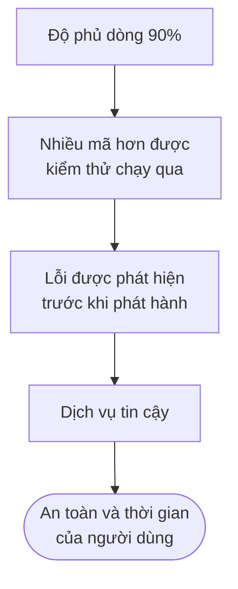
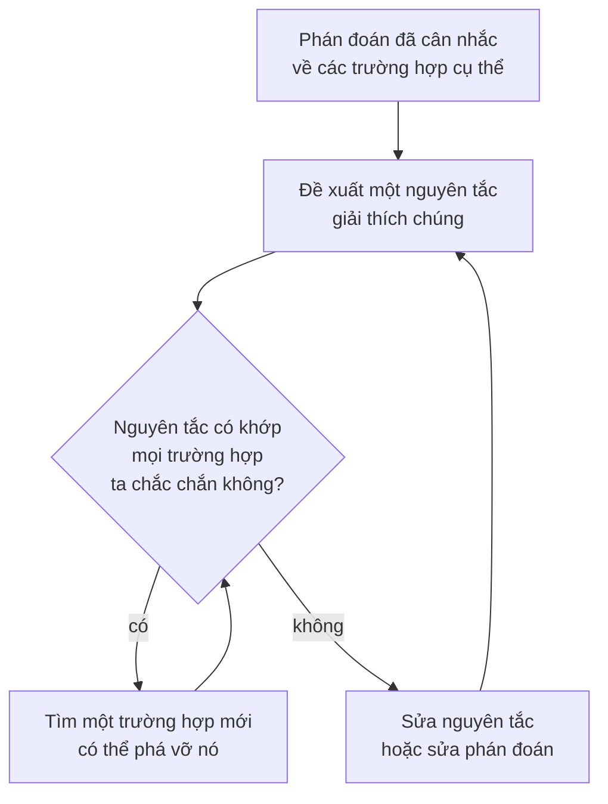

import Figure from '../../../components/Figure.astro';
import CtValHohfeld from '../../../components/diagrams/CtValHohfeld.astro';

Các bài trước của loạt bài này bàn về những câu hỏi mà bằng chứng có thể giải quyết, ít nhất là về nguyên tắc. Một tiền đề có đúng không, một nguyên nhân có gây ra một kết quả không, một giả thuyết có xác suất bao nhiêu khi đã có dữ liệu: [bài thứ tám](/vi/blog/scientific-reasoning-and-causation) và [bài thứ chín](/vi/blog/probability-and-statistical-reasoning) đã cho thấy quan sát và tính toán trả lời những câu hỏi như vậy ra sao. Nhiều câu hỏi quan trọng nhất trong kỹ thuật và trong cuộc sống lại thuộc một loại khác. Có nên phát hành một sản phẩm khi đã biết nó có lỗi? Xếp hạng ứng viên bằng một mô hình được huấn luyện trên các quyết định tuyển dụng trong quá khứ có công bằng không? Một thiết kế rẻ hơn có chấp nhận được không nếu nó kém an toàn hơn một chút? Không phép đo nào tự nó trả lời được những câu này, vì chúng hỏi điều gì *nên* làm, chứ không chỉ hỏi điều gì *là* sự thật.

Dù vậy, những câu hỏi ấy vẫn có thể được lập luận một cách cẩn thận. Bài này áp dụng công cụ của [bài thứ ba](/vi/blog/arguments-and-their-structure) (tiền đề, kết luận, giả định ẩn) cho những lập luận có kết luận là phán đoán giá trị. Bài tách nhận định mô tả khỏi nhận định chuẩn tắc, giá trị công cụ khỏi giá trị nội tại, giải thích vì sao chỉ riêng sự kiện không sinh ra được một chữ "nên" có nội dung thực chất (substantive), và xem xét ba quan điểm về vị thế của các nhận định đạo đức. Sau đó bài trình bày các phương pháp chính của lập luận đạo đức (tính nhất quán, cân bằng phản tư và loại suy), ba cách đánh giá một hành động (theo hệ quả của nó, theo các quyền mà nó tôn trọng và theo phẩm chất mà nó thể hiện) và một bộ từ vựng chính xác về quyền. Bài không đứng về phía nào trong các câu hỏi đạo đức còn tranh cãi; mục đích của nó là cho thấy một lập luận tốt về những câu hỏi ấy trông như thế nào.

## 1. Giá trị và phán đoán giá trị

### 1.1 Giá trị là gì

Các lập luận về việc nên làm gì đều viện đến những chuẩn mực: một biên an toàn, sự công bằng giữa người dùng, vẻ đẹp của một chứng minh, chi phí của một thiết kế. Một chuẩn mực như vậy là một **giá trị** (value), và một nhận định áp dụng chuẩn mực đó là một **phán đoán giá trị** (value judgment): "đợt phát hành đã được xử lý thiếu trung thực", "chứng minh này đẹp", "lịch trực mới không công bằng với ca đêm".

Cùng một từ đánh giá có thể viện đến những chuẩn mực khác nhau. "Thiết kế này tệ" có thể có nghĩa là nó không đạt mục đích (nó quá nhiệt khi chịu tải), là nó gây thiệt hại cho ai đó (nó che giấu một rủi ro đã biết với khách hàng), hoặc là nó vụng về (không ai đọc nổi mã nguồn). Ba cách hiểu này đòi hỏi những kiểu hỗ trợ khác nhau. Cách thứ nhất phần lớn được giải quyết bằng kiểm thử; cách thứ hai cần đến lập luận đạo đức của các Mục 3 đến 9; cách thứ ba dựa vào phán đoán đã được rèn luyện của người trong nghề. Vì vậy câu hỏi đầu tiên đối với mọi lập luận về giá trị là nó viện đến chuẩn mực nào. Một lập luận bắt đầu với cách hiểu này và kết thúc với cách hiểu khác, chẳng hạn chuyển từ "kém hiệu quả" sang "vô trách nhiệm", đang lợi dụng đúng loại tính mơ hồ (ambiguity) mà [bài thứ hai](/vi/blog/meaning-clarity-and-definitions) (Mục 6.1) đã cảnh báo.

### 1.2 Nhận định mô tả và nhận định chuẩn tắc

Một **nhận định mô tả** (descriptive claim) đúng hay sai tùy theo thế giới ra sao. Một **nhận định chuẩn tắc** (normative claim) nói điều gì nên làm hoặc một thứ nên được đánh giá thế nào, và không bản kê sự kiện nào tự nó giải quyết được nhận định ấy; Mục 3 giải thích vì sao. Một báo cáo sau sự cố cho thấy hai loại nhận định trộn lẫn trong cùng một tài liệu như thế nào:

| Nhận định trong báo cáo | Loại | Điều gì sẽ giải quyết nó |
|---|---|---|
| Dịch vụ không khả dụng trong 47 phút. | Mô tả | Nhật ký giám sát |
| Sự cố do một chứng chỉ hết hạn gây ra. | Mô tả (nhân quả) | Điều tra dòng thời gian |
| Kỹ sư trực đã cẩu thả. | Hỗn hợp | Những gì kỹ sư đã làm, cộng với một chuẩn mực cẩn trọng đã được thống nhất |
| Việc hết hạn chứng chỉ nên được giám sát tự động. | Chuẩn tắc | Sự kiện về chi phí và rủi ro, cộng với một tiền đề giá trị |

Hàng thứ ba đáng được chú ý. Những từ như "cẩu thả", "liều lĩnh", "an toàn" và "tin cậy" vừa mô tả vừa đánh giá cùng lúc; Williams gọi các khái niệm loại này là **khái niệm đạo đức dày** (thick ethical concepts). Chúng làm một lập luận trông có vẻ mang tính sự kiện hơn thực chất, vì gọi một kỹ sư là "cẩu thả" là đưa vào một chuẩn mực cẩn trọng mà người nói có thể chưa bao giờ phát biểu ra. Tách một từ như vậy thành phần nó tường thuật và chuẩn mực nó áp dụng là bước đầu tiên của quy trình ở Mục 10, và cũng là phép thử mà bài thứ hai (Mục 7.1) đã đề xuất cho ngôn ngữ thiên lệch (loaded language).

## 2. Giá trị công cụ và giá trị nội tại

### 2.1 Phương tiện và mục đích

Một **mục đích** (end) là thứ được theo đuổi; một **phương tiện** (means) là một cách đạt được mục đích. Cùng một thứ có thể vừa là phương tiện vừa là mục đích. Một nhóm có thể muốn một con số độ phủ kiểm thử cao vì muốn có nhiều mã hơn được kiểm thử chạy qua. Nhóm muốn điều đó để bắt được lỗi trước khi phát hành, và muốn bắt lỗi vì một dịch vụ tin cậy cùng những người phụ thuộc vào nó.

Một thứ có **giá trị công cụ** (instrumental value) khi nó có giá trị như một phương tiện để đạt điều khác. Một thứ có **giá trị nội tại** (intrinsic value) khi nó có giá trị tự thân, bất kể nó dẫn tới điều gì khác. Trong chuỗi trên, mọi mắt xích trừ mắt xích cuối rõ ràng chỉ có giá trị công cụ. Một con số độ phủ tự nó không đáng gì; nếu có thể viết những kiểm thử chạy qua mọi dòng mà không kiểm tra điều gì, độ phủ 100% sẽ đạt được mà không lỗi nào bị bắt. Một thước đo chỉ được coi trọng như phương tiện sẽ thôi có giá trị khi nó bị theo đuổi theo cách cắt đứt liên kết của nó với mục đích, và lập luận về giá trị bắt đầu bằng việc giữ liên kết ấy trong tầm mắt.

### 2.2 Giá trị công cụ phụ thuộc vào sự kiện

Vì giá trị công cụ là giá trị *với tư cách phương tiện*, một nhận định về giá trị công cụ chứa một nhận định nhân quả, và phần đó có thể kiểm tra bằng bằng chứng. "Bắt buộc lập trình cặp là có giá trị vì nó giảm lỗi" đứng vững hay sụp đổ tùy theo việc nó có thực sự giảm lỗi hay không, trong nhóm này, với một chi phí chấp nhận được. Các phương pháp của [bài thứ tám](/vi/blog/scientific-reasoning-and-causation) áp dụng trọn vẹn cho tiền đề đó.

Phương tiện cũng có xu hướng tồn tại lâu hơn những điều kiện từng làm cho chúng hữu ích. Quy tắc mỗi pull request cần hai lượt phê duyệt có thể đã được đặt ra khi nhóm còn nhỏ và người duyệt nắm toàn bộ mã nguồn. Trong một nhóm lớn, cùng quy tắc đó có thể biến thành hai lượt duyệt vội vàng từ những người biết rất ít về phần mã bị thay đổi, và khi đó quy tắc phục vụ mục đích của nó còn kém hơn một lượt duyệt cẩn thận. Định kỳ hỏi về mỗi quy tắc và mỗi thước đo "cái này để làm gì, và nó còn đạt được điều đó không?" là hình thức thực hành của việc giữ cho chuỗi ở Mục 2.1 không bị đứt.

### 2.3 Kiểm tra giá trị nội tại

Moore đề xuất một thí nghiệm tưởng tượng để tách hai loại giá trị, thường được gọi là **phép thử cô lập** (isolation test): hình dung thứ đó tồn tại hoàn toàn đơn độc, không kèm bất kỳ hệ quả thông thường nào của nó, rồi hỏi sự tồn tại của nó có còn là điều tốt không. Một con số độ phủ thất bại ngay lập tức, và một dịch vụ tin cậy mà không ai dùng cũng vậy. Bản thân Moore kết luận, trong *Principia Ethica*, rằng những thứ vượt qua phép thử bao gồm niềm vui của tình bạn giữa con người và sự thưởng thức những vật đẹp.

Áp dụng cho chuỗi ở Mục 2.1, phép thử đi ngược lên theo các mắt xích cho đến khi gặp một thứ vượt qua được, và chính ở đó bất đồng trở nên khó giải quyết. Mọi người có thể đồng ý rằng mọi mắt xích bên dưới "an toàn và thời gian của người dùng" chỉ có giá trị công cụ, mà vẫn bất đồng về việc ngoài phúc lợi của những người dùng ấy, còn điều gì có giá trị tự thân. Không thí nghiệm nào phân xử được bất đồng đó, vì không còn mục đích nào xa hơn để đối chiếu câu trả lời. Những câu hỏi như vậy được tranh luận bằng các phương pháp của Mục 6 và 7: tính nhất quán, phán đoán về các trường hợp cụ thể và loại suy.

## 3. Từ sự kiện đến giá trị

### 3.1 Khoảng cách giữa "là" và "nên"

Hume nhận xét rằng những người viết về đạo đức thường chuyển từ các phát biểu về điều *là* sự thật sang các phát biểu về điều *nên* là, mà không giải thích vì sao loại thứ hai suy ra được từ loại thứ nhất (*A Treatise of Human Nature*, Quyển III). Nhận xét này ngày nay được gọi là **khoảng cách giữa "là" và "nên"** (is-ought gap): không tập tiền đề thuần mô tả nào kéo theo (entail) một kết luận chuẩn tắc có nội dung thực chất. Theo thuật ngữ của [bài thứ tư](/vi/blog/what-logic-studies), các tiền đề thuần mô tả không thể dẫn tới một chữ "nên" thực chất một cách hợp lệ. Gạt sang một bên những trường hợp suy biến, như các tiền đề không nhất quán, vốn kéo theo mọi thứ (bài thứ tư, Mục 4.5), một lập luận hợp lệ (valid) không thể đưa vào kết luận một loại nhận định mà các tiền đề của nó không chứa.

Xét một lập luận thường nghe thấy ở nhiều nhóm:

1. Mọi nhóm trong phòng đều bỏ qua bước duyệt mã cho các bản sửa nóng (hotfix).
2. Do đó, việc chúng ta bỏ qua duyệt mã cho các bản sửa nóng là chấp nhận được.

Tiền đề có thể đúng và kết luận thậm chí có thể đúng, nhưng kết luận không suy ra được. Điều còn thiếu là một **tiền đề bắc cầu** (bridging premise), một nhận định chuẩn tắc tổng quát nối các sự kiện với sự đánh giá:

1. Mọi nhóm trong phòng đều bỏ qua bước duyệt mã cho các bản sửa nóng.
2. (Tiền đề bắc cầu) Mọi thực hành được tất cả các nhóm trong phòng tuân theo đều chấp nhận được.
3. Do đó, việc chúng ta bỏ qua duyệt mã cho các bản sửa nóng là chấp nhận được.

Giờ đây lập luận hợp lệ, và điểm yếu của nó lộ rõ. Tiền đề 2 sai: mọi nhóm đều có thể cùng chung một thói quen xấu. Làm cho tiền đề bắc cầu trở nên tường minh thường là bước hữu ích nhất khi đánh giá một lập luận về giá trị, vì phần gây tranh cãi của lập luận hay ẩn nấp ở đó.

### 3.2 Sự kiện vẫn quan trọng

Một kỹ sư an toàn lập luận rằng một lối qua đường cho người đi bộ cần có đèn tín hiệu có thể suy luận như sau:

1. (Chuẩn tắc) Một thiết kế đường không nên đặt người đi bộ vào rủi ro bị thương nặng cao hơn đáng kể khi một thay đổi trong khả năng chi trả có thể loại bỏ rủi ro đó.
2. (Mô tả) Tại lối qua đường này, tốc độ xe và tầm nhìn khiến người đi bộ chịu rủi ro bị thương nặng cao hơn đáng kể so với tại một lối qua đường có đèn tín hiệu.
3. (Mô tả) Một đèn tín hiệu nằm trong khả năng chi trả của ngân sách hiện tại.
4. Do đó, lối qua đường này nên được lắp đèn tín hiệu.

Lập luận hợp lệ, và hai trong ba tiền đề của nó là tiền đề thực nghiệm. Vì vậy một người phê bình bác bỏ kết luận có ba mục tiêu để tấn công, và chỉ một trong số đó là giá trị. Trong thực tế, sự phản bác thường nhắm vào tiền đề 2 (tốc độ có cao như đã nói không?) hoặc tiền đề 3 (có tiền không?), và những câu hỏi đó có thể được giải quyết bằng đo đạc một khi hai bên thống nhất phép đo nào được tính. Khoảng cách giữa "là" và "nên" nói rằng không thể bỏ tiền đề 1; nó không nói rằng giá trị làm hết mọi việc.

### 3.3 Viện dẫn tự nhiên, truyền thống và số đông

Ba khuôn mẫu lập luận phổ biến vượt qua khoảng cách này mà để cây cầu không được nói ra. Trong mỗi trường hợp, tiền đề còn thiếu là một khái quát toàn thể, nên chỉ một phản ví dụ (counterexample) rõ ràng là đủ đánh đổ nó.

| Khuôn mẫu | Ví dụ | Tiền đề bắc cầu ẩn | Phản ví dụ |
|---|---|---|---|
| Viện dẫn tự nhiên | "Thiết kế lấy cảm hứng sinh học thì tốt hơn." | Những gì tự nhiên tạo ra đều tốt. | Mắt động vật có xương sống có một điểm mù mà không nhà thiết kế máy ảnh nào lại chọn. |
| Viện dẫn truyền thống | "Chúng ta xưa nay vẫn lưu mật khẩu theo cách này." | Thực hành lâu đời là chấp nhận được. | Băm mật khẩu không có salt từng là thực hành phổ biến và nay được công nhận là không an toàn. |
| Viện dẫn số đông | "Nhóm nào cũng bỏ duyệt mã cho bản sửa nóng." | Điều mọi người đều làm là chấp nhận được. | Trường hợp ở Mục 3.1. |

Tên gọi **ngụy biện tự nhiên chủ nghĩa** (naturalistic fallacy) đôi khi được dùng một cách lỏng lẻo cho mọi lập luận đi từ sự kiện đến giá trị. Nói chặt chẽ, Moore đặt ra thuật ngữ này trong *Principia Ethica* (1903) cho một lỗi có liên quan nhưng hẹp hơn: định nghĩa "tốt" là đồng nhất với một thuộc tính tự nhiên nào đó, như "dễ chịu" hay "tiến hóa hơn". Dù hiểu theo cách nào, cách khắc phục vẫn như nhau: phát biểu tiền đề bắc cầu ra và hỏi nó có đúng không.

## 4. Giá trị và thẩm quyền

Trong *Euthyphro* của Plato, Socrates gặp một người tự nhận biết chính xác lòng mộ đạo đòi hỏi điều gì, và hỏi ông ta một câu hỏi đã sống lâu hơn bối cảnh của nó: điều mộ đạo được thần linh yêu mến vì nó mộ đạo, hay nó mộ đạo vì thần linh yêu mến nó? Thay "thần linh" bằng bất kỳ thẩm quyền nào, như một tổ chức tiêu chuẩn, một cơ quan quản lý hay bộ quy tắc ứng xử của một công ty, câu hỏi trở thành: một thực hành là bắt buộc vì thẩm quyền đòi hỏi nó, hay thẩm quyền đòi hỏi nó vì nó đúng?

Kỹ thuật cung cấp một trường hợp để thử. Một chuẩn lập trình cấm cấp phát bộ nhớ động sau giai đoạn khởi động trong phần mềm bay. Nếu quy tắc đúng chỉ *vì* nó nằm trong chuẩn, thì nó cũng sẽ đúng y như vậy nếu ủy ban đã viết điều ngược lại, điều mà không ai tin. Nếu ủy ban viết nó *vì* cấp phát sau khởi động làm thời gian thực thi và mức dùng bộ nhớ khó dự đoán, thì thẩm quyền của quy tắc đến từ những lý do ấy, và chính những lý do ấy quyết định cách áp dụng nó. Một nhóm viết công cụ phân tích nhật ký phía mặt đất, nơi cả thời gian lẫn bộ nhớ đều không trọng yếu, có thể hỏi liệu các lý do của quy tắc có áp dụng cho mình hay không.

Câu trả lời thứ hai là câu trả lời mà gần như ai cũng chấp nhận khi suy ngẫm, và nó có một hệ quả. Các quy tắc của một thẩm quyền là những lý do được nén lại. Tuân theo chúng thường là khôn ngoan, vì thẩm quyền thường đã thấy những trường hợp mà cá nhân chưa thấy, nhưng quy tắc ràng buộc chặt nhất ở nơi lý do của nó áp dụng, và một trường hợp nằm ngoài phạm vi dự kiến của quy tắc buộc người lập luận quay về với các lý do.

## 5. Thuyết tương đối, thuyết tuyệt đối và thuyết ngữ cảnh

### 5.1 Bất đồng không phải là thuyết tương đối

**Thuyết tương đối đạo đức** (moral relativism) cho rằng một phán đoán đạo đức chỉ đúng hay sai theo chuẩn mực của một nhóm hay một khung quy chiếu nào đó, nên phán quyết của không khung nào đúng hơn khung nào. Chỗ dựa phổ biến nhất của nó là một lập luận từ sự bất đồng:

1. Các xã hội và các cá nhân bất đồng sâu sắc về những câu hỏi đạo đức.
2. Do đó, về những câu hỏi ấy không có sự thật nào ngoài những gì mỗi nhóm chấp nhận.

Như đang được phát biểu, lập luận này không hợp lệ, và tiền đề bắc cầu mà nó cần, "ở đâu người ta bất đồng thì ở đó không có sự thật", là sai. Các nhà điều tra từng bất đồng trong nhiều năm về nguyên nhân của nhiều sự cố kỹ thuật trước khi bằng chứng phân xử, và sự bất đồng chưa bao giờ là dấu hiệu rằng không có gì để tìm. Bất đồng cho thấy một câu hỏi khó, hoặc rằng một số bên đã sai hay thiếu thông tin. Việc các câu hỏi đạo đức có câu trả lời hay không phải được lập luận trên những cơ sở khác.

### 5.2 Thuyết tương đối và sự khoan dung

Một động cơ phổ biến của thuyết tương đối là sự tôn trọng những lối sống khác. Lập luận đi từ "không có chân lý đạo đức nào độc lập với văn hóa" đến "do đó không nền văn hóa nào nên can thiệp vào thực hành của nền văn hóa khác". Trong *Morality: An Introduction to Ethics*, Williams gọi sự kết hợp này là **thuyết tương đối thô thiển** (vulgar relativism) và chỉ ra rằng nó tự đánh đổ chính mình. Kết luận dùng một chữ "nên" không tương đối: nó phát biểu một nghĩa vụ không can thiệp ràng buộc mọi nền văn hóa, đúng loại nhận định mà tiền đề phủ nhận.

Hãy xét quan điểm này hàm ý gì trong một trường hợp cụ thể. Một nhóm kỹ sư trong một tập đoàn đa quốc gia biết được rằng nhà máy của một nhà cung cấp ở nước ngoài thường xuyên vô hiệu hóa các tấm che bảo vệ máy để tăng năng suất. Nếu sự đúng đắn chỉ tương đối theo thực hành địa phương, nhóm sẽ không có tư cách gì để phản đối, và bất kỳ ai trong nhà máy không đồng tình với thực hành đó cũng vậy, vì theo quan điểm này sự đồng thuận địa phương quyết định điều gì là đúng. Phần lớn những người coi trọng sự khoan dung không chấp nhận kết quả đó. Điều họ coi trọng là một nguyên tắc có nội dung thực chất, đại ý "đừng áp đặt lên người khác khi không có lý do chính đáng, và hãy lắng nghe trước khi phán xét", và bản thân nguyên tắc ấy là một nhận định đạo đức phải được bảo vệ bằng chính giá trị của nó, chứ không phải thứ mà thuyết tương đối có thể cung cấp.

### 5.3 Quy tắc không ngoại lệ và ngữ cảnh

Một quy tắc đạo đức có thể được giữ theo hai hình thức logic (logical form). Giữ theo **thuyết tuyệt đối đạo đức** (moral absolutism), nó là một phát biểu toàn thể không ngoại lệ: "trong mọi tình huống, không làm $X$". Kant giữ nghĩa vụ không nói dối theo hình thức này; tiểu luận ngắn năm 1797 của ông lập luận rằng người ta không được nói dối ngay cả với một kẻ định giết người đang hỏi người bạn mình trốn ở đâu. Giữ theo **thuyết ngữ cảnh đạo đức** (moral contextualism), quy tắc là một mặc định mà phán quyết phụ thuộc vào các đặc điểm của tình huống: "không làm $X$, trừ khi các điều kiện $C_1$, $C_2$, ... được thỏa mãn". Phần lớn các quy tắc thực hành trong kỹ thuật thuộc loại thứ hai. Một chính sách công bố có trách nhiệm (responsible disclosure) có thể yêu cầu cho nhà cung cấp thời gian vá lỗi trước khi công bố một lỗ hổng, trừ khi lỗ hổng đã đang bị khai thác, khi đó người dùng cần được biết ngay.

Cả hai hình thức đều khác thuyết tương đối ở chỗ phán quyết phụ thuộc vào cái gì. Theo thuyết ngữ cảnh, một hành vi đúng hay không là hàm số của *tình huống*: các đặc điểm của tình huống ấn định câu trả lời cho bất kỳ ai phán xét nó. Theo thuyết tương đối, đó là hàm số của *người phán xét*: cùng một tình huống được mô tả đầy đủ có thể nhận hai phán quyết trái ngược, cả hai đều đúng, từ hai khung quy chiếu. Vì vậy "còn tùy tình huống" là một nhận định mời gọi câu hỏi *những đặc điểm nào, và vì sao?* Người kỹ sư trả lời "có bản vá hay chưa và lỗ hổng có đang bị khai thác hay không" đã đưa ra một danh sách có thể kiểm tra, chứ không phải một cái nhún vai của thuyết tương đối.

## 6. Tính nhất quán và cân bằng phản tư

### 6.1 Đối xử như nhau với các trường hợp như nhau

Các phán đoán đạo đức ít nhất phải nhất quán, và dạng nhất quán quan trọng nhất trong thực hành là **công bằng hình thức** (formal justice): các trường hợp giống nhau về mọi phương diện liên quan thì nhận cùng một phán quyết. Các quyết định phát hành cho một phép thử rõ ràng. Giả sử chính sách phát hành ở Mục 6.2 dưới đây chặn bản phát hành của một nhóm vì một kiểm thử thất bại, và một tuần sau một nhóm khác phát hành với cùng loại thất bại vì trưởng nhóm của họ có thâm niên. Hoặc có một khác biệt liên quan giữa hai bản phát hành, điều mà ai đó phải nêu ra được, hoặc một trong hai quyết định đã sai. Thâm niên không phải là khác biệt liên quan đến việc một kiểm thử thất bại có quan trọng hay không.

Nguyên tắc này mang tính hình thức vì nó không nói *những* khác biệt nào là liên quan. Sức mạnh của nó mang tính thủ tục: ai đối xử khác nhau với hai trường hợp thì phải chỉ ra khác biệt, và một khác biệt đã được chỉ ra thì có thể được xem xét. Nhiều lời cáo buộc bất công trong các tổ chức rốt cuộc quy về yêu cầu này.

### 6.2 Cân bằng phản tư

Rawls mô tả một phương pháp làm cho các niềm tin đạo đức trở nên nhất quán, mà ông gọi là **cân bằng phản tư** (reflective equilibrium), trong *A Theory of Justice*. Người ta bắt đầu từ các **phán đoán đã cân nhắc** (considered judgments), những phán quyết tự tin về các trường hợp cụ thể, và từ các **nguyên tắc** (principles), những quy tắc tổng quát có thể giải thích các phán quyết ấy. Nguyên tắc được kiểm tra bằng các trường hợp và các trường hợp được kiểm tra bằng nguyên tắc. Khi chúng xung đột, người ta sửa cái nào có vẻ kém vững chắc hơn: khi thì nguyên tắc, khi thì phán đoán về trường hợp.

Một ví dụ chi tiết từ kỹ thuật phát hành phần mềm cho thấy phương pháp vận hành ra sao. Giả sử một nhóm giữ phán đoán rằng phát hành một bản build đã biết là không qua kiểm thử là vô trách nhiệm, và khái quát nó thành một nguyên tắc:

> P1. Không bao giờ phát hành một bản build có kiểm thử thất bại.

Giờ xét một trường hợp. Một lỗ hổng nghiêm trọng đang bị khai thác trên môi trường production; bản vá đã sẵn sàng; kiểm thử thất bại duy nhất là một kiểm thử đã biết là thất bại chập chờn, nằm trong một mô-đun mà bản vá không chạm tới, và nó đã thất bại trên nhánh chính suốt nhiều tuần. Phần lớn kỹ sư tự tin phán đoán rằng bản vá nên được phát hành. Trường hợp này xung đột với P1, và phán đoán về trường hợp có vẻ vững chắc hơn quy tắc không điều kiện. Vậy nguyên tắc được sửa lại:

> P2. Không bao giờ phát hành một bản build có kiểm thử thất bại, trừ khi thất bại đó được chứng minh là không liên quan đến thay đổi và việc trì hoãn phát hành sẽ gây ra thiệt hại nghiêm trọng.

Quá trình tiếp tục. P2 có cho phép quá nhiều không? Một nhóm chịu áp lực thời hạn có thể gọi mọi thất bại phiền phức là "không liên quan". Điều đó gợi ý một lần sửa nữa, yêu cầu một người duyệt độc lập xác nhận nhận định ấy. Mỗi vòng làm cho nguyên tắc chính xác hơn và làm tường minh các giá trị đứng sau nó: tránh gây hại cho người dùng, và không để sự tiện lợi khoác áo sự cần thiết. Phương pháp này không bảo đảm một câu trả lời duy nhất, và hai người xuất phát từ những phán đoán khác nhau có thể đi đến những trạng thái cân bằng khác nhau. Điều nó bảo đảm là bất đồng của họ trở nên đủ cụ thể để thảo luận.

## 7. Lập luận loại suy về giá trị

### 7.1 Hình thức

Một cách phổ biến để tranh luận về một trường hợp còn tranh cãi là so sánh nó với một trường hợp mà ai cũng đồng ý. Hình thức tổng quát của một **lập luận loại suy** (analogical argument) về giá trị là:

1. (Tiền đề đánh giá) Trường hợp $X$ có thuộc tính đánh giá $V$ (nó sai, được phép, đáng ngưỡng mộ, có giá trị).
2. (Tiền đề loại suy) Trường hợp $Y$ giống trường hợp $X$ về mọi phương diện liên quan đến $V$.
3. Do đó trường hợp $Y$ có thuộc tính $V$.

Lập luận dựa vào nguyên tắc nhất quán của Mục 6.1: nếu $X$ và $Y$ không khác nhau ở điểm liên quan nào, chúng phải được phán xét như nhau. Có thể tấn công nó ở cả hai tiền đề. Tiền đề loại suy sụp đổ nếu có một khác biệt liên quan (một **điểm bất tương đồng**, disanalogy); tiền đề đánh giá sụp đổ nếu phán quyết về $X$ kém chắc chắn hơn vẻ ngoài.

### 7.2 Một ví dụ chi tiết

Một nhà nghiên cứu bảo mật quét mạng của một công ty, không xin phép, để tìm các máy chủ chạy phần mềm có lỗ hổng đã biết, rồi báo cáo kết quả cho công ty. Một người phê bình lập luận:

1. Đi qua một bãi đỗ xe và thử mở từng cửa xe để xem chiếc nào không khóa là sai, kể cả nếu sau đó bạn báo cho chủ xe.
2. Quét máy chủ của một công ty để tìm lỗ hổng mà không xin phép giống, về những điểm liên quan, với việc thử từng cửa xe.
3. Do đó việc quét không được phép là sai.

Một người bênh vực tấn công tiền đề 2 bằng cách liệt kê các khác biệt và hỏi khác biệt nào là liên quan. Thử tay nắm cửa là một hành vi vật lý có thể dễ dàng trở thành đột nhập và trộm cắp; còn việc quét chỉ truy vấn những dịch vụ mà công ty công khai cho bất kỳ ai. Người phê bình đáp lại bằng các điểm tương đồng: cả hai đều dò tìm điểm yếu trên tài sản của người khác mà không có sự đồng ý, và cả hai đều tạo ra một danh sách điểm yếu có thể bị lạm dụng. Cuộc tranh luận đã trở thành tranh luận về việc *những đặc điểm nào làm cho việc dò tìm khi không có sự đồng ý là sai* (thiếu sự đồng ý, nguy cơ gây hư hại, nguy cơ bị lạm dụng, ý định), và giờ đây mỗi đặc điểm có thể được tranh luận riêng.

Một phép loại suy cũng cắt theo cả hai chiều. Nếu tiền đề loại suy được chấp nhận, tính nhất quán đòi hỏi cùng một phán quyết cho cả hai trường hợp, nhưng không đòi hỏi phán quyết nào. Một người tin chắc rằng việc quét là chấp nhận được có thể chạy lập luận theo chiều ngược lại và kết luận rằng thử tay nắm cửa cũng chấp nhận được. Chấp nhận cặp phán đoán nào tùy thuộc vào tiền đề đánh giá nào có sự hỗ trợ độc lập tốt hơn. Vì vậy một lập luận loại suy tốt cần một tiền đề đánh giá đáng tin hơn phủ định của kết luận, và một sự bảo vệ phép loại suy có chỉ ra các điểm tương đồng liên quan.

## 8. Hệ quả, quyền và phẩm chất

Một nhóm sản phẩm phải quyết định giữ lịch sử vị trí của người dùng một ứng dụng dẫn đường trong bao lâu. Có thể xem xét trường hợp này theo ba cách, mỗi cách ứng với một họ lý thuyết đạo đức, và so sánh chúng cho thấy mỗi cách nhìn thấy gì và bỏ sót gì.

### 8.1 Hệ quả và độ hữu dụng

Nguyên tắc hữu dụng (principle of utility) của Mill cho rằng hành động là đúng "tương ứng với mức chúng có xu hướng thúc đẩy hạnh phúc, là sai tương ứng với mức chúng có xu hướng tạo ra điều ngược lại với hạnh phúc". Theo nghĩa này, **độ hữu dụng** (utility) của một phương án là lợi ích mà nó mang lại trừ đi thiệt hại, cộng lại trên tất cả những ai chịu tác động, và **thuyết vị lợi** (utilitarianism) là lý thuyết cho rằng phương án đúng là phương án có độ hữu dụng lớn nhất. Áp dụng nó có nghĩa là liệt kê các bên chịu tác động, ước lượng từng tác động và cộng lại. Bảng dưới làm việc này cho ba phương án bằng những đơn vị minh họa; các con số được bịa ra cho ví dụ, và ước lượng chúng một cách trung thực mới là phần khó của mọi phân tích thật.

| Bên chịu tác động và tác động | A: không giữ gì | B: giữ 30 ngày, có sự đồng ý | C: giữ vĩnh viễn, bán cho nhà quảng cáo không có sự đồng ý |
|---|---:|---:|---:|
| Người dùng: dự đoán tuyến đường tốt hơn | 0 | +30 | +40 |
| Người dùng: mất quyền riêng tư và nguy cơ bị lạm dụng | 0 | −10 | −60 |
| Công ty: doanh thu | 0 | +20 | +70 |
| Nhà quảng cáo: dữ liệu nhắm mục tiêu | 0 | 0 | +20 |
| **Độ hữu dụng ròng** | 0 | +40 | +70 |

Hàng cuối là tổng các mục có dấu, và đó vừa là sức mạnh vừa là mối nguy của phương pháp. Không có gì bị bỏ ra ngoài một cách lặng lẽ: chi phí quyền riêng tư nằm trong cùng một bảng với doanh thu, và một phương án chỉ được ghi nhận phần còn lại sau khi đã trừ thiệt hại của nó. Nhưng một thiệt hại lớn cho một nhóm có thể bị lấn át bởi đủ nhiều lợi ích cho những nhóm khác. Ở đây phương án C thắng 30 đơn vị vì lợi ích của công ty và nhà quảng cáo vượt quá tổn thất của người dùng; Bài tập 5 cho thấy phán quyết đó phụ thuộc đến mức nào vào một ước lượng duy nhất.

### 8.2 Quyền như những ràng buộc

Nhiều người phán đoán rằng C sai bất kể tổng của nó là bao nhiêu, vì nó bán dữ liệu của người dùng mà không có sự đồng ý của họ. Quyền giải thích phán đoán đó. Dworkin mô tả quyền cá nhân như những "quân át chủ bài" (trumps): một người có một quyền khi một mục tiêu tập thể không phải là lý do đủ để từ chối điều họ muốn có hoặc muốn làm. Áp dụng cho công ty, một **quyền** (right) khoanh vùng một lợi ích cá nhân không được phép hy sinh chỉ vì tổng lợi ích cho những người khác lớn hơn.

Về cấu trúc, một quyền không phải là thêm một hàng nữa trong bảng mà là một ràng buộc về những cột nào được chấp nhận. Quyền của người dùng được quyết định dữ liệu của mình có bị bán hay không loại bỏ C; khi đó độ hữu dụng chọn giữa A và B, và B thắng. Như vậy quyền không làm cho hệ quả trở nên không liên quan; chúng giới hạn tập phương án mà trong đó hệ quả đưa ra quyết định. Một quyền đòi hỏi điều gì, và đòi hỏi ở ai, là chủ đề của Mục 9.

### 8.3 Phẩm chất và đức hạnh

Độ hữu dụng và quyền đều đánh giá các phương án; đạo đức học đức hạnh (virtue ethics) đánh giá người hành động. Theo cách trình bày của Hursthouse, một hành động là đúng nếu đó là điều một người có đức hạnh thường sẽ làm trong hoàn cảnh ấy, và các **đức hạnh** (virtues) là những nét phẩm chất mà một người như vậy có: trung thực, công bằng, can đảm và sự khôn ngoan thực tiễn để vận dụng chúng. Câu hỏi nó đặt ra cho nhóm là khác: không phải "phương án nào đạt điểm cao nhất?" mà là "một kỹ sư trung thực và tận tâm sẽ làm gì ở đây?" Một kỹ sư như vậy có thể nhận ra rằng màn hình xin sự đồng ý được soạn cho phương án B có lời lẽ khiến ít người dùng hiểu được họ đang đồng ý với điều gì, và nêu vấn đề ra dù không quy tắc nào bắt buộc và không bảng nào ghi lại. Các khái niệm đức hạnh đưa ra chỉ dẫn ở chỗ hai cách tiếp cận kia cạn lời: khi các ước lượng không chắc chắn và các quy tắc không giải quyết được trường hợp, điều mà trong thực tế xảy ra khá thường xuyên.

## 9. Các loại quyền

### 9.1 Bốn vị thế của Hohfeld

Chữ "quyền" được dùng cho nhiều quan hệ khác nhau, và các cuộc tranh luận về quyền thường thất bại vì hai bên hiểu những điều khác nhau. Hohfeld, khi viết về quyền pháp lý trong một bài báo năm 1913, đã phân biệt bốn loại lợi thế mà một bên $A$ có thể có đối với một bên khác $B$. Phân tích này cũng áp dụng cho quyền đạo đức.

- $A$ có một **quyền yêu cầu** (claim-right) đối với $B$ rằng $B$ làm $X$ khi $B$ có một **nghĩa vụ** (duty) với $A$ phải làm $X$. Một khách hàng đã trả tiền cho hợp đồng hỗ trợ có quyền yêu cầu nhà cung cấp phản hồi các phiếu hỗ trợ.
- $A$ có một **đặc quyền** (privilege, còn gọi là **quyền tự do**, liberty) đối với $B$ để làm $X$ khi $A$ không có nghĩa vụ với $B$ phải không làm $X$; khi đó $B$ ở vị thế **không-quyền** (no-right) đối với $A$ về $X$. Theo một giấy phép mã nguồn mở dễ dãi, người dùng có đặc quyền, đối với chủ sở hữu bản quyền, sửa đổi mã nguồn.
- $A$ có một **quyền năng** (power) đối với $B$ về $X$ khi $A$ có thể thay đổi quyền hoặc nghĩa vụ của $B$ về $X$; khi đó $B$ ở vị thế **chịu tác động** (liability). Chủ sở hữu một kho mã có quyền năng thu hồi quyền ghi của một người đóng góp.
- $A$ có một **quyền miễn trừ** (immunity) đối với $B$ về $X$ khi $B$ không có quyền năng thay đổi vị thế của $A$ về $X$; khi đó $B$ ở vị thế **vô năng** (disability). Một người dùng đã nắm giấy phép vĩnh viễn, không thể hủy ngang cho một phiên bản phần mềm có quyền miễn trừ trước nỗ lực rút lại giấy phép của nhà cung cấp.

<Figure caption="Tám vị thế của Hohfeld. Mỗi đường thẳng đứng nối hai vị thế tương liên (correlatives), tức một quan hệ nhìn từ phía A và từ phía B (quyền yêu cầu của A đối với B là nghĩa vụ của B với A). Mỗi đường chéo nét đứt nối hai vị thế đối lập pháp lý (jural opposites), hai vị thế của cùng một bên, nên ai có vị thế này thì không có vị thế kia (đặc quyền làm X là sự vắng mặt của nghĩa vụ không làm X).">
  <CtValHohfeld />
</Figure>

Hình vuông thứ nhất liên quan đến hành vi: mỗi bên được phép hoặc phải làm gì. Hình vuông thứ hai liên quan đến quyền năng thay đổi hình vuông thứ nhất: ai có thể thay đổi quyền và nghĩa vụ của ai. Đặc quyền và quyền yêu cầu độc lập với nhau. Chủ sở hữu một thiết bị có thể có đặc quyền cài phần mềm của bên thứ ba (không có nghĩa vụ với nhà sản xuất phải không cài) mà không có quyền yêu cầu nào buộc nhà sản xuất không được làm việc đó trở nên khó khăn, và các tranh chấp về quyền sở hữu thiết bị thường xoay quanh chính khác biệt này.

### 9.2 Quyền như những bó vị thế

Phần lớn các quyền được bàn tới trong thực tế là những **bó** (bundles) vị thế như trên. Sở hữu một kho mã phần mềm thường bao gồm:

| Thành phần của quyền sở hữu | Vị thế theo Hohfeld |
|---|---|
| Chủ sở hữu được thay đổi, lưu trữ hoặc xóa mã | Đặc quyền (không có nghĩa vụ với ai phải không làm) |
| Người khác không được push lên kho khi chưa được phép | Quyền yêu cầu của chủ sở hữu; nghĩa vụ của người khác |
| Chủ sở hữu có thể cấp hoặc thu hồi quyền ghi | Quyền năng; người khác ở vị thế chịu tác động |
| Người đóng góp không thể gỡ quyền quản trị của chủ sở hữu | Quyền miễn trừ của chủ sở hữu; vô năng của người đóng góp |

Tách một quyền đang tranh chấp thành các thành phần của nó thường làm tan biến một bất đồng. Hai người tranh luận về "quyền sửa chữa" có thể đồng ý rằng chủ sở hữu có đặc quyền mở thiết bị của mình, và chỉ bất đồng về việc nhà sản xuất có nghĩa vụ cung cấp linh kiện và tài liệu hay không, một câu hỏi về quyền yêu cầu. *The Realm of Rights* của Thomson phát triển kiểu phân tích này một cách chi tiết.

## 10. Một quy trình, và giới hạn của nó

Các mục trên kết hợp thành một quy trình đánh giá một lập luận có kết luận là phán đoán giá trị.

1. **Phân loại các nhận định** thành mô tả hoặc chuẩn tắc, và xác định chỗ bất đồng: sự kiện, giá trị hay cả hai.
2. **Tìm tiền đề bắc cầu** nối các sự kiện với kết luận chuẩn tắc, bổ sung nó nếu nó bị thiếu.
3. **Kiểm tra cây cầu** bằng những trường hợp mà ở đó nó cho một phán quyết bạn tin chắc là sai (Mục 6.2).
4. **Kiểm tra sự kiện**, đặc biệt là các nhận định nhân quả ẩn bên trong nhận định về giá trị công cụ.
5. **Xem xét các phép loại suy** để tìm khác biệt liên quan, và so sánh sự hỗ trợ cho mỗi tiền đề đánh giá (Mục 7).
6. **Cân nhắc cả ba chiều**: ai chịu tác động và ở mức nào, quyền của ai bị đặt vào thế nguy và thuộc loại nào, và một người có phẩm chất tốt sẽ làm gì.

Quy trình này không thể tạo ra sự đồng thuận giữa những người có phán đoán đã cân nhắc khác nhau ở tầng sâu nhất; nó chỉ có thể làm cho bất đồng trở nên chính xác. Các ước lượng độ hữu dụng thường là phỏng đoán, và người đã sẵn nghiêng về một phương án có xu hướng tìm kiếm và tin vào bằng chứng ủng hộ nó, tức thiên kiến xác nhận (confirmation bias) của [bài thứ mười hai, Mục 6.3](/vi/blog/fallacies-and-cognitive-biases). Cân bằng phản tư có thể hội tụ về những niềm tin nhất quán mà vẫn sai, nếu các phán đoán xuất phát cùng chung một định kiến. Và không lập luận nào thay thế được việc lắng nghe những người chịu tác động, những người biết các sự kiện về thiệt hại và lợi ích của chính họ. Những giới hạn này là lý do để giữ kết luận với mức tin tưởng thích đáng, chứ không phải để ngừng lập luận.

## 11. Bài tập

**Bài tập 1.** Phân loại mỗi nhận định là mô tả, chuẩn tắc hay hỗn hợp, và với các nhận định hỗn hợp, tách điều được tường thuật khỏi chuẩn mực được áp dụng. (a) "Hệ thống build mới đã giảm một nửa thời gian biên dịch của chúng ta." (b) "Phát hành mà không có kế hoạch khôi phục (rollback) là liều lĩnh." (c) "Firmware nên ghi nhật ký mọi lần đăng nhập thất bại." (d) "Bản vá này an toàn."

*Đáp án.* (a) Mô tả; hãy đo hiệu năng để kiểm tra. (b) Hỗn hợp: nó tường thuật rằng không có kế hoạch khôi phục và phán xét, theo một chuẩn mực cẩn trọng không được nói ra, rằng rủi ro đã chấp nhận là không chính đáng. (c) Chuẩn tắc; nó cần các sự kiện về chi phí và lợi ích cộng với một tiền đề giá trị về bảo mật và quyền riêng tư. (d) Hỗn hợp, dù nghe có vẻ mô tả: "an toàn" có nghĩa là các rủi ro được kiểm thử phát hiện nằm dưới một mức chấp nhận được nào đó, và mức đó là một phán đoán giá trị cần được phát biểu ra.

**Bài tập 2.** Bổ sung tiền đề bắc cầu và đánh giá nó: "Người dùng bấm 'chấp nhận' trên biểu ngữ cookie mà không đọc, nên thu thập dữ liệu của họ là chấp nhận được."

*Đáp án.* Cây cầu đại ý là "nếu người dùng bấm 'chấp nhận' thì thu thập dữ liệu của họ là chấp nhận được". Nó sụp đổ trong những trường hợp cú bấm không phải là sự đồng ý có hiểu biết: người dùng không biết mình đồng ý với điều gì, hoặc không có lựa chọn thay thế thực sự, thì chưa đồng ý theo nghĩa làm cho việc thu thập dữ liệu trở nên chấp nhận được. Lập luận cũng trượt từ một sự kiện về hành vi sang một kết luận chuẩn tắc mà không xem xét sự đồng ý đòi hỏi điều gì.

**Bài tập 3.** Cân bằng phản tư có thể sửa một phán đoán cũng như sửa một nguyên tắc. Hãy mô tả một trường hợp trong đó P2 ở Mục 6.2 cấm một bản phát hành mà lúc đầu bạn phán đoán là nên được phát hành, và quyết định bạn sẽ sửa P2 hay sửa phán đoán của mình về trường hợp đó. Nêu lý do.

*Đáp án.* Một khả năng: một khách hàng đòi một tính năng trước một triển lãm thương mại, và kiểm thử thất bại duy nhất là một kiểm thử không liên quan, đã thất bại từ lâu, nhưng việc trì hoãn không gây ra thiệt hại nghiêm trọng nào. P2 cấm bản phát hành vì điều kiện về thiệt hại không được thỏa mãn. Khi suy ngẫm, người ta có thể nhận ra rằng phán đoán ban đầu bị thúc đẩy bởi áp lực thời hạn chứ không phải bởi một lý do đạo đức, và giữ nguyên P2: ở đây phán đoán về trường hợp được sửa. Có thể có những đáp án khác; điều quan trọng là có một trường hợp, một phán quyết và một lựa chọn có lý lẽ về cái cần sửa.

**Bài tập 4.** Dùng các thuật ngữ của Hohfeld, phân tích "quyền của người lao động được từ chối công việc không an toàn".

*Đáp án.* Có ít nhất hai thành phần. Một đặc quyền: người lao động không có nghĩa vụ với người sử dụng lao động phải thực hiện nhiệm vụ không an toàn. Một quyền yêu cầu, nếu pháp luật quy định: người sử dụng lao động có nghĩa vụ không sa thải hoặc phạt người lao động vì đã từ chối. Thành phần thứ hai là thứ cho thành phần thứ nhất hiệu lực thực tế; một đặc quyền không kèm quyền yêu cầu không bảo vệ người lao động khỏi hậu quả nào.

**Bài tập 5.** Trong bảng ở Mục 8.1, thiệt hại về quyền riêng tư của phương án C phải lớn đến mức nào (theo cùng đơn vị) để phương án B có độ hữu dụng ròng cao hơn, khi mọi mục khác giữ nguyên?

*Đáp án.* Độ hữu dụng ròng của C là $40 + 70 + 20 - h$, với $h$ là độ lớn của thiệt hại về quyền riêng tư. Độ hữu dụng ròng của B là 40. B thắng khi $130 - h < 40$, tức khi $h > 90$. Đáp án minh họa mức độ nhạy của một phép so sánh độ hữu dụng đối với mục khó ước lượng nhất của nó.

## 12. Tóm tắt

| Ý tưởng | Điểm chính |
|---|---|
| Mô tả và chuẩn tắc | Nhận định mô tả được giải quyết bởi thế giới ra sao; nhận định chuẩn tắc không được giải quyết chỉ bằng sự kiện. Các từ dày như "cẩu thả" trộn lẫn hai loại và cần được tách ra. |
| Giá trị công cụ và giá trị nội tại | Một phương tiện chỉ có giá trị thông qua hệ quả của nó, vốn là vấn đề thực nghiệm; phép thử cô lập của Moore tách hai loại giá trị, và giá trị nội tại được lập luận bằng tính nhất quán và các trường hợp, không phải bằng thí nghiệm. |
| Khoảng cách giữa "là" và "nên" | Các tiền đề thuần mô tả không dẫn tới một kết luận chuẩn tắc thực chất một cách hợp lệ; hãy làm tường minh tiền đề bắc cầu và kiểm tra nó. |
| Thẩm quyền | Câu hỏi Euthyphro cho thấy quy tắc của một thẩm quyền là những lý do được nén lại, ràng buộc chặt nhất ở nơi lý do của chúng áp dụng. |
| Thuyết tương đối | Bất đồng không xác lập được thuyết tương đối, và thuyết tương đối không thể làm chỗ dựa cho sự khoan dung; thuyết ngữ cảnh làm phán quyết phụ thuộc vào tình huống, thuyết tương đối làm nó phụ thuộc vào người phán xét. |
| Cân bằng phản tư | Điều chỉnh nguyên tắc và phán đoán về các trường hợp theo nhau cho đến khi chúng ăn khớp. |
| Lập luận loại suy | Chỉ tốt nếu các trường hợp giống nhau ở những điểm liên quan và phán quyết về trường hợp đã thống nhất là vững chắc; tính nhất quán quy định rằng hai phán quyết đi cùng nhau, chứ không quy định phán quyết nào. |
| Hệ quả, quyền, phẩm chất | Độ hữu dụng cộng lợi ích và thiệt hại trên mọi bên chịu tác động; quyền giới hạn tập phương án mà độ hữu dụng được chọn; đức hạnh hỏi một người có phẩm chất tốt sẽ làm gì. |
| Hohfeld | Quyền yêu cầu, đặc quyền, quyền năng và quyền miễn trừ, với các vị thế tương liên là nghĩa vụ, không-quyền, chịu tác động và vô năng. |

Lập luận về giá trị cho ta biết mình đang cố đạt điều gì và điều gì không được làm để đạt nó. [Bài tiếp theo](/vi/blog/strategic-thinking-and-decisions) coi các mục tiêu và ràng buộc ấy là đã cho và hỏi làm thế nào để theo đuổi chúng cho tốt: làm thế nào để xác định và phân rã một vấn đề, làm thế nào để phân tích một tình huống, và làm thế nào để chọn giữa các phương án khi kết quả của chúng không chắc chắn.

### Tài liệu tham khảo

- R. Dworkin, *Taking Rights Seriously*, Harvard University Press, 1977.
- W. N. Hohfeld, "Some fundamental legal conceptions as applied in judicial reasoning," *Yale Law Journal*, vol. 23, no. 1, pp. 16–59, 1913.
- D. Hume, *A Treatise of Human Nature*, 1739–1740.
- R. Hursthouse, *On Virtue Ethics*, Oxford University Press, 1999.
- I. Kant, "On a supposed right to lie from philanthropy," 1797.
- J. Y. F. Lau, *An Introduction to Critical Thinking and Creativity: Think More, Think Better*, Wiley, 2011.
- J. Y. F. Lau and J. Chan, *Critical Thinking Web*, Department of Philosophy, The University of Hong Kong, 2004–2026. https://philosophy.hku.hk/think/
- J. S. Mill, *Utilitarianism*, Parker, Son and Bourn, 1863.
- G. E. Moore, *Principia Ethica*, Cambridge University Press, 1903.
- J. Rawls, *A Theory of Justice*, Harvard University Press, 1971.
- J. J. Thomson, *The Realm of Rights*, Harvard University Press, 1990.
- B. Williams, *Morality: An Introduction to Ethics*, Harper & Row, 1972.
- B. Williams, *Ethics and the Limits of Philosophy*, Harvard University Press, 1985.
