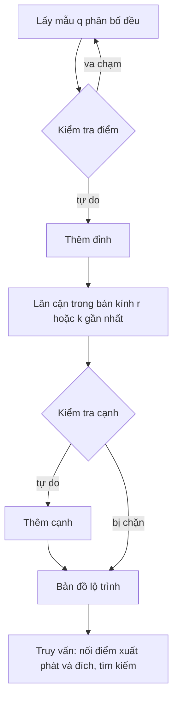

[Bài trước](/vi/blog/graph-search-dijkstra-and-a-star) đã biến không gian cấu hình (configuration space) thành một lưới và tìm kiếm trên đó bằng thuật toán Dijkstra và A*. Các phép tìm kiếm ấy tối ưu trên lưới, nhưng mục 6 của [bài đó](/vi/blog/graph-search-dijkstra-and-a-star) đã chỉ ra cái giá phải trả. Số ô tăng theo độ phân giải lũy thừa số chiều, nên một lưới đủ dùng cho robot di động trong mặt phẳng trở nên bất khả thi với một cánh tay có sáu hay bảy khớp. Bài thứ ba này của loạt bài [Lập kế hoạch chuyển động cho robot](/vi/series/motion-planning) mô tả các phương pháp đã thay thế lưới trong lập kế hoạch nhiều chiều. Chúng đặt các cấu hình một cách ngẫu nhiên, giữ lại những cấu hình tự do, nối chúng bằng các chuyển động ngắn không va chạm và tìm kiếm trên đồ thị thu được. Hai họ phương pháp được trình bày là **bản đồ lộ trình xác suất** (probabilistic roadmap), xây dựng một đồ thị dùng lại được của không gian tự do, và **cây ngẫu nhiên khám phá nhanh** (rapidly-exploring random tree), phát triển một cây từ điểm xuất phát về phía đích.

Bài này dựa trên không gian cấu hình, vùng vật cản (obstacle region) và bộ kiểm tra va chạm (collision checker) của [bài thứ nhất](/vi/blog/configuration-space-and-the-planning-problem), cùng các bảo đảm được định nghĩa ở mục 4 của bài đó. Nó dùng thuật toán Dijkstra của bài thứ hai làm chương trình con. Bài giải thích hai họ phương pháp hoạt động thế nào và các bảo đảm của chúng có nghĩa gì, biến thể nào hội tụ đến đường đi tối ưu, việc lấy mẫu thất bại ở đâu và một đường đi lấy mẫu được rút ngắn ra sao trước khi robot sử dụng nó.

**Quy ước.** Ký hiệu là ký hiệu của loạt bài. Một cấu hình là $q$, không gian cấu hình $\mathcal{C}$ có số chiều $d$, phần tự do của nó là $\mathcal{C}_{\mathrm{free}}$ và vùng vật cản của nó là $\mathcal{C}_{\mathrm{obs}}$; một truy vấn yêu cầu một đường đi (path) từ $q_{\mathrm{start}}$ đến $q_{\mathrm{goal}}$. Một bộ lập kế hoạch (planner) rút $n$ mẫu và nối mỗi mẫu với các mẫu nằm trong một bán kính kết nối $r_n$ hoặc với $k$ lân cận gần nhất (nearest neighbor) của nó; một cây ngẫu nhiên tiến tối đa một kích thước bước (step size) $\eta$ ở mỗi vòng lặp. Chi phí của một đường đi là độ dài của nó, và $C^*$ là chi phí tối ưu. Logarit là logarit tự nhiên. Độ dài tính bằng mét cho các ví dụ phẳng và bằng radian cho cánh tay, với các góc khớp $\theta_1, \theta_2$ và độ dài khâu $l_1 = 1.0$ m và $l_2 = 0.7$ m như trong bài [Động học thuận và động học ngược của cánh tay phẳng](/vi/blog/planar-arm-kinematics). Mã nguồn viết bằng Python 3.13 với NumPy 2.5. Mọi lựa chọn ngẫu nhiên đều được rút từ `numpy.random.default_rng(seed)` với hạt giống (seed) được nêu rõ, và kết quả được báo cáo dưới dạng trung vị, giá trị nhỏ nhất và lớn nhất trên 10 hoặc 20 hạt giống thay vì một lần chạy, vì một lần chạy đơn lẻ của bộ lập kế hoạch ngẫu nhiên có thể may mắn hoặc kém may mắn một cách bất thường.

## 1. Vì sao lấy mẫu

### 1.1 Cái giá của việc phủ kín một không gian

Một lưới có $N$ ô trên mỗi trục có $N^d$ ô, và mục 6.4 của [bài thứ hai](/vi/blog/graph-search-dijkstra-and-a-star) đã cho thấy điều đó nghĩa là gì: $10^{12}$ ô cho một cánh tay sáu khớp với 100 ô trên mỗi khớp, và mỗi ô cần một lần kiểm tra va chạm. Không cải tiến nào của A* thay đổi được con số này, vì lưới tốn cùng một công sức cho mọi vùng của không gian, dù đường đi có thể đi qua vùng đó hay không.

Phần lớn công sức ấy là lãng phí. Một bộ lập kế hoạch chỉ cần đủ phần không gian tự do để nối điểm xuất phát với đích. Trong nhiều bài toán thực tế, không gian tự do (free space) rộng và liên thông tốt: một cánh tay với vào trong giá kệ có vài vùng khó gần kệ và rất nhiều không gian thoáng ở chỗ khác. Một phương pháp đặt một số lượng vừa phải cấu hình ở những nơi chúng có ích, rồi nối chúng bằng các đoạn thẳng, có thể trả lời một truy vấn như vậy với hàng nghìn lần kiểm tra va chạm thay vì hàng tỉ.

### 1.2 Bộ kiểm tra va chạm là hình học duy nhất

Các phương pháp của bài này có chung một quyết định thiết kế: chúng không bao giờ xây dựng $\mathcal{C}_{\mathrm{obs}}$ một cách tường minh. Bài thứ nhất đã cho thấy rằng ngay cả với cánh tay hai khâu và một đĩa tròn, vùng vật cản đã có hình dạng cong và không lồi, và trong số chiều cao hơn nó không có dạng giải tích nào dùng được. Các bộ lập kế hoạch dựa trên lấy mẫu (sampling-based planning) thay nó bằng hai truy vấn:

- một **phép kiểm tra điểm** (point check) (phép kiểm tra cấu hình ở mục 5.1 của [bài thứ nhất](/vi/blog/configuration-space-and-the-planning-problem)), hỏi xem một cấu hình đơn lẻ $q$ có tự do hay không, bằng cách đặt hình học của robot tại $q$ và kiểm tra nó với các vật cản trong không gian làm việc;
- một **phép kiểm tra cạnh** (edge check), hỏi xem đoạn thẳng giữa hai cấu hình có tự do hay không, bằng cách chạy các phép kiểm tra điểm tại những cấu hình cách nhau không quá một độ phân giải dọc theo đoạn đó, như ở mục 5 của [bài thứ nhất](/vi/blog/configuration-space-and-the-planning-problem).

Mọi điều bộ lập kế hoạch biết về vật cản đều đến qua hai lời gọi này, và đó là lý do cùng một mã lập kế hoạch dùng được cho robot điểm trong mặt phẳng lẫn cánh tay bảy khớp: chỉ bộ kiểm tra va chạm và hàm khoảng cách thay đổi. Điều đó cũng có nghĩa là số lần kiểm tra va chạm (collision checking) là thước đo tự nhiên cho chi phí của bộ lập kế hoạch, và bộ lập kế hoạch thừa hưởng các điểm yếu của bộ kiểm tra. Một phép kiểm tra cạnh ở độ phân giải $\varepsilon$ có thể bỏ sót một vật cản mỏng hơn $\varepsilon$, nên đường đi do bất kỳ bộ lập kế hoạch nào trong bài này trả về chỉ không va chạm trong giới hạn độ phân giải của bộ kiểm tra, trừ khi bộ kiểm tra là chính xác hoặc bảo thủ.

### 1.3 Tính đầy đủ theo xác suất

Từ bỏ lưới cũng là từ bỏ bảo đảm của lưới. Tìm kiếm trên lưới là đầy đủ theo độ phân giải (resolution complete): nó tìm được đường đi nếu có một đường đi tồn tại ở độ phân giải của lưới. Một bộ lập kế hoạch dựa trên lấy mẫu tốt nhất cũng chỉ **đầy đủ theo xác suất** (probabilistically complete), theo nghĩa ở mục 4.2 của [bài thứ nhất](/vi/blog/configuration-space-and-the-planning-problem): nếu tồn tại một đường đi, xác suất để bộ lập kế hoạch tìm được một đường đi tiến tới 1 khi số mẫu tăng lên. Các giáo trình của LaValle và của Choset cùng cộng sự trình bày khái niệm này và các bộ lập kế hoạch của bài này chi tiết hơn. Định nghĩa không nói gì về tốc độ xác suất tiến tới 1, và tốc độ đó phụ thuộc vào hình học của không gian tự do, như mục 5 sẽ cho thấy. Bộ lập kế hoạch dựa trên lấy mẫu cũng không thể chứng minh rằng không có đường đi nào. Khi nó thất bại sau $n$ mẫu, thất bại đó chỉ có nghĩa là $n$ chưa đủ hoặc không có đường đi, và bộ lập kế hoạch không thể phân biệt hai trường hợp.

### 1.4 Các bài toán thử nghiệm

Hai bài toán xuyên suốt bài này. Bài toán thứ nhất là một robot điểm trong một căn phòng vuông 10 m × 10 m, với một bức tường có một cửa rộng 1.0 m và ba hộp chữ nhật. Một robot hình đĩa quy về trường hợp này bằng cách phình to các vật cản thêm bán kính của nó, như ở bài thứ nhất. Chương trình `show_maps.py` in bản đồ này trên một lưới ô rộng 0.25 m và cao 0.5 m (chỉ để hiển thị; các bộ lập kế hoạch làm việc với tọa độ liên tục):

```text
Plane map, x right, y up, 0 to 10 m; S start, G goal, # obstacle
..................####....######........
..................####....######....G...
..................####....######........
..................####....######........
..................####....######........
..................####....######........
........######....####....######........
........######....####....######........
........######....####..................
........######..........................
........######..........................
........######....####..................
........######....####....##########....
........######....####....##########....
........######....####....##########....
........######....####....##########....
..................####....##########....
....S.............####....##########....
..................####..................
..................####..................
free area 71.80 m^2 of 100 m^2
```

Điểm xuất phát là $q_{\mathrm{start}} = (1, 1)$ m và đích là $q_{\mathrm{goal}} = (9, 9)$ m. Vì vật cản là các đa giác và robot là một điểm, đường đi tối ưu chỉ gấp khúc tại các góc của vật cản, và việc tìm kiếm trên đồ thị tầm nhìn (visibility graph), tức đồ thị có các cạnh nối những góc nhìn thấy nhau (mục 2.3 của [bài thứ hai](/vi/blog/graph-search-dijkstra-and-a-star)), cho ra giá trị tối ưu chính xác. Chương trình `optimal_plane.py` tìm được $C^* = 12.30$ m, đi qua các góc $(3.5, 2.0)$, $(4.6, 4.5)$ và $(8.0, 6.0)$. Chi phí của mọi bộ lập kế hoạch dưới đây đều có thể so sánh với con số này.

Bài toán thứ hai là cánh tay hai khâu giữa ba vật cản hình đĩa trong không gian làm việc, có tâm tại $(1.1, 0.8)$, $(-0.6, 1.1)$ và $(-0.9, -0.9)$ m với bán kính 0.25, 0.2 và 0.25 m. Các khâu được coi là đoạn thẳng, và một cấu hình va chạm khi một trong hai khâu tiến vào trong bán kính của một đĩa tính từ tâm của nó. Không gian cấu hình là mặt xuyến (torus) của bài thứ nhất: cả hai góc chạy từ $-\pi$ đến $\pi$ và quấn vòng lại, nên khoảng cách giữa hai cấu hình đi theo đường ngắn hơn quanh mỗi góc. Cùng chương trình đó in nó với các ô 10°:

```text
Arm C-space, theta1 right, theta2 up, both from -pi to pi
....................................
....................................
....................................
....................................
....................................
....................................
....................................
#...................................
###..............##......###........
####.............###......###.......
.###..............##......###.......
.####.............###......###......
..###..............##......###......
..###..............###......##......
..###..............###......##G.....
...##...............##......##......
...##..........S....##.......##.....
...###..............###......##.....
...###...............##......##.....
....##...............##......##.....
....##...............##......##.....
....###..............###......##....
....###...............##......##....
....###...............###.....##....
....####..............###.....###...
.....###...............###.....###..
.....####..............###.....###..
......###...............##......##..
........#...........................
....................................
....................................
....................................
....................................
....................................
....................................
....................................
free cells 1136 of 1296 (87.7%)
```

Điểm xuất phát là $(\theta_1, \theta_2) = (-0.5, 0.2)$ rad và đích là $(2.2, 0.6)$ rad. Mỗi đĩa trở thành một dải cong gồm các cấu hình mà tại đó cẳng tay chạm vào nó; cả ba đĩa đều nằm ngoài tầm với của cánh tay trên. Các dải này ngăn cách điểm xuất phát với đích ở những góc khuỷu nhỏ, theo cả hai chiều quanh $\theta_1$, nên mọi nghiệm đều phải gập khuỷu mạnh để luồn cánh tay đã gập qua các vật cản. Trong lưới được in, các dải vươn tới góc khuỷu có độ lớn khoảng 1.8 rad. Cùng chương trình đó lặp lại phép tính trên một lưới mịn hơn gồm 720 × 720 ô (0.5°), đánh dấu tại tâm ô, rồi tìm cận nhỏ nhất của $|\theta_2|$ mà dưới cận đó các ô tự do vẫn nối được điểm xuất phát với đích:

```text
Fine grid 720 x 720: free fraction 0.879, largest |theta2| in C_obs 1.889 rad
smallest elbow bound joining start and goal: |theta2| <= 1.854 rad
```

Do đó, một đường đi từ điểm xuất phát đến đích phải gập khuỷu tới ít nhất khoảng 1.85 rad, trong giới hạn độ phân giải của lưới. Bài toán cánh tay là hai chiều để có thể in ra, nhưng các bộ lập kế hoạch không bao giờ dùng hình vẽ: chúng chỉ nhìn thấy bộ kiểm tra va chạm.

## 2. Bản đồ lộ trình xác suất

### 2.1 Một đồ thị của các cấu hình tự do ngẫu nhiên

Một **bản đồ lộ trình xác suất** (probabilistic roadmap, PRM), do Kavraki, Švestka, Latombe và Overmars giới thiệu năm 1996, là một đồ thị có các đỉnh là những cấu hình tự do ngẫu nhiên và các cạnh là những đoạn thẳng không va chạm giữa các đỉnh gần nhau. Phương pháp có hai pha. Trong **pha xây dựng** (construction phase) (bài báo gốc gọi là pha học), nó lấy mẫu các cấu hình phân bố đều trong $\mathcal{C}$, giữ lại những cấu hình vượt qua phép kiểm tra điểm và thử nối mỗi cấu hình với các lân cận của nó bằng phép kiểm tra cạnh. Trong **pha truy vấn** (query phase), nó nối $q_{\mathrm{start}}$ và $q_{\mathrm{goal}}$ với các đỉnh lân cận của bản đồ lộ trình rồi tìm kiếm trên đồ thị, chẳng hạn bằng thuật toán Dijkstra.

Việc tách thành hai pha chính là điểm cốt lõi của phương pháp. Pha xây dựng tốn kém và không phụ thuộc vào truy vấn, nên kết quả của nó có thể được lưu lại và dùng lại. Một robot làm việc trong một khu vực cố định, chẳng hạn một cánh tay tại một trạm làm việc, có thể xây dựng một bản đồ lộ trình và trả lời nhiều truy vấn từ đó, mỗi truy vấn chỉ tốn vài phép kiểm tra cạnh và một lần tìm kiếm trên đồ thị. Vì vậy PRM được gọi là bộ lập kế hoạch **đa truy vấn** (multi-query). Bài báo gốc được viết cho các robot có nhiều bậc tự do, như tiêu đề của nó cho thấy.



*Hai pha của một bản đồ lộ trình xác suất. Mọi bước trước ô truy vấn chỉ làm một lần; sau đó mỗi truy vấn chỉ tốn vài phép kiểm tra cạnh và một lần tìm kiếm trên đồ thị.*

### 2.2 Chọn lân cận

Pha xây dựng phải quyết định thử những cặp đỉnh nào. Có hai quy tắc phổ biến: nối mỗi đỉnh với mọi đỉnh nằm trong một **bán kính kết nối** (connection radius) $r$, hoặc với **$k$ lân cận gần nhất** của nó. Một lân cận lớn hơn cho đồ thị liên thông tốt hơn và đường đi ngắn hơn, nhưng mỗi cạnh ứng viên tốn một phép kiểm tra cạnh, và các phép kiểm tra cạnh chiếm phần lớn chi phí xây dựng. Tìm các lân cận là một truy vấn lân cận gần nhất; các chương trình ở đây tính mọi khoảng cách bằng NumPy, đủ dùng cho vài nghìn đỉnh, còn các bộ lập kế hoạch lớn hơn dùng cấu trúc dữ liệu không gian như cây k-d.

Đoạn mã dưới đây là pha xây dựng được dùng trong bài này. Nó lược bỏ pha truy vấn (`prm_query`), vốn nối điểm xuất phát và đích với $k$ đỉnh gần nhất của chúng rồi chạy thuật toán Dijkstra, cùng bộ kiểm tra va chạm và các hàm khoảng cách, vốn là phương thức của đối tượng `space`; tất cả đều nằm trong `mp.py`, mô-đun mà các chương trình của bài này dùng chung.

```python
def sample_free(space, rng, n):
    pts = []
    while len(pts) < n:
        q = space.sample(rng)
        if space.point_free(q):
            pts.append(q)
    return np.array(pts)


def prm_build(space, rng, n, radius=None, k=None):
    """Roadmap on n free samples. Each sample is joined to every sample
    within `radius` or to its k nearest neighbors, if the edge is free."""
    V = sample_free(space, rng, n)
    adj = {i: [] for i in range(n)}
    seen = set()
    for i in range(n):
        dd = space.dists(V, V[i])
        if radius is not None:
            nbrs = [j for j in np.nonzero(dd <= radius)[0] if j != i]
        else:
            nbrs = [j for j in np.argsort(dd)[1:k + 1]]
        for j in nbrs:
            e = (min(i, j), max(i, j))
            if e in seen:
                continue
            seen.add(e)
            if space.edge_free(V[i], V[j]):
                w = float(dd[j])
                adj[i].append((j, w))
                adj[j].append((i, w))
    return V, adj
```

Phiên bản này thử mọi lân cận, kể cả lân cận đã đến được qua đồ thị. Một số cách xây dựng bỏ qua lân cận nằm trong cùng một thành phần liên thông, giữ cho bản đồ lộ trình là một rừng và tiết kiệm phép kiểm tra cạnh; Karaman và Frazzoli đã chỉ ra rằng sự tiết kiệm này khiến đường đi trên bản đồ lộ trình không được cải thiện khi thêm mẫu, một điểm mà mục 4 sẽ quay lại.

### 2.3 Kết quả trên bản đồ phẳng

Chương trình `exp_plane.py` xây dựng các bản đồ lộ trình 200 và 1000 đỉnh với $k = 10$ trên bản đồ phẳng, cho các hạt giống từ 0 đến 9, với cạnh được kiểm tra mỗi 0.05 m. "Checks" đếm mọi phép kiểm tra điểm của pha xây dựng, kể cả các mẫu bị loại; "query" đếm các phép kiểm tra dùng để nối điểm xuất phát và đích.

```text
optimal cost C* = 12.30 m
PRM n=200 k=10: solved 8/10
  edges      median   1093.00   min   1055.00   max   1129.00
  checks     median  22979.50   min  22179.00   max  23505.00
  query      median    354.50   min    277.00   max    410.00
  cost       median     13.88   min     13.01   max     18.31
PRM n=1000 k=10: solved 10/10
  edges      median   5787.00   min   5744.00   max   5856.00
  checks     median  54752.00   min  54118.00   max  55311.00
  query      median    154.50   min    141.00   max    171.00
  cost       median     13.15   min     12.86   max     13.53
...
```

Kết quả cho thấy ba hiệu ứng. Thứ nhất, với 200 đỉnh, bản đồ lộ trình thất bại ở hai trong mười hạt giống: trong các lần chạy đó không có mẫu nào rơi đủ gần cửa để một cạnh đi qua được, nên hai phòng tạo thành hai thành phần tách rời. Đây là bài toán lối đi hẹp của mục 5 ở dạng nhẹ nhất. Thứ hai, việc xây dựng tốn khoảng 23 000 phép kiểm tra điểm cho 200 đỉnh và 55 000 cho 1000 đỉnh, trong khi một truy vấn chỉ tốn vài trăm, đó là sự đánh đổi của bộ lập kế hoạch đa truy vấn thể hiện bằng con số. Thứ ba, các đường đi dài hơn $C^*$ từ 7% đến 13% theo trung vị: một đường đi trên bản đồ lộ trình đi theo các cạnh của nó, vốn hướng theo những phương ngẫu nhiên, nên nó đi zíc zắc.

Trên mặt xuyến của cánh tay, `exp_arm.py` xây dựng các bản đồ lộ trình 300 đỉnh với $k = 10$ cho các hạt giống từ 0 đến 9. Cả mười lần đều giải được truy vấn, với trung vị khoảng 42 000 phép kiểm tra điểm và trung vị độ dài đường đi trong không gian khớp là 5.29 rad (nhỏ nhất 5.05, lớn nhất 6.41). Không có gì trong bộ lập kế hoạch thay đổi ngoài đối tượng không gian, giờ đây tính khoảng cách theo đường ngắn quanh mỗi góc và đặt hai khâu để kiểm tra chúng với các đĩa.

## 3. Cây ngẫu nhiên khám phá nhanh

### 3.1 Phát triển một cây từ điểm xuất phát

Nhiều truy vấn chỉ được hỏi một lần: một robot di động trong một tòa nhà luôn thay đổi, một cánh tay gắp những vật có vị trí khác nhau mỗi lần. Xây dựng bản đồ lộ trình cho toàn bộ không gian chỉ để phục vụ một truy vấn sẽ lãng phí phần lớn các phép kiểm tra cạnh. Một **cây ngẫu nhiên khám phá nhanh** (rapidly-exploring random tree, RRT), do LaValle giới thiệu trong một báo cáo kỹ thuật năm 1998 và được phát triển cùng Kuffner trong các bài báo sau đó, là một bộ lập kế hoạch **đơn truy vấn** (single-query): nó phát triển một cây từ $q_{\mathrm{start}}$ cho đến khi một nhánh chạm tới $q_{\mathrm{goal}}$.

Mỗi vòng lặp rút một cấu hình ngẫu nhiên $q_{\mathrm{rand}}$, tìm đỉnh $q_{\mathrm{near}}$ của cây gần nó nhất, và di chuyển từ $q_{\mathrm{near}}$ về phía $q_{\mathrm{rand}}$ một đoạn không quá kích thước bước $\eta$, được $q_{\mathrm{new}}$. Nếu đoạn từ $q_{\mathrm{near}}$ đến $q_{\mathrm{new}}$ tự do, $q_{\mathrm{new}}$ gia nhập cây với tư cách là con của $q_{\mathrm{near}}$. Khi mẫu ngẫu nhiên nằm xa cây hơn $\eta$, nó chỉ là một hướng để phát triển: nó không được thêm vào và bản thân nó không bao giờ được kiểm tra. Khi nó nằm trong khoảng $\eta$, $q_{\mathrm{new}}$ chính là mẫu đó.

### 3.2 Thiên lệch Voronoi

Quy tắc này khám phá tốt nhờ cách nó chọn đỉnh để mở rộng. Một đỉnh được chọn khi mẫu ngẫu nhiên rơi gần nó hơn mọi đỉnh khác, tức là rơi vào **miền Voronoi** (Voronoi region) của nó, tập hợp các điểm gần nó hơn mọi đỉnh khác. Các đỉnh nằm ở biên của cây, cạnh vùng chưa khám phá, có miền Voronoi lớn; các đỉnh ở bên trong, bị các đỉnh khác bao quanh, có miền Voronoi nhỏ. Với mẫu phân bố đều, xác suất một đỉnh được chọn để mở rộng tỉ lệ với thể tích miền Voronoi của nó trong $\mathcal{C}$, nên cây bị kéo về phía những phần chưa khám phá lớn nhất của không gian. Kuffner và LaValle mô tả **thiên lệch Voronoi** (Voronoi bias) này là điều làm cho cây khám phá nhanh, tính chất mà phương pháp được đặt tên theo. Khi cây lấp dần không gian, các miền co lại và trở nên đồng đều hơn, và các bước mở rộng trở nên đều hơn.

Thiên lệch này có cái giá của nó ở gần vật cản. Một đỉnh biên đối diện một bức tường vẫn giữ miền Voronoi lớn, nên nó liên tục được chọn, và các bước mở rộng của nó liên tục không qua được phép kiểm tra cạnh. Những vòng lặp thất bại như vậy làm tăng số phép kiểm tra va chạm mà không thêm đỉnh nào, điều thấy rõ qua khoảng chênh giữa số vòng lặp và số đỉnh trong các kết quả dưới đây.

### 3.3 Thiên lệch về đích và quy tắc dừng

Mẫu phân bố đều không để ý đến đích. Một cải tiến phổ biến, **thiên lệch về đích** (goal bias), thay mẫu ngẫu nhiên bằng $q_{\mathrm{goal}}$ với một xác suất nhỏ, ở đây là 0.05, để thỉnh thoảng cây thử phát triển thẳng về đích. Giá trị lớn hơn làm các bài toán dễ nhanh hơn và các bài toán khó chậm hơn, vì một bước mở rộng về phía đích bị vật cản chặn sẽ thất bại mỗi lần được thử. Sau mỗi đỉnh mới, bộ lập kế hoạch kiểm tra xem đích có nằm trong khoảng $\eta$ hay không và đoạn nối tới nó có tự do không; nếu có, nó thêm đích vào và đọc ngược đường đi qua các con trỏ cha. Đoạn mã là bộ lập kế hoạch đầy đủ như đã chạy; `steer` di chuyển từ một cấu hình về phía cấu hình khác một đoạn không quá $\eta$, và `space.interp` thực hiện nội suy (trên mặt xuyến thì theo đường ngắn).

```python
def steer(space, a, b, eta):
    d = space.dist(a, b)
    if d <= eta:
        return b.copy()
    return space.interp(a, b, eta / d)


def rrt(space, rng, qs, qg, eta, goal_bias=0.05, max_iter=20000):
    """Basic RRT. Returns (path or None, tree size, iterations)."""
    V = [qs.copy()]
    parent = [-1]
    for it in range(1, max_iter + 1):
        qr = qg if rng.random() < goal_bias else space.sample(rng)
        i = int(np.argmin(space.dists(np.array(V), qr)))
        qn = steer(space, V[i], qr, eta)
        if not space.edge_free(V[i], qn):
            continue
        V.append(qn)
        parent.append(i)
        if space.dist(qn, qg) <= eta and space.edge_free(qn, qg):
            V.append(qg.copy())
            parent.append(len(V) - 2)
            path = [len(V) - 1]
            while parent[path[-1]] != -1:
                path.append(parent[path[-1]])
            return [V[j] for j in path[::-1]], len(V), it
    return None, len(V), max_iter
```

### 3.4 RRT-Connect

**RRT-Connect** (2000) của Kuffner và LaValle phát triển hai cây, một từ điểm xuất phát và một từ đích, và cho chúng gặp nhau. Mỗi vòng lặp mở rộng một cây thêm một bước về phía một mẫu ngẫu nhiên, đúng như trên. Sau đó nó thử nối cây kia với đỉnh mới theo cách tham lam: nó bước liên tiếp về phía đỉnh đó, mỗi lần một đoạn $\eta$, cho đến khi chạm tới đỉnh hoặc gặp vật cản. Rồi hai cây đổi vai trò cho nhau. Khi phép nối tham lam chạm tới đỉnh mới, hai nhánh tạo thành một đường đi. Bước tham lam giúp phương pháp nhanh trong không gian thoáng, nơi một lần thử nối thường vượt được quãng dài, còn các bước mở rộng ngẫu nhiên giữ cho nó tiếp tục khám phá khi bước tham lam bị chặn. Bài báo gốc đã thử nghiệm nó trên các bài toán lập kế hoạch cho một mô hình cánh tay người bảy bậc tự do.

### 3.5 Kết quả

Cùng chương trình đó chạy cả hai bộ lập kế hoạch trên bản đồ phẳng với $\eta = 0.5$ m:

```text
RRT (goal bias 0.05) eta=0.5: solved 10/10
  vertices   median    191.00   min    114.00   max    363.00
  iters      median    330.00   min    185.00   max    768.00
  checks     median   2456.00   min   1553.00   max   4655.00
  cost       median     16.91   min     15.97   max     20.26
RRT-Connect eta=0.5: solved 10/10
  vertices   median     63.50   min     33.00   max    121.00
  iters      median     94.00   min     39.00   max    227.00
  checks     median   1158.50   min    625.00   max   2193.00
  cost       median     16.29   min     14.24   max     21.96
```

RRT giải được mọi hạt giống với trung vị 2 456 phép kiểm tra điểm, khoảng một phần mười so với số mà bản đồ lộ trình nhỏ hơn đã tốn cho việc xây dựng, và RRT-Connect lại giảm một nửa con số đó. Độ phân tán lớn: lần chạy RRT chậm nhất cần số phép kiểm tra gấp ba lần nhanh nhất. Điều này là điển hình của các bộ lập kế hoạch ngẫu nhiên và là lý do để báo cáo nhiều hạt giống. Cái giá phải trả là chất lượng đường đi: trung vị đường đi của RRT là 16.91 m so với $C^* = 12.30$ m, dài hơn 37%, vì mỗi nhánh lang thang theo bất cứ hướng nào các mẫu ngẫu nhiên kéo nó đi, và bộ lập kế hoạch dừng ở đường đi đầu tiên mà nó tìm thấy.

Trên cánh tay (`exp_arm.py`, $\eta = 0.3$ rad, độ phân giải trong không gian khớp 0.02 rad), RRT-Connect một lần nữa cần ít phép kiểm tra hơn RRT, và độ dài đường đi của hai phương pháp tương tự nhau:

```text
RRT eta=0.3 rad, goal bias 0.05: solved 10/10
  vertices       median    121.50   min     75.00   max    477.00
  checks         median   2105.00   min   1395.00   max   6536.00
  cost           median      6.34   min      5.41   max      8.85
RRT-Connect eta=0.3 rad: solved 10/10
  vertices       median     61.50   min     38.00   max     71.00
  checks         median   1469.50   min    904.00   max   1739.00
  cost           median      6.47   min      5.98   max      8.39
...
largest |theta2| on each RRT-Connect path, rad: 2.54 2.04 2.37 2.37 1.91 1.99 2.27 2.29 1.99 2.13
```

Mọi đường đi của RRT-Connect đều gập khuỷu quá 1.9 rad ở một thời điểm nào đó, vượt mức 1.85 rad mà không gian cấu hình đòi hỏi. Các cây đã tìm ra cách gập đó mà không cần bất kỳ biểu diễn nào của các dải: nó hình thành chỉ từ các phép kiểm tra điểm và kiểm tra cạnh.

### 3.6 Tính đầy đủ của bản đồ lộ trình và cây

Một PRM nối các đỉnh trong một bán kính kết nối, và RRT, đều đầy đủ theo xác suất dưới những điều kiện nhẹ; một PRM với số lân cận gần nhất cố định $k$, như PRM trong bài này, thì không nhất thiết (Karaman và Frazzoli chỉ ra rằng nó không đầy đủ với $k = 1$). Với bản đồ lộ trình, phân tích của Hsu, Latombe và Motwani đưa ra khái niệm **tính khuếch trương** (expansiveness), một thước đo cho biết mỗi vùng có thể nhìn thấy bao nhiêu phần không gian tự do qua các đoạn thẳng. Trong một không gian khuếch trương theo nghĩa của họ, xác suất để một bản đồ lộ trình lấy mẫu đều không nối được hai cấu hình nằm trong cùng một thành phần của không gian tự do giảm theo hàm mũ của số mẫu. Các hằng số trong cận đó phụ thuộc vào các tham số khuếch trương, và một lối đi hẹp làm chúng trở nên kém.

Với RRT, câu hỏi này chỉ được giải quyết cẩn thận về sau: Kleinbort, Solovey, Littlefield, Bekris và Halperin đưa ra một chứng minh cho bài toán lập kế hoạch hình học, chỉ đòi hỏi rằng có một đường đi nghiệm giữ được một khoảng hở an toàn (clearance) dương với các vật cản. Một đường đi chạm vào vật cản, hoặc lách qua một khe hở có độ rộng bằng không, là một nghiệm mà không thể kỳ vọng bộ lập kế hoạch dựa trên lấy mẫu nào tìm được.

## 4. Tính tối ưu tiệm cận: PRM* và RRT*

### 4.1 Vì sao các bộ lập kế hoạch cơ bản không hội tụ

Các kết quả trên cho thấy PRM và RRT tìm được những đường đi có chất lượng tầm thường. Một hy vọng tự nhiên là chạy chúng lâu hơn sẽ có ích. Karaman và Frazzoli đã xem xét câu hỏi này năm 2011. Một bộ lập kế hoạch là **tối ưu tiệm cận** (asymptotically optimal), như mục 4.3 của [bài thứ nhất](/vi/blog/configuration-space-and-the-planning-problem) đã định nghĩa, nếu chi phí của nghiệm hội tụ hầu chắc chắn đến $C^*$ khi số mẫu tăng lên. Họ chứng minh rằng, dưới những điều kiện kỹ thuật nhẹ, RRT không tối ưu tiệm cận: xác suất để nghiệm của nó hội tụ đến chi phí tối ưu bằng không. Lý do là cây không bao giờ thay đổi cha của một đỉnh, nên một nhánh khởi đầu theo hướng xấu sẽ mãi xấu. Một PRM với số lân cận cố định $k$ cũng không tối ưu tiệm cận, và biến thể bỏ qua các lân cận trong cùng một thành phần (mục 2.2) cũng vậy. Một PRM nối mọi cặp đỉnh trong một bán kính cố định thì tối ưu tiệm cận, nhưng số cạnh của nó tăng theo bình phương của $n$, khiến nó tốn kém khi $n$ lớn.

### 4.2 Bán kính kết nối

Cách khắc phục là cho lân cận co lại khi thêm mẫu, nhưng chậm hơn khoảng cách điển hình giữa các mẫu. Trong không gian $d$ chiều, $n$ mẫu phân bố đều cách nhau xấp xỉ $(\mu(\mathcal{C}_{\mathrm{free}})/n)^{1/d}$, trong đó $\mu(\mathcal{C}_{\mathrm{free}})$ là thể tích của không gian tự do; độ dài này tỉ lệ với $n^{-1/d}$. **PRM*** của Karaman và Frazzoli nối mỗi đỉnh với mọi đỉnh nằm trong

$$
r_n = \gamma_{\mathrm{PRM}} \left( \frac{\log n}{n} \right)^{1/d},
\qquad
\gamma_{\mathrm{PRM}} > 2 \left( 1 + \frac{1}{d} \right)^{1/d} \left( \frac{\mu(\mathcal{C}_{\mathrm{free}})}{\zeta_d} \right)^{1/d},
$$

trong đó $\zeta_d$ là thể tích của quả cầu đơn vị trong $d$ chiều ($\zeta_2 = \pi$). Thừa số bổ sung $(\log n)^{1/d}$ so với khoảng cách giữa các mẫu khiến mỗi đỉnh nhìn thấy, tính trung bình, một số lân cận tăng như $\log n$: đủ để đồ thị vẫn liên thông và các đường đi của nó tiến tới tối ưu, nhưng đủ ít để số cạnh chỉ tăng như $n \log n$. Họ chỉ ra rằng chi phí tính toán của PRM* và của RRT* (mục 4.3) chỉ chênh một hằng số nhân so với PRM và RRT.

Ý tưởng tương tự cũng áp dụng được với lân cận gần nhất. Phiên bản $k$ lân cận gần nhất của PRM* nối mỗi đỉnh với $k(n) = k_{\mathrm{PRM}} \log n$ lân cận gần nhất của nó với $k_{\mathrm{PRM}} > e\,(1 + 1/d)$; vì cận này không bao giờ vượt quá $2e$, giá trị $k_{\mathrm{PRM}} = 2e$ dùng được ở mọi số chiều $d \ge 2$ và không cần biết thể tích tự do. Điều đó làm cho dạng $k$ lân cận gần nhất dễ dùng hơn. Dạng bán kính cần $\mu(\mathcal{C}_{\mathrm{free}})$, đại lượng hiếm khi biết được; thể tích của toàn bộ $\mathcal{C}$ là một ước lượng trội an toàn.

Với bản đồ phẳng, $d = 2$ và $\mu(\mathcal{C}_{\mathrm{free}}) = 71.80$ m², nên ngưỡng là $2 \times 1.5^{1/2} \times (71.80/\pi)^{1/2} = 11.71$ m. Với $n = 1000$, $r_n = 11.71 \times (\log 1000 / 1000)^{1/2} = 0.973$ m, và $k(1000) = \lceil 2e \log 1000 \rceil = 38$.

### 4.3 RRT*

**RRT*** thay đổi cách một đỉnh mới gia nhập cây. Sau khi lái tới $q_{\mathrm{new}}$ như trong RRT, nó xét mọi đỉnh của cây nằm trong một bán kính $r_n$ có cùng dạng, bị chặn trên bởi $\eta$, và làm hai việc. Nó chọn làm cha của $q_{\mathrm{new}}$ đỉnh trong tập đó mà qua đó chi phí từ điểm xuất phát là thấp nhất và cạnh nối là tự do, thay vì đỉnh gần nhất. Sau đó nó **nối lại** (rewire): với mỗi đỉnh trong tập, nếu đến đỉnh đó qua $q_{\mathrm{new}}$ rẻ hơn tuyến hiện tại của nó, cha của nó trở thành $q_{\mathrm{new}}$, và phần tiết kiệm lan truyền xuống các con cháu của nó. Nhờ vậy cây liên tục tự sửa chữa, và các nhánh thẳng dần khi mẫu tích lũy. Công việc bổ sung ở mỗi vòng lặp là một tập các phép kiểm tra cạnh tới những đỉnh trong bán kính $r_n$, khoảng $\log n$ đỉnh.

Chứng minh ban đầu về tính tối ưu tiệm cận của RRT* dùng một bán kính có dạng như trên với cận dưới riêng cho hằng số. Solovey, Janson, Schmerling, Frazzoli và Pavone sau đó tìm ra một lỗ hổng trong chứng minh ấy, và chứng minh tính tối ưu tiệm cận cho một bán kính co lại như $(\log n / n)^{1/(d+1)}$, chậm hơn một chút. Chương trình ở đây dùng số mũ $1/d$ với $\gamma = 11.71$ m, ngưỡng PRM* cho bản đồ này, và chặn bán kính ở $\eta$; đó là một lựa chọn thực tế để minh họa, không phải một tham số được chứng minh bảo đảm.

### 4.4 Sự hội tụ đo được

Chương trình `exp_optimal.py` đo cả hai hiệu ứng trên bản đồ phẳng với các hạt giống từ 0 đến 9. Phần (a) so sánh PRM với $k = 10$ và PRM* dạng $k$ lân cận gần nhất với $k = \lceil 2e \log n \rceil$. Phần (b) chạy RRT* với $\eta = 1.0$ m trong 4000 vòng lặp, ghi lại chi phí tốt nhất tìm được cho đến lúc đó, và so sánh nó với một RRT tiếp tục phát triển sau nghiệm đầu tiên và giữ đường đi tốt nhất tới đích, không nối lại.

```text
C* = 12.30 m
n      k_PRM*  PRM k=10 cost: median [min, max]   PRM* cost: median [min, max]
250    31       13.83 [ 12.97,  14.49] 2 failed    12.83 [ 12.67,  13.87]
500    34       13.64 [ 13.02,  13.95] 1 failed    12.76 [ 12.62,  13.11]
1000   38       13.15 [ 12.86,  13.53]             12.58 [ 12.49,  12.89]
2000   42       13.10 [ 12.81,  13.34]             12.49 [ 12.42,  12.55]
free area 71.80 m^2, gamma = 11.71 m
  r_n at n = 500: 1.000 m
  r_n at n = 1000: 0.973 m
  r_n at n = 2000: 0.722 m
  r_n at n = 4000: 0.533 m
iterations  RRT cost: median [min, max]      RRT* cost: median [min, max]
500          17.79 [ 13.99,  24.36]            13.51 [ 13.25,  19.45]
1000         17.79 [ 13.99,  24.36]            13.04 [ 12.59,  13.41]
2000         17.79 [ 13.99,  24.36]            12.61 [ 12.46,  12.76]
4000         17.70 [ 13.99,  24.36]            12.46 [ 12.37,  12.50]
```

Số "failed" là số hạt giống mà bản đồ lộ trình không nối được điểm xuất phát với đích; các cột chi phí tóm tắt những hạt giống thành công. Các bán kính là bán kính cho một cây $n$ đỉnh, bị chặn ở $\eta = 1.0$ m (công thức cho 1.306 m tại $n = 500$); cây của RRT* có ít đỉnh hơn số vòng lặp một chút, vì các bước mở rộng bị chặn không thêm đỉnh nào.

Từ 1000 đến 2000 mẫu, PRM với $k = 10$ cải thiện trung vị chi phí thêm 0.05 m và vẫn cao hơn $C^*$ 6.5%; PRM* cải thiện 0.09 m, còn cao hơn 1.5%, và độ phân tán của nó thu hẹp từ 0.40 m xuống 0.13 m.

Khác biệt giữa RRT tiếp tục phát triển và RRT* còn rõ rệt hơn. Trung vị chi phí của cây thường hầu như không đổi từ 500 đến 4000 vòng lặp (17.79 m xuống 17.70 m), và hạt giống tệ nhất của nó giữ nguyên 24.36 m suốt quá trình, vì tuyến từ một đỉnh về điểm xuất phát không bao giờ thay đổi. RRT* giảm từ 13.51 m xuống 12.46 m, cao hơn tối ưu 1.3%, và cả mười hạt giống kết thúc trong phạm vi 0.13 m của nhau.

### 4.5 Tính tối ưu tiệm cận hứa hẹn điều gì

Bảo đảm này là một giới hạn: chi phí hội tụ đến $C^*$ khi $n \to \infty$. Nó không cho biết cần bao nhiêu mẫu để đưa chi phí vào trong phạm vi 1% của tối ưu; con số đó phụ thuộc vào bài toán và không biết trước được. Nó không làm bộ lập kế hoạch tìm ra nghiệm đầu tiên nhanh hơn; RRT* tốn nhiều phép kiểm tra hơn RRT ở mỗi vòng lặp, nên tốt nhất là dùng nó như một **bộ lập kế hoạch *anytime*** (anytime planner), loại bộ lập kế hoạch trả về đường đi đầu tiên sớm và tiếp tục cải thiện nó khi còn thời gian. Nó liên quan đến sự hội tụ về tối ưu trong số các đường đi giữ được một khoảng hở nào đó, nên một đường đi tối ưu sượt qua góc vật cản, như đường đi ở đây tại $(4.6, 4.5)$, được tiếp cận từ phía tự do nhưng không bao giờ đạt tới. Và đó là một phát biểu chỉ về chi phí: đường đi tối ưu về độ dài vẫn có các góc, mà robot không thể đi theo ở tốc độ cao, một vấn đề dành cho bài tiếp theo.

## 5. Lối đi hẹp và các dạng thất bại khác

### 5.1 Vì sao lối đi hẹp khó

Một mẫu đều vượt qua phép kiểm tra điểm, như mọi đỉnh của bản đồ lộ trình, rơi vào một vùng với xác suất bằng tỉ phần của vùng đó trong thể tích của $\mathcal{C}_{\mathrm{free}}$. Một lối đi hẹp (narrow passage) theo một hay nhiều hướng có thể tích nhỏ, nên nó nhận được ít mẫu, dù mọi đường đi đều phải đi qua nó. Bản đồ phẳng cho phép đo được điều này: cửa sâu 0.8 m (bề dày bức tường), nên một cửa rộng $w$ chiếm $0.8\,w$ m² trong diện tích tự do khoảng 71 m². Với $w = 1.0$ m, một mẫu đều rơi vào cửa với xác suất khoảng 1.1%; với $w = 0.125$ m, khoảng 0.14%. Trong $d$ chiều hiệu ứng này cộng dồn, vì một lối đi hẹp theo nhiều hướng có thể tích co lại theo tích các độ rộng của nó.

Chương trình `exp_narrow.py` thu hẹp cửa trong khi giữ nguyên mọi thứ khác. Nó chạy một PRM với $n = 300$ và $k = 10$ cho 20 hạt giống, và RRT-Connect cho 10 hạt giống:

```text
PRM n=300 k=10, 20 seeds: solved, median point checks
door 1.000 m: uniform 19/20 (28753 checks)   hybrid 18/20 (418991 checks)
door 0.500 m: uniform 14/20 (28740 checks)   hybrid 18/20 (277642 checks)
door 0.250 m: uniform  9/20 (28690 checks)   hybrid 18/20 (240839 checks)
door 0.125 m: uniform  2/20 (28715 checks)   hybrid 16/20 (259604 checks)
RRT-Connect eta=0.5, 10 seeds: iterations to solve, median [min, max]
door 1.000 m: median    94.0 [39, 227]
door 0.500 m: median   114.5 [41, 1440]
door 0.250 m: median   321.5 [43, 1440]
door 0.125 m: median   518.5 [48, 3277]
```

Với lấy mẫu đều, tỉ lệ thành công của bản đồ lộ trình giảm từ 19 trên 20 xuống 2 trên 20 khi cửa hẹp lại từ 1.0 m xuống 0.125 m, với cùng số phép kiểm tra. RRT-Connect giải được mọi lần chạy trong giới hạn 20 000 vòng lặp của nó, nhưng trung vị số vòng lặp tăng hơn năm lần và lần chạy tệ nhất tăng hơn mười bốn lần. Cây phải chờ một mẫu có hướng, nhìn từ một đỉnh gần cửa, luồn được qua lỗ mở.

Mục 3.6 đã mô tả tính khuếch trương của Hsu, Latombe và Motwani là đại lượng chi phối tỉ lệ thành công của bản đồ lộ trình. Lối đi hẹp là nguyên nhân điển hình của tính khuếch trương kém: từ bên trong một phòng, chỉ một phần nhỏ của phòng kia nhìn thấy được qua cửa. Bảo đảm về tính đầy đủ theo xác suất vẫn đúng, nhưng số mẫu cần thiết để thất bại trở nên khó xảy ra có thể lớn đến mức không thực tế.

### 5.2 Lấy mẫu ở nơi cần thiết

Vì lấy mẫu đều lãng phí mẫu trong không gian thoáng, một số chiến lược tập trung mẫu gần vật cản hoặc bên trong lối đi. Hai chiến lược có ảnh hưởng lớn chỉ dùng phép kiểm tra điểm:

- **Lấy mẫu Gauss** (Gaussian sampling) (Boor, Overmars và van der Stappen, 1999) rút một cấu hình $q_1$ phân bố đều và một cấu hình thứ hai $q_2$ từ một phân phối chuẩn có tâm tại $q_1$; nếu đúng một trong hai cấu hình là tự do, nó giữ lại cấu hình tự do. Các mẫu tụ lại gần biên của $\mathcal{C}_{\mathrm{obs}}$, nơi có các lối đi.
- **Phép thử cầu nối** (bridge test) (Hsu, Jiang, Reif và Sun, 2003) rút $q_1$ và một $q_2$ gần đó như trên, và chỉ giữ trung điểm của chúng nếu cả $q_1$ lẫn $q_2$ đều va chạm và trung điểm thì tự do. Một "cầu nối" như vậy bắc qua khe giữa hai vật cản, nên trung điểm của nó thường nằm trong một lối đi hẹp. Vì nó loại bỏ phần lớn ứng viên, các tác giả đã kết hợp nó với lấy mẫu đều trong một chiến lược lai.

Cột "hybrid" ở trên rút một nửa số mẫu theo phân bố đều và một nửa bằng phép thử cầu nối với độ lệch chuẩn 0.5 m. Nó giải được 16 đến 18 trên 20 truy vấn ở mọi độ rộng cửa, kể cả 16 trên 20 ở 0.125 m, nơi lấy mẫu đều chỉ giải được 2. Nó trả giá bằng các phép kiểm tra va chạm: phần lớn ứng viên cầu nối bị loại, và lần chạy trung vị dùng số phép kiểm tra điểm gấp 8 đến 15 lần lấy mẫu đều. Ở cửa rộng nhất, chiến lược lai kém hơn lấy mẫu đều một chút (18 so với 19 trên 20), có lẽ vì nó chỉ có 150 mẫu đều để phủ các phòng thoáng. Sự đánh đổi đó có đáng hay không phụ thuộc vào mức độ tốn kém của một phép kiểm tra điểm so với một phép kiểm tra cạnh và vào độ hẹp của các lối đi trong bài toán thực tế, nên các chiến lược như vậy được tinh chỉnh theo từng ứng dụng thay vì chọn một lần cho tất cả.

### 5.3 Các dạng thất bại khác

Lối đi hẹp là dạng thất bại được biết đến nhiều nhất, nhưng không phải là duy nhất.

- **Hàm khoảng cách.** Lân cận gần nhất, việc lái và bán kính kết nối đều phụ thuộc vào metric trên $\mathcal{C}$. Trên mặt xuyến của cánh tay, một metric bỏ qua tính quấn vòng sẽ coi $\theta_1 = 3.1$ và $\theta_1 = -3.1$ cách nhau 6.2 rad thay vì 0.08 rad, và sẽ bỏ lỡ các đường đi ngắn. Với một robot vừa tịnh tiến vừa quay, metric phải cân đối mét với radian, và một cách cân đối kém khiến đỉnh gần nhất trở thành lựa chọn kém để mở rộng.
- **Độ phân giải kiểm tra.** Như mục 1.2 đã lưu ý, một cạnh được kiểm tra ở độ phân giải $\varepsilon$ có thể đi xuyên qua một vật cản mỏng hơn $\varepsilon$ trong không gian cấu hình. Với cánh tay, một bước 0.02 rad trong không gian khớp di chuyển đầu mút cánh tay tối đa $0.02 \times \sqrt{1.7^2 + 0.7^2} = 0.037$ m giữa hai lần kiểm tra (1.7 m là cánh tay đòn của vai, 0.7 m là cánh tay đòn của khuỷu); đây là cận $D$ ở mục 5.3 của [bài thứ nhất](/vi/blog/configuration-space-and-the-planning-problem) cho hướng bước xấu nhất. Một vật cản mỏng hơn có thể lọt giữa hai lần kiểm tra mà không bị phát hiện.
- **Ràng buộc vi phân.** Các bộ lập kế hoạch ở đây nối các cấu hình bằng đoạn thẳng, nghĩa là giả định robot có thể di chuyển theo bất kỳ hướng nào của $\mathcal{C}$. Một robot kiểu ô tô không thể di chuyển ngang, nên một đoạn thẳng trong $(x, y, \theta)$ không phải là chuyển động mà nó thực hiện được. Bài báo năm 2001 của LaValle và Kuffner đã điều chỉnh RRT cho các hệ như vậy bằng cách phát triển cây bằng các tín hiệu điều khiển tác động thay vì đoạn thẳng; chủ đề này nằm ngoài phạm vi bài này.

## 6. Rút ngắn và làm trơn đường đi

### 6.1 Rút ngắn đường đi

Các đường đi của PRM và RRT khả thi nhưng lãng phí, và một bước hậu xử lý rẻ tiền lấy lại được phần lớn sự lãng phí đó. **Rút ngắn đường đi ngẫu nhiên** (random shortcutting) lặp lại một thao tác đơn giản: chọn ngẫu nhiên hai điểm dọc theo đường đi, có thể nằm giữa các đoạn. Nếu đoạn thẳng giữa chúng tự do, nó thay thế phần đường đi nằm giữa hai điểm đó. Theo bất đẳng thức tam giác, không thao tác thành công nào làm đường đi dài thêm, và một thao tác làm đường đi ngắn lại trừ khi phần bị thay thế vốn đã thẳng; kết quả vẫn không va chạm trong giới hạn độ phân giải của bộ kiểm tra, vì mọi đoạn mới đều đã được kiểm tra. Chương trình dùng 100 lần thử như vậy trên mỗi đường đi RRT-Connect của bài toán cánh tay (hạt giống của bộ sinh rút ngắn là hạt giống của bộ lập kế hoạch cộng 100):

```text
RRT-Connect eta=0.3 rad: solved 10/10
  ...
  cost           median      6.47   min      5.98   max      8.39
  shortcut_cost  median      4.87   min      4.79   max      6.23
  shortcut_checks median   3371.00   min   2373.00   max   4188.00
```

Trung vị độ dài đường đi giảm từ 6.47 rad xuống 4.87 rad, tức giảm 25%, với cái giá khoảng 3 400 phép kiểm tra điểm bổ sung, nhiều hơn số mà chính bộ lập kế hoạch đã dùng. Để so sánh, `ref_arm.py` chạy một PRM* dạng $k$ lân cận gần nhất với 3000 mẫu trên cùng bài toán cho các hạt giống từ 0 đến 2 và rút ngắn mỗi kết quả 300 lần; đường đi tốt nhất tìm được là 4.671 rad. Con số đó là một cận trên của $C^*$ cho bài toán cánh tay, không phải bản thân giá trị tối ưu, nhưng nó cho thấy RRT-Connect cộng với 100 lần rút ngắn đạt tới trong phạm vi khoảng 4% của nó theo trung vị.

Rút ngắn đường đi không làm được mọi thứ. Nó là một cải thiện cục bộ: nó làm thẳng tuyến mà đường đi đang đi, và không thể tìm ra một tuyến khác mà đường đi không bao giờ đến gần. Hai đường đi có thể biến dạng liên tục thành nhau mà không cắt qua vật cản thuộc cùng một **lớp đồng luân** (homotopy class), và một lần rút ngắn chỉ đổi lớp khi tình cờ có một vật cản nằm giữa một phần của đường đi và đoạn tự do thay thế nó.

Chương trình `probe_shortcut.py` cho thấy hiệu ứng này trên cánh tay. Chín trong mười đường đi đã rút ngắn gập khuỷu về góc dương và có độ dài cuối cùng từ 4.79 đến 5.35 rad. Trong số đó xuất hiện hai tuyến, một tuyến quay vai về phía trước tổng cộng 2.70 rad và một tuyến quay về phía sau 3.58 rad, với độ dài tương tự nhau. Đường đi thứ mười, từ hạt giống 8, gập khuỷu về góc âm, vòng qua đầu kia của các dải, và giữ nguyên 6.23 rad sau khi rút ngắn, dài hơn một phần sáu so với đường đi dài thứ hai.

Rút ngắn còn kéo đường đi sát vào vật cản, không để lại **khoảng hở an toàn** nào, tức khoảng cách giữa robot và vật cản gần nhất. Geraerts và Overmars đã giải quyết cả hai hạn chế: họ đề xuất một phép rút ngắn từng phần nội suy lần lượt từng bậc tự do một, có thể rút ngắn những đường đi mà phép rút ngắn thông thường không làm được, cùng các phương pháp tăng khoảng hở an toàn sau khi rút ngắn.

### 6.2 Làm trơn

Một đường đi đã rút ngắn vẫn là một đường gấp khúc có các góc. Tại một góc, hướng chuyển động thay đổi tức thời, nên vận tốc phải giảm về không tại đó, nếu không gia tốc sẽ không bị chặn. Cách khắc phục, **làm trơn** (smoothing), thay đường gấp khúc bằng một đường cong có đạo hàm liên tục, chẳng hạn bằng cách khớp một spline qua các đỉnh của nó hoặc bo tròn mỗi góc bằng một cung. Mọi phép làm trơn đều đưa đường đi rời khỏi các đoạn đã được kiểm tra, nên đường cong đã làm trơn phải được kiểm tra lại, và ở chỗ nó va chạm thì việc làm trơn được nới bớt cục bộ. Làm trơn hình học cũng không nói gì về việc robot di chuyển nhanh đến đâu dọc theo đường cong; đó là nhiệm vụ của tham số hóa thời gian (time scaling).

## 7. Bài tập

**Bài tập 1.** Với bản đồ phẳng ($\mu(\mathcal{C}_{\mathrm{free}}) = 71.80$ m²), hãy tính ngưỡng bán kính của PRM* và bán kính cho $n = 2000$. Sau đó tính giá trị $k(2000)$ của dạng $k$ lân cận gần nhất với $k_{\mathrm{PRM}} = 2e$. So sánh với kết quả in ra ở mục 4.4.

<details>
<summary>Đáp án</summary>

Ngưỡng là $2 \times (3/2)^{1/2} \times (71.80/\pi)^{1/2} = 2 \times 1.2247 \times 4.7807 = 11.71$ m. Với $n = 2000$, $\log 2000 / 2000 = 7.601/2000 = 0.0038005$, có căn bậc hai là 0.061648, nên $r_{2000} = 11.71 \times 0.061648 = 0.722$ m, đúng như đã in. $k(2000) = \lceil 2e \times 7.601 \rceil = \lceil 41.32 \rceil = 42$, cũng đúng như đã in.

</details>

**Bài tập 2.** Giả sử thiên lệch về đích của RRT được đặt bằng 1, để mọi vòng lặp đều lái về phía $q_{\mathrm{goal}}$. Điều gì xảy ra trên bản đồ phẳng, và điều này nói lên gì về vai trò của các mẫu ngẫu nhiên?

<details>
<summary>Đáp án</summary>

Đỉnh gần đích nhất luôn được chọn, và cây phát triển theo một đường thẳng từ điểm xuất phát về phía $(9, 9)$ cho đến vật cản đầu tiên trên đường đó, chiếc hộp có $x$ từ 2.0 m đến 3.5 m. Từ đó trở đi mọi vòng lặp đều chọn cùng một đỉnh, lái vào chiếc hộp và không qua được phép kiểm tra cạnh, nên bộ lập kế hoạch quay vòng mà không tiến triển cho đến giới hạn số vòng lặp. Các mẫu ngẫu nhiên đảm nhận việc khám phá (mục 3.2); thiên lệch về đích chỉ có ích như một nhiễu động nhỏ đối với chúng.

</details>

**Bài tập 3.** Với bản đồ phẳng có cửa rộng $w = 0.125$ m, hãy ước lượng số kỳ vọng các mẫu đều rơi vào trong cửa (sâu 0.8 m) khi $n = 300$. PRM với lấy mẫu đều vẫn giải được 2 trên 20 truy vấn với cửa này. Làm sao một bản đồ lộ trình có thể đi qua cửa mà không có đỉnh nào nằm trong đó?

<details>
<summary>Đáp án</summary>

Các vật cản chiếm $21.0 + 0.8 \times (10 - 0.125) = 28.9$ m², nên diện tích tự do là 71.1 m², và cửa chiếm $0.8 \times 0.125 = 0.1$ m². Xác suất cho mỗi mẫu là $0.1/71.1 = 0.0014$, và số kỳ vọng trong 300 mẫu là 0.42. Bản đồ lộ trình không cần một đỉnh trong cửa: một cạnh giữa một đỉnh ngay bên trái bức tường và một đỉnh ngay bên phải nó có thể đi qua lỗ mở nếu cả hai gần như thẳng hàng với cửa. Những cặp như vậy hiếm, vì thế tỉ lệ thành công thấp.

</details>

**Bài tập 4.** Một đồng nghiệp chạy RRT trên một bài toán mới với giới hạn 50 000 vòng lặp, và nó thất bại. Họ kết luận rằng không tồn tại đường đi. Có thể kết luận được gì, và các bước tiếp theo hợp lý là gì?

<details>
<summary>Đáp án</summary>

Không thể kết luận gì về sự tồn tại: tính đầy đủ theo xác suất (mục 1.3) chỉ nói rằng xác suất thành công tiến tới 1, với tốc độ phụ thuộc vào bài toán. Thất bại này phù hợp với cả một lối đi hẹp lẫn tính bất khả thi. Các bước tiếp theo hữu ích là chạy nhiều hạt giống, thử RRT-Connect và thêm một chiến lược lấy mẫu cho lối đi hẹp (mục 5.2). Hàm khoảng cách và độ phân giải kiểm tra cần được đối chiếu với bài toán (mục 5.3). Nếu nghi ngờ tính bất khả thi, cần có bằng chứng khác, chẳng hạn kiểm tra rằng điểm xuất phát và đích là tự do và nằm trong tầm với. Một phép tìm kiếm trên lưới thô cũng được tính nếu nó thỏa mãn hai điều kiện. Các ô của nó chỉ bị đánh dấu là bị chặn khi mọi cấu hình trong ô đều va chạm, một phép kiểm tra trên toàn bộ ô, khác với phép kiểm tra tại tâm ô ở mục 6.3 của [bài thứ hai](/vi/blog/graph-search-dijkstra-and-a-star). Và nó được phép di chuyển giữa hai ô bất kỳ có tiếp xúc với nhau, kể cả chỉ tại một góc. Thất bại của một phép tìm kiếm như vậy chứng minh rằng không tồn tại đường đi. Các bộ lập kế hoạch trên lưới của bài thứ hai, vốn kiểm tra tâm ô và cấm di chuyển qua góc, không cho chứng minh như vậy.

</details>

**Bài tập 5.** Vì sao rút ngắn đường đi ngẫu nhiên không bao giờ tạo ra một đường đi va chạm, ngoài giới hạn độ phân giải của bộ kiểm tra? Nó có thể đưa đường đi sang phía bên kia của một vật cản không?

<details>
<summary>Đáp án</summary>

Mọi đoạn mà phép rút ngắn chèn vào đều đã qua một phép kiểm tra cạnh, và phần còn lại của đường đi không thay đổi, nên đường đi mới không va chạm ở mức độ mà các phép kiểm tra bảo đảm. Nó có thể đưa đường đi sang phía bên kia của một vật cản, nhưng chỉ với vật cản nằm giữa phần bị thay thế và đoạn mới, chẳng hạn một vật cản nhỏ bên trong một đường vòng rộng. Nó không thể đưa đường đi vượt qua một vật cản lớn mà đường đi vòng quanh toàn bộ: mọi đoạn cắt qua vật cản đó đều bị chặn, nên tuyến vòng qua phía bên kia không bao giờ được thử. Đây là hành vi của hạt giống 8 ở mục 6.1, vốn vẫn ở phía của nó so với các dải vật cản.

</details>

## 8. Tóm tắt

| Khái niệm | Kết quả | Giới hạn chính |
|---|---|---|
| Lấy mẫu thay cho lưới | Bộ kiểm tra va chạm là hình học duy nhất; chi phí tăng theo số phép kiểm tra cần thiết, không theo $N^d$ ô | Chỉ không va chạm trong giới hạn độ phân giải kiểm tra |
| Tính đầy đủ theo xác suất | Xác suất tìm được một đường đi tồn tại tiến tới 1 khi $n \to \infty$ | Nói chung không có tốc độ; không thể chứng minh rằng không có đường đi |
| PRM | Bản đồ lộ trình đa truy vấn; bản đồ phẳng, $n = 1000$, $k = 10$: khoảng 55 000 phép kiểm tra để xây dựng, khoảng 150 cho mỗi truy vấn | Đường đi zíc zắc, cao hơn $C^*$ 7% theo trung vị; lối đi hẹp |
| RRT và RRT-Connect | Cây đơn truy vấn với thiên lệch Voronoi; bản đồ phẳng: trung vị 2 456 và 1 159 phép kiểm tra | Đường đi cao hơn $C^*$ từ 30% đến 40%; không cải thiện khi thêm mẫu |
| PRM* và RRT* | $r_n = \gamma (\log n / n)^{1/d}$ hoặc $k = k_{\mathrm{PRM}} \log n$; tối ưu tiệm cận; RRT* đạt mức cao hơn $C^*$ 1.3% sau 4000 vòng lặp | Một giới hạn không kèm tốc độ; các hằng số cần $\mu(\mathcal{C}_{\mathrm{free}})$; chứng minh cho RRT* cần một bán kính đã sửa đổi |
| Lối đi hẹp | Tỉ lệ thành công của PRM lấy mẫu đều giảm từ 19 xuống 2 trên 20 khi cửa hẹp lại tám lần | Lấy mẫu Gauss và phép thử cầu nối giúp ích, đổi lại tốn thêm phép kiểm tra |
| Rút ngắn đường đi | Đường đi của cánh tay ngắn lại 25% theo trung vị với 100 lần thử | Ở lại trong một lớp đồng luân; không để lại khoảng hở an toàn |

Các bộ lập kế hoạch dựa trên lấy mẫu đánh đổi sự phủ kín toàn diện của lưới lấy sự phủ ngẫu nhiên, vốn rẻ ở nơi không gian tự do thoáng đãng. Sự đánh đổi này có hiệu quả vì một bộ kiểm tra va chạm là tất cả những gì chúng cần, nên cùng một mã nguồn lập kế hoạch cho một điểm trong căn phòng và cho một cánh tay trên mặt xuyến, và trong các ví dụ ở đây các cây đã tìm được đường đi với vài nghìn phép kiểm tra. Các bảo đảm yếu hơn của lưới và cần được đọc cẩn thận: tính đầy đủ chỉ theo xác suất và tính tối ưu chỉ ở giới hạn, cả hai đều bị lối đi hẹp làm chậm lại. Mọi bộ lập kế hoạch trong bài này đều trả về một đường đi hình học, một dãy cấu hình không có khái niệm thời gian, và ngay cả một đường đi đã rút ngắn vẫn có những góc mà không cơ cấu chấp hành thực nào có thể chuyển hướng tức thời. Bài tiếp theo, [Từ đường đi đến quỹ đạo: tham số hóa thời gian và biên dạng vận tốc](/vi/blog/trajectories-and-time-scaling), bổ sung thời gian: nó biến một đường đi như vậy thành một quỹ đạo (trajectory) có vận tốc và gia tốc bị chặn mà robot có thể đi theo.

### Tài liệu tham khảo

- V. Boor, M. H. Overmars and A. F. van der Stappen, "The Gaussian sampling strategy for probabilistic roadmap planners," in *Proceedings of the IEEE International Conference on Robotics and Automation (ICRA)*, pp. 1018–1023, 1999.
- H. Choset, K. M. Lynch, S. Hutchinson, G. Kantor, W. Burgard, L. E. Kavraki and S. Thrun, *Principles of Robot Motion: Theory, Algorithms, and Implementations*, MIT Press, 2005.
- R. Geraerts and M. H. Overmars, "Creating high-quality paths for motion planning," *International Journal of Robotics Research*, vol. 26, no. 8, pp. 845–863, 2007.
- D. Hsu, T. Jiang, J. Reif and Z. Sun, "The bridge test for sampling narrow passages with probabilistic roadmap planners," in *Proceedings of the IEEE International Conference on Robotics and Automation (ICRA)*, vol. 3, pp. 4420–4426, 2003.
- D. Hsu, J.-C. Latombe and R. Motwani, "Path planning in expansive configuration spaces," *International Journal of Computational Geometry and Applications*, vol. 9, no. 4–5, pp. 495–512, 1999.
- S. Karaman and E. Frazzoli, "Sampling-based algorithms for optimal motion planning," *International Journal of Robotics Research*, vol. 30, no. 7, pp. 846–894, 2011.
- L. E. Kavraki, P. Švestka, J.-C. Latombe and M. H. Overmars, "Probabilistic roadmaps for path planning in high-dimensional configuration spaces," *IEEE Transactions on Robotics and Automation*, vol. 12, no. 4, pp. 566–580, 1996.
- M. Kleinbort, K. Solovey, Z. Littlefield, K. E. Bekris and D. Halperin, "Probabilistic completeness of RRT for geometric and kinodynamic planning with forward propagation," *IEEE Robotics and Automation Letters*, vol. 4, no. 2, pp. 277–283, 2019.
- J. J. Kuffner and S. M. LaValle, "RRT-connect: An efficient approach to single-query path planning," in *Proceedings of the IEEE International Conference on Robotics and Automation (ICRA)*, vol. 2, pp. 995–1001, 2000.
- S. M. LaValle, "Rapidly-exploring random trees: A new tool for path planning," Technical Report TR 98-11, Computer Science Department, Iowa State University, 1998.
- S. M. LaValle, *Planning Algorithms*, Cambridge University Press, 2006.
- S. M. LaValle and J. J. Kuffner, "Randomized kinodynamic planning," *International Journal of Robotics Research*, vol. 20, no. 5, pp. 378–400, 2001.
- K. Solovey, L. Janson, E. Schmerling, E. Frazzoli and M. Pavone, "Revisiting the asymptotic optimality of RRT*," in *Proceedings of the IEEE International Conference on Robotics and Automation (ICRA)*, pp. 2189–2195, 2020.
