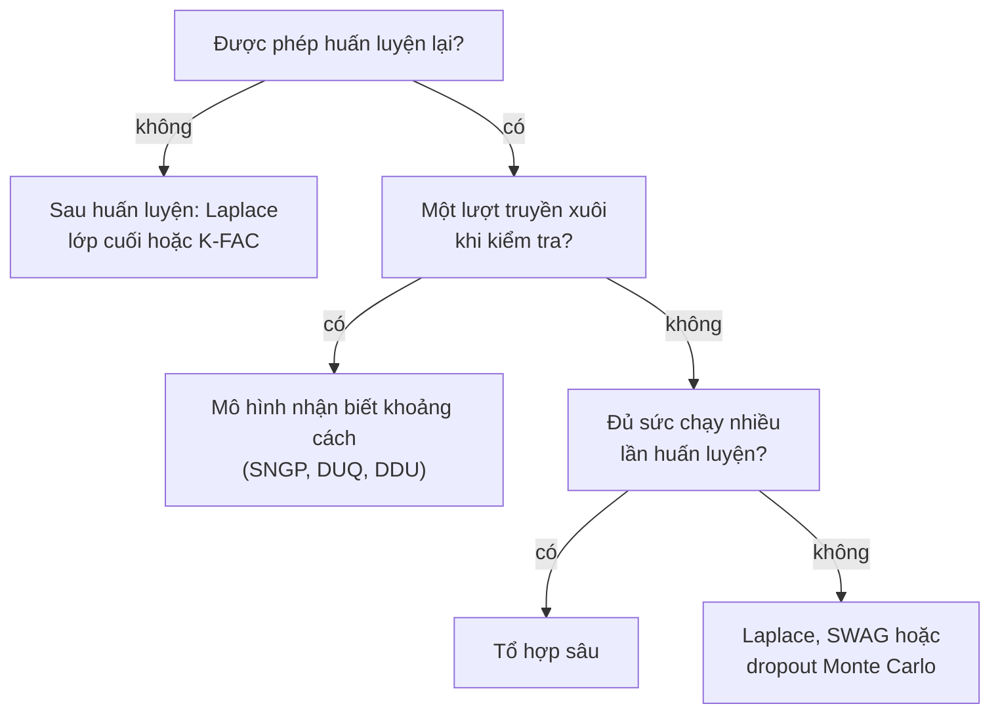

import Figure from '../../../components/Figure.astro';
import BdlLastLayer from '../../../components/diagrams/BdlLastLayer.astro';

Các phương pháp của loạt bài này được giới thiệu trên những mạng chỉ có vài chục tham số, nơi một ma trận hiệp phương sai đầy đủ vừa trong bộ nhớ và một nghìn lượt truyền xuôi chỉ mất một giây. Một mạng hiện đại có từ hàng triệu đến hàng tỉ tham số và được huấn luyện trên những tập dữ liệu lớn đến mức chỉ có thể duyệt qua vài lần. Bài này hỏi mỗi phương pháp của các bài tổng quan trước tốn bao nhiêu ở quy mô đó, và những phép xấp xỉ nào giảm được chi phí. Đó là suy luận chỉ trên lớp cuối, độ cong có cấu trúc cho [xấp xỉ Laplace](/vi/blog/laplace-approximations), các mô hình một lượt truyền xuôi đưa độ bất định vào ngay trong kiến trúc, [quá trình Gauss](/vi/blog/gaussian-processes-and-kernels) thưa và, một cách ngắn gọn, mối liên hệ giữa suy luận Bayes và nén mô hình.

Bài này dựa trên xấp xỉ Laplace (Laplace approximation) và ma trận Gauss–Newton tổng quát (generalized Gauss–Newton, GGN) của bài tổng quan Phần II, suy luận biến phân (variational inference, VI) của [bài tổng quan Phần III](/vi/blog/variational-inference-for-neural-networks), [tổ hợp sâu (deep ensembles)](/vi/blog/deep-ensembles) của bài tổng quan Phần IV và các hàm nhân (kernel) của bài tổng quan Phần V. Bài dùng ký hiệu chung của loạt bài: tham số $\theta$, dữ liệu $\mathcal{D}$ gồm $N$ mẫu, phân phối tiên nghiệm (prior) $p(\theta)$, đầu vào kiểm tra $x^*$. Mã dùng Python 3.13 và NumPy 2.5.3 với các hạt giống ngẫu nhiên (seed) ghi trong từng đoạn mã; các con số về bộ nhớ giả định số dấu phẩy động (floating point) 32 bit (mỗi số 4 byte) và dùng tiền tố nhị phân (1 MiB là $2^{20}$ byte).

## 1. Chi phí nằm ở đâu

### 1.1 Bốn đại lượng kích thước

Bốn con số quyết định chi phí của suy luận xấp xỉ cho một mạng. **Số tham số** $P$ quyết định kích thước của một vector trọng số và của mọi thứ được lưu theo từng trọng số. **Kích thước dữ liệu** $N$ quyết định chi phí của một lượt duyệt qua tập huấn luyện. **Số mẫu** $M$ (mẫu từ phân phối hậu nghiệm hoặc các lần rút Monte Carlo), hoặc số thành viên $J$ của một tổ hợp mô hình, nhân lên chi phí của mọi dự đoán. Cuối cùng, **kích thước đầu ra** $C$, tức số lớp hoặc số chiều đầu ra, xuất hiện ở bất cứ đâu cần lập một ma trận Jacobi (Jacobian) hoặc một ma trận hiệp phương sai theo từng đầu ra.

Các số hạng nguy hiểm là những số hạng bậc hai hoặc bậc ba theo $P$. Một ma trận hiệp phương sai hậu nghiệm đầy đủ có $P^2$ phần tử. Với $P = 10^7$, một mạng khiêm tốn theo tiêu chuẩn hiện nay, đó là $10^{14}$ số, tức 400 terabyte (khoảng 364 TiB), và việc nghịch đảo nó tốn cỡ $P^3 = 10^{21}$ phép tính dấu phẩy động. Mọi thứ trong bài này đều là cách tránh các số hạng đó: giới hạn suy luận vào một số ít tham số, áp đặt cấu trúc lên ma trận hiệp phương sai, hoặc thay đổi mô hình để độ bất định đến từ một nguồn rẻ hơn.

### 1.2 Bảng chi phí

Bảng dưới đây so sánh các phương pháp của loạt bài theo bộ nhớ cần thêm ngoài một mạng đã huấn luyện, chi phí huấn luyện thêm và chi phí của một dự đoán. Các mục là bậc tăng trưởng, không phải số đo; các hằng số nhân phụ thuộc vào cách cài đặt.

| Phương pháp | Bộ nhớ thêm | Chi phí huấn luyện thêm | Chi phí mỗi dự đoán |
|---|---|---|---|
| Ước lượng hậu nghiệm cực đại (maximum a posteriori, MAP), mốc so sánh | không có | một lần huấn luyện | 1 lượt truyền xuôi |
| Laplace đầy đủ | $P^2$ | một lượt qua dữ liệu để lập độ cong, $O(P^3)$ để phân tích nó | $M$ lượt truyền xuôi, hoặc 1 lượt tuyến tính hóa |
| Laplace đường chéo | $P$ | một lượt qua dữ liệu | $M$ lượt truyền xuôi |
| Laplace phân tích Kronecker | $\sum_l (d_{\text{in},l}^2 + d_{\text{out},l}^2)$ | một lượt, cộng các phép phân rã trị riêng nhỏ | $M$ lượt truyền xuôi |
| Laplace lớp cuối hoặc hồi quy tuyến tính Bayes | $K^2$ (hồi quy), $K^2 C^2$ (đầy đủ, $C$ đầu ra) | một lượt để tính đặc trưng, $O(K^3)$ | 1 lượt truyền xuôi cộng $O(K^2)$ |
| Dropout Monte Carlo | không có | huấn luyện có dropout | $M$ lượt truyền xuôi |
| VI trường trung bình | $P$ (một phương sai cho mỗi trọng số) | lấy mẫu trọng số ở mỗi bước, thường cần nhiều epoch hơn | $M$ lượt truyền xuôi |
| Gauss trung bình trọng số ngẫu nhiên (stochastic weight averaging Gaussian, SWAG) | từ $P$ đến $(r + 2) P$ với hạng $r$ | thêm vài epoch hạ gradient ngẫu nhiên | $M$ lượt truyền xuôi |
| Tổ hợp sâu gồm $J$ thành viên | $(J - 1) P$ | $J$ lần huấn luyện | $J$ lượt truyền xuôi |
| Monte Carlo xích Markov (MCMC) gradient ngẫu nhiên | $(M - 1) P$ cho các mẫu được lưu | một lần chạy lấy mẫu dài | $M$ lượt truyền xuôi |
| Mô hình một lượt nhận biết khoảng cách | $K^2$ cho lớp đầu ra | chuẩn hóa phổ trong khi huấn luyện | 1 lượt truyền xuôi |
| Quá trình Gauss (GP) chính xác | $N^2$ | $O(N^3)$ | $O(N)$ cho trung bình, $O(N^2)$ cho phương sai |
| GP biến phân thưa, $N_u$ điểm cảm sinh | $N_u^2$ | $O(B N_u^2 + N_u^3)$ cho mỗi lô nhỏ cỡ $B$ | $O(N_u^2)$ |

Ở đây $l$ đánh chỉ số các lớp có $d_{\text{in},l}$ đầu vào và $d_{\text{out},l}$ đầu ra, còn $K$ là độ rộng của lớp ẩn cuối cùng. SWAG (Maddox và cộng sự, 2019) khớp một phân phối Gauss với các điểm lặp của hạ gradient ngẫu nhiên: một phương sai đường chéo cộng một số hạng hạng thấp có hạng $r$. MCMC gradient ngẫu nhiên là bộ lấy mẫu của [bài tổng quan Phần I](/vi/blog/sampling-the-posterior-mcmc). Bảng đã gợi ra lựa chọn thiết kế chính: hoặc trả giá lúc huấn luyện (tổ hợp mô hình, VI, lấy mẫu), hoặc lúc dự đoán ($M$ lượt truyền xuôi), hoặc tìm một cấu trúc làm cả hai đều rẻ. Các mục tiếp theo mô tả những phương pháp ở các hàng mới xuất hiện trong bài này.

## 2. Suy luận lớp cuối

### 2.1 Ý tưởng

Một mạng đã huấn luyện có thể được tách làm hai phần. **Bộ trích xuất đặc trưng** (feature extractor), gồm mọi lớp cho đến lớp ẩn cuối cùng, ánh xạ đầu vào $x$ thành vector đặc trưng $z = \phi(x) \in \mathbb{R}^K$, và một lớp tuyến tính cuối ánh xạ $z$ thành đầu ra. **Suy luận lớp cuối** (last-layer inference) giữ bộ trích xuất đặc trưng ở giá trị đã huấn luyện và chỉ coi các trọng số $w$ của lớp cuối là ngẫu nhiên. Với bài toán hồi quy có nhiễu Gauss, mô hình khi đó là

$$
y = w^\top \phi(x) + \varepsilon, \qquad \varepsilon \sim \mathcal{N}(0, \sigma^2), \qquad w \sim \mathcal{N}(0, \alpha^{-1} I),
$$

một bài toán hồi quy tuyến tính Bayes trên $K$ đặc trưng, trong đó $\alpha = 1/s_0^2$ là độ chính xác tiên nghiệm (prior precision), nghịch đảo của phương sai tiên nghiệm $s_0^2$ dùng ở bài tổng quan mở đầu, và $\sigma$ là độ lệch chuẩn của nhiễu. Mọi thứ của mô hình này đều chính xác và rẻ. Snoek và cộng sự (2015) dùng nó như một thay thế có khả năng mở rộng cho GP trong tối ưu hóa Bayes, và Riquelme, Tucker và Snoek (2018) thấy nó cạnh tranh được với các phương pháp phức tạp hơn trong bài toán ra quyết định với *contextual bandit*. Kristiadi, Hein và Hennig (2020) chứng minh rằng với các bộ phân loại ReLU, chỉ riêng một phân phối Gauss trên lớp cuối đã ngăn độ tự tin tiến tới một ở xa dữ liệu, điều mà một ước lượng điểm không tránh được.

### 2.2 Phân phối hậu nghiệm và phân phối dự đoán

Đây chính là hồi quy tuyến tính Bayes của [bài tổng quan mở đầu](/vi/blog/bayesian-inference-for-neural-networks), với các đặc trưng đã học thay cho các hàm bướu Gauss cố định ở đó. Với ma trận đặc trưng $\Phi$ cỡ $N \times K$ có các hàng là $\phi(x_n)^\top$ và vector mục tiêu $\mathbf{y}$, phân phối hậu nghiệm (posterior) là $\mathcal{N}(m_N, S_N)$ và phân phối dự đoán (predictive distribution) tại $x^*$, với $z^* = \phi(x^*)$, là

$$
S_N^{-1} = \alpha I + \sigma^{-2} \Phi^\top \Phi, \qquad m_N = \sigma^{-2} S_N \Phi^\top \mathbf{y},
$$

$$
p(y^* \mid x^*, \mathcal{D}) = \mathcal{N}\big(y^*;\; m_N^\top z^*,\; \sigma^2 + z^{*\top} S_N z^*\big).
$$

Điều mới ở quy mô lớn là chi phí. Lập $\Phi^\top \Phi$ tốn $O(N K^2)$ trong một lượt qua dữ liệu, phân tích ma trận độ chính xác cỡ $K \times K$ tốn $O(K^3)$, và sau đó mỗi dự đoán tốn một lượt truyền xuôi cộng $O(K^2)$. Với $K$ cỡ vài trăm đến vài nghìn, chi phí này không đáng kể so với huấn luyện, và ngoài một lượt truyền xuôi cho mỗi mẫu, không phần nào trong đó phụ thuộc vào kích thước của bộ trích xuất đặc trưng.

### 2.3 Một ví dụ tính toán

Đoạn mã dưới đây dùng 200 đặc trưng cosin ngẫu nhiên cố định thay cho một bộ trích xuất đặc trưng đã huấn luyện. Đó là các đặc trưng Fourier ngẫu nhiên (random Fourier features) (Rahimi và Recht, 2007), có tích vô hướng xấp xỉ hàm nhân mũ bình phương (squared-exponential kernel) của bài tổng quan Phần V với thang độ dài 1, nên ví dụ này cũng là một xấp xỉ rẻ của GP ở bài tổng quan Phần V. Dữ liệu là 40 quan sát có nhiễu của $\sin(2x)$ chia thành hai cụm, có một khoảng trống tại $x = 0$. Mã tính phân phối hậu nghiệm cho năm giá trị độ chính xác tiên nghiệm, in ra logarit hàm hợp lý biên (log marginal likelihood) của từng giá trị, rồi dự đoán tại bốn đầu vào kiểm tra với $\alpha = 1$. Trong mã, `prec` là ma trận độ chính xác hậu nghiệm $S_N^{-1}$ và `m` là $m_N$.

```python
import numpy as np

rng = np.random.default_rng(3)
N, K, sigma = 40, 200, 0.1                 # data, features, noise sd

# Training inputs in two clusters, with a gap around x = 0.
x = np.r_[rng.uniform(-3, -1, N // 2), rng.uniform(1, 3, N // 2)]
y = np.sin(2 * x) + sigma * rng.normal(size=N)

# Fixed random features: the stand-in for a trained network body.
omega = rng.normal(0, 1.0, size=K)         # frequencies, lengthscale 1
phase = rng.uniform(0, 2 * np.pi, size=K)
def features(x):
    return np.sqrt(2 / K) * np.cos(np.outer(x, omega) + phase)

def fit(alpha):
    """Posterior N(m, prec^-1) over last-layer weights with prior N(0, I/alpha)."""
    Phi = features(x)
    prec = alpha * np.eye(K) + Phi.T @ Phi / sigma**2   # posterior precision
    L = np.linalg.cholesky(prec)
    m = np.linalg.solve(prec, Phi.T @ y) / sigma**2
    # log evidence log p(y | alpha, sigma), Bishop (2006), Section 3.5
    E = np.sum((y - Phi @ m) ** 2) / (2 * sigma**2) + alpha * m @ m / 2
    logev = (K * np.log(alpha) - N * np.log(2 * np.pi * sigma**2)) / 2 \
            - E - np.log(np.diag(L)).sum()
    return m, L, logev

for alpha in [0.01, 0.1, 1.0, 10.0, 100.0]:
    print(f"alpha = {alpha:6g}   log evidence = {fit(alpha)[2]:8.2f}")

m, L, _ = fit(1.0)
xs = np.array([-2.0, 0.0, 2.0, 6.0])
Phis = features(xs)
V = np.linalg.solve(L, Phis.T)             # z^T prec^-1 z = |L^-1 z|^2
sd = np.sqrt(sigma**2 + (V**2).sum(0))
for xi, mu, s in zip(xs, Phis @ m, sd):
    print(f"x* = {xi:4.1f}  mean = {mu:6.3f}  sd = {s:5.3f}  sin(2x*) = {np.sin(2*xi):6.3f}")
```

```text
alpha =   0.01   log evidence =     3.66
alpha =    0.1   log evidence =    11.28
alpha =      1   log evidence =    14.42
alpha =     10   log evidence =   -18.76
alpha =    100   log evidence =  -205.46
x* = -2.0  mean =  0.763  sd = 0.105  sin(2x*) =  0.757
x* =  0.0  mean =  0.291  sd = 0.226  sin(2x*) =  0.000
x* =  2.0  mean = -0.836  sd = 0.106  sin(2x*) = -0.757
x* =  6.0  mean = -0.099  sd = 0.975  sin(2x*) = -0.537
```

<Figure caption="Trung bình dự đoán hậu nghiệm (nét liền) và dải ±2 độ lệch chuẩn (vùng tô) của mô hình lớp cuối với α = 1, so với hàm thật sin(2x) (nét đứt) và 40 điểm huấn luyện. Hãy để ý dải này giữ gần mức nhiễu bên trong các cụm, rộng ra ở khoảng trống và mở tới thang của tiên nghiệm ở ngoài vùng dữ liệu.">
  <BdlLastLayer />
</Figure>

Bên trong các cụm, độ lệch chuẩn dự đoán, 0.105 và 0.106, chỉ nhỉnh hơn mức nhiễu $\sigma = 0.1$ một chút: dữ liệu đã ghim chặt hàm số. Ở khoảng trống tại $x = 0$, nó tăng gấp đôi lên 0.226, và sai số của trung bình tại đó (0.291) nằm trong phạm vi hai độ lệch chuẩn. Tại $x = 6$, xa mọi dữ liệu, nó bằng 0.975, gần với độ lệch chuẩn tiên nghiệm $\sqrt{\sigma^2 + \lVert z^* \rVert^2 / \alpha} \approx 1$, và trung bình đã lùi về gần không. Đó là hành vi mà một phân phối dự đoán nên có, và nó chỉ tốn một phép phân tích Cholesky cỡ $200 \times 200$.

### 2.4 Chọn tiên nghiệm bằng bằng chứng

Logarit hàm hợp lý biên, được dùng ở bài tổng quan mở đầu để chọn thang của tiên nghiệm và ở [bài tổng quan Phần VI–VII](/vi/blog/priors-symmetries-and-identifiability) để học tiên nghiệm, có dạng đóng, và trên lưới giá trị ở trên nó đạt cực đại tại $\alpha = 1$. Một tiên nghiệm yếu ($\alpha = 0.01$) dàn xác suất ra nhiều hàm uốn lượn và phải trả giá cho điều đó; một tiên nghiệm mạnh ($\alpha = 100$) không vươn tới được dữ liệu và trả giá đắt hơn nhiều. Vì bằng chứng (evidence) là một hàm trơn của $\alpha$ và $\sigma$, cả hai đều có thể được tối ưu bằng phương pháp tăng gradient hoặc bằng các phép cập nhật điểm bất động của MacKay (1992), không cần tập kiểm định. Trong thực tế, cùng hàm mục tiêu này thường được dùng để điều chỉnh độ chính xác tiên nghiệm của một xấp xỉ Laplace lớp cuối sau khi huấn luyện.

### 2.5 Những gì suy luận lớp cuối không làm được

Các đặc trưng là cố định. Nếu bộ trích xuất đặc trưng ánh xạ một đầu vào lạ lên cùng vector đặc trưng với một đầu vào quen thuộc, không phân phối hậu nghiệm nào trên lớp cuối phân biệt được chúng; mục 4 sẽ quay lại thất bại này, gọi là sụp đổ đặc trưng. Với bài toán phân loại, hàm hợp lý không phải Gauss và phân phối hậu nghiệm phải được xấp xỉ, thường bằng một xấp xỉ Laplace lớp cuối. Ma trận hiệp phương sai của nó trên toàn bộ $K C$ trọng số có $K^2 C^2$ phần tử; với $K = 2048$ đặc trưng và $C = 1000$ lớp, đó là khoảng $4 \times 10^{12}$ số, nên ngay cả lớp cuối cũng cần cấu trúc Kronecker của mục 3. Các cách xử lý biến phân cho lớp cuối, chẳng hạn của Harrison, Willes và Snoek (2024), huấn luyện đồng thời các đặc trưng và phân phối hậu nghiệm của lớp cuối với chi phí gần bằng huấn luyện thông thường.

## 3. Xấp xỉ Laplace có khả năng mở rộng

### 3.1 Độ cong có cấu trúc

Xấp xỉ Laplace của [bài tổng quan Phần II](/vi/blog/laplace-approximations) cần ma trận độ chính xác $H + \alpha I$, trong đó $H$ là ma trận GGN của logarit âm của hàm hợp lý tại ước lượng MAP và $\alpha = 1/s_0^2$ là độ chính xác tiên nghiệm, như ở mục 2. Bài đó đã liệt kê các cấu trúc làm cho nó khả thi: đường chéo, phân tích Kronecker, hạng thấp và giới hạn trên một tập con các trọng số. Mục này xem kỹ hơn hai cấu trúc quan trọng nhất ở quy mô lớn.

Độ cong xấp xỉ phân tích Kronecker (Kronecker-factored approximate curvature, K-FAC) của [bài tổng quan Phần II](/vi/blog/laplace-approximations) được Martens và Grosse (2015) đưa ra cho bài toán tối ưu và được Ritter, Botev và Barber (2018) áp dụng cho xấp xỉ Laplace. Nó coi các lớp là độc lập và xấp xỉ khối ứng với một lớp kết nối đầy đủ có ma trận trọng số $W \in \mathbb{R}^{d_\text{out} \times d_\text{in}}$, với các trọng số được xếp chồng theo từng cột thành $\operatorname{vec}(W)$, bằng một tích Kronecker (định nghĩa ở bài tổng quan Phần II, mục 2.3)

$$
H_W \approx A \otimes G, \qquad A = \mathbb{E}[a a^\top], \qquad G = \mathbb{E}[g g^\top],
$$

trong đó $a \in \mathbb{R}^{d_\text{in}}$ là đầu vào của lớp, $g \in \mathbb{R}^{d_\text{out}}$ là gradient của hàm mất mát theo đầu ra của lớp và các kỳ vọng là trung bình trên dữ liệu huấn luyện. Phép xấp xỉ giả định rằng các giá trị kích hoạt và gradient đầu ra là độc lập, điều không hoàn toàn đúng, nhưng nó giữ lại các tương quan chủ yếu bên trong một lớp. Với một lớp có 1024 đầu vào và 1024 đầu ra, khối chính xác sẽ có $2^{40}$ phần tử (4 TiB); hai thừa số có $2 \times 2^{20}$ phần tử (8 MiB), gấp đôi đường chéo (4 MiB).

Cấu trúc thứ hai giới hạn suy luận vào một **mạng con** (subnetwork). Trong công trình về suy luận trên mạng con, Daxberger và cộng sự (2021) chọn một tập con nhỏ các trọng số, chẳng hạn những trọng số có phương sai biên lớn nhất theo một xấp xỉ đường chéo, giữ ma trận hiệp phương sai đầy đủ trên chúng và cố định phần còn lại ở giá trị MAP. Suy luận lớp cuối là trường hợp đặc biệt khi tập con đó là lớp cuối.

### 3.2 Thủ thuật Kronecker trong mã

Một phép phân tích Kronecker chỉ hữu ích nếu có thể dùng phân phối hậu nghiệm mà không bao giờ phải lập $A \otimes G$. Đồng nhất thức cho phép điều đó là: nếu $A = Q_A D_A Q_A^\top$ và $G = Q_G D_G Q_G^\top$ là các phép phân rã trị riêng thì $A \otimes G + \alpha I$ có các vector riêng $Q_A \otimes Q_G$ và các trị riêng $\lambda_{A,i} \lambda_{G,j} + \alpha$. Với cách xếp chồng theo cột, nhân $\operatorname{vec}(V)$ với $Q_A \otimes Q_G$ cũng chính là tính $Q_G V Q_A^\top$, nên các phép quay tác động lên các ma trận cỡ $d_\text{out} \times d_\text{in}$. Giải một hệ tuyến tính, lấy mẫu hay tính logarit định thức khi đó chỉ cần hai phép phân rã trị riêng nhỏ. Đoạn mã kiểm tra phép giải so với một phép tính dày đặc cho một lớp cỡ $20 \times 30$.

```python
import numpy as np

rng = np.random.default_rng(5)
d_in, d_out, B, alpha = 30, 20, 500, 1.0

# Kronecker factors from a batch of B examples: layer inputs a and
# gradients g of the loss with respect to the layer outputs.
a = rng.normal(size=(B, d_in)) @ rng.normal(size=(d_in, d_in)) / 5
g = rng.normal(size=(B, d_out)) @ rng.normal(size=(d_out, d_out)) / 5
A = a.T @ a / B                         # d_in x d_in
G = g.T @ g / B                         # d_out x d_out

# Full precision of vec(W), W is d_out x d_in stacked column by column.
prec = np.kron(A, G) + alpha * np.eye(d_out * d_in)
V = rng.normal(size=(d_out, d_in))      # a vector to multiply by prec^-1
direct = np.linalg.solve(prec, V.ravel(order="F"))

# Kronecker route: two small eigendecompositions, never forming prec.
lA, QA = np.linalg.eigh(A)
lG, QG = np.linalg.eigh(G)
X = QG.T @ V @ QA                       # rotate into the joint eigenbasis
X /= np.outer(lG, lA) + alpha           # divide by the eigenvalues of prec
kron = (QG @ X @ QA.T).ravel(order="F") # rotate back

print("max difference:", f"{np.abs(direct - kron).max():.1e}")
print("numbers stored: full", prec.size, " Kronecker", A.size + G.size)
```

```text
max difference: 4.9e-15
numbers stored: full 360000  Kronecker 1300
```

Hai cách cho kết quả trùng nhau đến sai số làm tròn, và các thừa số chỉ lưu 1300 số thay vì 360 000. Phép giải dày đặc tốn $O((d_\text{in} d_\text{out})^3)$; cách Kronecker tốn $O(d_\text{in}^3 + d_\text{out}^3)$ cho các phép phân rã trị riêng và $O(d_\text{in} d_\text{out} (d_\text{in} + d_\text{out}))$ cho các phép quay.

### 3.3 Dự đoán và lấy mẫu ở quy mô lớn

Với một ma trận hiệp phương sai có cấu trúc, dự đoán có được hoặc bằng cách lấy mẫu trọng số rồi chạy $M$ lượt truyền xuôi, hoặc từ phân phối dự đoán tuyến tính hóa của bài tổng quan Phần II, vốn thay mạng bằng khai triển bậc nhất của nó quanh ước lượng MAP. Immer, Korzepa và Bauer (2021) chỉ ra rằng phân phối dự đoán tuyến tính hóa thường cho kết quả tốt hơn việc lấy mẫu chính mạng dưới một xấp xỉ Laplace dựa trên GGN, vì GGN là độ cong chính xác của mô hình tuyến tính hóa. Phép so sánh các lựa chọn này của Daxberger và cộng sự (2021), khuyến nghị dùng xấp xỉ lớp cuối với độ cong phân tích Kronecker hoặc đầy đủ làm mặc định, đã được bàn ở bài tổng quan Phần II.

Khi ngay cả các thừa số Kronecker cũng quá thô, phân phối hậu nghiệm của mô hình tuyến tính hóa có thể được lấy mẫu mà hoàn toàn không cần lưu ma trận hiệp phương sai. Một mẫu từ phân phối hậu nghiệm Gauss của mô hình tuyến tính là nghiệm cực tiểu của một hàm mục tiêu bình phương tối thiểu bị nhiễu ngẫu nhiên, nên rút một mẫu tốn xấp xỉ bằng một lần chạy tối ưu. Antorán và cộng sự (2023) dùng điều này, với tối ưu ngẫu nhiên thay cho các phép giải chính xác, để lấy mẫu phân phối hậu nghiệm Laplace tuyến tính hóa của các bộ phân loại ảnh quá lớn đối với các cấu trúc hiệp phương sai khác.

## 4. Các phương pháp một lượt truyền xuôi

### 4.1 Sụp đổ đặc trưng và nhận biết khoảng cách

Mọi phương pháp cho đến giờ đều trả giá lúc dự đoán bằng $M$ lượt truyền xuôi, hoặc giới hạn suy luận vào một lớp có đặc trưng cố định. **Các phương pháp một lượt truyền xuôi** (single-forward-pass methods) thì thay đổi mô hình để một lượt truyền xuôi tất định cho cả dự đoán lẫn độ bất định. Ý tưởng là làm cho lớp đầu ra **nhận biết khoảng cách** (distance-aware): độ bất định của nó tăng theo khoảng cách giữa vector đặc trưng của đầu vào kiểm tra và các vector đặc trưng của dữ liệu huấn luyện, giống như phương sai dự đoán của một GP với hàm nhân dừng.

Khoảng cách trong không gian đặc trưng chỉ có ý nghĩa nếu bộ trích xuất đặc trưng bảo toàn khoảng cách trong không gian đầu vào. Một mạng không bị ràng buộc thì không nhất thiết như vậy: huấn luyện cho bài toán phân loại khuyến khích ánh xạ mọi đầu vào của một lớp vào một vùng gọn, và không gì ngăn một đầu vào khác hẳn mọi đầu vào huấn luyện cũng bị ánh xạ vào vùng đó. Đây là hiện tượng **sụp đổ đặc trưng** (feature collapse), và nó vô hiệu hóa mọi phương pháp đọc độ bất định từ các đặc trưng, kể cả mô hình lớp cuối của mục 2. Cách khắc phục là đòi hỏi bộ trích xuất đặc trưng phải **song Lipschitz** (bi-Lipschitz): với các hằng số $0 < L_1 \le L_2$ nào đó,

$$
L_1 \lVert x - x' \rVert \le \lVert \phi(x) - \phi(x') \rVert \le L_2 \lVert x - x' \rVert,
$$

để các đầu vào cách xa nhau vẫn cách xa nhau (cận dưới, độ nhạy) và các đầu vào gần nhau vẫn gần nhau (cận trên, độ trơn).

### 4.2 Áp đặt các cận

Có hai kỹ thuật được dùng. Một khối phần dư (residual block) $x \mapsto x + r(x)$ có nhánh $r$ với hằng số Lipschitz $c < 1$ thỏa mãn cả hai cận, với $L_1 = 1 - c$ và $L_2 = 1 + c$, theo bất đẳng thức tam giác. **Chuẩn hóa phổ** (spectral normalization) (Miyato và cộng sự, 2018) áp đặt $c < 1$ bằng cách chia mỗi ma trận trọng số trong nhánh cho một ước lượng của giá trị kỳ dị lớn nhất của nó. Ước lượng này rẻ: một bước lặp lũy thừa cho mỗi bước huấn luyện. Cách còn lại là một số hạng phạt gradient hai phía, đẩy chuẩn của gradient của đầu ra theo đầu vào về gần một, cách mà van Amersfoort và cộng sự (2020) đã dùng.

### 4.3 Các lớp đầu ra đo khoảng cách

Một số lớp đầu ra biến các khoảng cách được bảo toàn thành độ bất định. Định lượng độ bất định tất định (deterministic uncertainty quantification, DUQ) (van Amersfoort và cộng sự, 2020) so sánh vector đặc trưng với một tâm học được cho mỗi lớp qua một hàm nhân mũ bình phương và báo độ tự tin thấp khi nó ở xa mọi tâm. Quá trình Gauss nơ-ron chuẩn hóa phổ (spectral-normalized neural Gaussian process, SNGP) (Liu và cộng sự, 2020) thay lớp đầu ra bằng một GP được xấp xỉ bằng đặc trưng Fourier ngẫu nhiên, tức cách dựng của mục 2.3 áp dụng cho đặc trưng đã học. Nó tính ma trận hiệp phương sai hậu nghiệm bằng một xấp xỉ Laplace được tích lũy trong epoch huấn luyện cuối cùng. Độ bất định tất định sâu (deep deterministic uncertainty, DDU) (Mukhoti và cộng sự, 2023) giữ một đầu ra softmax thông thường nhưng khớp một mật độ Gauss với các đặc trưng huấn luyện của mỗi lớp sau khi huấn luyện; mật độ đặc trưng thấp báo hiệu độ bất định nhận thức (epistemic uncertainty), còn entropy của softmax báo hiệu độ bất định ngẫu nhiên (aleatoric uncertainty).

Các phương pháp này nhanh lúc dự đoán và, trong các bộ dữ liệu chuẩn đã công bố, phát hiện tốt các đầu vào ở xa dữ liệu huấn luyện. Độ bất định của chúng chỉ tốt đến mức khoảng cách trong không gian đặc trưng cho phép: các cận song Lipschitz loại trừ sự sụp đổ hoàn toàn, nhưng không bảo đảm rằng khoảng cách đặc trưng phản ánh những khác biệt quan trọng đối với bài toán. Chúng cũng chỉ xấp xỉ phân phối hậu nghiệm trên một phần nhỏ của mô hình, nên hầu như không nói gì về độ bất định sinh ra từ chính các tham số của bộ trích xuất đặc trưng.

## 5. Quá trình Gauss có khả năng mở rộng

GP chính xác của bài tổng quan Phần V cần ma trận nhân cỡ $N \times N$, bộ nhớ $O(N^2)$ và thời gian $O(N^3)$. Hai họ phép xấp xỉ giảm được chi phí này.

**Các phương pháp điểm cảm sinh** (inducing-point methods) tóm tắt hàm số bằng các giá trị $u$ của nó tại $N_u \ll N$ vị trí $Z$, gọi là các điểm cảm sinh. GP biến phân thưa của Titsias (2009) coi $Z$ là tham số biến phân và khớp một phân phối Gauss $q(u)$ bằng cách cực đại hóa một cận dưới của bằng chứng (evidence lower bound, ELBO), với chi phí $O(N N_u^2 + N_u^3)$. Hensman, Fusi và Lawrence (2013) viết cận này thành tổng theo các điểm dữ liệu để có thể tối ưu nó bằng các lô nhỏ (mini-batch) cỡ $B$ với chi phí $O(B N_u^2 + N_u^3)$ mỗi bước, nhờ đó GP dùng được trên hàng triệu mẫu. Với $N = 10^6$, $N_u = 500$ và $B = 256$, một bước tốn khoảng $1.9 \times 10^8$ phép tính, so với $10^{18}$ cho một phép phân tích chính xác. Chất lượng của phép xấp xỉ phụ thuộc vào việc $N_u$ điểm cảm sinh có biểu diễn được hàm số hay không: một hàm có nhiều chi tiết nhỏ cần nhiều điểm như vậy.

**Các phương pháp hạng thấp và lặp** tấn công trực tiếp vào phần đại số tuyến tính. Xấp xỉ Nyström (Williams và Seeger, 2001) và đặc trưng ngẫu nhiên (Rahimi và Recht, 2007) thay hàm nhân bằng một xấp xỉ hạng $N_u$ hoặc hạng $K$, biến GP thành một mô hình tuyến tính Bayes giống như ở mục 2. Các bộ giải lặp như gradient liên hợp tính các tích và các phép giải mà một GP chính xác cần chỉ bằng các phép nhân ma trận – vector với ma trận nhân, vốn chạy nhanh trên bộ xử lý đồ họa; Gardner và cộng sự (2018) xây dựng một thư viện GP quanh cách tiếp cận này.

## 6. Nén và độ dài mô tả

Một cách nhìn khác về quy mô hỏi một mô hình cần bao nhiêu bit, và nó dẫn trở lại ELBO của bài tổng quan Phần III. Hinton và van Camp (1993) nhận xét rằng một bên gửi muốn truyền các giá trị mục tiêu huấn luyện cho một bên nhận đã có sẵn các đầu vào có thể gửi trước một bộ trọng số, rồi gửi các giá trị mục tiêu được mã hóa bằng dự đoán của mô hình. Nếu các trọng số được lấy mẫu từ một phân phối $q(\theta)$ và được mã hóa bằng một bộ mã dựng từ tiên nghiệm $p(\theta)$, một sơ đồ về sau được gọi là **mã hóa bits-back** (bits-back coding) làm cho tổng độ dài kỳ vọng, tính bằng nat, bằng

$$
\mathrm{KL}\big(q(\theta) \,\Vert\, p(\theta)\big) + \mathbb{E}_{q}\big[-\log p(\mathcal{D} \mid \theta)\big],
$$

tức là ELBO âm. Do đó cực tiểu hóa ELBO âm chính là cực tiểu hóa một độ dài mô tả, nguyên lý của Rissanen (1978); Honkela và Valpola (2004) đã phát triển mối liên hệ này. Số hạng Kullback–Leibler (KL) có một cách đọc trực tiếp: đó là số nat cần để truyền các trọng số đến độ chính xác mà độ bất định hậu nghiệm cho phép. Một trọng số có phân phối hậu nghiệm rộng cần ít bit.

Cách đọc này đã được dùng để nén mạng. Louizos, Ullrich và Welling (2017) dùng các tiên nghiệm tạo tính thưa và các phương sai hậu nghiệm để cắt tỉa các đơn vị và chọn số bit lưu cho mỗi trọng số. Havasi, Peharz và Hernández-Lobato (2019) chỉ ra cách truyền một mẫu từ $q(\theta)$ với khoảng $\mathrm{KL}(q \Vert p)$ bit cộng một phần chi phí phụ nhỏ, không cần cách dựng bits-back, bằng cách dùng tính ngẫu nhiên chung giữa bên gửi và bên nhận, một kỹ thuật nay được gọi là mã hóa entropy tương đối (relative entropy coding). Như một ví dụ về quy mô, một phân phối hậu nghiệm biến phân có độ phân kỳ KL so với tiên nghiệm là 2000 nat có thể được truyền bằng khoảng $2000 / \log 2 \approx 2885$ bit, bất kể mạng có bao nhiêu trọng số.

## 7. Chọn phương pháp

Bảng chi phí và các mục ở trên gợi ra trình tự quyết định dưới đây. Nó phản ánh các phép so sánh được trích dẫn trong bài này, không phải một bảng xếp hạng phổ quát; [bài tổng quan Phần IX](/vi/blog/evaluating-and-using-uncertainty) giải thích cách kiểm tra kết quả trên chính bài toán của người đọc.



Con đường sau huấn luyện (post hoc) hấp dẫn vì nó không động đến quy trình huấn luyện sẵn có. Huấn luyện như bình thường, tính độ cong của lớp cuối hoặc của toàn mạng với các thừa số Kronecker trong một lượt bổ sung, rồi điều chỉnh độ chính xác tiên nghiệm theo bằng chứng hoặc theo dữ liệu kiểm định. Tổ hợp mô hình vẫn là lựa chọn đáng tin cậy nhất khi đủ sức chạy nhiều lần huấn luyện, như bài tổng quan Phần IV đã bàn, và việc khớp một xấp xỉ Laplace quanh mỗi thành viên, cho ra hỗn hợp mô tả ở bài tổng quan Phần IV, chỉ thêm một lượt tính độ cong cho mỗi thành viên vào $J$ lần huấn luyện.

## 8. Giới hạn và các kiểu thất bại

Các phép xấp xỉ của bài này có chung một khuôn mẫu: mỗi phép đổi lấy tốc độ bằng cách bỏ qua một phần của phân phối hậu nghiệm, và phần bị bỏ qua quyết định nó thất bại ở đâu.

- **Đặc trưng cố định.** Các phương pháp lớp cuối và một lượt thừa hưởng mọi điểm mù của bộ trích xuất đặc trưng. Chuẩn hóa phổ giảm sụp đổ đặc trưng nhưng không làm cho khoảng cách đặc trưng có ý nghĩa đối với bài toán.
- **Giả định độc lập.** Độ cong đường chéo và phân tích Kronecker bỏ qua tương quan giữa các lớp, và K-FAC giả định rằng đầu vào và gradient đầu ra là độc lập; độ bất định thu được phụ thuộc mạnh vào độ chính xác tiên nghiệm đã điều chỉnh.
- **Quá ít điểm cảm sinh hoặc đặc trưng.** GP thưa và các mô hình đặc trưng ngẫu nhiên làm trơn mất những cấu trúc mà chúng không biểu diễn được, và trở nên quá tự tin theo những cách trông giống hiệu chuẩn (calibration) tốt trên các hàm kiểm tra trơn.
- **Chi phí được dời đi, không bị loại bỏ.** $M$ lượt truyền xuôi lúc dự đoán có thể tốn hơn cả việc huấn luyện trong suốt vòng đời của một mô hình; một phương pháp khớp rẻ có thể triển khai đắt.
- **So sánh phụ thuộc vào bối cảnh.** Thứ hạng của các phương pháp có khả năng mở rộng thay đổi theo kiến trúc, dữ liệu và thước đo; các phép so sánh đã công bố chỉ bao quát một tập hạn chế các bộ dữ liệu chuẩn.

## 9. Bài tập

**Bài tập 1.** Một lớp kết nối đầy đủ có 512 đầu vào và 2048 đầu ra. Khối GGN chính xác của nó cần bao nhiêu bộ nhớ, tính theo số 32 bit, và hai thừa số Kronecker cùng đường chéo cần bao nhiêu?

<details>
<summary>Đáp án</summary>

Lớp này có $512 \times 2048 = 2^{20}$ trọng số. Khối chính xác có $2^{40}$ phần tử, tức 4 TiB. Các thừa số có $512^2 + 2048^2 = 4\,456\,448$ phần tử, tức 17 MiB. Đường chéo có $2^{20}$ phần tử, tức 4 MiB.

</details>

**Bài tập 2.** Trong ví dụ tính toán, độ lệch chuẩn dự đoán tại $x^* = 6$ là 0.975. Từ công thức dự đoán, hãy giải thích vì sao nó phải gần 1 với $\alpha = 1$ và $\sigma = 0.1$, và vì sao nó nhỏ hơn một chút.

<details>
<summary>Đáp án</summary>

Ở xa dữ liệu, các đặc trưng huấn luyện mang rất ít thông tin về $z^*$, nên $S_N$ tác động lên $z^*$ gần như ma trận hiệp phương sai tiên nghiệm $\alpha^{-1} I$ và phương sai gần bằng $\sigma^2 + \lVert z^* \rVert^2 / \alpha$. Mỗi đặc trưng là $\sqrt{2/K}\cos(\cdot)$, nên $\lVert z^* \rVert^2$ có trung bình $2/K \cdot K \cdot 1/2 = 1$, cho $\sqrt{1.01} \approx 1.005$. Với các đặc trưng này, $\lVert z^* \rVert^2 = 1.003$ tại $x^* = 6$, nên phần hụt nhỏ đến từ dữ liệu: các đặc trưng tần số thấp biến thiên đủ chậm để mang một phần thông tin từ các cụm ra tới $x = 6$, làm giảm đi một chút phương sai tiên nghiệm.

</details>

**Bài tập 3.** Vì sao không thể dùng trực tiếp cách Kronecker của mục 3.2 khi độ chính xác tiên nghiệm khác nhau giữa các trọng số trong cùng một lớp?

<details>
<summary>Đáp án</summary>

Đồng nhất thức đòi hỏi số hạng được cộng thêm phải là một bội của ma trận đơn vị, vốn có chung mọi vector riêng với $A \otimes G$. Một ma trận đường chéo có các phần tử không bằng nhau thì không như vậy, nên $A \otimes G + D$ không còn có các vector riêng $Q_A \otimes Q_G$. Có những phép xấp xỉ, chẳng hạn cộng một số hạng tắt dần (damping) vào mỗi thừa số, nhưng chúng làm thay đổi phân phối hậu nghiệm.

</details>

**Bài tập 4.** Một GP biến phân thưa với $N_u = 1000$ điểm cảm sinh được huấn luyện với các lô nhỏ cỡ $B = 512$. Số hạng chi phối chi phí mỗi bước là gì, và chi phí thay đổi thế nào nếu $N_u$ tăng gấp đôi?

<details>
<summary>Đáp án</summary>

$B N_u^2 = 5.12 \times 10^8$ và $N_u^3 = 10^9$, nên số hạng $N_u^3$ chi phối. Tăng gấp đôi $N_u$ nhân $B N_u^2$ lên 4 lần và $N_u^3$ lên 8 lần, nên chi phí mỗi bước tăng từ khoảng $1.5 \times 10^9$ lên $1.0 \times 10^{10}$, tức khoảng 6.6 lần.

</details>

**Bài tập 5.** Theo cách nhìn bits-back, độ dài mô tả của một trọng số có phân phối hậu nghiệm $q$ bằng đúng tiên nghiệm $p$ của nó sẽ ra sao, và điều đó gợi ý gì cho việc nén?

<details>
<summary>Đáp án</summary>

Đóng góp KL của nó bằng không: nó không tốn bit nào, vì bên nhận có thể tự rút nó từ tiên nghiệm bằng tính ngẫu nhiên chung. Một trọng số như vậy không mang thông tin nào từ dữ liệu, nên có thể cắt tỉa nó hoặc thay nó bằng một mẫu từ tiên nghiệm mà không làm thay đổi chi phí dữ liệu kỳ vọng; đó là cơ sở của việc cắt tỉa trong nén Bayes.

</details>

## 10. Tóm tắt

| Câu hỏi | Trả lời |
|---|---|
| Những số hạng nào làm học sâu Bayes đắt đỏ? | Mọi thứ bậc hai hoặc bậc ba theo số tham số $P$, và $M$ lượt truyền xuôi cho mỗi dự đoán. |
| Suy luận lớp cuối là gì? | Hồi quy tuyến tính Bayes (hoặc một xấp xỉ Laplace) trên lớp cuối, với các đặc trưng cố định. |
| Ví dụ tính toán cho thấy gì? | Độ lệch chuẩn dự đoán 0.105 trong vùng dữ liệu, 0.226 ở khoảng trống, 0.975 ở xa, chỉ từ một phép phân tích cỡ $200 \times 200$. |
| Tiên nghiệm được chọn ở đó thế nào? | Bằng bằng chứng dạng đóng, đạt cực đại tại $\alpha = 1$ trên lưới giá trị. |
| K-FAC lưu những gì? | Hai thừa số cho mỗi lớp, $d_\text{in}^2 + d_\text{out}^2$ số; 8 MiB thay vì 4 TiB cho một lớp 1024 × 1024. |
| Dùng nó thế nào mà không lập tích? | Thông qua các phép phân rã trị riêng của các thừa số. |
| Các phương pháp một lượt cần gì? | Một bộ trích xuất đặc trưng song Lipschitz (khối phần dư với chuẩn hóa phổ) và một lớp đầu ra nhận biết khoảng cách. |
| GP mở rộng quy mô thế nào? | Điểm cảm sinh với lô nhỏ, $O(BN_u^2 + N_u^3)$ mỗi bước, hoặc đại số tuyến tính hạng thấp và lặp. |
| Nén liên quan thế nào? | ELBO âm là một độ dài mô tả; số hạng KL là chi phí của các trọng số tính bằng nat. |

Mở rộng quy mô quy về việc quyết định giữ phần nào của phân phối hậu nghiệm: lớp cuối, các tương quan bên trong mỗi lớp, một GP trên đặc trưng đã học, hay một tập các mode được huấn luyện độc lập. Mỗi lựa chọn đều rẻ ở chỗ các phương pháp của các bài tổng quan trước đắt, và mỗi lựa chọn đều có thể thất bại ở chỗ phần bị bỏ qua trở nên quan trọng. Một phép xấp xỉ cho trước có đủ tốt hay không thì không thể đọc ra từ cách suy dẫn của nó; phải đo. Bài tổng quan tiếp theo, [Đánh giá và sử dụng độ bất định dự đoán](/vi/blog/evaluating-and-using-uncertainty) (Phần IX), chuyển sang phép đo đó: hiệu chuẩn, quy tắc chấm điểm thích đáng (proper scoring rule) và dự đoán có chọn lọc, cùng cách độ bất định dự đoán được dùng trong học chủ động (active learning) và trong các mô hình ngôn ngữ lớn. Trước bài đó, các chương đầy đủ của Phần VIII của loạt bài nối tiếp bài tổng quan này, mỗi chương một bài.

### Tài liệu tham khảo

- J. Antorán et al., "Sampling-based inference for large linear models, with application to linearised Laplace," in *Proceedings of the International Conference on Learning Representations (ICLR)*, 2023.
- C. M. Bishop, *Pattern Recognition and Machine Learning*, Springer, 2006.
- E. Daxberger, E. Nalisnick, J. U. Allingham, J. Antorán and J. M. Hernández-Lobato, "Bayesian deep learning via subnetwork inference," in *Proceedings of the 38th International Conference on Machine Learning (ICML)*, 2021.
- E. Daxberger, A. Kristiadi, A. Immer, R. Eschenhagen, M. Bauer and P. Hennig, "Laplace redux – effortless Bayesian deep learning," in *Advances in Neural Information Processing Systems 34*, 2021.
- J. R. Gardner, G. Pleiss, D. Bindel, K. Q. Weinberger and A. G. Wilson, "GPyTorch: Blackbox matrix-matrix Gaussian process inference with GPU acceleration," in *Advances in Neural Information Processing Systems 31*, 2018.
- J. Harrison, J. Willes and J. Snoek, "Variational Bayesian last layers," in *Proceedings of the International Conference on Learning Representations (ICLR)*, 2024.
- M. Havasi, R. Peharz and J. M. Hernández-Lobato, "Minimal random code learning: Getting bits back from compressed model parameters," in *Proceedings of the International Conference on Learning Representations (ICLR)*, 2019.
- J. Hensman, N. Fusi and N. D. Lawrence, "Gaussian processes for big data," in *Proceedings of the 29th Conference on Uncertainty in Artificial Intelligence (UAI)*, 2013.
- G. E. Hinton and D. van Camp, "Keeping the neural networks simple by minimizing the description length of the weights," in *Proceedings of the Sixth Annual Conference on Computational Learning Theory (COLT)*, 1993.
- A. Honkela and H. Valpola, "Variational learning and bits-back coding: An information-theoretic view to Bayesian learning," *IEEE Transactions on Neural Networks*, vol. 15, 2004.
- A. Immer, M. Korzepa and M. Bauer, "Improving predictions of Bayesian neural nets via local linearization," in *Proceedings of the 24th International Conference on Artificial Intelligence and Statistics (AISTATS)*, 2021.
- A. Kristiadi, M. Hein and P. Hennig, "Being Bayesian, even just a bit, fixes overconfidence in ReLU networks," in *Proceedings of the 37th International Conference on Machine Learning (ICML)*, 2020.
- J. Z. Liu et al., "Simple and principled uncertainty estimation with deterministic deep learning via distance awareness," in *Advances in Neural Information Processing Systems 33*, 2020.
- C. Louizos, K. Ullrich and M. Welling, "Bayesian compression for deep learning," in *Advances in Neural Information Processing Systems 30*, 2017.
- D. J. C. MacKay, "Bayesian interpolation," *Neural Computation*, vol. 4, no. 3, pp. 415–447, 1992.
- W. J. Maddox, T. Garipov, P. Izmailov, D. Vetrov and A. G. Wilson, "A simple baseline for Bayesian uncertainty in deep learning," in *Advances in Neural Information Processing Systems 32*, 2019.
- J. Martens and R. Grosse, "Optimizing neural networks with Kronecker-factored approximate curvature," in *Proceedings of the 32nd International Conference on Machine Learning (ICML)*, 2015.
- T. Miyato, T. Kataoka, M. Koyama and Y. Yoshida, "Spectral normalization for generative adversarial networks," in *Proceedings of the International Conference on Learning Representations (ICLR)*, 2018.
- J. Mukhoti, A. Kirsch, J. van Amersfoort, P. H. S. Torr and Y. Gal, "Deep deterministic uncertainty: A new simple baseline," in *Proceedings of the IEEE Conference on Computer Vision and Pattern Recognition (CVPR)*, 2023.
- A. Rahimi and B. Recht, "Random features for large-scale kernel machines," in *Advances in Neural Information Processing Systems 20*, 2007.
- C. Riquelme, G. Tucker and J. Snoek, "Deep Bayesian bandits showdown: An empirical comparison of Bayesian deep networks for Thompson sampling," in *Proceedings of the International Conference on Learning Representations (ICLR)*, 2018.
- J. Rissanen, "Modeling by shortest data description," *Automatica*, vol. 14, no. 5, pp. 465–471, 1978.
- H. Ritter, A. Botev and D. Barber, "A scalable Laplace approximation for neural networks," in *Proceedings of the International Conference on Learning Representations (ICLR)*, 2018.
- J. Snoek et al., "Scalable Bayesian optimization using deep neural networks," in *Proceedings of the 32nd International Conference on Machine Learning (ICML)*, 2015.
- M. Titsias, "Variational learning of inducing variables in sparse Gaussian processes," in *Proceedings of the 12th International Conference on Artificial Intelligence and Statistics (AISTATS)*, 2009.
- J. van Amersfoort, L. Smith, Y. W. Teh and Y. Gal, "Uncertainty estimation using a single deep deterministic neural network," in *Proceedings of the 37th International Conference on Machine Learning (ICML)*, 2020.
- C. K. I. Williams and M. Seeger, "Using the Nyström method to speed up kernel machines," in *Advances in Neural Information Processing Systems 13*, 2001.
