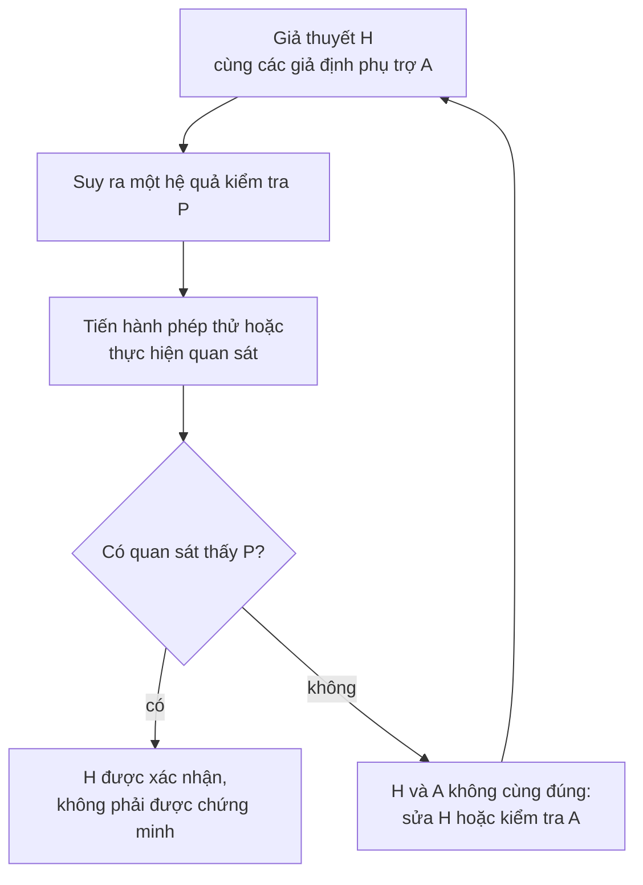
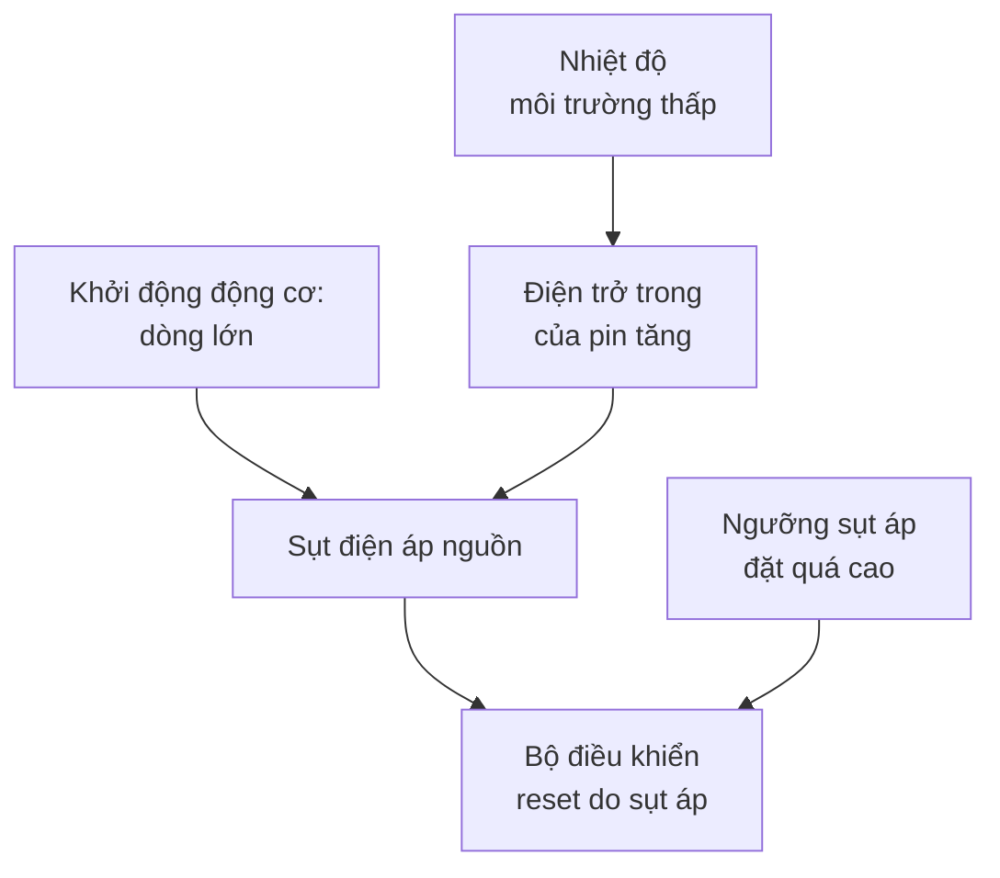
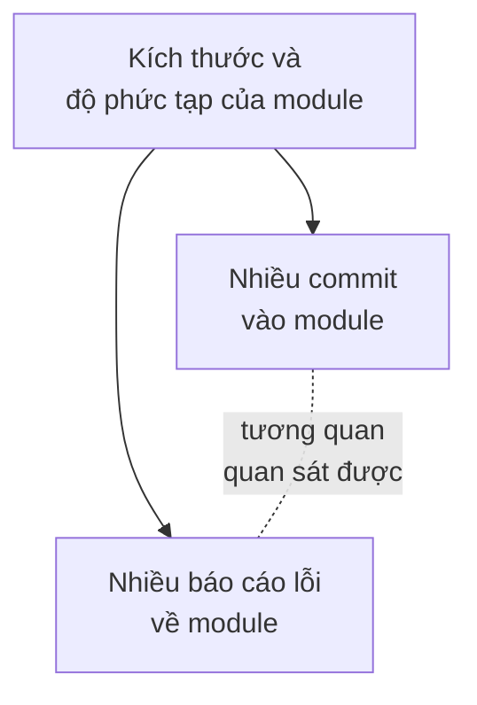

import Figure from '../../../components/Figure.astro';
import CtSciFishbone from '../../../components/diagrams/CtSciFishbone.astro';

Bảy bài đầu của loạt bài này chủ yếu bàn về suy diễn, nơi tính đúng của các tiền đề bảo đảm tính đúng của kết luận. Phần lớn những gì kỹ sư và nhà khoa học tin về thế giới không được xác lập theo cách đó. Chúng dựa trên bằng chứng: các phép đo, thí nghiệm và quan sát làm cho một giả thuyết khả dĩ hơn hoặc kém khả dĩ hơn mà không bao giờ chứng minh được nó. Bài này chuyển từ suy diễn sang kiểu lập luận ấy. Bài dùng sự phân biệt giữa tính hợp lệ diễn dịch và độ mạnh quy nạp từ [bài thứ ba](/vi/blog/arguments-and-their-structure), cùng hai dạng lập luận từ [bài thứ sáu](/vi/blog/sentential-logic): modus tollens, một dạng hợp lệ, và khẳng định hậu kiện (affirming the consequent), một dạng không hợp lệ.

Nửa đầu của bài xoay quanh một bài toán kỹ thuật: một robot có số đo hành trình bị thiếu. Bài toán này được dùng để cho thấy một giả thuyết được đem ra kiểm tra như thế nào, một kết quả kiểm tra xác lập được điều gì và không xác lập được điều gì, và các giả thuyết cạnh tranh được cân nhắc ra sao. Nửa sau hỏi một sự việc là nguyên nhân của một sự việc khác nghĩa là gì, nguyên nhân được tìm ra từ các mẫu hình của các trường hợp như thế nào, vì sao một mối liên hệ có thể gây hiểu lầm và một phép thử công bằng được thiết kế ra sao. Câu hỏi liệu một khác biệt quan sát được có lớn hơn mức do ngẫu nhiên hay không là một câu hỏi thống kê, được để lại cho [bài tiếp theo](/vi/blog/probability-and-statistical-reasoning).

## 1. Một ví dụ xuyên suốt: số đo hành trình bị thiếu

Một robot di động ước lượng quãng đường đã đi bằng cách đếm số vòng quay của bánh xe và nhân với chu vi suy ra từ bán kính bánh xe được cấu hình là 50.0 mm. Trên một đường thử dài 10 m, robot báo cáo khoảng 9.8 m. Phải có điều gì đó giải thích 0.2 m chênh lệch, và nhiệm vụ của người kỹ sư là tìm ra điều đó.

Có hai lời giải thích ứng viên nảy ra ngay. Theo $H_1$, bán kính được cấu hình bị sai và bánh xe thực ra có bán kính 51.0 mm, nên mỗi vòng quay đi được quãng đường dài hơn mức phần mềm giả định. Theo $H_2$, bánh xe bị trượt trên sàn, nên một số vòng quay đưa robot đi ít hơn một chu vi đầy đủ. Mỗi lời giải thích là một **giả thuyết** (hypothesis): một lời giải thích được đề xuất, chưa biết là đúng, và có thể đối chiếu với **dữ liệu** (data), tức các ghi nhận từ quan sát và đo lường. Không giả thuyết nào có thể được nhìn thấy trực tiếp. Sai số bán kính và hiện tượng trượt được suy ra từ những gì chúng sẽ làm với số đo hành trình, và phép suy luận đó là chủ đề của Mục 2.

Ví dụ này nhỏ, nhưng có cấu trúc của phần lớn các câu hỏi thực nghiệm: một quan sát cần giải thích, nhiều lời giải thích khả dĩ và một quyết định cần đưa ra trước khi có được sự chắc chắn.

## 2. Đem một giả thuyết ra kiểm tra

### 2.1 Hệ quả kiểm tra

Một giả thuyết được kiểm tra thông qua các **hệ quả kiểm tra** (test implications) của nó, thuật ngữ của Hempel chỉ các phát biểu quan sát được phải đúng nếu giả thuyết đúng (Hempel, 1966). Kiểu lập luận này được gọi là **phương pháp giả thuyết – diễn dịch** (hypothetico-deductive method): suy ra một hệ quả kiểm tra $P$ từ giả thuyết $H$, rồi tìm hiểu bằng quan sát hoặc thí nghiệm xem $P$ có đúng không. Phép suy diễn hầu như luôn cần thêm các **giả thuyết phụ trợ** (auxiliary hypotheses) $A$, tức các giả định về dụng cụ, cách bố trí và điều kiện nền mà thiếu chúng thì $H$ không nói được điều gì quan sát được. Hình 1 cho thấy vòng lặp này.

*Hình 1. Vòng lặp giả thuyết – diễn dịch. Một phép thử thành công ủng hộ giả thuyết mà không chứng minh nó (Mục 2.3); một phép thử thất bại chỉ bác bỏ giả thuyết khi đi cùng với các giả định phụ trợ của nó (Mục 2.4).*

Với robot, $H_1$ kéo theo một điều chính xác. Nếu bán kính thật là 51.0 mm thì quãng đường được báo cáo bằng quãng đường thật nhân với $50.0/51.0 = 0.980$. Đó là mức thiếu 1.96% bất kể robot chạy ở đâu và chạy thế nào. Trên 5 m, 10 m và 20 m, mức thiếu này là 0.098 m, 0.196 m và 0.392 m. $H_2$ kéo theo rằng mức thiếu phụ thuộc vào bề mặt sàn và tăng theo gia tốc, vì khởi động gấp làm bánh xe trượt.

Một giả thuyết không kéo theo điều gì quan sát được thì không thể kiểm tra. Popper coi đây là dấu hiệu của một nhận định khoa học: một giả thuyết có **tính khả bác bỏ** (falsifiability) khi có một quan sát khả dĩ nào đó mâu thuẫn với nó (Popper, 1959). "Sai số của robot đến từ một ảnh hưởng mà không dụng cụ nào phát hiện được" không thỏa tiêu chí này, vì mọi kết quả đều tương thích với nó. Tính không rõ ranh giới cũng có tác dụng tương tự. "Bánh xe hơi lệch một chút" chỉ trở nên kiểm tra được khi được làm sắc nét thành một bán kính cụ thể và một mức thiếu dự đoán.

### 2.2 Thiết kế một phép thử có khả năng phân biệt

Một phép thử tốt là phép thử mà kết quả của nó sẽ khác nhau dưới các giả thuyết cạnh tranh. Cho robot chạy thêm một lần trên chính đường thử 10 m đó là một phép thử kém: cả $H_1$ lẫn $H_2$ đều dự đoán có mức thiếu ở đó. Cho robot chạy 5 m, 10 m và 20 m trên thảm và trên bê tông, với gia tốc thấp và gia tốc cao, là một phép thử tốt. Theo $H_1$, mức thiếu là 1.96% như nhau trong cả mười hai lần chạy; theo $H_2$, nó thay đổi theo bề mặt và gia tốc. Đo trực tiếp đường kính bánh xe bằng thước cặp là một phép thử khác cho $H_1$, hoàn toàn không dựa vào số đo hành trình.

Một dự đoán mà mọi ứng viên đều đưa ra thì không giúp chọn giữa chúng, dù nó có đúng bao nhiêu lần đi nữa.

### 2.3 Xác nhận không phải là chứng minh

Giả sử cả mười hai lần chạy đều cho mức thiếu khoảng 2% và thước cặp đo được 102 mm. $H_1$ đã vượt qua các phép thử của nó. Dù vậy, phép suy luận "nếu $H_1$ thì $P$; $P$; vậy $H_1$" vẫn là khẳng định hậu kiện, một dạng không hợp lệ (bài thứ sáu): một giả thuyết nào đó chưa được xét đến cũng có thể kéo theo $P$. Có thể một bản cập nhật firmware đã thay đổi độ phân giải của bộ mã hóa vòng quay (encoder) đúng 2%, và đồng thời bánh xe cũng tình cờ hơi mòn.

Vì vậy một phép thử thành công **xác nhận** (confirms) một giả thuyết, tức làm tăng xác suất của nó, mà không xác lập nó. Mức tăng nhiều hay ít phụ thuộc vào khả năng xảy ra của quan sát đó nếu giả thuyết sai. Mức thiếu đồng đều 1.96% trên mọi bề mặt sẽ là một sự trùng hợp kỳ lạ theo $H_2$, nên nó xác nhận $H_1$ mạnh mẽ; một lần chạy bị thiếu duy nhất thì hầu như không xác nhận gì. [Bài tiếp theo](/vi/blog/probability-and-statistical-reasoning) cho ý tưởng này một dạng chính xác bằng định lý Bayes.

### 2.4 Một phép thử thất bại bác bỏ điều gì

Bây giờ giả sử người kỹ sư đặt bán kính thành 51.0 mm mà robot vẫn báo cáo 9.8 m. Modus tollens là hợp lệ, nhưng thứ nó bác bỏ là hội của giả thuyết và các giả định phụ trợ của nó:

$$
\big((H \land A) \to P\big),\ \neg P \ \vdash\ \neg(H \land A).
$$

Có thể $H_1$ sai. Hoặc có thể một giả định phụ trợ đã không đúng: tham số mới được ghi vào một tệp mà bộ điều khiển không đọc, hoặc bộ điều khiển chưa được khởi động lại. Duhem đã nêu điểm này về các lý thuyết vật lý, vốn không bao giờ đối diện với thí nghiệm từng giả thuyết một (Duhem, 1954). Trước khi từ bỏ $H_1$, người kỹ sư kiểm tra xem bán kính mới có thực sự được dùng hay không, chẳng hạn bằng cách đọc lại nó từ bộ điều khiển đang chạy.

Đổ lỗi cho một giả định phụ trợ là chính đáng khi giả định đó có thể được kiểm tra độc lập, như tham số ở đây. Hempel gọi một giả thuyết là ***ad hoc*** khi nó được đưa ra chỉ để cứu một giả thuyết khác khỏi một phép thử thất bại và không có sự ủng hộ độc lập nào (Hempel, 1966). "Tham số đã được nạp nhưng có một hiệu ứng chưa biết nào đó triệt tiêu nó một cách chính xác" thuộc loại này. Nên giữ một giả thuyết có nhiều bằng chứng ủng hộ trong bao lâu sau một lần thất bại là một vấn đề phán đoán: bằng chứng độc lập đứng sau nó càng nhiều thì càng hợp lý khi nghi ngờ cách bố trí thí nghiệm trước.

## 3. Cân nhắc các giả thuyết cạnh tranh

Khi bằng chứng vẫn để lại nhiều giả thuyết đứng vững, các nhà khoa học chọn giữa chúng bằng những tiêu chí mà Thomas Kuhn liệt kê là các đặc tính tiêu chuẩn của một lý thuyết tốt: tính chính xác, tính nhất quán, phạm vi rộng, tính đơn giản và tính phong phú (Kuhn, 1977).

| Đặc tính | Ý nghĩa | Trong ví dụ đo hành trình |
|---|---|---|
| Tính chính xác | Các hệ quả của nó phù hợp với các quan sát. | Cả hai giả thuyết đều khớp với một lần chạy; chỉ $H_1$ khớp với mức thiếu đồng đều 1.96%. |
| Tính nhất quán | Nó không có mâu thuẫn nội tại và phù hợp với các lý thuyết khác đã được chấp nhận. | Cả hai đều phù hợp với cơ học sơ cấp. |
| Phạm vi | Các hệ quả của nó vượt ra ngoài những quan sát mà nó được xây dựng để giải thích. | $H_1$ còn dự đoán số đo của thước cặp và sai số của góc quay. |
| Tính đơn giản | Nó sắp xếp dữ liệu vào trật tự với ít giả định. | $H_1$ chỉ cần một con số sai; $H_2$ cần một mô hình trượt. |
| Tính phong phú | Nó dẫn đến những phát hiện mới hoặc câu hỏi mới. | $H_1$ gợi ý kiểm tra xem các robot còn lại trong đội đã được cấu hình thế nào. |

Kuhn nhấn mạnh rằng mỗi tiêu chí đều không chính xác và chúng có thể xung đột nhau: một giả thuyết đơn giản có thể khớp dữ liệu kém hơn một giả thuyết phức tạp. Chúng định hướng cho phán đoán chứ không thay thế phán đoán. Sự ưu tiên quen thuộc dành cho giả thuyết đơn giản hơn trong hai giả thuyết khớp dữ liệu như nhau, **dao cạo Occam** (Occam's razor), là một quy tắc thuộc loại này. Nó cho biết nên thử giả thuyết nào trước, chứ không cho biết tự nhiên đã chọn giả thuyết nào.

Tính nhất quán với các lý thuyết đã được chấp nhận cũng xác định nghĩa vụ chứng minh (burden of proof): một báo cáo về một động cơ cung cấp nhiều cơ năng hơn năng lượng nó tiêu thụ thì khả năng cao hơn rất nhiều là một sai số đo chứ không phải một phát kiến.

## 4. Là một nguyên nhân nghĩa là gì

### 4.1 Nguyên nhân tạo ra khác biệt

Pearl đặc trưng hóa quan hệ nhân quả (causation) bằng can thiệp: $X$ là một nguyên nhân của $Y$ khi việc đặt $X$ ở các giá trị khác nhau, bằng cách tác động vào hệ thống thay vì chờ quan sát nó, làm thay đổi $Y$ hoặc phân phối xác suất của $Y$ (Pearl, 2009). Tăng điện áp nguồn của một vi điều khiển và thấy các lần reset do sụt áp (brownout reset) của nó chấm dứt là một can thiệp. Nhận thấy rằng reset hiếm hơn vào những ngày điện áp tình cờ cao hơn chỉ là một quan sát, và nó có thể có những lời giải thích khác, như Mục 6 sẽ cho thấy.

Định nghĩa này bao gồm cả các nhận định riêng lẻ ("tăng nguồn của bo mạch này đã chấm dứt các lần reset của nó") lẫn các nhận định tổng quát ("điện áp thấp gây reset ở dòng vi điều khiển này"), và các nhận định tổng quát có thể mang tính xác suất: điện áp thấp làm tăng xác suất reset mà không làm cho reset chắc chắn xảy ra.

### 4.2 Các điều kiện và tập điều kiện đủ

Hiếm khi một hệ quả chỉ có một nguyên nhân duy nhất. Mackie phân tích một nguyên nhân điển hình là một điều kiện trong một tập các điều kiện cùng nhau đủ để tạo ra hệ quả (Mackie, 1965). Theo ký hiệu điều kiện của bài thứ sáu, $C$ là **đủ về mặt nhân quả** (causally sufficient) cho $E$ khi thêm $C$ vào hoàn cảnh bảo đảm có $E$, theo mẫu $C \to E$, và là **cần về mặt nhân quả** (causally necessary) khi bỏ $C$ khỏi hoàn cảnh ngăn được $E$, theo mẫu $E \to C$. Cả hai đều được hiểu là nhận định về can thiệp, không phải phép điều kiện hàm chân lý.

Xét một tình trạng quá tải làm tác động bộ bảo vệ nhiệt của một động cơ. Riêng quá tải không làm bộ bảo vệ tác động nếu động cơ được làm mát tốt; riêng một quạt làm mát bị tắc không làm nó tác động khi tải nhẹ. Cùng với nhiệt độ môi trường trên một mức nào đó, chúng tạo thành một tập điều kiện đủ cho việc ngắt. Tập này không cần, vì một ổ bi bị kẹt có thể làm bộ bảo vệ tác động theo một con đường khác. Bên trong tập, không thể bỏ quá tải mà vẫn giữ được hệ quả. Mackie gọi một nguyên nhân như vậy là một phần không đủ nhưng không thừa của một điều kiện không cần nhưng đủ (insufficient but non-redundant part of an unnecessary but sufficient condition), gọi tắt là **điều kiện INUS** (INUS condition).

Điều kiện nào trong một tập đủ được gọi là "nguyên nhân" phụ thuộc vào cái gì được coi là nền. Mackie gọi nền này là **trường nhân quả** (causal field). Một điều kiện tồn tại suốt trong trường, một **điều kiện thường trực** (standing condition), thường được coi là nền; sự thay đổi xảy ra trên nền đó, **yếu tố kích hoạt** (trigger), thường được gọi là nguyên nhân. Trong một cơn bão thử lại (retry storm), một thư viện client được cấu hình để thử lại các yêu cầu thất bại ngay lập tức và không giới hạn là điều kiện thường trực, còn một lần gián đoạn mạng ngắn làm nhiều yêu cầu thất bại cùng lúc là yếu tố kích hoạt. Các lần thử lại khi đó làm dịch vụ quá tải, khiến nó làm thất bại thêm nhiều yêu cầu. Yếu tố kích hoạt là điều đã thay đổi vào hôm đó; điều kiện thường trực là thứ biến một lỗi nhỏ thành một sự cố ngừng dịch vụ, và việc giới hạn số lần thử lại kèm giãn cách thời gian (backoff) sẽ loại bỏ nó.

### 4.3 Cơ chế

Một nhận định nhân quả đáng tin hơn, và hữu ích hơn, khi biết được **cơ chế** (mechanism) của nó: chuỗi các bước trung gian mà qua đó nguyên nhân tạo ra hệ quả. "Robot cạn pin sớm hơn trong các kho lạnh" chỉ là một tương quan cho đến khi các bước được phát biểu. Ở nhiệt độ thấp, các phản ứng và sự vận chuyển ion bên trong một tế bào pin lithium-ion chậm lại, nên điện trở trong của tế bào tăng. Khi đó một dòng động cơ lớn kéo điện áp đầu cực xuống thấp hơn nữa. Vì vậy robot chạm tới điện áp ngắt trong khi tế bào vẫn còn điện tích. Mỗi bước có thể được đo riêng, nên một cơ chế cũng làm cho một nhận định nhân quả dễ kiểm tra hơn.

Hình 2 kết hợp các ý tưởng của mục này cho một bộ điều khiển bị reset khi robot bắt đầu chuyển động trong môi trường lạnh. Nhiệt độ thấp và một ngưỡng sụt áp đặt quá cao là các điều kiện thường trực; việc khởi động động cơ là yếu tố kích hoạt; hệ quả cần cả ba.

*Hình 2. Một mạng nhân quả cho các lần reset do sụt áp. Mỗi mũi tên là một ảnh hưởng nhân quả trực tiếp; việc reset cần đồng thời sụt áp và ngưỡng, còn sụt áp tự nó có hai nguyên nhân.*

## 5. Các phương pháp của Mill để tìm nguyên nhân

Trong *A System of Logic*, Mill đề ra năm quy tắc (canon) để suy ra nguyên nhân bằng cách so sánh các trường hợp (Mill, 1843; Copi, Cohen và McMahon, 2011). Chúng được trình bày ở đây theo thứ tự của Mill, trên một vấn đề phần mềm: một bộ kiểm thử bắt đầu thất bại không thường xuyên trong hệ thống tích hợp liên tục (continuous integration, CI), tức hệ thống tự động xây dựng và kiểm thử của một dự án, và mỗi lần chạy ghi lại bốn yếu tố ứng viên.

### 5.1 Phương pháp tương đồng

Khi các trường hợp có hệ quả chỉ giống nhau ở một hoàn cảnh ứng viên duy nhất, hoàn cảnh đó có lẽ là nguyên nhân hoặc một phần của nguyên nhân.

| Lần chạy thất bại | Image runner mới | Chạy song song nhiều worker | Thư viện phiên bản 2.4 | Thứ tự kiểm thử xáo trộn |
|---|---|---|---|---|
| 1 | có | có | có | không |
| 2 | không | không | có | có |
| 3 | có | không | có | không |
| 4 | không | có | có | có |

Bốn lần chạy thất bại chỉ giống nhau ở việc dùng phiên bản 2.4 của một thư viện, và thư viện này trở thành nghi phạm hàng đầu.

### 5.2 Phương pháp khác biệt và phương pháp kết hợp tương đồng – khác biệt

Khi một trường hợp có hệ quả và một trường hợp không có hệ quả chỉ khác nhau ở một hoàn cảnh ứng viên duy nhất, hoàn cảnh đó có lẽ là nguyên nhân hoặc một phần không thể thiếu của nguyên nhân. Người kỹ sư chạy lại lần chạy 1 mười lần với mọi thiết lập giữ nguyên, chỉ trừ thư viện được ghim lùi về phiên bản 2.3, và không thấy lần thất bại nào. Bằng chứng này chỉ mạnh đến mức mà tỉ lệ thất bại cho phép. Nếu cấu hình của lần chạy 1 thất bại trong một nửa số lần chạy thì mười lần chạy lại sạch lỗi sẽ xảy ra do ngẫu nhiên với xác suất $0.5^{10} \approx 0.001$. Nếu nó thất bại một lần trong hai mươi lần thì xác suất đó là $0.95^{10} \approx 0.60$, và kết quả hầu như không cho thấy gì.

**Phương pháp kết hợp** (joint method) của Mill áp dụng cả hai quy tắc cùng lúc: sự tương đồng giữa các trường hợp có hệ quả thu hẹp danh sách ứng viên, và sự khác biệt so với các trường hợp không có hệ quả kiểm tra ứng viên còn lại. Một thí nghiệm có đối chứng (Mục 8) sắp đặt phép so sánh đó một cách có chủ đích.

### 5.3 Phương pháp phần dư

Khi các nguyên nhân đã biết giải thích được một phần của hệ quả, phần còn lại được quy cho các điều kiện có trước còn lại. Một bo mạch cảm biến tiêu thụ 120 mA. Vi điều khiển, bộ vô tuyến và các cảm biến được biết là tiêu thụ 40, 45 và 10 mA, tổng cộng 95 mA. Phần dư 25 mA được quy cho các linh kiện chưa được tính đến, và người kỹ sư tìm ở đó trước, chẳng hạn một đèn LED trạng thái bị bỏ sáng hoặc một bộ ổn áp ở trạng thái lỗi.

### 5.4 Phương pháp biến thiên đồng hành

Khi một hệ quả biến thiên đồng bộ với một hoàn cảnh, hai thứ đó có liên hệ nhân quả với nhau, theo một chiều nào đó hoặc thông qua một nguyên nhân chung. Giả sử với phiên bản 2.4, tỉ lệ thất bại tăng lên khi số worker chạy song song tăng từ một lên tám. Mẫu hình này chỉ đến một điều kiện tranh chấp (race condition) chỉ bộc lộ khi có đồng thời. Dịch tễ học biết đến cùng ý tưởng này dưới tên quan hệ liều – đáp ứng (dose-response relationship), tức "gradient sinh học" trong các tiêu chí của Hill để đánh giá một mối liên hệ có phải là nhân quả hay không (Hill, 1965).

### 5.5 Những gì các phương pháp không làm được

Trong ví dụ CI, bảng có bốn cột vì có người đã chọn chúng. Một chứng chỉ hết hạn vào một ngày cụ thể, mà không ai ghi lại, không thể xuất hiện trong bảng, và khi đó các phương pháp sẽ đổ lỗi cho thư viện hoặc không chỉ ra được gì. Một lỗi cần cả phiên bản 2.4 lẫn việc chạy song song, tức một cấu trúc INUS (Mục 4.2), bị chia ra hai cột, nên phương pháp tương đồng không tách riêng được cột nào một cách rõ ràng. Và bốn lần chạy có thể tình cờ cùng chung một yếu tố không liên quan. Các quy tắc biến một bảng được chọn tốt thành một giả thuyết; Mục 2 vẫn phải kiểm tra giả thuyết đó.

## 6. Khi một mối liên hệ gây hiểu lầm

### 6.1 Những cách có mối liên hệ mà không có quan hệ nhân quả

Một **mối liên hệ** (association) giữa $A$ và $B$, nói không hình thức, nghĩa là $B$ thường gặp hơn, hoặc ít gặp hơn, trong các trường hợp có $A$ so với các trường hợp không có $A$; Mục 9.1 của bài tiếp theo phát biểu nó bằng ngôn ngữ xác suất. Một mối liên hệ là bằng chứng cho một cấu trúc nhân quả nào đó, nhưng không nhất thiết là cho $A \to B$. Khi vẽ thành đồ thị nhân quả (Pearl, 2009), các khả năng thay thế không nhiều, và mỗi khả năng có cách kiểm tra riêng.

| Cấu trúc | Đồ thị | Ví dụ kỹ thuật | Cách kiểm tra |
|---|---|---|---|
| Nguyên nhân chung | $A \leftarrow Z \to B$ | Các module có nhiều commit nhận nhiều báo cáo lỗi, vì các module lớn và phức tạp thu hút cả hai (Hình 3). | So sánh các trường hợp có $Z$ tương tự nhau. |
| Chọn lọc theo một hệ quả chung | $A \to C \leftarrow B$, chỉ xét các trường hợp có $C$ | Lỗi phần cứng và sự không hài lòng của khách hàng có vẻ liên hệ với nhau trong số các thiết bị bị trả lại (Mục 7.1). | Xét một mẫu không qua chọn lọc. |
| Mũi tên theo chiều ngược lại | $B \to A$, hoặc cả hai chiều | Các dịch vụ có nhiều cảnh báo có nhiều sự cố vì sự cố thúc đẩy việc thêm cảnh báo mới; phản hồi chậm gây ra các lần thử lại, làm phản hồi càng chậm hơn. | Xác định điều gì xảy ra trước trong từng trường hợp. |
| Một yếu tố đi kèm $A$ | $A \leftarrow W \to B$, với $W$ luôn có mặt cùng $A$ | Một bản cập nhật firmware đồng thời khởi động lại thiết bị dường như sửa được một lỗi mà thực ra lần khởi động lại đã xóa đi. | Tách $A$ khỏi $W$, chẳng hạn khởi động lại mà không cập nhật. |
| Không có cấu trúc | không có | Trong 40 chỉ số dịch vụ được dò tìm sau một sự cố ngừng dịch vụ, có một chỉ số biến động cùng với sự cố. | Lặp lại phép so sánh trên dữ liệu không dùng để tìm ra nó; bài tiếp theo đo lường yếu tố ngẫu nhiên. |

Một biến ảnh hưởng đến cả nguyên nhân được cho là và hệ quả, như $Z$ hay $W$ ở trên, là một **biến gây nhiễu** (confounder).

*Hình 3. Một nguyên nhân chung. Kích thước và độ phức tạp thúc đẩy cả số commit lẫn số báo cáo lỗi, nên hai đại lượng này tương quan với nhau (đường nét đứt) dù không đại lượng nào ảnh hưởng đến đại lượng kia.*

### 6.2 Bằng chứng tích cực cho thấy một mối liên hệ là nhân quả

Loại trừ các khả năng cạnh tranh là một nửa cơ sở cho một nhận định nhân quả; nửa kia là bằng chứng tích cực. Hill đề xuất một danh sách các tiêu chí để đánh giá liệu một mối liên hệ quan sát được trong một quần thể có phải là nhân quả hay không (Hill, 1965). Xét theo góc độ kỹ thuật, các tiêu chí hữu ích nhất là như sau.

- **Tính trình tự thời gian** (temporality): nguyên nhân được cho là xảy ra trước hệ quả.
- **Độ mạnh** (strength): một mối liên hệ lớn khó bị giải thích đi bởi một biến gây nhiễu vừa phải hơn so với một mối liên hệ nhỏ.
- **Tính nhất quán** (consistency): mối liên hệ xuất hiện ở các hệ thống, địa điểm và thời kỳ khác nhau.
- **Gradient**: càng nhiều nguyên nhân thì càng nhiều hệ quả (Mục 5.4).
- **Tính hợp lý** (plausibility): có một cơ chế đã biết nối chúng với nhau (Mục 4.3).
- **Thí nghiệm** (experiment): loại bỏ hoặc thêm nguyên nhân làm thay đổi hệ quả, chính là phép thử của Mục 4.1.

Hill viết rằng không quan điểm nào trong số đó, kể cả tính trình tự thời gian, đem lại bằng chứng không thể bác bỏ hay có thể được đòi hỏi như một điều kiện *sine qua non*; chúng được cân nhắc cùng nhau.

## 7. Sơ đồ nhân quả

### 7.1 Mạng nhân quả

Một **mạng nhân quả** (causal network) là một đồ thị có hướng trong đó một mũi tên từ $X$ đến $Y$ nghĩa là $X$ là một nguyên nhân trực tiếp của $Y$; Hình 2 và Hình 3 là những ví dụ. Ba mẫu hình gồm ba biến lặp đi lặp lại trong các mạng lớn hơn và quyết định những mối liên hệ mà một mạng tạo ra (Pearl, 2009):

| Mẫu hình | Cấu trúc | Điều nó kéo theo |
|---|---|---|
| Chuỗi (chain) | $X \to M \to Y$ | $X$ và $Y$ có liên hệ với nhau; giữ cố định biến trung gian (mediator) $M$ thì mối liên hệ biến mất. |
| Rẽ nhánh (fork, nguyên nhân chung) | $X \leftarrow Z \to Y$ | $X$ và $Y$ có liên hệ với nhau mà không có quan hệ nhân quả nào giữa chúng; so sánh các trường hợp có $Z$ bằng nhau thì mối liên hệ biến mất. |
| Hội tụ (collider, hệ quả chung) | $X \to C \leftarrow Y$ | $X$ và $Y$ độc lập, nhưng chọn lọc hoặc lấy điều kiện theo $C$ tạo ra một mối liên hệ giữa chúng. |

Mẫu hội tụ giải thích các hiệu ứng chọn lọc. Nếu một thiết bị bị trả lại khi nó có lỗi phần cứng hoặc khi chủ sở hữu không hài lòng vì một lý do khác, thì một thiết bị bị trả lại mà không có lỗi phần cứng hẳn đã bị trả lại vì lý do kia. Vì vậy, trong số các thiết bị bị trả lại, hai nguyên nhân này có liên hệ với nhau, ngay cả khi chúng không liên quan gì đến nhau trên toàn bộ các thiết bị đã bán.

Khi mỗi nút mang một phân phối xác suất có điều kiện theo các nút cha của nó (các nút có mũi tên đi vào nó), mạng trở thành một **mạng Bayes** (Bayesian network), và lý thuyết của Pearl cho biết khi nào hiệu quả của một can thiệp có thể được ước lượng chỉ từ một mạng như vậy cùng dữ liệu quan sát.

### 7.2 Biểu đồ xương cá

Một **biểu đồ xương cá** (fishbone diagram), còn gọi là biểu đồ nhân quả (cause-and-effect diagram) hay biểu đồ Ishikawa theo tên kỹ sư chất lượng Kaoru Ishikawa, sắp xếp các nguyên nhân ứng viên của một vấn đề trước khi kiểm tra bất kỳ nguyên nhân nào. Vấn đề nằm ở đầu cá, các xương chính là các nhóm nguyên nhân và các xương nhỏ là các ứng viên cụ thể. Các nhóm sản xuất thường dùng các nhóm máy móc, phương pháp, vật liệu, con người, đo lường và môi trường.

<Figure caption="Hình 4. Một biểu đồ xương cá cho một bộ kẹp gắp – đặt (pick-and-place) làm rơi linh kiện. Mỗi xương là một nhóm nguyên nhân khả dĩ và mỗi mũi tên ngắn là một ứng viên cụ thể; biểu đồ là một danh sách kiểm tra các giả thuyết, không phải một kết luận.">
  <CtSciFishbone />
</Figure>

Một mạng nhân quả ghi lại những gì được tin về cách các nguyên nhân tương tác với nhau; một biểu đồ xương cá ghi lại những gì chưa bị loại trừ. Nó cung cấp danh sách ứng viên mà các phương pháp của Mill không tự tạo ra được (Mục 5.5), và mỗi nhánh trở thành một giả thuyết cần kiểm tra như ở Mục 2.

## 8. Thiết kế một phép thử công bằng

### 8.1 So sánh ngẫu nhiên hóa

Một nhóm phát triển firmware muốn biết phiên bản 2 có ít bị sập hơn phiên bản 1 hay không. Cài phiên bản 2 lên các thiết bị mà nhóm cho là ổn định nhất sẽ khiến độ ổn định ảnh hưởng đến cả việc thiết bị chạy firmware nào lẫn tần suất nó bị sập: phán đoán của nhóm sẽ trở thành một biến gây nhiễu. Một phép thử công bằng gán phiên bản bằng một lần rút thăm ngẫu nhiên. **Ngẫu nhiên hóa** (randomization) không làm cho hai nhóm giống hệt nhau, nhưng nó làm cho mọi yếu tố khác, kể cả những yếu tố không ai nghĩ đến việc ghi lại, có khả năng rơi vào nhóm này hay nhóm kia như nhau. Khi đó mọi khác biệt có hệ thống về tỉ lệ bị sập giữa hai nhóm chỉ có thể đến từ firmware hoặc từ sự may rủi của lần rút thăm, và bài tiếp theo chỉ ra cách đánh giá khả năng thứ hai.

Trong một sản phẩm phần mềm, thiết kế này là một **kiểm thử A/B** (A/B test): người dùng hoặc thiết bị được gán ngẫu nhiên vào phiên bản hiện tại (A) hoặc phiên bản ứng viên (B), và một kết quả đầu ra được so sánh. Đơn vị được ngẫu nhiên hóa phải tương ứng với phép so sánh. Gán phiên bản B vào các ngày trong tuần và phiên bản A vào cuối tuần thì cũng là so sánh ngày thường với cuối tuần không kém gì so sánh A với B.

### 8.2 Làm mù

Những người biết một đơn vị thuộc nhóm nào có thể làm thay đổi kết quả mà không cố ý. Trong thử nghiệm bàn phím ở Bài tập 4, những nhân viên biết mình được dùng bàn phím mới có thể báo cáo ít đau hơn vì họ kỳ vọng như vậy, và một người đánh giá biết việc phân nhóm có thể đọc một triệu chứng ở ranh giới theo cách khác. Một thiết kế **mù** (blind) che giấu việc phân nhóm đối với người tham gia; một thiết kế **mù đôi** (double-blind) còn che giấu nó đối với những người thực hiện can thiệp và đánh giá kết quả. Trong y học, nhóm đối chứng của một thử nghiệm mù nhận một **giả dược** (placebo), một can thiệp trơ không thể phân biệt với can thiệp thật, để kỳ vọng như nhau ở cả hai nhóm. Các kỹ sư cũng làm như vậy khi người đánh giá chấm điểm hai đầu ra của mô hình được trình bày không kèm nhãn và theo thứ tự ngẫu nhiên.

### 8.3 Khi không thể làm thí nghiệm

Một số nguyên nhân không thể gán được. Một nhà sản xuất không thể quyết định một cách ngẫu nhiên khách hàng nào sẽ vận hành thiết bị của mình trong môi trường hơi muối hay trong văn phòng khô ráo, nên phải so sánh các thiết bị có môi trường do chính khách hàng chọn. Trong một **nghiên cứu quan sát** (observational study) như vậy, mọi khác biệt giữa các nhóm đều là một biến gây nhiễu tiềm năng. Nghiên cứu có thể so sánh những trường hợp tương đương nhau theo các biến gây nhiễu mà nó biết và tìm kiếm bằng chứng tích cực như ở Mục 6.2, nhưng kết luận của nó chỉ trở nên thuyết phục khi nhiều dòng bằng chứng độc lập cùng chỉ về một hướng.

## 9. Những sai lầm và các công bố khoa học

### 9.1 Những sai lầm nhân quả thường gặp

Các lỗi dưới đây là những lỗi mà bài này đã gặp trên đường đi; [bài thứ mười hai](/vi/blog/fallacies-and-cognitive-biases) đặt chúng bên cạnh các ngụy biện và thiên kiến khác.

- **Giả định chỉ có một nguyên nhân duy nhất.** Một sự cố ngừng dịch vụ hay một tai nạn thường có một điều kiện thường trực và một yếu tố kích hoạt (Mục 4.2), và chỉ sửa yếu tố kích hoạt thì sự cố tiếp theo vẫn đang chờ sẵn.
- **Đọc ra nguyên nhân từ trình tự.** Một máy chủ được vá vào thứ Hai và bị sập vào thứ Ba có thêm một nghi phạm mới, chứ chưa có một thủ phạm đã được chứng minh. Tên Latin của lỗi này, *post hoc ergo propter hoc*, nghĩa là "sau cái này, do đó vì cái này".
- **Coi một mối liên hệ là nhân quả** mà không kiểm tra các cấu trúc cạnh tranh của Mục 6.1.
- **Đảo ngược chiều nhân quả**, cụ thể là cấu trúc mũi tên theo chiều ngược lại.
- **Bỏ qua hồi quy về giá trị trung bình** (regression to the mean). Một hành động được thực hiện vì một phép đo xấu bất thường thường sẽ được theo sau bởi một phép đo tốt hơn, dù hành động đó có hiệu quả hay không; bài tiếp theo giải thích vì sao.

### 9.2 Đọc các bằng chứng đã công bố

Một nghiên cứu đơn lẻ đã công bố là bằng chứng yếu hơn vẻ ngoài của nó, vì hai lý do đã được ghi nhận. Thứ nhất, nhiều kết quả không tái lập được. Khi Open Science Collaboration lặp lại 100 thí nghiệm tâm lý học đã công bố, 36% số lần lặp lại cho kết quả có ý nghĩa thống kê, so với 97% của các nghiên cứu gốc (Open Science Collaboration, 2015). Thứ hai, các nghiên cứu tìm thấy một hiệu ứng được công bố dễ dàng hơn các nghiên cứu không tìm thấy, nên tập hợp các công bố phóng đại bằng chứng; đây là **thiên lệch công bố** (publication bias). Rosenthal gọi các kết quả không có hiệu ứng chưa được công bố là "ngăn kéo hồ sơ" (file drawer) (Rosenthal, 1979). Cả hai đều chỉ về cùng một hướng: hãy cân nhắc một phát hiện theo các lần tái lập độc lập của nó và theo thiết kế đã tạo ra nó (Mục 8), chứ không theo sự tự tin của dòng tiêu đề.

## 10. Bài tập

**Bài tập 1.** Một tác vụ triển khai chạy hằng đêm bị thất bại. Một kỹ sư đặt giả thuyết rằng thông tin xác thực truy cập của nó đã hết hạn và xoay vòng nó. Lần chạy tiếp theo thành công. Thành công đó cho thấy điều gì, và cần loại trừ lời giải thích cạnh tranh nào?

*Đáp án.* Nó xác nhận giả thuyết mà không chứng minh giả thuyết (khẳng định hậu kiện, Mục 2.3). Việc xoay vòng thông tin xác thực có thể cũng đã khởi động lại tác tử triển khai hoặc xóa một token trong bộ nhớ đệm, và mỗi điều đó đều có thể giải thích thành công. Thời điểm hết hạn được ghi lại của thông tin xác thực, hoặc thông báo lỗi của lần chạy thất bại, kiểm tra giả thuyết một cách độc lập.

**Bài tập 2.** Ba bo mạch cảm biến bị trôi đến từ các lô và các kỹ thuật viên khác nhau nhưng đều được cất trong cùng một phòng ẩm. Một bo mạch thứ tư, thuộc một trong các lô đó nhưng được cất ở nơi khô, không bị trôi. Những phương pháp nào của Mill áp dụng được, và điều gì giới hạn kết luận?

*Đáp án.* Phương pháp tương đồng (chỉ có việc cất trong phòng ẩm là chung) và phương pháp khác biệt (bo mạch thứ tư khác bo mạch cùng lô với nó chủ yếu ở cách cất giữ): phương pháp kết hợp chỉ đến độ ẩm. Các yếu tố không được ghi lại và số lượng bo mạch ít giới hạn kết luận; một phép thử độ ẩm có đối chứng sẽ giải quyết được câu hỏi.

**Bài tập 3.** Các nhóm viết nhiều kiểm thử đơn vị hơn báo cáo ít sự cố trên môi trường production hơn. Hãy đưa ra ba lời giải thích cho mối liên hệ này ngoài "kiểm thử ngăn ngừa sự cố".

*Đáp án.* Một nguyên nhân chung: các nhóm có kinh nghiệm hoặc có nhiều nguồn lực vừa viết nhiều kiểm thử hơn vừa mắc ít lỗi hơn. Chiều ngược lại: các nhóm có ít sự cố hơn có nhiều thời gian hơn để viết kiểm thử. Đo lường hoặc chọn lọc: các nhóm kiểm thử nhiều hơn cũng có thể phân loại hoặc báo cáo sự cố theo cách khác. Ngẫu nhiên là lời giải thích thứ tư nếu chỉ có ít nhóm được so sánh.

**Bài tập 4.** Một công ty phát một bàn phím công thái học mới cho những nhân viên yêu cầu nó và nhận thấy rằng sau đó họ báo cáo đau cổ tay ít hơn những người khác. Vì sao đây không phải là một phép thử công bằng, và bạn sẽ thiết kế một phép thử công bằng như thế nào?

*Đáp án.* Những nhân viên yêu cầu bàn phím đã tự chọn mình và có thể khác biệt về triệu chứng, động lực hay các thói quen khác, và họ biết mình đang dùng nó, nên kỳ vọng có thể ảnh hưởng đến báo cáo của họ. Một phép thử công bằng gán bàn phím một cách ngẫu nhiên trong số những người tình nguyện, phát cho nhóm đối chứng một bàn phím tiêu chuẩn có hình dáng tương tự, và để một người không biết việc phân nhóm đánh giá mức độ đau (Mục 8).

## 11. Tóm tắt

| Câu hỏi | Trả lời |
|---|---|
| Một giả thuyết được kiểm tra như thế nào? | Bằng cách suy ra các hệ quả kiểm tra từ giả thuyết cùng các giả định phụ trợ của nó rồi kiểm tra chúng, tốt nhất là ở những chỗ các giả thuyết cạnh tranh cho kết quả khác nhau. |
| Một phép thử thành công cho thấy điều gì? | Nó xác nhận giả thuyết, một cách mạnh mẽ nếu kết quả khó xảy ra trong trường hợp ngược lại; nó không chứng minh giả thuyết. |
| Một phép thử thất bại cho thấy điều gì? | Rằng giả thuyết và các giả định phụ trợ của nó không cùng đúng hết; các giả định được kiểm tra trước khi bác bỏ giả thuyết. |
| Các giả thuyết cạnh tranh được cân nhắc như thế nào? | Bằng tính chính xác, tính nhất quán, phạm vi, tính đơn giản và tính phong phú, được áp dụng kèm phán đoán. |
| Nguyên nhân là gì? | Một thứ mà việc tác động vào nó làm thay đổi hệ quả; điển hình là một điều kiện INUS (một phần của một tập điều kiện đủ), được tách riêng ra như một yếu tố kích hoạt trên nền các điều kiện thường trực. |
| Nguyên nhân được tìm ra như thế nào? | Bằng các phương pháp của Mill: tương đồng, khác biệt, phương pháp kết hợp, phần dư và biến thiên đồng hành, áp dụng cho một danh sách ứng viên. |
| Vì sao một mối liên hệ có thể gây hiểu lầm? | Ngẫu nhiên, chiều ngược lại, vòng phản hồi, nguyên nhân chung, chọn lọc và các nguyên nhân đi kèm nhau đều tạo ra mối liên hệ. |
| Điều gì làm cho một phép thử công bằng? | Phân nhóm ngẫu nhiên và, khi con người đánh giá hoặc phản hồi, làm mù. |

Lập luận khoa học kết hợp suy diễn, vốn rút ra các hệ quả kiểm tra, với quy nạp, vốn cân nhắc xem sự thành công hay thất bại của chúng nói gì về một giả thuyết. Còn bỏ ngỏ là bước định lượng: một khác biệt phải lớn đến mức nào thì ngẫu nhiên mới trở thành một lời giải thích khó xảy ra, và một mẩu bằng chứng nên làm thay đổi mức độ tin tưởng bao nhiêu. [Bài tiếp theo](/vi/blog/probability-and-statistical-reasoning) cung cấp các quy tắc xác suất, định lý Bayes và các công cụ cơ bản của suy luận thống kê để trả lời những câu hỏi đó.

### Tài liệu tham khảo

- I. M. Copi, C. Cohen and K. McMahon, *Introduction to Logic*, 14th ed., Pearson, 2011.
- P. Duhem, *The Aim and Structure of Physical Theory*, trans. P. P. Wiener, Princeton University Press, 1954.
- C. G. Hempel, *Philosophy of Natural Science*, Prentice-Hall, 1966.
- A. B. Hill, "The environment and disease: association or causation?," *Proceedings of the Royal Society of Medicine*, vol. 58, no. 5, pp. 295–300, 1965.
- T. S. Kuhn, "Objectivity, value judgment, and theory choice," in *The Essential Tension: Selected Studies in Scientific Tradition and Change*, University of Chicago Press, 1977.
- J. Y. F. Lau and J. Chan, *Critical Thinking Web*, Department of Philosophy, The University of Hong Kong, 2004–2026. https://philosophy.hku.hk/think/
- J. L. Mackie, "Causes and conditions," *American Philosophical Quarterly*, vol. 2, no. 4, pp. 245–264, 1965.
- J. S. Mill, *A System of Logic, Ratiocinative and Inductive*, John W. Parker, 1843.
- Open Science Collaboration, "Estimating the reproducibility of psychological science," *Science*, vol. 349, no. 6251, art. aac4716, 2015.
- J. Pearl, *Causality: Models, Reasoning, and Inference*, 2nd ed., Cambridge University Press, 2009.
- K. R. Popper, *The Logic of Scientific Discovery*, Hutchinson, 1959.
- R. Rosenthal, "The file drawer problem and tolerance for null results," *Psychological Bulletin*, vol. 86, no. 3, pp. 638–641, 1979.
