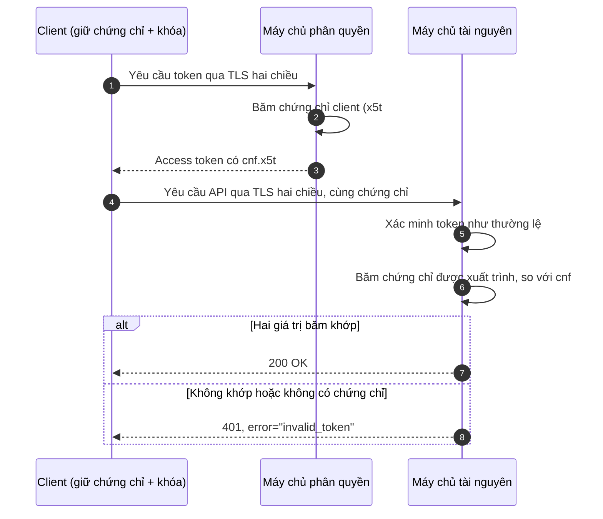

Mọi token trong bài trước đều là **bearer token**: chỉ cần xuất trình là đủ để sử dụng. Bài thứ nhất đã so sánh loại token này với tiền mặt, và phép so sánh hoàn toàn chính xác. Một token bị sao chép từ tệp nhật ký, từ một proxy cấu hình sai, từ một tiện ích mở rộng trình duyệt bị xâm nhập, hay từ một máy chủ tài nguyên (resource server) chuyển tiếp nó một cách cẩu thả, đều dùng được cho bất kỳ ai nắm giữ bản sao, từ bất kỳ đâu, cho đến khi nó hết hạn.

Thời gian sống ngắn, lưu trữ cẩn thận và giới hạn đối tượng nhận (audience) làm giảm thiệt hại, nhưng không biện pháp nào thay đổi được tính chất cốt lõi ấy. **Token ràng buộc bên gửi** (sender-constrained token) thì làm được. Một token ràng buộc bên gửi được gắn với một khóa mật mã do client hợp lệ nắm giữ, và máy chủ tài nguyên chỉ chấp nhận nó khi đi kèm bằng chứng rằng bên xuất trình kiểm soát khóa đó. Một bản sao token không kèm khóa thì vô dụng.

Bài này trước hết giải thích cơ chế chung, sau đó trình bày hai cách chuẩn để cung cấp bằng chứng (TLS hai chiều và DPoP), và kết thúc bằng những gì việc ràng buộc bảo vệ được và không bảo vệ được.

## 1. Bằng chứng sở hữu

### 1.1 Khuôn mẫu chung

Mọi cơ chế ràng buộc bên gửi đều theo cùng ba bước.

1. **Ràng buộc khi cấp phát.** Khi client yêu cầu token, nó chứng minh việc sở hữu một khóa. Máy chủ phân quyền (authorization server) ghi một tham chiếu tới khóa công khai của client vào token, hoặc vào trạng thái phía máy chủ mà một token mờ (opaque token) trỏ tới.
2. **Chứng minh khi sử dụng.** Với mỗi yêu cầu gửi tới máy chủ tài nguyên, client chứng minh việc sở hữu chính khóa đó: bằng cách hoàn tất một lần bắt tay TLS với khóa này, hoặc bằng cách ký một khẳng định mới về yêu cầu.
3. **So khớp tại máy chủ tài nguyên.** Máy chủ tài nguyên kiểm tra rằng khóa dùng trong bằng chứng chính là khóa được nêu trong token, bên cạnh mọi bước kiểm tra thông thường từ bài thứ nhất.

Khóa bí mật không bao giờ rời khỏi client và không bao giờ được gửi kèm token. Chỉ đánh cắp token thì kẻ tấn công không thu được gì.

### 1.2 Claim xác nhận

RFC 7800 định nghĩa claim `cnf` (confirmation, xác nhận), qua đó một JWT nêu tên khóa phải đi kèm nó. Cả hai cơ chế chuẩn đều dùng claim này, với các thành phần khác nhau:

```json
{
  "iss": "https://id.example.com",
  "sub": "user-48213",
  "aud": "https://api.example.com/orders",
  "exp": 1791796200,
  "cnf": { "jkt": "0ZcOCORZNYy-DWpqq30jZyJGHTN0d2HglBV3uiguA4I" }
}
```

Ở đây `jkt` là **dấu vân tay SHA-256 của JWK** (JWK SHA-256 thumbprint, RFC 7638) của một khóa công khai DPoP: giá trị băm của các tham số cốt yếu của khóa ở dạng JSON chính tắc. Với TLS hai chiều, thành phần tương ứng là `x5t#S256`, giá trị băm SHA-256 mã hóa base64url của chứng chỉ client ở dạng mã hóa DER. Với token mờ, máy chủ phân quyền trả về cùng đối tượng `cnf` đó từ điểm cuối kiểm tra trạng thái token (introspection endpoint). Khóa, access token và các giá trị băm trong các ví dụ của bài này là các giá trị mẫu từ RFC 9449 và nhất quán với nhau: `jkt` ở trên là dấu vân tay của khóa trong Mục 3.2, và `ath` ở đó là giá trị băm của access token trong Mục 3.3.

Lưu ý rằng `cnf` nêu một giá trị băm, không phải bản thân khóa. Máy chủ tài nguyên tính cùng giá trị băm đó trên khóa được xuất trình trong bằng chứng và so sánh hai giá trị.

## 2. TLS hai chiều

### 2.1 Chứng chỉ client trong TLS

Trong HTTPS thông thường, chỉ máy chủ xuất trình chứng chỉ. TLS cũng cho phép máy chủ yêu cầu chứng chỉ từ client; khi đó client chứng minh việc sở hữu khóa bí mật tương ứng bằng cách ký một phần của quá trình bắt tay. Đây là **TLS hai chiều** (mutual TLS, mTLS). Vì bằng chứng là một phần của quá trình bắt tay, mọi yêu cầu trên kết nối đó đều mặc nhiên được nó đi kèm.

RFC 8705 dùng mTLS cho hai mục đích riêng biệt trong OAuth.

### 2.2 Xác thực client

Như bài trước đã mô tả, một client bảo mật (confidential client) có thể xác thực với điểm cuối token (token endpoint) bằng chứng chỉ của nó thay cho một bí mật:

- với `tls_client_auth`, chứng chỉ do một hạ tầng khóa công khai (public key infrastructure) mà máy chủ phân quyền tin cậy cấp, và client được nhận diện bằng một thuộc tính đã đăng ký của chứng chỉ, chẳng hạn tên chủ thể (subject name);
- với `self_signed_tls_client_auth`, client đăng ký trực tiếp chứng chỉ tự ký của nó (hoặc khóa công khai của nó), và không có tổ chức cấp chứng chỉ (certificate authority) nào tham gia.

### 2.3 Access token gắn với chứng chỉ

Độc lập với việc xác thực client, máy chủ phân quyền có thể gắn access token với chứng chỉ mà client đã dùng khi nhận token. Luồng diễn ra như sau:



Kẻ tấn công sao chép được token không thể hoàn tất lần bắt tay TLS bằng khóa bí mật của client, nên máy chủ tài nguyên hoặc không thấy chứng chỉ nào, hoặc thấy một chứng chỉ khác, và từ chối yêu cầu.

RFC 8705 cũng cho phép token gắn với chứng chỉ cho các client **công khai** (public client): client có thể xuất trình một chứng chỉ tự ký chỉ nhằm ràng buộc token của mình, mà chứng chỉ đó không dùng để xác thực nó. Việc ràng buộc vẫn ngăn được việc phát lại (replay) bởi bất kỳ ai không có khóa.

### 2.4 Thực tế vận hành

TLS hai chiều hấp dẫn vì việc chứng minh do các thư viện TLS đã trưởng thành và nhanh đảm nhận, và không có gì thay đổi ở tầng HTTP. Những khó khăn của nó nằm ở hạ tầng.

- **Điểm kết thúc TLS (TLS termination).** Nhiều hệ thống kết thúc TLS tại một bộ cân bằng tải hoặc cổng (gateway), nên ứng dụng không bao giờ thấy quá trình bắt tay. Thành phần kết thúc TLS phải xác minh rằng client sở hữu khóa, rồi chuyển chứng chỉ cho ứng dụng trong một trường tiêu đề (header field), và ứng dụng phải chấp nhận trường tiêu đề đó **chỉ** từ thành phần kết thúc TLS. RFC 9440 chuẩn hóa một trường tiêu đề như vậy (`Client-Cert`). Một trường tiêu đề mà bất kỳ client nào cũng đặt được là một kẽ hở để giả mạo, chứ không phải một sự ràng buộc.
- **Vòng đời chứng chỉ.** Chứng chỉ phải được cấp, phân phối, thay mới trước khi hết hạn và thu hồi khi bị xâm phạm. Thay chứng chỉ làm thay đổi giá trị băm của nó, nên các token gắn với chứng chỉ cũ ngừng hoạt động; client phải lấy token mới sau khi thay chứng chỉ.
- **Bí danh điểm cuối.** Một số client của máy chủ phân quyền dùng mTLS, số khác thì không. Vì máy chủ khó có thể yêu cầu chứng chỉ client trên kết nối này mà không yêu cầu trên kết nối khác cùng một tên máy chủ, RFC 8705 cho phép máy chủ công bố các `mtls_endpoint_aliases` riêng trong siêu dữ liệu (metadata) của nó.
- **Trình duyệt.** Trình duyệt chỉ hỗ trợ chứng chỉ client qua những hộp thoại chọn chứng chỉ vụng về và kho chứng chỉ của hệ điều hành. mTLS khả thi cho máy chủ, dịch vụ back-end và thiết bị được quản lý, không phải cho các ứng dụng web thông thường chạy trong trình duyệt.

## 3. DPoP

### 3.1 Bằng chứng ở tầng ứng dụng

Demonstrating Proof of Possession (DPoP, RFC 9449) chuyển việc chứng minh từ tầng TLS lên HTTP. Client sinh một cặp khóa bất đối xứng, giữ khóa bí mật, và với **mỗi** yêu cầu tạo một JWT ngắn, gọi là **bằng chứng DPoP** (DPoP proof), được ký bằng khóa đó và mô tả chính yêu cầu đó. Bằng chứng được gửi trong trường tiêu đề `DPoP` cùng với yêu cầu.

Vì hoạt động trên mọi kết nối TLS, kể cả kết nối được kết thúc tại một proxy, DPoP phù hợp với những client mà TLS hai chiều không khả thi: ứng dụng trang đơn (single-page application), ứng dụng di động và mọi hệ thống mà chứng chỉ là một gánh nặng.

### 3.2 Cấu tạo của một bằng chứng

Phần đầu (header) của bằng chứng mang khóa công khai, nên bên nhận có thể xác minh chữ ký mà không cần bất kỳ đăng ký nào từ trước:

```json
{
  "typ": "dpop+jwt",
  "alg": "ES256",
  "jwk": {
    "kty": "EC",
    "crv": "P-256",
    "x": "l8tFrhx-34tV3hRICRDY9zCkDlpBhF42UQUfWVAWBFs",
    "y": "9VE4jf_Ok_o64zbTTlcuNJajHmt6v9TDVrU0CdvGRDA"
  }
}
```

Phần nội dung (payload) của nó mô tả một yêu cầu:

```json
{
  "jti": "e1j3V_bKic8-LAEB",
  "htm": "GET",
  "htu": "https://api.example.com/orders",
  "iat": 1791795700,
  "ath": "fUHyO2r2Z3DZ53EsNrWBb0xWXoaNy59IiKCAqksmQEo"
}
```

| Claim | Ý nghĩa | Vì sao quan trọng |
|---|---|---|
| `jti` | Một định danh duy nhất cho bằng chứng này | Máy chủ có thể từ chối một bằng chứng nó đã thấy |
| `htm` | Phương thức HTTP | Bằng chứng cho `GET` không thể dùng lại cho `DELETE` |
| `htu` | URI đích, không có phần truy vấn hay phân đoạn | Bằng chứng cho một điểm cuối không thể dùng ở điểm cuối khác |
| `iat` | Thời điểm tạo | Bằng chứng chỉ được chấp nhận trong một khoảng thời gian ngắn |
| `ath` | Giá trị băm SHA-256 mã hóa base64url của access token | Gắn bằng chứng với một token cụ thể |
| `nonce` | Một giá trị do máy chủ cung cấp, khi máy chủ yêu cầu | Ngăn việc chuẩn bị bằng chứng từ trước (Mục 3.5) |

Claim `ath` có mặt khi bằng chứng đi kèm một access token tại máy chủ tài nguyên; bằng chứng gửi tới điểm cuối token thì bỏ qua nó.

### 3.3 Nhận một token gắn DPoP

Client đưa một bằng chứng vào yêu cầu token của mình. Máy chủ phân quyền xác minh bằng chứng, tính dấu vân tay của `jwk` trong đó, và gắn token với nó (cú pháp HTTP/1.1, như trong toàn bộ loạt bài):

```http
POST /token HTTP/1.1
Host: id.example.com
Content-Type: application/x-www-form-urlencoded
DPoP: eyJ0eXAiOiJkcG9wK2p3dCIsImFsZyI6IkVTMjU2IiwiandrIjp7Li4ufX0.eyJqdGkiOi...

grant_type=authorization_code
&code=SplxlOBeZQQYbYS6WxSbIA
&redirect_uri=https%3A%2F%2Fprint.example%2Fcallback
&code_verifier=dBjftJeZ4CVP-mB92K27uhbUJU1p1r_wW1gFWFOEjXk
```

```http
HTTP/1.1 200 OK
Content-Type: application/json
Cache-Control: no-store

{
  "access_token": "Kz~8mXK1EalYznwH-LC-1fBAo.4Ljp~zsPE_NeO.gxU",
  "token_type": "DPoP",
  "expires_in": 600,
  "refresh_token": "Q..Zkm29lexi8VnWg2zPW1x-tgGad0Ibc3s3EwM_Ni4-g"
}
```

Giá trị `token_type` là `DPoP` cho client biết rằng xuất trình theo kiểu bearer sẽ không có tác dụng. Với một client công khai, máy chủ phân quyền gắn **refresh token** với cùng khóa đó; đây là một trong hai lựa chọn mà RFC 9700 đưa ra để làm cho refresh token của client công khai trở nên an toàn (lựa chọn còn lại là xoay vòng, như bài trước đã nêu). Client cũng có thể gửi tham số `dpop_jkt` trong yêu cầu ủy quyền, để gắn chính mã ủy quyền (authorization code) với khóa ngay trước khi mã được cấp.

### 3.4 Xuất trình token

Tại máy chủ tài nguyên, token chuyển từ lược đồ `Bearer` sang lược đồ `DPoP`, và một bằng chứng mới (lúc này có `ath`) đi kèm nó:

```http
GET /orders HTTP/1.1
Host: api.example.com
Authorization: DPoP Kz~8mXK1EalYznwH-LC-1fBAo.4Ljp~zsPE_NeO.gxU
DPoP: eyJ0eXAiOiJkcG9wK2p3dCIsImFsZyI6IkVTMjU2IiwiandrIjp7Li4ufX0.eyJqdGkiOi...
```

Các bước kiểm tra của máy chủ tài nguyên mở rộng quy trình xác minh từ bài thứ nhất:

1. Xác minh access token như thường lệ (chữ ký, `iss`, `aud`, `exp` và các trường còn lại) hoặc kiểm tra trạng thái của nó qua introspection.
2. Phân tích bằng chứng; kiểm tra `typ` là `dpop+jwt` và `alg` là một thuật toán bất đối xứng nằm trong danh sách cho phép (allow-list) của máy chủ.
3. Xác minh chữ ký của bằng chứng bằng `jwk` trong phần đầu của nó.
4. Đối chiếu `htm` và `htu` với yêu cầu thực tế, và `iat` với thời điểm hiện tại trong một khoảng nhỏ.
5. Đối chiếu `ath` với giá trị băm của access token được xuất trình.
6. Kiểm tra `jti` chưa từng xuất hiện trong khoảng thời gian chấp nhận, và kiểm tra `nonce` nếu máy chủ yêu cầu.
7. Tính dấu vân tay của `jwk` trong bằng chứng và so sánh với `cnf.jkt` của token.

Một lỗi được báo bằng lược đồ xác thực `DPoP`:

```http
HTTP/1.1 401 Unauthorized
WWW-Authenticate: DPoP error="invalid_token", algs="ES256 PS256"
```

Một máy chủ tài nguyên chấp nhận token gắn DPoP cũng phải từ chối chúng khi được xuất trình với lược đồ `Bearer`, nếu không kẻ tấn công chỉ cần đổi lược đồ là gỡ bỏ được sự ràng buộc.

### 3.5 Nonce và bằng chứng sinh trước

Khi không có giá trị do máy chủ cung cấp, một bằng chứng chỉ phụ thuộc vào những thứ client biết trước: phương thức, URL, token và thời gian. Một kẻ tấn công có thể chạy mã trong chốc lát ở nơi khóa có thể được sử dụng (chẳng hạn qua một lỗ hổng tấn công chèn mã độc liên trang (cross-site scripting, XSS) trong một ứng dụng trình duyệt) có thể sinh bằng chứng cho các thời điểm tương lai rồi mang chúng đi, và dùng chúng sau khi lỗ hổng đã được vá.

Để ngăn điều này, máy chủ có thể yêu cầu một **nonce**. Máy chủ trả lời một yêu cầu thiếu nonce, hoặc mang một nonce đã cũ, bằng một lỗi kèm một giá trị mới trong trường tiêu đề `DPoP-Nonce`:

```http
HTTP/1.1 401 Unauthorized
WWW-Authenticate: DPoP error="use_dpop_nonce", error_description="Resource server requires nonce in DPoP proof"
DPoP-Nonce: eyJ7S_zG.eyJH0-Z.HX4w-7v
```

Client gửi lại yêu cầu với nonce trong bằng chứng. Vì máy chủ thay đổi nonce định kỳ, không thể chuẩn bị bằng chứng vượt quá thời gian sống của nonce hiện tại. Máy chủ phân quyền báo hiệu cùng yêu cầu này bằng lỗi `use_dpop_nonce` trong một phản hồi `400`. Nonce tốn thêm một lượt khứ hồi mỗi khi nó thay đổi, đó là lý do nó là tùy chọn.

### 3.6 Bảo vệ khóa bí mật

DPoP chỉ mạnh ngang mức client bảo vệ khóa bí mật của mình. Trong trình duyệt, Web Cryptography API có thể sinh một khóa được đánh dấu **không thể trích xuất** (non-extractable): script có thể yêu cầu trình duyệt ký bằng khóa đó, nhưng không thể đọc các byte của khóa. Đối tượng khóa có thể được giữ trong IndexedDB qua các lần tải trang. Trên nền tảng di động, khóa có thể được sinh trong kho khóa dựa trên phần cứng (hardware-backed keystore) của thiết bị. Trong cả hai trường hợp, khóa không thể bị sao chép ra khỏi thiết bị; mã độc nhiều nhất chỉ có thể sử dụng nó trong lúc đang chạy ở đó.

## 4. Ràng buộc bảo vệ được gì và không bảo vệ được gì

### 4.1 Những gì nó ngăn được

| Rò rỉ | Bearer token | Token ràng buộc bên gửi |
|---|---|---|
| Token bị ghi vào nhật ký, bộ đệm hoặc hệ thống phân tích | Ai đọc được thì dùng được | Vô dụng nếu không có khóa |
| Token bị một proxy hoặc bên trung gian hoạt động sai bắt được | Dùng được | Vô dụng nếu không có khóa |
| Máy chủ tài nguyên chuyển tiếp hoặc làm lộ một token nó nhận được | Dùng được ở mọi máy chủ chấp nhận audience đó | Vô dụng nếu không có khóa |
| Refresh token bị đánh cắp từ nơi lưu trữ của một client công khai | Dùng được để tạo access token mới | Vô dụng nếu không có khóa |
| Token bị đánh cắp ra ngoài bởi mã độc không chạm tới được khóa | Dùng được | Vô dụng |

### 4.2 Những gì nó không ngăn được

- **Mã chạy trên client.** Mã độc hoặc một script bị chèn vào có thể *sử dụng* khóa, dù không đọc được nó, vẫn có thể gửi các yêu cầu đã xác thực trong lúc nó chạy. Ràng buộc ngăn token bị mang *đi*; nó không ngăn việc lạm dụng *tại chỗ*. Nonce của DPoP giới hạn điều này trong khoảng thời gian bị xâm nhập.
- **Khóa bị đánh cắp.** Nếu khóa có thể trích xuất và bị đánh cắp cùng với token, sự ràng buộc không mang lại gì. Việc bảo vệ khóa (khóa không thể trích xuất, kho khóa phần cứng, chứng chỉ trong kho được quản lý) là một phần của thiết kế, không phải việc nghĩ tới sau cùng.
- **Lỗi phân quyền.** Một token đã ràng buộc do client hợp lệ nắm giữ vẫn cấp mọi quyền mà token đó cấp. Phân quyền ở mức đối tượng, phạm vi (scope) và audience vẫn thiết yếu.
- **Cookie phiên.** Ràng buộc một token OAuth không có tác dụng gì đối với cookie phiên của trình duyệt với chính ứng dụng. Vấn đề tương đương ở tầng phiên đã được bàn trong bài thứ ba.

### 4.3 Ghi chú về Token Binding

Một nỗ lực trước đó nhằm cùng mục tiêu, giao thức Token Binding (RFC 8471 đến RFC 8473), gắn token và cookie với các khóa được thương lượng trong TLS. Giao thức này cần sự hỗ trợ từ trình duyệt, và sự hỗ trợ đó đã bị rút lại, nên ngày nay nó không phải là một lựa chọn thực tế. DPoP được thiết kế một phần để đáp lại điều này: nó không cần gì từ trình duyệt ngoài Web Cryptography API vốn đã có sẵn.

## 5. Lựa chọn giữa TLS hai chiều và DPoP

| Tiêu chí | TLS hai chiều | DPoP |
|---|---|---|
| Tầng của bằng chứng | Bắt tay TLS | Trường tiêu đề HTTP, theo từng yêu cầu |
| Nền tảng client | Máy chủ, dịch vụ back-end, thiết bị được quản lý | Mọi nền tảng, kể cả trình duyệt và ứng dụng di động |
| Hoạt động qua proxy kết thúc TLS | Chỉ khi proxy xác minh và chuyển tiếp chứng chỉ | Có, không cần thay đổi |
| Chi phí mỗi yêu cầu | Không có sau khi bắt tay | Một lần ký ở client, một lần xác minh và một lần kiểm tra phát lại ở máy chủ |
| Khoảng thời gian có thể phát lại | Không có: bằng chứng chính là kết nối đang mở | Bị giới hạn bởi khoảng `iat`, việc theo dõi `jti` và nonce tùy chọn |
| Hạ tầng | Cấp, thay mới và thu hồi chứng chỉ | Sinh khóa trên client; không cần chứng chỉ |
| Đồng thời xác thực client | Có, với `tls_client_auth` hoặc `self_signed_tls_client_auth` | Không; xác thực client là việc riêng |

Trong thực tế:

- **Dịch vụ back-end và API yêu cầu mức bảo đảm cao** (chẳng hạn các hồ sơ chuẩn cấp tài chính, financial-grade profiles) thường dùng **TLS hai chiều**, vừa để xác thực client vừa để ràng buộc token của chúng, vì hạ tầng đã có sẵn và việc ràng buộc không tốn chi phí cho từng yêu cầu.
- **Client công khai chạy trên trình duyệt và di động** dùng **DPoP**, với khóa không thể trích xuất hoặc khóa dựa trên phần cứng, để access token và refresh token của chúng không thể bị phát lại nếu bị rò rỉ.
- **Ứng dụng trình duyệt đứng sau một BFF** (backend for frontend) có thể không cần cơ chế nào trong hai cơ chế này cho chính trình duyệt, vì token không bao giờ tới được trình duyệt; BFF có thể dùng TLS hai chiều hoặc DPoP đối với các API mà nó gọi.

## 6. Tóm tắt

| Câu hỏi | Trả lời |
|---|---|
| Bearer token có vấn đề gì? | Bất kỳ ai có được một bản sao đều có thể dùng nó, từ bất kỳ đâu, cho đến khi nó hết hạn. |
| Ràng buộc bên gửi bổ sung điều gì? | Token nêu tên một khóa, và mỗi lần sử dụng phải chứng minh việc sở hữu khóa đó. |
| Token nêu tên khóa của nó bằng cách nào? | Bằng claim `cnf`: `x5t#S256` cho giá trị băm chứng chỉ, `jkt` cho dấu vân tay JWK; introspection trả về cùng thông tin. |
| TLS hai chiều chứng minh việc sở hữu như thế nào? | Khóa bí mật của client ký một phần của mỗi lần bắt tay TLS; máy chủ tài nguyên so sánh giá trị băm của chứng chỉ với token. |
| DPoP chứng minh việc sở hữu như thế nào? | Client ký một JWT mới cho mỗi yêu cầu, bao gồm phương thức, URI, thời gian, một định danh duy nhất và giá trị băm của token. |
| Nonce của DPoP bổ sung điều gì? | Chúng ngăn mã tạm thời có quyền sử dụng khóa sinh bằng chứng từ trước. |
| Những gì không được bảo vệ? | Sự lạm dụng bởi mã có thể dùng khóa tại chỗ, khóa có thể trích xuất bị đánh cắp cùng token, và các sai sót phân quyền. |

Bài cuối cùng của loạt bài đi vào bên trong hệ thống: các dịch vụ xác thực lẫn nhau như thế nào, các *workload* có được danh tính mà không cần bí mật dài hạn ra sao, và danh tính của người dùng được mang qua các lời gọi nội bộ một cách an toàn như thế nào.

### Các đặc tả

- Ngữ nghĩa bằng chứng sở hữu: RFC 7800 (claim `cnf`), RFC 7638 (JWK thumbprint).
- TLS hai chiều: RFC 8705 (OAuth 2.0 mutual-TLS client authentication and certificate-bound tokens), RFC 9440 (trường tiêu đề `Client-Cert`).
- DPoP: RFC 9449.
- Liên quan: RFC 9700 (OAuth 2.0 security best current practice), RFC 7662 (token introspection), RFC 8471 đến RFC 8473 (Token Binding, mang tính lịch sử).
- Khóa trong trình duyệt: W3C Web Cryptography API.
