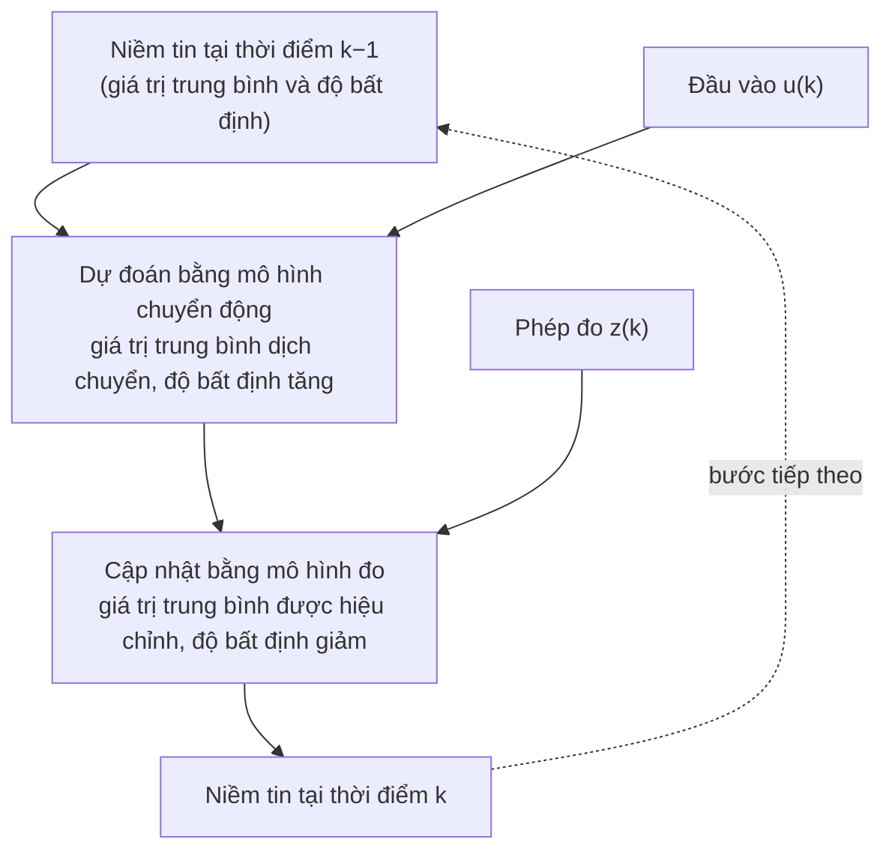

import Figure from '../../../components/Figure.astro';
import GaussianFusion from '../../../components/diagrams/GaussianFusion.astro';

Các bài trước của loạt bài này đều giả định rằng robot biết nó đang ở đâu. Động học thuận (forward kinematics) biến các góc khớp đã biết thành vị trí tay kẹp; các phép biến đổi tọa độ biến một số đọc lidar thành tọa độ thế giới khi biết tư thế (pose) của robot. Trong thực tế, không đầu vào nào trong số này được biết chính xác. Bộ mã hóa vòng quay (encoder) đo động cơ chứ không đo khâu, bánh xe bị trượt, lidar trả về một khoảng cách có nhiễu, và camera chỉ thấy những gì ở phía trước nó. Bài thứ nhất đã nói thẳng điều này: mọi quyết định của robot đều được đưa ra dựa trên một ước lượng.

Bài cuối cùng này giải thích ước lượng đó là gì và được tính như thế nào. Bài bắt đầu từ điều robot muốn biết (**trạng thái** của nó), sau đó giới thiệu ngôn ngữ của độ bất định cần thiết để mô tả hiểu biết không đầy đủ, rồi đến ý tưởng duy nhất đứng sau hầu hết mọi bộ ước lượng trong robot học: *dự đoán bằng mô hình, hiệu chỉnh bằng phép đo*. Một ví dụ một chiều được tính đầy đủ làm cho ý tưởng này trở nên cụ thể trước khi bộ lọc Kalman (Kalman filter) tổng quát và các phiên bản phi tuyến kế tiếp được giới thiệu. Bài kết thúc với những chi tiết kỹ thuật quyết định một bộ ước lượng có hoạt động được trên robot thực hay không.

## 1. Robot cần biết những gì

### 1.1 Trạng thái

**Trạng thái** (state) của một hệ là tập biến nhỏ nhất mà, cùng với các đầu vào tác động từ thời điểm này trở đi, xác định hành vi tương lai của hệ. [Bài nhập môn về mô hình không gian trạng thái](/vi/blog/state-space-models-primer) trong loạt bài về hệ thống điều khiển đã giới thiệu ý tưởng này cho các hệ cơ học; robot học dùng nó theo đúng nghĩa đó. Các trạng thái điển hình là:

- với một cánh tay, các góc khớp và vận tốc khớp;
- với một robot bánh xe chuyển động trong mặt phẳng, **tư thế** $(x, y, \theta)$ của nó, tức vị trí tính bằng mét và hướng đi tính bằng radian trong một hệ tọa độ thế giới, thường kèm theo các vận tốc của nó;
- với một máy bay không người lái (drone), vị trí, vận tốc và hướng của nó trong không gian ba chiều;
- với một robot đang khám phá một tòa nhà, tư thế của nó cùng với vị trí của các mốc định vị (landmark) hoặc các bức tường, tức **bản đồ** (map).

Trong suốt bài này, vị trí tính bằng mét, góc tính bằng radian và thời gian tính bằng giây, trừ khi một đại lượng ghi rõ khác.

### 1.2 Vì sao trạng thái không được đo trực tiếp

Các cảm biến (cảm biến nội thụ (proprioceptive) và cảm biến ngoại thụ (exteroceptive) của bài thứ nhất) không báo trạng thái. Mỗi cảm biến báo một hàm nào đó của trạng thái, một cách không hoàn hảo:

- **Gián tiếp.** Một lidar đo khoảng cách đến bề mặt gần nhất dọc theo một tia, vốn phụ thuộc vào tư thế của robot *và* vào vị trí của các bức tường.
- **Có nhiễu.** Các số đọc lặp lại của cùng một đại lượng phân tán quanh giá trị thực.
- **Có độ lệch (bias).** Một con quay hồi chuyển (gyroscope) báo một tốc độ quay nhỏ khác không ngay cả khi nó đứng yên, và độ lệch đó trôi theo nhiệt độ.
- **Trễ và với tốc độ khác nhau.** Một khối đo lường quán tính (inertial measurement unit, IMU) có thể báo hàng trăm lần mỗi giây, một camera hàng chục lần, và một máy thu định vị vệ tinh mỗi giây một lần, mỗi thiết bị có độ trễ riêng.
- **Không đầy đủ.** Một số đại lượng hoàn toàn không thể xác định được từ một cảm biến cho trước. Chẳng hạn, một camera đơn không thể biết kích thước tuyệt đối của một cảnh nếu không có thêm thông tin; những đại lượng như vậy là **không quan sát được** (unobservable) nếu chỉ dùng cảm biến đó.

**Ước lượng trạng thái** (state estimation) là bài toán tính ra mô tả tốt nhất có thể về trạng thái từ tất cả những điều trên, một cách liên tục, trong khi robot chuyển động.

## 2. Ngôn ngữ của độ bất định

Một ước lượng là vô dụng nếu không kèm theo một phát biểu về mức độ tốt của nó. Một vị trí 10.4 m được biết với sai lệch trong phạm vi một centimet và một vị trí được biết với sai lệch trong phạm vi một mét đòi hỏi những hành động khác nhau. Lý thuyết xác suất cung cấp từ vựng cho việc này; ở đây chỉ cần một vài ý tưởng của nó.

- Một **biến ngẫu nhiên** (random variable) là một đại lượng có giá trị không chắc chắn, chẳng hạn vị trí thực của robot hay số đọc cảm biến tiếp theo.
- Một **mật độ xác suất** (probability density) $p(x)$ mô tả độ bất định đó phân bố như thế nào trên các giá trị có thể: xác suất để đại lượng nằm trong một khoảng nhỏ quanh $x$ xấp xỉ bằng $p(x)$ nhân với độ rộng của khoảng, và tích phân của mật độ bằng 1.
- **Giá trị trung bình** (mean) $\mu$ là trọng tâm của mật độ, giá trị đoán đơn lẻ tốt nhất theo nghĩa sai số bình phương trung bình nhỏ nhất.
- **Phương sai** (variance) $\sigma^2$ là trung bình của bình phương độ lệch so với giá trị trung bình, và **độ lệch chuẩn** (standard deviation) $\sigma$ là căn bậc hai của nó, có cùng đơn vị với chính đại lượng đó. Phương sai $0.25\ \text{m}^2$ ứng với độ lệch chuẩn $0.5\ \text{m}$.
- Với một trạng thái có nhiều thành phần, **ma trận hiệp phương sai** (covariance matrix) $P$ chứa phương sai của từng thành phần trên đường chéo và, ngoài đường chéo, mức độ mà sai số của từng cặp thành phần biến thiên cùng nhau. Chẳng hạn, một robot không chắc chắn về hướng đi của mình sẽ trở nên không chắc chắn về vị trí theo phương ngang khi nó di chuyển, và hai sai số này liên kết với nhau: nếu hướng đi lệch sang trái thì vị trí cũng lệch theo.
- Mật độ **Gauss** (Gaussian), hay mật độ chuẩn (normal), $\mathcal N(\mu, \sigma^2)$, là đường hình chuông quen thuộc:

$$
p(x) = \frac{1}{\sqrt{2\pi\sigma^2}} \exp\!\left(-\frac{(x - \mu)^2}{2\sigma^2}\right).
$$

Phân bố Gauss quan trọng ở đây vì hai lý do. Nhiều nguồn nhiễu, do là tổng của nhiều tác động nhỏ độc lập, có phân bố xấp xỉ Gauss. Và một phân bố Gauss được mô tả hoàn toàn bởi giá trị trung bình và phương sai của nó (hoặc, trong nhiều chiều, vector trung bình và ma trận hiệp phương sai), nên một bộ ước lượng giữ độ bất định của mình ở dạng Gauss chỉ cần lưu trữ những con số đó.

Hiểu biết của robot về trạng thái của nó tại mỗi thời điểm là một mật độ xác suất trên các trạng thái có thể, gọi là **niềm tin** (belief) của nó. Ước lượng trạng thái cập nhật niềm tin khi thời gian trôi qua và các phép đo đến.

## 3. Hai mô hình và một chu trình

### 3.1 Mô hình chuyển động

Một **mô hình chuyển động** (motion model) dự đoán trạng thái thay đổi như thế nào từ một bước thời gian sang bước tiếp theo, khi biết đầu vào được ra lệnh $u_k$ (chẳng hạn tốc độ bánh xe):

$$
x_k = f(x_{k-1}, u_k) + w_k ,
$$

trong đó $w_k$ là **nhiễu quá trình** (process noise), một biến ngẫu nhiên đại diện cho mọi thứ mà mô hình bỏ qua: bánh xe trượt, sàn không bằng phẳng, các khiếm khuyết của động cơ. Chỉ dùng riêng mô hình chuyển động, tức tích phân chuyển động của bánh xe hay của khớp từ một điểm xuất phát đã biết, được gọi là **định vị suy đoán** (dead reckoning). Sai số của nó tích lũy: mỗi bước cộng thêm phương sai của $w_k$, nên độ bất định tăng không giới hạn.

### 3.2 Mô hình đo

Một **mô hình đo** (measurement model) dự đoán một cảm biến sẽ báo gì nếu trạng thái là $x_k$:

$$
z_k = h(x_k) + v_k ,
$$

trong đó $v_k$ là **nhiễu đo** (measurement noise). Với một cảm biến khoảng cách hướng vào một bức tường ở vị trí đã biết, $h$ là khoảng cách từ robot đến bức tường; với một camera, $h$ chiếu các mốc định vị đã biết lên ảnh bằng các phép biến đổi của bài thứ hai.

### 3.3 Dự đoán, rồi cập nhật

Mọi bộ ước lượng trong bài này đều luân phiên giữa hai bước:

**Bước dự đoán** (prediction) đưa niềm tin tiến lên theo thời gian và làm nó kém chắc chắn hơn, vì mô hình chuyển động không hoàn hảo. **Bước cập nhật** (update) so sánh điều cảm biến thực sự báo với điều mà niềm tin dự đoán cho rằng nó lẽ ra phải báo, rồi dịch niềm tin về phía nhất quán với phép đo, làm nó chắc chắn hơn. Ký hiệu $\hat x_k^-$ và $P_k^-$ là giá trị trung bình và hiệp phương sai của niềm tin dự đoán (dấu trừ đánh dấu "trước phép đo"), và $\hat x_k$ và $P_k$ là của niềm tin đã cập nhật; dấu mũ phân biệt một ước lượng với trạng thái thực $x_k$. Hiệu giữa phép đo thực tế và phép đo dự đoán, $z_k - h(\hat x_k^-)$, là **phần đổi mới** (innovation): phần của phép đo mà dự đoán chưa giải thích được.

Về mặt hình thức, bước cập nhật là **quy tắc Bayes** (Bayes' rule), cho biết một niềm tin cần thay đổi như thế nào trước bằng chứng mới: mật độ đã cập nhật tỉ lệ với mật độ dự đoán nhân với hàm hợp lý (likelihood) của phép đo ứng với từng trạng thái có thể. Thuật toán luân phiên áp dụng bước dự đoán và quy tắc Bayes được gọi là **bộ lọc Bayes** (Bayes filter). Mọi bộ ước lượng dưới đây đều là một cách thực hiện bộ lọc này với một cách biểu diễn niềm tin cụ thể.

## 4. Một ví dụ một chiều tính đầy đủ

Một robot di chuyển dọc một hành lang. Niềm tin của nó về vị trí của mình có dạng Gauss, với giá trị trung bình $\hat x^- = 10.0$ m và phương sai $P^- = 0.25\ \text{m}^2$ (độ lệch chuẩn 0.5 m), thu được bằng định vị suy đoán. Một cảm biến khoảng cách, hướng vào một bức tường ở vị trí đã biết, báo một phép đo tương đương $z = 10.6$ m, với phương sai nhiễu đo $R = 0.09\ \text{m}^2$ (độ lệch chuẩn 0.3 m).

Khi cả niềm tin lẫn nhiễu đo đều có dạng Gauss, quy tắc Bayes cho ra một phân bố Gauss khác, với giá trị trung bình và phương sai

$$
K = \frac{P^-}{P^- + R}, \qquad
\hat x = \hat x^- + K\,(z - \hat x^-), \qquad
P = (1 - K)\,P^- .
$$

**Độ lợi** (gain) $K$, nằm giữa 0 và 1, quyết định dịch về phía phép đo bao xa. Nó lớn khi dự đoán kém chắc chắn so với phép đo và nhỏ khi phép đo là nguồn kém tin cậy hơn trong hai nguồn. Ở đây

$$
K = \frac{0.25}{0.25 + 0.09} = 0.735, \qquad
\hat x = 10.0 + 0.735 \times 0.6 = 10.44\ \text{m}, \qquad
P = 0.265 \times 0.25 = 0.066\ \text{m}^2 .
$$

Ước lượng hợp nhất nằm giữa hai nguồn, gần với phép đo chính xác hơn, và độ lệch chuẩn của nó, 0.26 m, nhỏ hơn của từng nguồn (0.5 m và 0.3 m). Kết hợp hai nguồn thông tin độc lập luôn có ích, miễn là độ bất định của chúng được khai báo trung thực. Phương sai hợp nhất cũng bằng $P^- R / (P^- + R)$, đối xứng theo hai nguồn, điều này cho thấy rõ ý trên.

<Figure caption="Hợp nhất một dự đoán (nét liền, 10.0 m, σ = 0.5 m) với một phép đo khoảng cách (nét đứt, 10.6 m, σ = 0.3 m). Ước lượng hợp nhất (đường có màu, 10.44 m, σ = 0.26 m) nằm giữa hai đường đó, gần phép đo chính xác hơn, và hẹp hơn cả hai.">
  <GaussianFusion />
</Figure>

Nếu bây giờ robot được lệnh tiến lên 1.0 m, với phương sai nhiễu quá trình $Q = 0.04\ \text{m}^2$ cho bước di chuyển này, bước dự đoán cho

$$
\hat x^- = 10.44 + 1.0 = 11.44\ \text{m}, \qquad P^- = 0.066 + 0.04 = 0.106\ \text{m}^2 .
$$

Độ bất định đã tăng trở lại, và sẽ tiếp tục tăng (sau mười bước di chuyển như vậy mà không có phép đo nào, độ lệch chuẩn của nó sẽ đạt khoảng 0.68 m) cho đến khi phép đo tiếp theo kéo nó xuống. Sự lên xuống này là nhịp điệu của mọi bộ ước lượng.

## 5. Bộ lọc Kalman

### 5.1 Các phương trình

Rudolf E. Kálmán (công bố dưới tên R. E. Kalman) đã đưa ra phiên bản tổng quát của phép tính này vào năm 1960. Với một vector trạng thái (state vector) $\mathbf x$ có mô hình chuyển động và mô hình đo tuyến tính,

$$
\mathbf x_k = A\,\mathbf x_{k-1} + B\,\mathbf u_k + \mathbf w_k, \qquad
\mathbf z_k = H\,\mathbf x_k + \mathbf v_k ,
$$

và các nhiễu Gauss có hiệp phương sai $Q$ và $R$, **bộ lọc Kalman** duy trì giá trị trung bình $\hat{\mathbf x}$ và hiệp phương sai $P$ của một niềm tin dạng Gauss:

$$
\begin{aligned}
\text{predict:}\quad & \hat{\mathbf x}^- = A\,\hat{\mathbf x} + B\,\mathbf u, && P^- = A P A^{\mathsf T} + Q, \\
\text{update:}\quad & K = P^- H^{\mathsf T}\left(H P^- H^{\mathsf T} + R\right)^{-1}, && \\
& \hat{\mathbf x} = \hat{\mathbf x}^- + K\left(\mathbf z - H\,\hat{\mathbf x}^-\right), && P = (I - K H)\,P^- .
\end{aligned}
$$

Các mô hình chuyển động và mô hình đo ở trên là mô hình **thời gian rời rạc** (discrete-time), viết cho các thời điểm $k = 0, 1, 2, \dots$ mà bộ lọc chạy. Ma trận $A$ ánh xạ trạng thái ở một bước sang bước tiếp theo, nên nó không phải là ma trận $A$ của dạng thời gian liên tục $\dot{\mathbf x} = A\mathbf x + B\mathbf u$ trong bài nhập môn về không gian trạng thái: với một hệ tuyến tính bất biến theo thời gian được lấy mẫu mỗi $\Delta t$ giây, ma trận rời rạc là $e^{A\Delta t}$. Ma trận đo $H$ đóng vai trò của ma trận đầu ra $C$ trong bài nhập môn đó.

Với một trạng thái duy nhất, $A = H = 1$ và không có đầu vào, các phương trình này rút gọn đúng thành các công thức của Mục 4. Ma trận $H P^- H^{\mathsf T} + R$ là hiệp phương sai của phần đổi mới; độ lợi cân đối nó với độ bất định dự đoán, theo từng thành phần.

### 5.2 Các giả định của nó

Dưới các giả định của nó (mô hình tuyến tính, nhiễu Gauss, $Q$ và $R$ được biết chính xác), bộ lọc Kalman là tối ưu: không bộ ước lượng nào khác có sai số bình phương kỳ vọng nhỏ hơn. Mỗi giả định đều có thể không đúng trên một robot:

- các mô hình thường **phi tuyến** (góc hướng đi xuất hiện qua $\cos\theta$ và $\sin\theta$; khoảng cách là một căn bậc hai);
- nhiễu có thể **không có dạng Gauss**, với những số đọc bất thường thỉnh thoảng xuất hiện (một tia lidar bị phản xạ bởi kính);
- $Q$ và $R$ hiếm khi được biết và phải được **tinh chỉnh**.

Mục tiếp theo xử lý hai vấn đề đầu; Mục 8 xử lý vấn đề thứ ba.

## 6. Vượt ra ngoài tuyến tính và Gauss

### 6.1 Bộ lọc Kalman mở rộng

**Bộ lọc Kalman mở rộng** (extended Kalman filter, EKF) xử lý các hàm $f$ và $h$ phi tuyến bằng cách tuyến tính hóa chúng quanh ước lượng hiện tại ở mỗi bước: nó thay $A$ và $H$ bằng các ma trận Jacobi (Jacobian) $\partial f / \partial \mathbf x$ và $\partial h / \partial \mathbf x$, chính là các ma trận đạo hàm đã liên hệ vận tốc khớp với vận tốc tay kẹp ở bài trước. Nó rẻ về tính toán và được dùng rộng rãi. Nó hoạt động tốt khi các mô hình gần tuyến tính trong phạm vi kích thước của độ bất định, và có thể phân kỳ khi điều đó không đúng, chẳng hạn khi độ bất định về hướng đi lớn.

### 6.2 Bộ lọc Kalman không vết

**Bộ lọc Kalman không vết** (unscented Kalman filter, UKF), được Julier và Uhlmann giới thiệu năm 1997, tránh việc lấy đạo hàm. Nó đưa một tập nhỏ các điểm mẫu tất định (điểm sigma, sigma point), được chọn để khớp với giá trị trung bình và hiệp phương sai hiện tại, qua các mô hình phi tuyến, rồi khớp một phân bố Gauss với kết quả. Nó thường nắm bắt các hiệu ứng phi tuyến tốt hơn EKF với chi phí tương đương, và không cần ma trận Jacobi.

### 6.3 Bộ lọc hạt

Khi niềm tin không thể được mô tả hợp lý bằng một phân bố Gauss duy nhất, chẳng hạn khi một robot trong một tòa nhà có các hành lang giống hệt nhau có thể đang ở một trong vài nơi, một **bộ lọc hạt** (particle filter) biểu diễn niềm tin bằng nhiều mẫu (hạt, particle), mỗi mẫu là một giả thuyết về trạng thái. Bước dự đoán đưa từng hạt qua mô hình chuyển động với nhiễu ngẫu nhiên; bước cập nhật gán trọng số cho mỗi hạt theo mức độ nó giải thích được phép đo rồi lấy mẫu lại (resample), giữ lại các giả thuyết có khả năng cao và loại bỏ các giả thuyết ít khả năng. Bộ lọc hạt có thể biểu diễn niềm tin với hình dạng bất kỳ, với chi phí tăng theo số hạt cần thiết, mà số hạt này lại tăng nhanh theo số chiều của trạng thái.

### 6.4 Lựa chọn

| Bộ ước lượng | Niềm tin được biểu diễn dưới dạng | Xử lý được | Chi phí | Ứng dụng điển hình |
|---|---|---|---|---|
| Bộ lọc Kalman | Một phân bố Gauss (giá trị trung bình, hiệp phương sai) | Mô hình tuyến tính, nhiễu Gauss | Rất thấp | Bám mục tiêu tuyến tính, hiệu chuẩn cảm biến |
| Bộ lọc Kalman mở rộng | Một phân bố Gauss | Mô hình phi tuyến nhẹ | Thấp | Dẫn đường quán tính, hợp nhất đo hành trình (odometry) của xe |
| Bộ lọc Kalman không vết | Một phân bố Gauss, thông qua các điểm sigma | Mô hình phi tuyến mạnh hơn | Thấp đến trung bình | Ước lượng tư thế góc và tư thế |
| Bộ lọc hạt | Các mẫu có trọng số | Niềm tin có hình dạng bất kỳ, kể cả nhiều giả thuyết | Cao; tăng theo số chiều trạng thái | Định vị toàn cục trong một bản đồ đã biết |

## 7. Ước lượng trên robot thực

### 7.1 Hợp nhất các cảm biến bổ sung cho nhau

Các cảm biến được kết hợp vì điểm yếu của chúng khác nhau. Một trường hợp kinh điển là ước lượng hướng từ một IMU:

- tích phân tốc độ quay của **con quay hồi chuyển** cho hướng mượt và phản ứng nhanh, nhưng độ lệch nhỏ của nó tích lũy thành độ trôi;
- **gia tốc kế** (accelerometer), khi đứng yên, đo hướng của trọng lực, cho một tham chiếu tuyệt đối nhưng có nhiễu và bị chuyển động làm nhiễu loạn cho độ nghiêng.

Một bộ lọc tin con quay hồi chuyển trong khoảng thời gian ngắn và tin gia tốc kế trong khoảng thời gian dài, nhờ đó loại bỏ độ trôi mà không mang theo nhiễu. Bộ lọc Kalman làm điều này với các mô hình nhiễu tường minh; một **bộ lọc bù** (complementary filter) đơn giản hơn làm điều đó với các trọng số cố định: nó giữ phần đóng góp của con quay hồi chuyển cho các thay đổi nhanh và phần của gia tốc kế cho các thay đổi chậm (lần lượt bằng lọc thông cao và lọc thông thấp). Cùng một khuôn mẫu này lặp lại ở các robot di động hợp nhất đo hành trình bánh xe (wheel odometry) (mượt, bị trôi) với định vị vệ tinh hoặc việc nhận ra các mốc định vị (tuyệt đối, có nhiễu, không liên tục).

### 7.2 Định vị, lập bản đồ và SLAM

**Định vị** (localization) ước lượng tư thế của robot trong một bản đồ đã biết. **Lập bản đồ** (mapping) xây dựng bản đồ từ các tư thế đã biết. Một robot đi vào một tòa nhà chưa biết thì không có cả hai, và phải ước lượng cả hai cùng lúc: **định vị và lập bản đồ đồng thời** (simultaneous localization and mapping, SLAM). Khi đó trạng thái bao gồm cả chính bản đồ (vị trí các mốc định vị, hoặc một lưới chiếm chỗ (occupancy grid): một lưới các ô phủ lên mặt bằng sàn, mỗi ô chứa xác suất ô đó bị chiếm), và tương quan giữa sai số của robot và sai số của các mốc định vị trở nên thiết yếu. Khi robot nhận ra một nơi nó đã từng thấy (**đóng vòng**, loop closure), lượng hiệu chỉnh lan truyền qua toàn bộ bản đồ. SLAM là một lĩnh vực riêng; bài tổng quan của Durrant-Whyte và Bailey được trích dẫn bên dưới là một điểm khởi đầu tiêu chuẩn.

## 8. Những chi tiết kỹ thuật quyết định thành công

Các phương trình thì ngắn; phần lớn khó khăn nằm ở những chi tiết xung quanh chúng.

- **Hệ tọa độ.** Mọi ước lượng và phép đo đều phải được biểu diễn trong một hệ tọa độ (coordinate frame) đã biết, bằng các phép biến đổi và cây hệ tọa độ (frame tree) của bài thứ hai. Một khoảng cách lidar được dự đoán từ tư thế của cảm biến, chứ không phải từ tư thế của đế robot.
- **Thời gian.** Các phép đo đến muộn và không theo thứ tự. Một bộ ước lượng phải dùng mỗi phép đo tại đúng thời điểm nó được thực hiện, bằng cách lưu một lịch sử ngắn các trạng thái, hoặc bằng cách dự đoán tiến lên từ nhãn thời gian (time stamp) của phép đo.
- **Góc.** Phần đổi mới của các góc phải được quy về khoảng $(-\pi, \pi]$, nếu không thì sai lệch hướng đi giữa $+179^\circ$ và $-179^\circ$ bị coi là $358^\circ$ thay vì $2^\circ$, đúng sai lầm đã mô tả ở bài thứ hai.
- **Giá trị ngoại lai.** Một phép đo bất thường duy nhất có thể kéo bộ lọc Kalman đi rất xa. Mỗi phần đổi mới $\nu$ có thể được kiểm tra với hiệp phương sai kỳ vọng $S = H P^- H^{\mathsf T} + R$ của nó trước khi sử dụng: bình phương **khoảng cách Mahalanobis** (Mahalanobis distance) $d^2 = \nu^{\mathsf T} S^{-1} \nu$, đo phần đổi mới theo đơn vị độ phân tán kỳ vọng của chính nó, có phân bố **khi bình phương** (chi-square) (phân bố của tổng bình phương các biến Gauss chuẩn, mỗi chiều phép đo một biến) khi các mô hình đúng, và một phép đo có $d^2$ lớn đến mức phi lý sẽ bị loại bỏ (**gating**). Trong ví dụ hành lang, phần đổi mới $0.6$ m cho $d^2 = 0.6^2 / 0.34 = 1.06$, nằm thoải mái trong ngưỡng 99% là $6.63$ cho một chiều; một số đọc 12.0 m sẽ cho $d^2 = 11.8$ và bị loại bỏ.
- **Tinh chỉnh.** $Q$ và $R$ mã hóa mức độ bộ lọc tin vào các mô hình và các cảm biến của nó. $Q$ quá nhỏ làm bộ lọc quá tự tin và chậm bám theo chuyển động thực; quá lớn thì làm nó nhiễu. Bảng dữ liệu (datasheet) của cảm biến và dữ liệu ghi lại giúp định hướng cho $R$; $Q$ thường cần thực nghiệm. Một phép kiểm tra hữu ích là xem các phần đổi mới có thực sự có hiệp phương sai $S$ mà bộ lọc dự đoán hay không.
- **Khởi tạo.** Niềm tin đầu tiên phải phản ánh trung thực độ bất định ban đầu. Bắt đầu với một hiệp phương sai nhỏ một cách sai lệch sẽ làm bộ lọc phớt lờ những phép đo đầu tiên, vốn mang nhiều thông tin nhất.

## 9. Tóm tắt

| Câu hỏi | Trả lời |
|---|---|
| Trạng thái là gì? | Tập biến nhỏ nhất mà, cùng với các đầu vào tương lai, xác định hành vi tương lai, chẳng hạn các góc khớp và vận tốc khớp, hoặc một tư thế. |
| Vì sao không đo trực tiếp được trạng thái? | Cảm biến báo các hàm của trạng thái, kèm nhiễu, độ lệch và độ trễ, với các tốc độ khác nhau, và một số đại lượng không quan sát được từ một cảm biến cho trước. |
| Độ bất định được mô tả như thế nào? | Bằng một mật độ xác suất trên các trạng thái, tức niềm tin, thường là một phân bố Gauss được mô tả bởi một giá trị trung bình và một ma trận hiệp phương sai. |
| Mọi bộ ước lượng đều làm gì? | Dự đoán bằng mô hình chuyển động (độ bất định tăng), rồi cập nhật bằng mô hình đo (độ bất định giảm): bộ lọc Bayes. |
| Một phép đo cập nhật niềm tin dạng Gauss như thế nào? | Với độ lợi $K = P^-/(P^- + R)$: ước lượng dịch về phía phép đo một lượng bằng $K$ lần phần đổi mới, và phương sai co lại theo hệ số $1 - K$. |
| Khi nào bộ lọc Kalman là tối ưu? | Với mô hình tuyến tính và nhiễu Gauss có hiệp phương sai đã biết. |
| Cái gì xử lý các bài toán phi tuyến hoặc đa mode? | Bộ lọc Kalman mở rộng và không vết cho mô hình phi tuyến; bộ lọc hạt cho niềm tin có nhiều giả thuyết. |
| Điều gì thường quyết định một bộ ước lượng có hoạt động hay không? | Hệ tọa độ, nhãn thời gian, quy đổi góc, loại bỏ giá trị ngoại lai, tinh chỉnh $Q$ và $R$, và khởi tạo trung thực. |

## 10. Toàn bộ loạt bài trong một bức tranh

Bài này hoàn tất loạt bài. Bốn bài mô tả một robot từ ngoài vào trong.

- Bài **thứ nhất** định nghĩa robot là một vòng kín gồm kết cấu, truyền động, cảm nhận và tính toán, chạy ở nhiều tốc độ, và được tổ chức bằng phần mềm phân lớp.
- Bài **thứ hai** cung cấp phần hình học: hệ tọa độ, phép quay và phép biến đổi, cùng cây hệ tọa độ liên hệ mọi bộ phận của robot.
- Bài **thứ ba** dùng phần hình học đó để kết nối khớp với tay kẹp, theo cả hai chiều, và chỉ ra nơi mối liên hệ này trở nên kỳ dị.
- Bài **thứ tư** này giải thích làm thế nào robot biết được bất cứ điều gì: bằng cách dự đoán với các mô hình và hiệu chỉnh với các cảm biến có nhiễu, đồng thời theo dõi mức độ bất định của chính mình.

Mỗi chủ đề tiếp theo trong robot học (lập kế hoạch chuyển động, điều khiển tiếp xúc, học từ dữ liệu) đều xây dựng trên bốn bài này: một robot phải biết hình học của mình, ánh xạ giữa không gian khớp và không gian tác vụ, và hành động dựa trên các ước lượng chứ không phải các điều chắc chắn.

### Tài liệu tham khảo

- R. E. Kalman, "A New Approach to Linear Filtering and Prediction Problems", *Journal of Basic Engineering*, 1960.
- S. J. Julier and J. K. Uhlmann, "A New Extension of the Kalman Filter to Nonlinear Systems", *Proceedings of SPIE*, 1997.
- S. Thrun, W. Burgard and D. Fox, *Probabilistic Robotics*, MIT Press, 2005.
- H. Durrant-Whyte and T. Bailey, "Simultaneous Localization and Mapping: Part I", *IEEE Robotics & Automation Magazine*, 2006.
- Y. Bar-Shalom, X. R. Li and T. Kirubarajan, *Estimation with Applications to Tracking and Navigation*, Wiley, 2001.
