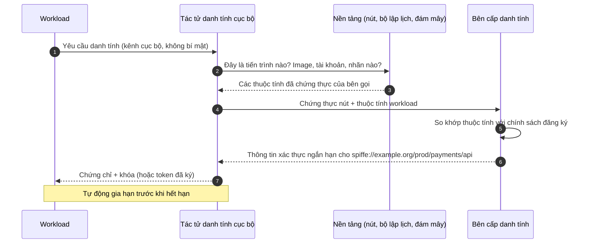
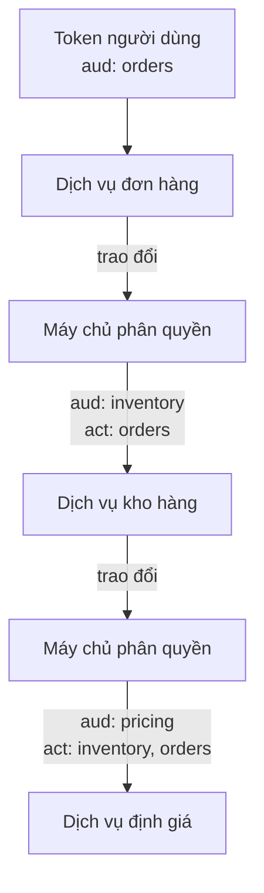

Các bài trước trong loạt bài này theo dõi một yêu cầu đi từ trình duyệt hoặc ứng dụng của người dùng tới dịch vụ đầu tiên nhận nó. Trong hầu hết các hệ thống thực tế, đó là nơi hành trình của yêu cầu bắt đầu chứ không phải kết thúc. Dịch vụ đầu tiên gọi một dịch vụ kho hàng, dịch vụ này gọi một dịch vụ định giá, dịch vụ định giá lại phát đi một thông điệp mà một tiến trình xử lý đơn hàng tiêu thụ một giờ sau đó. Mỗi chặng như vậy tự nó là một quyết định kiểm soát truy cập (access control): *ai đang gọi, và bên đó có được phép làm việc này không?*

Bên trong một hệ thống, các câu hỏi đó có hai phần. Một phần liên quan đến **workload**: phần mềm nào đang thực hiện lời gọi. Phần còn lại liên quan đến **người dùng**, nếu có, mà lời gọi được thực hiện thay mặt cho họ. Bài cuối cùng này xử lý cả hai. Bài bắt đầu bằng lý do vị trí mạng không phải là câu trả lời, sau đó trình bày cách các workload có được danh tính, cách chúng chứng minh danh tính với nhau, cách các lời gọi giữa chúng được phân quyền, và cách danh tính của người dùng có thể đi qua một chuỗi dịch vụ mà không bị giả mạo hay lạm dụng.

## 1. Mạng không phải là danh tính

### 1.1 Mô hình vành đai và sự thất bại của nó

Thiết kế truyền thống tin tưởng mạng nội bộ. Một tường lửa ngăn cách bên ngoài với bên trong; khi một yêu cầu đã vào bên trong, các dịch vụ chấp nhận nó vì nơi nó xuất phát. Mô hình này thất bại theo ba cách cộng dồn lên nhau:

- **Một điểm bị xâm nhập chạm tới mọi thứ.** Kẻ tấn công giành được chỗ đứng trên bất kỳ máy nội bộ nào (một thư viện phụ thuộc có lỗ hổng, một máy tính xách tay bị đánh cắp đang kết nối VPN, một điểm cuối (endpoint) gỡ lỗi cấu hình sai) có thể gọi mọi dịch vụ nội bộ như thể đó là lời gọi hợp lệ.
- **Địa chỉ không phải là danh tính.** Trên các nền tảng container, địa chỉ được tái sử dụng chỉ trong vài phút; trên các mạng dùng chung, nhiều workload dùng chung một địa chỉ đi ra (egress); và các quy tắc dựa trên địa chỉ không nói gì về việc *phần mềm nào* đang gọi.
- **Không còn "bên trong" nữa.** Các dịch vụ chạy trên nhiều đám mây, nhiều vùng và nhiều nhà cung cấp, và gọi nhau qua những mạng mà không một bên nào kiểm soát toàn bộ.

Tài liệu *Zero Trust Architecture* của NIST (SP 800-207, 2020) tóm tắt giải pháp thay thế: không trao sự tin cậy ngầm định nào dựa trên vị trí mạng, và mọi truy cập đều được xác thực và phân quyền cho chủ thể và tài nguyên cụ thể. Với các lời gọi giữa các dịch vụ, điều đó có nghĩa là mọi workload cần một danh tính mà nó có thể chứng minh, và mọi dịch vụ phải kiểm tra danh tính đó.

### 1.2 Áp dụng mô hình kiểm soát truy cập bên trong hệ thống

Bộ giám sát tham chiếu (reference monitor) từ bài thứ nhất áp dụng nguyên vẹn. Với một lời gọi nội bộ, chủ thể là workload gọi (và có thể cả người dùng mà nó hành động thay mặt), đối tượng là tài nguyên của dịch vụ được gọi, và kiểm soát toàn diện (complete mediation) đòi hỏi dịch vụ được gọi kiểm tra mọi lời gọi, không chỉ những lời gọi đến từ bên ngoài.

## 2. Danh tính workload

### 2.1 Danh tính workload nêu tên cái gì

Một danh tính workload nêu tên một phần mềm theo **bản chất của nó và nơi nó được phép chạy**, chứ không theo máy hay địa chỉ mà nó tình cờ chiếm giữ. Một danh tính hữu ích có tên ổn định và có cấu trúc, chẳng hạn:

```text
spiffe://example.org/prod/payments/api
```

Đây là dạng được định nghĩa bởi SPIFFE (Secure Production Identity Framework for Everyone), một đặc tả mở do Cloud Native Computing Foundation quản lý: một URI có phần authority là một **miền tin cậy** (trust domain), tức một ranh giới quản trị có các khóa ký riêng, và có phần đường dẫn định danh workload bên trong miền đó. Dù dùng lược đồ đặt tên nào, các tính chất quan trọng là: tên được một cơ quan trung tâm gán, có ý nghĩa với những người viết chính sách, và không thay đổi khi workload di chuyển.

### 2.2 Bài toán khởi tạo

Để chứng minh một danh tính, workload cần một thông tin xác thực (credential). Để có được thông tin xác thực một cách an toàn, dường như nó lại cần sẵn một thông tin xác thực. Đôi khi điều này được gọi là bài toán **bí mật số không** (secret zero), và cách một thiết kế giải quyết nó phần lớn quyết định mức độ an toàn của thiết kế đó.

Câu trả lời yếu là cấp cho workload một bí mật dài hạn khi triển khai: một khóa API trong biến môi trường, một mật khẩu trong tệp cấu hình. Những bí mật như vậy bị sao chép vào image, nhật ký, bản kết xuất bộ nhớ khi sự cố (crash dump) và kho mã nguồn, hiếm khi được xoay vòng, và định danh bất kỳ ai nắm giữ bản sao.

Câu trả lời mạnh là **chứng thực** (attestation): danh tính của workload được xác lập từ những sự kiện mà nền tảng đang chạy nó có thể bảo đảm, và không có bí mật nào được cấp sẵn từ trước.



Bằng chứng của chính nền tảng (tài liệu định danh mà nhà cung cấp đám mây ký cho từng máy ảo, bản ghi của bộ lập lịch về tài khoản dịch vụ mà một container chạy dưới danh nghĩa, hiểu biết của nhân hệ điều hành về tiến trình nào đã mở một socket cục bộ) thay thế cho bí mật được cấp sẵn. Các hệ thống điều phối container cung cấp một biến thể đơn giản hơn của cùng ý tưởng: chúng có thể gắn vào mỗi workload một token, do nền tảng ký, nêu tên tài khoản dịch vụ của workload, bị giới hạn cho một audience và hết hạn sau một thời gian ngắn.

### 2.3 Thông tin xác thực ngắn hạn

Dù khởi tạo theo cách nào, thông tin xác thực mà workload nhận được nên là **ngắn hạn**: tính bằng giờ chứ không phải bằng tháng, và được gia hạn tự động. Lập luận giống như với access token trong bài thứ nhất. Một thông tin xác thực sắp hết hạn có ít giá trị với kẻ trộm, và thu hồi (revocation) trở thành việc đơn giản là không gia hạn nữa. Có hai dạng thông tin xác thực phổ biến:

- một **chứng chỉ X.509** và khóa bí mật, mang danh tính trong chứng chỉ (SPIFFE gọi đây là X.509-SVID, với SPIFFE ID nằm trong trường tên thay thế của chủ thể (subject alternative name)), dùng cho TLS hai chiều (mutual TLS, mTLS);
- một **token đã ký** (JWT-SVID theo thuật ngữ SPIFFE) mang danh tính làm chủ thể của nó và bị giới hạn cho một audience, dùng ở những nơi TLS không thể mang danh tính từ đầu đến cuối.

### 2.4 Liên kết danh tính với các máy chủ phân quyền bên ngoài

Workload thường cần gọi các API thuộc về bên khác: dịch vụ lưu trữ của một nhà cung cấp đám mây, dịch vụ của một đối tác, máy chủ phân quyền (authorization server) trung tâm của một tổ chức. Thay vì lưu một khóa dài hạn cho từng bên, workload có thể xuất trình token do nền tảng cấp cho điểm cuối token của bên đó và nhận lại một access token, dùng luồng cấp quyền JWT bearer (JWT bearer grant) hoặc trao đổi token (token exchange) từ bài thứ năm. Bên nhận được cấu hình để tin tưởng bên phát hành token của workload và ánh xạ những chủ thể cụ thể sang những quyền cụ thể. Các pipeline tích hợp liên tục (continuous integration) thường triển khai lên môi trường đám mây theo cách này, không cần lưu khóa triển khai nào.

## 3. Chứng minh danh tính giữa các dịch vụ

### 3.1 TLS hai chiều

Khi đã có chứng chỉ, hai dịch vụ có thể xác thực lẫn nhau bằng TLS hai chiều, như bài trước đã mô tả: mỗi bên xuất trình chứng chỉ của mình, chứng minh việc sở hữu khóa trong quá trình bắt tay, và xác minh chứng chỉ của bên kia dựa trên các tổ chức cấp chứng chỉ của miền tin cậy. Bên gọi biết rằng nó đã tới đúng dịch vụ thanh toán thật, và dịch vụ thanh toán biết workload nào đang gọi. Kết nối được mã hóa như một hệ quả phụ.

Làm việc này trong mã nguồn của từng dịch vụ có nghĩa là phải xử lý việc gia hạn chứng chỉ, các gói tin cậy (trust bundle) và cấu hình TLS trong mọi ngôn ngữ mà hệ thống sử dụng. Một **lưới dịch vụ** (service mesh) đưa việc này ra khỏi ứng dụng: một proxy đặt cạnh mỗi workload thay mặt workload kết thúc và khởi tạo TLS hai chiều, lấy và xoay vòng chứng chỉ của nó, và cung cấp danh tính đã xác thực của bên kia cho chính sách và, khi cần, cho ứng dụng. Ứng dụng chỉ nói HTTP thuần với proxy cục bộ của nó.

Sự tiện lợi này đi kèm một giới hạn chính xác. Lưới dịch vụ xác lập **workload nào** đang ở đầu bên kia của một kết nối. Nó không nói gì về việc lời gọi dành cho **người dùng nào**, nếu có. Điều đó đòi hỏi các cơ chế của Mục 5.

### 3.2 Token giữa các dịch vụ

Ở những nơi TLS hai chiều không thể đi trọn từ đầu đến cuối (qua ranh giới giữa các tổ chức, qua các bên trung gian kết thúc TLS, hoặc qua một hàng đợi thông điệp), workload chứng minh danh tính bằng một token đã ký thay thế: một JWT-SVID, hoặc một access token lấy từ máy chủ phân quyền bằng luồng client credentials. Dịch vụ nhận xác minh nó đúng như bài thứ nhất mô tả, đặc biệt chú ý tới **audience**: một token mà workload nhận được để gọi dịch vụ A không được phép được dịch vụ B chấp nhận. Token dùng theo cách này là bearer token trừ khi chúng là token ràng buộc bên gửi (sender-constrained token, bài thứ sáu); thời gian sống ngắn và audience hẹp càng trở nên quan trọng.

## 4. Phân quyền các lời gọi dịch vụ

Xác thực cho dịch vụ thanh toán biết rằng bên gọi là `spiffe://example.org/prod/orders/api`. Phân quyền quyết định liệu bên gọi đó có được thực hiện lời gọi này hay không. Các mô hình từ bài thứ tư được áp dụng, thường ở dạng đơn giản:

- một **danh sách cho phép (allow-list) theo từng điểm cuối hoặc thao tác**: dịch vụ đơn hàng được gọi `POST /payments`; dịch vụ báo cáo được gọi `GET /payments` nhưng không được gọi `POST`; không dịch vụ nào khác được gọi cả hai;
- **từ chối theo mặc định**, để một dịch vụ mới không có quyền truy cập nào cho đến khi một chính sách cấp quyền cho nó;
- **tách biệt môi trường** được mã hóa trong danh tính, để một workload staging không bao giờ gọi được một dịch vụ production, bất kể đường đi mạng của nó.

Các chính sách này có thể được thực thi tại proxy của lưới dịch vụ, trong ứng dụng, hoặc ở cả hai. Thực thi tại proxy thì đồng nhất và rẻ; thực thi trong ứng dụng thì thấy được yêu cầu đã phân tích và ngữ cảnh người dùng. Cũng như với các cổng (gateway) trong bài thứ nhất, các kiểm tra thô có thể nằm ở rìa của từng dịch vụ, còn các kiểm tra ở mức đối tượng phải nằm cùng với dữ liệu.

## 5. Truyền danh tính của người dùng

### 5.1 Confused deputy

Khi dịch vụ đơn hàng gọi dịch vụ thanh toán **thay mặt một người dùng**, dịch vụ thanh toán đối mặt với một câu hỏi mà danh tính workload không trả lời được. Nó nên hành động với thẩm quyền của dịch vụ đơn hàng, hay với thẩm quyền của người dùng?

Nếu nó hành động với thẩm quyền của bên gọi, hệ thống tạo cơ hội cho vấn đề **confused deputy** (người được ủy quyền bị lừa), được Norm Hardy mô tả năm 1988: một chương trình nắm thẩm quyền rộng bị một bên có ít đặc quyền hơn lừa sử dụng thẩm quyền đó thay cho bên kia. Dịch vụ đơn hàng được phép gọi `GET /payments/{id}` cho bất kỳ khoản thanh toán nào, vì nó thực sự cần như vậy. Nếu nó chuyển tiếp bất kỳ định danh thanh toán nào người dùng cung cấp mà không kiểm tra khoản thanh toán đó có thuộc về người dùng ấy hay không, người dùng có thể đọc mọi khoản thanh toán trong hệ thống thông qua dịch vụ đơn hàng. Từng dịch vụ riêng lẻ đều hoạt động đúng như thiết kế; sự kết hợp của chúng thì làm rò rỉ.

Cách khắc phục là dịch vụ phía sau phải biết **cả** workload đang gọi lẫn người dùng, và phải phân quyền lời gọi dựa trên quyền của người dùng cũng như của workload.

### 5.2 Các cách mang theo người dùng

| Cách tiếp cận | Người dùng đến được dịch vụ tiếp theo như thế nào | Rủi ro |
|---|---|---|
| Trường tiêu đề được tin cậy | Cổng ở rìa xác thực người dùng và thêm `X-User-Id: user-48213` vào các lời gọi nội bộ | Bất kỳ workload nội bộ nào, hoặc bất kỳ kẻ tấn công nào tiếp cận được mạng, đều có thể đặt trường tiêu đề này. Chỉ an toàn nếu dịch vụ nhận chấp nhận nó duy nhất từ các danh tính cổng đã xác thực qua TLS hai chiều, và ngay cả khi đó nó cũng không thể biểu diễn phạm vi (scope), thời hạn hay chuỗi các bên gọi |
| Chuyển tiếp token gốc | Mỗi dịch vụ chuyển access token của người dùng cho dịch vụ tiếp theo | Audience của token là dịch vụ đầu tiên. Hoặc mọi dịch vụ chấp nhận token cho bất kỳ audience nào, điều này vô hiệu hóa việc kiểm tra audience, hoặc token được cấp cho nhiều audience, điều này khiến nó có giá trị ở mọi nơi. Một vụ rò rỉ ở bất kỳ chặng nào cũng làm người dùng bị lộ trước tất cả các dịch vụ đó |
| Trao đổi token theo từng chặng | Mỗi dịch vụ đổi token nó nhận được lấy một token mới nhắm tới dịch vụ tiếp theo (RFC 8693, bài thứ năm) | Cần một lời gọi tới máy chủ phân quyền cho mỗi chặng (thường được lưu đệm). Giữ được giới hạn audience, có thể thu hẹp phạm vi, và ghi lại chuỗi các tác nhân |
| Token giao dịch nội bộ | Cổng ở rìa đổi token bên ngoài của người dùng một lần lấy một token nội bộ ngắn hạn, đã ký, mô tả người dùng và yêu cầu, và các dịch vụ chuyển nó đi kèm theo xác thực workload của riêng chúng | Được đặc tả trong công việc đang tiến hành tại IETF (Transaction Tokens). Tránh việc trao đổi ở từng chặng bên trong một miền tin cậy; không bao giờ được rời khỏi miền đó |

### 5.3 Chuỗi ủy nhiệm

Trao đổi token có thể ghi lại **ai đã hành động thay cho ai** trong claim `act` (actor, tác nhân). Khi dịch vụ đơn hàng đổi token của alice lấy một token nhắm tới dịch vụ kho hàng, và đến lượt dịch vụ kho hàng đổi token đó lấy một token nhắm tới dịch vụ định giá, token cuối cùng có thể mang một chuỗi lồng nhau:

```json
{
  "iss": "https://id.example.com",
  "sub": "user-48213",
  "aud": "spiffe://example.org/prod/pricing/api",
  "scope": "prices.read",
  "exp": 1791795900,
  "act": {
    "sub": "spiffe://example.org/prod/inventory/api",
    "act": {
      "sub": "spiffe://example.org/prod/orders/api"
    }
  }
}
```

`act` ngoài cùng là tác nhân hiện tại (kho hàng); các mục lồng bên trong là các tác nhân trước đó (đơn hàng). Chủ thể vẫn là người dùng. Do đó dịch vụ định giá có thể phân quyền dựa trên ba sự kiện: quyền của người dùng, các phạm vi được cấp cho chặng này, và liệu chuỗi workload này có phải là chuỗi mà nó mong đợi hay không. Nhật ký kiểm toán (audit log) của nó có thể ghi lại rằng yêu cầu của alice đến được nó thông qua dịch vụ đơn hàng và dịch vụ kho hàng, đó chính là điều mà người điều tra sẽ cần.



Máy chủ phân quyền là nơi tự nhiên để thực thi việc **những** cuộc trao đổi nào được phép: dịch vụ đơn hàng được lấy token kho hàng và token thanh toán cho người dùng, dịch vụ kho hàng được lấy token định giá, và không dịch vụ nào khác được lấy token cho dịch vụ thanh toán. Phạm vi nên **thu hẹp** dần dọc theo chuỗi, không bao giờ mở rộng.

### 5.4 Công việc bất đồng bộ

Thông điệp trên hàng đợi và các tác vụ được lập lịch phá vỡ các giả định của token gắn với phạm vi một yêu cầu: access token của người dùng thường đã hết hạn vào lúc một bên tiêu thụ xử lý thông điệp, và cũng có thể hoàn toàn không có người dùng nào.

- Với công việc do người dùng kích hoạt, thông điệp nên ghi lại **ai đã yêu cầu nó và những gì đã được phân quyền vào thời điểm đó**, được dịch vụ tạo thông điệp ký, và bên tiêu thụ nên kiểm tra lại quyền hiện tại trước khi hành động ở những nơi mức độ rủi ro đòi hỏi điều đó. Đặt refresh token dài hạn của người dùng vào hàng đợi để giữ cho nó còn dùng được là một phản mẫu (anti-pattern): nó biến hàng đợi thành nơi lưu trữ những thông tin xác thực giá trị nhất trong hệ thống.
- Với công việc không có người dùng (đối soát, báo cáo, dọn dẹp), tác vụ hành động dưới **danh tính workload của chính nó** với các quyền được thiết kế cho tác vụ đó. Nó không nên mượn một tài khoản người có đặc quyền hay một thông tin xác thực quản trị dùng chung.

## 6. Thực hành vận hành

Một vài thực hành phân biệt những thiết kế giữ được an toàn với những thiết kế dần xuống cấp:

- **Kiểm kê mọi danh tính workload** và các chính sách cấp quyền truy cập cho chúng; một danh tính mà không ai giải thích được nên bị loại bỏ.
- **Loại bỏ dần các bí mật tĩnh.** Mỗi khóa API được thay bằng một thông tin xác thực ngắn hạn đã chứng thực là bớt đi một bí mật có thể bị rò rỉ và phải xoay vòng.
- **Tự động hóa việc xoay vòng** các khóa ký của miền tin cậy và các tổ chức cấp chứng chỉ, có thời gian chồng lấn để việc xoay vòng không bao giờ gây gián đoạn dịch vụ; việc xoay vòng chưa được kiểm thử là lý do thường gặp khiến các khóa dài hạn tồn tại.
- **Ghi nhật ký cả hai danh tính** cho mọi quyết định phân quyền: workload đã gọi và người dùng mà nó hành động thay mặt, cùng chuỗi ủy nhiệm nếu có.
- **Thất bại ở trạng thái đóng.** Nếu một workload không thể lấy hoặc gia hạn danh tính của nó, nó nên ngừng phục vụ thay vì lùi về một chế độ không xác thực.

## 7. Tóm tắt

| Câu hỏi | Trả lời |
|---|---|
| Vì sao không tin tưởng mạng nội bộ? | Địa chỉ không phải là danh tính, một chỗ đứng chạm tới mọi thứ, và các hệ thống hiện đại không có một "bên trong" duy nhất. |
| Danh tính workload là gì? | Một tên ổn định, được gán tập trung cho một phần mềm, độc lập với nơi nó chạy, chẳng hạn một SPIFFE ID. |
| Workload có được thông tin xác thực mà không cần bí mật chia sẻ trước như thế nào? | Thông qua chứng thực: nền tảng bảo đảm cho các thuộc tính của workload, và một bên cấp phát cấp một chứng chỉ hoặc token ngắn hạn. |
| Các dịch vụ chứng minh danh tính với nhau như thế nào? | Bằng TLS hai chiều với chứng chỉ ngắn hạn (thường qua một lưới dịch vụ), hoặc bằng token đã ký giới hạn audience ở những nơi TLS không đi trọn từ đầu đến cuối. |
| Lưới dịch vụ không xác lập được điều gì? | Lời gọi dành cho người dùng nào. |
| Vấn đề confused deputy là gì? | Một dịch vụ có thẩm quyền rộng bị một bên ít đặc quyền hơn lợi dụng để hành động vượt quá quyền của bên đó. |
| Danh tính người dùng nên được truyền giữa các dịch vụ như thế nào? | Bằng cách trao đổi token ở từng chặng với phạm vi thu hẹp dần và một chuỗi `act`, hoặc bằng một token giao dịch nội bộ, chứ không bằng trường tiêu đề được tin cậy hay token được chuyển tiếp. |
| Còn công việc trong hàng đợi và công việc được lập lịch? | Ghi lại ai đã yêu cầu và kiểm tra lại khi thực thi; tác vụ không có người dùng hành động dưới danh tính workload của chính nó. |

## 8. Toàn bộ loạt bài trong một bức tranh

Bài này hoàn tất loạt bài. Gộp lại, bảy bài mô tả một quyết định duy nhất, được đưa ra lặp đi lặp lại tại mọi ranh giới của một hệ thống: *chủ thể này có được thực hiện hành động này trên đối tượng này không?*

- **Bài thứ nhất** đặt ra mô hình: một bộ giám sát tham chiếu làm trung gian cho mọi yêu cầu, và sự tách biệt giữa xác thực, phân quyền và kiểm toán.
- **Bài thứ hai** cho thấy một *principal* chứng minh nó là ai như thế nào, và vì sao chỉ những thông tin xác thực khóa công khai gắn với nguồn gốc (origin) mới chống được lừa đảo giả mạo (phishing).
- **Bài thứ ba** cho thấy bằng chứng đó được mang giữa các yêu cầu trong trình duyệt như thế nào, và các cuộc tấn công nhắm vào vật mang nó.
- **Bài thứ tư** xem xét cách quyền được biểu diễn và quyết định.
- **Bài thứ năm** cho thấy client có được các token ủy nhiệm, giới hạn phạm vi theo OAuth 2.0 như thế nào.
- **Bài thứ sáu** gắn các token đó với khóa để một bản sao là không đủ.
- **Bài thứ bảy** này áp dụng cùng các nguyên tắc bên trong hệ thống, giữa các dịch vụ và dọc theo các chuỗi lời gọi.

Những bài học lặp lại không nhiều. Xác thực mọi yêu cầu tại mọi ranh giới. Phân quyền dựa trên đối tượng cụ thể, càng gần dữ liệu càng tốt. Ưu tiên những thông tin xác thực ngắn hạn, phạm vi hẹp, gắn với khóa và không thể bị đánh cắp bằng phishing. Và với mọi thông tin xác thực trong hệ thống, phải trả lời được ai đang nắm giữ nó, nó có thể được dùng ở đâu, và nó ngừng hoạt động như thế nào.

### Tài liệu tham khảo

- NIST Special Publication 800-207, *Zero Trust Architecture*, 2020.
- N. Hardy, "The Confused Deputy (or why capabilities might have been invented)", *ACM SIGOPS Operating Systems Review*, 1988.
- Các đặc tả SPIFFE (SPIFFE ID, X.509-SVID, JWT-SVID, Workload API), Cloud Native Computing Foundation.
- RFC 8693 (OAuth 2.0 token exchange), RFC 7523 (JWT bearer grant and client authentication), RFC 8705 (OAuth 2.0 mutual TLS).
- Đang được xây dựng tại IETF: OAuth Transaction Tokens.
