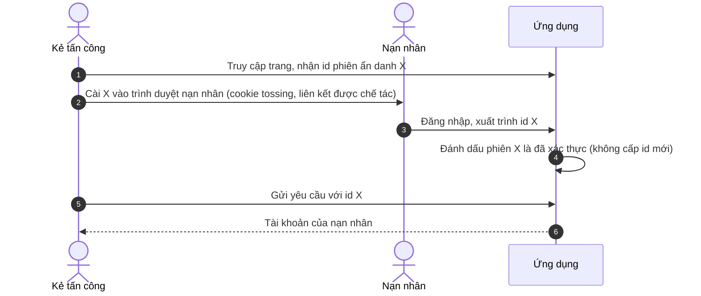
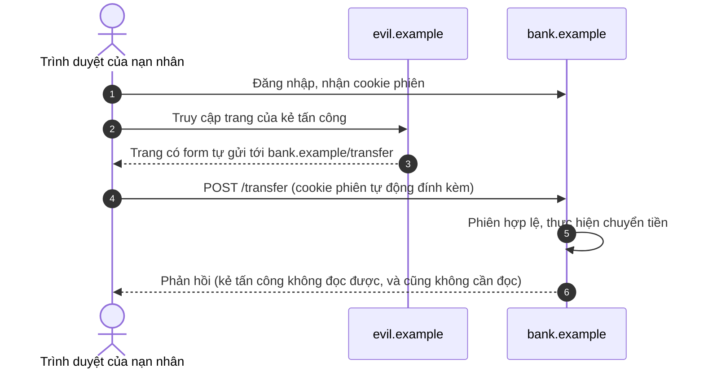

Bài trước dừng lại ở thời điểm xác thực (authentication) thành công: người dùng đã chứng minh mình kiểm soát một phương tiện xác thực (authenticator), có thể là một passkey, có thể là một mật khẩu cộng một mã dùng một lần. Bằng chứng đó tốn nhiều công sức mới có được, và giờ đây người dùng sẽ gửi rất nhiều yêu cầu. **Phiên** (session) là cơ chế cho phép mỗi yêu cầu trong số đó thừa hưởng kết quả của lần chứng minh duy nhất ấy.

Vì vậy, bản thân một phiên đã là một thông tin xác thực (credential), và thường có giá trị hơn cả mật khẩu: nó đã vượt qua mọi yếu tố xác thực, nó được xuất trình trong mọi yêu cầu, và nó sống bên trong một trình duyệt đồng thời chạy mã từ các trang khác. Bài này xem phiên như một bài toán thiết kế thống nhất gồm nhiều phần: định danh, cookie mang định danh đó, các quy tắc của trình duyệt quyết định khi nào cookie được gửi đi, các cuộc tấn công khai thác những quy tắc ấy, và vòng đời kết thúc phiên.

## 1. Phiên là gì

### 1.1 Bản ghi phiên và định danh phiên

Một phiên có hai nửa.

- **Bản ghi phiên** (session record), do máy chủ giữ, mô tả trạng thái đã xác thực: chủ thể, thời điểm và cách thức họ đã xác thực (những yếu tố nào, mức đảm bảo nào), thời điểm phiên được tạo, thời điểm phiên được dùng lần cuối, và mọi thứ ứng dụng lưu đệm gắn với phiên.
- **Định danh phiên** (session identifier) là một giá trị được trao cho trình duyệt để các yêu cầu về sau có thể gọi tên bản ghi. Bản thân nó không mang ý nghĩa gì; nó là một tham chiếu, theo nghĩa đã nêu ở bài thứ nhất của loạt bài này.

Bất kỳ ai xuất trình định danh đều được coi là người dùng đã xác thực. Định danh là một thông tin xác thực kiểu bearer (bearer credential), và mọi nội dung trong bài này đều xuất phát từ việc bảo vệ nó: giữ cho nó không thể đoán được, giữ bí mật, kiểm soát khi nào trình duyệt gửi nó, và giới hạn khoảng thời gian mà nó còn đáng để đánh cắp.

### 1.2 Yêu cầu đối với định danh

| Yêu cầu | Lý do | Thực hành |
|---|---|---|
| Không thể dự đoán | Kẻ tấn công đoán được một định danh đang hoạt động sẽ chiếm phiên đó mà không cần thông tin xác thực nào | Ít nhất 128 bit ngẫu nhiên từ một bộ sinh số an toàn về mặt mật mã |
| Không mang ý nghĩa | Nhúng ID người dùng, dấu thời gian hay bộ đếm làm rò rỉ thông tin và tạo điều kiện cho việc đoán | Hoàn toàn ngẫu nhiên; mọi ý nghĩa nằm trong bản ghi trên máy chủ |
| Duy nhất cho một phiên | Dùng lại sẽ liên kết các phiên không liên quan | Giá trị mới cho mỗi phiên mới và mỗi lần thay đổi đặc quyền |
| Không lưu nguyên dạng trên máy chủ | Nếu không, một bảng phiên bị rò rỉ sẽ trao toàn bộ các phiên đang hoạt động | Lưu giá trị băm của định danh và tra cứu phiên theo giá trị băm |

Hàng cuối đáng được nhấn mạnh. Bảng phiên bị sao chép vào bản sao lưu, nhật ký và hệ thống phân tích thường xuyên hơn bảng mật khẩu. Nếu máy chủ lưu `SHA-256(session_id)` thay vì định danh, một bảng bị rò rỉ cho phép kẻ tấn công liệt kê các phiên nhưng không dùng được chúng, với chi phí không đáng kể cho máy chủ: một lần băm cho mỗi yêu cầu. Ở đây một hàm băm nhanh là đủ, khác với trường hợp mật khẩu, vì định danh vốn đã là 128 bit ngẫu nhiên và không thể đoán được. Cũng vì lý do đó, bản thân định danh không bao giờ được ghi vào nhật ký, báo cáo lỗi hay sự kiện phân tích.

### 1.3 Phiên có trạng thái và phiên phi trạng thái

Một số framework tránh bản ghi phía máy chủ bằng cách đặt dữ liệu phiên vào cookie và ký nó (đôi khi còn mã hóa). Đây là mô hình *giá trị* (value) từ bài thứ nhất, với cùng một sự đánh đổi: không phải tra cứu ở mỗi yêu cầu, nhưng không có cách nào kết thúc sớm một phiên đơn lẻ, trừ khi đổi khóa ký, điều sẽ kết thúc tất cả các phiên, hoặc duy trì một danh sách phiên bị thu hồi phía máy chủ, điều lại đưa trạng thái trở lại. Những ứng dụng cần "đăng xuất khỏi mọi nơi", cho phép quản trị viên chấm dứt phiên, hoặc cần hiệu lực tức thì khi một tài khoản bị vô hiệu hóa sẽ được phục vụ tốt hơn bởi một bản ghi phía máy chủ.

## 2. Cookie: cách định danh được truyền đi

### 2.1 Đặt và gửi lại cookie

Máy chủ đặt một cookie bằng trường tiêu đề phản hồi (header field) `Set-Cookie` (RFC 6265); trình duyệt lưu nó và đính kèm vào các yêu cầu về sau có URL khớp với phạm vi của cookie. Viết theo cú pháp HTTP/1.1, như trong suốt loạt bài:

```http
HTTP/1.1 303 See Other
Location: /account
Set-Cookie: __Host-sid=Vb9xQm4tR2kz8YpLw7nJcA; Path=/; Secure; HttpOnly; SameSite=Lax
```

```http
GET /account HTTP/1.1
Host: app.example.com
Cookie: __Host-sid=Vb9xQm4tR2kz8YpLw7nJcA
```

Trình duyệt chỉ gửi lại tên và giá trị. Nó không cho máy chủ biết cookie đã được đặt với những thuộc tính nào, hay ai đã đặt nó, và đó là lý do máy chủ không phân biệt được cookie do chính nó đặt với cookie do một tên miền con anh em cài vào (Mục 2.4).

### 2.2 Các thuộc tính

| Thuộc tính | Tác dụng | Khuyến nghị cho cookie phiên |
|---|---|---|
| `Domain` | Nếu vắng mặt, cookie là *host-only*: chỉ được gửi tới đúng host đã đặt nó. Nếu có mặt, cookie được gửi tới tên miền đó và mọi tên miền con của nó | Bỏ qua, trừ khi cần chia sẻ giữa các tên miền con |
| `Path` | Giới hạn các đường dẫn URL mà cookie được gửi tới | `/`; phạm vi theo đường dẫn không phải là ranh giới bảo mật giữa các ứng dụng trên cùng một host |
| `Expires` / `Max-Age` | Không có cả hai, cookie là một *cookie phiên* (session cookie) theo nghĩa của trình duyệt và bị hủy khi phiên trình duyệt kết thúc (nhiều trình duyệt khôi phục nó sau khi khởi động lại) | Bỏ qua cho các phiên đăng nhập, trừ khi người dùng chọn "duy trì đăng nhập"; không bao giờ dựa vào nó để hết hạn phía máy chủ |
| `Secure` | Chỉ gửi qua HTTPS | Luôn luôn |
| `HttpOnly` | Không đọc được qua `document.cookie` hay các API script khác | Luôn luôn đối với cookie phiên |
| `SameSite` | Kiểm soát việc cookie có được gửi trong các yêu cầu do site khác khởi tạo hay không (Mục 3) | `Lax` hoặc `Strict` |

### 2.3 Tiền tố cookie

Hai tiền tố tên, được các trình duyệt hiện nay tôn trọng, cho phép máy chủ tin cậy vào cách một cookie đã được đặt:

- Một cookie có tên bắt đầu bằng `__Secure-` chỉ được chấp nhận nếu nó có thuộc tính `Secure` và được đặt qua HTTPS.
- Một cookie có tên bắt đầu bằng `__Host-` chỉ được chấp nhận nếu, ngoài ra, nó có `Path=/` và **không** có thuộc tính `Domain`. Do đó nó là host-only, và không tên miền con nào có thể đặt hay ghi đè nó.

Tiền tố `__Host-` là sự bảo đảm mạnh nhất hiện có rằng một cookie phiên thuộc về đúng một host. Nó không tốn gì khi ứng dụng chạy trên một tên host duy nhất.

### 2.4 Tên miền con và cookie tossing

Phạm vi của cookie lỏng hơn chính sách cùng nguồn gốc (same-origin policy) của trình duyệt. Một trang trên `blog.example.com` có thể đặt một cookie với `Domain=example.com`, và khi đó trình duyệt cũng sẽ gửi cookie đó tới `app.example.com`. Điều này tạo điều kiện cho **cookie tossing**: một kẻ tấn công kiểm soát bất kỳ tên miền con nào (một trang tiếp thị bị lãng quên, một host chứa nội dung người dùng, một bản ghi DNS treo trỏ tới một tài nguyên đám mây đã bị hủy cấp phát) có thể cài cookie mà ứng dụng chính sẽ nhận. Cookie phiên bị cài vào cho phép tấn công cố định phiên (Mục 4); giá trị bị cài cho các cookie khác có thể phá vỡ các cơ chế chống giả mạo dựa vào cookie (Mục 5.3).

Biện pháp phòng vệ mang tính cấu trúc: dùng cookie `__Host-` cho mọi thứ liên quan đến bảo mật, đặt nội dung do người dùng cung cấp trên một tên miền có thể đăng ký (registrable domain) riêng, và xóa các bản ghi DNS trỏ tới tài nguyên không còn thuộc sở hữu.

## 3. Site, nguồn gốc và khi nào cookie được gửi

### 3.1 Nguồn gốc và site

Hai khái niệm "cùng một nơi" chi phối bảo mật trình duyệt, và chúng khác nhau.

- Một **nguồn gốc** (origin) là bộ ba *(scheme, host, cổng)*. `https://app.example.com` và `https://blog.example.com` là hai nguồn gốc khác nhau. Chính sách cùng nguồn gốc, vốn kiểm soát việc một script có được đọc nội dung hay phản hồi của một trang khác hay không, dùng khái niệm nguồn gốc.
- Một **site** là scheme cộng với *tên miền có thể đăng ký*: tên miền ở ngay dưới một hậu tố công cộng (public suffix) như `.com` hay `.co.uk`, theo danh sách trong Public Suffix List. `https://app.example.com` và `https://blog.example.com` là **cùng site**, `https://example.com` và `https://example.org` là hai site khác nhau, và `http://example.com` với `https://example.com` là hai site khác nhau theo định nghĩa có tính đến scheme mà các trình duyệt hiện nay dùng.

`SameSite` nói về site, không phải về nguồn gốc. Một yêu cầu từ `blog.example.com` tới `app.example.com` là một yêu cầu cùng site, và `SameSite` không làm gì để ngăn nó.

### 3.2 Các chế độ SameSite

Khi một trang trên một site khiến một yêu cầu được gửi tới site khác, yêu cầu đó là *liên site* (cross-site). `SameSite` quyết định cookie của bên đích có đi kèm yêu cầu hay không:

| Chế độ | Gửi trong yêu cầu cùng site | Gửi trong điều hướng cấp cao nhất liên site dùng phương thức an toàn (khi theo một đường liên kết) | Gửi trong các yêu cầu liên site khác (form `POST`, `fetch`, ảnh, khung) |
|---|---|---|---|
| `Strict` | Có | Không | Không |
| `Lax` | Có | Có | Không |
| `None` (yêu cầu `Secure`) | Có | Có | Có |

`Strict` an toàn nhất và có một cái giá dễ thấy: người dùng theo một đường liên kết từ email hoặc từ trang khác tới ứng dụng sẽ đến nơi mà không có cookie phiên và trông như đã đăng xuất ở trang đầu tiên đó. `Lax` giữ cho kiểu điều hướng đó hoạt động, và nó chỉ an toàn nếu các yêu cầu dùng `GET` và các phương thức an toàn khác không làm thay đổi trạng thái. Yêu cầu đó vốn đã có trong chính định nghĩa phương thức an toàn của HTTP (RFC 9110); `Lax` biến việc vi phạm nó thành một lỗ hổng.

Các trình duyệt xử lý khác nhau khi vắng `SameSite`; một số coi cookie là `Lax`, số khác coi là `None`. Một cookie phiên luôn nên đặt thuộc tính này một cách tường minh.

## 4. Tấn công cố định phiên

### 4.1 Cuộc tấn công

Trong một cuộc tấn công cố định phiên (session fixation), kẻ tấn công không đánh cắp định danh phiên của nạn nhân; kẻ tấn công **chọn** nó từ trước và khiến nạn nhân xác thực với định danh đó.



Cuộc tấn công cần hai điều: một cách để cài định danh (một tên miền con anh em đặt cookie, hoặc một ứng dụng chấp nhận định danh trong tham số URL) và một ứng dụng giữ nguyên định danh qua lần xác thực.

### 4.2 Biện pháp phòng vệ

Cách khắc phục đơn giản và triệt để: **cấp một định danh phiên mới mỗi khi mức đặc quyền của phiên thay đổi**: khi đăng nhập, khi nâng lên một mức xác thực mạnh hơn, khi thay đổi vai trò, khi đăng xuất. Định danh cũ bị vô hiệu hóa trên máy chủ, nên bất cứ thứ gì kẻ tấn công đã cài vào đều trở nên vô giá trị đúng vào lúc lẽ ra nó trở nên có giá trị. Chỉ chấp nhận định danh phiên từ cookie, không bao giờ từ URL, và dùng cookie `__Host-` cũng loại bỏ luôn các con đường cài định danh.

## 5. Giả mạo yêu cầu liên trang

### 5.1 Cuộc tấn công

Cookie là thông tin xác thực *ngầm định* (ambient): trình duyệt tự động đính kèm chúng vào các yêu cầu khớp phạm vi, bất kể trang nào đã kích hoạt yêu cầu. Giả mạo yêu cầu liên trang (cross-site request forgery, CSRF) khai thác điều này. Một trang trên site của kẻ tấn công khiến trình duyệt của nạn nhân gửi một yêu cầu tới ứng dụng; trình duyệt đính kèm cookie phiên của nạn nhân; ứng dụng thấy một yêu cầu đã xác thực và thực hiện nó.



Kẻ tấn công không bao giờ nhìn thấy cookie hay phản hồi. CSRF là một cuộc tấn công vào *tính toàn vẹn*: nó khiến nạn nhân thực hiện một hành động, và đó là tất cả những gì kẻ tấn công cần.

### 5.2 SameSite là lớp phòng vệ đầu tiên

Khi cookie phiên được đặt `SameSite=Lax` hoặc `Strict`, yêu cầu `POST` liên site ở trên đến nơi mà không có cookie, và cuộc tấn công thất bại. Chỉ một thuộc tính này đã loại bỏ phần lớn CSRF trên các trình duyệt hiện đại. Tự nó không phải là một biện pháp phòng vệ đầy đủ:

- nó không làm gì đối với các yêu cầu từ những trang **cùng site**, kể cả một tên miền con bị chiếm quyền hoặc do kẻ tấn công kiểm soát;
- với `Lax`, mọi điểm cuối (endpoint) `GET` làm thay đổi trạng thái vẫn bị khai thác được chỉ qua một đường liên kết bình thường;
- các client cũ hoặc khác thường có thể không thực thi nó.

### 5.3 Phòng vệ ở mức yêu cầu

Lớp thứ hai kiểm tra một thứ mà trang liên site không thể cung cấp:

- **Token đồng bộ (synchronizer token).** Máy chủ lưu một token ngẫu nhiên trong bản ghi phiên và nhúng nó vào mỗi form hoặc cung cấp nó cho các script của chính ứng dụng; các yêu cầu làm thay đổi trạng thái phải gửi lại nó trong một trường form hoặc một trường tiêu đề. Một trang liên site không đọc được token, vì chính sách cùng nguồn gốc ngăn nó đọc các trang của ứng dụng.
- **Token gửi kép có ký (signed double-submit token).** Khi không muốn có trạng thái phía máy chủ, máy chủ đặt một cookie chứa một token được ràng buộc về mặt mật mã với phiên (chẳng hạn HMAC của định danh phiên) và yêu cầu cùng giá trị đó trong một trường tiêu đề. Việc ràng buộc với phiên là quan trọng: một token gửi kép không được ràng buộc có thể bị đánh bại bởi một kẻ tấn công có khả năng tung (toss) một cookie do chính chúng chọn.
- **Kiểm tra Origin và fetch metadata.** Trình duyệt gửi trường tiêu đề `Origin` trong mọi yêu cầu có phương thức không phải `GET` hay `HEAD`, và trong các yêu cầu khác nguồn gốc thực hiện qua CORS. Các trình duyệt hiện đại còn gửi `Sec-Fetch-Site` (`same-origin`, `same-site`, `cross-site` hoặc `none`) trong các yêu cầu tới nguồn gốc HTTPS. Máy chủ có thể từ chối các yêu cầu làm thay đổi trạng thái có `Sec-Fetch-Site` là `cross-site`, hoặc có `Origin` không phải của chính nó, với chi phí rất thấp.
- **Trường tiêu đề tùy chỉnh cho API.** Trình duyệt thực thi cơ chế **chia sẻ tài nguyên khác nguồn gốc** (Cross-Origin Resource Sharing, CORS): trước khi gửi một yêu cầu khác nguồn gốc mà một form HTML thông thường không thể tạo ra, chẳng hạn yêu cầu có trường tiêu đề tùy chỉnh hoặc thân (body) JSON, trình duyệt trước hết hỏi máy chủ xin phép bằng một yêu cầu `OPTIONS` *tiền kiểm* (preflight), và chỉ gửi yêu cầu thật nếu máy chủ cho phép nguồn gốc đó. Do đó một trang liên site có thể gửi một form `POST` đơn giản, nhưng không thể thêm một trường tiêu đề tùy chỉnh như `X-Requested-With` trừ khi chính sách CORS của máy chủ cho phép. Một API yêu cầu trường tiêu đề tùy chỉnh, hoặc kiểu nội dung JSON, cho mọi yêu cầu làm thay đổi trạng thái sẽ được bảo vệ trước việc giả mạo dựa trên form, miễn là chính sách CORS của nó không chấp nhận các nguồn gốc tùy ý kèm thông tin xác thực.

Một cấu hình vững chắc kết hợp cookie `SameSite`, một bước kiểm tra fetch metadata hoặc `Origin`, và một token cho những thao tác nhạy cảm nhất.

### 5.4 CSRF trên form đăng nhập

Form đăng nhập cũng cần được bảo vệ, dù người dùng chưa đăng nhập. Trong *CSRF đăng nhập* (login CSRF), kẻ tấn công gửi form đăng nhập với thông tin xác thực **của chính kẻ tấn công** từ trình duyệt của nạn nhân. Nạn nhân giờ đã đăng nhập vào tài khoản của kẻ tấn công mà không hay biết, và bất cứ thứ gì họ nhập sau đó (một số thẻ, một lịch sử tìm kiếm, một tài liệu) đều được lưu ở nơi kẻ tấn công đọc được. Một token chống giả mạo có trước phiên, hoặc một bước kiểm tra `Origin` trên điểm cuối đăng nhập, sẽ ngăn chặn điều này.

## 6. Tấn công chèn mã độc liên trang và giới hạn của HttpOnly

`HttpOnly` ngăn script **đọc** cookie phiên, nên một script bị chèn vào không thể lấy trộm nó để dùng ở nơi khác. Nó không ngăn script **sử dụng** phiên: script chạy trong nguồn gốc của ứng dụng có thể gửi các yêu cầu có đính kèm cookie, đọc phản hồi (chúng cùng nguồn gốc) và đọc mọi token chống giả mạo trên trang. Vì vậy tấn công chèn mã độc liên trang (cross-site scripting, XSS) đánh bại các biện pháp phòng vệ CSRF và biến trình duyệt thành client của kẻ tấn công chừng nào trang còn mở.

Các biện pháp phòng vệ trước XSS (mã hóa đầu ra theo ngữ cảnh, dùng template an toàn, một Content Security Policy chặt chẽ, tránh các API nguy hiểm chèn HTML) nằm ngoài phạm vi bài này. Điểm thiết kế cần nắm là: bảo mật phiên giả định rằng nguồn gốc của chính ứng dụng không chạy script thù địch. `HttpOnly` hạn chế thiệt hại khi giả định đó thất bại; nó không ngăn sự thất bại.

## 7. Thời hạn, xác thực lại và đăng xuất

### 7.1 Thời hạn chờ

Một phiên nên kết thúc theo hai đồng hồ, cả hai đều được thực thi trên máy chủ:

- **thời hạn chờ khi không hoạt động** (idle timeout), tính từ yêu cầu cuối cùng, kết thúc các phiên trên những thiết bị bị bỏ không;
- **thời hạn tuyệt đối** (absolute timeout), tính từ lúc xác thực, giới hạn thời gian sống của mọi định danh bị đánh cắp bất kể mức độ hoạt động.

Giá trị phù hợp tùy thuộc vào mức rủi ro. Một ứng dụng ngân hàng có thể dùng vài phút cho thời gian không hoạt động và vài giờ cho thời gian sống tuyệt đối; một ứng dụng đọc nội dung có rủi ro thấp có thể giữ người dùng đăng nhập trong nhiều tuần. "Ghi nhớ tôi" nên là một lựa chọn có chủ ý của người dùng, được hiện thực như một thông tin xác thực riêng, có thời gian sống dài hơn, có thể được liệt kê và thu hồi (revocation), chứ không phải là việc kéo dài vô tận phiên thông thường.

### 7.2 Xác thực lại cho các hành động nhạy cảm

Bản ghi phiên nên lưu người dùng đã xác thực *khi nào* và *bằng cách nào*. Trước một hành động nhạy cảm (đổi mật khẩu hoặc các phương tiện xác thực đã đăng ký, thêm người nhận tiền, xuất dữ liệu, xóa tài khoản), ứng dụng so sánh bản ghi đó với yêu cầu của hành động và, nếu cần, yêu cầu người dùng xác thực lại, có thể với một yếu tố mạnh hơn (*xác thực nâng cấp*, step-up authentication). Điều này giới hạn những gì một phiên bị đánh cắp có thể làm ngay cả khi phiên còn hợp lệ, và sau đó là việc cấp một định danh phiên mới (Mục 4.2).

### 7.3 Đăng xuất

Đăng xuất phải kết thúc phiên **trên máy chủ**: xóa hoặc vô hiệu hóa bản ghi, để mọi bản sao của định danh nằm ở bất kỳ đâu khác trở nên vô dụng. Xóa cookie trong trình duyệt chỉ là một phép lịch sự, thực hiện bằng cách gửi cùng tên cookie với cùng các thuộc tính và `Max-Age=0`:

```http
HTTP/1.1 303 See Other
Location: /
Set-Cookie: __Host-sid=; Path=/; Secure; HttpOnly; SameSite=Lax; Max-Age=0
Clear-Site-Data: "cookies", "storage"
```

`Clear-Site-Data` yêu cầu trình duyệt xóa cookie của site và dữ liệu được lưu của nguồn gốc, qua đó cũng xóa các token hoặc dữ liệu cá nhân được lưu đệm mà script có thể đã lưu.

Người dùng và quản trị viên cũng cần kết thúc những phiên mà họ không chạm tới được: một danh sách các phiên đang hoạt động của tài khoản kèm thông tin thiết bị và thời gian, một thao tác "đăng xuất khỏi mọi nơi", và việc tự động chấm dứt mọi phiên khi mật khẩu hoặc phương tiện xác thực thay đổi hoặc khi tài khoản bị vô hiệu hóa. Tất cả những điều này đều dễ dàng khi có bản ghi phiên phía máy chủ và khó khăn khi không có.

Khi ứng dụng dùng đăng nhập một lần (single sign-on, SSO), việc kết thúc phiên của ứng dụng không kết thúc phiên của nhà cung cấp danh tính (identity provider, IdP); lần truy cập tiếp theo có thể đăng nhập lại người dùng ngay lập tức. Đăng xuất liên kết (federated logout), đã được nhắc đến ở bài thứ nhất, là lời giải ở mức giao thức.

## 8. Đánh cắp sau khi xác thực

Mã độc chạy trên thiết bị của người dùng có thể sao chép cookie từ kho lưu trữ của trình duyệt và phát lại chúng từ một máy khác, vượt qua mọi phương tiện xác thực đã bàn ở bài trước. Một số biện pháp làm giảm giá trị của một định danh bị đánh cắp:

- thời gian sống tuyệt đối ngắn và xác thực lại cho các hành động nhạy cảm (Mục 7);
- phát hiện các thay đổi đột ngột về đặc điểm client (mạng, vị trí, user agent) và yêu cầu xác thực lại, chấp nhận rằng những tín hiệu này nhiều nhiễu và nên kích hoạt xác thực nâng cấp thay vì âm thầm từ chối;
- ràng buộc phiên với một khóa do thiết bị nắm giữ, để một cookie bị sao chép là vô dụng nếu không có khóa. Đây là phiên bản ở tầng phiên của token ràng buộc bên gửi (sender-constrained token) sẽ được trình bày ở phần sau của loạt bài; Device Bound Session Credentials, một Bản dự thảo làm việc (Working Draft) của W3C mà chưa phải trình duyệt nào cũng hỗ trợ, nhắm tới việc cung cấp điều này cho cookie thông thường.

## 9. Một cấu hình tham chiếu

Ghép các phần lại với nhau, một ứng dụng kết xuất phía máy chủ chạy trên một host duy nhất có thể áp dụng cấu hình sau:

| Vấn đề | Lựa chọn |
|---|---|
| Định danh | 128 bit ngẫu nhiên từ một bộ sinh an toàn, mã hóa base64url; lưu giá trị băm phía máy chủ |
| Cookie | `__Host-sid`, `Path=/`, `Secure`, `HttpOnly`, `SameSite=Lax`, không `Domain`, không `Max-Age` |
| Truyền tải | Chỉ HTTPS, kèm HTTP Strict Transport Security để trình duyệt không bao giờ thử HTTP thường |
| Cố định phiên | Định danh mới khi đăng nhập, xác thực nâng cấp, thay đổi vai trò và đăng xuất; chỉ chấp nhận định danh từ cookie |
| CSRF | Không thay đổi trạng thái trên phương thức an toàn; từ chối các yêu cầu liên site làm thay đổi trạng thái theo `Sec-Fetch-Site` hoặc `Origin`; token đồng bộ trên các form nhạy cảm và trên form đăng nhập |
| Thời gian sống | Thời hạn chờ khi không hoạt động và thời hạn tuyệt đối do máy chủ thực thi; thông tin xác thực "ghi nhớ tôi" riêng, có thể thu hồi |
| Hành động nhạy cảm | Xác thực lại dựa trên thời điểm và phương thức xác thực đã lưu |
| Đăng xuất | Vô hiệu hóa phía máy chủ, xóa cookie, `Clear-Site-Data`; danh sách phiên và "đăng xuất khỏi mọi nơi" |
| Tên miền con | Nội dung người dùng và dịch vụ bên thứ ba trên một tên miền có thể đăng ký riêng; xóa các bản ghi DNS lỗi thời |

## 10. Tóm tắt

| Câu hỏi | Trả lời |
|---|---|
| Định danh phiên là gì? | Một tham chiếu ngẫu nhiên kiểu bearer tới một bản ghi phía máy chủ về một sự kiện xác thực. |
| Nó được bảo vệ khi lưu trữ như thế nào? | Nó không bao giờ được ghi vào nhật ký và chỉ được lưu trên máy chủ dưới dạng giá trị băm. |
| Những thuộc tính cookie nào quan trọng? | `Secure`, `HttpOnly`, một `SameSite` tường minh, không có `Domain`, và tiền tố `__Host-`. |
| Site và nguồn gốc khác nhau thế nào? | Nguồn gốc là scheme, host và cổng; site là scheme cộng với tên miền có thể đăng ký. `SameSite` bảo vệ trước các site khác, không bảo vệ trước các tên miền con anh em. |
| Ngăn cố định phiên bằng cách nào? | Bằng cách cấp một định danh mới ở mỗi lần thay đổi đặc quyền. |
| Ngăn CSRF bằng cách nào? | Bằng cookie `SameSite`, các phương thức an toàn thực sự an toàn, một bước kiểm tra `Origin` hoặc fetch metadata, và token chống giả mạo cho các hành động nhạy cảm và form đăng nhập. |
| HttpOnly không làm được gì? | Nó không ngăn script bị chèn vào sử dụng phiên. |
| Một phiên kết thúc như thế nào? | Bằng thời hạn chờ khi không hoạt động và thời hạn tuyệt đối do máy chủ thực thi, và bằng việc vô hiệu hóa phía máy chủ khi đăng xuất; chỉ xóa cookie là không đủ. |

Bài tiếp theo chuyển từ câu hỏi người dùng là *ai* sang câu hỏi họ được làm *gì*: các mô hình phân quyền (authorization) biểu diễn chính sách như thế nào, và lựa chọn giữa vai trò, thuộc tính và quan hệ ảnh hưởng ra sao đến việc đánh giá, kiểm toán và thay đổi.

### Tài liệu tham khảo

- A. Barth, *HTTP State Management Mechanism*, RFC 6265, IETF, 2011.
- S. Bingler, M. West and J. Wilander, Eds., *Cookies: HTTP State Management Mechanism*, draft-ietf-httpbis-rfc6265bis-22, IETF, 2025 (Internet-Draft, work in progress; specifies `SameSite` and the cookie prefixes).
- R. Fielding, M. Nottingham and J. Reschke, Eds., *HTTP Semantics*, RFC 9110, IETF, 2022.
- J. Hodges, C. Jackson and A. Barth, *HTTP Strict Transport Security (HSTS)*, RFC 6797, IETF, 2012.
- Mozilla, *Public Suffix List*, maintained as a community resource and used by browsers to determine registrable domains, consulted October 2026.
- M. West, Ed., *Clear Site Data*, W3C Working Draft, 2017.
- M. West, Ed., *Fetch Metadata Request Headers*, W3C Working Draft, 2026.
- Web Hypertext Application Technology Working Group (WHATWG), *Fetch Standard*, living standard, consulted October 2026.
