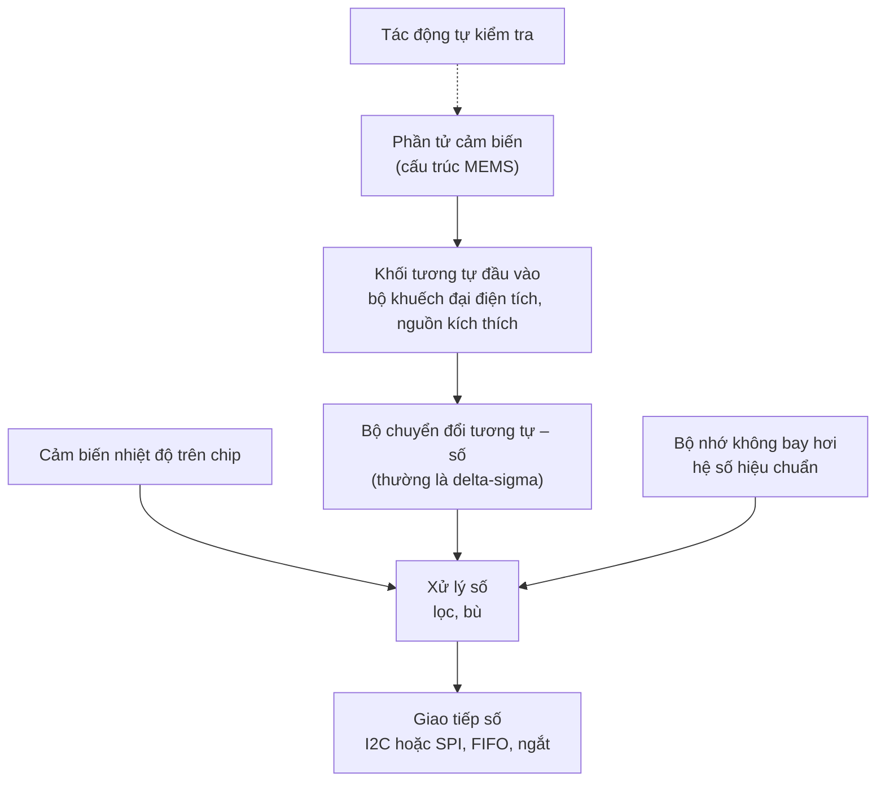

import Figure from '../../../components/Figure.astro';
import MemsAccelerometer from '../../../components/diagrams/MemsAccelerometer.astro';

Các bài trước đã lần theo tín hiệu qua những thành phần riêng rẽ: một phần tử cảm biến, mạch điện tử chuẩn hóa tín hiệu, một bộ chuyển đổi, mỗi thành phần có nhiễu và sai số riêng, nối với nhau bằng dây dẫn vốn thu nhận can nhiễu. Nhiều cảm biến được dùng ngày nay không còn có hình dạng như vậy. Gia tốc kế trong điện thoại, cảm biến áp suất trong hệ thống quản lý động cơ của ô tô và micrô trong máy tính xách tay đều chứa phần tử cảm biến, bộ khuếch đại, bộ chuyển đổi, một cảm biến nhiệt độ, bộ nhớ hiệu chuẩn và một giao tiếp số trong cùng một vỏ linh kiện chỉ rộng vài milimét.

Hai ý tưởng làm cho điều này trở nên khả thi, và bài này trình bày cả hai:

- **Hệ vi cơ điện tử** (microelectromechanical systems, MEMS) là những cấu trúc cơ khí, như dầm, màng và khối treo, được chế tạo bằng chính các phương pháp dùng cho mạch tích hợp, với kích thước từ khoảng một micromét đến một milimét.
- **Cảm biến thông minh** (smart sensor) là cảm biến tự mang theo khâu xử lý tín hiệu của nó: tối thiểu là chuẩn hóa tín hiệu và chuyển đổi, thường có thêm bù, tự kiểm tra và một giao tiếp số, để nó cung cấp một con số đã được hiệu chuẩn thay vì một tín hiệu điện thô.

Bài này bắt đầu với silic như một vật liệu cơ khí và cách chế tạo vi cấu trúc, giải thích vì sao các cấu trúc cơ khí nhỏ có hành vi khác với cấu trúc lớn, phân tích các cảm biến MEMS chính bằng những con số cụ thể, rồi chuyển sang những gì phần điện tử trên chip thực hiện và cái giá của sự tích hợp.

## 1. Silic như một vật liệu cơ khí

Mạch tích hợp được làm từ silic đơn tinh thể, và hóa ra tinh thể này là một vật liệu cơ khí tuyệt vời:

- **Mô đun Young** (Young's modulus), tức độ cứng của vật liệu, nằm trong khoảng 130 đến 190 GPa tùy theo phương tinh thể, tương đương với 200 GPa của thép, trong khi khối lượng riêng của nó chưa bằng một phần ba của thép.
- Ở nhiệt độ phòng, nó biến dạng **đàn hồi cho đến khi gãy**: nó không chảy dẻo hay rão như kim loại, nên một lò xo silic trở về chính xác vị trí nghỉ, gần như không có độ trễ (hysteresis) cơ học. Cái giá phải trả là tính giòn: khi quá tải, nó hỏng do nứt gãy.
- Các tính chất điện của nó thay đổi theo ứng suất (**hiệu ứng áp trở**, piezoresistive effect), nên các điện trở chế tạo ngay trong silic có thể đóng vai trò cảm biến biến dạng (strain gauge), với hệ số gauge cỡ 100, so với khoảng 2 của các cảm biến biến dạng lá kim loại trong bài về các nguyên lý cảm biến.

### 1.1 Cách chế tạo vi cấu trúc

Chế tạo MEMS sử dụng bộ công cụ của công nghệ mạch tích hợp: **quang khắc** (photolithography) chuyển một hình mẫu từ mặt nạ lên một lớp nhạy sáng, **lắng đọng** (deposition) bổ sung các màng mỏng (ôxít silic, silic đa tinh thể, kim loại), và **ăn mòn** (etching) loại bỏ vật liệu ở những chỗ hình mẫu để hở. Hai họ quy trình biến các bước này thành những bộ phận chuyển động:

- **Vi gia công khối** (bulk micromachining) ăn mòn sâu vào chính tấm silic. Một số dung dịch ăn mòn ướt, như kali hydroxit, tấn công các mặt tinh thể khác nhau với tốc độ rất khác nhau, và với định hướng tấm silic thông dụng, chúng để lại các thành bên nghiêng 54.7°; đây là cách tạo ra các màng mỏng cho cảm biến áp suất. **Ăn mòn ion phản ứng sâu** (deep reactive-ion etching), một quy trình plasma, tạo ra các rãnh gần như thẳng đứng sâu từ hàng chục đến hàng trăm micromét.
- **Vi gia công bề mặt** (surface micromachining) xây dựng cấu trúc từ các màng mỏng nằm trên bề mặt tấm silic. Một **lớp hy sinh** (sacrificial layer) được lắng đọng bên dưới bộ phận chuyển động sau này và được hòa tan ở bước cuối, để lại một dầm hoặc tấm treo cách đế vài micromét.

Các cấu trúc hoàn chỉnh được bịt kín trong một khoang, thường dưới một áp suất khí được kiểm soát hoặc trong chân không, vì chuyển động của chúng phụ thuộc vào chất khí bao quanh và các khe hở của chúng nhỏ đến mức một hạt bụi cũng có thể làm tắc.

## 2. Vì sao nhỏ lại khác

Thu nhỏ một cấu trúc cơ khí không chỉ làm nó nhỏ đi; nó làm thay đổi những hiệu ứng vật lý nào chiếm ưu thế. Giả sử mọi kích thước của một cấu trúc lò xo – khối lượng đều được nhân với hệ số $s$:

- **Khối lượng** tỉ lệ với thể tích, tức theo $s^3$.
- **Độ cứng** của một lò xo dạng dầm tỉ lệ theo $s$ (với dầm công-xôn, $k \propto E\,w t^3 / L^3$, và khi mọi chiều dài được nhân với $s$ thì biểu thức này bằng $s^4/s^3$).
- Do đó **tần số cộng hưởng** $\omega_0 = \sqrt{k/m}$ tỉ lệ theo $1/s$: một cấu trúc nhỏ hơn một nghìn lần sẽ cộng hưởng nhanh hơn một nghìn lần.

Vì vậy, các cấu trúc nhỏ phản ứng nhanh và gần như không chịu ảnh hưởng của quán tính của chính chúng, nhưng khối lượng rất nhỏ cũng khiến chúng nhạy với các va chạm ngẫu nhiên của phân tử khí. Các lực bề mặt, như lực hút tĩnh điện, lực cản của chất khí và hiện tượng dính bề mặt (stiction, các bề mặt dính vào nhau), trở nên quan trọng, trong khi ở kích thước cỡ centimét chúng có thể bỏ qua. Thiết kế MEMS phần lớn là việc tận dụng các hiệu ứng này thay vì chống lại chúng.

## 3. Các cảm biến MEMS

### 3.1 Gia tốc kế

Gia tốc kế MEMS chính là cảm biến bậc hai của bài thứ nhất (mục 4.2), được chế tạo bằng silic: một khối lượng, một lò xo và cơ cấu tắt dần. Một **khối thử** (proof mass) $m$ được treo trên các lò xo có tổng độ cứng $k$ bên trong vỏ. Khi vỏ chuyển động có gia tốc, các lò xo phải biến dạng để đẩy khối lượng chuyển động theo; với các gia tốc biến thiên chậm so với tần số cộng hưởng, độ dịch chuyển là

$$
x = \frac{m\,a}{k} = \frac{a}{\omega_0^2}.
$$

Độ nhạy và băng thông gắn với nhau qua $\omega_0$: hệ treo mềm hơn cho độ dịch chuyển lớn hơn trên mỗi đơn vị gia tốc nhưng có tần số cộng hưởng thấp hơn, mà cảm biến chỉ có thể theo dõi trung thực gia tốc ở dưới tần số này.

<Figure caption="Sơ đồ nguyên lý của một gia tốc kế MEMS kiểu điện dung. Khối thử nằm giữa hai điện cực cố định. Khi vỏ chuyển động có gia tốc, khối thử bị trễ lại và dịch chuyển một đoạn x so với vỏ, nên một khe hẹp lại thành d − x còn khe kia rộng ra thành d + x.">
  <MemsAccelerometer />
</Figure>

Độ dịch chuyển được đo bằng phương pháp điện dung, với cách bố trí vi sai như trong hình. Mỗi khe tạo thành một tụ điện $C = \varepsilon_0 A / \text{gap}$, nên

$$
C_2 - C_1 = \varepsilon_0 A\left(\frac{1}{d - x} - \frac{1}{d + x}\right) = \frac{2\,\varepsilon_0 A\,x}{d^2 - x^2} \approx \frac{2\,C_0\,x}{d},
$$

trong đó $C_0 = \varepsilon_0 A / d$ là điện dung ở trạng thái nghỉ. Giống như nửa cầu trong bài về chuẩn hóa tín hiệu, cách bố trí vi sai làm tín hiệu tăng gấp đôi, triệt tiêu độ phi tuyến bậc nhất và loại bỏ những thay đổi tác động như nhau lên cả hai phía.

Các con số cho thấy vì sao một cảm biến như vậy cần có mạch điện tử ngay trên chip. Lấy tần số cộng hưởng 5 kHz, điện dung nghỉ 100 fF phân bố trên nhiều ngón lược đan xen, và khe hở 2 µm:

- Gia tốc 1 g (9.81 m/s²) làm khối thử dịch chuyển $9.81 / (2\pi \times 5000)^2 \approx 9.9$ nm.
- Hiệu điện dung là $2 \times 100\ \text{fF} \times 9.9\ \text{nm} / 2\ \mu\text{m} \approx 1$ fF trên mỗi g.

Một femtofara bằng $10^{-15}$ F. Một mét cáp có vỏ chống nhiễu có điện dung cỡ 100 pF, lớn hơn một trăm nghìn lần. Đo những thay đổi cỡ femtofara qua một sợi cáp là điều vô vọng; đo chúng ở khoảng cách vài trăm micromét, với một bộ khuếch đại điện tích (trong bài về chuẩn hóa tín hiệu) nằm trên cùng chip, là việc thông thường.

**Nhiễu nhiệt cơ** (thermomechanical noise). Nhiễu nhiệt trong bài về nhiễu có một đối tác cơ học. Lực cản của chất khí, vốn ngăn khối thử dao động kéo dài, cũng thông qua chính những va chạm phân tử đó làm khối thử rung ngẫu nhiên, và chuyển động này không thể phân biệt được với một gia tốc. Mật độ nhiễu của nó, biểu diễn dưới dạng gia tốc, là

$$
a_n = \sqrt{\frac{4 k_B T\,\omega_0}{m\,Q}},
$$

trong đó $k_B$ là hằng số Boltzmann và $Q$ là hệ số phẩm chất (quality factor) của cộng hưởng ($Q$ thấp nghĩa là tắt dần mạnh). Với khối thử 1 µg, $\omega_0 = 2\pi \times 5$ kHz và $Q = 1$, giá trị này là $7.2 \times 10^{-4}$ m/s² trên √Hz, khoảng 74 µg/√Hz (ở đây g là gia tốc trọng trường, không phải gam). Trong băng thông 100 Hz, con số đó vào khoảng 0.74 mg hiệu dụng (RMS), tương ứng với độ dịch chuyển của khối thử là 7 picomét và thay đổi điện dung nhỏ hơn một attofara ($10^{-18}$ F). Mạch điện tử đọc tín hiệu phải thêm vào ít nhiễu hơn mức đó để đạt tới giới hạn cơ học; trong thực tế, chúng thường thêm vào nhiều hơn, và hai thành phần kết hợp theo căn của tổng bình phương. Khối thử nặng hơn làm giảm nhiễu cơ học, đó là lý do gia tốc kế dùng cho dẫn đường chính xác cao có kích thước lớn hơn loại trong điện thoại.

### 3.2 Con quay hồi chuyển

Con quay hồi chuyển (gyroscope) MEMS đo tốc độ quay thông qua **hiệu ứng Coriolis** (Coriolis effect): một khối lượng chuyển động với vận tốc $\mathbf{v}$ trong một hệ quy chiếu quay với tốc độ $\boldsymbol{\Omega}$ chịu một gia tốc biểu kiến $\mathbf{a}_c = 2\,\boldsymbol{\Omega} \times \mathbf{v}$, vuông góc với cả hai. Con quay hồi chuyển MEMS không có bánh xe quay. Thay vào đó, nó kích cho một khối thử dao động dọc theo một trục, gọi là trục kích, và đo dao động nhỏ do chuyển động quay gây ra dọc theo một trục cảm nhận vuông góc, bằng cùng các kỹ thuật điện dung như gia tốc kế.

Tín hiệu Coriolis rất nhỏ. Một khối lượng được kích ở 20 kHz với biên độ 10 µm đạt vận tốc đỉnh $2\pi \times 20\,000 \times 10\ \mu\text{m} \approx 1.26$ m/s. Khi đó, chuyển động quay 1 °/s (0.0175 rad/s) tạo ra gia tốc Coriolis $2 \times 0.0175 \times 1.26 \approx 0.044$ m/s², khoảng 4.5 mg, đổi chiều theo tần số kích. Con quay hồi chuyển khôi phục tín hiệu này bằng giải điều chế đồng bộ với tín hiệu kích làm tham chiếu, kỹ thuật trong bài về chuẩn hóa tín hiệu. Vì biên độ kích và sự ghép cơ học giữa hai trục trôi theo nhiệt độ và thời gian, con quay hồi chuyển có một độ lệch biến đổi chậm, gọi là **độ trôi điểm không** (bias drift); đó là lý do loạt bài về robot kết hợp tốc độ quay từ con quay hồi chuyển với gia tốc kế và các phép đo khác thay vì chỉ lấy tích phân riêng chúng.

### 3.3 Cảm biến áp suất và micrô

Một **cảm biến áp suất** MEMS là một màng silic mỏng, được tạo bằng vi gia công khối, bị uốn cong dưới tác dụng của hiệu áp suất giữa hai mặt của nó. Bốn áp điện trở được khuếch tán vào màng, đặt ở những vị trí mà hai điện trở bị kéo giãn và hai điện trở bị nén, tạo thành cầu đủ Wheatstone trong bài về chuẩn hóa tín hiệu; hệ số gauge lớn của chúng cho đầu ra cỡ milivôn trên mỗi vôn nguồn kích thích. Cảm biến áp suất kiểu điện dung thì đo khoảng cách từ màng đến một điện cực cố định, và tiêu thụ ít công suất hơn. Nếu khoang phía sau màng được bịt kín trong chân không, cảm biến đo áp suất tuyệt đối; nếu khoang được thông hơi, nó đo áp suất tương đối so với khí quyển.

Một **micrô** MEMS là một cảm biến áp suất kiểu điện dung được tối ưu cho các dao động áp suất nhỏ và nhanh của âm thanh: một màng mỏng, mềm đặt trước một bản cực sau cứng có đục lỗ, cùng một lỗ thông hơi cân bằng các thay đổi chậm của áp suất khí quyển để chỉ còn lại tín hiệu âm thanh.

## 4. Mạch điện tử trên chip

Một cảm biến thông minh bao quanh phần tử cảm biến bằng chuỗi đo của loạt bài này, được xây dựng như một hệ thống tích hợp duy nhất. Phần tử cảm biến và mạch điện tử có thể nằm chung một đế bán dẫn (tích hợp **đơn khối**, monolithic), hoặc, phổ biến hơn, một đế MEMS và một mạch tích hợp chuyên dụng (application-specific integrated circuit, ASIC) được chế tạo bằng các quy trình riêng biệt, mỗi quy trình được tối ưu cho nhiệm vụ của nó, rồi đặt cạnh nhau trong cùng một vỏ linh kiện.

### 4.1 Khối đầu vào và chuyển đổi

Khối đầu vào (front end) chuyển các thay đổi cỡ femtofara của một cấu trúc điện dung thành điện áp, bằng các bộ khuếch đại điện tích kiểu tụ chuyển mạch (switched-capacitor), vốn đặt một bước điện áp lên các điện cực và đo lượng điện tích chạy qua. Bộ chuyển đổi rất thường là loại delta-sigma: băng thông của cảm biến thấp so với tốc độ của mạch điện tử trên chip, nên lấy mẫu vượt mức và định dạng nhiễu (trong bài về chuyển đổi dữ liệu) cho độ phân giải cao với chi phí thấp, và bộ lọc giảm tốc độ mẫu (decimation) đồng thời đảm nhận vai trò bộ lọc chống chồng phổ và bộ lọc đầu ra.

### 4.2 Đo nhiệt độ và bù

Gần như mọi tính chất của một cảm biến MEMS đều thay đổi theo nhiệt độ: độ cứng lò xo, độ rộng khe hở, ứng suất dư do đóng vỏ, độ lợi và điện áp lệch của mạch điện tử. Vì vậy, một cảm biến thông minh đo nhiệt độ của chính nó, thường bằng một mạch khai thác một tính chất cơ bản của tranzito. Khi hai tranzito lưỡng cực dẫn dòng với mật độ theo tỉ số $N$, hiệu giữa các điện áp base–emitter của chúng là

$$
\Delta V_\text{BE} = \frac{k_B T}{q}\,\ln N,
$$

tỉ lệ thuận với nhiệt độ tuyệt đối. Với $N = 8$, giá trị này là 53.8 mV ở 300 K và thay đổi 0.179 mV/K, tạo thành một cảm biến nhiệt độ tuyến tính có sẵn trên bất kỳ chip nào mà không cần phần tử cảm biến riêng.

Nhà sản xuất khảo sát đặc tính của từng cảm biến, hoặc của từng lô sản xuất, ở nhiều nhiệt độ, khớp một mô hình mô tả sự phụ thuộc của điện áp lệch và độ nhạy vào nhiệt độ, và lưu các hệ số của mô hình vào bộ nhớ không bay hơi trên chip. Khối xử lý số sau đó áp dụng hiệu chỉnh một cách liên tục:

$$
\hat a = \frac{a_\text{raw} - o(T)}{s(T)},
$$

trong đó $o(T)$ và $s(T)$ là các đa thức bậc thấp theo nhiệt độ đo được. Đây chính là phép hiệu chuẩn của bài thứ nhất, được thực hiện một lần tại nhà máy và lưu trong thiết bị. Những gì còn lại sau đó, tức sai số nhiệt độ dư và các thay đổi kể từ lần hiệu chuẩn tại nhà máy (lão hóa, và ứng suất phát sinh khi thiết bị được hàn lên bảng mạch), là thứ mà bảng thông số kỹ thuật (datasheet) quy định và là thứ mà phép hiệu chuẩn của chính người dùng phải xử lý.

### 4.3 Tự kiểm tra và tự hiệu chuẩn

Một cấu trúc MEMS có thể được dịch chuyển bằng chính các điện cực dùng để cảm nhận nó: một điện áp đặt qua khe hở kéo các bản cực lại gần nhau bằng lực tĩnh điện. **Tự kiểm tra** (self-test) sử dụng điều này để tác dụng một lực đã biết lên khối thử theo lệnh và kiểm tra xem đầu ra có thay đổi đúng lượng mong đợi hay không, qua đó xác nhận rằng cấu trúc cơ khí chuyển động tự do và đường tín hiệu hoạt động. Tự kiểm tra xác nhận chức năng, không xác nhận độ chính xác: lực tĩnh điện phụ thuộc vào chính các khe hở và điện áp có thể đã bị trôi, nên nó không phải là một chuẩn có tính liên kết chuẩn.

**Tự hiệu chuẩn** (self-calibration), theo nghĩa chặt chẽ, đòi hỏi một chuẩn mà thiết bị không thể đã trôi khỏi nó. Mạch điện tử có thể tự hiệu chuẩn theo một nguồn điện áp tham chiếu bên trong, và các bộ chuyển đổi thường xuyên làm như vậy. Đối với bản thân đại lượng vật lý, các chuẩn duy nhất mà phần lớn cảm biến có được là những chuẩn tự nhiên: 1 g của trọng trường đối với một gia tốc kế đứng yên, tốc độ quay bằng không đối với một con quay hồi chuyển được biết là đang đứng yên. Việc sử dụng các chuẩn như vậy trong khi vận hành là một dạng của phép hiệu chuẩn và hợp nhất dữ liệu mà bài tiếp theo trình bày.

### 4.4 Giao tiếp số

Một cảm biến thông minh cung cấp các con số qua một bus số, thường là I2C hoặc SPI, các bus nối tiếp mà loạt bài dự kiến về hệ thống nhúng sẽ trình bày. Một liên kết số miễn nhiễm với các vấn đề can nhiễu và vòng đất trong bài về nhiễu, vì vài trăm milivôn can nhiễu không làm thay đổi một bit. Cảm biến thường cho phép chọn **tốc độ dữ liệu đầu ra** (output data rate) và băng thông bộ lọc, có một bộ đệm **FIFO** lưu các mẫu cho đến khi thiết bị chủ đọc chúng, và các tín hiệu ngắt báo có dữ liệu mới hoặc các sự kiện như một chuyển động được phát hiện.

Các mô tả về chính cảm biến được lưu trữ bên trong nó cũng đã được chuẩn hóa: họ tiêu chuẩn IEEE 1451 định nghĩa **bảng dữ liệu điện tử của bộ chuyển đổi** (Transducer Electronic Data Sheet, TEDS), một khối bộ nhớ trong cảm biến dùng để nhận dạng cảm biến và lưu thông tin hiệu chuẩn của nó, để một hệ thống đo có thể tự cấu hình khi cảm biến được kết nối.

## 5. Cái giá của sự tích hợp

Sự tích hợp giải quyết các vấn đề của những bài trước (hiệu ứng tải, dây dẫn dài, can nhiễu, hiệu chuẩn riêng từng khâu) nhưng cũng mang đến những vấn đề riêng:

- **Khâu xử lý bị ẩn.** Đáp ứng của bộ lọc số, độ trễ của nó và mô hình bù do nhà sản xuất ấn định và thường chỉ được công bố một phần. Một bộ lọc làm trễ tín hiệu vài mili giây là đáng kể trong một vòng điều khiển, và phải biết độ trễ đó để căn chỉnh thời gian giữa các số đọc của nhiều cảm biến.
- **Tự gia nhiệt và ứng suất do đóng vỏ.** ASIC tiêu tán công suất ngay cạnh phần tử cảm biến, nên một cảm biến nhiệt độ tích hợp đo nhiệt độ của chip, không phải của không khí xung quanh. Ứng suất cơ học từ vỏ linh kiện và từ quá trình hàn làm dịch chuyển điện áp lệch, và có thể lại thay đổi theo độ ẩm và tuổi thọ.
- **Các lựa chọn thiết kế cố định.** Dải đo, băng thông và nhiễu chỉ có trong những tổ hợp mà nhà sản xuất cung cấp. Một thiết kế rời rạc có thể được tối ưu cho một ứng dụng; một thiết kế tích hợp được tối ưu cho một thị trường.
- **Định thời.** Mỗi cảm biến lấy mẫu theo xung nhịp riêng của nó. Các số đọc từ nhiều cảm biến, hoặc từ một cảm biến và vòng điều khiển của thiết bị chủ, không được lấy tại cùng một thời điểm trừ khi hệ thống đồng bộ hóa chúng, và bài tiếp theo cho thấy vì sao điều đó quan trọng đối với việc hợp nhất dữ liệu.

| | Cảm biến và mạch chuẩn hóa tín hiệu rời rạc | Cảm biến thông minh |
|---|---|---|
| Tín hiệu giữa cảm biến và hệ thống | Tương tự, thường nhỏ | Số |
| Mức nhạy với can nhiễu và ảnh hưởng của dây dẫn | Cao; cần thiết kế cẩn thận | Thấp |
| Hiệu chuẩn | Do người dùng thực hiện, cho toàn bộ kênh đo | Bù tại nhà máy lưu trong cảm biến, cộng với hiệu chuẩn phần dư của người dùng |
| Tính minh bạch | Mọi khâu đều có thể tiếp cận | Khâu xử lý bên trong cố định và bị ẩn một phần |
| Tự do thiết kế | Tự do chọn dải đo, băng thông, nhiễu | Chọn trong các cấu hình được cung cấp |
| Kích thước, công suất và chi phí khi sản xuất số lượng lớn | Lớn hơn, cao hơn | Nhỏ hơn, thấp hơn |

## 6. Tóm tắt

| Câu hỏi | Trả lời |
|---|---|
| MEMS là gì? | Các cấu trúc cơ khí (dầm, màng, khối thử) được chế tạo bằng công nghệ mạch tích hợp, kích thước từ vài micromét đến một milimét. |
| Cảm biến thông minh là gì? | Cảm biến tự mang theo khâu chuẩn hóa tín hiệu, chuyển đổi và thường có thêm bù, tự kiểm tra và một giao tiếp số. |
| Vì sao dùng silic? | Cứng như thép, nhẹ, đàn hồi cho đến khi gãy mà không có độ trễ, và có tính áp trở. |
| Việc thu nhỏ thay đổi cơ học như thế nào? | Tần số cộng hưởng tỉ lệ theo $1/s$; các lực bề mặt và lực cản của chất khí trở nên quan trọng. |
| Gia tốc kế MEMS hoạt động như thế nào? | Khối thử dịch chuyển một đoạn $a/\omega_0^2$; một tụ điện vi sai cho $\Delta C \approx 2C_0x/d$, khoảng 1 fF trên mỗi g trong ví dụ. |
| Điều gì giới hạn nó về cơ bản? | Nhiễu nhiệt cơ, $\sqrt{4k_BT\omega_0/(mQ)}$: khoảng 74 µg/√Hz với khối thử 1 µg ở 5 kHz và $Q = 1$. |
| Con quay hồi chuyển MEMS hoạt động như thế nào? | Nó kích cho một khối lượng dao động và cảm nhận gia tốc Coriolis $2\Omega v$ dọc theo một trục vuông góc. |
| Mạch điện tử trên chip làm gì? | Khuếch đại điện tích, chuyển đổi delta-sigma, đo nhiệt độ và bù tại nhà máy, tự kiểm tra, đầu ra số. |
| Sự tích hợp phải trả giá gì? | Khâu xử lý và độ trễ bị ẩn, tự gia nhiệt và ứng suất do đóng vỏ, các lựa chọn thiết kế cố định, và việc định thời phải được đồng bộ hóa giữa các cảm biến. |

Bù tại nhà máy vẫn để lại sai số dư, mọi cảm biến đều trôi, và không cảm biến đơn lẻ nào đo tốt mọi thứ. Bài cuối cùng của loạt bài chuyển sang những gì người dùng có thể làm trước thực tế đó: hiệu chuẩn trong thực hành, tính liên kết chuẩn, và kết hợp nhiều cảm biến không hoàn hảo thành một ước lượng tốt hơn.

### Tài liệu tham khảo

- S. D. Senturia, *Microsystem Design*, Kluwer Academic Publishers, 2001.
- V. Kaajakari, *Practical MEMS*, Small Gear Publishing, 2009.
- J. Fraden, *Handbook of Modern Sensors: Physics, Designs, and Applications*, 5th edition, Springer, 2016.
- T. B. Gabrielson, "Mechanical-thermal noise in micromachined acoustic and vibration sensors", *IEEE Transactions on Electron Devices*, vol. 40, no. 5, pp. 903–909, 1993.
