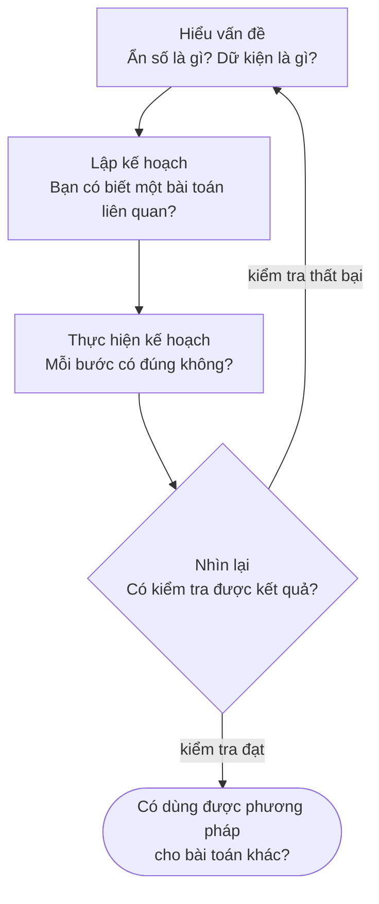
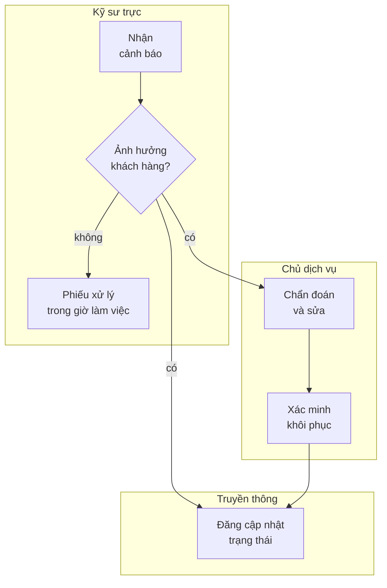
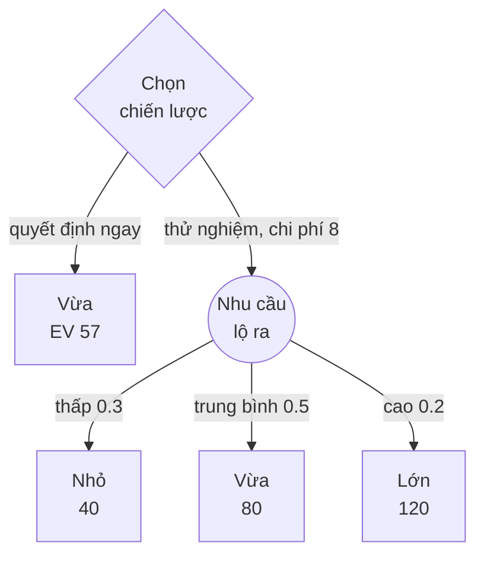

import Figure from '../../../components/Figure.astro';
import CtStratSwot from '../../../components/diagrams/CtStratSwot.astro';
import CtStratSensitivity from '../../../components/diagrams/CtStratSensitivity.astro';

[Bài trước](/vi/blog/reasoning-about-values) đã hỏi làm thế nào để lập luận về điều ta nên mong muốn và điều ta không được làm để đạt nó. Bài này coi mục tiêu và ràng buộc là đã cho và hỏi làm thế nào để theo đuổi chúng cho tốt. Trong bài này, **tư duy chiến lược** (strategic thinking) có nghĩa là tiến tới một mục tiêu bằng phương pháp có chủ đích: phát biểu vấn đề một cách chính xác, khảo sát tình huống và so sánh các phương án trước khi cam kết với một phương án, thay vì phản ứng với từng tình huống khi nó xảy đến. Nó dựa vào gần như mọi thứ đã có trong loạt bài: định nghĩa rõ ràng từ [bài thứ hai](/vi/blog/meaning-clarity-and-definitions), lập luận nhân quả từ [bài thứ tám](/vi/blog/scientific-reasoning-and-causation), và xác suất cùng giá trị kỳ vọng từ [bài thứ chín](/vi/blog/probability-and-statistical-reasoning).

Bài theo dõi một quyết định từ đầu đến cuối. Mục 1 trình bày cách xác định một vấn đề và phân loại những câu hỏi nằm trong nó. Mục 2 giới thiệu một chu trình giải quyết vấn đề tổng quát cùng việc dùng phép phân rã và lưu đồ. Mục 3 giới thiệu hai công cụ phân tích tình huống: phân tích điểm mạnh, điểm yếu, cơ hội và thách thức (SWOT) và khung 7-S. Mục 4 hỏi điều gì làm nên một quyết định tốt, và các Mục 5 đến 7 xây dựng dần các phương pháp lựa chọn: tiêu chí có trọng số, các quy tắc ra quyết định trong điều kiện bất định, và giá trị kỳ vọng cùng phân tích độ nhạy và cây quyết định. Mọi con số đều mang tính minh họa và được tính bằng Python 3; tiền được tính theo đơn vị nghìn đô la.

## 1. Xác định và phân loại vấn đề

### 1.1 Từ một lời phàn nàn đến một phát biểu vấn đề

Vấn đề thường đến dưới dạng lời phàn nàn. Giả sử các lập trình viên trong một nhóm nói: "đường ống tích hợp liên tục (continuous integration, CI) quá chậm." Một lời phàn nàn gọi tên một triệu chứng và thường kèm một biện pháp được ưa chuộng, ở đây là máy build nhanh hơn. Biến nó thành một phát biểu vấn đề (problem statement) có nghĩa là hỏi những người phàn nàn muốn kết quả gì, muốn đến mức nào, và làm sao biết được điều đó đã đạt.

Một kỹ thuật là phát biểu lại lời phàn nàn ở nhiều tầng của chuỗi phương tiện – mục đích trong [bài thứ mười](/vi/blog/reasoning-about-values) (Mục 2.1). Mỗi tầng mở ra một tập giải pháp khác:

| Phát biểu | Các giải pháp mà nó gợi ý |
|---|---|
| Đường ống chạy quá lâu | Máy nhanh hơn, nhiều tác vụ song song hơn, bộ nhớ đệm (cache) |
| Lập trình viên chờ phản hồi quá lâu | Chạy các kiểm thử nhanh nhất trước, chỉ kiểm thử phần mà thay đổi chạm tới, kiểm tra cục bộ trước khi push |
| Thay đổi mất quá lâu để vào nhánh chính | Hàng đợi duyệt mã và quy tắc merge, không chỉ đường ống |
| Bản sửa lỗi đến tay người dùng quá chậm | Quy trình phát hành và tần suất triển khai |

Đi lên trong chuỗi làm rộng phạm vi tìm kiếm; đi xuống làm cho mục tiêu đo được. Một phát biểu dùng được thường nằm cao hơn lời phàn nàn ban đầu một hoặc hai tầng và mang theo một con số: "90% số lần push nhận được kết quả kiểm thử trong vòng 10 phút." Con số làm hai việc. Nó cho biết khi nào dừng, và nó làm cho lời phàn nàn có thể đối chiếu với chính nhật ký của đường ống. Nếu nhật ký tháng trước cho thấy 85% số lần push đã đạt mục tiêu, thì vấn đề là một phần đuôi gồm những lần chạy chậm, đòi hỏi một cuộc điều tra khác với trường hợp đường ống chậm trên mọi mặt.

### 1.2 Phân loại các câu hỏi bên trong một vấn đề

Khi đã được phát biểu, vấn đề CI tách thành các câu hỏi, và chúng không cùng một loại. Đây là ba câu hỏi mà một nhóm có thể nêu ra trong buổi họp đầu tiên:

1. Lưu đệm các gói phụ thuộc đã tải về có rút ngắn thời gian chạy đường ống không?
2. Một kiểm thử thất bại chập chờn có được tính là "thất bại" theo chính sách phát hành của chúng ta không?
3. Có nên chấp nhận một đường ống chậm hơn để đổi lấy độ phủ kiểm thử rộng hơn không?

Câu thứ nhất là một **câu hỏi thực nghiệm** (empirical question): nó liên quan đến điều xảy ra trong thế giới và được trả lời bằng đo đạc, với sự cẩn trọng về nguyên nhân và mẫu của bài thứ tám và bài thứ chín. Câu thứ hai là một **câu hỏi khái niệm** (conceptual question): nó liên quan đến ý nghĩa của một thuật ngữ trong chính sách và được trả lời bằng cách đọc, và nếu cần thì sửa đổi, một định nghĩa, như trong [bài thứ hai](/vi/blog/meaning-clarity-and-definitions). Câu thứ ba là một **câu hỏi đánh giá** (evaluative question): nó hỏi điều gì đáng làm và cần đến các phương pháp của bài thứ mười, cùng với câu trả lời cho các câu hỏi thực nghiệm về chi phí và lợi ích của mỗi phương án.

Phân loại câu hỏi theo cách này phá vỡ một kiểu bế tắc quen thuộc. Hai kỹ sư tranh luận về việc các kiểm thử chập chờn có nên chặn bản phát hành hay không, và một người đề xuất giải quyết bằng cách đo xem các kiểm thử chập chờn bắt được lỗi thật thường xuyên đến đâu. Phép đo đáng thực hiện, nhưng nó không thể kết thúc cuộc tranh luận chừng nào hai người còn bất đồng về câu hỏi 2: một người coi thất bại chập chờn là thất bại, người kia coi nó là nhiễu. Khi nhóm đã thống nhất một định nghĩa (chẳng hạn "một kiểm thử thất bại trong hai lần chạy lại liên tiếp"), phần còn lại một phần là thực nghiệm (những thất bại như vậy bắt được bao nhiêu lỗi thật) và một phần là đánh giá (điều đó đáng với bao nhiêu sự chậm trễ), và mỗi phần có thể được giao cho phương pháp phù hợp với nó.

## 2. Giải quyết vấn đề

### 2.1 Bốn giai đoạn của Pólya

Pólya viết *How to Solve It* cho sinh viên toán học, nhưng bốn giai đoạn của nó (hiểu vấn đề, lập kế hoạch, thực hiện kế hoạch và nhìn lại) cùng những câu hỏi ông gắn với mỗi giai đoạn chuyển sang kỹ thuật mà gần như không cần thay đổi. Các câu hỏi trong ngoặc kép dưới đây là của Pólya; phần bình luận áp dụng chúng cho vấn đề CI.

- **Hiểu vấn đề.** "Ẩn số là gì? Dữ kiện là gì? Điều kiện là gì?" Với vấn đề CI, ẩn số là một thay đổi đối với đường ống hoặc quy trình, dữ kiện là nhật ký thời gian chạy, và điều kiện là mục tiêu ở Mục 1.1.
- **Lập kế hoạch.** "Bạn có biết một bài toán nào liên quan không?" và "Bạn có thể giải một phần của bài toán không?" Đường ống chậm là chuyện phổ biến, và các biện pháp của những nhóm khác chính là các bài toán liên quan. Giải một phần có thể nghĩa là sửa giai đoạn chậm nhất trước rồi đo mức cải thiện.
- **Thực hiện kế hoạch.** "Bạn có thấy rõ bước đó là đúng không?" Mỗi thay đổi nên được đo riêng, để một cải thiện có thể được quy cho đúng thay đổi đã tạo ra nó.
- **Nhìn lại.** "Bạn có thể kiểm tra kết quả không?" và "Bạn có thể dùng kết quả, hoặc phương pháp, cho một bài toán nào khác không?" Pólya nhấn mạnh rằng giai đoạn này củng cố những gì đã học được. Trong kỹ thuật, nó mang hình thức một bản rà soát bằng văn bản sau một dự án hay một sự cố, biến giải pháp của một nhóm thành một bài toán liên quan mà nhóm tiếp theo có thể bắt đầu từ đó.

### 2.2 Phân rã

Một vấn đề quá lớn để nắm bắt trọn vẹn thường có thể được tách thành các phần có thể đo và cải thiện lần lượt từng phần. Đường ống CI tự nhiên tách thành các giai đoạn. Giả sử nhật ký cho các thời gian trung vị sau: checkout 1 phút, cài đặt gói phụ thuộc 4, build 6, sau đó hai phân đoạn kiểm thử chạy song song (9 và 5 phút), rồi đóng gói 1. Đường ống mất $1 + 4 + 6 + \max(9, 5) + 1 = 21$ phút.

Phép phân rã (decomposition) làm được nhiều hơn việc liệt kê các phần; nó cho thấy các phần kết hợp với nhau ra sao, và điều đó cho nhóm biết nỗ lực bỏ vào đâu thì có lợi. Giảm một nửa thời gian của phân đoạn kiểm thử ngắn hơn không tiết kiệm được gì, vì phân đoạn dài hơn vẫn quyết định nhịp độ. Giảm một nửa phân đoạn dài hơn tiết kiệm 4 phút chứ không phải 4.5, vì khi đó phân đoạn ngắn hơn trở thành phân đoạn chậm hơn với 5 phút. Lưu đệm các gói phụ thuộc để thời gian cài đặt giảm từ 4 phút xuống nửa phút tiết kiệm trọn 3.5 phút. Cùng một phép tính, các giai đoạn nối tiếp thì cộng lại và các giai đoạn song song thì lấy giá trị lớn nhất, áp dụng cho mọi đường ống, dây chuyền sản xuất hay quy trình phê duyệt.

Phép phân rã hiệu quả khi các phần tương tác qua ít giao diện và các giao diện ấy được xác định rõ. Nếu việc tăng tốc bước build làm các kiểm thử chậm đi (chẳng hạn vì một bộ nhớ đệm mà chúng dùng chung bị đẩy ra), các giai đoạn không còn có thể được cải thiện lần lượt từng cái nữa, và đường ống phải được nghiên cứu như một tổng thể.

### 2.3 Lưu đồ và lưu đồ làn bơi

Một **lưu đồ** (flowchart) biểu diễn một thủ tục dưới dạng đồ thị có hướng: hình chữ nhật cho hành động, hình thoi cho quyết định, hình đầu cuối bo tròn cho điểm bắt đầu và kết thúc, và mũi tên cho thứ tự chuyển quyền điều khiển. ISO 5807 chuẩn hóa các ký hiệu này cho lưu đồ dữ liệu, lưu đồ chương trình và lưu đồ hệ thống, và các lưu đồ trong loạt bài này tuân theo cùng các quy ước đó.

Khi nhiều người hoặc nhiều nhóm cùng thực hiện một thủ tục, bản thân đồ thị che mất sự kiện quan trọng nhất: ai thực hiện mỗi bước. Một **lưu đồ làn bơi** (swimlane flowchart, còn gọi là deployment flowchart) bổ sung điều đó bằng cách vẽ một dải cho mỗi vai trò và đặt mỗi bước vào dải của vai trò thực hiện nó. Lưu đồ dưới đây mô tả cách một nhóm xử lý một cảnh báo từ hệ thống giám sát của mình.

Mỗi mũi tên đi từ dải này sang dải khác là một lần bàn giao, và bàn giao là nơi các sự cố hay trục trặc: một thông điệp không được nhận, hoặc mỗi bên đều tin rằng bên kia đang hành động. Đọc lưu đồ theo từng dải làm nảy ra những câu hỏi mà thủ tục phải trả lời. Ai gọi chủ dịch vụ, và chuyện gì xảy ra nếu chủ dịch vụ không phản hồi? Ai quyết định rằng việc khôi phục đã hoàn tất trước khi cập nhật trạng thái được đăng? Không có gì tiếp theo sau bản cập nhật cuối cùng, vậy bản rà soát bằng văn bản ở Mục 2.1 bắt đầu từ đâu? Một mũi tên bị thiếu trong lưu đồ làn bơi thường đánh dấu một trách nhiệm bị thiếu.

## 3. Phân tích tình huống

### 3.1 Phân tích SWOT

Một phân tích SWOT (SWOT analysis) liệt kê các **điểm mạnh** (strengths), **điểm yếu** (weaknesses), **cơ hội** (opportunities) và **thách thức** (threats) của một tổ chức, sản phẩm, dự án hay cá nhân đối với một mục tiêu. Điểm mạnh và điểm yếu là yếu tố bên trong: đặc điểm của chính thực thể đó, mà nó có thể thay đổi. Cơ hội và thách thức là yếu tố bên ngoài: đặc điểm của môi trường xung quanh nó, mà nó phải ứng phó nhưng không kiểm soát được. Bốn danh sách được sắp xếp trong một lưới hai hàng hai cột.

<Figure caption="Lưới SWOT cho một công ty khởi nghiệp giả định gồm năm người, với mục tiêu bán robot kho hàng cho các công ty logistics cỡ vừa. Đọc theo một hàng để so sánh các yếu tố có lợi và có hại cùng loại; đọc theo một cột để thấy các yếu tố bên trong gặp các yếu tố bên ngoài ra sao.">
  <CtStratSwot />
</Figure>

Lưới chỉ là điểm khởi đầu của phân tích. Giá trị của nó đến từ việc ghép các ô với nhau. Một điểm mạnh gặp một cơ hội gợi ý một bước đi: phần mềm định vị dẫn đường tự phát triển và một nhà tích hợp hệ thống đang tìm đối tác gợi ý một lời đề nghị hợp tác. Một điểm yếu gặp một thách thức đánh dấu một rủi ro ưu tiên: khi một nhà cung cấp lớn đang bước vào phân khúc, việc phụ thuộc vào một kỹ sư firmware duy nhất là rủi ro cần được giảm trước mọi thứ khác. Có hai lỗi phổ biến. Lỗi thứ nhất là phân loại sai, chẳng hạn liệt kê "thị trường đang tăng trưởng" là một điểm mạnh; đó là một cơ hội, đối thủ cạnh tranh cũng có được. Lỗi thứ hai là coi lưới như một sản phẩm hoàn chỉnh: bốn danh sách không xếp hạng không nói gì về những yếu tố nào quan trọng nhất, và phân tích nên kết thúc bằng một danh sách ngắn các quyết định, chứ không phải một danh sách dài hơn các quan sát.

### 3.2 Khung 7-S

Waterman, Peters và Phillips đề xuất **khung 7-S** (7-S framework) trong một bài báo năm 1980 có nhan đề "Structure is not organization" (Cấu trúc không phải là tổ chức). Lập luận của họ, rút ra từ công việc tư vấn tại McKinsey, là việc vẽ lại các tuyến báo cáo hiếm khi thay đổi cách một tổ chức hoạt động, vì cấu trúc chỉ là một trong bảy yếu tố phụ thuộc lẫn nhau, và một thay đổi ở một yếu tố sẽ thất bại nếu các yếu tố khác kéo ngược lại. Các trình bày về sau, chẳng hạn cuốn sách của Peters và Waterman (1982), thường chia bảy yếu tố thành ba yếu tố "cứng", được ghi thành văn bản và dễ thay đổi trên giấy, và bốn yếu tố "mềm", nằm trong con người và thay đổi chậm.

Áp dụng khung này có nghĩa là hỏi, đối với một thay đổi dự kiến, mỗi yếu tố phải trông như thế nào sau đó và các yếu tố còn lại có khớp không. Bảng dưới làm việc này cho công ty khởi nghiệp ở Mục 3.1 nếu nó chọn mục tiêu xây dựng một hồ sơ an toàn (safety case) được chứng nhận.

| Yếu tố | Nội dung bao quát | Câu hỏi cho mục tiêu hồ sơ an toàn |
|---|---|---|
| Chiến lược (Strategy) | Con đường đã chọn để đạt mục tiêu | Năm nay việc chứng nhận có được ưu tiên trước các tính năng mới không? |
| Cấu trúc (Structure) | Tuyến báo cáo và phân chia công việc | Ai chịu trách nhiệm về an toàn, và họ có thể chặn một bản phát hành không? |
| Hệ thống (Systems) | Thủ tục và công cụ | Quy trình phát hành có bao gồm kiểm thử phần cứng và rà soát mối nguy không? |
| Giá trị chung (Shared values) | Những ưu tiên mà các thành viên thực sự giữ trong thực tế | Sự thận trọng được tôn trọng, hay bị coi là chậm chạp? |
| Phong cách (Style) | Cách lãnh đạo hành xử và ra quyết định | Các nhà sáng lập có ủng hộ một kỹ sư trì hoãn buổi demo vì một vấn đề an toàn không? |
| Nhân sự (Staff) | Ai được tuyển dụng và họ phát triển ra sao | Có ai được đào tạo về kỹ thuật an toàn không? |
| Kỹ năng (Skills) | Những gì tổ chức nói chung có thể làm được | Nhóm có tạo ra được những bằng chứng mà một người thẩm định sẽ đòi hỏi không? |

Một kế hoạch chỉ thay đổi các yếu tố cứng (một người phụ trách được chỉ định, một quy trình mới) và để nguyên phong cách cùng giá trị chung chính là kiểu thất bại mà bài báo gốc đã cảnh báo.

## 4. Điều gì làm nên một quyết định tốt

### 4.1 Đánh giá quyết định theo kết quả

Baron và Hershey đưa cho những người tham gia các mô tả về những quyết định được đưa ra trong điều kiện bất định, trong đó có các quyết định y khoa, và chỉ thay đổi kết cục của chúng. Người tham gia đánh giá cùng một quyết định, dựa trên cùng một thông tin, là tốt hơn khi nó có kết cục tốt. Xu hướng này là **thiên kiến kết quả** (outcome bias), và nó là một sai lầm mỗi khi may rủi có phần trong đó, vì người ra quyết định đã chọn một quy trình, chứ không chọn một kết quả.

Tách bạch hai điều này cần một định nghĩa. Hãy gọi một quyết định là tốt nếu nó đã dùng thông tin sẵn có một cách hợp lý, đã xét các phương án thực tế và đã so sánh chúng bằng một phương pháp đúng đắn. Theo định nghĩa đó, một lần triển khai chưa kiểm thử vào tối thứ Sáu tình cờ không gây sự cố nào vẫn là một quyết định tồi, còn một lần phát hành cẩn thận bị một sự cố hỏng ổ đĩa đánh trúng lại là một quyết định tốt. Các buổi rà soát sau sự cố hỏi "chúng ta đã biết gì, và đã làm gì với điều đó?" thay vì "ai đã gây ra sự cố?" cũng áp dụng đúng sự phân biệt này.

### 4.2 Trực giác, cảm xúc và cân nhắc

Kahneman và Klein xuất thân từ những truyền thống nghiên cứu có thái độ trái ngược nhau đối với trực giác: một bên liệt kê các sai lầm của nó, bên kia nghiên cứu những chuyên gia như lính cứu hỏa, những người quyết định nhanh và tốt. Hai ông đồng ý về hai điều kiện mà khi thỏa mãn thì phán đoán trực giác đáng tin. Môi trường phải đủ đều đặn để có thể dự đoán được, và người đó phải đã thực hành lâu dài trong môi trường ấy với phản hồi kịp thời. Cảm nhận của một kỹ sư trực, sau nhiều năm với cùng một hệ thống, rằng "mẫu cảnh báo này là nhiễu" có thể thỏa mãn cả hai điều kiện. Ấn tượng đầu tiên về một công nghệ mà chưa ai trong nhóm từng dùng không thỏa mãn điều kiện nào và nên được coi như một giả thuyết.

Cân nhắc không có nghĩa là gạt cảm xúc ra ngoài. Damasio mô tả những bệnh nhân bị tổn thương ở các vùng não thùy trán liên quan đến cảm xúc, vẫn có thể liệt kê và lập luận về các phương án trong một quyết định nhưng lại gặp khó khăn lớn khi đi đến quyết định trong đời sống hằng ngày; cách diễn giải của ông là các tín hiệu cảm xúc là một phần của cách các phương án được cân nhắc. Trong thực tế, sự miễn cưỡng của một nhóm khi áp dụng một công cụ là một dữ kiện đầu vào của quyết định, một chi phí mà không phép đo hiệu năng nào cho thấy. Các phương pháp ở những mục tiếp theo là những cách ghi các đầu vào như vậy ra giấy để có thể xem xét từng cái.

## 5. Ưu, nhược và tiêu chí có trọng số

### 5.1 Đại số thận trọng của Franklin

Các phương pháp có trọng số trong mục này có một tổ tiên là bức thư Benjamin Franklin viết cho Joseph Priestley năm 1772. Thủ tục của Franklin là "chia nửa tờ giấy bằng một đường kẻ thành hai cột", một cột cho các lý do ủng hộ một hướng hành động và một cột cho các lý do phản đối, rồi gạch bỏ các lý do có sức nặng ngang nhau ở hai cột (một đổi một, một đổi hai, hai đổi ba) cho đến khi thấy được cán cân. Ông gọi nó là "đại số đạo đức hay đại số thận trọng" (moral or prudential algebra).

Phép gạch bỏ là một phương trình trá hình. Gạch một lý do ủng hộ đổi lấy hai lý do phản đối là khẳng định rằng lý do thứ nhất nặng bằng hai lý do kia cộng lại, nên những gì còn sót lại sau khi gạch bỏ chính là dấu của một tổng có trọng số. Ma trận có trọng số dưới đây biến các trọng số thành những con số tường minh, so sánh nhiều phương án với nhau thay vì một phương án với việc không làm gì, và cho phép kiểm tra độ nhạy ở Mục 5.3, điều mà phương pháp của Franklin không diễn đạt được.

### 5.2 Ma trận quyết định có trọng số

Một **ma trận quyết định có trọng số** (weighted decision matrix) làm tường minh cách gán trọng số của Franklin và mở rộng nó cho nhiều hơn hai phương án. Mỗi tiêu chí nhận một trọng số (tổng các trọng số bằng 1), mỗi phương án nhận một điểm trên từng tiêu chí, và tổng điểm của phương án là tổng có trọng số của các điểm đó.

Một nhóm phải chọn một bo mạch vi điều khiển cho một nút cảm biến chạy pin. Nhóm chấm ba bo mạch ứng viên từ 1 (kém) đến 5 (xuất sắc) trên năm tiêu chí:

| Tiêu chí | Trọng số | Bo A | Bo B | Bo C |
|---|---:|---:|---:|---:|
| Giá thành đơn vị | 0.15 | 5 | 3 | 5 |
| Công suất tiêu thụ | 0.30 | 2 | 5 | 4 |
| Độ hoàn thiện của bộ công cụ | 0.20 | 4 | 3 | 2 |
| Mức quen thuộc với nhóm | 0.15 | 5 | 2 | 3 |
| Rủi ro nguồn cung | 0.20 | 3 | 4 | 4 |
| **Tổng không trọng số** | | 19 | 17 | 18 |
| **Tổng có trọng số** | | 3.50 | 3.65 | 3.60 |

Đếm điểm thì nghiêng về bo A; gán trọng số thì nghiêng về bo B, vì nút cảm biến chạy bằng pin và công suất tiêu thụ mang trọng số lớn nhất. Ma trận đã làm xong việc của nó: nó cho thấy quyết định xoay quanh việc công suất tiêu thụ quan trọng đến đâu so với mức quen thuộc.

### 5.3 Độ nhạy đối với trọng số

Các trọng số là phán đoán, nên kết quả cần được kiểm tra trước những thay đổi hợp lý của chúng. Chuyển một lượng trọng số $d$ từ công suất tiêu thụ sang mức quen thuộc với nhóm. Tổng của bo A tăng $(5-2)d = 3d$ và tổng của bo B giảm $(5-2)d = 3d$, nên khoảng cách 0.15 khép lại khi $6d = 0.15$, tức tại $d = 0.025$. Một sự dịch chuyển hai phẩy năm điểm phần trăm đảo ngược lựa chọn (đúng tại mức dịch chuyển đó, cả ba bo hòa nhau ở 3.575). Một kết quả mong manh như vậy không phải là một phát hiện; nó cho biết các bo mạch sát nhau trên các tiêu chí đã nêu và cần một yếu tố khác để quyết định, chẳng hạn một phép đo công suất tiêu thụ trên mẫu thử hoặc một tiêu chí chưa được liệt kê. Khi một thay đổi nhỏ của trọng số không làm đổi phương án thắng, ma trận ủng hộ quyết định; khi nó làm đổi, ma trận đã định vị được phán đoán cần được đưa ra một cách cẩn trọng.

## 6. Quyết định trong điều kiện bất định

### 6.1 Bảng lợi ích

**Lý thuyết quyết định** (decision theory) hình thức nghiên cứu các lựa chọn giữa những **hành động** (acts) loại trừ lẫn nhau, mà kết quả phụ thuộc vào **trạng thái** (state) nào của thế giới xảy ra, một trạng thái mà người ra quyết định không kiểm soát được. Công cụ cơ bản là **bảng lợi ích** (payoff table), cho biết kết quả của mỗi hành động ở mỗi trạng thái. Lý thuyết quyết định phân biệt **quyết định trong điều kiện bất định** (decisions under uncertainty), khi người ra quyết định không có xác suất cho các trạng thái, với **quyết định trong điều kiện rủi ro** (decisions under risk), khi có các xác suất đó.

Một nhóm ra mắt một dịch vụ trực tuyến mới phải chọn cam kết bao nhiêu năng lực máy chủ cho năm đầu: nhỏ, vừa hay lớn. Nhu cầu năm đầu có thể hóa ra thấp, trung bình hoặc cao. Bảng cho lợi nhuận ước tính trong mỗi trường hợp. Quá ít năng lực thì mất khách hàng khi nhu cầu cao; quá nhiều thì lãng phí tiền khi nhu cầu thấp.

| Hành động | Nhu cầu thấp | Nhu cầu trung bình | Nhu cầu cao |
|---|---:|---:|---:|
| Nhỏ | 40 | 50 | 30 |
| Vừa | 10 | 80 | 70 |
| Lớn | −30 | 60 | 120 |

Không hành động nào **trội hơn** (dominates) hành động khác, nghĩa là không hành động nào tốt ít nhất bằng ở mọi trạng thái và tốt hơn ở một số trạng thái. Nếu có, hành động bị trội có thể bị loại mà không cần suy nghĩ thêm. Vì không có, cần đến một quy tắc ra quyết định.

### 6.2 Các quy tắc không dùng xác suất

Bốn quy tắc kinh điển áp dụng khi không có xác suất.

- **Maximin** xét kết quả xấu nhất của mỗi hành động và chọn hành động có kết quả xấu nhất tốt nhất. Các kết quả xấu nhất là 30, 10 và −30, nên maximin chọn Nhỏ. Đây là quy tắc của một người ra quyết định thận trọng, hợp lý khi trường hợp xấu nhất sẽ là thảm họa.
- **Maximax** xét kết quả tốt nhất của mỗi hành động và chọn cái tốt nhất trong các kết quả tốt nhất: 50, 80 và 120, nên chọn Lớn. Đây là quy tắc của người lạc quan và bỏ qua mọi thứ có thể đi sai.
- **Minimax hối tiếc** (minimax regret) làm việc với **độ hối tiếc** (regret) của một hành động ở một trạng thái, tức hiệu giữa lợi ích tốt nhất có được ở trạng thái đó và lợi ích của hành động đã chọn: $r(a, s) = \max_{a'} v(a', s) - v(a, s)$, trong đó $v(a, s)$ là lợi ích của hành động $a$ ở trạng thái $s$. Quy tắc chọn hành động có độ hối tiếc lớn nhất là nhỏ nhất.
- **Quy tắc đồng khả năng** (equal-likelihood rule, còn gọi là quy tắc Laplace) coi mọi trạng thái là có xác suất như nhau và chọn hành động có lợi ích trung bình cao nhất: $40$, $53.3$ và $50$, nên chọn Vừa.

Giá trị lớn nhất của các cột là 40, 80 và 120, nên bảng độ hối tiếc là:

| Hành động | Nhu cầu thấp | Nhu cầu trung bình | Nhu cầu cao | Độ hối tiếc lớn nhất |
|---|---:|---:|---:|---:|
| Nhỏ | 0 | 30 | 90 | 90 |
| Vừa | 30 | 0 | 50 | 50 |
| Lớn | 70 | 20 | 0 | 70 |

Minimax hối tiếc chọn Vừa. Ba quy tắc chính cho ba câu trả lời khác nhau từ cùng một bảng, và không quy tắc nào "đúng" một cách độc lập với hoàn cảnh của người ra quyết định. Maximin phù hợp với một công ty không thể sống sót qua một khoản lỗ lớn; maximax gần như không phù hợp với ai; minimax hối tiếc phù hợp với người muốn giới hạn mức mà, khi nhìn lại, lựa chọn của mình có thể thua kém phương án tốt nhất. Bản thân việc chọn quy tắc là một quyết định về thái độ đối với rủi ro và nên được đưa ra một cách tường minh. Mỗi quy tắc cũng có một khiếm khuyết đã biết. Maximin và maximax chỉ nhìn một lợi ích cho mỗi hành động, xấu nhất hoặc tốt nhất, và bỏ qua phần còn lại của hàng. Minimax hối tiếc có thể đổi lựa chọn giữa hai hành động khi một hành động thứ ba, không liên quan, được thêm vào bảng, vì hành động mới có thể làm thay đổi giá trị lớn nhất của các cột.

## 7. Quyết định trong điều kiện rủi ro

### 7.1 Giá trị kỳ vọng

Khi có thể gán xác suất cho các trạng thái, quy tắc chuẩn là chọn hành động có **giá trị kỳ vọng** (expected value) cao nhất (đã được giới thiệu trong [bài thứ chín](/vi/blog/probability-and-statistical-reasoning)):

$$
\mathrm{EV}(a) = \sum_{i} p_i \, v(a, s_i),
$$

trong đó $p_i$ là xác suất của trạng thái $s_i$. Giả sử nghiên cứu thị trường cho các xác suất 0.3, 0.5 và 0.2 đối với nhu cầu thấp, trung bình và cao. Khi đó:

| Hành động | Phép tính | Giá trị kỳ vọng |
|---|---|---:|
| Nhỏ | $0.3 \times 40 + 0.5 \times 50 + 0.2 \times 30$ | 43 |
| Vừa | $0.3 \times 10 + 0.5 \times 80 + 0.2 \times 70$ | 57 |
| Lớn | $0.3 \times (-30) + 0.5 \times 60 + 0.2 \times 120$ | 45 |

Vừa có giá trị kỳ vọng cao nhất. Giá trị kỳ vọng không phải là một lợi ích sẽ xảy ra (không trạng thái nào cho 57); nó là lợi ích trung bình cho mỗi quyết định nếu có rất nhiều quyết định tương tự được đưa ra với cùng các xác suất.

### 7.2 Độ nhạy đối với xác suất

Xác suất từ nghiên cứu thị trường là các ước lượng, và quyết định nên được kiểm tra trước chúng như các trọng số đã được kiểm tra ở Mục 5.3. Giữ xác suất nhu cầu thấp ở 0.3 và gọi xác suất nhu cầu cao là $q$, sao cho nhu cầu trung bình có xác suất $0.7 - q$. Các giá trị kỳ vọng trở thành những đường thẳng theo $q$:

$$
\mathrm{EV}_\text{Small} = 47 - 20q, \qquad \mathrm{EV}_\text{Medium} = 59 - 10q, \qquad \mathrm{EV}_\text{Large} = 33 + 60q.
$$

(Các chỉ số Small, Medium, Large lần lượt ứng với Nhỏ, Vừa, Lớn.) Lớn vượt Vừa khi $33 + 60q > 59 - 10q$, tức khi $q > 26/70 \approx 0.37$.

<Figure caption="Lợi ích kỳ vọng của mỗi hành động khi xác suất nhu cầu cao q thay đổi, với xác suất nhu cầu thấp cố định ở 0.3 (Small, Medium, Large là Nhỏ, Vừa, Lớn). Vừa tốt nhất ở bên trái q ≈ 0.37 và Lớn tốt nhất ở bên phải; Nhỏ không bao giờ tốt nhất trên khoảng này. Ước lượng của nhóm, 0.2, nằm sâu bên trong vùng của Vừa.">
  <CtStratSensitivity />
</Figure>

Hình vẽ biến một con số đơn lẻ thành một nhận định mà nhóm có thể hành động theo: lựa chọn Vừa là an toàn trừ khi xác suất nhu cầu cao gần gấp đôi ước lượng. Nếu nhóm có lý do để nghĩ rằng điều đó có thể xảy ra, thì nên tìm thông tin tốt hơn về nhu cầu trước khi cam kết.

### 7.3 Cây quyết định và giá trị của thông tin

Thông tin tốt hơn đáng giá bao nhiêu? Giả sử một đợt ra mắt thử nghiệm tốn 8 sẽ cho biết mức nhu cầu trước khi đưa ra quyết định về năng lực. Có đợt thử nghiệm, nhóm sẽ chọn hành động tốt nhất ở mỗi trạng thái (Nhỏ nếu nhu cầu thấp, Vừa nếu trung bình, Lớn nếu cao), nên lợi ích kỳ vọng sẽ là $0.3 \times 40 + 0.5 \times 80 + 0.2 \times 120 = 76$, trừ đi chi phí thử nghiệm. Một **cây quyết định** (decision tree) đặt hai chiến lược cạnh nhau, với quyết định được vẽ bằng hình thoi (cây quyết định theo quy ước dùng hình vuông) và biến cố ngẫu nhiên bằng hình tròn:

Cây được đánh giá từ các lá ngược về gốc: nút ngẫu nhiên có giá trị $76$, nhánh thử nghiệm $76 - 8 = 68$, và nhánh quyết định ngay 57, nên chạy thử nghiệm là tốt hơn. Hiệu $76 - 57 = 19$ là **giá trị kỳ vọng của thông tin hoàn hảo** (expected value of perfect information, EVPI), mức tối đa đáng trả cho thông tin loại bỏ mọi bất định về trạng thái. Bất kỳ đợt thử nghiệm nào tốn hơn 19 đều không đáng chạy, dù nó cung cấp nhiều thông tin đến đâu. EVPI cũng bằng độ hối tiếc kỳ vọng của hành động tốt nhất, ở đây là $0.3 \times 30 + 0.5 \times 0 + 0.2 \times 50 = 19$. Các đợt thử nghiệm thực tế cho thông tin không hoàn hảo, và định giá chúng cần đến phép cập nhật Bayes của [bài thứ chín](/vi/blog/probability-and-statistical-reasoning); EVPI là cận trên cho giá trị của mọi thông tin như vậy.

### 7.4 Giới hạn của giá trị kỳ vọng

Giá trị kỳ vọng là tiêu chí đúng trong những điều kiện dễ bị quên.

- **Thái độ đối với rủi ro.** Tối đa hóa số tiền kỳ vọng bỏ qua việc một khoản lỗ 30 có thể quan trọng hơn một khoản lãi 30, chẳng hạn khi nó sẽ làm cạn tiền mặt của một công ty nhỏ. Von Neumann và Morgenstern đã chỉ ra rằng một người ra quyết định có sở thích thỏa mãn một số tiên đề nhất quán nhất định sẽ hành động như thể đang tối đa hóa giá trị kỳ vọng của một **hàm hữu dụng** (utility function), hàm này có thể lõm để biểu thị sự ngại rủi ro (risk aversion). Thay lợi ích bằng độ hữu dụng giữ nguyên phương pháp và thay đổi các con số.
- **Tính độc lập giữa hành động và trạng thái.** Phân tích giả định rằng xác suất của các trạng thái không phụ thuộc vào hành động. Giả định đó có thể sai: chọn năng lực Nhỏ có thể gây ra các sự cố gián đoạn khiến khách hàng bỏ đi, làm nhu cầu thấp trở nên dễ xảy ra hơn. Khi hành động ảnh hưởng đến trạng thái, các xác suất phải là xác suất có điều kiện theo hành động.
- **Quyết định một lần.** Cách hiểu dài hạn về giá trị kỳ vọng yếu nhất đối với những quyết định chỉ đưa ra một lần, với mức đặt cược lớn. Một khả năng nhỏ xảy ra thảm họa đáng được chú ý hơn nhiều so với phần đóng góp của nó vào một giá trị trung bình.
- **Bản thân cái bảng.** Mọi con số trong bảng đều là ước lượng, và lỗi nguy hiểm nhất là một trạng thái chưa bao giờ được liệt kê. Các phân tích độ nhạy ở Mục 5.3 và 7.2 kiểm tra những con số đã có trong bảng; chỉ việc xác định vấn đề cẩn thận (Mục 1) và một phân tích SWOT trung thực (Mục 3.1) mới giúp được với những con số bị thiếu.

## 8. Bài tập

**Bài tập 1.** Phân loại mỗi câu hỏi là thực nghiệm, khái niệm hay đánh giá. (a) Bật nén dữ liệu có làm giảm thời gian phản hồi trung vị của API không? (b) Theo thỏa thuận mức dịch vụ (service-level agreement) của chúng ta, một lần gián đoạn 5 phút trong khung giờ bảo trì có được tính là thời gian ngừng hoạt động không? (c) Có nên gọi kỹ sư dậy ban đêm vì những cảnh báo không ảnh hưởng đến khách hàng không?

*Đáp án.* (a) Thực nghiệm; hãy đo. (b) Khái niệm; nó phụ thuộc vào cách thỏa thuận định nghĩa thời gian ngừng hoạt động và khung giờ bảo trì. (c) Đánh giá, có kèm các phần thực nghiệm: những cảnh báo như vậy xảy ra thường xuyên đến đâu và chúng gây tổn thất bao nhiêu về giấc ngủ và về các vấn đề bị bỏ sót.

**Bài tập 2.** Một kỹ sư nhà máy phải quyết định làm gì với một máy bơm đã cũ trong năm tới. Các chi phí (lợi ích âm) là:

| Hành động | Máy bơm chạy hết năm | Máy bơm hỏng |
|---|---:|---:|
| Đại tu ngay | −12 | −30 |
| Thay ngay | −25 | −25 |
| Để chạy như hiện tại | 0 | −60 |

Mỗi quy tắc maximin, maximax và minimax hối tiếc chọn hành động nào? Hành động nào có giá trị kỳ vọng cao nhất nếu xác suất hỏng là 0.4, và giá trị kỳ vọng của thông tin hoàn hảo là bao nhiêu?

*Đáp án.* Maximin: các kết quả xấu nhất là −30, −25 và −60, nên chọn Thay. Maximax: các kết quả tốt nhất là −12, −25 và 0, nên chọn Để chạy như hiện tại. Độ hối tiếc (giá trị lớn nhất của các cột là 0 và −25): Đại tu 12 và 5, Thay 25 và 0, Để chạy như hiện tại 0 và 35; độ hối tiếc lớn nhất là 12, 25 và 35, nên chọn Đại tu. Giá trị kỳ vọng: Đại tu $0.6 \times (-12) + 0.4 \times (-30) = -19.2$, Thay $-25$, Để chạy như hiện tại $0.4 \times (-60) = -24$, nên chọn Đại tu. Với thông tin hoàn hảo, kỹ sư sẽ để máy bơm chạy nếu nó sẽ chạy hết năm và thay nó nếu nó sẽ hỏng: $0.6 \times 0 + 0.4 \times (-25) = -10$. EVPI là $-10 - (-19.2) = 9.2$.

**Bài tập 3.** Trong bài toán máy bơm, với những xác suất hỏng $q$ nào thì để máy bơm chạy như hiện tại tốt hơn đại tu nó xét theo giá trị kỳ vọng?

*Đáp án.* Để chạy như hiện tại: $-60q$. Đại tu: $-12(1-q) - 30q = -12 - 18q$. Để chạy tốt hơn khi $-60q > -12 - 18q$, tức $q < 12/42 \approx 0.29$.

**Bài tập 4.** Trong ma trận chọn bo mạch ở Mục 5.2, chuyển 0.10 trọng số từ độ hoàn thiện của bộ công cụ sang rủi ro nguồn cung. Bo nào thắng, và kết quả gợi ý điều gì?

*Đáp án.* Các trọng số trở thành 0.15, 0.30, 0.10, 0.15 và 0.30. Tổng điểm: A $3.40$, B $3.75$, C $3.80$, nên C thắng. Cùng với Mục 5.3, kết quả cho thấy mỗi bo trong ba bo đều thắng dưới một cách gán trọng số hợp lý nào đó; quyết định nên dựa vào dữ liệu tốt hơn (công suất tiêu thụ đo được, thời gian chờ cung ứng thực tế) hơn là vào ma trận.

**Bài tập 5.** Một phân tích SWOT cho một đội robot của trường đại học liệt kê "luật thi đấu thay đổi vào năm sau", "lập trình viên giỏi nhất của chúng ta tốt nghiệp vào tháng Sáu" và "chúng ta có một xưởng được trang bị tốt". Đặt mỗi mục vào lưới.

*Đáp án.* Thay đổi luật là yếu tố bên ngoài, nên nó là cơ hội hay thách thức tùy theo việc nó có lợi cho thiết kế của đội hay không; xác định là loại nào cần phân tích, không phải giả định. Lập trình viên sắp tốt nghiệp là một điểm yếu bên trong cho năm tới (đội có thể chuẩn bị bằng cách đào tạo người khác). Xưởng là một điểm mạnh bên trong.

**Bài tập 6.** Trong bài toán năng lực máy chủ, giả sử nghiên cứu thị trường thay vào đó cho các xác suất 0.5, 0.3 và 0.2 đối với nhu cầu thấp, trung bình và cao. Hành động nào có giá trị kỳ vọng cao nhất, và nhóm nên trả tối đa bao nhiêu cho một đợt thử nghiệm cho biết chính xác nhu cầu?

*Đáp án.* Giá trị kỳ vọng: Nhỏ $20 + 15 + 6 = 41$, Vừa $5 + 24 + 14 = 43$, Lớn $-15 + 18 + 24 = 27$, nên chọn Vừa, với cách biệt nhỏ. Với thông tin hoàn hảo: $0.5 \times 40 + 0.3 \times 80 + 0.2 \times 120 = 68$. EVPI là $68 - 43 = 25$, nên đợt thử nghiệm đáng giá tới 25: nhiều hơn trước, vì giờ đây quyết định sát nút hơn.

## 9. Tóm tắt

| Chủ đề | Điểm chính |
|---|---|
| Xác định vấn đề | Phát biểu lại lời phàn nàn ở nhiều tầng của chuỗi phương tiện – mục đích và gắn với một mục tiêu đo được. |
| Các loại câu hỏi | Phân loại các câu hỏi của một vấn đề thành thực nghiệm, khái niệm và đánh giá, rồi giao mỗi câu cho phương pháp có thể trả lời nó. |
| Các giai đoạn của Pólya | Hiểu vấn đề, lập kế hoạch, thực hiện kế hoạch, nhìn lại, mỗi giai đoạn có các câu hỏi dẫn dắt riêng. |
| SWOT và 7-S | SWOT tách yếu tố bên trong khỏi yếu tố bên ngoài và phát huy giá trị khi các ô được ghép với nhau; 7-S kiểm tra xem chiến lược, cấu trúc, hệ thống, giá trị chung, phong cách, nhân sự và kỹ năng có khớp với nhau không. |
| Quyết định tốt | Đánh giá quy trình, không đánh giá kết quả; chỉ tin trực giác ở nơi môi trường đều đặn và phản hồi nhanh. |
| Tiêu chí có trọng số | Cân sức nặng các lý do thay vì đếm chúng, rồi kiểm tra xem những thay đổi nhỏ của trọng số có làm đổi phương án thắng không. |
| Bất định | Maximin, maximax, minimax hối tiếc và đồng khả năng có thể bất đồng; việc chọn quy tắc thể hiện một thái độ đối với rủi ro. |
| Rủi ro | Chọn giá trị kỳ vọng cao nhất, kiểm tra nó trước các xác suất, và dùng EVPI để chặn trên giá trị của thông tin. |

Mọi phương pháp trong bài này đều phụ thuộc vào những phán đoán do con người đưa ra dưới áp lực, và những phán đoán ấy thất bại theo những cách dễ nhận ra: kết quả bị nhầm với quyết định, những trường hợp sống động lấn át tỉ lệ nền (base rate), và cách đóng khung vấn đề đầu tiên không bị chất vấn. [Bài tiếp theo](/vi/blog/fallacies-and-cognitive-biases) tập hợp những thất bại này, các ngụy biện (fallacy) trong lập luận và các thiên kiến (bias) trong phán đoán mà các bài trước đã gặp lần lượt từng cái một.

### Tài liệu tham khảo

- J. Baron and J. C. Hershey, "Outcome bias in decision evaluation," *Journal of Personality and Social Psychology*, vol. 54, no. 4, pp. 569–579, 1988.
- A. R. Damasio, *Descartes' Error: Emotion, Reason, and the Human Brain*, Putnam, 1994.
- B. Franklin, "Letter to Joseph Priestley," London, 19 September 1772.
- ISO 5807:1985, *Information processing – Documentation symbols and conventions for data, program and system flowcharts, program network charts and system resources charts*, International Organization for Standardization, 1985.
- D. Kahneman and G. Klein, "Conditions for intuitive expertise: A failure to disagree," *American Psychologist*, vol. 64, no. 6, pp. 515–526, 2009.
- J. Y. F. Lau, *An Introduction to Critical Thinking and Creativity: Think More, Think Better*, Wiley, 2011.
- J. Y. F. Lau and J. Chan, *Critical Thinking Web*, Department of Philosophy, The University of Hong Kong, 2004–2026. https://philosophy.hku.hk/think/
- M. Peterson, *An Introduction to Decision Theory*, Cambridge University Press, 2009.
- T. J. Peters and R. H. Waterman, *In Search of Excellence: Lessons from America's Best-Run Companies*, Harper & Row, 1982.
- G. Pólya, *How to Solve It*, Princeton University Press, 1945.
- J. von Neumann and O. Morgenstern, *Theory of Games and Economic Behavior*, Princeton University Press, 1944.
- R. H. Waterman, T. J. Peters and J. R. Phillips, "Structure is not organization," *Business Horizons*, vol. 23, no. 3, pp. 14–26, 1980.
