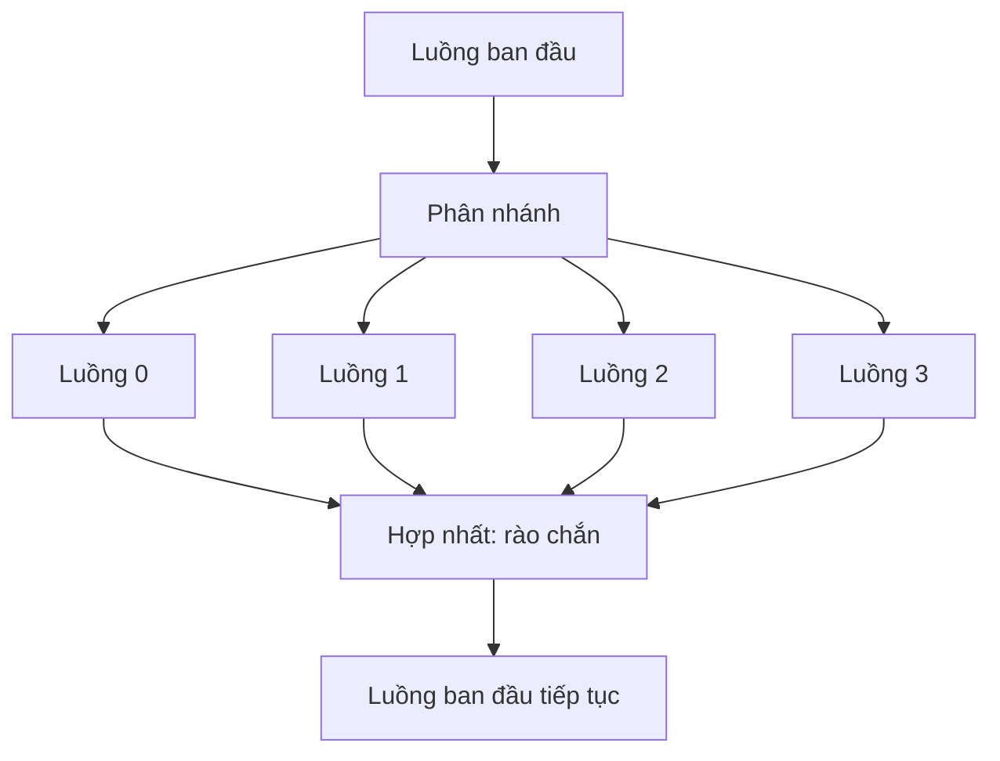

[Bài thứ nhất](/vi/blog/performance-models-and-scaling-laws) đã định nghĩa các thước đo mà bài này dùng để đánh giá mọi kết quả: hệ số tăng tốc (speedup) $S(p) = T_1/T_p$ và hiệu suất song song (efficiency) $E(p) = S(p)/p$. Bài đó cũng đã suy ra cận của định luật Amdahl (mục 2) cùng khối lượng công việc (work) và độ dài đường găng (span) của một phép tính (mục 4). [Bài thứ hai](/vi/blog/memory-hierarchy-and-locality) đã chỉ ra rằng bộ nhớ được di chuyển theo từng dòng cache (cache line) 64 byte (mục 2) và rằng băng thông của bộ nhớ chính (mục 6) thường giới hạn một vòng lặp trước cả khi phần số học của nó làm vậy. Ngoài một vài phép đo tốc độ số học đỉnh và băng thông trên bốn lõi, cả hai bài đều chỉ xét một lõi (core) của bộ xử lý. Bài này đưa nhiều lõi cùng giải một bài toán, thông qua các luồng (thread) dùng chung một bộ nhớ.

Bộ nhớ dùng chung (shared memory) khiến mã song song dễ bắt đầu và cũng dễ viết sai. Một chỉ thị duy nhất có thể làm một vòng lặp chạy nhanh gần gấp bốn trên bốn lõi, và cũng chỉ thị đó trên một vòng lặp hơi khác có thể cho kết quả sai hoặc một chương trình chậm hơn mà không có bất kỳ cảnh báo nào. Bài này trước hết cho thấy các luồng và các vòng lặp OpenMP hoạt động đúng như dự định, rồi đo từng cách mà chúng thất bại: tranh chấp dữ liệu (data race), các lệnh ghi trở nên nhìn thấy được theo sai thứ tự, chi phí của đồng bộ hóa và chia sẻ giả (false sharing), và công việc được chia không đều giữa các luồng.

**Quy ước.** Mã viết bằng C11, biên dịch bằng GNU Compiler Collection (GCC) 13.3 với `-std=c11 -O2 -fopenmp`, cộng thêm `-fno-tree-vectorize` ở những chỗ được nêu rõ. OpenMP là giao diện lập trình bộ nhớ dùng chung dựa trên chỉ thị, do OpenMP Architecture Review Board (ARB) duy trì; bài này dẫn phiên bản 5.2 của đặc tả (tháng 11 năm 2021), phiên bản được dùng trong toàn bộ loạt bài; một phiên bản sau, 6.0, ra đời vào tháng 11 năm 2024. GCC 13 báo `_OPENMP` là `201511`, tương ứng với phiên bản 4.5, và mọi cấu trúc dùng ở đây đều có trong 4.5 với đúng ý nghĩa được nêu trong 5.2. Hai chương trình dùng các kiểu nguyên tử của C11 cùng với luồng của Portable Operating System Interface (POSIX). Một mô hình ngắn được viết bằng Python 3.13.

Mọi phép đo đều lấy từ máy tham chiếu của loạt bài, một máy ảo chạy dưới Linux Kernel-based Virtual Machine (KVM). Máy có bốn lõi của một bộ xử lý Intel Xeon được báo ở 2.1 GHz, mỗi lõi một luồng phần cứng, và 16 GiB bộ nhớ. Mỗi lõi có bộ nhớ đệm (cache) dữ liệu cấp 1 (L1) 48 KiB và bộ nhớ đệm cấp 2 (L2) 2 MiB, và các lõi dùng chung một bộ nhớ đệm cấp 3 (L3) mà `lscpu` báo là 260 MiB. Các luồng được gắn vào lõi bằng `OMP_PROC_BIND=close OMP_PLACES=cores`. Mỗi thời gian là trung vị của năm hoặc bảy lần lặp lại. Máy được dùng chung với các công việc khác, nên thời gian đo có nhiễu: chênh lệch 10% giữa hai lần chạy là bình thường, và vì lý do đó một số lần chạy cho hệ số tăng tốc hơi lớn hơn $p$. Các thời gian chỉ mô tả máy này. Tốc độ số học được tính theo đơn vị $10^9$ phép toán dấu phẩy động (floating-point operation, FLOP) mỗi giây, viết là GFLOP/s, và băng thông theo gigabyte mỗi giây (GB/s), đơn vị $10^9$ byte mỗi giây.

## 1. Luồng và bộ nhớ dùng chung

### 1.1 Tiến trình và luồng

Một **tiến trình** (process) là một chương trình đang chạy cùng với các tài nguyên mà hệ điều hành cấp cho nó: một không gian địa chỉ (address space, tức khoảng địa chỉ bộ nhớ mà nó có thể dùng), các tệp đang mở và các handle khác. Các tiến trình không nhìn thấy bộ nhớ của nhau trừ khi chúng chủ động sắp đặt điều đó. Một **luồng** là một chuỗi lệnh đang được thực thi bên trong một tiến trình; một tiến trình bắt đầu với một luồng và có thể tạo thêm luồng, tất cả cùng chạy trong một không gian địa chỉ.

Từ đó suy ra những gì các luồng của một tiến trình dùng chung và những gì mỗi luồng có riêng:

| Dùng chung bởi mọi luồng của một tiến trình | Riêng của từng luồng |
|---|---|
| Biến toàn cục và biến tĩnh | Các thanh ghi, kể cả bộ đếm chương trình |
| Heap (bộ nhớ cấp phát bằng `malloc`) | Ngăn xếp (stack): biến cục bộ và địa chỉ trả về |
| Mã chương trình, các tệp đang mở | Bộ nhớ cục bộ của luồng (`_Thread_local` trong C11) |

Một biến cục bộ chỉ là riêng vì các luồng khác không có tên để gọi nó. Địa chỉ của nó vẫn nằm trong không gian địa chỉ dùng chung, và một luồng được trao con trỏ tới nó có thể đọc và ghi nó.

### 1.2 Lõi và luồng phần cứng

Một **lõi** là phần của bộ xử lý nạp và thực thi một dòng lệnh, với các thanh ghi, các đơn vị thực thi và các bộ nhớ đệm riêng của nó. Một số lõi xen kẽ hai hoặc nhiều dòng lệnh trên cùng các đơn vị thực thi; khi đó mỗi dòng lệnh là một **luồng phần cứng** (hardware thread). Hệ điều hành lập lịch các luồng phần mềm lên các luồng phần cứng, và chia chúng theo các lát thời gian khi số luồng phần mềm sẵn sàng chạy nhiều hơn số luồng phần cứng.

Máy tham chiếu có bốn lõi và mỗi lõi một luồng phần cứng:

```text
$ lscpu
CPU(s):                                  4
Model name:                              Intel(R) Xeon(R) Processor @ 2.10GHz
Thread(s) per core:                      1
Core(s) per socket:                      4
Socket(s):                               1
L1d cache:                               192 KiB (4 instances)
L2 cache:                                8 MiB (4 instances)
L3 cache:                                260 MiB (1 instance)
...
```

Tổng dung lượng L1 và L2 là bốn bản 48 KiB và 2 MiB. Với các vòng lặp giữ cho lõi luôn bận, số luồng hữu ích là một luồng mỗi lõi.

Mỗi lõi giữ bản sao của các dòng cache vừa dùng trong các bộ nhớ đệm riêng của nó, nên khi một lõi ghi vào một dòng mà lõi khác đang giữ, lõi kia không được tiếp tục đọc một bản sao đã cũ. Một **giao thức nhất quán bộ nhớ đệm** (cache-coherence protocol) bảo đảm điều đó: một dòng có thể được nhiều lõi giữ để đọc hoặc một lõi giữ để ghi, và một lệnh ghi làm mất hiệu lực các bản sao trong các lõi khác (Hennessy và Patterson mô tả các giao thức nghe lén (snooping) và giao thức thư mục (directory) dùng trong bộ xử lý đa lõi). Đơn vị của tính nhất quán là cả dòng cache, một thực tế sẽ trở lại ở mục 3 và mục 5.

### 1.3 Mô hình phân nhánh – hợp nhất

Phần lớn các chương trình bộ nhớ dùng chung cho tính toán số đi theo **mô hình phân nhánh – hợp nhất** (fork-join model). Một luồng chạy các phần tuần tự của chương trình. Khi bắt đầu một phần song song, nó **phân nhánh** (fork) thành một nhóm luồng, và mỗi thành viên của nhóm làm phần việc của mình. Khi kết thúc, nhóm **hợp nhất** (join): mọi luồng chờ tại một rào chắn (barrier) cho đến khi tất cả đã xong, rồi luồng ban đầu tiếp tục chạy một mình.



Theo ngôn ngữ của bài thứ nhất, một phần song song có khối lượng công việc $W$ được chia đều cho $p$ luồng mất ít nhất $W/p$ cộng với chi phí phân nhánh và hợp nhất, còn các phần tuần tự nằm giữa các phần song song tạo thành tỉ lệ $f$ của định luật Amdahl.

### 1.4 Vì sao bộ nhớ dùng chung tiện lợi và nó nguy hiểm ở đâu

Bộ nhớ dùng chung tiện lợi vì không có dữ liệu nào phải được di chuyển thủ công. Một luồng đọc một mảng do luồng khác ghi bằng một lệnh nạp thông thường, và không có cấu trúc dữ liệu nào bị sao chép hay chia nhỏ chỉ để phục vụ song song. Vì vậy, một chương trình tuần tự có thể được song song hóa từng vòng lặp một.

Chính tính chất đó là mối nguy. Bất kỳ luồng nào cũng có thể ghi bất kỳ biến nào, và không có gì kiểm tra xem một luồng khác có đang dùng biến đó cùng lúc hay không. Khi hai luồng dùng một biến mà không phối hợp, kết quả phụ thuộc vào thời điểm: nó có thể đúng trong mọi lần thử, sai khi vận hành thực tế và khác nhau giữa các lần chạy (mục 3 và mục 4). Mối nguy thứ hai liên quan đến hiệu năng: tính nhất quán hoạt động theo từng dòng cache, nên các luồng ghi vào cùng một dòng, kể cả vào các biến khác nhau trong dòng đó, sẽ làm chậm lẫn nhau (mục 5).

## 2. Vòng lặp song song với OpenMP

### 2.1 Mô hình OpenMP

OpenMP bổ sung tính song song cho C, C++ và Fortran bằng ba phương tiện: các **chỉ thị** (directive; trong C là các dòng `#pragma omp` đặt trước một câu lệnh hoặc một khối), một thư viện thời gian chạy (các hàm như `omp_get_thread_num`) và các biến môi trường (như `OMP_NUM_THREADS`). Một trình biên dịch không bật OpenMP sẽ bỏ qua các chỉ thị, nên một chương trình không gọi thư viện thời gian chạy vẫn biên dịch được thành phiên bản tuần tự của nó.

Chỉ thị `#pragma omp parallel` phân nhánh một nhóm luồng, chạy khối theo sau trong mọi luồng và hợp nhất ở cuối khối; khối đó là một **vùng song song** (parallel region). Mỗi luồng nhận số hiệu của mình, từ 0 đến kích thước nhóm trừ một, từ `omp_get_thread_num()`.

### 2.2 Các mệnh đề chia sẻ dữ liệu

Bên trong một vùng song song, mọi biến hoặc là **dùng chung** (shared, một bản cho tất cả các luồng) hoặc là **riêng** (private, mỗi luồng một bản). Các biến khai báo trước vùng mặc định là dùng chung, còn các biến khai báo bên trong là riêng. Mệnh đề `private(b)` cho mỗi luồng một bản sao chưa khởi tạo của `b`, `firstprivate(a)` cho một bản sao được khởi tạo bằng giá trị mà `a` có trước vùng, và `shared(c)` nêu rõ giá trị mặc định. Các thay đổi trên bản sao riêng bị mất khi vùng kết thúc.

```c
/* C11 + OpenMP. Data-sharing clauses on a parallel region.
   Build: gcc -std=c11 -O2 -fopenmp -o clauses clauses.c                    */
#include <omp.h>
#include <stdio.h>

int main(void) {
    int a = 10, b = 10, c = 0;
    #pragma omp parallel num_threads(4) firstprivate(a) private(b) shared(c)
    {
        int me = omp_get_thread_num();   /* declared inside: private */
        a += me;                         /* own copy, initialized to 10 */
        b = 100 + me;                    /* own copy, uninitialized until here */
        #pragma omp atomic
        c += a;                          /* one shared c, updated atomically */
        printf("thread %d of %d: a = %d, b = %d\n", me, omp_get_num_threads(), a, b);
    }
    printf("after the region: a = %d, b = %d, c = %d\n", a, b, c);
    return 0;
}
```

```text
thread 0 of 4: a = 10, b = 100
thread 1 of 4: a = 11, b = 101
thread 3 of 4: a = 13, b = 103
thread 2 of 4: a = 12, b = 102
after the region: a = 10, b = 10, c = 46
```

Các bản sao riêng của `a` bắt đầu ở 10 và kết thúc ở 10 đến 13, `a` và `b` gốc không đổi sau vùng, còn `c` dùng chung bằng $10 + 11 + 12 + 13 = 46$. Thứ tự các dòng khác nhau giữa các lần chạy (một lần chạy trước đó, không được ghi lại, in chúng theo thứ tự 0, 1, 2, 3), vì không có gì sắp thứ tự các luồng với nhau. Chỉ thị `atomic` là cần thiết vì bốn luồng cập nhật một biến dùng chung; mục 3 cho thấy điều gì xảy ra khi không có nó.

### 2.3 Vòng lặp chia sẻ công việc

Một chỉ thị **vòng lặp chia sẻ công việc** (worksharing loop), `#pragma omp for` bên trong một vùng, chia các lần lặp của vòng lặp cho cả nhóm; `#pragma omp parallel for` tạo vùng và chia vòng lặp trong cùng một chỉ thị:

```c
#pragma omp parallel for
for (long i = 0; i < n; i++) a[i] = b[i] + q * c[i];
```

Biến lặp `i` tự động là riêng. Chỉ thị này khẳng định rằng các lần lặp độc lập với nhau: không lần lặp nào ghi vào một vị trí mà lần lặp khác đọc hoặc ghi. Trình biên dịch không kiểm tra điều này, và một vòng lặp vi phạm nó cho kết quả sai mà không có cảnh báo nào. Số lần lặp phải được biết khi vòng lặp bắt đầu, để hệ thống thời gian chạy có thể chia các lần lặp; cách chia chúng là **lịch** (schedule) của vòng lặp (mục 6). Khi không có mệnh đề schedule, GCC chia các lần lặp thành $p$ khối liên tiếp có kích thước gần bằng nhau, mỗi luồng một khối. Mọi vòng lặp chia sẻ công việc đều kết thúc bằng một rào chắn ngầm định, mà mệnh đề `nowait` loại bỏ.

Mệnh đề `reduction(+ : s)` cho mỗi luồng một bản sao riêng của `s` được khởi tạo bằng 0, phần tử đơn vị của `+`, và cộng các bản sao vào `s` khi vòng lặp kết thúc; đó là một phép rút gọn (reduction). Thứ tự kết hợp không được quy định, nên một tổng dấu phẩy động có thể khác nhau ở các chữ số cuối giữa các lần chạy (xem bài góc nhìn [Sai số làm tròn dấu phẩy động trong các mô phỏng dài](/vi/insights/floating-point-in-long-simulations)).

### 2.4 Một vòng lặp bị giới hạn bởi tính toán và một vòng lặp bị giới hạn bởi bộ nhớ

Chương trình `loops.c` đo thời gian hai vòng lặp, trước hết không có OpenMP để có $T_1$, rồi với 1, 2 và 4 luồng. Vòng lặp thứ nhất tính một đa thức bậc 199 tại $2^{21}$ điểm bằng 200 bước nhân – cộng theo sơ đồ Horner; vòng lặp thứ hai là phép **triad** $a_i = b_i + q\,c_i$ trong bộ đo STREAM của McCalpin, trên các mảng $2^{25}$ số double (mỗi mảng 256 MiB, lớn hơn rất nhiều so với mọi cache). Thời gian được đo bằng `omp_get_wtime()`, hàm trả về thời gian thực đã trôi qua tính bằng giây kể từ một mốc cố định tùy ý trong quá khứ:

```c
/* Excerpt of loops.c (C11 + OpenMP). Each loop also exists without the
   pragma, as the sequential reference. Times are medians of 7 runs.
   Build: gcc -std=c11 -O2 -fno-tree-vectorize -fopenmp -o loops loops.c */
#define DEG 200
static void poly_omp(const double *x, double *y, long n) {
    #pragma omp parallel for
    for (long i = 0; i < n; i++) {
        double s = 0.0, xi = x[i];
        for (int k = 0; k < DEG; k++) s = s * xi + 1.0;   /* 2 FLOP */
        y[i] = s;
    }
}

static void triad_omp(double *a, const double *b, const double *c, double q, long n) {
    #pragma omp parallel for
    for (long i = 0; i < n; i++) a[i] = b[i] + q * c[i];  /* 2 FLOP, 24 bytes */
}
```

```text
polynomial (compute-bound), 400 FLOP per element, I = 25.0 FLOP/byte
  sequential    0.6239 s    1.34 GFLOP/s
  1 thread(s)   0.6124 s    1.37 GFLOP/s  S = 1.02  E = 1.02
  2 thread(s)   0.3146 s    2.67 GFLOP/s  S = 1.98  E = 0.99
  4 thread(s)   0.1613 s    5.20 GFLOP/s  S = 3.87  E = 0.97
triad (memory-bound), 2 FLOP and 24 bytes per element, I = 0.083 FLOP/byte
  sequential    0.0737 s   10.93 GB/s
  1 thread(s)   0.0683 s   11.79 GB/s   S = 1.08  E = 1.08
  2 thread(s)   0.0344 s   23.42 GB/s   S = 2.14  E = 1.07
  4 thread(s)   0.0172 s   46.80 GB/s   S = 4.28  E = 1.07
```

Cờ `-fno-tree-vectorize` giữ cả hai phiên bản của mỗi vòng lặp ở dạng lệnh vô hướng. Trong một lần biên dịch đầu tiên không có cờ này, GCC đã vector hóa vòng lặp đa thức tuần tự nhưng không vector hóa vòng lặp OpenMP, và phiên bản OpenMP một luồng chạy lâu gần gấp đôi vòng lặp tuần tự. So sánh hai phiên bản đó sẽ trộn lẫn tác động của luồng với tác động của lệnh vector, vốn là chủ đề của [bài thứ tư](/vi/blog/data-parallelism-vector-units-and-gpus).

Vòng lặp đa thức hành xử đúng như một vòng lặp bị giới hạn bởi tính toán (compute-bound). **Cường độ số học** (arithmetic intensity) của nó, đại lượng của mô hình roofline (roofline model) do Williams, Waterman và Patterson đề xuất mà mục 5 của [bài thứ nhất](/vi/blog/performance-models-and-scaling-laws) đã trình bày, là 400 FLOP cho 16 byte lưu lượng bộ nhớ, $I = 25$ FLOP/byte. Mỗi lõi góp thêm thông lượng số học của riêng nó, nên $P_{\mathrm{peak}}$ trong cận roofline $P \le \min(P_{\mathrm{peak}}, B\,I)$ tăng tỉ lệ thuận với $p$, và hệ số tăng tốc trên bốn luồng là 3.87 ($E = 0.97$). Bản thân tốc độ này thấp hơn rất nhiều so với khả năng của phần cứng, vì việc tính mỗi phần tử là một chuỗi các phép toán phụ thuộc nhau và lệnh vector đã bị tắt.

Phép triad có $I = 2/24 \approx 0.083$ FLOP/byte. Con số 24 byte mỗi phần tử theo quy ước của STREAM; với cơ chế cấp phát khi ghi (write-allocate) (mục 2.3 của [bài thứ hai](/vi/blog/memory-hierarchy-and-locality)) lưu lượng vật lý là 32 byte. Dù theo cách nào, cận roofline của nó là $B\,I$, và vòng lặp được dự đoán sẽ ngừng mở rộng khi các luồng cộng lại đã dùng hết băng thông mà hệ thống bộ nhớ có thể cung cấp. Trên máy này điều đó không xảy ra. Tốc độ tăng từ 11.8 GB/s trên một luồng lên 46.8 GB/s trên bốn luồng, hệ số tăng tốc 4.28 (lớn hơn 4 vì trong lần chạy này phiên bản tham chiếu tuần tự chạy chậm hơn vòng lặp một luồng). Bài thứ hai đã đo được 45.6 GB/s trên bốn lõi và đi đến cùng kết luận: bốn lõi này nhiều khả năng là một phần nhỏ của một bộ xử lý máy chủ lớn, và cộng lại chúng chưa chạm tới giới hạn của hệ thống bộ nhớ của bộ xử lý đó.

Điều giới hạn một lõi đơn lẻ là số lượt truyền dòng cache mà nó có thể duy trì đồng thời, như mục 6.4 của [bài thứ hai](/vi/blog/memory-hierarchy-and-locality) đã chỉ ra bằng định luật Little. Mỗi lõi được thêm vào mang theo các yêu cầu đang chờ của riêng nó, và tổng số tăng lên cho đến khi đạt tới băng thông của các bộ điều khiển bộ nhớ. Trên một máy có băng thông duy trì được giả định là $B = 25$ GB/s, một phép triad dùng 11.8 GB/s mỗi lõi không bao giờ có thể chạy nhanh hơn $25/11.8 \approx 2.1$ lần so với trên một lõi, dù dùng bao nhiêu lõi đi nữa.

Đối với mô hình roofline, điều này có nghĩa là $B$ là băng thông của cả con chip, chỉ đạt được khi có đủ lõi. Một vòng lặp bị giới hạn bởi bộ nhớ (memory-bound) mở rộng cho đến khi các luồng làm bão hòa $B$ rồi dừng lại, tại một số luồng phụ thuộc vào máy; một vòng lặp bị giới hạn bởi tính toán không có giới hạn dùng chung như vậy.

## 3. Tranh chấp dữ liệu và cách loại bỏ chúng

### 3.1 Tranh chấp dữ liệu là gì

Chuẩn C định nghĩa vấn đề này một cách chính xác, trong điều khoản 5.1.2.4 của cả C11 lẫn bản sửa đổi năm 2018, ISO/IEC 9899:2018, bản được dẫn ở đây. Hai lượt đánh giá biểu thức **xung đột** (conflict) nếu một lượt sửa đổi một vị trí bộ nhớ và lượt kia đọc hoặc sửa đổi cùng vị trí đó. Một lần thực thi chứa một **tranh chấp dữ liệu** nếu nó chứa hai hành động xung đột trong hai luồng khác nhau, ít nhất một trong hai không nguyên tử, và không hành động nào xảy ra trước hành động kia (Mục 4.4 định nghĩa "xảy ra trước"). Mọi tranh chấp dữ liệu như vậy dẫn đến **hành vi không xác định** (undefined behavior): chuẩn không đặt ra yêu cầu nào về việc chương trình làm gì.

Hành vi không xác định mạnh hơn "một trong các cách xen kẽ có thể xảy ra". Trình biên dịch tối ưu hóa từng luồng với giả định rằng không có luồng nào khác lén thay đổi một biến không nguyên tử, nên nó có thể giữ một biến trong thanh ghi hoặc đưa một lệnh nạp ra khỏi vòng lặp. Mục 4.2 cho thấy một chương trình bị treo vì lý do này.

Tranh chấp phổ biến nhất là một lệnh cập nhật không được bảo vệ trên một biến dùng chung. Câu lệnh `count = count + 1` gồm ba bước: nạp `count` vào thanh ghi, cộng 1, ghi thanh ghi trở lại. Nếu hai luồng xen kẽ các bước đó, một lần cập nhật bị mất:

| Bước | Luồng 0 | Luồng 1 | `count` trong bộ nhớ |
|---|---|---|---|
| 1 | nạp `count` (đọc được 7) | | 7 |
| 2 | | nạp `count` (đọc được 7) | 7 |
| 3 | cộng 1, ghi 8 | | 8 |
| 4 | | cộng 1, ghi 8 | 8 |

Hai lần tăng đã xảy ra nhưng `count` chỉ tăng thêm một.

### 3.2 Một bộ đếm có tranh chấp

Chương trình `race.c` đếm các chỉ số $i$ trong $0 \le i \lt 10^7$ mà giá trị băm nhân của $i$ có bit cao nhất bằng 1, điều đúng với 4 999 998 chỉ số. Một hàm băm được dùng để trình biên dịch không thể tính ra số đếm mà không chạy vòng lặp. Phiên bản đầu tiên tăng một bộ đếm dùng chung mà không có đồng bộ hóa nào:

```c
/* Excerpt of race.c (C11 + OpenMP). DATA RACE: undefined behavior, run
   only to see what happens. volatile keeps each increment a separate load
   and store, as in an unoptimized build. */
static inline int hit(long i) {
    return (int)(((unsigned long long)i * 0x9E3779B97F4A7C15ull) >> 63);
}

static long racy(void) {
    volatile long count = 0;
    #pragma omp parallel for
    for (long i = 0; i < N; i++) if (hit(i)) count = count + 1;
    return count;
}
```

Chạy năm lần với một luồng và năm lần với bốn luồng:

```text
N = 10000000 iterations, expected total 4999998
racy       p = 1, totals:  4999998  4999998  4999998  4999998  4999998   median 0.010961 s
racy       p = 4, totals:  2657992  2665880  2628956  2608162  2616607   median 0.009347 s
```

Với một luồng, kết quả đúng. Với bốn luồng, khoảng một nửa số lần tăng bị mất và tổng mỗi lần một khác; các lần chạy trước đó của cùng chương trình, có kết quả không được lưu lại, cho tổng thấp tới khoảng 1.3 triệu. Phiên bản có tranh chấp với bốn luồng cũng chỉ nhanh hơn chút ít so với một luồng (0.0093 so với 0.0110 s), vì mỗi lần tăng đều làm dòng cache chứa bộ đếm chuyển từ lõi này sang lõi khác.

Một tranh chấp như vậy có thể vượt qua mọi lần thử mà trong đó các luồng tình cờ không chồng lên nhau. ThreadSanitizer của GCC (`-fsanitize=thread`) chèn mã theo dõi vào các truy cập bộ nhớ và báo các truy cập xung đột không được sắp thứ tự bởi đồng bộ hóa, trên những nhánh mà một lần thử thực thi; mục 4.2 trình bày một báo cáo.

### 3.3 Bốn cách loại bỏ tranh chấp

Mỗi phiên bản dưới đây đều đúng. Chúng khác nhau ở mức độ thường xuyên mà các luồng phải phối hợp.

```c
/* Excerpts of race.c. Each function returns the count of hits. */

/* 1. atomic: each increment is one indivisible read-modify-write. */
#pragma omp parallel for
for (long i = 0; i < N; i++)
    if (hit(i)) {
        #pragma omp atomic
        count++;
    }

/* 2. critical: a lock held around each increment. */
#pragma omp parallel for
for (long i = 0; i < N; i++)
    if (hit(i)) {
        #pragma omp critical
        count++;
    }

/* 3. reduction: a private copy per thread, combined once at the end. */
#pragma omp parallel for reduction(+ : count)
for (long i = 0; i < N; i++) if (hit(i)) count++;

/* 4. per-thread partial sums, written by hand. */
#pragma omp parallel
{
    long mine = 0;                        /* private: on this thread's stack */
    #pragma omp for
    for (long i = 0; i < N; i++) if (hit(i)) mine++;
    #pragma omp atomic
    count += mine;                        /* one shared update per thread */
}
```

```text
atomic     p = 1, totals:  4999998  4999998  4999998  4999998  4999998   median 0.028740 s
critical   p = 1, totals:  4999998  4999998  4999998  4999998  4999998   median 0.084008 s
reduction  p = 1, totals:  4999998  4999998  4999998  4999998  4999998   median 0.005202 s
partial    p = 1, totals:  4999998  4999998  4999998  4999998  4999998   median 0.004947 s
atomic     p = 4, totals:  4999998  4999998  4999998  4999998  4999998   median 0.263877 s
critical   p = 4, totals:  4999998  4999998  4999998  4999998  4999998   median 1.200808 s
reduction  p = 4, totals:  4999998  4999998  4999998  4999998  4999998   median 0.001181 s
partial    p = 4, totals:  4999998  4999998  4999998  4999998  4999998   median 0.001178 s
```

Một **thao tác nguyên tử** (atomic operation) là thao tác mà các luồng khác quan sát được hoặc trọn vẹn hoặc hoàn toàn không. Chỉ thị `atomic` biến `count++` thành một thao tác đọc – sửa – ghi không thể chia cắt, trên x86-64 là một lệnh `lock add`. Với bốn luồng, nó mất 0.264 s, khoảng 53 ns mỗi lần tăng và lâu gấp chín lần so với một luồng, vì mỗi lần tăng cần dòng cache chứa bộ đếm ở trạng thái độc quyền trong lõi đang ghi, nên dòng này di chuyển giữa các lõi ở gần như mọi lần tăng.

Một **đoạn găng** (critical section) là một khối mà mỗi lúc chỉ một luồng được thực thi; `#pragma omp critical` hiện thực nó bằng một khóa (lock), mà việc chiếm và nhả khóa bản thân chúng cũng là các thao tác nguyên tử. Với bốn luồng, nó mất 1.20 s, khoảng 240 ns mỗi lần tăng và lâu gấp 14 lần so với một luồng. Mọi cấu trúc `critical` không đặt tên trong một chương trình dùng chung một khóa; một cái tên, như trong `critical(histogram)`, cho cấu trúc đó một khóa riêng.

Phép rút gọn và các tổng bộ phận viết thủ công loại bỏ sự cạnh tranh (contention) thay vì quản lý nó. Mỗi luồng đếm trong một biến riêng, được giữ trong thanh ghi, và bộ đếm dùng chung chỉ được cập nhật bốn lần thay vì năm triệu lần. Cả hai mất khoảng 1.2 ms với bốn luồng so với khoảng 5 ms với một luồng (một hệ số hơi lớn hơn bốn trong lần chạy này, nằm trong phạm vi nhiễu). Mệnh đề `reduction` nói rõ ý định và là cách viết nên ưu tiên; dạng viết thủ công dùng khi phép kết hợp không phải là một toán tử có sẵn.

Quy tắc chung: đồng bộ hóa mọi lần cập nhật một biến dùng chung tốn kém hơn rất nhiều so với bản thân lần cập nhật, nên các chương trình đúng và nhanh để các luồng làm việc trên dữ liệu riêng và hiếm khi kết hợp kết quả.

## 4. Tính nhất quán bộ nhớ

### 4.1 Nhất quán tuần tự

Loại bỏ tranh chấp dữ liệu làm nảy sinh câu hỏi thứ hai: khi một luồng ghi hai biến, một luồng khác nhìn thấy các lệnh ghi theo thứ tự nào? Câu trả lời trực giác đã được Lamport hình thức hóa năm 1979. Một hệ đa xử lý là **nhất quán tuần tự** (sequentially consistent) nếu "kết quả của mọi lần thực thi giống như khi các thao tác của tất cả các bộ xử lý được thực thi theo một thứ tự tuần tự nào đó, và các thao tác của mỗi bộ xử lý riêng lẻ xuất hiện trong chuỗi này theo thứ tự mà chương trình của nó quy định." Dưới nhất quán tuần tự, một chương trình song song hành xử như một cách xen kẽ nào đó các câu lệnh của các luồng, với các câu lệnh của mỗi luồng theo đúng thứ tự trong mã nguồn.

Các bộ xử lý thông dụng và các trình biên dịch tối ưu hóa không cung cấp nhất quán tuần tự cho các lệnh nạp và ghi thông thường, vì điều đó sẽ cấm những tối ưu hóa làm mã đơn luồng chạy nhanh. Bài hướng dẫn của Adve và Gharachorloo mô tả các mô hình nới lỏng mà phần cứng cung cấp thay vào đó, tức các mô hình nhất quán bộ nhớ (memory consistency model), và cách các ngôn ngữ khôi phục nhất quán tuần tự cho những chương trình tuân theo quy tắc của chúng.

### 4.2 Vì sao phần cứng và trình biên dịch sắp xếp lại thứ tự

Cả hai đều sắp xếp lại các truy cập bộ nhớ vì luồng thực hiện việc sắp xếp lại không thể nhìn thấy nó.

- **Phần cứng.** Thay vì dừng chờ một lệnh ghi bị trượt cache, lõi đưa nó vào một **bộ đệm ghi** (store buffer), một hàng đợi nhỏ giữa lõi và bộ nhớ đệm của nó, rồi tiếp tục; lệnh ghi trở nên nhìn thấy được với các lõi khác về sau. Trong lúc đó, một lệnh nạp sau tới một địa chỉ khác có thể được phục vụ từ bộ nhớ đệm. Bên trong luồng không có gì thay đổi, vì một lệnh nạp từ địa chỉ của một lệnh ghi đang nằm trong bộ đệm sẽ đọc từ bộ đệm ghi.
- **Trình biên dịch.** Một trình biên dịch có thể di chuyển, gộp hoặc loại bỏ các lệnh nạp và ghi trên biến không nguyên tử bất cứ khi nào kết quả đối với một luồng đơn lẻ không đổi, chẳng hạn bằng cách giữ một biến trong thanh ghi suốt một vòng lặp.

Trường hợp của trình biên dịch hiện ra trong một chương trình chờ một cờ do luồng khác đặt, trước hết được viết với một `int` thông thường và do đó có tranh chấp dữ liệu:

```c
/* C11 + POSIX threads. A reader waits for a writer's flag, with a plain int
   (a data race, so undefined behavior; built only to see what the compiler
   does) or with an _Atomic int and release/acquire.
   Build: gcc -std=c11 -O2 -pthread -o spin_plain spin.c
          gcc -std=c11 -O2 -pthread -DUSE_ATOMIC -o spin_atomic spin.c     */
#define _POSIX_C_SOURCE 199309L
#include <pthread.h>
#include <stdio.h>
#include <time.h>
#ifdef USE_ATOMIC
#include <stdatomic.h>
static _Atomic int ready;
#define PUBLISH()  atomic_store_explicit(&ready, 1, memory_order_release)
#define WAIT()     while (!atomic_load_explicit(&ready, memory_order_acquire)) { }
#else
static int ready;
#define PUBLISH()  (ready = 1)
#define WAIT()     while (!ready) { }
#endif

static int payload;

static void *writer(void *arg) {
    (void)arg;
    struct timespec ts = {0, 100000000};       /* 0.1 s */
    nanosleep(&ts, NULL);
    payload = 42;
    PUBLISH();
    return NULL;
}

int main(void) {
    pthread_t w;
    pthread_create(&w, NULL, writer, NULL);
    WAIT();
    printf("reader saw ready, payload = %d\n", payload);
    pthread_join(w, NULL);
    return 0;
}
```

```text
$ timeout 3 ./spin_plain; echo "exit status $?"
exit status 124
$ timeout 3 ./spin_atomic
reader saw ready, payload = 42
```

Phiên bản dùng `int` thông thường không bao giờ kết thúc; `timeout` đã buộc dừng nó sau 3 s (trạng thái 124). Trong mã máy của nó, GCC nạp `ready` một lần và, nếu giá trị là 0, đi vào một lệnh nhảy về chính nó (`1115: jmp 1115`): trong một chương trình không có tranh chấp dữ liệu, không luồng nào khác được thay đổi `ready`, nên kiểm tra nó một lần là đủ. ThreadSanitizer báo cáo tranh chấp (kết quả đã được cắt bớt):

```text
WARNING: ThreadSanitizer: data race (pid=9168)
  Write of size 4 at 0x5605ff092014 by thread T1:
    #0 writer .../spin.c:28 (spin_tsan+0x1339)
  Previous read of size 4 at 0x5605ff092014 by main thread:
    #0 main .../spin.c:35 (spin_tsan+0x13be)
...
```

### 4.3 Những gì x86 sắp xếp lại: thứ tự ghi toàn cục

Kiến trúc x86-64 cung cấp một mô hình gần với nhất quán tuần tự gọi là **thứ tự ghi toàn cục** (total store order, TSO), được Sewell và các cộng sự hình thức hóa thành x86-TSO. Mỗi luồng phần cứng có một bộ đệm ghi vào trước ra trước, từ đó các lệnh nạp sau của chính luồng đó đọc các lệnh ghi đang chờ của nó (mục 4.2). Nhìn từ các luồng khác, sự sắp xếp lại duy nhất mà mô hình này cho phép là một lệnh nạp hoàn tất trước khi một lệnh ghi trước đó của cùng luồng, tới một địa chỉ khác, rời khỏi bộ đệm. Do đó:

- lệnh nạp không bị sắp xếp lại với lệnh nạp, và lệnh ghi không bị sắp xếp lại với lệnh ghi hay với các lệnh nạp trước đó;
- một lệnh nạp có thể bị sắp xếp lại với một lệnh ghi trước đó tới một vị trí khác;
- các lệnh có khóa (`lock add`, `xchg`) và lệnh `mfence` xả hết bộ đệm ghi, và các lệnh có khóa có hiệu lực theo một thứ tự duy nhất mà mọi luồng đều đồng ý.

Sự sắp xếp lại duy nhất được phép này có thể quan sát được bằng phép thử litmus **store-buffering**. Một **phép thử litmus** (litmus test) là một chương trình hai luồng rất nhỏ mà các kết quả có thể có của nó phân biệt được mô hình bộ nhớ này với mô hình khác. Ban đầu $x = y = 0$:

| Luồng 0 | Luồng 1 |
|---|---|
| `x = 1;` | `y = 1;` |
| `r0 = y;` | `r1 = x;` |

Dưới nhất quán tuần tự, $r_0 = r_1 = 0$ là không thể, vì lệnh ghi nào đến trước cũng được lệnh nạp của luồng kia nhìn thấy. Dưới TSO, cả hai lệnh ghi có thể còn chờ trong bộ đệm ghi trong khi cả hai lệnh nạp đọc giá trị cũ. `litmus.c` chạy phép thử $10^6$ lần, với hai luồng được gắn vào hai lõi và gặp nhau tại một rào chắn trước mỗi lần thử. Mọi biến đều là `_Atomic`, nên không có tranh chấp dữ liệu; thứ tự bộ nhớ (memory ordering) của từng truy cập là thứ mà phép thử thay đổi:

```c
/* Excerpt of litmus.c (C11 atomics + POSIX threads). One trial of the
   store-buffering test with relaxed accesses; thread 1 is symmetric. */
atomic_store_explicit(&x, 1, memory_order_relaxed);
r0[i] = atomic_load_explicit(&y, memory_order_relaxed);
```

```text
1000000 trials per test
SB relaxed                   r0,r1 = 0,0:  235183  0,1:  330402  1,0:  434310  1,1:     105
SB seq_cst                   r0,r1 = 0,0:       0  0,1:  338146  1,0:  420525  1,1:  241329
```

Với các truy cập relaxed, kết quả mà nhất quán tuần tự cấm đã xảy ra trong 235 183 trên $10^6$ lần thử. Với các truy cập nhất quán tuần tự (`atomic_store` và `atomic_load`, có thứ tự mặc định là `memory_order_seq_cst`), nó không bao giờ xảy ra: GCC biên dịch một lệnh ghi như vậy thành `xchg`, lệnh xả hết bộ đệm ghi trước khi lệnh nạp chạy. Các phiên bản đầu của chương trình, có kết quả không được lưu lại, truyền thứ tự bộ nhớ dưới dạng biến lúc chạy, mà GCC coi là `memory_order_seq_cst`, và không cho thấy sự sắp xếp lại nào. Phiên bản được trình bày cố định các thứ tự lúc biên dịch, đặt mỗi biến trong một dòng cache riêng và thay đổi thời điểm của các luồng để các truy cập của chúng chồng lên nhau. Một phép thử litmus không cho thấy gì thì không chứng minh được gì.

### 4.4 Truyền thông điệp, release và acquire

Trong chương trình dùng cờ, một luồng ghi dữ liệu rồi đặt cờ, còn luồng kia chờ cờ rồi đọc dữ liệu. Trong mẫu **truyền thông điệp** (message passing) này, bên đọc không bao giờ được thấy cờ đã đặt mà dữ liệu vẫn cũ. `litmus.c` cũng chạy mẫu này như một phép thử litmus (bên ghi `data = 42; flag = 1;`, bên đọc `r0 = flag; r1 = data;`) và đếm kết quả cũ $r_0 = 1, r_1 = 0$:

```text
MP relaxed                   r0,r1 = 0,0:  555781  0,1:  129806  1,0:       0  1,1:  314413
MP release/acquire           r0,r1 = 0,0:  554578  0,1:  125924  1,0:       0  1,1:  319498
```

Kết quả cũ không xảy ra, kể cả với các truy cập relaxed, đúng như TSO dự đoán: nó không sắp xếp lại hai lệnh ghi của bên ghi cũng như hai lệnh nạp của bên đọc. Điều đó không làm cho phiên bản relaxed trở nên đúng. C11 cho phép một lệnh ghi relaxed vào `flag` trở nên nhìn thấy được trước lệnh ghi vào `data`, nên một trình biên dịch có thể sắp xếp lại chúng, và các mô hình phần cứng yếu hơn, chẳng hạn một số mô hình trong khảo sát của Adve và Gharachorloo, sắp xếp lại chúng ngay trong phần cứng.

Một chương trình đúng nói rõ thứ tự mà nó cần, trong C11 là bằng các thao tác **release** và **acquire**. Một lệnh ghi với `memory_order_release` và một lệnh nạp với `memory_order_acquire` đọc được giá trị đã ghi thì **đồng bộ với** (synchronize with) nhau. Quan hệ **xảy ra trước** (happens-before), ở dạng đơn giản hóa, là quan hệ bắc cầu nhỏ nhất chứa thứ tự chương trình trong mỗi luồng (sequenced-before) và các cặp đồng bộ với nhau này. Vì vậy mọi việc bên ghi làm trước lệnh ghi release của nó đều xảy ra trước mọi việc bên đọc làm sau lệnh nạp acquire của nó. Trong chương trình dùng cờ, `payload = 42` xảy ra trước lệnh `printf` của bên đọc, nên các truy cập tới biến `int payload` thông thường không tranh chấp và bên đọc phải in ra 42. Tương tự, việc mở khóa một mutex đồng bộ với lần khóa tiếp theo của nó.

Trên x86-64, release và acquire không tốn gì trong bộ xử lý. Trong `litmus.c` đã biên dịch, lệnh ghi relaxed và lệnh ghi release vào `flag` là cùng một lệnh `movl`, lệnh nạp relaxed và lệnh nạp acquire cũng vậy; khác biệt duy nhất là trình biên dịch không được di chuyển các truy cập khác vượt qua chúng. Một lệnh ghi nhất quán tuần tự tốn một lệnh có khóa, và đó là thứ mẫu store-buffering cần, như trong các thuật toán loại trừ lẫn nhau mà mỗi luồng đặt cờ của mình rồi đọc cờ của luồng kia.

C11 khôi phục mô hình trực giác cho mã được đồng bộ hóa đúng: một chương trình tránh mọi tranh chấp dữ liệu và chỉ đồng bộ hóa bằng mutex và các thao tác nguyên tử nhất quán tuần tự sẽ hành xử như thể các thao tác của các luồng được xen kẽ với nhau. OpenMP làm cho các lệnh ghi trước đó trở nên nhìn thấy được tại các rào chắn kết thúc vùng `parallel` và vùng chia sẻ công việc, và tại điểm vào và điểm ra của `critical`. Một cấu trúc `atomic` không có mệnh đề thứ tự bộ nhớ là relaxed trong OpenMP 5.2: bản thân lần cập nhật của nó không thể chia cắt, nhưng nó không sắp thứ tự truy cập nào khác, và như vậy là đủ cho các bộ đếm ở mục 3 vì kết quả của chúng được đọc sau rào chắn ngầm định của vòng lặp.

## 5. Chi phí đồng bộ hóa và chia sẻ giả

### 5.1 Chi phí của rào chắn và khóa

Đồng bộ hóa buộc các luồng trao đổi dòng cache, việc tốn thời gian hơn rất nhiều so với tính toán số học. Chương trình `sync.c` đo hai chi phí có sẵn trong mô hình phân nhánh – hợp nhất, với bốn luồng:

```text
barrier, 4 threads: 0.85 us each
empty parallel region, 4 threads: 2.081 us each
```

Một rào chắn mất 0.85 µs, khoảng 1800 chu kỳ xung nhịp ở tần số 2.1 GHz được báo, hoặc khoảng 2400 ở tần số 2.8 GHz mà các phép đo của bài thứ nhất gợi ý. Một vùng song song rỗng mất khoảng 2.1 µs, bằng thời gian của chừng 2900 FLOP mỗi luồng ở tốc độ 1.37 GFLOP/s của vòng lặp đa thức. Một vùng song song chỉ có lợi khi phần việc của mỗi luồng dài hơn nhiều so với vài micro giây; một vòng lặp song song nằm trong một vòng lặp trong chạy hàng triệu lần có thể chậm hơn mã tuần tự. Các lần tăng có cạnh tranh ở mục 3.3, khoảng 53 và 240 ns, là cùng một chi phí ở quy mô nhỏ hơn.

### 5.2 Đoạn găng như một tỉ lệ tuần tự

Một đoạn găng chạy trên một luồng tại mỗi thời điểm, nên nó hoạt động như một phần tuần tự của chương trình, nhưng mức độ nó giới hạn hệ số tăng tốc không hiển nhiên như vẻ ngoài. Trong vòng lặp của `sync.c`, mỗi lần lặp làm $A$ đơn vị công việc bên ngoài một đoạn găng và $C$ đơn vị bên trong nó, như một chuỗi phụ thuộc, nên $f = C/(A + C)$ là phần thời gian tuần tự dành cho đoạn găng. Chương trình so sánh hệ số tăng tốc đo được với công thức Amdahl $1/(f + (1 - f)/p)$ và với $\min(p, 1/f)$:

```text
f = 0.00: T1 = 0.749 s;  p = 2: S = 2.02 [Amdahl 2.00, min(p,1/f) 2.00]  p = 4: S = 3.77 [Amdahl 4.00, min(p,1/f) 4.00]
f = 0.05: T1 = 0.703 s;  p = 2: S = 1.83 [Amdahl 1.90, min(p,1/f) 2.00]  p = 4: S = 3.25 [Amdahl 3.48, min(p,1/f) 4.00]
f = 0.20: T1 = 0.768 s;  p = 2: S = 1.89 [Amdahl 1.67, min(p,1/f) 2.00]  p = 4: S = 2.70 [Amdahl 2.50, min(p,1/f) 4.00]
f = 0.50: T1 = 0.746 s;  p = 2: S = 1.55 [Amdahl 1.33, min(p,1/f) 2.00]  p = 4: S = 1.53 [Amdahl 1.60, min(p,1/f) 2.00]
```

Với $f = 0.2$ và hai luồng, giá trị đo được 1.89 vượt quá cận Amdahl 1.67. Đó không phải là mâu thuẫn. Định luật Amdahl giả định rằng phần tuần tự chạy trong khi mọi luồng khác chờ, như một pha tuần tự giữa các vùng song song; còn một đoạn găng chạy trong khi các luồng khác làm phần việc song song của chúng và chỉ loại trừ các lần thực thi khác của chính nó. Tổng thời gian bị tuần tự hóa là $f\,T_1$ và phần việc song song cần ít nhất $T_1/p$, nên

$$
T_p \ge \max\!\left(\frac{T_1}{p},\ f\,T_1\right), \qquad S(p) \le \min\!\left(p,\ \frac{1}{f}\right).
$$

Cùng cận đó cũng suy ra từ cách nhìn khối lượng công việc – độ dài đường găng ở mục 4 của [bài thứ nhất](/vi/blog/performance-models-and-scaling-laws): các đoạn găng chạy lần lượt từng cái một, như thể chúng tạo thành một chuỗi (trong `sync.c` chúng đúng là như vậy, thông qua `shared_sum`), nên độ dài đường găng ít nhất là $f\,T_1$ và độ song song (parallelism) nhiều nhất là $1/f$.

Các giá trị đo được nằm dưới cận này, và càng thấp hơn khi càng nhiều luồng cạnh tranh: với $f = 0.5$, bốn luồng (1.53) không nhanh hơn hai luồng (1.55). Mỗi lần chuyển giao khóa làm dòng cache của khóa và dữ liệu được bảo vệ di chuyển giữa các lõi, nên $f$ hiệu dụng tăng theo mức cạnh tranh. Các biện pháp khắc phục, từ ít đến nhiều thay đổi cấu trúc nhất, là giữ đoạn găng ngắn, chuyển công việc ra khỏi đoạn găng và tích lũy riêng (mục 3.3).

### 5.3 Chia sẻ giả

Các luồng ghi vào các biến khác nhau trong cùng một dòng cache cũng làm chậm lẫn nhau. Tính nhất quán hoạt động trên cả dòng, nên mỗi lệnh ghi của một lõi làm mất hiệu lực dòng đó ở các lõi khác, và dòng di chuyển giữa các lõi như thể các biến được dùng chung. Đây là **chia sẻ giả**: chương trình không dùng chung gì cả, nhưng phần cứng thì có.

Trong chương trình `falseshare.c`, mỗi luồng trong $p$ luồng tăng bộ đếm riêng của mình $2 \times 10^7$ lần. Các bộ đếm hoặc là các phần tử kề nhau của một mảng, cả bốn nằm trong một dòng 64 byte, hoặc mỗi bộ đếm được thêm **phần đệm** (padding) để chiếm riêng một dòng:

```c
/* Excerpt of falseshare.c (C11 + OpenMP). No two threads touch the same
   counter, so there is no data race in either layout. */
static _Alignas(64) _Atomic long atomic_adj[P];         /* one line for all */
struct atomic_pad { _Alignas(64) _Atomic long v; };    /* sizeof == 64 */
static struct atomic_pad atomic_pad[P];                 /* one line each */

static __attribute__((noinline)) void bump_atomic(_Atomic long *c) {
    for (long i = 0; i < N; i++) atomic_fetch_add_explicit(c, 1, memory_order_relaxed);
}
/* in a parallel region: bump_atomic(&atomic_adj[omp_get_thread_num()]);
   or                    bump_atomic(&atomic_pad[omp_get_thread_num()].v); */
```

Chương trình đo thời gian các lần tăng nguyên tử, thứ mà một bộ đếm cần khi một luồng khác có thể đọc nó trong lúc đó, và các lần tăng thông thường qua một con trỏ `volatile`:

```text
20000000 increments per thread; ns per increment (median of 5)
     plain adjacent  plain padded  atomic adjacent  atomic padded
p = 1        0.33          0.32             6.21           5.82
p = 2        0.31          0.28            43.58           5.79
p = 4        0.47          0.33           122.56           5.81
```

Với các lần tăng nguyên tử, ảnh hưởng là lớn. Một luồng mất khoảng 6 ns mỗi lần tăng với cả hai cách bố trí, và khi có phần đệm, bốn luồng vẫn mất 5.8 ns mỗi luồng. Với các bộ đếm kề nhau, thời gian tăng lên 43.6 ns với hai luồng và 122.6 ns với bốn luồng, gấp 21 lần thời gian khi có phần đệm, dù không luồng nào từng đọc bộ đếm của luồng khác.

Với các lần tăng thông thường, ảnh hưởng là nhỏ trên máy này: 0.47 so với 0.33 ns mỗi lần tăng với bốn luồng trong lần chạy này, và không có khác biệt thấy được trong một số lần chạy trước đó có kết quả không được lưu lại. Một cách giải thích có khả năng, phù hợp với mục 4.3 nhưng chưa được kiểm chứng ở đây, là các lệnh ghi thông thường chờ trong bộ đệm ghi, và một lõi giành được dòng cache sẽ ghi nhiều lệnh trong số đó trước khi mất dòng, trong khi mỗi thao tác đọc – sửa – ghi nguyên tử phải tự mình sở hữu dòng. Mức phạt phụ thuộc vào cách thực hiện các lệnh ghi và vào bộ xử lý, và chỉ một phép đo mới phân định được điều đó cho một chương trình cụ thể.

Ba biện pháp khắc phục suy ra từ nguyên nhân; biện pháp thứ hai, một thay đổi về cách bố trí dữ liệu, là điều mà mục 5.3 của [bài thứ hai](/vi/blog/memory-hierarchy-and-locality) đã lường trước:

- tích lũy trong một biến cục bộ và chỉ ghi vào vị trí dùng chung một lần ở cuối, như các tổng bộ phận ở mục 3.3 đã làm;
- cho dữ liệu của mỗi luồng một dòng cache riêng, bằng `_Alignas(64)` hoặc phần đệm tường minh, với cái giá là tốn bộ nhớ;
- sắp xếp dữ liệu sao cho mỗi luồng ghi một khối liên tiếp lớn hơn nhiều so với một dòng, điều mà lịch tĩnh của một vòng lặp trên mảng tự động làm được; khi đó chỉ các dòng ở biên các khối là dùng chung, một tỉ lệ không đáng kể so với toàn bộ.

## 6. Cân bằng tải và lập lịch

### 6.1 Mất cân bằng tải

Thời gian của một bước phân nhánh – hợp nhất là thời gian của luồng chậm nhất: nếu luồng $k$ mất $t_k$ cho phần việc của mình thì $T_p = \max_k t_k$ cộng chi phí phụ. **Mất cân bằng tải** (load imbalance) là hiệu giữa giá trị lớn nhất và giá trị trung bình của các $t_k$. Một vòng lặp có các lần lặp tốn chi phí khác nhau có thể mất cân bằng nặng ngay cả khi mọi luồng nhận cùng số lần lặp.

Một **vòng lặp tam giác** (triangular loop) là ví dụ tiêu chuẩn: lần lặp $i$ của vòng lặp ngoài chạy một vòng lặp trong có độ dài $i$, như trong tích của một ma trận tam giác với một vector. Với $n$ hàng và $p$ luồng, cách chia khối tĩnh giao cho luồng $k$ các hàng từ $kn/p$ đến $(k + 1)n/p$, có khối lượng công việc tỉ lệ với $(k + 1)^2 - k^2 = 2k + 1$ trên tổng $p^2$. Với $p = 4$, các phần là 1/16, 3/16, 5/16 và 7/16 khối lượng công việc, và hệ số tăng tốc nhiều nhất là $16/7 \approx 2.29$.

### 6.2 Các lịch

Mệnh đề `schedule` của một vòng lặp chia sẻ công việc cho biết các lần lặp được giao cho các luồng như thế nào; đó là việc lập lịch (scheduling). Đặc tả OpenMP định nghĩa các loại sau:

- **`static`** khi không có kích thước đoạn (chunk) cho mỗi luồng nhiều nhất một đoạn liên tiếp có kích thước xấp xỉ bằng nhau; với kích thước đoạn $c$, nó chia các đoạn gồm $c$ lần lặp cho các luồng theo kiểu xoay vòng (round-robin). Việc phân công được cố định trước và gần như không tốn gì lúc chạy.
- **`dynamic`** với kích thước đoạn $c$ (mặc định 1) phát các đoạn theo yêu cầu: một luồng làm xong một đoạn sẽ lấy đoạn chưa được giao tiếp theo từ một hàng đợi dùng chung. Nó thích nghi với các lần lặp không đều, với cái giá là một lần truy cập trạng thái dùng chung cho mỗi đoạn.
- **`guided`** cũng phát các đoạn theo yêu cầu, mỗi đoạn tỉ lệ với số lần lặp chưa được giao chia cho số luồng, nên các đoạn ban đầu lớn và nhỏ dần đến $c$ (mặc định 1).
- **`runtime`** lấy loại lịch và kích thước đoạn từ biến môi trường `OMP_SCHEDULE` hoặc từ `omp_set_schedule`, để một chương trình có thể thử nhiều lịch.

### 6.3 Một vòng lặp tam giác dưới từng lịch

Chương trình `schedule.c` chạy một vòng lặp tam giác gồm $n = 20\,000$ hàng, hàng $i$ là một chuỗi $i$ phép nhân – cộng phụ thuộc nhau, dưới năm lịch với bốn luồng. Khi rào chắn cuối vòng lặp đã được loại bỏ bằng `nowait`, mỗi luồng ghi lại thời điểm nó kết thúc, nhờ đó chương trình có thể báo luồng xong đầu tiên đã chờ luồng cuối cùng bao lâu:

```c
/* Excerpt of schedule.c (C11 + OpenMP).
   Build: gcc -std=c11 -O2 -fno-tree-vectorize -fopenmp -o schedule schedule.c */
static inline double row(long i) {             /* row i: i units of work */
    double s = 1e-9 * (double)i;
    for (long j = 0; j < i; j++) s = s * 0.9999999 + 1e-7;
    return s;
}
...
omp_set_schedule(omp_sched_dynamic, 100);      /* or one of the others */
#pragma omp parallel reduction(+ : total)
{
    #pragma omp for schedule(runtime) nowait
    for (long i = 0; i < NROWS; i++) total += row(i);
    finish[omp_get_thread_num()] = omp_get_wtime();
}
```

```text
sequential: 0.3711 s
static       0.1635 s  S = 2.27  first thread idle for 0.1410 s
static,1     0.0973 s  S = 3.81  first thread idle for 0.0119 s
dynamic,1    0.0916 s  S = 4.05  first thread idle for 0.0000 s
dynamic,100  0.0891 s  S = 4.17  first thread idle for 0.0027 s
guided       0.0912 s  S = 4.07  first thread idle for 0.0000 s
```

Lịch khối tĩnh đạt $S = 2.27$, so với cận 2.29 từ mục 6.1. Các chi tiết của nó cũng khớp với mô hình: phần 1/16 của luồng 0 là $0.3711/16 = 0.023$ s, sau đó nó chờ 0.141 s, và phần 7/16 của luồng 3 là 0.162 s so với 0.1635 s đo được. Một mô hình Python nhỏ cho ra các phần việc đối với những lịch được cố định trước:

```python
# Python 3. Work per thread of the triangular loop (row i costs i units)
# under schedule(static) and schedule(static,1), with n rows and p threads.
n, p = 20000, 4
W = n * (n - 1) // 2                      # total work, units
D = n - 1                                 # span: the longest row
for name, rows_of in [
    ("static",   lambda k: range(k * n // p, (k + 1) * n // p)),
    ("static,1", lambda k: range(k, n, p)),
]:
    work = [sum(rows_of(k)) for k in range(p)]
    share = ", ".join(f"{w / W:.4f}" for w in work)
    print(f"{name:9s} shares of W: {share}  bound S <= {W / max(work):.2f}")
print(f"W = {W}, D = {D}, parallelism W/D = {W / D:.0f}, "
      f"greedy bound T_p <= W/p + D = {W / p + D:.0f} units "
      f"(W/p alone = {W / p:.0f})")
```

```text
static    shares of W: 0.0625, 0.1875, 0.3125, 0.4375  bound S <= 2.29
static,1  shares of W: 0.2500, 0.2500, 0.2500, 0.2500  bound S <= 4.00
W = 199990000, D = 19999, parallelism W/D = 10000, greedy bound T_p <= W/p + D = 50017499 units (W/p alone = 49997500)
```

Chia xoay vòng (`static,1`) cho mỗi luồng cả hàng dài lẫn hàng ngắn, các phần bằng nhau đến bốn chữ số thập phân mà không tốn gì lúc chạy, và đạt $S = 3.81$. Các lịch động và lịch guided cân bằng tải trong khi vòng lặp chạy và đạt khoảng bốn (các giá trị hơi lớn hơn bốn nằm trong phạm vi nhiễu). Chia xoay vòng hiệu quả ở đây chỉ vì mẫu chi phí đều đặn; một vòng lặp có các lần lặp đắt nằm rải rác không đoán trước được cần một lịch động hoặc guided.

### 6.4 Chi phí của một đoạn nhỏ

Một lịch động trả giá cho sự cân bằng của nó bằng một lần truy cập có cạnh tranh vào hàng đợi dùng chung cho mỗi đoạn. Khi các lần lặp rẻ và bằng nhau, chỉ còn lại chi phí, như chính chương trình đó cho thấy với vòng lặp đều `y[i] = 2 * x[i] + 1` trên $2^{20}$ phần tử:

```text
uniform loop y[i] = 2 x[i] + 1, 1048576 iterations:
static       0.00027 s
dynamic,1    0.10946 s
dynamic,1000 0.00045 s
```

Với các đoạn gồm một lần lặp, vòng lặp chạy lâu gấp 400 lần so với lịch tĩnh, khoảng 100 ns mỗi lần lặp, dành cho việc lấy lần lặp từ hàng đợi và, như một hệ quả phụ, cho việc các luồng khác nhau ghi các phần tử kề nhau của `y` vào cùng các dòng cache. Với các đoạn gồm 1000 lần lặp, chi phí phụ gần như biến mất. Một đoạn nên đủ lớn để một lần yêu cầu, ở đây tốn cho mỗi luồng vài trăm nano giây khi cả bốn luồng cùng cạnh tranh, là nhỏ so với phần việc của nó, và đủ nhỏ để số đoạn nhiều hơn hẳn số luồng.

### 6.5 Cách nhìn khối lượng công việc – độ dài đường găng

Với vòng lặp tam giác, khối lượng công việc là $W = n(n - 1)/2 \approx 2.0 \times 10^8$ đơn vị và độ dài đường găng là hàng dài nhất, $D = n - 1$, vì mỗi hàng là một chuỗi phụ thuộc còn các hàng thì độc lập với nhau. Độ song song $W/D = n/2 = 10^4$ lớn hơn rất nhiều so với $p = 4$, nên cận của bộ lập lịch tham lam $T_p \le W/p + D$ ở mục 4.2 của [bài thứ nhất](/vi/blog/performance-models-and-scaling-laws) chỉ vượt giá trị lý tưởng $W/p$ có 0.04%.

Cận này đúng với một bộ lập lịch tham lam (greedy scheduler), loại không bao giờ để một luồng rảnh khi vẫn còn việc, và giả định rằng việc lập lịch không tốn gì. Lịch khối tĩnh không tham lam: các luồng 0, 1 và 2 ngồi không trong khi luồng 3 vẫn còn những hàng mà không luồng nào khác được phép nhận. Một lịch động là tham lam ở mức độ chi tiết của các đoạn của nó, đó là lý do nó tiến gần tới $W/p$, và chi phí mỗi đoạn ở mục 6.4 là thứ mà mô hình bỏ qua. Mất cân bằng tải không phải là thiếu độ song song mà là không tận dụng được nó, và chính lịch quyết định nó có được tận dụng hay không.

## 7. Bài tập

**Bài tập 1.** Một vòng lặp dành tỉ lệ $f = 0.1$ thời gian tuần tự của nó trong một đoạn găng, được thực thi ở mọi lần lặp. Định luật Amdahl và cận ở mục 5.2 cho kết quả gì với $p = 8$? Nếu mỗi lần khóa được chuyển từ luồng này sang luồng khác làm tăng thêm một khoảng thời gian bằng nửa độ dài của đoạn găng, cận trở thành bao nhiêu?

<details>
<summary>Đáp án</summary>

Công thức Amdahl cho $1/(0.1 + 0.9/8) = 4.71$, nhưng nó giả định rằng mọi luồng đều chờ trong phần tuần tự. Cận ở mục 5.2 là $\min(8, 1/0.1) = 8$. Khi có chi phí chuyển giao, thời gian bị tuần tự hóa của mỗi lần lặp tăng từ 0.1 lên 0.15 thời gian của một lần lặp tuần tự, nên cận trở thành $\min(8, 1/0.15) = 6.7$. Hệ số tăng tốc đo được còn thấp hơn nữa, vì các luồng còn phải xếp hàng chờ khóa.

</details>

**Bài tập 2.** Vòng lặp tam giác ở mục 6 chạy trên $p = 8$ luồng với `schedule(static)`. Luồng chậm nhất nhận bao nhiêu phần khối lượng công việc, và cận của hệ số tăng tốc và hiệu suất song song là bao nhiêu?

<details>
<summary>Đáp án</summary>

Luồng $k$ nhận phần $(2k + 1)/p^2$, nên luồng chậm nhất, $k = 7$, nhận $15/64 \approx 0.234$. Hệ số tăng tốc nhiều nhất là $64/15 \approx 4.27$ và hiệu suất song song nhiều nhất là $4.27/8 \approx 0.53$: gần một nửa thời gian của tám luồng bị dành cho việc chờ. `schedule(static,1)` hoặc một lịch động sẽ loại bỏ sự mất cân bằng.

</details>

**Bài tập 3.** Vòng lặp histogram sau sai ở đâu, và có ba cách nào để sửa nó?

```c
#pragma omp parallel for
for (long i = 0; i < n; i++) hist[key[i]]++;    /* key[i] in 0..255 */
```

<details>
<summary>Đáp án</summary>

Hai luồng có thể tăng cùng một ô cùng lúc: một tranh chấp dữ liệu, nên hành vi là không xác định, và trên thực tế các lần tăng bị mất. Ba cách sửa:

1. `#pragma omp atomic` trước lệnh tăng, đúng nhưng chậm khi nhiều luồng cùng rơi vào các ô giống nhau.
2. Một phép rút gọn mảng, `reduction(+ : hist[:256])`, được hỗ trợ từ OpenMP 4.5, cho mỗi luồng một histogram riêng và cộng chúng lại ở cuối.
3. Các histogram riêng viết thủ công: một mảng cục bộ `long mine[256]` cho mỗi luồng bên trong một vùng song song, được gộp vào `hist` một lần cho mỗi luồng bằng các phép cộng nguyên tử hoặc trong một đoạn găng.

Các cách (2) và (3) cũng tránh được chia sẻ giả trên histogram dùng chung.

</details>

**Bài tập 4.** Một lập trình viên khai báo cờ ở mục 4.2 là `volatile int ready` thay vì `_Atomic int`. Khi đó vòng lặp kết thúc trên máy tham chiếu. Chương trình có đúng không?

<details>
<summary>Đáp án</summary>

Không. `volatile` buộc trình biên dịch thực hiện mọi truy cập, nên vòng lặp không còn bị thu gọn, nhưng một truy cập `volatile` không nguyên tử và không tạo ra quan hệ xảy ra trước nào: các truy cập tới `ready` và `payload` vẫn tranh chấp, và hành vi là không xác định. Trình biên dịch cũng có thể dời lệnh ghi không volatile vào `payload` ra sau lệnh ghi volatile vào `ready`. Chương trình có vẻ hoạt động vì x86-64 không sắp xếp lại hai lệnh ghi; với một mô hình bộ nhớ yếu hơn, nó có thể in ra một `payload` cũ. Dạng đúng là một lệnh ghi release và một lệnh nạp acquire trên một cờ `_Atomic`.

</details>

**Bài tập 5.** Bốn luồng cập nhật các thống kê riêng của từng luồng, khai báo là `struct stats { double sum; long count; } s[4];`. Bao nhiêu trong bốn cấu trúc dùng chung một dòng cache 64 byte, và có thể sửa khai báo thế nào để không cấu trúc nào dùng chung?

<details>
<summary>Đáp án</summary>

Mỗi cấu trúc dài 16 byte, nên nếu mảng bắt đầu tại biên của một dòng thì cả bốn dùng chung một dòng, và mỗi lần cập nhật của một luồng làm mất hiệu lực dòng đó ở ba lõi còn lại. Khai báo `struct stats { _Alignas(64) double sum; long count; };` làm cho mỗi cấu trúc dài 64 byte và căn theo dòng, với cái giá là 48 byte không dùng đến ở mỗi cấu trúc. Tích lũy trong các biến cục bộ và chỉ ghi `s[k]` một lần ở cuối sẽ tránh được vấn đề mà không cần phần đệm.

</details>

## 8. Tóm tắt

| Chủ đề | Kết quả |
|---|---|
| Luồng | Các luồng của một tiến trình dùng chung biến toàn cục, heap và mã; mỗi luồng có thanh ghi và ngăn xếp riêng. Tính nhất quán giữ các bộ nhớ đệm thống nhất theo từng dòng 64 byte. |
| OpenMP | `parallel` phân nhánh và hợp nhất một nhóm luồng; `for` chia một vòng lặp; `shared`, `private`, `firstprivate` và `reduction` cho biết mỗi luồng nhìn thấy dữ liệu nào. |
| Hai vòng lặp trên 4 luồng | Đa thức bị giới hạn bởi tính toán: $S = 3.87$. Triad bị giới hạn bởi bộ nhớ: $S = 4.28$ ở đây, vì bốn lõi chưa làm bão hòa băng thông của máy này; trên những máy mà chúng làm bão hòa, $B$ chặn trên hệ số tăng tốc. |
| Tranh chấp dữ liệu | Hai truy cập xung đột trong các luồng khác nhau, ít nhất một không nguyên tử, không truy cập nào xảy ra trước truy cập kia: hành vi không xác định trong C11. Bộ đếm có tranh chấp mất khoảng một nửa số lần tăng. |
| Loại bỏ tranh chấp | `atomic` và `critical` đúng nhưng chậm khi có cạnh tranh (ở đây 53 và 240 ns mỗi lần tăng); một phép rút gọn hoặc các tổng bộ phận riêng vừa đúng vừa nhanh. |
| Tính nhất quán bộ nhớ | Phần cứng và trình biên dịch sắp xếp lại thứ tự; TSO của x86 cho phép một lệnh nạp vượt một lệnh ghi trước đó (quan sát được trong 23.5% số lần thử). Release/acquire sắp thứ tự một thông điệp; cần `seq_cst` cho các mẫu store-buffering. |
| Chi phí đồng bộ hóa | Một rào chắn tốn 0.85 µs và một vùng song song 2.1 µs; một đoạn găng chiếm tỉ lệ $f$ giới hạn hệ số tăng tốc ở $\min(p, 1/f)$, và sự cạnh tranh hạ nó xuống thấp hơn nữa. |
| Chia sẻ giả | Các bộ đếm nguyên tử của từng luồng trong một dòng: chậm hơn 21 lần so với các bộ đếm có phần đệm khi có bốn luồng. Thêm phần đệm tới 64 byte hoặc tích lũy riêng. |
| Lập lịch | Khối tĩnh trên vòng lặp tam giác: $S = 2.27$ (cận 2.29); xoay vòng, động và guided: khoảng 4. Các đoạn gồm một lần lặp rẻ làm một vòng lặp đều chậm đi 400 lần. |

Các luồng cho một chương trình nhiều lõi và một bộ nhớ, và các phép đo trong bài này cho thấy cả hai mặt của sự sắp đặt đó. Các vòng lặp mở rộng gần như tỉ lệ với số lõi. Tranh chấp dữ liệu, sắp xếp lại thứ tự và các dòng cache bị cạnh tranh đã xóa bỏ lợi ích đó ở bất cứ đâu các luồng dùng chung dữ liệu một cách cẩu thả, và các luồng ngồi không đã xóa bỏ nó ở bất cứ đâu công việc bị chia không đều. Bên trong mỗi lõi còn một mức song song nữa mà các luồng không dùng tới: một lệnh duy nhất có thể thao tác trên nhiều số cùng lúc. Một bộ xử lý đồ họa áp dụng cùng ý tưởng đó cho hàng nghìn làn. [Bài thứ tư](/vi/blog/data-parallelism-vector-units-and-gpus) chuyển sang tính song song dữ liệu đó, bắt đầu từ các lệnh vector mà bài này đã tắt.

### Tài liệu tham khảo

- S. V. Adve and K. Gharachorloo, "Shared memory consistency models: A tutorial," *Computer*, vol. 29, no. 12, pp. 66–76, 1996.
- J. L. Hennessy and D. A. Patterson, *Computer Architecture: A Quantitative Approach*, 6th ed., Morgan Kaufmann, 2017.
- ISO/IEC 9899:2018, *Information technology – Programming languages – C*, International Organization for Standardization, 2018.
- L. Lamport, "How to make a multiprocessor computer that correctly executes multiprocess programs," *IEEE Transactions on Computers*, vol. C-28, no. 9, pp. 690–691, 1979.
- J. D. C. Little, "A proof for the queuing formula: L = λW," *Operations Research*, vol. 9, no. 3, pp. 383–387, 1961.
- J. D. McCalpin, "Memory bandwidth and machine balance in current high performance computers," *IEEE Computer Society Technical Committee on Computer Architecture (TCCA) Newsletter*, pp. 19–25, December 1995.
- OpenMP Architecture Review Board, *OpenMP Application Programming Interface*, version 5.2, 2021.
- P. Sewell, S. Sarkar, S. Owens, F. Zappa Nardelli and M. O. Myreen, "x86-TSO: A rigorous and usable programmer's model for x86 multiprocessors," *Communications of the ACM*, vol. 53, no. 7, pp. 89–97, 2010.
- S. Williams, A. Waterman and D. Patterson, "Roofline: An insightful visual performance model for multicore architectures," *Communications of the ACM*, vol. 52, no. 4, pp. 65–76, 2009, doi: 10.1145/1498765.1498785.
