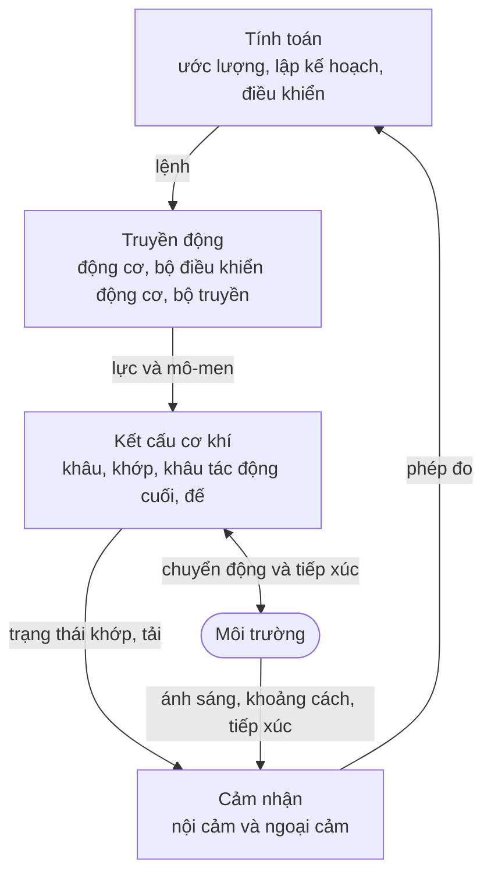
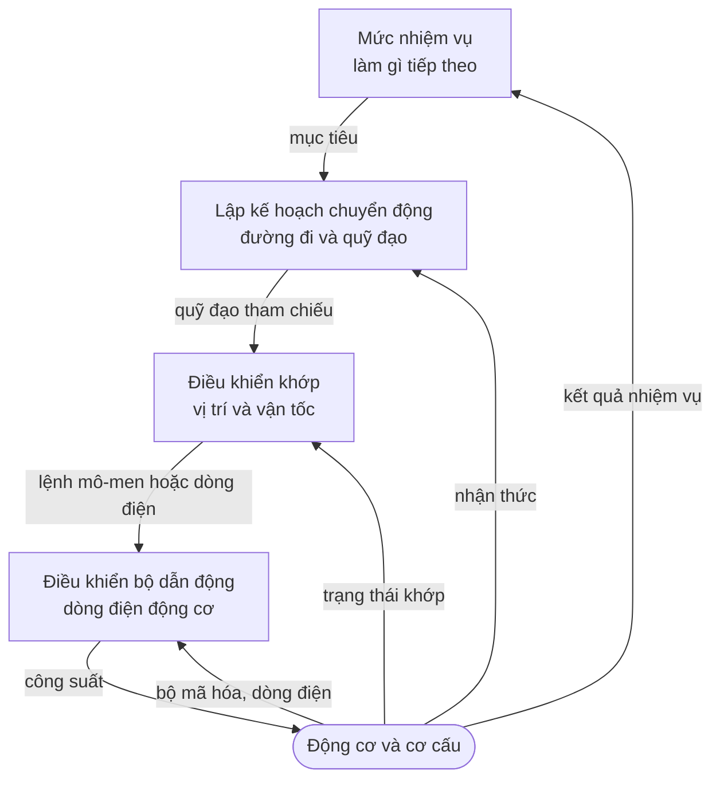

Một chiếc máy giặt cảm nhận mực nước, chạy một động cơ và thực hiện theo một chương trình, nhưng ít ai gọi nó là robot. Một chiếc máy bay không người lái (drone) giữ nguyên vị trí giữa những cơn gió giật thì thường được gọi là robot, và một cánh tay trong nhà máy lặp lại cùng một mối hàn hàng triệu lần cũng vậy. Từ này được dùng khá tùy tiện, và cách dùng tùy tiện ấy che khuất một ý tưởng hữu ích. Bài này đưa ý tưởng đó về một dạng chính xác, rồi tháo rời robot thành các hệ thống con của nó, để phần còn lại của loạt bài có chung một bộ từ vựng.

Cách tiếp cận đi từ ngoài vào trong. Bài bắt đầu từ điều khiến một cỗ máy trở thành robot, chia robot thành bốn hệ thống con, lần theo hai thứ khác nhau chảy giữa chúng (năng lượng và thông tin), và kết thúc bằng những cách tổ chức phần mềm khép kín vòng điều khiển.

## 1. Điều gì khiến một cỗ máy trở thành robot

### 1.1 Một định nghĩa làm việc

Các tổ chức tiêu chuẩn và các giáo trình định nghĩa khác nhau, nhưng đều có chung ba yếu tố. Robot là một cỗ máy:

1. **tác động vật lý** lên chính nó hoặc lên môi trường: nó di chuyển, cầm nắm, đẩy hoặc mang vác;
2. **cảm nhận**, để những gì nó làm phụ thuộc vào những gì thực sự đang xảy ra chứ không chỉ vào những gì đã được lên kế hoạch;
3. **tự quyết định** ở một mức độ nào đó, bằng cách tính toán hành động của mình từ những gì cảm nhận được và từ mục tiêu.

Tiêu chuẩn quốc tế về thuật ngữ robot học, ISO 8373, nắm bắt cùng ý tưởng đó bằng cách diễn đạt riêng. Ấn bản năm 2012 mô tả robot là một cơ cấu được dẫn động, lập trình được theo hai trục trở lên, có một mức độ tự chủ, di chuyển trong môi trường của nó để thực hiện các nhiệm vụ định trước; bản sửa đổi năm 2021 diễn đạt lại định nghĩa xoay quanh sự di chuyển (locomotion), thao tác (manipulation) và định vị.

Ba yếu tố này cùng nhau tạo thành một **vòng kín** (closed loop): hành động, quan sát kết quả, quyết định hành động tiếp theo. Ý tưởng về phản hồi (feedback), được giới thiệu cho các hệ động lực tổng quát trong [bài thứ nhất của loạt bài về hệ thống điều khiển](/vi/blog/introduction-to-control-systems), là cốt lõi của mọi robot. Điều phân biệt robot học với lý thuyết điều khiển nói chung là vòng điều khiển chạy qua một cơ cấu vật lý chuyển động trong không gian, kéo theo toàn bộ những vấn đề về hình học, tiếp xúc và tính bất định.

### 1.2 Tính tự chủ là một dải liên tục

Yếu tố thứ ba, việc ra quyết định, có nhiều mức độ.

| Mức | Ai quyết định điều gì | Ví dụ |
|---|---|---|
| Điều khiển từ xa | Con người ra lệnh cho mọi chuyển động; cỗ máy thực thi và giữ ổn định chuyển động đó | Một phương tiện lặn điều khiển từ xa do một người lái điều hướng |
| Có giám sát | Con người đặt mục tiêu hoặc phê duyệt kế hoạch; cỗ máy thực thi chúng | Một xe tự hành thám hiểm hành tinh được giao một đích đến trong ngày, tự lập kế hoạch và tự lái theo lộ trình của mình |
| Tự chủ trong một nhiệm vụ | Cỗ máy tự chọn chuyển động để đạt một mục tiêu cho trước | Một xe trong nhà kho tự tìm đường đến một kệ hàng |
| Tự chủ giữa các nhiệm vụ | Cỗ máy chọn giữa các mục tiêu và thích nghi với tình huống mới | Phần lớn vẫn là một mục tiêu nghiên cứu |

Ngay cả một cỗ máy điều khiển từ xa cũng chứa những vòng tự chủ: người lái ra lệnh một hướng đi, và các bộ điều khiển (controller) riêng của phương tiện quyết định cần đẩy mỗi chân vịt mạnh đến đâu để giữ hướng đó. Tính tự chủ nên được mô tả theo từng lớp hơn là như một thuộc tính duy nhất của cỗ máy.

### 1.3 Trở lại chiếc máy giặt

Theo định nghĩa này, chiếc máy giặt nằm ở ranh giới: nó cảm nhận và hành động, nhưng các quyết định của nó là một trình tự cố định với vài nhánh rẽ, và hành động của nó không liên quan đến việc di chuyển trong không gian hay thao tác trong không gian. Cánh tay nhà máy lặp lại mối hàn rõ ràng là một robot, dù nhiệm vụ của nó không bao giờ thay đổi: trong mỗi chuyển động, các bộ điều khiển khớp của nó liên tục hiệu chỉnh theo tải và nhiễu loạn (disturbance), và nó có thể được lập trình lại cho một nhiệm vụ khác. Ranh giới này mờ nhạt một cách có chủ ý. Điều quan trọng không phải là cái nhãn mà là cấu trúc, được mô tả trong phần còn lại của bài.

## 2. Bốn hệ thống con

Mọi robot đều có thể chia thành bốn hệ thống con. Cách chia này chỉ là để thuận tiện, vì các bộ phận thực tế thường thuộc về nhiều hơn một hệ thống con, nhưng nó giúp sắp xếp cả phần cứng lẫn những câu hỏi mà người kỹ sư đặt ra về phần cứng đó.

### 2.1 Kết cấu cơ khí

Kết cấu là phần thân: các **khâu** (link) cứng nối với nhau bằng các **khớp** (joint), kết thúc ở một **khâu tác động cuối** (end effector) như bộ kẹp, dụng cụ hay bàn chân, và với robot di động thì được mang trên một **đế** (base) có bánh xe, chân, cánh quạt nâng hoặc chân vịt.

Hai loại khớp chiếm ưu thế:

- **khớp quay** (revolute joint) quay quanh một trục, giống như khuỷu tay;
- **khớp tịnh tiến** (prismatic joint) trượt dọc một trục, giống như ngăn kéo.

Mỗi khớp đóng góp một **bậc tự do** (degree of freedom, DOF): một tọa độ độc lập cần có để mô tả cấu hình của robot. Các khớp có nhiều bậc tự do hơn, chẳng hạn khớp cầu, có thể được xem như nhiều khớp một bậc tự do có các trục cắt nhau.

### 2.2 Bậc tự do và độ linh động

Một vật rắn chuyển động tự do trong không gian ba chiều có **sáu** bậc tự do: ba cho vị trí và ba cho hướng. Trong mặt phẳng, nó có **ba**: hai cho vị trí và một cho hướng. Những con số này xác định robot cần gì để đặt một vật một cách tùy ý: một cánh tay phải đạt tới mọi vị trí *và* mọi hướng trong không gian làm việc (workspace) của nó cần ít nhất sáu khớp, và một cánh tay phẳng cần ít nhất ba.

Với một cánh tay nối tiếp (serial arm), tức một chuỗi khâu duy nhất từ đế đến dụng cụ, số bậc tự do đơn giản là số khớp một bậc tự do. Với các cơ cấu có vòng kín, chẳng hạn một robot song song (parallel robot) có bệ được đỡ bởi nhiều chân, **độ linh động** (mobility) được tính bằng công thức Chebychev–Grübler–Kutzbach. Với một cơ cấu không gian có $n_b$ vật kể cả giá cố định và $n_j$ khớp, trong đó khớp $i$ cho phép $f_i$ bậc tự do,

$$
M = 6\,(n_b - 1 - n_j) + \sum_{i=1}^{n_j} f_i .
$$

Mỗi vật trừ giá cố định đóng góp sáu bậc tự do, và mỗi khớp loại bỏ $6 - f_i$ bậc tự do mà nó ràng buộc. Với cơ cấu phẳng, thay 6 bằng 3. Để kiểm tra, một cánh tay nối tiếp gồm $n$ khớp quay có $n_b = n + 1$ vật và $n_j = n$ khớp, cho $M = 6(n + 1 - 1 - n) + n = n$, đúng như mong đợi. Công thức chỉ đếm ràng buộc mà không xét đến hình học, nên những cách bố trí đặc biệt (chẳng hạn các trục song song) có thể khiến cơ cấu có độ linh động lớn hơn giá trị công thức dự đoán.

Ba thuật ngữ xuất hiện lặp đi lặp lại trong robot học:

- Robot là **dư bậc tự do** (redundant) đối với một nhiệm vụ khi nó có nhiều bậc tự do hơn mức nhiệm vụ đòi hỏi: một cánh tay bảy khớp đặt dụng cụ theo vị trí và hướng sáu chiều còn thừa một bậc tự do, có thể dùng để tránh vật cản hoặc giới hạn khớp.
- Robot là **thiếu cơ cấu chấp hành** (underactuated) khi nó có ít cơ cấu chấp hành (actuator) hơn số bậc tự do: một quadrotor có bốn cánh quạt nhưng sáu bậc tự do, nên chẳng hạn nó không thể dịch sang ngang mà không nghiêng trước.
- Một đế di động là **không holonom** (nonholonomic) khi vận tốc của nó bị ràng buộc theo những cách không hạn chế nơi nó cuối cùng có thể đến. Cấu hình của một chiếc ô tô trong mặt phẳng có ba tọa độ (vị trí và hướng), nhưng nó không thể đi thẳng sang ngang; dù vậy nó vẫn có thể đạt tới mọi vị trí và hướng bằng cách xoay xở, như bất kỳ ai từng đỗ xe song song đều biết.

### 2.3 Truyền động

Cơ cấu chấp hành biến lệnh thành lực và **mô-men** (torque; mô-men là đại lượng quay tương ứng với lực: tác dụng làm quay của một lực đặt cách một trục một khoảng, tính bằng newton-mét). Phần lớn robot dùng **động cơ điện**, điển hình là động cơ không chổi than được điều khiển bằng mạch điện tử công suất điều chỉnh dòng điện trong các cuộn dây, và do đó điều chỉnh mô-men. Cơ cấu chấp hành thủy lực có mật độ lực rất cao và xuất hiện trong máy móc hạng nặng cũng như một số robot có chân; cơ cấu chấp hành khí nén rẻ và vốn có tính mềm dẻo nhưng khó điều khiển chính xác.

Động cơ điện đạt hiệu suất cao ở tốc độ cao và mô-men thấp, trong khi các khớp thường cần điều ngược lại, nên động cơ dẫn động khớp qua một **bộ truyền** (transmission) như hộp số, dây đai, dây cáp hoặc vít me. Một bộ giảm tốc có tỉ số truyền $N$ đổi tốc độ lấy mô-men. Nếu động cơ tạo ra mô-men $\tau_m$ ở tốc độ $\omega_m$, thì với bộ truyền có hiệu suất $\eta$, khớp nhận được

$$
\tau_j = \eta \, N \, \tau_m, \qquad \omega_j = \frac{\omega_m}{N}.
$$

Bộ truyền cũng thay đổi cách **quán tính** (inertia) riêng của động cơ (mô-men quán tính: sự chống lại của một vật quay đối với thay đổi tốc độ quay) thể hiện tại khớp. Một rô-to động cơ có quán tính $J_m$ được cảm nhận tại khớp như một quán tính $N^2 J_m$, vì rô-to quay nhanh gấp $N$ lần khớp. Với tỉ số giảm tốc cao, quán tính động cơ quy đổi có thể lấn át quán tính của chính khâu. Điều đó làm khớp ít nhạy với thay đổi của tải, giúp việc điều khiển đơn giản hơn, nhưng cũng làm khớp cứng và khó đẩy ngược lại bằng tay, một mối lo khi robot làm việc gần con người. Những thiết kế cần sự nhẹ nhàng dùng tỉ số thấp, hoặc chủ ý chèn một lò xo giữa hộp số và khâu (**truyền động đàn hồi nối tiếp**, series elastic actuation) để mô-men khớp có thể được đo từ độ biến dạng của lò xo và được điều khiển.

### 2.4 Cảm nhận

Cảm biến (sensor) chia thành hai nhóm theo đại lượng mà chúng đo.

- Cảm biến **nội cảm** (proprioceptive) đo trạng thái của chính robot: **bộ mã hóa vòng quay** (encoder) đo góc khớp, dòng điện động cơ cho biết mô-men, **khối đo quán tính** (inertial measurement unit, IMU) đo chuyển động của thân robot: con quay hồi chuyển (gyroscope) đo tốc độ quay, còn gia tốc kế (accelerometer) đo gia tốc kết hợp với trọng lực (một gia tốc kế đứng yên đọc được lực hút của trọng lực, đây chính là điều về sau cho phép nó làm mốc tham chiếu độ nghiêng), và cảm biến mô-men đo tải tại các khớp.
- Cảm biến **ngoại cảm** (exteroceptive) đo môi trường: **camera**, **cảm biến khoảng cách** (lidar, đo khoảng cách bằng cách đo thời gian ánh sáng phản xạ; sonar; camera độ sâu dùng ánh sáng cấu trúc (structured light) và thời gian bay (time-of-flight)), **cảm biến lực – mô-men** ở cổ tay, và cảm biến **xúc giác** (tactile) ở đầu ngón tay hoặc lớp da.

Vị trí lắp cảm biến tương tác với bộ truyền. Một bộ mã hóa vòng quay đặt trên trục động cơ được hưởng lợi từ bộ giảm tốc: với 4096 xung mỗi vòng động cơ và tỉ số giảm tốc 100:1, góc khớp được phân giải tới

$$
\frac{360^\circ}{4096 \times 100} \approx 0.00088^\circ .
$$

Nhưng con số đó mô tả động cơ, không phải khâu. **Độ rơ** (backlash), tức khe hở nhỏ giữa các răng bánh răng ăn khớp, và tính đàn hồi trong hộp số nằm giữa bộ mã hóa và khâu, nên góc thực của khâu có thể khác với góc mà bộ mã hóa động cơ ngụ ý nhiều hơn hẳn độ phân giải của nó. Một số robot thêm bộ mã hóa thứ hai ở đầu ra của khớp chính vì lý do này. Bài học chung là một cảm biến đo một đại lượng vật lý tại một vị trí; đại lượng mà bộ điều khiển quan tâm thường nằm ở chỗ khác, và khoảng cách giữa hai đại lượng đó là một phần của thiết kế.

Không cảm biến nào báo trạng thái của robot và môi trường xung quanh một cách trực tiếp và chính xác. Các phép đo có nhiễu, có độ trễ, gián đoạn và gián tiếp, và việc biến chúng thành một ước lượng của trạng thái là một bài toán trung tâm của robot học, chủ đề của bài cuối cùng trong loạt bài này.

### 2.5 Tính toán

Hệ thống con tính toán biến các phép đo và mục tiêu thành lệnh. Trong thực tế, đó không phải là một máy tính mà là nhiều máy tính, được sắp xếp theo mức độ nhanh mà chúng phải đáp ứng: vi điều khiển trên mỗi bộ điều khiển động cơ, một bộ điều khiển thời gian thực phối hợp các khớp, và một hoặc nhiều máy tính đa dụng cho nhận thức và lập kế hoạch. Cách sắp xếp này xuất phát từ các yêu cầu về thời gian được mô tả ở Mục 4.

## 3. Hai dòng chảy: năng lượng và thông tin

Sơ đồ ở Mục 2 trộn lẫn hai loại mũi tên khác nhau. Tách chúng ra làm sáng tỏ nhiều quyết định thiết kế.

**Đường năng lượng** đi từ nguồn năng lượng (pin hoặc nguồn cấp) qua mạch điện tử công suất, động cơ và bộ truyền đến khớp, và từ đó đi vào môi trường dưới dạng công thực hiện lên các vật, hoặc quay trở lại robot dưới dạng nhiệt và chuyển động được tích trữ. Những vấn đề của nó là công suất, hiệu suất, nhiệt, mô-men đỉnh và an toàn: những gì robot *có thể* làm.

**Đường thông tin** đi từ các cảm biến qua ước lượng, ra quyết định và điều khiển đến các lệnh gửi tới mạch điện tử công suất. Những vấn đề của nó là độ chính xác, độ trễ, tốc độ cập nhật và độ tin cậy: những gì robot *biết* và nó có thể phản ứng nhanh đến đâu.

Hai đường này chỉ gặp nhau ở hai nơi: mạch điện tử công suất, nơi một tín hiệu lệnh nhỏ điều tiết một dòng công suất lớn, và các cảm biến, nơi các đại lượng vật lý trở thành dữ liệu. Một sự cố trên đường năng lượng (động cơ quá nhiệt, pin sụt áp khi mang tải) chỉ hiện ra với đường thông tin qua những gì cảm biến báo về. Một sự cố trên đường thông tin (một thông điệp bị trễ, một ước lượng sai) tác động đến thế giới thực với toàn bộ công suất của các cơ cấu chấp hành. Nhiều cơ chế an toàn trong robot, chẳng hạn giới hạn mô-men được áp đặt trong mạch điện tử của bộ điều khiển động cơ và nút dừng khẩn cấp ngắt trực tiếp nguồn động cơ, tồn tại để ngăn loại sự cố thứ hai trở nên nguy hiểm.

## 4. Vòng trong vòng

Robot không chạy một vòng phản hồi duy nhất; nó chạy cả một hệ thống phân cấp các vòng, mỗi vòng khép kín quanh vòng bên dưới ở tốc độ thấp hơn.

Các bậc độ lớn điển hình, vốn khác nhau rất nhiều giữa các robot, là:

| Vòng | Tốc độ cập nhật điển hình | Khép kín quanh |
|---|---|---|
| Dòng điện động cơ | Hàng chục kilohertz | Dòng điện cuộn dây đo được |
| Vị trí và vận tốc khớp | Khoảng một kilohertz | Số đọc bộ mã hóa |
| Lập kế hoạch chuyển động và tránh vật cản phản xạ | Hàng chục đến hàng trăm hertz | Vật cản nhận thức được và trạng thái ước lượng của robot |
| Quyết định nhiệm vụ | Khoảng một lần mỗi giây hoặc chậm hơn | Mục tiêu đã đạt được hay chưa |

Mỗi vòng coi các vòng nhanh hơn bên dưới như một cơ cấu chấp hành gần lý tưởng. Bộ điều khiển khớp giả định rằng mô-men nó yêu cầu chính là mô-men nó nhận được, vì vòng dòng điện nhanh hơn nhiều lần; bộ lập kế hoạch giả định rằng quỹ đạo nó gửi đi chính là quỹ đạo các khớp bám theo. Những giả định này chỉ đúng khi các tốc độ tách biệt rõ rệt, và đó là một lý do khiến các tốc độ chênh nhau nhiều bậc độ lớn. Khi một giả định không còn đúng, chẳng hạn khi bộ lập kế hoạch yêu cầu một chuyển động nhanh hơn khả năng bám của vòng khớp, sai lệch sẽ lộ ra ở mức cao hơn dưới dạng một robot không làm đúng như kế hoạch.

## 5. Tổ chức phần mềm

Hệ thống phân cấp ở trên cho biết *khi nào* mỗi phép tính chạy. Một câu hỏi riêng là việc ra quyết định ở tầng trên cùng được tổ chức *như thế nào*. Ba câu trả lời lớn đã định hình lĩnh vực này.

### 5.1 Cảm nhận – lập kế hoạch – hành động

Những robot di động đầu tiên, như Shakey, được chế tạo tại Viện Nghiên cứu Stanford (Stanford Research Institute) từ cuối thập niên 1960, đi theo một chu trình **suy tính** (deliberative): cảm nhận thế giới, xây dựng một mô hình của nó, lập kế hoạch một chuỗi hành động trong mô hình, rồi thực thi kế hoạch. Cách tiếp cận này tổng quát và kế hoạch của nó có thể giải thích được, nhưng nó chậm, và nó giả định rằng mô hình vẫn chính xác trong khi kế hoạch đang được thực thi. Trong một môi trường thay đổi, thế giới thường đã đổi khác trước khi kế hoạch hoàn tất.

### 5.2 Điều khiển phản xạ

Năm 1986, Rodney Brooks đề xuất **kiến trúc bao hàm** (subsumption architecture), trong đó hành vi được xây dựng từ các lớp quy tắc đơn giản, nhanh, nối thẳng cảm biến với cơ cấu chấp hành ("nếu có vật cản ở gần, rẽ tránh"; "nếu không, đi lang thang"; "nếu thấy một ô cửa, đi qua nó"), các lớp cao hơn có thể chặn hoặc ghi đè các lớp thấp hơn, và không có mô hình thế giới trung tâm. Hệ thống phản xạ (reactive) phản ứng nhanh và suy giảm một cách êm ái khi gặp sự cố, nhưng khó hướng tới các mục tiêu dài hạn và khó phân tích.

### 5.3 Kiến trúc phân lớp (lai)

Phần lớn robot ngày nay kết hợp hai cách trên trong các kiến trúc **phân lớp** (layered), thường được mô tả gồm ba lớp (bài tổng quan năm 1998 của Erann Gat là một tài liệu tham khảo phổ biến): một lớp **phản xạ** gồm các hành vi phản hồi nhanh, một lớp **suy tính** lập kế hoạch trên một mô hình ở tốc độ chậm hơn, và một lớp **điều hành** (executive), hay lớp sắp xếp trình tự, nằm giữa hai lớp đó, có nhiệm vụ biến kế hoạch thành chuỗi hành vi, theo dõi tiến trình của chúng và xử lý sự cố. Hệ thống phân cấp vòng trong vòng ở Mục 4 chính là cùng ý tưởng đó nhìn từ phía điều khiển.

## 6. Vì sao robot học khó

Từng hệ thống con riêng lẻ đều đã được hiểu rõ; khó khăn nằm ở sự kết hợp của chúng với thế giới vật lý.

- **Tính bất định ở khắp nơi.** Cảm biến có nhiễu, mô hình của cơ cấu chỉ gần đúng (ma sát, độ đàn hồi, độ rơ), và môi trường chỉ được biết một phần. Mọi quyết định đều được đưa ra dựa trên một ước lượng.
- **Thời gian.** Chuyển động vật lý không chờ tính toán. Một lệnh đến muộn là một lệnh sai, và độ trễ bên trong một vòng phản hồi có thể làm một vòng vốn ổn định trở nên không ổn định.
- **Tiếp xúc.** Chạm vào thế giới làm động lực học thay đổi đột ngột: một bộ kẹp khép lại quanh một vật, một bàn chân đập xuống mặt đất. Lực tiếp xúc có thể lớn và khó dự đoán.
- **Hình học.** Vị trí và hướng nằm trong những không gian mà trực giác thông thường dễ đánh lừa: các phép quay không giao hoán, và góc quay vòng trở lại. Xử lý đúng hệ tọa độ (coordinate frame) và phép biến đổi (transformation) là chủ đề của bài tiếp theo.
- **An toàn.** Robot chuyển thông tin thành lực. Những sự cố của nó có hậu quả vật lý, và khi ở gần con người thì chúng phải được giới hạn bằng thiết kế, chứ không chỉ được làm cho ít có khả năng xảy ra.

## 7. Tóm tắt

| Câu hỏi | Trả lời |
|---|---|
| Điều gì khiến một cỗ máy trở thành robot? | Nó tác động vật lý, cảm nhận, và ở một mức độ nào đó tự quyết định hành động từ những gì cảm nhận được, trong một vòng kín. |
| Bốn hệ thống con là gì? | Kết cấu cơ khí, truyền động, cảm nhận và tính toán. |
| Một vật rắn tự do có bao nhiêu bậc tự do? | Sáu trong không gian, ba trong mặt phẳng. |
| Dư bậc tự do, thiếu cơ cấu chấp hành và không holonom nghĩa là gì? | Nhiều DOF hơn mức nhiệm vụ cần; ít cơ cấu chấp hành hơn số DOF; vận tốc bị ràng buộc mà không hạn chế các cấu hình có thể đạt tới. |
| Bộ giảm tốc tỉ số $N$ làm gì? | Nhân mô-men lên khoảng $N$ lần, chia tốc độ cho $N$, và quy đổi quán tính động cơ về khớp nhân với $N^2$. |
| Vì sao tách đường năng lượng và đường thông tin? | Chúng hỏng theo những cách khác nhau, và các cơ chế an toàn tồn tại để ngăn sự cố thông tin trở thành sự cố năng lượng. |
| Vì sao các vòng điều khiển chạy ở những tốc độ khác nhau? | Mỗi vòng giả định vòng nhanh hơn bên dưới hoạt động như một cơ cấu chấp hành lý tưởng, điều chỉ đúng khi các tốc độ tách biệt rõ rệt. |
| Phần mềm robot được tổ chức như thế nào? | Suy tính, phản xạ, hoặc thường gặp nhất là một tổ hợp phân lớp với lớp điều hành nằm giữa. |

Bài tiếp theo chuyển sang hình học: cách mô tả vị trí của từng bộ phận của robot, và cách chuyển đổi giữa nhiều hệ tọa độ mà các cảm biến và các khâu của robot xác định.

### Tài liệu tham khảo

- ISO 8373, *Robotics — Vocabulary*, International Organization for Standardization (2012; revised 2021).
- R. A. Brooks, "A Robust Layered Control System for a Mobile Robot", *IEEE Journal of Robotics and Automation*, 1986.
- E. Gat, "On Three-Layer Architectures", in D. Kortenkamp, R. P. Bonasso and R. Murphy (eds.), *Artificial Intelligence and Mobile Robots*, MIT Press, 1998.
- N. J. Nilsson, *Shakey the Robot*, SRI International Technical Note 323, 1984.
