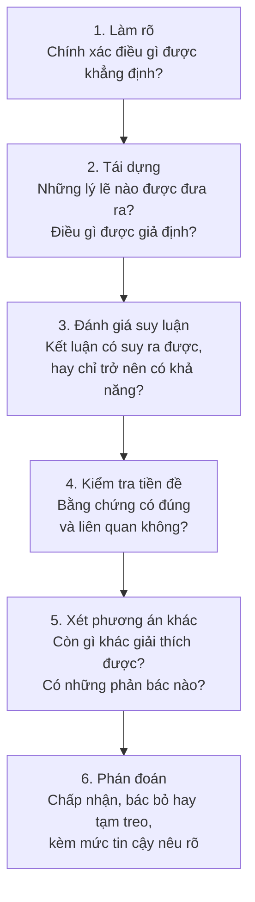

Kỹ sư dành phần lớn ngày làm việc để quyết định nên tin điều gì và nên làm gì. Sự sụt giảm hiệu năng trong lần chạy benchmark đêm qua là thật hay chỉ là nhiễu? Bảng dữ liệu (datasheet) của nhà cung cấp có thực sự ủng hộ nhận định ghi ở trang đầu của nó không? Thiết kế được đề xuất có đáp ứng yêu cầu không, hay chỉ đáp ứng phiên bản của yêu cầu mà tác giả của nó hình dung trong đầu? Không câu hỏi nào trong số này được trả lời bằng cách nhớ lại một sự kiện. Mỗi câu hỏi cần một phán đoán được xây dựng từ các lý lẽ, và chất lượng của phán đoán phụ thuộc vào chất lượng của lập luận đứng sau nó.

Bài này mở đầu loạt bài [Tư duy phản biện và lập luận](/vi/series/critical-thinking), một khóa học gồm mười ba phần về cách lập luận cẩn thận đối với các nhận định kỹ thuật và đời thường. Loạt bài đi từ ý nghĩa và lập luận, qua logic hình thức, đến lập luận khoa học, thống kê, đạo đức và chiến lược, và kết thúc bằng ngụy biện, thiên kiến và sáng tạo. Loạt bài không đòi hỏi kiến thức nền nào về triết học hay logic. Bài thứ nhất này trình bày tư duy phản biện là gì (mục 1) và các học giả đã định nghĩa nó như thế nào (mục 2). Sau đó bài mô tả các kỹ năng, tri thức và phẩm chất mà tư duy phản biện kết hợp (mục 3) và giải thích vì sao trực giác nhanh cần được xem lại lần thứ hai (mục 4). Mục 5 đưa ra một phương pháp làm việc mà phần còn lại của loạt bài sẽ lần lượt bổ sung, và mục 6 nêu các giới hạn của nó.

## 1. Tư duy phản biện là gì

### 1.1 Một định nghĩa làm việc

Trong loạt bài này, **tư duy phản biện** (critical thinking) là suy nghĩ rõ ràng và hợp lý về việc nên tin điều gì và nên làm gì. Nó bao gồm việc hiểu một nhận định nói gì, tìm ra các lý lẽ được đưa ra để ủng hộ nó, đánh giá các lý lẽ đó ủng hộ nó tốt đến mức nào, và giữ kết luận với mức độ tin cậy tương xứng với các lý lẽ. Cách phát biểu này theo cách Lau dùng trong giáo trình của ông về tư duy phản biện và sáng tạo (Lau, 2011). Định nghĩa có ba phần đáng được tách riêng.

- **Sự rõ ràng** liên quan đến ý nghĩa. Một nhận định có thể hiểu theo hai cách thì không thể được đánh giá cho đến khi biết cách hiểu nào là cách được dự định.
- **Tính hợp lý** liên quan đến lý lẽ. Một niềm tin là hợp lý ở mức độ nó được ủng hộ bởi bằng chứng tốt và suy luận chặt chẽ, chứ không phải bởi thói quen, mong muốn chủ quan hay uy tín của người nói to nhất.
- **Niềm tin và hành động** đều thuộc phạm vi. Tư duy phản biện không chỉ nói về việc phát biểu nào là đúng; nó còn nói về việc nên chọn thiết kế nào, nên chạy phép thử nào trước, hay có nên phát hành ngay hôm nay hay không.

Từ "critical" (phản biện) bắt nguồn từ tiếng Hy Lạp *kritikos*, nghĩa là có khả năng phán xét hay phân định. Nó không có nghĩa là bới lông tìm vết. Một lần đọc phản biện bản đề xuất của đồng nghiệp hoàn toàn có thể đi đến kết luận rằng đề xuất đó đúng và lập luận của nó có thể được làm cho mạnh hơn.

### 1.2 Điều nó bổ sung cho tri thức và cho sự phê bình

Định nghĩa trên đặt tư duy phản biện vào giữa thông tin và quyết định, và sẽ hữu ích nếu thấy vị trí đó loại trừ những gì.

**Tri thức không phải là phán đoán.** Một người duyệt mã thuộc lòng mọi điều khoản trong chuẩn viết mã của nhóm vẫn có thể chấp thuận một thay đổi mà phép kiểm thử đơn vị mới của nó không khẳng định điều gì cả. Thứ còn thiếu không phải là một sự kiện mà là một câu hỏi: phép kiểm thử này có thất bại khi mã sai không? Tri thức cung cấp chất liệu cho lập luận. Tư duy phản biện quyết định điều gì suy ra được từ chất liệu đó, nhận thấy khi hai mẩu chất liệu mâu thuẫn với nhau, và nhận ra khi một mẩu cần thiết bị thiếu và phải đi tra cứu.

**Phê bình là phương tiện, không phải mục đích.** Tìm ra bước yếu trong một lập luận thường là nơi công việc bắt đầu chứ không phải nơi nó kết thúc. Một buổi duyệt thiết kế tốt thường kết luận rằng đề xuất là vững và tác giả của nó đã trình bày chưa đủ sức thuyết phục: benchmark được đưa ra làm bằng chứng là benchmark yếu nhất có thể có, trong khi một benchmark tốt hơn vẫn tồn tại. Mục tiêu là kết luận được ủng hộ tốt nhất, và đôi khi đó chính là kết luận đang được xem xét.

**Đánh giá cần có thứ để đánh giá.** Việc đánh giá các phương án giả định rằng đã có người tạo ra chúng. Công việc kỹ thuật luân phiên giữa mở rộng tập các thiết kế ứng viên và thu hẹp nó, và tư duy phản biện chi phối việc thu hẹp. Nó cũng góp phần vào việc mở rộng, vì một trong những câu hỏi tiêu chuẩn của nó, "còn điều gì khác có thể giải thích hiện tượng này, hay còn việc gì khác ta có thể làm?", chính là lời đề nghị tìm thêm ứng viên mới. Bài cuối của loạt bài, [Sáng tạo và hình thành ý tưởng](/vi/blog/creativity-and-generating-ideas), xem xét việc mở rộng theo đúng cách riêng của nó.

### 1.3 Một kỹ năng chung cho mọi lĩnh vực

Phần lớn những gì làm nên một lập luận tốt không phụ thuộc vào chủ đề. Cùng một lỗi, kết luận rằng một giả thuyết là đúng vì một trong các dự đoán của nó đã thành sự thật, có thể do một bác sĩ mắc phải khi đọc kết quả xét nghiệm, một lập trình viên khi đọc một phép kiểm thử đơn vị vượt qua, và một nhà quản lý khi đọc kết quả kinh doanh quý. Vì lý do này, tư duy phản biện được gọi là **chung cho mọi lĩnh vực** (domain-general): các nguyên tắc của nó áp dụng xuyên suốt các ngành. Tuy vậy, nó không tách rời khỏi lĩnh vực. Nhận ra một benchmark không mang tính đại diện đòi hỏi phải biết đôi điều về benchmark. Mục 6 sẽ quay lại điểm này.

## 2. Tư duy phản biện đã được định nghĩa như thế nào

Không có một định nghĩa duy nhất được mọi người chấp nhận, nhưng các định nghĩa nổi tiếng nhất có một nét tương đồng gia đình. Đặt một vài định nghĩa cạnh nhau sẽ cho thấy chúng thống nhất ở điểm nào.

### 2.1 Dewey và tư duy phản tư

Nhà triết học và nhà giáo dục John Dewey, trong *How We Think* (1910), cho rằng giáo dục cần vun đắp điều ông gọi là **tư duy phản tư** (reflective thought). Theo ông, một niềm tin không chỉ đơn giản được nắm giữ; nó được xem xét, bằng cách hỏi điều gì ủng hộ nó và nó dẫn tới đâu, và sự xem xét đó được duy trì bền bỉ chứ không qua loa. Dewey cũng nhấn mạnh việc tạm treo phán đoán: tìm hiểu xem vấn đề thực sự là gì trước khi chốt một câu trả lời cho nó. Đây là gốc rễ của quan niệm hiện đại rằng tư duy phản biện mang tính phản tư chứ không mang tính phản ứng.

### 2.2 Ennis: quyết định nên tin hay làm điều gì

Robert Ennis, người có công trình định hình phần lớn tài liệu về sau và các bài trắc nghiệm của nó, mô tả tư duy phản biện trong một câu duy nhất: lối suy nghĩ hợp lý và phản tư, có mục đích là đi đến một quyết định về việc nên tin điều gì hoặc nên làm gì (Ennis, 1987). Định nghĩa ngắn, và mỗi từ đều có lý do để có mặt. "Hợp lý" chỉ đến các chuẩn mực của lập luận tốt; "phản tư" chỉ đến suy nghĩ có chủ ý thay vì tự động; còn "quyết định nên tin hay làm điều gì" làm rõ rằng mục đích là một phán đoán dẫn dắt niềm tin hoặc hành động, chứ không phải suy ngẫm vì chính nó.

### 2.3 Đồng thuận Delphi

Năm 1990, Peter Facione công bố kết quả của một cuộc tham vấn chuyên gia có cấu trúc, được tiến hành cho Hiệp hội Triết học Hoa Kỳ (American Philosophical Association) theo phương pháp Delphi (nhiều vòng ý kiến viết ẩn danh nối tiếp nhau, mỗi vòng có tham khảo bản tóm tắt của vòng trước). Hội đồng mô tả tư duy phản biện là phán đoán có mục đích và tự điều chỉnh, và xác định sáu kỹ năng nhận thức cốt lõi: **diễn giải**, **phân tích**, **đánh giá**, **suy luận**, **giải thích** và **tự điều chỉnh** (Facione, 1990). Báo cáo cũng mô tả các phẩm chất của một người tư duy phản biện lý tưởng, được bàn ở mục 3.4.

### 2.4 Điểm chung của các định nghĩa

Các định nghĩa khác nhau về điểm nhấn nhưng thống nhất ở ba điểm:

| Yếu tố chung | Dewey | Ennis | Báo cáo Delphi |
|---|---|---|---|
| Phán đoán dựa trên lý lẽ và bằng chứng | Các căn cứ ủng hộ một niềm tin | Suy nghĩ hợp lý | Đánh giá và suy luận |
| Suy nghĩ có chủ ý và tự ý thức | Tư duy phản tư, tạm treo phán đoán | Suy nghĩ phản tư | Tự điều chỉnh |
| Mục đích là một quyết định về niềm tin hoặc hành động | Các kết luận đã được kiểm nghiệm | Quyết định nên tin hay làm điều gì | Phán đoán có mục đích |

Định nghĩa làm việc ở mục 1.1 là phiên bản cô đọng của ba điểm này.

## 3. Kỹ năng, tri thức và phẩm chất

Báo cáo Delphi tách hai chiều của tư duy phản biện: các kỹ năng nhận thức, là những gì một người có thể thực hiện, và các phẩm chất cảm xúc – thái độ, là những gì quyết định người đó có thực hiện hay không (Facione, 1990). Mục này đi theo cách phân chia đó, với một bổ sung ở giữa: tri thức về các chuẩn mực mà kỹ năng áp dụng, và sự rèn luyện giúp các kỹ năng trở nên dùng được.

### 3.1 Các kỹ năng thành phần

Các kỹ năng có thể được liệt kê dưới dạng những câu hỏi mà một người lập luận cẩn thận đặt ra cho một nhận định. Bảng cũng cho biết mỗi kỹ năng được phát triển ở đâu trong loạt bài.

| Kỹ năng | Câu hỏi nó trả lời | Được phát triển trong |
|---|---|---|
| Phân tích ý nghĩa | Chính xác thì điều gì đang được khẳng định? | [Ý nghĩa, sự rõ ràng và định nghĩa](/vi/blog/meaning-clarity-and-definitions) |
| Nhận diện lập luận | Những lý lẽ nào được đưa ra, và điều gì được giả định? | [Lập luận và cấu trúc của chúng](/vi/blog/arguments-and-their-structure) |
| Đánh giá suy diễn | Kết luận có suy ra một cách tất yếu không? | Các bài từ thứ tư đến thứ bảy, từ [Logic nghiên cứu gì](/vi/blog/what-logic-studies) đến [Logic vị từ](/vi/blog/predicate-logic) |
| Đánh giá bằng chứng | Sự ủng hộ về nhân quả hoặc thống kê có đủ không? | [Lập luận khoa học và quan hệ nhân quả](/vi/blog/scientific-reasoning-and-causation), [Xác suất và lập luận thống kê](/vi/blog/probability-and-statistical-reasoning) |
| Lập luận về giá trị | Kết luận dựa trên những phán đoán giá trị nào? | [Lập luận về giá trị](/vi/blog/reasoning-about-values) |
| Ra quyết định | Phương án nào là tốt nhất, khi xét đến mục tiêu và sự bất định? | [Tư duy chiến lược và ra quyết định](/vi/blog/strategic-thinking-and-decisions) |
| Phát hiện lỗi | Những sai lầm đã biết nào có thể đang tác động? | [Ngụy biện và thiên kiến nhận thức](/vi/blog/fallacies-and-cognitive-biases) |
| Tạo ra phương án thay thế | Còn những cách giải thích hoặc phương án nào khác? | [Sáng tạo và hình thành ý tưởng](/vi/blog/creativity-and-generating-ideas) |

### 3.2 Tri thức về các chuẩn mực

Một kỹ năng áp dụng một chuẩn mực, và người lập luận chỉ có thể áp dụng những chuẩn mực mà mình biết. Phần lớn loạt bài này nói về hai loại chuẩn mực bổ sung cho nhau. Loại thứ nhất cho biết lập luận đúng trông như thế nào: định nghĩa của một lập luận hợp lệ, các quy tắc của xác suất, cách thiết kế một phép so sánh công bằng. Loại thứ hai mô tả những cách sai lầm dễ nhận ra. Một số là **ngụy biện** (fallacy), những kiểu lập luận có vẻ thuyết phục nhưng không ủng hộ được kết luận của chúng. Số khác là **thiên kiến nhận thức** (cognitive bias), những lệch lạc có quy luật của phán đoán con người so với điều mà bằng chứng cho phép, chẳng hạn ưu tiên những phép thử chỉ có thể xác nhận một giả thuyết mà mình đã tin sẵn (Wason, 1960; bài thứ mười hai, mục 6.3). Biết về một thiên kiến không làm nó tắt đi, nhưng cho người lập luận biết những kết luận nào của chính mình cần được kiểm tra lại lần thứ hai.

### 3.3 Rèn luyện và chuyển giao

Biết các quy tắc suy luận không làm nên một người lập luận giỏi, cũng như đọc sách hướng dẫn của trình gỡ lỗi không làm nên một người gỡ lỗi giỏi. Sự thành thạo đến từ việc áp dụng các nguyên tắc cho nhiều trường hợp đa dạng, nhận phản hồi về kết quả và xem xét những trường hợp đã đi sai. Một khó khăn đã được ghi nhận đầy đủ trong việc dạy tư duy phản biện: một kỹ năng được luyện trên một loại chất liệu không tự động dùng được trên loại khác, nên chính việc **chuyển giao** (transfer) sang những loại vấn đề mới cũng phải được luyện tập (van Gelder, 2005). Vì vậy mỗi bài của loạt bài này đều kết hợp các ví dụ từ kỹ thuật, nghiên cứu và đời sống hằng ngày, và kết thúc bằng bài tập.

### 3.4 Phẩm chất

Kỹ năng không bao giờ được sử dụng thì ít giá trị. Báo cáo Delphi mô tả người tư duy phản biện lý tưởng bằng một danh sách dài các thói quen tư duy, trong đó có: luôn ham tìm hiểu, hiểu biết đầy đủ, cởi mở, công bằng khi đánh giá, trung thực khi đối diện với thiên kiến của bản thân, thận trọng khi đưa ra phán đoán và sẵn lòng xem xét lại (Facione, 1990). Đối với công việc kỹ thuật, có thể nhóm danh sách này theo đối tượng mà mỗi thói quen hướng tới.

| Hướng tới | Các thói quen trong danh sách Delphi | Biểu hiện trong thực tế |
|---|---|---|
| Bằng chứng | Ham tìm hiểu, hiểu biết đầy đủ, cần mẫn tìm kiếm thông tin liên quan | Đọc các điều kiện thử nghiệm trong bảng dữ liệu, không chỉ con số nổi bật của nó |
| Quan điểm của người khác | Cởi mở, công bằng, linh hoạt | Phát biểu luận cứ mạnh nhất của một thiết kế đối thủ trước khi bác bỏ nó |
| Phán đoán của chính mình | Trung thực về thiên kiến cá nhân, thận trọng, sẵn lòng xem xét lại | Viết ra trước kết quả nào sẽ cho thấy bản sửa lỗi của chính mình không hiệu quả |

Hàng thứ ba là khó duy trì nhất, vì nó đòi hỏi một người đi tìm lỗi của chính mình. Các nhóm có thể làm điều này dễ hơn. Một buổi phân tích sau sự cố không quy lỗi (blameless postmortem), xem xét sự cố đã xảy ra như thế nào mà không quy trách nhiệm cho một cá nhân, biến việc xem lại sai lầm của chính mình từ một mối đe dọa thành một việc làm thường lệ.

## 4. Vì sao trực giác cần được xem lại lần thứ hai

### 4.1 Tư duy nhanh và tư duy chậm

Phần lớn các phán đoán được đưa ra nhanh chóng và không tốn sức. Ta nhận ra một khuôn mặt, điền nốt câu "muối và ...", hay cảm thấy một thay đổi mã là rủi ro trước khi có thể nói vì sao. Các nhà tâm lý học phân biệt chế độ tư duy nhanh, tự động, dựa trên liên tưởng này với một chế độ chậm, tốn sức, có chủ ý, tuân theo quy tắc và có thể giữ nhiều bước trong đầu cùng lúc. Keith Stanovich và Richard West gọi chúng là Hệ thống 1 và Hệ thống 2 (Stanovich and West, 2000), và cuốn sách *Thinking, Fast and Slow* của Daniel Kahneman đã làm cho hai nhãn này trở nên phổ biến (Kahneman, 2011). Các nhãn là một cách mô tả tiện lợi cho hai kiểu xử lý, không phải một khẳng định về hai cơ quan riêng biệt trong não.

Tư duy nhanh là không thể thiếu. Nó thường đúng trong những tình huống quen thuộc, và trực giác chuyên gia (cảm giác của một kỹ sư lâu năm rằng một mối hàn trông không ổn) là tư duy nhanh đã được rèn luyện qua nhiều năm nhận phản hồi. Vấn đề là tư duy nhanh đưa ra câu trả lời với cùng một cảm giác tự tin dù câu trả lời đúng hay sai, và nó có xu hướng trả lời một câu hỏi dễ hơn câu hỏi được đặt ra.

### 4.2 Cây gậy và quả bóng

Bài kiểm tra phản tư nhận thức (Cognitive Reflection Test) của Shane Frederick là một bài kiểm tra ngắn gồm những câu hỏi có câu trả lời trực giác nhưng sai (Frederick, 2005). Câu nổi tiếng nhất của nó là: một cây gậy và một quả bóng có tổng giá \$1.10, và cây gậy đắt hơn quả bóng \$1.00; quả bóng giá bao nhiêu?

Câu trả lời hiện ra trong đầu phần lớn mọi người là 10 xu. Kiểm tra nó chỉ mất một dòng: nếu quả bóng giá \$0.10 thì cây gậy giá \$1.10 và tổng cộng là \$1.20. Gọi $b$ là giá quả bóng tính bằng đô la, các điều kiện cho

$$
b + (b + 1.00) = 1.10 \quad\Rightarrow\quad 2b = 0.10 \quad\Rightarrow\quad b = 0.05,
$$

nên quả bóng giá 5 xu và cây gậy giá \$1.05. Frederick báo cáo rằng một tỉ lệ lớn người trả lời, kể cả nhiều sinh viên ở các trường đại học tuyển chọn gắt gao, đã đưa ra câu trả lời trực giác. Vấn đề không phải là phép tính khó; mà là câu trả lời sai đến trước và có cảm giác đúng, và chỉ thói quen kiểm tra mới bắt được nó.

Cấu trúc tương tự xuất hiện trong các bài toán kỹ thuật. Một robot đi 30 km đến trạm sạc với tốc độ 30 km/h và quay về cùng quãng đường 30 km với tốc độ 90 km/h. Tốc độ trung bình của nó trên cả hành trình khứ hồi là bao nhiêu? Câu trả lời hấp dẫn là trung bình của hai tốc độ, 60 km/h. Tốc độ trung bình là tổng quãng đường chia cho tổng thời gian: chặng đi mất 1 h, chặng về mất 1/3 h, nên tốc độ trung bình là $60 / (4/3) = 45$ km/h. Câu trả lời trực giác lấy trung bình của nhầm đại lượng, gán cho mỗi chặng trọng số bằng nhau trong khi chặng chậm hơn chiếm thời gian gấp ba lần.

### 4.3 Siêu nhận thức: biết khi nào cần chậm lại

**Siêu nhận thức** (metacognition) là suy nghĩ về chính suy nghĩ của mình: biết lập luận của mình vận hành ra sao, theo dõi nó trong khi nó diễn ra và đổi hướng khi nó đang đi sai. Tư duy phản biện phụ thuộc vào siêu nhận thức, vì bước quyết định trong cả hai ví dụ trên không phải là phép tính mà là quyết định kiểm tra lại. Cân nhắc kỹ thì tốn kém, nên kỹ năng thực tế là nhận ra những tình huống mà một câu trả lời nhanh là không đủ tốt. Các tín hiệu hữu ích gồm:

- rủi ro cao hoặc quyết định khó đảo ngược;
- tình huống không quen thuộc, nên trực giác chưa có cơ hội được rèn luyện qua phản hồi;
- câu trả lời đến ngay lập tức cho một câu hỏi có liên quan đến con số, tỉ lệ hoặc xác suất;
- bản thân có quyền lợi riêng gắn với một câu trả lời cụ thể;
- một người có kiến thức liên quan không đồng ý.

### 4.4 Sai lầm có hệ thống

Lỗi trong bài toán cây gậy và quả bóng không ngẫu nhiên: gần như tất cả những người trả lời sai đều đưa ra cùng một câu trả lời sai. Đó là dấu hiệu của một **sai lầm có hệ thống** (systematic error) trong phán đoán, phân biệt với nhiễu. Tversky và Kahneman đã chỉ ra rằng khi phán đoán xác suất, con người dựa vào một số ít lối tắt tư duy (heuristic) thường hữu ích nhưng sinh ra những sai lầm có thể dự đoán, chẳng hạn đánh giá khả năng xảy ra của một sự kiện theo mức độ dễ dàng nghĩ ra các ví dụ về nó (Tversky and Kahneman, 1974). Vì các sai lầm có thể dự đoán được, ta có thể lường trước và kiểm tra chúng. Bài thứ mười hai, [Ngụy biện và thiên kiến nhận thức](/vi/blog/fallacies-and-cognitive-biases), tập hợp những sai lầm quan trọng nhất trong số đó.

## 5. Một phương pháp làm việc: từ nhận định đến phán đoán

### 5.1 Sáu câu hỏi

Phần còn lại của loạt bài phát triển công cụ cho từng bước của một quy trình đơn giản. Đây không phải là một thuật toán để làm theo một cách máy móc, mà là một danh sách kiểm tra giúp khó bỏ sót bước nào hơn.

Bước thứ nhất là chủ đề của bài thứ hai và bước thứ hai là chủ đề của bài thứ ba. Bước thứ ba dùng logic của các bài từ thứ tư đến thứ bảy cho lập luận diễn dịch và các phương pháp của bài thứ tám và thứ chín cho bằng chứng. Bước thứ tư và thứ năm là nơi phương pháp khoa học, thống kê và sáng tạo gặp nhau. Bước thứ sáu là một phán đoán, và nó bao gồm cả lựa chọn tạm treo phán đoán cho đến khi có bằng chứng tốt hơn.

### 5.2 Ví dụ minh họa: bản build nhanh hơn

Một đồng nghiệp báo cáo: "Chuyển bộ nhớ đệm build sang hệ lưu trữ mới đã làm cho quy trình tích hợp liên tục (continuous integration, CI) của chúng ta nhanh gấp đôi. Tuần trước một lần chạy trung bình mất 20 phút; tuần này mất 10 phút." Các con số ở đây được đặt ra để minh họa; điều quan trọng là cách lập luận.

1. **Làm rõ.** "Nhanh gấp đôi" có thể có nghĩa là thời gian chạy trung bình giảm một nửa, trung vị giảm một nửa, hoặc những lần chạy chậm nhất giảm một nửa. "Quy trình" có thể là mọi tác vụ hoặc chỉ những tác vụ dùng bộ nhớ đệm. Nhận định như được phát biểu nói về giá trị trung bình trên mọi lần chạy, vậy hãy lấy cách hiểu đó và ghi chú các cách hiểu còn lại.
2. **Tái dựng.** Lập luận là: (P1) thời gian chạy trung bình tuần trước là 20 phút; (P2) thời gian chạy trung bình tuần này là 10 phút; (P3) hệ lưu trữ đã được thay đổi giữa hai tuần; do đó (C) việc đổi hệ lưu trữ đã làm thời gian chạy giảm một nửa. Suy luận từ P1–P3 đến C dựa vào một giả định không được nói ra: (A) không có yếu tố nào khác ảnh hưởng đến thời gian chạy thay đổi giữa hai tuần.
3. **Đánh giá suy luận.** Ngay cả khi có A, lập luận vẫn không hợp lệ về mặt diễn dịch: kết luận có thể sai trong khi mọi tiền đề đều đúng, chẳng hạn nếu sự khác biệt giữa hai tuần đến từ dao động ngẫu nhiên của thời gian chạy. Đây là một lập luận nhân quả quy nạp, và độ mạnh của nó phụ thuộc vào A và vào số lần chạy mà mỗi giá trị trung bình dựa trên.
4. **Kiểm tra tiền đề.** Hai giá trị trung bình có được tính trên những lần chạy tương đương nhau không? Nếu tuần này có nhiều commit chỉ sửa tài liệu và bỏ qua giai đoạn kiểm thử, giá trị trung bình sẽ giảm vì một lý do không liên quan gì đến bộ nhớ đệm.
5. **Xét phương án khác.** Những thay đổi khác trong cùng tuần (nâng cấp trình biên dịch, một tuần yên ắng hơn với ít tác vụ đồng thời tranh nhau máy chạy, một bộ kiểm thử bị tách nhỏ hoặc bị tắt) đều có thể tạo ra mức giảm tương tự.
6. **Phán đoán.** Nhận định là hợp lý nhưng chưa được xác lập. Một phép thử có thể giải quyết dứt điểm vấn đề lại rẻ: chạy cùng một commit vài lần với mỗi hệ lưu trữ, xen kẽ nhau, trên cùng các máy chạy, rồi so sánh phân bố thời gian chạy. Cho đến lúc đó, một tóm tắt công bằng là "quy trình đã nhanh hơn kể từ khi thay đổi, và hệ lưu trữ là một nguyên nhân có khả năng".

Không điều gì trong phân tích này đòi hỏi nghi ngờ sự trung thực của đồng nghiệp. Nó chỉ đòi hỏi hỏi xem nhận định có nghĩa là gì, dựa trên điều gì, và còn điều gì khác có thể tạo ra cùng quan sát đó. Bài thứ tám bàn chi tiết về kiểu suy luận nhân quả này và về cách thiết kế các phép so sánh công bằng.

## 6. Giới hạn và những cách thất bại

Tư duy phản biện có những cách thất bại của riêng nó, và một loạt bài dạy về nó nên gọi tên chúng.

**Nghi ngờ mọi thứ không phải là tư duy phản biện.** Bác bỏ mọi nhận định như nhau cũng thiếu phản biện như chấp nhận mọi nhận định như nhau, vì cả hai phản ứng đều không nhạy với bằng chứng. Phần lớn những gì bất kỳ ai tin đều dựa trên lời chứng: sách giáo khoa, tiêu chuẩn, tài liệu và đồng nghiệp. Câu hỏi phản biện về lời chứng không phải là có nên tin hay không mà là tin đến mức nào, khi xét đến năng lực, thành tích và động cơ của nguồn tin.

**Kỹ năng có thể phục vụ thiên kiến.** Các công cụ trong loạt bài này có thể được dùng để soi xét chỉ những lập luận mình không thích trong khi để những lập luận mình thích đi qua dễ dàng. Một người lập luận giỏi làm như vậy lại khó sửa hơn chứ không dễ hơn. Biện pháp bảo vệ là một phẩm chất chứ không phải một kỹ năng: áp dụng cùng một chuẩn mực cho kết luận của chính mình cũng như cho kết luận của người khác.

**Cân nhắc kỹ có cái giá của nó.** Không phải quyết định nào cũng đáng đi qua sáu bước. Chọn tên biến thì không; chọn cơ sở dữ liệu cho một sản phẩm mười năm thì có thể. Một phần của phán đoán tốt là cân xứng công sức với mức độ hệ trọng.

**Kỹ năng tổng quát không thay thế được kiến thức chuyên môn.** Không thể đánh giá một phân tích thống kê dữ liệu cảm biến có phù hợp hay không nếu không biết đôi điều về cảm biến và về thống kê. Tư duy phản biện cho biết cần đặt những câu hỏi nào; kiến thức chuyên môn thường cần để trả lời chúng, và nhận ra khi nào cần hỏi ý kiến người có kiến thức đó tự nó cũng là một kỹ năng tư duy phản biện.

**Lập luận mang tính xã hội.** Mercier và Sperber cho rằng con người tìm ra lỗi trong lập luận của người khác giỏi hơn nhiều so với trong lập luận của chính mình (Mercier and Sperber, 2011). Duyệt mã, bình duyệt đồng cấp và các bài tập đội đỏ (red team) tồn tại vì chúng khai thác sự bất đối xứng này. Một hệ quả thực tế là một trong những cách tốt nhất để cải thiện lập luận của chính mình là đưa nó ra cho những người sẽ đi tìm lỗi trong đó.

## 7. Bài tập

**Bài tập 1.** Những việc nào sau đây là tư duy phản biện theo nghĩa của mục 1.1, và những việc nào không? (a) Học thuộc định nghĩa của 50 ngụy biện logic. (b) Tự hỏi bằng chứng nào sẽ làm mình đổi ý trước một cuộc họp thiết kế. (c) Bác bỏ một đề xuất vì nó đến từ một đối thủ cạnh tranh. (d) Viết lại lập luận của đồng nghiệp ở dạng mạnh nhất của nó trước khi đáp lại.

*Đáp án.* (b) và (d) là tư duy phản biện: (b) là tự điều chỉnh đối với niềm tin của chính mình, và (d) áp dụng phân tích và thiện chí diễn giải vào lập luận của người khác. (a) là tri thức có thể hỗ trợ tư duy phản biện nhưng bản thân nó không phải là hoạt động đó. (c) đánh giá một nhận định theo nguồn gốc của nó thay vì theo lý lẽ của nó, tức là điều ngược lại.

**Bài tập 2.** Một cảm biến đắt hơn giá đỡ lắp đặt của nó \$90, và cả hai cộng lại giá \$100. Giá đỡ giá bao nhiêu? Trước khi giải, hãy viết ra câu trả lời đầu tiên nảy ra trong đầu.

*Đáp án.* Câu trả lời hấp dẫn là \$10. Với giá của giá đỡ là $x$: $x + (x + 90) = 100$, nên $x = 5$. Giá đỡ giá \$5 và cảm biến giá \$95.

**Bài tập 3.** Một bộ ghi dữ liệu lấy mẫu với tốc độ 100 mẫu mỗi giây trong một phần của phép thử và 400 mẫu mỗi giây trong phần còn lại. Tốc độ lấy mẫu trung bình trên toàn bộ phép thử là bao nhiêu (a) nếu bộ ghi dành một nửa thời gian phép thử ở mỗi tốc độ, và (b) nếu nó lấy một nửa số mẫu ở mỗi tốc độ? Hãy viết ra phỏng đoán đầu tiên của bạn cho (b) trước khi tính.

*Đáp án.* (a) Các tốc độ được lấy trọng số theo thời gian, và thời gian bằng nhau, nên trung bình là $(100 + 400)/2 = 250$ mẫu mỗi giây. (b) Với $N$ mẫu lấy ở mỗi tốc độ, hai phần kéo dài $N/100$ s và $N/400$ s, nên trung bình là $2N / (N/100 + N/400) = 160$ mẫu mỗi giây. Câu trả lời hấp dẫn cho (b) lại là 250. Tốc độ chậm hơn chiếm thời gian gấp bốn lần, nên nó chi phối giá trị trung bình; đây chính là cấu trúc của ví dụ tốc độ trung bình ở mục 4.2.

**Bài tập 4.** Áp dụng sáu câu hỏi của mục 5.1 cho nhận định: "Hướng dẫn làm quen mới của chúng ta có hiệu quả: số yêu cầu hỗ trợ từ người dùng mới giảm 30% trong tháng sau khi nó được phát hành."

*Đáp án.* Làm rõ: số yêu cầu trên mỗi người dùng mới, hay tổng số yêu cầu? Tháng nào được so sánh với tháng nào? Tái dựng: lập luận giả định rằng không có yếu tố nào khác ảnh hưởng đến số yêu cầu thay đổi, và rằng người dùng mới có đọc hướng dẫn. Đánh giá: đây là một lập luận nhân quả quy nạp, không phải một lập luận hợp lệ. Kiểm tra tiền đề: nếu số người dùng mới cũng giảm, thì việc tổng số yêu cầu giảm nói lên rất ít. Phương án khác: một bản sửa lỗi sản phẩm phát hành trong cùng tháng, biến động theo mùa, một thay đổi trong cách đếm yêu cầu. Phán đoán: hợp lý nhưng chưa được xác lập; so sánh tỉ lệ yêu cầu của những người dùng mới đã mở và chưa mở hướng dẫn, hoặc triển khai theo từng giai đoạn, sẽ là bằng chứng mạnh hơn.

**Bài tập 5.** Một đồng đội nói: "Tôi không bao giờ tin trực giác; tôi luôn suy ra mọi thứ từ các nguyên lý cơ bản." Hãy đánh giá điều này như một chính sách.

*Đáp án.* Không thể làm theo chính sách này, và nếu làm được thì cũng không khôn ngoan. Mọi chuỗi lập luận đều bắt đầu từ những tiền đề được chấp nhận dựa trên lòng tin, và việc cân nhắc kỹ quá chậm cho mọi quyết định. Chính sách có thể bảo vệ được là tin vào trực giác đã được rèn luyện trong những tình huống quen thuộc, ít rủi ro và có phản hồi tốt, và kiểm tra lại nó khi xuất hiện các tín hiệu của mục 4.3.

## 8. Tóm tắt

| Câu hỏi | Trả lời |
|---|---|
| Tư duy phản biện là gì? | Suy nghĩ rõ ràng và hợp lý về việc nên tin điều gì và nên làm gì, với kết luận được giữ ở mức tin cậy tương xứng với các lý lẽ. |
| Nó bổ sung điều gì? | Phán đoán vượt ra ngoài tri thức, sự phê bình phục vụ cho kết luận được ủng hộ tốt nhất, và nửa chọn lọc của một chu trình mà nửa còn lại là tạo ra phương án. |
| Các định nghĩa kinh điển có điểm chung gì? | Phán đoán dựa trên lý lẽ, suy nghĩ có chủ ý và tự ý thức, và mục đích là quyết định về niềm tin hoặc hành động. |
| Nó kết hợp những gì? | Kỹ năng (phân tích, đánh giá, suy luận), tri thức về các chuẩn mực và về những sai lầm điển hình, sự rèn luyện, và các phẩm chất như sự cởi mở và sẵn lòng xem xét lại. |
| Vì sao trực giác là chưa đủ? | Các phán đoán nhanh thường đúng nhưng có thể sai một cách tự tin và có hệ thống, như bài toán cây gậy và quả bóng cho thấy. |
| Phương pháp làm việc là gì? | Làm rõ, tái dựng, đánh giá suy luận, kiểm tra tiền đề, xét phương án khác, phán đoán kèm mức tin cậy nêu rõ. |
| Giới hạn của nó là gì? | Nghi ngờ tràn lan, chỉ khắt khe có chọn lọc, cái giá của việc cân nhắc kỹ và nhu cầu về kiến thức chuyên môn. |

Bước đầu tiên của phương pháp, làm rõ một nhận định có nghĩa là gì, đi trước mọi bước khác: tranh luận về một nhận định chưa được xác định rõ là tranh luận về nhiều nhận định cùng một lúc. [Bài tiếp theo](/vi/blog/meaning-clarity-and-definitions) bàn về ý nghĩa: định nghĩa và cách đánh giá chúng, điều kiện cần và điều kiện đủ, cùng tính mơ hồ, tính không rõ ranh giới và sự bóp méo làm cho các nhận định khó đánh giá.

### Tài liệu tham khảo

- J. Dewey, *How We Think*, D. C. Heath, 1910.
- R. H. Ennis, "A taxonomy of critical thinking dispositions and abilities," in J. B. Baron and R. J. Sternberg, Eds., *Teaching Thinking Skills: Theory and Practice*, W. H. Freeman, pp. 9–26, 1987.
- P. A. Facione, *Critical Thinking: A Statement of Expert Consensus for Purposes of Educational Assessment and Instruction* (The Delphi Report), The California Academic Press, 1990.
- S. Frederick, "Cognitive reflection and decision making," *Journal of Economic Perspectives*, vol. 19, no. 4, pp. 25–42, 2005.
- D. Kahneman, *Thinking, Fast and Slow*, Farrar, Straus and Giroux, 2011.
- J. Y. F. Lau, *An Introduction to Critical Thinking and Creativity: Think More, Think Better*, Wiley, 2011.
- J. Y. F. Lau and J. Chan, *Critical Thinking Web*, Department of Philosophy, The University of Hong Kong, 2004–2026. https://philosophy.hku.hk/think/
- H. Mercier and D. Sperber, "Why do humans reason? Arguments for an argumentative theory," *Behavioral and Brain Sciences*, vol. 34, no. 2, pp. 57–74, 2011.
- K. E. Stanovich and R. F. West, "Individual differences in reasoning: Implications for the rationality debate?," *Behavioral and Brain Sciences*, vol. 23, no. 5, pp. 645–665, 2000.
- A. Tversky and D. Kahneman, "Judgment under uncertainty: Heuristics and biases," *Science*, vol. 185, no. 4157, pp. 1124–1131, 1974.
- T. van Gelder, "Teaching critical thinking: Some lessons from cognitive science," *College Teaching*, vol. 53, no. 1, pp. 41–46, 2005.
- P. C. Wason, "On the failure to eliminate hypotheses in a conceptual task," *Quarterly Journal of Experimental Psychology*, vol. 12, no. 3, pp. 129–140, 1960.
