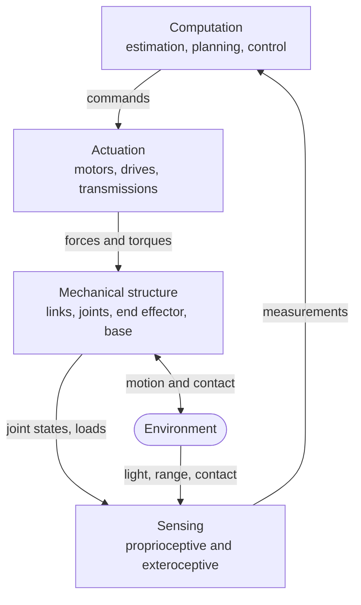
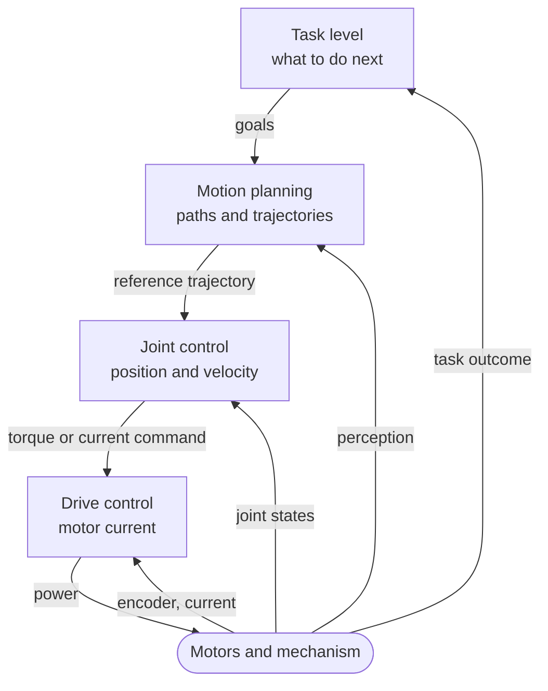

A washing machine senses the water level, runs a motor and follows a programme, yet few people would call it a robot. A drone that holds its position in a gusting wind usually is called one, and so is a factory arm that repeats the same weld a million times. The word is used loosely, and the loose use hides a useful idea. This entry gives that idea a precise form and then takes a robot apart into its subsystems, so that the rest of the series has a shared vocabulary.

The approach is from the outside in. It starts with what makes a machine a robot, divides a robot into four subsystems, follows the two different things that flow between them (energy and information), and ends with the ways in which the software that closes the loop is organised.

## 1. What Makes a Machine a Robot

### 1.1 A working definition

Definitions differ between standards bodies and textbooks, but they share three elements. A robot is a machine that:

1. **acts physically** on itself or its environment: it moves, grasps, pushes or carries;
2. **senses**, so that what it does depends on what is actually happening rather than only on what was planned;
3. **decides** to some degree on its own, by computing its actions from its sensing and its goal.

The international vocabulary standard for robotics, ISO 8373, captures the same idea in its own terms: a programmed, actuated mechanism with a degree of autonomy that moves within its environment to perform tasks.

The three elements together form a **closed loop**: act, observe the effect, decide the next action. The idea of feedback, introduced for general dynamical systems in the [first entry of the control systems series](/blog/introduction-to-control-systems), is the core of every robot. What distinguishes robotics from control in general is that the loop runs through a physical mechanism moving in space, with all the geometry, contact and uncertainty that implies.

### 1.2 Autonomy is a spectrum

The third element, deciding, admits degrees.

| Level | Who decides what | Example |
|---|---|---|
| Teleoperated | A human commands every motion; the machine executes and stabilises it | A remotely operated underwater vehicle steered by a pilot |
| Supervised | A human sets goals or approves plans; the machine executes them | A planetary rover given a target for the day, which plans and drives its own route |
| Autonomous within a task | The machine chooses its motions to achieve a given goal | A warehouse vehicle routing itself to a shelf |
| Autonomous across tasks | The machine chooses among goals and adapts to new situations | Largely a research aim |

Even a teleoperated machine contains autonomous loops: the pilot commands a heading, and the vehicle's own controllers decide how hard to drive each thruster to hold it. Autonomy is better described layer by layer than as a single property of a machine.

### 1.3 The washing machine revisited

By this definition the washing machine sits at the edge: it senses and acts, but its decisions are a fixed sequence with a few branches, and its actions do not involve moving through or manipulating space. The factory arm repeating a weld is clearly a robot, even though its task never changes: within each motion, its joint controllers continuously correct for load and disturbance, and it can be reprogrammed for a different task. The line is blurred on purpose. What matters is not the label but the structure, which the rest of this entry describes.

## 2. Four Subsystems

Every robot can be divided into four subsystems. The division is a convenience, since real components often belong to more than one, but it organises both the hardware and the questions an engineer asks about it.

### 2.1 Mechanical structure

The structure is the body: rigid **links** connected by **joints**, ending in an **end effector** (a gripper, a tool, a foot) and, for mobile robots, carried on a **base** with wheels, legs, rotors or propellers.

Two joint types dominate:

- a **revolute** joint rotates about an axis, like an elbow;
- a **prismatic** joint slides along an axis, like a drawer.

Each contributes one **degree of freedom** (DOF): one independent coordinate needed to describe the robot's configuration. Joints with more freedom, such as a ball joint, can be treated as several one-DOF joints with intersecting axes.

### 2.2 Degrees of freedom and mobility

A rigid body moving freely in three-dimensional space has **six** degrees of freedom: three of position and three of orientation. In a plane it has **three**: two of position and one of orientation. These numbers set what a robot needs in order to place an object arbitrarily: an arm that must reach any position *and* orientation in its workspace needs at least six joints, and a planar arm needs at least three.

For a serial arm (a single chain of links from base to tool), the number of degrees of freedom is simply the number of one-DOF joints. For mechanisms with closed loops, such as a parallel robot whose platform is held by several legs, the **mobility** is counted with the Chebychev–Grübler–Kutzbach formula. For a spatial mechanism with $N$ bodies including the fixed ground and $J$ joints, where joint $i$ allows $f_i$ degrees of freedom,

$$
M = 6\,(N - 1 - J) + \sum_{i=1}^{J} f_i .
$$

Each body other than the ground contributes six freedoms, and each joint removes the $6 - f_i$ freedoms it constrains. For a planar mechanism, replace 6 by 3. As a check, a serial arm of $n$ revolute joints has $N = n + 1$ bodies and $J = n$ joints, giving $M = 6(n + 1 - 1 - n) + n = n$, as expected. The formula counts constraints without examining geometry, so special arrangements (parallel axes, for example) can give a mechanism more mobility than it predicts.

Three terms recur throughout robotics:

- A robot is **redundant** for a task when it has more degrees of freedom than the task requires: a seven-joint arm placing a tool in six-dimensional position and orientation has one degree of freedom to spare, which it can use to avoid obstacles or joint limits.
- A robot is **underactuated** when it has fewer actuators than degrees of freedom: a quadrotor has four rotors but six degrees of freedom, so it cannot, for instance, move sideways without first tilting.
- A mobile base is **nonholonomic** when its velocity is constrained in ways that do not restrict where it can eventually go. A car's configuration in the plane has three coordinates (position and heading), but it cannot move directly sideways; it can still reach any position and heading, by manoeuvring, as anyone who has parallel-parked knows.

### 2.3 Actuation

Actuators turn commands into forces and torques. Most robots use **electric motors**, typically brushless motors driven by power electronics that regulate the current in the windings, and therefore the torque. Hydraulic actuators offer very high force density and appear in heavy machinery and some legged robots; pneumatic actuators are cheap and naturally compliant but hard to control precisely.

An electric motor is efficient at high speed and low torque, while joints usually need the opposite, so the motor drives the joint through a **transmission** (a gearbox, belt, cable or screw). A reduction of ratio $N$ trades speed for torque. If the motor delivers torque $\tau_m$ at speed $\omega_m$, the joint receives, for a transmission of efficiency $\eta$,

$$
\tau_j = \eta \, N \, \tau_m, \qquad \omega_j = \frac{\omega_m}{N}.
$$

The transmission also changes how the motor's own inertia appears at the joint. A motor rotor of inertia $J_m$ is felt at the joint as an inertia of $N^2 J_m$, because the rotor turns $N$ times faster than the joint. With a high reduction ratio the reflected motor inertia can dominate the link's own inertia. That makes the joint insensitive to changes in load, which simplifies control, but it also makes the joint stiff and hard to push back by hand, a concern when robots work near people. Designs that need to be gentle use low ratios, or deliberately insert a spring between gearbox and link (**series elastic actuation**) so that joint torque can be measured from the spring's deflection and controlled.

### 2.4 Sensing

Sensors divide into two families by what they measure.

- **Proprioceptive** sensors measure the robot's own state: **encoders** measure joint angles, motor current indicates torque, **inertial measurement units** (accelerometers and gyroscopes) measure the acceleration and rotation rate of the body, and torque sensors measure loads at joints.
- **Exteroceptive** sensors measure the environment: **cameras**, **range sensors** (lidar, which measures distance by timing reflected light; sonar; structured-light and time-of-flight depth cameras), **force–torque sensors** at the wrist, and **tactile** sensors in fingertips or skins.

Where a sensor is mounted interacts with the transmission. An encoder on the motor shaft benefits from the gear reduction: with 4096 counts per motor revolution and a 100:1 reduction, the joint angle is resolved to

$$
\frac{360^\circ}{4096 \times 100} \approx 0.00088^\circ .
$$

But that number describes the motor, not the link. Backlash and elasticity in the gearbox sit between the encoder and the link, so the link's true angle can differ from what the motor encoder implies by far more than its resolution. Some robots add a second encoder on the joint output for exactly this reason. The general lesson is that a sensor measures one physical quantity at one place; the quantity the controller cares about is often somewhere else, and the gap between the two is part of the design.

No sensor reports the state of the robot and its surroundings directly and exactly. Measurements are noisy, delayed, intermittent and indirect, and turning them into an estimate of the state is a central problem of robotics, the subject of the last entry in this series.

### 2.5 Computation

The computation subsystem turns measurements and goals into commands. In practice it is not one computer but several, arranged by how fast they must respond: microcontrollers on each motor drive, a real-time controller coordinating the joints, and one or more general-purpose computers for perception and planning. The arrangement follows from the timing requirements described in Section 4.

## 3. Two Flows: Energy and Information

The diagram in Section 2 mixes two different kinds of arrow. Separating them clarifies many design decisions.

The **energy path** runs from the power source (a battery or supply) through the power electronics, the motor and the transmission to the joint, and from there into the environment as work done on objects, or back into the robot as heat and stored motion. Its concerns are power, efficiency, heat, peak torque and safety: what the robot is *able* to do.

The **information path** runs from the sensors through estimation, decision and control to the commands sent to the power electronics. Its concerns are accuracy, delay, rate and reliability: what the robot *knows* and how quickly it can respond.

The two paths meet only at two places: the power electronics, where a small command signal regulates a large flow of power, and the sensors, where physical quantities become data. A fault on the energy path (a motor overheating, a battery sagging under load) appears to the information path only through what the sensors report. A fault on the information path (a delayed message, a wrong estimate) reaches the world through the full power of the actuators. Many safety mechanisms in robots, such as torque limits enforced in the drive electronics and emergency stops that cut motor power directly, exist to keep the second kind of fault from becoming dangerous.

## 4. Loops Within Loops

A robot does not run one feedback loop; it runs a hierarchy of them, each closed around the one below at a lower rate.

Typical orders of magnitude, which vary widely between robots, are:

| Loop | Typical update rate | Closes around |
|---|---|---|
| Motor current | Tens of kilohertz | Measured winding current |
| Joint position and velocity | Around a kilohertz | Encoder readings |
| Motion planning and reactive avoidance | Tens to hundreds of hertz | Perceived obstacles and the robot's estimated state |
| Task decisions | About once per second or slower | Whether goals were achieved |

Each loop treats the faster loops below it as an approximately ideal actuator. The joint controller assumes that the torque it requests is the torque it gets, because the current loop is many times faster; the planner assumes that the trajectory it sends is the trajectory the joints follow. These assumptions hold only when the rates are well separated, which is one reason the rates differ by orders of magnitude. When an assumption fails, for instance when a planner asks for a motion faster than the joint loop can track, the error shows up at the higher level as a robot that does not do what was planned.

## 5. Organising the Software

The hierarchy above says *when* each computation runs. A separate question is *how* the decision-making at the top is organised. Three broad answers have shaped the field.

### 5.1 Sense–plan–act

The earliest mobile robots, such as Shakey, built at the Stanford Research Institute from the late 1960s, followed a **deliberative** cycle: sense the world, build a model of it, plan a sequence of actions in the model, then execute the plan. The approach is general and its plans can be explained, but it is slow, and it assumes the model stays accurate while the plan executes. In a changing environment, the world has often moved on before the plan is finished.

### 5.2 Reactive control

In 1986 Rodney Brooks proposed the **subsumption architecture**, in which behaviour is built from layers of simple, fast sensor-to-actuator rules ("if an obstacle is close, turn away"; "otherwise, wander"; "if a doorway is seen, go through it"), with higher layers able to suppress or override lower ones and no central world model. Reactive systems respond quickly and degrade gracefully, but they are hard to direct toward long-range goals and hard to analyse.

### 5.3 Layered (hybrid) architectures

Most robots today combine the two in **layered** architectures, often described in three layers (Erann Gat's 1998 survey is a common reference): a **reactive** layer of fast feedback behaviours, a **deliberative** layer that plans over a model at a slower rate, and an **executive** (sequencing) layer between them that turns plans into sequences of behaviours, monitors their progress and handles failures. The loops-within-loops hierarchy of Section 4 is the same idea seen from the control side.

## 6. Why Robotics Is Hard

The subsystems are individually well understood; the difficulty lies in their combination with the physical world.

- **Uncertainty everywhere.** Sensors are noisy, models of the mechanism are approximate (friction, flexibility, backlash), and the environment is only partly known. Every decision is made on an estimate.
- **Time.** Physical motion does not wait for computation. A late command is a wrong command, and delay inside a feedback loop can make an otherwise stable loop unstable.
- **Contact.** Touching the world changes the dynamics abruptly: a gripper closing on an object, a foot striking the ground. Contact forces can be large and are hard to predict.
- **Geometry.** Positions and orientations live in spaces where ordinary intuition misleads: rotations do not commute, and angles wrap around. Getting frames and transformations right is the subject of the next entry.
- **Safety.** A robot converts information into force. Its failures have physical consequences, and near people they must be bounded by design, not just made unlikely.

## 7. Summary

| Question | Answer |
|---|---|
| What makes a machine a robot? | It acts physically, senses, and decides its actions to some degree from what it senses, in a closed loop. |
| What are the four subsystems? | Mechanical structure, actuation, sensing and computation. |
| How many degrees of freedom does a free rigid body have? | Six in space, three in the plane. |
| What do redundant, underactuated and nonholonomic mean? | More DOF than the task needs; fewer actuators than DOF; velocity constrained without restricting reachable configurations. |
| What does a gear reduction of ratio $N$ do? | Multiplies torque by about $N$, divides speed by $N$, and reflects motor inertia to the joint multiplied by $N^2$. |
| Why separate the energy and information paths? | They fail differently, and safety mechanisms exist to stop information faults from becoming energy faults. |
| Why do control loops run at different rates? | Each loop assumes the faster loop below it behaves as an ideal actuator, which holds only when rates are well separated. |
| How is robot software organised? | Deliberative, reactive, or most often a layered combination with an executive between them. |

The next entry turns to geometry: how to describe where each part of a robot is, and how to convert between the many coordinate frames that a robot's sensors and links define.

### References

- ISO 8373, *Robotics — Vocabulary*, International Organization for Standardization.
- R. A. Brooks, "A Robust Layered Control System for a Mobile Robot", *IEEE Journal of Robotics and Automation*, 1986.
- E. Gat, "On Three-Layer Architectures", in D. Kortenkamp, R. P. Bonasso and R. Murphy (eds.), *Artificial Intelligence and Mobile Robots*, MIT Press, 1998.
- N. J. Nilsson, *Shakey the Robot*, SRI International Technical Note 323, 1984.
