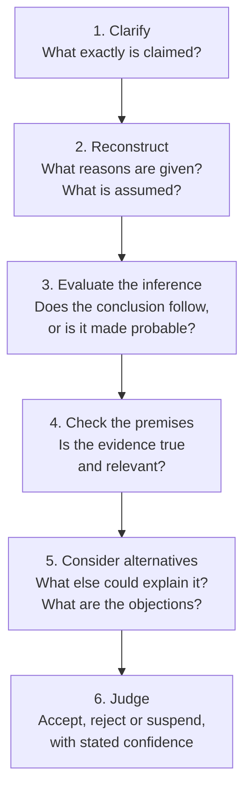

Engineers spend much of their working day deciding what to believe and what to do. Is the regression in last night's benchmark real or noise? Does the vendor's datasheet support the claim on its first page? Will the proposed design meet the requirement, or only the version of the requirement that its author had in mind? None of these questions is answered by recalling a fact. Each needs a judgment built from reasons, and the quality of the judgment depends on the quality of the reasoning behind it.

This entry opens the series [Critical Thinking and Reasoning](/series/critical-thinking), a thirteen-part course on reasoning carefully about technical and everyday claims. The series moves from meaning and argument, through formal logic, to scientific, statistical, ethical and strategic reasoning, and ends with fallacies, biases and creativity. It assumes no background in philosophy or logic. This first entry sets out what critical thinking is (Section 1) and how scholars have defined it (Section 2). It then describes the skills, knowledge and dispositions that critical thinking combines (Section 3) and explains why fast intuition needs a second look (Section 4). Section 5 gives a working method that the rest of the series fills in, and Section 6 states its limits.

## 1. What critical thinking is

### 1.1 A working definition

In this series, **critical thinking** means clear and rational thinking about what to believe and what to do. It involves understanding what a claim says, finding the reasons offered for it, judging how well those reasons support it and holding the conclusion with the confidence that the reasons warrant. The definition has three parts worth separating.

- **Clarity** concerns meaning. A claim that can be read in two ways cannot be evaluated until one knows which reading is intended.
- **Rationality** concerns reasons. A belief is rational to the degree that it is supported by good evidence and sound inference, not by habit, wishful thinking or the authority of whoever said it loudest.
- **Belief and action** are both in scope. Critical thinking is not only about which statements are true; it is also about which design to adopt, which test to run first or whether to ship today.

The word "critical" comes from the Greek *kritikos*, able to judge or discern. It does not mean fault-finding. A critical reading of a colleague's proposal may well conclude that the proposal is right and that its argument can be made stronger.

### 1.2 What critical thinking is not

Three confusions are common enough to address directly.

**It is not the same as knowing a lot.** A person with an excellent memory for facts may still accept a conclusion that does not follow from them, or fail to notice that two of the facts contradict each other. Knowledge is the material of reasoning; critical thinking is the skill of using that material well, including knowing where to look for information that is missing.

**It is not the same as being argumentative.** Critical thinking can expose a bad argument, but it is equally a tool for cooperative work: improving a design, strengthening a proof, finding the assumption that two teams disagree about without realizing it. A design review in which everyone tries to find the strongest version of each proposal is critical thinking at its most productive.

**It is not the enemy of creativity.** A common view holds that careful reasoning follows rules while creativity breaks them. In practice the two work in sequence. Generating many candidate ideas is one activity; selecting, testing and improving them is another, and the second is critical thinking. The last entry of the series, [Creativity and Generating Ideas](/blog/creativity-and-generating-ideas), treats the first activity on its own terms.

### 1.3 A domain-general skill

Much of what makes reasoning good does not depend on the subject. The same error, concluding that a hypothesis is true because one of its predictions came true, can be made by a physician interpreting a test, a programmer interpreting a passing unit test and a manager interpreting a quarterly result. For this reason critical thinking is called **domain-general**: its principles apply across fields. It is not domain-free, however. Recognizing that a benchmark is unrepresentative requires knowing something about benchmarks. Section 6 returns to this point.

## 2. How critical thinking has been defined

There is no single agreed definition, but the best-known ones share a family resemblance. Reading a few of them side by side shows what they agree on.

### 2.1 Dewey and reflective thought

The philosopher and educator John Dewey, in *How We Think* (1910), argued that education should cultivate what he called **reflective thought**: the active, persistent and careful examination of a belief in the light of the grounds that support it and the conclusions it leads to. Dewey stressed suspended judgment: before accepting a conclusion, one first investigates the nature of the problem. This is the root of the modern idea that critical thinking is reflective rather than reactive.

### 2.2 Ennis: deciding what to believe or do

Robert Ennis, whose work shaped much of the later literature and its tests, defined critical thinking as reasonable and reflective thinking that is focused on deciding what to believe or do (Ennis, 1987). The definition is short, and each word earns its place. "Reasonable" points to standards of good reasoning; "reflective" to deliberate rather than automatic thought; and "deciding what to believe or do" makes clear that the aim is a judgment that guides belief or action, not reflection for its own sake.

### 2.3 The Delphi consensus

In 1990 Peter Facione reported the results of a structured consultation of experts, conducted for the American Philosophical Association by the Delphi method (successive rounds of anonymous written opinions, each round informed by a summary of the last). The panel described critical thinking as purposeful, self-regulatory judgment and identified six core cognitive skills: **interpretation**, **analysis**, **evaluation**, **inference**, **explanation** and **self-regulation** (Facione, 1990). The report also described an ideal critical thinker in terms of dispositions such as inquisitiveness, open-mindedness, honesty in facing one's own biases and willingness to reconsider.

### 2.4 What the definitions share

The definitions differ in emphasis but agree on three points:

| Common element | Dewey | Ennis | Delphi report |
|---|---|---|---|
| Judgments rest on reasons and evidence | Grounds that support a belief | Reasonable thinking | Evaluation and inference |
| Thinking is deliberate and self-aware | Reflective thought, suspended judgment | Reflective thinking | Self-regulation |
| The aim is a decision about belief or action | Tested conclusions | Deciding what to believe or do | Purposeful judgment |

The working definition in Section 1.1 is a compressed version of these three points.

## 3. Skills, knowledge and dispositions

Becoming good at critical thinking resembles becoming good at any complex skill, such as debugging or playing an instrument. It needs knowledge of the principles, practice in applying them and the attitudes that make one use them.

### 3.1 The component skills

The skills can be listed as questions that a careful reasoner asks of a claim. The table also shows where each is developed in this series.

| Skill | Question it answers | Developed in |
|---|---|---|
| Analyzing meaning | What exactly is being claimed? | [Meaning, Clarity and Definitions](/blog/meaning-clarity-and-definitions) |
| Identifying arguments | What reasons are given, and what is assumed? | [Arguments and Their Structure](/blog/arguments-and-their-structure) |
| Evaluating deduction | Does the conclusion follow necessarily? | Entries four to seven, from [What Logic Studies](/blog/what-logic-studies) to [Predicate Logic](/blog/predicate-logic) |
| Evaluating evidence | Is the causal or statistical support adequate? | [Scientific Reasoning and Causation](/blog/scientific-reasoning-and-causation), [Probability and Statistical Reasoning](/blog/probability-and-statistical-reasoning) |
| Reasoning about values | Which value judgments does the conclusion rest on? | [Reasoning About Values](/blog/reasoning-about-values) |
| Deciding | Which option is best, given goals and uncertainty? | [Strategic Thinking and Decisions](/blog/strategic-thinking-and-decisions) |
| Detecting errors | Which known mistakes might be at work? | [Fallacies and Cognitive Biases](/blog/fallacies-and-cognitive-biases) |
| Generating alternatives | What other explanations or options exist? | [Creativity and Generating Ideas](/blog/creativity-and-generating-ideas) |

### 3.2 Knowledge of standards

Skills apply standards, and the standards have to be learned. Some are positive: the rules of deductive logic, the rules of probability, the logic of controlled experiments. Others are negative: knowledge of the errors people characteristically make. The negative knowledge comes from two sources. Logicians have cataloged **fallacies**, patterns of reasoning that look persuasive but do not support their conclusions. Psychologists have documented **cognitive biases**, systematic tendencies of human judgment to depart from what the evidence supports, such as the tendency to seek evidence that confirms what one already believes (Tversky and Kahneman, 1974). Knowing that these tendencies exist does not make one immune to them, but it tells one where to look.

### 3.3 Practice and transfer

Knowing the rules of inference no more makes a good reasoner than knowing the rules of swimming makes a swimmer. Skill comes from applying the principles to many varied cases, receiving feedback and reflecting on mistakes. A recurring finding in the teaching of critical thinking is that skills learned in one context do not move to another automatically: **transfer** to new kinds of problems has to be practiced deliberately (van Gelder, 2005). This is why every entry of this series includes worked examples drawn from several domains and ends with exercises.

### 3.4 Dispositions

A person may have the skills and still not use them. **Dispositions** are the habits and attitudes that determine whether the skills are applied when they matter. The following list is representative rather than official:

- **truth-seeking**: wanting to know how things are, even when the answer is unwelcome;
- **open-mindedness**: giving a fair hearing to views one initially rejects;
- **systematicity**: breaking a problem into parts and working through them in order;
- **intellectual humility**: accepting that one's own judgment may be wrong, and reviewing past mistakes rather than defending them;
- **confidence in reasoning**: being willing to follow an argument to its conclusion instead of deferring by reflex to whoever holds the more senior position;
- **maturity of judgment**: not jumping to conclusions, and holding conclusions with the confidence the evidence supports, no more and no less.

Some attitudes work against these: preferring to be handed the answer, trusting gut feeling for every decision, never revisiting past errors and treating criticism of an idea as criticism of oneself. An engineering culture that runs blameless postmortems is, in effect, cultivating the dispositions of critical thinking at the level of a team.

## 4. Why intuition needs a second look

### 4.1 Fast and slow thinking

Most judgments are made quickly and without effort. One recognizes a face, completes the sentence "salt and ...", or feels that a code change is risky before being able to say why. Psychologists distinguish this fast, automatic, associative mode of thought from a slow, effortful, deliberate mode that follows rules and can hold several steps in mind. Keith Stanovich and Richard West called them System 1 and System 2 (Stanovich and West, 2000), and Daniel Kahneman's book *Thinking, Fast and Slow* made the labels widely known (Kahneman, 2011). The labels are a convenient description of two kinds of processing, not a claim about two separate organs of the brain.

Fast thinking is indispensable. It is usually right in familiar situations, and expert intuition (an experienced engineer's sense that a weld looks wrong) is fast thinking trained by years of feedback. The trouble is that fast thinking delivers its answers with the same feeling of confidence whether they are right or wrong, and it tends to answer an easier question than the one asked.

### 4.2 The bat and the ball

Shane Frederick's Cognitive Reflection Test is a short test built from questions that have an intuitive but wrong answer (Frederick, 2005). Its best-known item reads: a bat and a ball cost \$1.10 in total, and the bat costs \$1.00 more than the ball; how much does the ball cost?

The answer that comes to mind for most people is 10 cents. Checking it takes one line: if the ball cost \$0.10, the bat would cost \$1.10 and the total would be \$1.20. Writing $b$ for the price of the ball in dollars, the conditions give

$$
b + (b + 1.00) = 1.10 \quad\Rightarrow\quad 2b = 0.10 \quad\Rightarrow\quad b = 0.05,
$$

so the ball costs 5 cents and the bat \$1.05. Frederick reported that a large share of respondents, including many students at selective universities, gave the intuitive answer. The point is not that the arithmetic is hard; it is that the wrong answer arrives first and feels right, and only a habit of checking catches it.

The same structure appears in engineering problems. A robot drives 30 km to a charging station at 30 km/h and returns the same 30 km at 90 km/h. What is its average speed over the round trip? The tempting answer is the average of the two speeds, 60 km/h. Average speed is total distance over total time: the outward leg takes 1 h, the return leg 1/3 h, so the average is $60 / (4/3) = 45$ km/h. The intuitive answer averages the wrong quantity, giving each leg equal weight when the slower leg occupies three times as much time.

### 4.3 Metacognition: knowing when to slow down

**Metacognition** is thinking about one's own thinking: knowing how one's reasoning works, monitoring it while it runs and changing course when it is going wrong. Critical thinking depends on it, because the decisive step in both examples above is not the calculation but the decision to check. Deliberation is costly, so the practical skill is to recognize the situations in which a quick answer is not good enough. Useful signals include:

- the stakes are high or the decision is hard to reverse;
- the situation is unfamiliar, so intuition has had no chance to be trained by feedback;
- the answer arrived instantly to a question that involves numbers, rates or probabilities;
- one has a personal stake in a particular answer;
- someone with relevant knowledge disagrees.

### 4.4 Systematic errors

The bat-and-ball error is not random: almost everyone who errs gives the same wrong answer. That is the mark of a **systematic error** in judgment, as opposed to noise. Tversky and Kahneman showed that people judging probabilities rely on a small number of mental shortcuts (heuristics) that are often useful but produce predictable errors, such as judging how likely an event is by how easily examples come to mind (Tversky and Kahneman, 1974). Because the errors are predictable, they can be anticipated and checked for. The twelfth entry, [Fallacies and Cognitive Biases](/blog/fallacies-and-cognitive-biases), collects the most important of them.

## 5. A working method: from claim to judgment

### 5.1 Six questions

The rest of the series develops tools for each step of a simple procedure. It is not an algorithm to be followed mechanically, but a checklist that makes it harder to skip a step.

The first step is the subject of the second entry and the second step of the third. The third step uses the logic of entries four to seven for deductive arguments and the methods of entries eight and nine for evidence. The fourth and fifth steps are where scientific method, statistics and creativity meet. The sixth step is a judgment, and it includes the option of suspending judgment until better evidence is available.

### 5.2 Worked example: a faster build

A colleague reports: "Switching the build cache to the new storage backend made our continuous-integration (CI) pipeline twice as fast. Last week the average pipeline took 20 minutes; this week it takes 10." The numbers here are invented for illustration; the reasoning is the point.

1. **Clarify.** "Twice as fast" could mean the mean pipeline duration halved, the median halved or the slowest runs halved. "The pipeline" could mean every job or only the jobs that use the cache. The claim as stated is about the mean over all runs, so take that reading and note the others.
2. **Reconstruct.** The argument is: (P1) the mean duration last week was 20 minutes; (P2) the mean duration this week is 10 minutes; (P3) the storage backend was changed between the two weeks; therefore (C) the change of backend halved the duration. The inference from P1 to P3 to C relies on an unstated assumption: (A) nothing else that affects duration changed between the two weeks.
3. **Evaluate the inference.** Even with A, the argument is not deductively valid: the conclusion could be false with all premises true, for instance if the difference between the weeks arose from chance variation in run times. It is an inductive causal argument, and its strength depends on A and on how many runs each mean is based on.
4. **Check the premises.** Are the two means computed over comparable runs? If this week includes many documentation-only commits that skip the test stage, the mean falls for a reason unrelated to the cache.
5. **Consider alternatives.** Other changes in the same week (a compiler upgrade, a quieter week with fewer concurrent jobs competing for runners, a test suite that was split or disabled) could each produce the same drop.
6. **Judge.** The claim is plausible but not yet established. A test that would settle it is cheap: run the same commit several times with each backend, alternating, on the same runners, and compare the distributions of duration. Until then, a fair summary is "the pipeline has been faster since the change, and the backend is a likely cause".

Nothing in this analysis requires doubting the colleague's honesty. It requires only asking what the claim means, what it rests on and what else could produce the same observation. Entry eight treats this kind of causal inference and the design of fair comparisons in detail.

## 6. Limits and failure modes

Critical thinking has failure modes of its own, and a series that teaches it should name them.

**Doubting everything is not the same as thinking critically.** Rejecting every claim equally is as uncritical as accepting every claim equally, because neither response is sensitive to the evidence. Most of what anyone believes rests on testimony: textbooks, standards, documentation and colleagues. The critical question about testimony is not whether to trust it but how much, given the source's competence, track record and incentives.

**Skill can serve bias.** The tools in this series can be used to scrutinize only the arguments one dislikes while waving through the ones one likes. A skilled reasoner who does this is harder to correct, not easier. The safeguard is a disposition rather than a skill: applying the same standard to one's own conclusions as to those of others.

**Deliberation has a cost.** Not every decision deserves the six steps. Choosing a variable name does not; choosing a database for a ten-year product might. Part of good judgment is matching effort to stakes.

**General skill does not replace domain knowledge.** One cannot judge whether a statistical analysis of sensor data is appropriate without knowing something about the sensor and the statistics. Critical thinking tells one which questions to ask; domain knowledge is often needed to answer them, and recognizing when to consult someone who has it is itself a critical-thinking skill.

**Reasoning is social.** Individuals are better at finding flaws in others' arguments than in their own. Code review, peer review and red-team exercises exist because they put this asymmetry to work. A practical consequence is that one of the best ways to improve one's own reasoning is to expose it to people who will look for the flaws.

## 7. Exercises

**Exercise 1.** Which of the following describe critical thinking in the sense of Section 1.1, and which do not? (a) Memorizing the definitions of 50 logical fallacies. (b) Asking what evidence would change one's mind before a design meeting. (c) Rejecting a proposal because it came from a competitor. (d) Rewriting a colleague's argument in its strongest form before replying to it.

*Answer.* (b) and (d) are critical thinking: (b) is self-regulation about one's own belief, and (d) applies analysis and charity to another's argument. (a) is knowledge that can support critical thinking but is not itself the activity. (c) judges a claim by its source rather than its reasons, which is the opposite.

**Exercise 2.** A sensor costs \$90 more than its mounting bracket, and together they cost \$100. What does the bracket cost? Before solving, write down the first answer that comes to mind.

*Answer.* The tempting answer is \$10. With bracket price $x$: $x + (x + 90) = 100$, so $x = 5$. The bracket costs \$5 and the sensor \$95.

**Exercise 3.** A data logger samples at 100 samples per second during one part of a test and at 400 samples per second during the rest. What is the average sampling rate over the whole test (a) if the logger spends half the test duration at each rate, and (b) if it takes half of its samples at each rate? Write down your first guess for (b) before working it out.

*Answer.* (a) The rates are weighted by time, and the times are equal, so the average is $(100 + 400)/2 = 250$ samples per second. (b) With $N$ samples taken at each rate, the two parts last $N/100$ s and $N/400$ s, so the average is $2N / (N/100 + N/400) = 160$ samples per second. The tempting answer for (b) is again 250. The slower rate occupies four times as long, so it dominates the average, which is the structure of the average-speed example in Section 4.2.

**Exercise 4.** Apply the six questions of Section 5.1 to the claim: "Our new onboarding guide works: support tickets from new users fell by 30% in the month after it was published."

*Answer.* Clarify: tickets per new user, or total tickets? Which month is compared with which? Reconstruct: the argument assumes that nothing else that affects tickets changed, and that new users read the guide. Evaluate: it is an inductive causal argument, not a valid one. Check premises: if the number of new users also fell, a fall in total tickets says little. Alternatives: a product fix released in the same month, seasonal variation, a change in how tickets are counted. Judge: plausible but not established; comparing ticket rates of new users who did and did not open the guide, or a staged rollout, would be stronger evidence.

**Exercise 5.** A teammate says: "I never trust intuition; I always work everything out from first principles." Evaluate this as a policy.

*Answer.* It is impossible to follow and would be unwise if it were possible. Every chain of reasoning starts from premises taken on trust, and deliberation is too slow for every decision. The defensible policy is to trust trained intuition in familiar, low-stakes situations with good feedback, and to check it when the signals of Section 4.3 are present.

## 8. Summary

| Question | Answer |
|---|---|
| What is critical thinking? | Clear and rational thinking about what to believe and what to do, with conclusions held at the confidence the reasons warrant. |
| What is it not? | Mere knowledge of facts, fault-finding for its own sake, or the opposite of creativity. |
| What do the classic definitions share? | Judgments based on reasons, deliberate and self-aware thinking, and an aim of deciding belief or action. |
| What does it combine? | Skills (analysis, evaluation, inference), knowledge of standards and of typical errors, practice and dispositions such as open-mindedness and humility. |
| Why is intuition not enough? | Fast judgments are often right but can be confidently and systematically wrong, as the bat-and-ball problem shows. |
| What is the working method? | Clarify, reconstruct, evaluate the inference, check the premises, consider alternatives, judge with stated confidence. |
| What are its limits? | Indiscriminate doubt, selective rigor, the cost of deliberation and the need for domain knowledge. |

The first step of the method, clarifying what a claim means, comes before all the others: an argument about a claim that has not been pinned down is an argument about several claims at once. The [next entry](/blog/meaning-clarity-and-definitions) takes up meaning: definitions and how to judge them, necessary and sufficient conditions, and the ambiguity, vagueness and distortion that make claims hard to evaluate.

### References

- J. Dewey, *How We Think*, D. C. Heath, 1910.
- R. H. Ennis, "A taxonomy of critical thinking dispositions and abilities," in J. B. Baron and R. J. Sternberg, Eds., *Teaching Thinking Skills: Theory and Practice*, W. H. Freeman, pp. 9–26, 1987.
- P. A. Facione, *Critical Thinking: A Statement of Expert Consensus for Purposes of Educational Assessment and Instruction* (The Delphi Report), American Philosophical Association, 1990.
- S. Frederick, "Cognitive reflection and decision making," *Journal of Economic Perspectives*, vol. 19, no. 4, pp. 25–42, 2005.
- D. Kahneman, *Thinking, Fast and Slow*, Farrar, Straus and Giroux, 2011.
- J. Lau, *An Introduction to Critical Thinking and Creativity: Think More, Think Better*, Wiley, 2011.
- J. Lau and J. Chan, *Critical Thinking Web*, Department of Philosophy, The University of Hong Kong, 2004–2026. https://philosophy.hku.hk/think/
- K. E. Stanovich and R. F. West, "Individual differences in reasoning: Implications for the rationality debate?," *Behavioral and Brain Sciences*, vol. 23, no. 5, pp. 645–665, 2000.
- A. Tversky and D. Kahneman, "Judgment under uncertainty: Heuristics and biases," *Science*, vol. 185, no. 4157, pp. 1124–1131, 1974.
- T. van Gelder, "Teaching critical thinking: Some lessons from cognitive science," *College Teaching*, vol. 53, no. 1, pp. 41–46, 2005.
