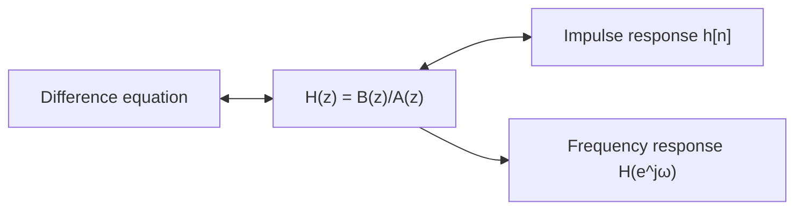

The [first entry](/blog/signals-and-systems-in-discrete-time) described a linear time-invariant (LTI) system in two equivalent ways, by a difference equation and by its impulse response $h[n]$, and derived two facts from the impulse response: the system is bounded-input bounded-output (BIBO) stable exactly when $\sum_n |h[n]|$ is finite, and it multiplies a complex exponential $e^{j\omega n}$ by the frequency response $H(e^{j\omega}) = \sum_k h[k]e^{-j\omega k}$. Both facts required summing an infinite series for each new system. This entry introduces the tool that replaces those sums with algebra.

The **z-transform** turns a sequence into a function of a complex variable $z$, turns convolution into multiplication and turns a difference equation into a ratio of two polynomials, the **transfer function**. The roots of those polynomials, the **poles** and **zeros**, then answer the questions that matter in practice: is the system stable, how fast does its response decay, and which frequencies does it pass or block. The entry ends by designing a filter that removes 50 Hz interference by placing poles and zeros by hand.

Notation and conventions follow the [table in the first entry](/blog/signals-and-systems-in-discrete-time#conventions-used-throughout-the-series): $\omega$ in radians per sample, $T_s$ and $f_s$ the sampling interval and frequency, angles in radians unless marked in degrees, and difference equations written as $y[n] + \sum_{k\ge1} a_k y[n-k] = \sum_{k\ge0} b_k x[n-k]$. All sequences in this series are **causal** (zero for $n < 0$) unless stated otherwise.

## 1. The z-Transform

### 1.1 Definition

The **z-transform** of a sequence $x[n]$ is

$$
X(z) = \sum_{n=-\infty}^{\infty} x[n]\,z^{-n},
$$

where $z$ is a complex variable. Writing $z = r e^{j\omega}$ in polar form shows what it does:

$$
X(re^{j\omega}) = \sum_n \bigl(x[n]\,r^{-n}\bigr)\,e^{-j\omega n}.
$$

On the **unit circle**, $r = 1$, this is exactly the sum that defined the frequency response in the first entry, applied to $x$ instead of $h$; it is called the **discrete-time Fourier transform** (DTFT) of $x[n]$. Away from the unit circle, the factor $r^{-n}$ weights the sequence before the sum, so that a sequence too large for the DTFT to converge, such as a growing exponential, can still have a z-transform for large enough $r$. The z-transform is therefore a generalisation of frequency analysis, in the same way that the Laplace transform generalises the continuous-time Fourier transform.

### 1.2 Region of convergence

The sum converges only for some values of $z$, which form the **region of convergence** (ROC). The basic example is the causal exponential $x[n] = a^n u[n]$, where $u[n]$ is the unit step:

$$
X(z) = \sum_{n=0}^{\infty} a^n z^{-n} = \sum_{n=0}^{\infty} \left(a z^{-1}\right)^n = \frac{1}{1 - a z^{-1}}, \qquad |z| > |a|.
$$

The geometric series converges only when $|a z^{-1}| < 1$, so the ROC is the exterior of the circle of radius $|a|$.

The ROC is part of the answer, not a technicality. The anti-causal sequence $x[n] = -a^n u[-n-1]$ (equal to $-a^n$ for $n \le -1$ and zero otherwise) has the same algebraic expression $1/(1 - az^{-1})$, but with ROC $|z| < |a|$. One formula, two different sequences: the ROC tells them apart. For causal sequences, which are all this series uses, the rule is simple: the ROC is the exterior of a circle passing through the outermost pole (a value of $z$ where $X(z)$ becomes infinite; [Section 2.2](#22-poles-and-zeros) defines poles properly). With that convention fixed, an algebraic expression identifies its sequence uniquely, and the ROC can be left implicit.

### 1.3 A short table of transforms

| Sequence (zero for $n < 0$) | z-transform | ROC |
|---|---|---|
| $\delta[n]$ | $1$ | all $z$ |
| $\delta[n - k]$, $k \ge 0$ | $z^{-k}$ | $z \ne 0$ |
| $u[n]$ | $\dfrac{1}{1 - z^{-1}}$ | $\lvert z \rvert > 1$ |
| $a^n u[n]$ | $\dfrac{1}{1 - a z^{-1}}$ | $\lvert z \rvert > \lvert a \rvert$ |
| $n\,a^n u[n]$ | $\dfrac{a z^{-1}}{(1 - a z^{-1})^2}$ | $\lvert z \rvert > \lvert a \rvert$ |
| $r^n \cos(\omega_0 n)\,u[n]$ | $\dfrac{1 - r\cos\omega_0\, z^{-1}}{1 - 2r\cos\omega_0\, z^{-1} + r^2 z^{-2}}$ | $\lvert z \rvert > r$ |
| $r^n \sin(\omega_0 n)\,u[n]$ | $\dfrac{r\sin\omega_0\, z^{-1}}{1 - 2r\cos\omega_0\, z^{-1} + r^2 z^{-2}}$ | $\lvert z \rvert > r$ |

The last two rows follow from the fourth by writing the cosine and sine as sums of complex exponentials, $r^n e^{\pm j\omega_0 n} = (re^{\pm j\omega_0})^n$, and adding the two geometric-series results.

### 1.4 Properties

Four properties do most of the work. In each, $x[n]$ has transform $X(z)$ and $y[n]$ has $Y(z)$.

- **Linearity.** $\alpha x[n] + \beta y[n]$ has transform $\alpha X(z) + \beta Y(z)$.
- **Time shift.** For a causal sequence and $k \ge 0$, $x[n - k]$ has transform $z^{-k}X(z)$. A delay of one sample multiplies the transform by $z^{-1}$, which is why block diagrams label the one-sample delay "$z^{-1}$".
- **Convolution.** $x * y$ has transform $X(z)\,Y(z)$. Substituting the convolution sum into the definition and exchanging the order of summation proves it.
- **Final value.** If $x[n]$ settles to a limit, that limit is $\lim_{n\to\infty} x[n] = \lim_{z \to 1}\,(1 - z^{-1})X(z)$, provided every pole of $(1 - z^{-1})X(z)$ lies strictly inside the unit circle. Without that proviso the theorem gives a number for sequences that never settle, so the condition must be checked.

## 2. Transfer Functions

### 2.1 From difference equation to transfer function

Take the z-transform of both sides of the general difference equation, using linearity and the time-shift property:

$$
Y(z)\left(1 + \sum_{k=1}^{N} a_k z^{-k}\right) = X(z)\sum_{k=0}^{M} b_k z^{-k}.
$$

The ratio of output to input transforms is the **transfer function**:

$$
H(z) = \frac{Y(z)}{X(z)} = \frac{B(z)}{A(z)} = \frac{b_0 + b_1 z^{-1} + \dots + b_M z^{-M}}{1 + a_1 z^{-1} + \dots + a_N z^{-N}}.
$$

The coefficient arrays $b$ and $a$ of the difference equation are read straight off the numerator and denominator, which is why the first entry fixed the sign convention it did. And because the output is the convolution $y = x * h$, the convolution property gives $Y(z) = H(z)X(z)$ with $H(z)$ the z-transform of $h[n]$. So three descriptions of the same system are now linked, and the frequency response is a fourth:



Moving from the difference equation to $H(z)$ is a matter of reading off coefficients; from $H(z)$ to $h[n]$ is an inverse transform ([Section 3](#3-the-inverse-transform-by-partial-fractions)); and from $H(z)$ to the frequency response is a substitution, $z = e^{j\omega}$ ([Section 5](#5-frequency-response-from-poles-and-zeros)).

For the exponential smoother of the first entry, $y[n] = a\,y[n-1] + (1 - a)\,x[n]$, the arrays are $b = [1 - a]$ and $a = [1, -a]$, so

$$
H(z) = \frac{1 - a}{1 - a z^{-1}},
$$

which matches the transform of its impulse response $(1 - a)a^n u[n]$ from the table. For the three-point moving average, $H(z) = \tfrac13(1 + z^{-1} + z^{-2})$.

### 2.2 Poles and zeros

Multiplying the numerator and denominator of $H(z)$ by $z^{\max(M,N)}$ turns both into ordinary polynomials in $z$, which factor into their roots:

$$
H(z) = b_0\, z^{N - M}\, \frac{(z - q_1)(z - q_2)\cdots(z - q_M)}{(z - p_1)(z - p_2)\cdots(z - p_N)}.
$$

The roots $q_k$ of the numerator are the **zeros** of $H(z)$, where it vanishes, and the roots $p_k$ of the denominator are its **poles**, where it becomes infinite. The factor $z^{N-M}$ adds poles or zeros at the origin. A **pole-zero plot** marks the poles with crosses and the zeros with circles in the complex plane, usually with the unit circle drawn for reference. Up to the gain $b_0$, the plot determines the system completely.

When the coefficients are real, which they are in every filter in this series, complex poles and zeros come in conjugate pairs, so the plot is symmetric about the real axis.

Two examples:

- The exponential smoother has a zero at $z = 0$ and a pole at $z = a$: $H(z) = (1 - a)\,z/(z - a)$.
- The three-point moving average has $H(z) = (z^2 + z + 1)/(3z^2)$: zeros at the roots of $z^2 + z + 1$, which are $e^{\pm j2\pi/3}$, and a double pole at the origin. The zeros lie on the unit circle at the angle $\omega = 2\pi/3$, the frequency the first entry found the filter blocks completely. That is not a coincidence, as Section 5 shows.

Every finite impulse response (FIR) system has all its poles at the origin, since its denominator is $A(z) = 1$. Poles away from the origin come only from feedback.

## 3. The Inverse Transform by Partial Fractions

For a rational transfer function with distinct poles, the impulse response is found by splitting $H(z)$ into a sum of first-order terms, each of which is a row of the table. Take

$$
H(z) = \frac{1}{1 - 1.3 z^{-1} + 0.4 z^{-2}} = \frac{1}{(1 - 0.5 z^{-1})(1 - 0.8 z^{-1})},
$$

a second-order recursive system with poles at $0.5$ and $0.8$. Write it as

$$
H(z) = \frac{A_1}{1 - 0.5 z^{-1}} + \frac{A_2}{1 - 0.8 z^{-1}}.
$$

Each coefficient is found by multiplying by its own factor and setting $z^{-1}$ to the value that makes that factor zero (the **cover-up method**). For $A_1$, set $z^{-1} = 1/0.5 = 2$ in the remaining factor: $A_1 = 1/(1 - 0.8 \times 2) = -5/3$. For $A_2$, set $z^{-1} = 1/0.8 = 1.25$: $A_2 = 1/(1 - 0.5 \times 1.25) = 8/3$. The table then gives

$$
h[n] = \left(\tfrac83\,(0.8)^n - \tfrac53\,(0.5)^n\right)u[n].
$$

Each pole contributes one geometric sequence, $p^n$, to the impulse response, with an amplitude set by the zeros and the other poles. The script below compares the formula with the difference equation $y[n] = 1.3\,y[n-1] - 0.4\,y[n-2] + x[n]$ run on an impulse.

```python
import numpy as np

# H(z) = 1 / ((1 - 0.5 z^-1)(1 - 0.8 z^-1)) = 1 / (1 - 1.3 z^-1 + 0.4 z^-2)
b = np.array([1.0])
a = np.array([1.0, -1.3, 0.4])
print("poles:", np.roots(a))

N = 8
x = np.r_[1.0, np.zeros(N - 1)]          # unit impulse
h = np.zeros(N)
for n in range(N):                        # run the difference equation
    h[n] = x[n] - a[1] * (h[n - 1] if n >= 1 else 0) - a[2] * (h[n - 2] if n >= 2 else 0)
n = np.arange(N)
h_pf = (8 / 3) * 0.8**n - (5 / 3) * 0.5**n   # partial-fraction result
print(np.round(h, 6))
print(np.round(h_pf, 6))
print("H(1) =", np.sum(b) / np.sum(a))
```

Output:

```text
poles: [0.8 0.5]
[1.       1.3      1.29     1.157    0.9881   0.82173  0.673009 0.54622 ]
[1.       1.3      1.29     1.157    0.9881   0.82173  0.673009 0.54622 ]
H(1) = 10.000000000000002
```

(`np.roots` takes the coefficients of $z^2 - 1.3z + 0.4$, which are the same numbers as the array $a$, because multiplying $A(z)$ by $z^2$ does not change the coefficients.) The last line is the DC gain (the gain at zero frequency), $H(z)$ at $z = 1$: by the final-value theorem the step response settles at $\lim_{z\to1}(1 - z^{-1})H(z)\frac{1}{1 - z^{-1}} = H(1) = 10$. The trailing digits are floating-point rounding.

Two refinements complete the method. A pair of complex conjugate poles $re^{\pm j\omega_0}$ gives a pair of conjugate terms that combine into a damped sinusoid $r^n\cos(\omega_0 n + \phi)$, as in the table. A repeated pole $p$ of multiplicity $m$ gives terms $p^n, n p^n, \dots, n^{m-1}p^n$. In each case the size of the pole decides whether the term decays.

## 4. Poles and Stability

### 4.1 The stability condition

Apart from a finite number of initial samples (present when the numerator's degree in $z^{-1}$ is at least the denominator's), every term of a causal impulse response is of the form $n^{i} p^n$ for a pole $p$. Such a term is absolutely summable if $|p| < 1$ (the geometric decay beats any power of $n$) and not summable if $|p| \ge 1$. The first entry showed that summability of $h[n]$ is exactly BIBO stability, so:

> A causal LTI system with a rational transfer function is BIBO stable if and only if all its poles lie strictly inside the unit circle, $|p_k| < 1$.

Equivalently, its ROC, the exterior of the outermost pole, contains the unit circle. Zeros play no part in stability. (The poles must be those of $H(z)$ after any common factors of numerator and denominator have been cancelled; a cancelled pole outside the circle still signals trouble inside an implementation, where the cancellation is never exact.)

A pole *on* the unit circle is not stable in the BIBO sense, although its impulse response stays bounded. The accumulator has $H(z) = 1/(1 - z^{-1})$, a pole at $z = 1$, and its bounded response to an impulse is the step $u[n]$; but its response to the bounded step is the ramp $n + 1$. A pair of poles at $e^{\pm j\omega_0}$ is an undamped oscillator, and a sinusoidal input at exactly $\omega_0$ makes its output grow without bound. Systems with poles on the circle are called **marginally stable**; they are deliberate in an oscillator or an integrator and accidental almost everywhere else.

For a second-order denominator $1 + a_1 z^{-1} + a_2 z^{-2}$, factoring is not needed: both poles lie inside the unit circle if and only if

$$
|a_2| < 1 \quad\text{and}\quad |a_1| < 1 + a_2,
$$

a triangle in the $(a_1, a_2)$ plane often called the **stability triangle**. The example of Section 3 has $a_1 = -1.3$, $a_2 = 0.4$: $0.4 < 1$ and $1.3 < 1.4$, so it is stable, as its poles at 0.5 and 0.8 confirm. For higher orders, the poles are computed numerically, or an algebraic test such as the Jury criterion (the discrete counterpart of the Routh–Hurwitz test) is used.

### 4.2 What the pole position says about the response

A pole $p = re^{j\theta}$ contributes a term $r^n e^{j\theta n}$, so its two coordinates have direct meanings:

- The **radius** $r$ sets the decay. The term falls by a factor $r$ per sample, and, as for the exponential smoother of the first entry, the equivalent time constant is $\tau = -T_s/\ln r$. Poles near the origin die out in a few samples; poles close to the unit circle ring for a long time.
- The **angle** $\theta$ sets the frequency of oscillation, in radians per sample. A real positive pole ($\theta = 0$) gives a smooth decay, a real negative pole ($\theta = \pi$) a decay that alternates in sign at every sample, and a complex pair at $\pm\theta$ a damped sinusoid of frequency $\theta$.

### 4.3 The mapping from the s-plane

The Laplace-transform description of continuous systems, used in the [control systems series](/blog/introduction-to-control-systems), has its poles in the complex $s$-plane, stable when they lie in the left half-plane. Sampling connects the two pictures. A continuous mode $e^{s t}$ sampled at $t = nT_s$ becomes $e^{s n T_s} = (e^{sT_s})^n$, a discrete mode with pole

$$
z = e^{sT_s}.
$$

Writing $s = \sigma + j\Omega$ gives $|z| = e^{\sigma T_s}$ and $\angle z = \Omega T_s$, so:

| $s$-plane | $z$-plane |
|---|---|
| Left half-plane, $\sigma < 0$ (stable) | Inside the unit circle, $\lvert z \rvert < 1$ (stable) |
| Imaginary axis, $\sigma = 0$ | Unit circle |
| Right half-plane, $\sigma > 0$ (unstable) | Outside the unit circle |
| Real axis, $\Omega = 0$ | Positive real axis, $z > 0$ |
| $\Omega = \pm\pi/T_s$ (half the sampling rate) | Negative real axis |

Two examples connect this to earlier material. A continuous first-order lag with time constant $\tau = 94.9$ ms has its pole at $s = -1/\tau$; sampled at $T_s = 10$ ms it maps to $z = e^{-0.01/0.0949} = 0.90$, the exponential smoother of the first entry. The damped oscillator of the [state-space primer](/blog/state-space-models-primer), with eigenvalues $-0.25 \pm 1.984j$ s⁻¹, sampled at $T_s = 0.1$ s, maps to poles of radius $e^{-0.025} = 0.975$ at angles $\pm 0.198$ rad: inside the circle, as a stable continuous system must.

The mapping also shows the limit of sampling. Every strip of the $s$-plane of height $2\pi/T_s$ maps onto the whole $z$-plane, so continuous modes whose frequencies differ by a multiple of the sampling rate land on the same discrete pole: aliasing, once again. The same unit-circle condition reappears in [numerical integration](/blog/numerical-integration-notes), where the explicit Euler method maps a continuous mode $\lambda$ to the discrete factor $1 + h\lambda$, and the computed solution is stable only if that factor lies inside the unit circle.

## 5. Frequency Response from Poles and Zeros

### 5.1 Evaluation on the unit circle

For a stable system, the ROC includes the unit circle, and the frequency response of the first entry is the transfer function evaluated there:

$$
H(e^{j\omega}) = H(z)\big|_{z = e^{j\omega}}.
$$

As $\omega$ runs from $0$ to $\pi$, the point $e^{j\omega}$ walks counter-clockwise around the upper half of the unit circle from $z = 1$ (zero frequency) to $z = -1$ (half the sampling rate). The factored form of [Section 2.2](#22-poles-and-zeros) then gives a geometric reading of the gain:

$$
\bigl|H(e^{j\omega})\bigr| = |b_0|\,\frac{\prod_k \bigl|e^{j\omega} - q_k\bigr|}{\prod_k \bigl|e^{j\omega} - p_k\bigr|}.
$$

Each factor $|e^{j\omega} - q_k|$ is the distance from the point on the circle to a zero, and each $|e^{j\omega} - p_k|$ the distance to a pole. Hence:

- A **zero on the unit circle** makes the gain exactly zero at its angle. A zero near the circle makes a dip.
- A **pole near the unit circle** makes a small distance in the denominator, and therefore a peak at its angle; the closer the pole, the higher and narrower the peak.
- Poles and zeros at the origin are at distance 1 from every point on the circle, so they do not affect the gain; they only add phase (a pure delay).

The three-point moving average illustrates the first rule: its zeros at $e^{\pm j2\pi/3}$ are why its gain vanishes at $\omega = 2\pi/3$.

### 5.2 Phase and group delay

The angle of $H(e^{j\omega})$ is the **phase response** $\phi(\omega)$. A pure delay of $n_d$ samples has $H(z) = z^{-n_d}$ and phase $-\omega n_d$, a straight line through the origin with slope $-n_d$. That suggests measuring delay at each frequency by the slope of the phase, the **group delay**:

$$
\tau_g(\omega) = -\frac{d\phi(\omega)}{d\omega} \quad \text{samples}.
$$

The group delay is the delay experienced by the envelope of a narrow-band signal centred at $\omega$. When it is the same at every frequency, as for the moving average (phase $-\omega$, group delay one sample), all components of a signal are delayed equally and its waveform is preserved; such a system has **linear phase**. The fourth entry shows how FIR filters achieve linear phase exactly and why recursive filters cannot.

### 5.3 Worked example: a notch filter for mains interference

The geometric reading turns directly into a design method. Suppose a sensor signal sampled at $f_s = 1$ kHz carries 50 Hz mains interference, and the aim is to remove 50 Hz while leaving other frequencies nearly untouched. The moving-average trick of the first entry needed $f_s$ to be a multiple of 150 Hz and attenuated the signal band noticeably; poles and zeros do better.

1. Put a pair of zeros on the unit circle at the angle of 50 Hz, $\theta = 2\pi \times 50/1000 = 0.1\pi$ rad/sample, so that the gain there is exactly zero.
2. Put a pair of poles at the same angle, just inside the circle, at radius $r = 0.98$. Away from $\theta$, each pole is almost as far from the point $e^{j\omega}$ as its neighbouring zero, so the ratio of distances is close to 1 and the gain is close to 1. Only near $\theta$, where the zero's distance shrinks to nothing faster than the pole's, does the gain drop.

Multiplying out the conjugate pairs $(1 - e^{j\theta}z^{-1})(1 - e^{-j\theta}z^{-1}) = 1 - 2\cos\theta\,z^{-1} + z^{-2}$ gives

$$
H(z) = \frac{1 - 2\cos\theta\, z^{-1} + z^{-2}}{1 - 2r\cos\theta\, z^{-1} + r^2 z^{-2}},
$$

a second-order recursive filter with $b = [1, -2\cos\theta, 1]$ and $a = [1, -2r\cos\theta, r^2]$. It is stable because both poles have radius $0.98 < 1$ (equivalently, $|a_2| = 0.9604 < 1$ and $|a_1| = 1.864 < 1.9604$). The width of the notch is set by $1 - r$: when the pole sits a distance $1 - r$ inside the circle, the gain is down by 3 dB (a factor $1/\sqrt2$) at roughly $\omega = \theta \pm (1 - r)$, so the total width is about $2(1 - r)$ rad/sample. For $r = 0.98$ that is $0.04$ rad/sample, or $0.04 \times 1000/(2\pi) = 6.4$ Hz. The script checks the design.

```python
import numpy as np

fs = 1000.0                       # sampling frequency, Hz
f0 = 50.0                         # frequency to remove, Hz
r = 0.98                          # pole radius
theta = 2 * np.pi * f0 / fs       # notch angle, rad/sample

b = np.array([1.0, -2 * np.cos(theta), 1.0])            # zeros on the unit circle
a = np.array([1.0, -2 * r * np.cos(theta), r**2])       # poles just inside it

print("zeros:", np.round(np.roots(b), 4), "|z| =", np.round(np.abs(np.roots(b)), 4))
print("poles:", np.round(np.roots(a), 4), "|p| =", np.round(np.abs(np.roots(a)), 4))

def H(w):
    """Evaluate B(z)/A(z) at z = e^{jw}."""
    zinv = np.exp(-1j * np.asarray(w))
    return np.polyval(b[::-1], zinv) / np.polyval(a[::-1], zinv)

for f in [0.0, 40.0, 47.0, 50.0, 53.0, 60.0, 500.0]:
    print(f"{f:6.1f} Hz  |H| = {abs(H(2 * np.pi * f / fs)):.4f}")

# width of the notch where the gain is below 1/sqrt(2)
f = np.linspace(0, fs / 2, 500001)
below = f[np.abs(H(2 * np.pi * f / fs)) < 1 / np.sqrt(2)]
print(f"-3 dB notch from {below.min():.2f} Hz to {below.max():.2f} Hz, width {below.max() - below.min():.2f} Hz")
```

Output:

```text
zeros: [0.9511+0.309j 0.9511-0.309j] |z| = [1. 1.]
poles: [0.932+0.3028j 0.932-0.3028j] |p| = [0.98 0.98]
   0.0 Hz  |H| = 1.0162
  40.0 Hz  |H| = 0.9708
  47.0 Hz  |H| = 0.6957
  50.0 Hz  |H| = 0.0000
  53.0 Hz  |H| = 0.6958
  60.0 Hz  |H| = 0.9710
 500.0 Hz  |H| = 1.0203
-3 dB notch from 46.91 Hz to 53.09 Hz, width 6.19 Hz
```

(`np.polyval` expects the highest power first, so the coefficient arrays, which are in ascending powers of $z^{-1}$, are reversed before evaluating them at $z^{-1} = e^{-j\omega}$.) The measured notch width, 6.19 Hz, agrees with the 6.4 Hz estimate to within the accuracy of the approximation. The gain is slightly above 1 far from the notch (1.016 at 0 Hz, 1.020 at 500 Hz) because the poles are not exactly as far from those points as the zeros; multiplying $b$ by $1/1.0162$ would make the DC gain exactly 1. Moving the poles closer to the circle narrows the notch, at a price the impulse response makes clear: the poles' contribution decays as $0.98^n$, with an equivalent time constant of $-1/\ln 0.98 = 49.5$ samples, so the filter needs about $3 \times 49.5 \approx 150$ samples (0.15 s) to settle after the interference starts or changes. A narrower notch would settle more slowly still.

## 6. Exercises

**Exercise 1.** Find the transfer function, poles and zeros of $y[n] = x[n] - x[n-2] + 0.81\,y[n-2]$, and say whether the system is stable.

<details>
<summary>Answer</summary>

$H(z) = (1 - z^{-2})/(1 - 0.81 z^{-2}) = (z^2 - 1)/(z^2 - 0.81)$. Zeros at $z = \pm 1$, poles at $z = \pm 0.9$. Both poles are inside the unit circle, so it is stable. The zeros at $z = 1$ and $z = -1$ block zero frequency and half the sampling rate. Each pole sits just inside the circle next to a zero, so away from those two frequencies the distances nearly cancel and the gain stays close to 1: the result is a wide band-pass filter, with its largest gain, $2/1.81 = 1.105$, at $\omega = \pi/2$ (where $z = j$).

</details>

**Exercise 2.** Use the stability triangle to classify the denominators $1 - 1.8z^{-1} + 0.95z^{-2}$, $1 - 1.8z^{-1} + 1.05z^{-2}$, $1 + 0.5z^{-1} - 0.6z^{-2}$ and $1 - 1.6z^{-1} + 0.6z^{-2}$.

<details>
<summary>Answer</summary>

The first is stable ($0.95 < 1$ and $1.8 < 1.95$): a complex pair of radius $\sqrt{0.95} = 0.975$. The second is unstable because $a_2 = 1.05 > 1$: a complex pair of radius $\sqrt{1.05} = 1.025$. The third is unstable because $|a_1| = 0.5$ is not less than $1 + a_2 = 0.4$: real poles at $0.564$ and $-1.064$. The fourth lies on the edge, $|a_1| = 1 + a_2 = 1.6$: it factors as $(1 - z^{-1})(1 - 0.6z^{-1})$, with a pole exactly at $z = 1$, so it is marginally stable (it contains an accumulator).

</details>

**Exercise 3.** A continuous system has poles at $s = -20 \pm j100$ s⁻¹. Where are the poles of its sampled version at $f_s = 500$ Hz, and how many samples does the oscillation take per cycle?

<details>
<summary>Answer</summary>

With $T_s = 2$ ms, $|z| = e^{-20 \times 0.002} = e^{-0.04} = 0.961$ and $\angle z = \pm 100 \times 0.002 = \pm 0.2$ rad. One cycle takes $2\pi/0.2 = 31.4$ samples, which is $100/(2\pi) = 15.9$ Hz at 500 Hz sampling, as it should be.

</details>

**Exercise 4.** Use the final-value theorem to find the steady-state response of $H(z) = 0.2/(1 - 0.8z^{-1})$ to a unit step, and check that the theorem applies.

<details>
<summary>Answer</summary>

$Y(z) = H(z)/(1 - z^{-1})$, so $(1 - z^{-1})Y(z) = H(z)$, whose only pole is at $0.8$, inside the unit circle: the theorem applies. The limit is $H(1) = 0.2/0.2 = 1$.

</details>

**Exercise 5.** For the 50 Hz notch filter of Section 5.3, which pole radius would give a notch about 2 Hz wide, and roughly how long would the filter take to settle?

<details>
<summary>Answer</summary>

A width of $2$ Hz is $2 \times 2\pi/1000 = 0.0126$ rad/sample, so $2(1 - r) \approx 0.0126$ and $r \approx 0.9937$. The equivalent time constant is $-1/\ln 0.9937 \approx 159$ samples, so settling takes about $3 \times 159 \approx 480$ samples, roughly half a second: three times narrower, three times slower.

</details>

## 7. Summary

| Question | Answer |
|---|---|
| What is the z-transform? | $X(z) = \sum_n x[n]z^{-n}$; on the unit circle $z = e^{j\omega}$ it reduces to the discrete-time Fourier transform. |
| Why does the region of convergence matter? | The same expression can belong to different sequences; for causal sequences the ROC is outside the outermost pole. |
| What is the transfer function? | $H(z) = B(z)/A(z)$, read off the difference equation; it is also the z-transform of $h[n]$, and $Y(z) = H(z)X(z)$. |
| What are poles and zeros? | Roots of the denominator and numerator; with the gain they determine the system. FIR systems have all poles at the origin. |
| How is $h[n]$ recovered from $H(z)$? | By partial fractions: each pole $p$ contributes a term $p^n$, complex pairs a damped sinusoid. |
| When is a causal system stable? | When every pole lies strictly inside the unit circle; for second order, when $\lvert a_2 \rvert < 1$ and $\lvert a_1 \rvert < 1 + a_2$. |
| How do continuous and discrete poles relate? | $z = e^{sT_s}$: the left half-plane maps inside the unit circle, the imaginary axis onto it. |
| How do poles and zeros shape the frequency response? | The gain is the product of distances to zeros over the product of distances to poles, measured from $e^{j\omega}$: zeros on the circle block, poles near it boost. |

Poles and zeros describe what a system does to a sinusoid of known frequency. Real signals contain many frequencies at once, and often the first job is to find out which. The next entry, [Spectra: The DFT and the FFT](/blog/dft-and-fft), turns from systems to signals: it computes the frequency content of a finite record of samples, shows why the fast Fourier transform makes that cheap, and explains the leakage that a finite record introduces and the windows that control it.

### References

- A. V. Oppenheim and R. W. Schafer, *Discrete-Time Signal Processing*, 3rd edition, Pearson, 2010.
- J. G. Proakis and D. G. Manolakis, *Digital Signal Processing: Principles, Algorithms, and Applications*, 4th edition, Pearson Prentice Hall, 2007.
- E. I. Jury, *Theory and Application of the z-Transform Method*, Wiley, 1964.
